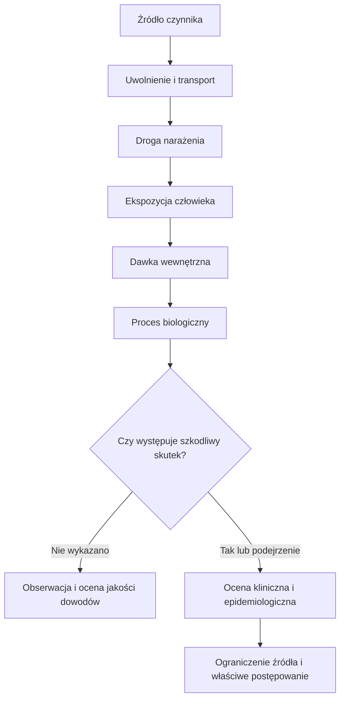
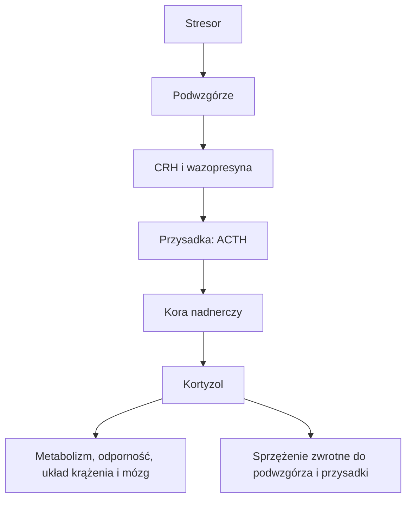
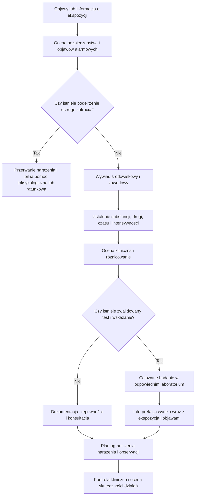

# 1.10. Wpływ środowiska na układ hormonalny

> **Cel rozdziału:** nauczenie uczestnika rozpoznawania, opisywania i bezpiecznej oceny czynników środowiskowych, które mogą wpływać na funkcjonowanie układu hormonalnego, z rozróżnieniem między udokumentowanym zagrożeniem, prawdopodobnym mechanizmem biologicznym, obserwowaną zależnością epidemiologiczną i hipotezą wymagającą dalszych badań.
>
> **Perspektywa kliniczna:** ekspozycja środowiskowa jest jednym z elementów wieloczynnikowego obrazu zdrowia. Nie należy przypisywać jej automatycznie przyczyny objawów ani rozpoznawać endokrynopatii wyłącznie na podstawie kontaktu z daną substancją.
>
> **Zastrzeżenie:** rozdział ma charakter dydaktyczny. Nie zastępuje oceny lekarskiej, konsultacji medycyny pracy lub toksykologii, aktualnych wytycznych, przepisów dotyczących bezpieczeństwa chemicznego ani lokalnych procedur. Nie ustanawia nowych uprawnień zawodowych i nie stanowi indywidualnego zalecenia dotyczącego odstawiania leków, suplementów lub zmiany pracy.

---

## 1. Miejsce rozdziału w kursie

Układ hormonalny pozostaje w stałej relacji z otoczeniem. Światło i ciemność synchronizują rytm dobowy, dostępność energii i składników odżywczych wpływa na metabolizm, a substancje chemiczne mogą oddziaływać na syntezę, transport, metabolizm lub działanie hormonów. Znaczenie mają również warunki pracy, jakość powietrza i wody, temperatura, stresory psychospołeczne, hałas, promieniowanie oraz ekspozycje występujące w okresie prenatalnym.

Nie oznacza to, że każda substancja chemiczna, każdy produkt z tworzywa sztucznego lub każde odstępstwo od idealnego rytmu dobowego powoduje chorobę hormonalną. Ocena musi uwzględniać rodzaj czynnika, drogę i wielkość ekspozycji, czas jej trwania, etap życia, współistniejące narażenia, podatność osobniczą oraz jakość dowodów naukowych.

### 1.1. Cele kształcenia

Po ukończeniu rozdziału uczestnik powinien:

1. wyjaśniać, w jaki sposób środowisko fizyczne, chemiczne, biologiczne i społeczne może modyfikować czynność układu hormonalnego;
2. definiować substancje zaburzające funkcjonowanie układu hormonalnego (EDC) i odróżniać aktywność endokrynną od potwierdzonego działania zaburzającego;
3. rozpoznawać główne grupy źródeł narażenia na pestycydy, rozpuszczalniki, związki przemysłowe, bisfenole, ftalany, PFAS, metale i zanieczyszczenia powietrza;
4. opisywać mechanizmy, przez które czynniki środowiskowe mogą wpływać na receptory hormonalne, steroidogenezę, transport hormonów, metabolizm i regulację osi podwzgórzowo-przysadkowych;
5. wyjaśniać znaczenie rytmu dobowego, snu, pracy zmianowej, stresu, żywienia i dostępności mikroskładników;
6. rozumieć szczególną wrażliwość okresu prenatalnego, niemowlęcego, dzieciństwa i dojrzewania;
7. przeprowadzać uporządkowany wywiad dotyczący ekspozycji środowiskowej i zawodowej;
8. odróżniać biomonitoring ekspozycji od badań potwierdzających uszkodzenie narządu lub chorobę;
9. wskazywać ograniczenia testów komercyjnych i unikać nieuzasadnionego zlecania szerokich paneli toksykologicznych;
10. proponować proporcjonalne, wykonalne sposoby ograniczania narażenia oraz rozpoznawać sytuacje wymagające pilnej konsultacji.

### 1.2. Oczekiwane efekty uczenia się

Uczestnik po zajęciach:

- rozróżnia zagrożenie, ekspozycję, dawkę wewnętrzną i ryzyko zdrowotne;
- wyjaśnia, dlaczego samo wykrycie substancji w próbce biologicznej nie dowodzi, że spowodowała ona objawy;
- wskazuje przykłady mechanizmów estrogenowych, androgenowych, tarczycowych, glikokortykosteroidowych i metabolicznych;
- rozumie rolę krytycznych okien rozwojowych i ograniczenia ekstrapolacji wyników badań na człowieka;
- opisuje możliwe drogi narażenia: pokarmową, wziewną, skórną i przezłożyskową;
- dokumentuje czas, miejsce, źródło, częstotliwość i charakter kontaktu z czynnikiem;
- dobiera dalsze postępowanie do prawdopodobieństwa ekspozycji, objawów i dostępnych metod potwierdzenia;
- komunikuje ryzyko bez wzbudzania nieuzasadnionego lęku;
- respektuje granice własnych kompetencji i kieruje pacjenta do właściwych specjalistów.

### 1.3. Zakres zawodowy

Umiejętność zebrania wywiadu, obserwacji, pomiaru parametrów i przekazania informacji nie jest równoznaczna z uprawnieniem do rozpoznawania zatrucia, interpretowania specjalistycznych badań toksykologicznych, prowadzenia leczenia chelatującego lub wydawania orzeczeń dotyczących zdolności do pracy. Czynności te wykonuje osoba uprawniona, zgodnie z przepisami, kwalifikacjami, zleceniami i procedurami.

---

## 2. Środowisko jako element regulacji hormonalnej

### 2.1. Co rozumiemy przez środowisko

W medycynie środowiskowej pojęcie środowiska obejmuje warunki, w których człowiek żyje, pracuje, uczy się, odpoczywa i rozwija. W kontekście endokrynologicznym warto uwzględnić co najmniej pięć grup czynników:

| Grupa | Przykłady | Możliwy obszar oddziaływania |
|---|---|---|
| Chemiczna | Pestycydy, bisfenole, ftalany, PFAS, metale, rozpuszczalniki | Receptory, steroidogeneza, transport i metabolizm hormonów |
| Fizyczna | Światło w nocy, promieniowanie jonizujące, temperatura, hałas | Rytm dobowy, stres fizjologiczny, uszkodzenia tkanek |
| Żywieniowa | Niedobór lub nadmiar jodu, niedożywienie, nadmierna podaż energii | Tarczyca, oś gonadalna, insulina, metabolizm |
| Biologiczna | Czynniki zakaźne, przewlekły stan zapalny, mikrobiota | Odpowiedź stresowa, odporność, metabolizm i sygnalizacja hormonalna |
| Psychospołeczna i organizacyjna | Przewlekły stres, brak snu, praca nocna, niestabilność warunków życia | Oś HPA, rytmy dobowe, apetyt, glikemia i zachowania zdrowotne |

Kategorie te mogą się nakładać. Przykładowo praca w rolnictwie może łączyć kontakt z pestycydami, wysoką temperaturą, promieniowaniem słonecznym, wysiłkiem, nieregularnym odżywianiem i zmianami godzin snu.

### 2.2. Od źródła do skutku

W ocenie środowiskowej należy odróżniać:

1. **Źródło** – miejsce lub produkt, z którego czynnik może się uwalniać.
2. **Droga uwalniania i przemieszczania** – np. migracja do żywności, parowanie, pylenie lub spływ do wody.
3. **Droga narażenia** – inhalacja, połknięcie, kontakt ze skórą lub przenikanie przez łożysko.
4. **Ekspozycję** – kontakt organizmu z czynnikiem w określonych warunkach.
5. **Dawkę zewnętrzną i wewnętrzną** – ilość przyjętą oraz ilość, która dotarła do organizmu lub określonego przedziału biologicznego.
6. **Wewnętrzny proces biologiczny** – metabolizm, wiązanie z receptorem, zmiana ekspresji genów lub inny mechanizm.
7. **Skutek zdrowotny** – odwracalną zmianę biologiczną, objaw, zaburzenie funkcji lub chorobę.

Nie każdy etap prowadzi do następnego. Obecność źródła nie dowodzi ekspozycji, ekspozycja nie musi prowadzić do dawki powodującej szkodę, a zmiana biomarkera nie jest automatycznie chorobą.

### 2.3. Model oceny narażenia

### 2.4. Zagrożenie a ryzyko

**Zagrożenie** opisuje zdolność czynnika do wywołania szkody w określonych warunkach. **Ryzyko** odnosi się do prawdopodobieństwa i ciężkości skutku przy rzeczywistej ekspozycji.

Substancja może wykazywać właściwości toksyczne w badaniach eksperymentalnych, ale ryzyko dla konkretnej osoby zależy m.in. od dawki, drogi kontaktu, czasu, biodostępności i podatności. Z drugiej strony mała dawka w okresie krytycznego rozwoju może mieć inne znaczenie niż taka sama dawka u osoby dorosłej.

W praktyce klinicznej nie należy ani bagatelizować narażenia, ani przedstawiać samej obecności substancji w otoczeniu jako dowodu choroby.

---

## 3. Substancje zaburzające funkcjonowanie układu hormonalnego (EDC)

### 3.1. Definicja

Substancja zaburzająca funkcjonowanie układu hormonalnego (ang. *endocrine-disrupting chemical*, EDC) to egzogenna substancja lub mieszanina, która zaburza funkcję albo funkcje układu hormonalnego i w konsekwencji powoduje niekorzystny skutek zdrowotny u nienaruszonego organizmu, jego potomstwa lub populacji.

W definicji istotne są trzy elementy:

- wykazany lub wiarygodnie udokumentowany niekorzystny skutek biologiczny;
- działanie na funkcję układu hormonalnego;
- wiarygodny związek przyczynowy między mechanizmem endokrynnym a skutkiem.

Samo wiązanie substancji z receptorem w teście laboratoryjnym oznacza aktywność biologiczną, ale nie zawsze wystarcza do uznania jej za EDC w rozumieniu kryteriów naukowych lub regulacyjnych.

### 3.2. Przykładowe mechanizmy działania

EDC mogą oddziaływać na wiele etapów sygnalizacji hormonalnej:

| Mechanizm | Możliwy skutek biologiczny | Przykładowy obszar badań |
|---|---|---|
| Naśladowanie hormonu | Aktywacja receptora mimo braku naturalnego ligandu | Receptory estrogenowe i androgenowe |
| Blokowanie receptora | Ograniczenie odpowiedzi na hormon endogenny | Receptory steroidowe |
| Zmiana syntezy hormonu | Zwiększenie lub zmniejszenie produkcji | Enzymy steroidogenezy, synteza hormonów tarczycy |
| Zmiana transportu | Modyfikacja wiązania z białkami transportowymi | Transport hormonów tarczycy i steroidów |
| Zmiana metabolizmu i eliminacji | Zmiana aktywności enzymów metabolizujących hormony | Deiodynazy, enzymy wątrobowe |
| Zmiana ekspresji receptorów | Zwiększenie lub zmniejszenie wrażliwości tkanek | Regulacja receptorów jądrowych i błonowych |
| Zmiana sygnalizacji wewnątrzkomórkowej | Modyfikacja odpowiedzi po związaniu ligandu | Szlaki kinaz i przekaźników wtórnych |
| Wpływ na oś neuroendokrynną | Zmiana regulacji wydzielania hormonów | Oś HPG, HPT lub HPA |
| Wpływ epigenetyczny | Zmiana regulacji ekspresji genów bez zmiany sekwencji DNA | Programowanie rozwoju i różnicowanie tkanek |

Nie wszystkie mechanizmy są jednakowo udokumentowane dla każdej substancji. Mechanizm wykazany w hodowli komórkowej nie przesądza o klinicznym znaczeniu ekspozycji u człowieka.

### 3.3. Układy szczególnie analizowane w badaniach EDC

1. **Układ rozrodczy:** steroidogeneza, dojrzewanie, płodność, rozwój gonad i funkcja jajników oraz jąder.
2. **Tarczyca:** synteza hormonów, transport, metabolizm i sygnalizacja receptorowa.
3. **Metabolizm:** regulacja adipogenezy, gospodarka glukozowa, insulinooporność i metabolizm lipidów.
4. **Neuroendokrynologia:** regulacja osi podwzgórzowych, zachowania związane z apetytem i rytmem dobowym.
5. **Kości:** mineralizacja, obrót kostny i sygnalizacja hormonalna tkanki kostnej.
6. **Układ odpornościowy:** interakcje między hormonami, zapaleniem i odpowiedzią immunologiczną.

### 3.4. Dawka, czas i odpowiedź

Klasyczna toksykologia często opisuje zależność dawka–odpowiedź jako wzrost skutku wraz ze wzrostem dawki. W badaniach nad hormonami i EDC analizuje się także zależności niemonotoniczne, w których kierunek lub wielkość odpowiedzi nie zmienia się liniowo wraz z dawką.

Należy zachować kilka rozróżnień:

- niemonotoniczna zależność dawka–odpowiedź jest możliwa dla niektórych mechanizmów, ale nie jest automatyczną właściwością każdej substancji;
- nie można wyprowadzać wniosku o szkodliwości dowolnie małej dawki bez oceny konkretnej substancji, skutku i jakości danych;
- brak wykrytego efektu w jednym badaniu nie dowodzi absolutnego bezpieczeństwa w każdych warunkach;
- wyniki eksperymentów na zwierzętach, komórkach i obserwacji epidemiologicznych wymagają integracji;
- nie należy przenosić pojedynczego wyniku eksperymentalnego bezpośrednio na diagnozę konkretnego pacjenta.

### 3.5. Krytyczne okna wrażliwości

Wrażliwość na czynniki środowiskowe może zależeć od etapu rozwoju. Szczególne znaczenie mają:

- gametogeneza i okres przedkoncepcyjny;
- embriogeneza i organogeneza;
- rozwój płodu;
- okres noworodkowy i niemowlęcy;
- dzieciństwo i dojrzewanie;
- ciąża i laktacja;
- okresy dużych zmian metabolicznych lub chorobowych.

W okresach intensywnego różnicowania tkanek niewielka zmiana sygnalizacji może mieć inne konsekwencje niż podobna zmiana w dojrzałym organizmie. Nie oznacza to, że każdy kontakt z substancją w ciąży powoduje uszkodzenie płodu. Znaczenie zależy od czynnika, dawki, czasu, drogi narażenia i dostępnych danych.

### 3.6. Mieszaniny i ekspozycja wieloczynnikowa

Człowiek zwykle nie jest narażony na jedną substancję. Występują mieszaniny chemiczne, a także jednoczesny wpływ czynników żywieniowych, fizycznych i psychospołecznych.

Możliwe interakcje obejmują:

- addytywność – łączny skutek zbliżony do sumy skutków poszczególnych czynników;
- synergizm – łączny skutek większy niż oczekiwany na podstawie prostego sumowania;
- antagonizm – jeden czynnik osłabia działanie drugiego;
- interakcje zależne od czasu, tkanki lub stanu fizjologicznego.

W praktyce klinicznej rzadko można wiarygodnie określić indywidualny udział każdej substancji w złożonej ekspozycji. Dlatego wywiad powinien opisywać całą sytuację, a nie koncentrować się na jednym modnym związku chemicznym.

---

## 4. Jak oceniać siłę dowodów naukowych

### 4.1. Rodzaje dowodów

| Rodzaj badania | Co może wykazać | Główne ograniczenie |
|---|---|---|
| Badanie in vitro | Mechanizm, aktywność receptora, wpływ na komórkę | Nie odtwarza całego organizmu, metabolizmu i rzeczywistej dawki |
| Badanie na zwierzętach | Skutek w organizmie i zależność czas–dawka | Różnice gatunkowe, dawki i warunki eksperymentalne |
| Badanie kohortowe | Związek ekspozycji z późniejszym skutkiem | Konfundowanie, błąd pomiaru ekspozycji, utrata uczestników |
| Badanie kliniczno-kontrolne | Związki z rzadkimi skutkami | Błąd pamięci i dobór grup |
| Badanie przekrojowe | Współwystępowanie ekspozycji i skutku | Trudność ustalenia kolejności czasowej |
| Biomonitoring populacyjny | Rozkład biomarkerów ekspozycji | Sam nie dowodzi skutku klinicznego |
| Przegląd systematyczny | Synteza wielu badań | Jakość wniosków zależy od jakości badań pierwotnych |
| Ocena regulacyjna | Integracja danych według określonych kryteriów | Wynik zależy od zakresu przepisów i przyjętej metodologii |

### 4.2. Najważniejsze źródła niepewności

- pomiar ekspozycji tylko raz, mimo że narażenie zmienia się w czasie;
- krótki okres półtrwania substancji lub jej metabolitu;
- błędne przypisanie źródła ekspozycji;
- współwystępowanie innych czynników ryzyka;
- zmienność genetyczna i metaboliczna;
- różnice w diecie, wieku, płci, stanie fizjologicznym i chorobach;
- mała liczebność grup;
- wielokrotne testowanie hipotez i selektywne raportowanie;
- różnice między modelami eksperymentalnymi a warunkami życia człowieka.

### 4.3. Zasada ostrożnego wnioskowania

W dokumentacji należy rozdzielać cztery poziomy wypowiedzi:

1. **Fakt potwierdzony:** np. określony metal został wykryty w próbce krwi metodą zwalidowaną.
2. **Interpretacja ekspozycji:** wynik jest zgodny z narażeniem w określonym przedziale czasu.
3. **Ocena kliniczna:** stwierdzone objawy lub zaburzenia wymagają określonej diagnostyki.
4. **Ocena przyczynowości:** czy ekspozycja spowodowała dany skutek – wymaga odrębnej, wieloczynnikowej analizy.

Nie należy zapisywać „choroba wywołana przez EDC” wyłącznie dlatego, że pacjent używał określonego produktu lub miał podwyższony biomarker bez właściwego kontekstu.

---

## 5. Pestycydy, rozpuszczalniki i związki przemysłowe

### 5.1. Pestycydy – podstawowe grupy

Pestycydy obejmują substancje stosowane do zwalczania organizmów uznanych za szkodliwe w rolnictwie, ogrodnictwie, leśnictwie, magazynowaniu i ochronie sanitarnej. Nie jest to jednolita grupa chemiczna ani toksykologiczna.

| Grupa lub przykład | Typowe zastosowanie | Uwagi dotyczące zdrowia i oceny |
|---|---|---|
| Insektycydy fosforoorganiczne | Zwalczanie owadów | Ostre zatrucia mogą hamować acetylocholinoesterazę; nie należy sprowadzać całej toksyczności do mechanizmu hormonalnego |
| Karbaminiany | Zwalczanie owadów i innych szkodników | Możliwy wpływ na układ cholinergiczny; ocena zależy od konkretnej substancji |
| Pyretroidy | Preparaty owadobójcze | Różne profile toksyczności; część badań analizuje możliwe efekty endokrynne |
| Herbicydy | Zwalczanie chwastów | Substancje różnią się mechanizmem i profilem ryzyka; nie wolno traktować wszystkich jako jednej klasy EDC |
| Fungicydy | Zwalczanie grzybów | Niektóre związki wpływają na szlaki steroidogenezy lub inne procesy biologiczne |
| Trwałe pestycydy chloroorganiczne | Historyczne i ograniczone zastosowania | Wybrane związki utrzymują się w środowisku i mogą kumulować w łańcuchu pokarmowym |

W wywiadzie istotne są nazwa handlowa i substancja czynna, numer rejestracyjny, karta charakterystyki, sposób przygotowania mieszaniny, czas pracy, używane środki ochrony, awarie, rozlania, praca w odzieży zanieczyszczonej preparatem i możliwość wtórnego przeniesienia substancji do domu.

**Ważne:** nie każdy pestycyd jest EDC, a nie każde zatrucie pestycydem jest zaburzeniem hormonalnym. Ostre objawy cholinergiczne, zaburzenia oddychania, drgawki, zaburzenia świadomości lub gwałtowne pogorszenie stanu wymagają postępowania ratunkowego i toksykologicznego.

### 5.2. Rozpuszczalniki organiczne

Rozpuszczalniki występują m.in. w farbach, lakierach, klejach, odtłuszczaczach, środkach czyszczących, procesach drukarskich i przemyśle chemicznym.

Przykładowe grupy:

- węglowodory aromatyczne, np. toluen i ksyleny;
- ketony, np. aceton;
- alkohole i glikole;
- etery glikolowe;
- chlorowane rozpuszczalniki;
- mieszaniny stosowane w lakiernictwie i obróbce powierzchni.

Możliwe skutki zdrowotne zależą od konkretnej substancji. Mogą obejmować działanie drażniące, neurotoksyczne, hepatotoksyczne, nefrotoksyczne, hematotoksyczne lub szkodliwe dla rozrodu. Nie wolno automatycznie przypisywać każdemu rozpuszczalnikowi działania endokrynnego.

W ocenie należy uwzględnić wentylację, temperaturę, otwarte pojemniki, rozpylanie, pracę w przestrzeniach zamkniętych, kontakt skórny i stosowanie właściwych rękawic oraz ochrony dróg oddechowych.

### 5.3. Związki przemysłowe i trwałe zanieczyszczenia organiczne

Do związków szczególnie istotnych w medycynie środowiskowej należą m.in.:

- polichlorowane bifenyle (PCB);
- dioksyny i furany;
- wybrane bromowane środki zmniejszające palność;
- niektóre związki per- i polifluoroalkilowe (PFAS);
- wybrane związki stosowane w produkcji tworzyw, powłok i materiałów technicznych.

Część związków jest trwała, może utrzymywać się w środowisku i przenikać do łańcucha pokarmowego. Dla niektórych opisano mechanizmy wpływu na receptory, transport hormonów, odporność lub metabolizm. Siła dowodów jest różna dla poszczególnych związków i skutków.

PFAS to duża i zróżnicowana grupa substancji, a nie pojedynczy związek. Właściwości farmakokinetyczne, okresy półtrwania i profile toksyczności poszczególnych PFAS mogą znacznie się różnić. Wynik oznaczenia jednego PFAS nie opisuje całkowitej ekspozycji na wszystkie związki z tej grupy.

### 5.4. Bezpieczeństwo pracy

W miejscu pracy należy preferować hierarchię kontroli ryzyka:

1. eliminację niebezpiecznego czynnika, jeżeli jest możliwa;
2. zastąpienie go mniej niebezpiecznym materiałem lub procesem;
3. rozwiązania techniczne, np. zamknięty proces i skuteczną wentylację miejscową;
4. środki organizacyjne, szkolenie, ograniczenie czasu i dostępu;
5. środki ochrony indywidualnej dobrane do konkretnego zagrożenia.

Rękawice, maska lub półmaska nie zastępują prawidłowej oceny ryzyka i wentylacji. Rodzaj ochrony powinien wynikać z karty charakterystyki, oceny zawodowej i właściwych norm.

---

## 6. Bisfenole, ftalany i substancje związane z tworzywami

### 6.1. Bisfenole

Bisfenole są wykorzystywane w produkcji niektórych tworzyw i żywic. Najbardziej znanym przykładem jest bisfenol A (BPA), a w produktach i procesach przemysłowych występują również inne związki o podobnej funkcji, np. BPS i BPF.

Potencjalne drogi kontaktu obejmują:

- żywność i napoje mające kontakt z materiałami zawierającymi bisfenole;
- powłoki wewnętrzne niektórych opakowań;
- pył i zanieczyszczenia środowiskowe;
- kontakt skórny w określonych warunkach zawodowych lub użytkowych.

Badania analizują m.in. wpływ bisfenoli na receptory estrogenowe, sygnalizację metaboliczną, odporność i rozwój. Nie należy jednak zakładać, że wszystkie bisfenole mają identyczne właściwości albo że zamiana BPA na dowolny „bisfenol alternatywny” gwarantuje brak ryzyka.

Europejski Urząd ds. Bezpieczeństwa Żywności (EFSA) w ponownej ocenie BPA z 2023 r. obniżył tolerowane dzienne pobranie do 0,2 ng/kg masy ciała na dobę, wskazując na obawy dotyczące zdrowia, przede wszystkim w kontekście układu odpornościowego. Jest to wartość wynikająca z oceny ryzyka dla populacji, a nie próg diagnostyczny ani wynik, który można bezpośrednio porównać z pojedynczym oznaczeniem BPA w moczu.

### 6.2. Ftalany

Ftalany są stosowane jako plastyfikatory i w niektórych innych zastosowaniach przemysłowych. Różne ftalany mają odmienne właściwości, zastosowania i profile toksykologiczne.

Możliwe źródła kontaktu obejmują:

- niektóre materiały z tworzyw sztucznych;
- wybrane materiały medyczne i przemysłowe;
- pył wewnątrz pomieszczeń;
- niektóre produkty kosmetyczne i zapachowe;
- żywność, zależnie od materiałów kontaktujących się z produktem i procesów produkcji.

Niektóre ftalany i ich metabolity są badane pod kątem wpływu na steroidogenezę, rozwój układu rozrodczego i metabolizm. Należy odróżniać dane dla konkretnego ftalanu od ogólnej nazwy grupy.

### 6.3. Inne związki związane z produktami konsumenckimi

W badaniach nad potencjalnym zaburzaniem gospodarki hormonalnej analizuje się także:

- wybrane parabeny;
- niektóre środki przeciwdrobnoustrojowe;
- związki per- i polifluoroalkilowe (PFAS);
- niektóre środki zmniejszające palność;
- perchlorany;
- wybrane składniki kosmetyków, detergentów i środków czystości.

Nie należy zakładać, że każdy produkt kosmetyczny, detergent lub materiał opakowaniowy zawiera EDC. Ocenia się konkretną substancję, stężenie, drogę kontaktu i wiarygodność danych.

### 6.4. Racjonalne ograniczanie kontaktu

Praktyczne działania o niskim koszcie i niewielkim ryzyku obejmują:

- stosowanie opakowań zgodnie z przeznaczeniem i instrukcją producenta;
- niepodgrzewanie żywności w opakowaniu, które nie jest przeznaczone do ogrzewania;
- ograniczenie kontaktu gorącej i tłustej żywności z materiałami nieprzeznaczonymi do takiego użycia;
- unikanie używania uszkodzonych opakowań wielokrotnego użytku;
- mycie rąk przed jedzeniem i po pracy z pyłem lub materiałami technicznymi;
- ograniczanie gromadzenia kurzu przez regularne sprzątanie metodą na mokro;
- wybieranie produktów dopuszczonych do kontaktu z żywnością;
- nieprzechowywanie żywności w pojemnikach po chemikaliach.

Nie ma podstaw, aby zalecać pacjentom masowe wyrzucanie wszystkich przedmiotów z tworzyw sztucznych, kosztowne „detoksy”, restrykcyjne diety lub niezweryfikowane preparaty oczyszczające.

---

## 7. Metale ciężkie i inne pierwiastki o znaczeniu toksykologicznym

### 7.1. Odrębność poszczególnych pierwiastków

Termin „metale ciężkie” jest używany potocznie i nie tworzy jednej spójnej grupy toksykologicznej. W praktyce należy wskazywać konkretny pierwiastek, jego postać chemiczną, drogę narażenia i biomarker.

| Czynnik | Typowe źródła | Najważniejsze uwagi kliniczne |
|---|---|---|
| Ołów | Stare farby, pył, woda z instalacji, hutnictwo, recykling akumulatorów | Neurotoksyczność, hematotoksyczność, nefrotoksyczność i szkodliwy wpływ na rozród; szczególna wrażliwość dzieci i płodu |
| Rtęć | Niektóre ryby i owoce morza, procesy przemysłowe, rozbite urządzenia zawierające rtęć | Toksyczność zależy od postaci chemicznej; metylortęć jest szczególnie istotna dla rozwijającego się układu nerwowego |
| Kadm | Dym tytoniowy, przemysł, niektóre źródła żywności i pyłu | Długotrwałe narażenie może uszkadzać nerki i kości; wymaga oceny konkretnego źródła |
| Arsen | Woda podziemna, niektóre procesy przemysłowe, żywność z obszarów skażonych | Arsen nieorganiczny jest silnie toksyczny i rakotwórczy; badania opisują także związki z zaburzeniami metabolicznymi |
| Chrom | Przemysł metalurgiczny, galwanizacja, pigmenty | Toksyczność zależy od stopnia utlenienia i drogi ekspozycji |
| Nikiel | Obróbka metali, stopy, pyły, niektóre przedmioty codziennego użytku | Istotne są alergia kontaktowa i narażenie zawodowe; nie należy automatycznie przypisywać objawów endokrynnych |

### 7.2. Ołów

Ołów nie ma znanej fizjologicznej funkcji w organizmie. Może wpływać na wiele układów, a szczególnie niebezpieczny jest dla rozwijającego się układu nerwowego. Może również oddziaływać na układ krwiotwórczy, nerki, układ sercowo-naczyniowy i funkcje rozrodcze.

Ołów może być magazynowany w kościach i uwalniany do krążenia, m.in. w okresie ciąży. W ocenie ekspozycji zwykle wykorzystuje się oznaczenie ołowiu we krwi, ale wynik należy interpretować zgodnie z aktualnymi zaleceniami i kontekstem. Nie należy traktować pojedynczej wartości jako pełnego opisu całkowitego obciążenia organizmu.

### 7.3. Arsen

Ważne jest rozróżnienie arsenu nieorganicznego i organicznych form występujących m.in. w żywności pochodzenia morskiego. Oznaczenie całkowitego arsenu w moczu bez specjacji może być trudne do interpretacji, zwłaszcza po spożyciu owoców morza.

Przewlekła ekspozycja na arsen nieorganiczny może wynikać z zanieczyszczonej wody lub żywności. Wymaga oceny źródła i odpowiedniego postępowania toksykologicznego lub środowiskowego.

### 7.4. Znaczenie dla endokrynologii

Niektóre pierwiastki mogą wpływać na syntezę, transport lub działanie hormonów, stres oksydacyjny, funkcje komórek beta trzustki, metabolizm glukozy i rozwój układu rozrodczego. Dla wielu zależności dowody są jednak niejednorodne.

W praktyce:

- nie należy zlecać „panelu metali ciężkich” bez określonego podejrzenia;
- dobór próbki (krew, mocz, włosy lub inny materiał) zależy od pierwiastka, postaci chemicznej i czasu od ekspozycji;
- analiza włosów nie jest uniwersalnym testem na „toksyczność organizmu”;
- wynik wymaga interpretacji przez osobę z kompetencjami toksykologicznymi lub medycyny środowiskowej;
- nie należy rozpoczynać chelatacji bez potwierdzonego wskazania i nadzoru specjalisty.

---

## 8. Zanieczyszczenia powietrza i jakość środowiska wewnętrznego

### 8.1. Główne rodzaje zanieczyszczeń

W środowisku zewnętrznym i wewnętrznym mogą występować:

- pył zawieszony PM2,5 i PM10;
- tlenki azotu i siarki;
- ozon przyziemny;
- tlenek węgla;
- wielopierścieniowe węglowodory aromatyczne;
- lotne związki organiczne;
- aldehydy, w tym formaldehyd;
- dym tytoniowy i produkty spalania;
- radon;
- pyły i aerozole zawodowe.

Nie wszystkie zanieczyszczenia powietrza są EDC. Część może oddziaływać na układ hormonalny pośrednio przez stres oksydacyjny, stan zapalny, zaburzenia funkcji łożyska lub metabolizm, lecz siła i swoistość dowodów różnią się między substancjami i punktami końcowymi.

### 8.2. Źródła domowe i zawodowe

W pomieszczeniach istotne mogą być:

- palenie tytoniu i bierna ekspozycja na dym;
- nieprawidłowo działające urządzenia spalające paliwa;
- gotowanie bez odpowiedniej wentylacji;
- spalanie odpadów;
- środki czyszczące i rozpuszczalniki;
- remonty, kleje, farby i nowe materiały budowlane;
- pył z zakładów przemysłowych lub dróg;
- pleśń i wilgoć, które są ważne dla zdrowia, choć nie stanowią typowych EDC.

### 8.3. Znaczenie kliniczne

Zanieczyszczenia powietrza mają dobrze udokumentowane skutki oddechowe i sercowo-naczyniowe. Badania obserwacyjne i mechanistyczne analizują także związki z zaburzeniami metabolicznymi, rozrodem i funkcją hormonalną. Nie należy jednak utożsamiać wykazanej szkodliwości pyłu zawieszonego dla układu oddechowego z dowodem, że u konkretnej osoby spowodował on zaburzenie tarczycy lub cukrzycę.

### 8.4. Działania ograniczające ekspozycję

- niepalenie w domu i samochodzie;
- sprawna wentylacja i konserwacja urządzeń spalających paliwa;
- używanie okapu odprowadzającego powietrze na zewnątrz, jeżeli jest prawidłowo zainstalowany;
- niewypalanie odpadów;
- ograniczanie pylenia podczas remontu i stosowanie odpowiedniej ochrony;
- monitorowanie lokalnych komunikatów o jakości powietrza;
- ograniczanie intensywnego wysiłku na zewnątrz w okresach wysokiego stężenia zanieczyszczeń, szczególnie u osób wrażliwych;
- przestrzeganie zaleceń służb sanitarnych i ochrony środowiska.

---

## 9. Promieniowanie i czynniki fizyczne

### 9.1. Promieniowanie jonizujące

Promieniowanie jonizujące może uszkadzać DNA i tkanki. Tarczyca jest narządem szczególnie istotnym w kontekście ekspozycji na radioaktywny jod, ponieważ wychwytuje jod do syntezy hormonów.

Znaczenie kliniczne zależy od:

- rodzaju promieniowania;
- dawki i mocy dawki;
- czasu i drogi narażenia;
- wieku w chwili ekspozycji;
- tego, czy doszło do napromienienia zewnętrznego, czy wchłonięcia radionuklidu;
- rodzaju i zakresu wcześniejszego leczenia, np. radioterapii.

Dzieci są bardziej wrażliwe na część skutków promieniowania z uwagi na rozwój tkanek i dłuższy przewidywany czas życia. U osób, które otrzymały radioterapię obejmującą szyję lub tarczycę, plan kontroli powinien wynikać z dokumentacji leczenia i zaleceń odpowiedniego specjalisty.

### 9.2. Badania obrazowe a bezpieczeństwo

Nie należy zniechęcać pacjenta do wskazanego badania obrazowego z powodu ogólnego lęku przed promieniowaniem. Decyzja powinna uwzględniać korzyść diagnostyczną, alternatywy, dawkę i zasady optymalizacji ochrony radiologicznej.

W przypadku narażenia na radioaktywny jod podczas zdarzenia radiacyjnego tabletki stabilnego jodu stosuje się wyłącznie zgodnie z komunikatami właściwych służb i zaleceniami medycznymi. Samodzielne przyjmowanie dużych dawek jodu nie jest bezpieczną metodą profilaktyki.

### 9.3. Promieniowanie niejonizujące

Pojęcie to obejmuje m.in. pola elektromagnetyczne o częstotliwościach radiowych, światło widzialne, podczerwień i ultrafiolet. Różne zakresy mają odmienne właściwości biologiczne.

Nie należy twierdzić, że typowa ekspozycja na urządzenia elektroniczne powoduje rozpoznaną endokrynopatię. W ocenie klinicznej trzeba odróżniać ustalone skutki danego zakresu promieniowania od hipotez, które nie zostały potwierdzone w badaniach o odpowiedniej jakości.

### 9.4. Światło, temperatura i hałas

Światło jest istotnym sygnałem synchronizującym rytm dobowy. Ekspozycja na intensywne światło w porze nocnej może przesuwać fazę rytmu melatoniny i snu. Temperatura i hałas mogą wpływać na stres fizjologiczny, sen i zachowania zdrowotne.

Nie należy jednak rozpoznawać zaburzenia hormonalnego wyłącznie na podstawie korzystania z ekranu wieczorem lub mieszkania w hałaśliwej okolicy. Są to czynniki kontekstowe, które mogą wymagać oceny, jeśli współistnieją z objawami i zaburzeniami funkcjonowania.

---

## 10. Stres, deprywacja snu i praca zmianowa

### 10.1. Oś podwzgórze–przysadka–nadnercza

Stresory fizyczne i psychospołeczne mogą aktywować oś HPA:

Odpowiedź stresowa jest fizjologicznym mechanizmem adaptacyjnym. Problem może pojawiać się przy długotrwałym obciążeniu, braku regeneracji, współistniejących chorobach i zaburzeniach snu.

Nie istnieje jeden laboratoryjny wynik kortyzolu, który samodzielnie mierzy „poziom stresu psychicznego” lub rozpoznaje przeciążenie życiowe. Kortyzol zależy od pory dnia, rytmu dobowego, choroby ostrej, leków, pobrania i metody oznaczenia.

### 10.2. Sen i rytm dobowy

Rytmy dobowe koordynują m.in.:

- wydzielanie melatoniny;
- rytm kortyzolu;
- temperaturę ciała;
- apetyt i sytość;
- tolerancję glukozy;
- wrażliwość na insulinę;
- wydzielanie hormonu wzrostu;
- ciśnienie tętnicze i aktywność autonomiczną.

Przewlekłe skracanie snu, nieregularne godziny zasypiania, częste zmiany pór pracy i ekspozycja na światło nocą mogą zaburzać synchronizację rytmów biologicznych. Badania obserwacyjne wykazują związki zaburzeń snu z otyłością, cukrzycą typu 2 i chorobami sercowo-naczyniowymi, ale nie pozwalają przypisać każdej choroby jednemu czynnikowi.

### 10.3. Praca zmianowa i nocna

Praca nocna może prowadzić do rozbieżności między zegarem biologicznym a wymaganiami społecznymi. IARC sklasyfikowała pracę nocną jako prawdopodobnie rakotwórczą dla człowieka (grupa 2A), co jest klasyfikacją zagrożenia rakotwórczego, a nie indywidualną prognozą zachorowania ani dowodem, że każda praca zmianowa powoduje określoną chorobę hormonalną.

W wywiadzie warto uwzględnić:

- liczbę nocy pracy w miesiącu;
- długość i regularność zmian;
- liczbę kolejnych nocy;
- możliwość regeneracji po zmianie;
- sen w dni pracy i dni wolne;
- ekspozycję na światło;
- posiłki w porze nocnej;
- stosowanie kofeiny i leków nasennych;
- objawy zaburzeń snu i zmęczenia.

### 10.4. Ocena i zalecenia ogólne

Wspieranie regularności snu, ograniczanie światła w porze nocnej, odpowiednia ekspozycja na światło dzienne, planowanie posiłków i aktywności fizycznej mogą poprawiać higienę rytmu dobowego. U pracowników zmianowych należy szukać rozwiązań realnych dla ich organizacji pracy, a nie formułować zaleceń niemożliwych do wykonania.

Przewlekłe zmęczenie, zaburzenia miesiączkowania, zmiana masy ciała lub wahania glikemii wymagają diagnostyki różnicowej. Nie wolno przypisywać ich automatycznie „wysokiemu kortyzolowi”.

---

## 11. Czynniki żywieniowe i mikroskładniki

### 11.1. Energia i dostępność substratów

Układ hormonalny reaguje na dostępność energii. Długotrwały deficyt energetyczny, niedożywienie, zaburzenia odżywiania i nadmierna podaż energii mogą wpływać na:

- leptynę i sygnały głodu;
- insulinę i glukagon;
- hormony tarczycy;
- oś podwzgórze–przysadka–gonady;
- hormony wzrostu i IGF-1;
- metabolizm kostny;
- płodność i dojrzewanie.

Zaburzenia miesiączkowania u osoby intensywnie trenującej i niedożywionej mogą mieć związek z niską dostępnością energii, ale wymagają wykluczenia ciąży, chorób tarczycy, hiperprolaktynemii, PCOS i innych przyczyn.

### 11.2. Jod

Jod jest niezbędnym składnikiem hormonów tarczycy. Zarówno niedobór, jak i nadmierna podaż mogą zaburzać czynność tarczycy.

- Niedobór może prowadzić do wola i niedostatecznej syntezy hormonów tarczycy.
- W okresie ciąży i wczesnego rozwoju płodu odpowiednia podaż jodu ma znaczenie dla rozwoju układu nerwowego.
- Nadmiar jodu może u osób podatnych wywołać niedoczynność, nadczynność lub zapalenie tarczycy.
- Preparaty z alg morskich mogą zawierać bardzo zmienne, czasem wysokie ilości jodu.

Stężenie jodu w pojedynczej próbce moczu jest przede wszystkim narzędziem oceny populacyjnej i nie powinno być rutynowo używane jako samodzielny test diagnostyczny indywidualnego pacjenta. Suplementację należy oceniać w odniesieniu do diety, ciąży, chorób tarczycy, leków i zaleceń krajowych.

### 11.3. Selen, żelazo, cynk i inne składniki

Selen uczestniczy w działaniu selenoprotein, w tym enzymów związanych z metabolizmem hormonów tarczycy. Żelazo jest potrzebne m.in. do prawidłowej aktywności peroksydazy tarczycowej, a cynk bierze udział w licznych procesach enzymatycznych i regulacji genów.

Nie oznacza to, że każda osoba z chorobą tarczycy powinna przyjmować suplementy tych składników. Niedobór należy oceniać w kontekście diety, objawów, czynników ryzyka i właściwych badań. Nadmierna suplementacja selenu, jodu, żelaza lub cynku może szkodzić.

### 11.4. Witamina D, wapń i metabolizm kostny

Witamina D i wapń są istotne dla homeostazy mineralnej, ale nie należy przypisywać im uniwersalnego działania „regulującego hormony”. Niedobór witaminy D może zaburzać mineralizację kości i gospodarkę wapniowo-fosforanową. Stosowanie suplementów powinno wynikać z aktualnych zaleceń, stanu klinicznego i ryzyka niedoboru.

### 11.5. Alkohol, kofeina i inne substancje

Alkohol może wpływać na metabolizm wątrobowy, sen, glikemię, funkcje gonad i gospodarkę energetyczną. Kofeina może wpływać na sen, pobudzenie i odczuwanie objawów autonomicznych. Nikotyna i dym tytoniowy mają wielonarządowe skutki, w tym wpływ na układ sercowo-naczyniowy i reprodukcyjny.

W wywiadzie należy pytać o dawkę, częstotliwość, porę używania, łączenie substancji i możliwe objawy odstawienia. Nie należy interpretować każdego kołatania serca jako choroby hormonalnej ani każdej zmiany TSH jako skutku diety.

---

## 12. Ekspozycja prenatalna i okresy szczególnej wrażliwości rozwojowej

### 12.1. Rozwój płodowy jako okres programowania biologicznego

W okresie prenatalnym hormony uczestniczą w różnicowaniu narządów, rozwoju mózgu, gonad, tarczycy, nadnerczy, trzustki i układu kostnego. Czynniki środowiskowe mogą wpływać na rozwój przez mechanizmy bezpośrednie i pośrednie, np. przez stan odżywienia matki, funkcję łożyska, zapalenie, stres oksydacyjny lub zaburzenia gospodarki hormonalnej.

Koncepcja rozwojowego programowania zdrowia i choroby (DOHaD) opisuje, że warunki w okresie płodowym i wczesnym dzieciństwie mogą modyfikować późniejszą podatność na choroby. Nie jest to jednak prosty model deterministyczny: ekspozycja nie przesądza o przyszłej chorobie, a wpływ środowiska może być modyfikowany przez geny, późniejszy styl życia i warunki społeczne.

### 12.2. Czynniki wymagające uwagi

- niedobór lub nadmiar jodu;
- niedożywienie i niedostateczna podaż energii;
- cukrzyca przedciążowa i hiperglikemia w ciąży;
- zaburzenia czynności tarczycy u matki;
- palenie tytoniu i ekspozycja na dym;
- alkohol i substancje psychoaktywne;
- wybrane leki, w tym glikokortykosteroidy i leki wpływające na tarczycę;
- ekspozycja zawodowa na rozpuszczalniki, pestycydy i metale;
- zanieczyszczenia powietrza i wody;
- niektóre EDC;
- przewlekły stres i zaburzenia snu.

Nie wolno samodzielnie odstawiać leków w ciąży z obawy przed działaniem hormonalnym. Ryzyko nieleczonej choroby matki może być większe niż ryzyko właściwie dobranej farmakoterapii. Każda zmiana wymaga konsultacji z lekarzem prowadzącym ciążę i odpowiednim specjalistą.

### 12.3. Okresy szczególnej wrażliwości

| Okres | Procesy rozwojowe | Znaczenie kliniczne |
|---|---|---|
| Przedkoncepcyjny | Dojrzewanie gamet, stan metaboliczny rodziców | Ocena chorób przewlekłych, leków, żywienia i ekspozycji zawodowej |
| Wczesna ciąża | Implantacja, organogeneza, rozwój łożyska | Szczególna ostrożność wobec teratogenów i nieuzasadnionych ekspozycji |
| Późniejsza ciąża | Wzrost płodu, dojrzewanie narządów i osi hormonalnych | Znaczenie glikemii, tarczycy, odżywienia i funkcji łożyska |
| Okres noworodkowy | Adaptacja metaboliczna i hormonalna | Przesiew i szybka weryfikacja nieprawidłowych wyników |
| Niemowlęctwo i dzieciństwo | Rozwój mózgu, kości, wzrastanie | Ochrona przed neurotoksycznymi i innymi szkodliwymi ekspozycjami |
| Dojrzewanie | Aktywacja osi HPG, wzrost i dojrzewanie kości | Znaczenie żywienia, snu, masy ciała i czynników rozwojowych |

### 12.4. Komunikacja z kobietą w ciąży i rodziną

Komunikat powinien być spokojny, konkretny i proporcjonalny. Należy ustalić rzeczywisty produkt lub czynnik, czas kontaktu, drogę ekspozycji, dawkę, objawy i możliwość powtórnego narażenia. W razie istotnego podejrzenia należy skorzystać z konsultacji toksykologicznej, medycyny pracy, położniczej lub środowiskowej.

Nie należy wywoływać poczucia winy u rodziców. Informacja o możliwej ekspozycji nie jest dowodem uszkodzenia płodu ani podstawą do samodzielnego podejmowania decyzji o ciąży.

---

## 13. Ocena ekspozycji środowiskowej w wywiadzie

### 13.1. Zasada: od pytania ogólnego do ekspozycji konkretnej

Pytanie „czy miał Pan/Pani kontakt z toksynami?” jest mało użyteczne. Pacjent może nie znać nazw chemikaliów i nie rozpoznawać, że określone czynności wiążą się z narażeniem.

Lepsze są pytania o konkretne miejsca, zadania i sytuacje:

- Gdzie pacjent pracuje i jakie czynności wykonuje?
- Czy miesza, rozpyla, podgrzewa, czyści lub usuwa substancje chemiczne?
- Czy pracuje z farbami, lakierami, klejami, pestycydami lub metalami?
- Czy używa wentylacji i środków ochrony?
- Czy przenosi odzież roboczą do domu?
- Czy mieszka w budynku remontowanym, z zawilgoceniem lub starą instalacją?
- Skąd pochodzi woda pitna?
- Czy w pobliżu znajduje się zakład przemysłowy, kopalnia, składowisko lub ruchliwa droga?
- Czy pacjent używa suplementów, preparatów ziołowych, kosmetyków i środków do pielęgnacji?
- Czy w przeszłości miał kontakt z promieniowaniem lub radioterapią?

### 13.2. Model 5W + H

| Element | Pytanie | Co należy zapisać |
|---|---|---|
| What – co? | Jaki czynnik lub produkt? | Nazwa, skład, etykieta, substancja czynna |
| Where – gdzie? | W jakim miejscu? | Praca, dom, szkoła, ogród, hobby |
| When – kiedy? | Od kiedy i kiedy ostatnio? | Daty, pora, okres rozwojowy |
| How often – jak często? | Jak regularny był kontakt? | Codziennie, sezonowo, incydentalnie |
| How – w jaki sposób? | Jaką drogą i przy jakiej czynności? | Wdychanie, skóra, połknięcie, pył |
| How much – ile? | Jaka ilość i intensywność? | Czas, stężenie, ilość, warunki pracy, wentylacja |

### 13.3. Chronologia ekspozycji

Należy zestawić w jednej osi czasu:

1. początek kontaktu z czynnikiem;
2. okresy zwiększonego narażenia;
3. początek objawów;
4. zmiany w pracy lub miejscu zamieszkania;
5. okresy bez ekspozycji;
6. poprawę lub pogorszenie objawów;
7. wyniki badań i leczenie.

Związek czasowy może wzmacniać podejrzenie, ale nie dowodzi przyczynowości. Poprawa po urlopie lub zmianie miejsca pracy może być ważną wskazówką, lecz nadal wymaga oceny alternatywnych wyjaśnień.

### 13.4. Grupy szczególnego zainteresowania

- kobiety w ciąży i planujące ciążę;
- niemowlęta i małe dzieci;
- osoby pracujące z pestycydami, rozpuszczalnikami i metalami;
- pracownicy przemysłu chemicznego, metalurgicznego, recyklingu i budownictwa;
- osoby mieszkające w pobliżu źródeł zanieczyszczeń;
- osoby po radioterapii obejmującej przysadkę, tarczycę lub gonady;
- osoby z pica, szczególnie dzieci narażone na połknięcie pyłu lub farby;
- osoby z przewlekłą chorobą nerek lub wątroby, u których metabolizm i eliminacja substancji mogą być zmienione.

### 13.5. Formularz wywiadu środowiskowego

**A. Dom i otoczenie**
- Rodzaj budynku i rok budowy (jeśli znany).
- Ostatnie remonty, malowanie, usuwanie farb i wymiana instalacji.
- Źródło wody pitnej i sposób jej uzdatniania.
- Ogrzewanie, gotowanie, wentylacja i dym tytoniowy.
- Zawilgocenie, pleśń, pył, sąsiedztwo zakładów przemysłowych i dróg.

**B. Praca**
- Nazwa stanowiska i rzeczywiste zadania.
- Substancje i produkty używane w pracy.
- Czas, częstotliwość i droga kontaktu.
- Wentylacja, zamknięte procesy i środki ochrony.
- Awarie, rozlania i epizody ostrego narażenia.
- Odzież i obuwie robocze, pranie oraz możliwość przenoszenia pyłu do domu.
- Dokumentacja oceny ryzyka i karty charakterystyki.

**C. Żywienie i produkty**
- Suplementy, preparaty ziołowe, algi i produkty o wysokiej zawartości jodu.
- Spożycie ryb i owoców morza.
- Żywność przechowywana i podgrzewana w opakowaniach.
- Kosmetyki, środki czyszczące i produkty zapachowe.
- Woda i żywność z własnego gospodarstwa lub niezweryfikowanych źródeł.

**D. Czas i objawy**
- Początek ekspozycji i objawów.
- Zmiany w rytmie snu i pracy.
- Objawy u współpracowników lub domowników.
- Poprawa po oddaleniu od źródła.
- Wcześniejsze badania i dokumentacja.

### 13.6. Współwystępowanie podobnych objawów u kilku osób

Jeżeli podobne objawy pojawiają się u wielu osób z jednego gospodarstwa domowego, zakładu pracy, szkoły lub miejscowości, należy rozważyć wspólne źródło ekspozycji. Może to dotyczyć tlenku węgla, rozpuszczalników, pestycydów, zanieczyszczonej wody lub innych czynników.

W razie podejrzenia ostrego zagrożenia należy przede wszystkim zapewnić bezpieczeństwo, przerwać narażenie, nie wchodzić do potencjalnie niebezpiecznej przestrzeni bez odpowiedniego zabezpieczenia i uruchomić właściwe służby ratunkowe. Diagnostyka endokrynologiczna nie może opóźniać działań ratujących życie.

---

## 14. Badania i biomonitoring ekspozycji

### 14.1. Biomonitoring – co mierzy

Biomonitoring człowieka polega na oznaczaniu substancji lub jej metabolitów w materiale biologicznym, np. krwi, moczu, surowicy, włosach lub innych próbkach.

Może dostarczyć informacji o:

- obecności substancji lub metabolitu;
- niedawnej albo długotrwałej ekspozycji, zależnie od kinetyki;
- różnicach między populacjami;
- trendach narażenia;
- skuteczności działań ograniczających ekspozycję.

Biomonitoring nie zawsze wskazuje źródło, drogę, czas ani kliniczne następstwa kontaktu.

### 14.2. Ograniczenia biomonitoringu

- krótki okres półtrwania może sprawić, że badanie nie wykryje wcześniejszej ekspozycji;
- próbka może odzwierciedlać niedawny posiłek lub kontakt;
- wynik może być zależny od rozcieńczenia moczu, pory pobrania i funkcji nerek;
- wykrycie substancji nie dowodzi, że spowodowała chorobę;
- brak wykrycia nie wyklucza ekspozycji w przeszłości;
- dla wielu związków nie ma zwalidowanego indywidualnego progu diagnostycznego;
- wynik populacyjny nie musi być właściwym zakresem decyzyjnym dla pojedynczej osoby.

### 14.3. Dobór materiału

| Materiał | Potencjalna przydatność | Ograniczenia |
|---|---|---|
| Krew pełna | Ołów, niektóre metale i inne oznaczenia zależne od substancji | Okno czasowe zależne od kinetyki; ryzyko zanieczyszczenia próbki |
| Mocz | Metabolity wielu substancji, niektóre metale | Zależność od rozcieńczenia i czasu pobrania |
| Surowica/osocze | Wybrane trwałe związki i biomarkery | Nie każdy związek dobrze koreluje z dawką docelową |
| Włosy | Wybrane ekspozycje, np. metylortęć w określonych kontekstach | Zanieczyszczenie zewnętrzne, kosmetyki, brak uniwersalnych zakresów |
| Mleko matki | Badania populacyjne i specjalistyczne w wybranych sytuacjach | Nie jest rutynowym testem diagnostycznym ekspozycji każdej matki |
| Tkanki | Badania specjalistyczne lub naukowe | Zwykle nie są materiałem do rutynowej diagnostyki |

### 14.4. Badania hormonalne a podejrzenie ekspozycji

Nie istnieje uniwersalny „panel hormonalny na EDC”. Zakres badań należy dobierać do objawów, podejrzenia konkretnego mechanizmu i standardów diagnostycznych.

Przykładowo:

- zaburzenia miesiączkowania wymagają standardowej diagnostyki ginekologiczno-endokrynologicznej, a nie automatycznego oznaczania dziesiątek substancji;
- nieprawidłowe TSH wymaga interpretacji z FT4 i kontekstem klinicznym, a nie domyślnego przypisania do zanieczyszczeń;
- podejrzenie ekspozycji na ołów wymaga właściwego oznaczenia ołowiu i oceny źródła;
- podejrzenie zatrucia arsenem wymaga odpowiedniego doboru materiału i – w razie potrzeby – specjacji;
- podejrzenie ostrego zatrucia pestycydem wymaga postępowania toksykologicznego, a nie opóźniania działań przez szeroki panel hormonalny.

### 14.5. Testy komercyjne i „detoksy”

Należy zachować szczególną ostrożność wobec ofert:

- szerokich paneli „obciążenia toksynami” bez określonego wskazania;
- badań włosów przedstawianych jako uniwersalny pomiar wszystkich metali;
- testów moczu po podaniu środka prowokującego wydalanie metali;
- badań o nieznanej walidacji analitycznej;
- interpretacji wyniku bez zakresów referencyjnych i danych o metodzie;
- terapii chelatujących proponowanych na podstawie niezwalidowanych testów;
- preparatów „oczyszczających”, które obiecują usunięcie EDC z organizmu.

Wynik badania powinien pochodzić z laboratorium o odpowiedniej jakości, być oznaczony metodą właściwą dla substancji i interpretowany w kontekście klinicznym. Chelatacja może powodować poważne działania niepożądane, w tym zaburzenia elektrolitowe, uszkodzenie nerek i utratę niezbędnych pierwiastków. Nie jest metodą ogólnej profilaktyki.

---

## 15. Ocena kliniczna pacjenta z podejrzeniem ekspozycji środowiskowej

### 15.1. Algorytm postępowania

### 15.2. Diagnostyka różnicowa

Objawy przypisywane środowisku mogą mieć wiele innych przyczyn. Przykładowo:

| Objaw | Możliwe przyczyny endokrynne | Inne ważne przyczyny |
|---|---|---|
| Zmiana masy ciała | Niedoczynność lub nadczynność tarczycy, hiperkortyzolizm, zaburzenia gonadalne | Leki, dieta, depresja, choroby przewlekłe, zaburzenia snu |
| Zmęczenie | Niedoczynność tarczycy, niewydolność nadnerczy, cukrzyca | Niedokrwistość, infekcja, zaburzenia snu, choroby serca i nerek |
| Zaburzenia miesiączkowania | PCOS, hiperprolaktynemia, niewydolność jajników, zaburzenia osi HPG | Ciąża, stres, deficyt energii, leki, choroby ginekologiczne |
| Niepłodność | Zaburzenia owulacji, hipogonadyzm, zaburzenia tarczycy | Czynniki anatomiczne, genetyczne, infekcyjne i partnerskie |
| Drżenie i potliwość | Tyreotoksykoza, hipoglikemia, nadmiar katecholamin | Leki, kofeina, lęk, choroby neurologiczne |
| Zaburzenia glikemii | Cukrzyca, choroby trzustki, zaburzenia hormonalne | Leki, infekcja, stres metaboliczny, błędy pomiaru |
| Zaburzenia rozwoju dziecka | Choroby tarczycy, niedobór GH, zaburzenia osi HPG | Choroby przewlekłe, niedożywienie, czynniki genetyczne |

### 15.3. Objawy alarmowe

Pilnej oceny wymagają m.in.:

- duszność, sinica, drgawki lub zaburzenia świadomości po możliwym narażeniu chemicznym;
- gwałtowne osłabienie, wymioty, zaburzenia rytmu serca lub hipotensja po ekspozycji;
- podejrzenie zatrucia tlenkiem węgla;
- objawy ostrego zespołu cholinergicznego po pestycydach;
- ciężkie odwodnienie, zaburzenia elektrolitowe lub zaburzenia glikemii;
- ekspozycja dziecka na ołów, pestycyd lub nieznaną substancję, zwłaszcza po połknięciu;
- istotna ekspozycja kobiety w ciąży na substancję o znanej toksyczności rozwojowej;
- rozległe oparzenia chemiczne lub skażenie skóry i oczu;
- jednoczesne występowanie objawów u kilku osób w tym samym budynku.

W sytuacji zagrożenia życia należy wezwać pomoc ratunkową. Nie wolno opóźniać interwencji w celu wykonania badań endokrynologicznych.

---

## 16. Prewencja i ograniczanie ekspozycji

### 16.1. Zasada proporcjonalności

Celem prewencji jest ograniczenie rzeczywistego i możliwego do uniknięcia narażenia, a nie osiągnięcie nierealistycznego „życia bez chemii”. Woda, powietrze, żywność i materiały codziennego użytku zawsze zawierają związki chemiczne; znaczenie zdrowotne zależy od ich właściwości i ekspozycji.

### 16.2. Działania na poziomie indywidualnym

- przestrzeganie instrukcji stosowania produktów chemicznych;
- niewykorzystywanie opakowań po chemikaliach do przechowywania żywności;
- mycie rąk po pracy z pyłem, ziemią i środkami chemicznymi;
- ograniczanie pyłu w domu metodą na mokro;
- prawidłowa wentylacja pomieszczeń;
- niepalenie tytoniu w domu i samochodzie;
- używanie środków ochrony zgodnie z oceną ryzyka;
- unikanie nieuzasadnionych suplementów i preparatów o nieznanym składzie;
- stosowanie zróżnicowanej diety, z uwzględnieniem zaleceń dotyczących ryb i źródeł jodu;
- przestrzeganie zaleceń dotyczących ochrony radiologicznej;
- utrzymywanie możliwie regularnego rytmu snu i aktywności.

### 16.3. Działania na poziomie rodziny i społeczności

- bezpieczne przechowywanie pestycydów i środków czystości poza zasięgiem dzieci;
- niewykonywanie remontów z pyleniem bez zabezpieczenia pomieszczeń;
- kontrola jakości wody z prywatnych ujęć, gdy istnieją lokalne przesłanki;
- usuwanie źródeł ołowiu przez uprawnione podmioty;
- zgłaszanie podejrzenia skażenia do właściwych służb;
- wspieranie bezpiecznych warunków pracy i profilaktyki zawodowej;
- edukacja bez stygmatyzowania osób narażonych zawodowo lub mieszkających na obszarach zanieczyszczonych.

### 16.4. Działania na poziomie systemowym

Ochrona zdrowia wymaga współpracy medycyny, toksykologii, higieny pracy, zdrowia publicznego, laboratoriów, inspekcji sanitarnej, organów ochrony środowiska i regulatorów. Lekarz może rozpoznać podejrzenie ekspozycji i udokumentować objawy, ale usunięcie źródła skażenia często wymaga interwencji poza gabinetem.

---

## 17. Komunikacja ryzyka z pacjentem

### 17.1. Zasady rozmowy

1. Ustal, czego pacjent się obawia i jakie informacje już posiada.
2. Oddziel potwierdzone fakty od hipotez.
3. Wyjaśnij różnicę między wykryciem substancji a wykazaniem szkody.
4. Określ, czy istnieje wiarygodna droga i czas ekspozycji.
5. Przedstaw możliwe działania ograniczające kontakt.
6. Wyjaśnij, jakie badania są zasadne i czego nie mogą rozstrzygnąć.
7. Ustal plan dalszej oceny i termin ponownego kontaktu.
8. Nie obiecuj całkowitego usunięcia substancji z organizmu.

### 17.2. Przykładowy komunikat

„Zebrane informacje wskazują, że mógł występować kontakt z określonym czynnikiem. Sam kontakt nie przesądza o uszkodzeniu układu hormonalnego. Sprawdzimy, jak długo trwało narażenie, jaką drogą mogło dochodzić do kontaktu i czy istnieją objawy lub wyniki badań uzasadniające dalszą diagnostykę. W pierwszej kolejności ograniczymy możliwe źródło kontaktu i dobierzemy badania, które mają potwierdzoną przydatność w tej sytuacji.”

### 17.3. Czego unikać

- straszenia nieodwracalnym uszkodzeniem bez dowodów;
- przypisywania wszystkich objawów jednej substancji;
- obwiniania pacjenta za ekspozycję;
- promowania kosztownych testów bez walidacji;
- zalecania chelatacji, „detoksu” lub głodówek bez wskazań;
- obiecywania, że określony produkt jest całkowicie wolny od ryzyka;
- sugerowania odstawienia leków przewlekłych bez konsultacji.

---

## 18. Granice kompetencji i bezpieczeństwo pacjenta

### 18.1. Co może obejmować rola osoby zbierającej wywiad lub prowadzącej edukację

W granicach kwalifikacji i uprawnień można:

- zebrać uporządkowany wywiad o środowisku i pracy;
- odnotować nazwy produktów i substancji podane przez pacjenta;
- udokumentować czas, miejsce, drogę i okoliczności kontaktu;
- rozpoznać objawy alarmowe i przekazać pacjenta do pilnej oceny;
- edukować o ogólnych zasadach ograniczania ekspozycji;
- wspierać przestrzeganie zaleceń specjalisty;
- koordynować przekazanie dokumentacji.

### 18.2. Czego nie należy robić bez odpowiednich uprawnień

- rozpoznawać zatrucia na podstawie samego wywiadu;
- interpretować specjalistycznych biomarkerów w oderwaniu od metody i toksykokinetyki;
- zlecać lub wykonywać procedur poza zakresem kompetencji;
- zalecać odstawiania leków hormonalnych, przeciwpadaczkowych, przeciwcukrzycowych lub innych leków przewlekłych;
- prowadzić chelatacji lub terapii „detoksykacyjnej”;
- orzekać o związku przyczynowym między ekspozycją zawodową a chorobą bez właściwej oceny;
- zastępować konsultacji toksykologicznej lub medycyny pracy.

### 18.3. Zasady bezpieczeństwa

- przy ostrym narażeniu priorytetem jest bezpieczeństwo i pomoc ratunkowa;
- nie należy narażać personelu na wtórne skażenie;
- nie wolno samodzielnie wchodzić do skażonej przestrzeni;
- próbki biologiczne i materiały zanieczyszczone należy zabezpieczać zgodnie z procedurą;
- przy ekspozycji dziecka lub kobiety w ciąży próg do konsultacji powinien być odpowiednio niski;
- wszystkie istotne informacje o ekspozycji i decyzjach należy dokumentować;
- dane o miejscu pracy, stanie zdrowia i sytuacji rodzinnej podlegają ochronie.

---

## 19. Przypadki kliniczno-dydaktyczne

Poniższe przypadki są fikcyjne i służą ćwiczeniu rozumowania. Nie są algorytmami leczenia ani podstawą do samodzielnego rozpoznawania chorób.

### Przypadek 1. Pracownik gospodarstwa rolnego

Mężczyzna w wieku 42 lat zgłasza zmęczenie, bóle głowy i okresowe zawroty głowy. W sezonie oprysków przygotowuje mieszaniny środków ochrony roślin, czasem pracuje w wysokiej temperaturze. Nie pamięta nazw preparatów. Zdarzało mu się naprawiać opryskiwacz bez rękawic.

**Zadania:**
1. Jakie informacje należy zebrać przed rozważaniem zaburzeń hormonalnych?
2. Jak odróżnić możliwe ostre zatrucie od przewlekłych nieswoistych objawów?
3. Jakie dokumenty mogą pomóc ustalić substancję czynną?
4. Kiedy należy skierować pacjenta do pilnej oceny toksykologicznej lub medycyny pracy?

**Omówienie:** należy ustalić czas ostatniego oprysku, objawy bezpośrednio po kontakcie, drogę narażenia, wentylację, środki ochrony, etykiety i karty charakterystyki. Bóle głowy i zmęczenie są nieswoiste. Jeśli występują ślinotok, zwężenie źrenic, nasilona potliwość, biegunka, skurcz oskrzeli, osłabienie mięśni lub zaburzenia świadomości po kontakcie z określonym pestycydem, wymagana jest pilna ocena pod kątem ostrego zatrucia. Nie należy z góry przypisywać objawów EDC.

### Przypadek 2. Dziecko w starszym budynku

Dziecko w wieku 3 lat ma wybiórczy apetyt i opóźnienie rozwoju mowy. Rodzice informują, że w mieszkaniu od kilku miesięcy usuwano starą farbę ze ścian i stolarki. Dziecko często bawi się na podłodze i wkłada przedmioty do ust.

**Zadania:**
1. Jakie źródło narażenia należy rozważyć?
2. Dlaczego samo badanie TSH nie odpowie na pytanie o ekspozycję?
3. Jakie postępowanie powinno być priorytetowe?
4. Jak ograniczyć dalszy kontakt dziecka z pyłem?

**Omówienie:** należy rozważyć ekspozycję na ołów, ale nie wolno rozpoznawać zatrucia na podstawie samej historii remontu. Konieczna jest ocena lekarska i dobór właściwego oznaczenia ołowiu we krwi zgodnie z aktualnymi zaleceniami. Należy przerwać kontakt z pyłem, zabezpieczyć dziecko przed dostępem do miejsca remontu i zlecić bezpieczne usunięcie źródła przez odpowiednie podmioty. Rozwój dziecka wymaga niezależnej, pełnej oceny.

### Przypadek 3. Kobieta w ciąży i suplementy z alg

Kobieta w 10. tygodniu ciąży przyjmuje kilka preparatów „na tarczycę”, w tym suplement z alg morskich. W badaniach uzyskano nieprawidłowy wynik TSH. Pacjentka obawia się, że suplement uszkodził płód.

**Zadania:**
1. Jakie informacje o preparacie należy uzyskać?
2. Dlaczego należy uwzględnić zarówno niedobór, jak i nadmiar jodu?
3. Jakie znaczenie ma fizjologia tarczycy w ciąży?
4. Jak przekazać pacjentce informację bez wywoływania poczucia winy?

**Omówienie:** należy sprawdzić skład, dawkę, częstotliwość i czas stosowania, uwzględnić inne źródła jodu i leki. Wynik TSH należy interpretować w kontekście ciąży, FT4, metody i zakresów właściwych dla danego trymestru lub laboratorium. Nie należy samodzielnie odstawiać leków ani rozpoczynać kolejnych suplementów. Właściwa jest konsultacja z lekarzem prowadzącym ciążę i – jeśli wskazane – endokrynologiem.

### Przypadek 4. Praca nocna i zaburzenia metaboliczne

Kobieta w wieku 36 lat pracuje w systemie zmianowym. W ostatnim roku przybrała na wadze, śpi nieregularnie i zgłasza nieregularne miesiączki. W internecie przeczytała, że „nocny kortyzol” jest przyczyną wszystkich jej objawów.

**Zadania:**
1. Jak ocenić rytm pracy i snu?
2. Jakie rozpoznania różnicowe należy uwzględnić?
3. Dlaczego pojedynczy pomiar kortyzolu nie rozpoznaje przewlekłego stresu?
4. Jakie działania można zaplanować bez przypisywania winy pacjentce?

**Omówienie:** należy zebrać dane o grafiku, śnie, diecie, aktywności, lekach i stresie. Nieregularne miesiączki wymagają standardowej diagnostyki, w tym wykluczenia ciąży i innych przyczyn hormonalnych oraz ginekologicznych. Zmiana masy ciała może mieć wiele przyczyn. Można wspólnie zaplanować wykonalne działania dotyczące snu, żywienia i aktywności, ale nie wolno zastępować diagnostyki hasłem „wysoki kortyzol”.

### Przypadek 5. Pracownik zakładu obróbki metali

Mężczyzna w wieku 51 lat zgłasza drętwienie kończyn, osłabienie i wzrost ciśnienia tętniczego. Pracuje przy szlifowaniu i spawaniu. Nie wie, czy w miejscu pracy występują metale ciężkie.

**Zadania:**
1. Jakie dane zawodowe należy pozyskać?
2. Dlaczego nie należy zlecać przypadkowego panelu metali?
3. Jakie znaczenie mają karta charakterystyki i ocena ryzyka zawodowego?
4. Kiedy wskazana jest konsultacja medycyny pracy lub toksykologii?

**Omówienie:** należy ustalić materiały obrabiane, skład stopów, pyły i dymy, wentylację, ochronę dróg oddechowych, staż pracy, epizody awaryjne i wyniki badań profilaktycznych. Drętwienie i nadciśnienie wymagają szerokiej diagnostyki. Oznaczenie pierwiastka powinno wynikać z określonego podejrzenia i być wykonane w odpowiednim materiale.

### Przypadek 6. Obawa przed EDC z opakowań żywności

Pacjentka w wieku 29 lat zgłasza niepłodność i uważa, że jej przyczyną jest wyłącznie używanie plastikowych pojemników. Chce kupić kosztowny panel kilkudziesięciu substancji i rozpocząć „detoks”.

**Zadania:**
1. Jakie elementy diagnostyki niepłodności należy uwzględnić?
2. Jak wyjaśnić ograniczenia biomonitoringu?
3. Jakie działania profilaktyczne są racjonalne?
4. Dlaczego chelatacja i „detoks” nie są właściwym rozwiązaniem?

**Omówienie:** niepłodność wymaga oceny obojga partnerów i standardowej diagnostyki. Kontakt z materiałami opakowaniowymi może być jednym z wielu elementów ekspozycji, ale nie dowodzi przyczyny niepłodności. Należy unikać kosztownych, niezwalidowanych testów i terapii bez wskazań. Można omówić bezpieczne użytkowanie opakowań, dietę, używki i warunki pracy, jednocześnie prowadząc diagnostykę zgodną z wytycznymi.

---

## 20. Ćwiczenia praktyczne

### Ćwiczenie 1. Mapa ekspozycji

Wybierz fikcyjnego pacjenta i sporządź mapę potencjalnych ekspozycji w domu, pracy, transporcie, żywieniu i czasie wolnym. Dla każdej wpisz źródło, drogę kontaktu, częstotliwość, czas i możliwe środki ograniczające.

**Kryterium zaliczenia:** odróżnienie potwierdzonego kontaktu od przypuszczenia.

### Ćwiczenie 2. Ocena wiarygodności informacji internetowej

Otrzymujesz materiał reklamowy twierdzący, że „każdy plastik zaburza hormony i powoduje niepłodność”. Oceń:
- czy podano konkretną substancję;
- czy opisano dawkę i drogę ekspozycji;
- czy przedstawiono badania na ludziach;
- czy rozróżniono korelację i przyczynowość;
- czy autor oferuje produkt lub test, który ma sprzedać.

**Kryterium zaliczenia:** wskazanie co najmniej pięciu braków metodologicznych.

### Ćwiczenie 3. Wywiad z pracownikiem

Przeprowadź symulowany wywiad z osobą pracującą przy lakierowaniu lub opryskach. Nie używaj ogólnego pytania „czy kontaktuje się Pan z toksynami?”. Zastosuj model 5W + H.

**Kryterium zaliczenia:** uzyskanie danych o zadaniach, produkcie, czasie, drodze kontaktu, wentylacji i środkach ochrony.

### Ćwiczenie 4. Interpretacja biomonitoringu

Otrzymujesz wynik wykrycia metabolitu substancji w moczu. Przygotuj listę informacji niezbędnych do interpretacji: metoda, materiał, czas pobrania, rozcieńczenie, okres półtrwania, zakres referencyjny, źródła i objawy.

**Kryterium zaliczenia:** wyjaśnienie, dlaczego sam wynik nie rozstrzyga o chorobie.

### Ćwiczenie 5. Komunikacja z pacjentem

Przygotuj krótką rozmowę z kobietą w ciąży, która obawia się kontaktu z tworzywami sztucznymi. Przedstaw:
- co jest wiadome;
- czego nie można ustalić na podstawie samej historii;
- jakie działania są proporcjonalne;
- kiedy potrzebna jest konsultacja.

**Kryterium zaliczenia:** komunikat bez straszenia, obwiniania i nieuzasadnionych obietnic.

### Ćwiczenie 6. Plan ograniczenia narażenia

Dla wybranego przypadku opracuj hierarchię działań: eliminacja źródła, rozwiązanie techniczne, organizacja pracy, środki ochrony indywidualnej i kontrola efektu.

**Kryterium zaliczenia:** wskazanie działań możliwych do wdrożenia i osoby lub instytucji odpowiedzialnej za ich realizację.

---

## 21. Lista kontrolna wywiadu środowiskowego

Przed zakończeniem wywiadu sprawdź:

- [ ] Czy ustalono główny powód podejrzenia ekspozycji?
- [ ] Czy zidentyfikowano konkretne źródło lub produkt?
- [ ] Czy rozróżniono potwierdzone dane od przypuszczeń?
- [ ] Czy ustalono drogę narażenia?
- [ ] Czy określono czas rozpoczęcia, częstotliwość i długość kontaktu?
- [ ] Czy uwzględniono pracę, dom, szkołę, hobby i żywienie?
- [ ] Czy oceniono możliwość narażenia prenatalnego lub w dzieciństwie?
- [ ] Czy zapytano o współpracowników i domowników z podobnymi objawami?
- [ ] Czy uwzględniono leki, suplementy i preparaty ziołowe?
- [ ] Czy oceniono objawy alarmowe i potrzebę pilnej pomocy?
- [ ] Czy dobrano badania tylko wtedy, gdy istnieje uzasadnienie?
- [ ] Czy wyjaśniono ograniczenia biomonitoringu?
- [ ] Czy określono, kto odpowiada za dalszą ocenę i ograniczenie źródła?
- [ ] Czy pacjent otrzymał zrozumiałe i proporcjonalne informacje?

---

## 22. Pytania kontrolne

1. Jakie trzy elementy składają się na definicję EDC?
2. Czym różni się aktywność endokrynna od działania zaburzającego funkcjonowanie układu hormonalnego?
3. Jakie są podstawowe drogi narażenia na substancje chemiczne?
4. Dlaczego zagrożenie nie jest tym samym co ryzyko?
5. Co oznacza krytyczne okno rozwojowe?
6. Jak EDC mogą wpływać na receptory hormonalne?
7. Dlaczego nie każdy pestycyd należy określać jako EDC?
8. Jakie informacje należy zebrać o narażeniu zawodowym?
9. Dlaczego biomonitoring nie zawsze identyfikuje źródło ekspozycji?
10. Jakie ograniczenia ma pojedynczy pomiar metabolitu w moczu?
11. Dlaczego wynik wykrycia bisfenolu nie jest samodzielnym rozpoznaniem choroby?
12. Jak odróżnić ołów od arsenu w kontekście doboru materiału i interpretacji?
13. Jakie znaczenie ma praca nocna dla rytmów dobowych?
14. Dlaczego pojedyncze oznaczenie kortyzolu nie mierzy przewlekłego stresu?
15. Jak niedobór i nadmiar jodu mogą wpływać na tarczycę?
16. Dlaczego w ciąży należy szczególnie ostrożnie oceniać ekspozycje i suplementy?
17. Jakie są ograniczenia badań włosów w ocenie metali?
18. Dlaczego nie należy zalecać chelatacji jako ogólnej metody „detoksykacji”?
19. Jakie objawy po ekspozycji chemicznej wymagają pilnej pomocy?
20. Jak należy komunikować pacjentowi niepewność naukową?

---

## 23. Test sprawdzający

**Instrukcja:** wybierz jedną najlepszą odpowiedź. Test ma charakter dydaktyczny i nie zastępuje oceny kompetencji praktycznych.

### Pytanie 1
Który zestaw elementów najlepiej odpowiada definicji EDC?

A. Dowolna substancja wykryta w moczu.  
B. Substancja, która zmienia kolor próbki laboratoryjnej.  
C. Egzogenna substancja lub mieszanina zaburzająca funkcję układu hormonalnego i powodująca niekorzystny skutek zdrowotny.  
D. Każdy lek hormonalny.

**Prawidłowa odpowiedź: C.** Sama obecność substancji lub aktywność w teście laboratoryjnym nie wystarcza do rozpoznania EDC.

### Pytanie 2
Co najlepiej opisuje różnicę między zagrożeniem a ryzykiem?

A. Pojęcia są identyczne.  
B. Zagrożenie opisuje zdolność do wyrządzenia szkody, a ryzyko uwzględnia prawdopodobieństwo i warunki ekspozycji.  
C. Ryzyko zależy wyłącznie od nazwy handlowej produktu.  
D. Zagrożenie dotyczy wyłącznie dzieci.

**Prawidłowa odpowiedź: B.** Ryzyko zależy m.in. od dawki, drogi, czasu i podatności.

### Pytanie 3
Która informacja jest najważniejsza przy ocenie narażenia zawodowego?

A. Wyłącznie nazwa stanowiska.  
B. Wyłącznie wiek pracownika.  
C. Rzeczywiste zadania, substancja, droga kontaktu, czas, wentylacja i środki ochrony.  
D. Wyłącznie wynik TSH.

**Prawidłowa odpowiedź: C.** Nazwa stanowiska nie zawsze opisuje rzeczywiste narażenie.

### Pytanie 4
Wykrycie metabolitu substancji w moczu oznacza, że:

A. substancja na pewno spowodowała chorobę;  
B. pacjent wymaga chelatacji;  
C. wykazano obecność biomarkera, którego znaczenie zależy od czasu, metody i kontekstu;  
D. należy odstawić wszystkie suplementy.

**Prawidłowa odpowiedź: C.** Biomarker ekspozycji nie jest automatycznie biomarkerem szkody.

### Pytanie 5
Które stwierdzenie o pestycydach jest prawidłowe?

A. Wszystkie pestycydy są EDC.  
B. Każdy pestycyd działa przez receptor estrogenowy.  
C. Pestycydy są zróżnicowaną grupą, a ich toksyczność i mechanizmy zależą od substancji.  
D. Nie mogą powodować ostrych zatruć.

**Prawidłowa odpowiedź: C.** Należy oceniać konkretną substancję i możliwy mechanizm.

### Pytanie 6
Który czynnik może szczególnie wpływać na interpretację stężenia jodu w moczu?

A. Fakt, że pojedynczy pomiar odzwierciedla przede wszystkim niedawną podaż i ma ograniczoną przydatność do indywidualnego rozpoznania.  
B. Kolor włosów.  
C. Grupa krwi.  
D. Wzrost pacjenta bez innych danych.

**Prawidłowa odpowiedź: A.** Stężenie jodu w moczu jest przede wszystkim wskaźnikiem populacyjnym i zależy od podaży oraz czasu pobrania.

### Pytanie 7
Które stwierdzenie o bisfenolu A jest zgodne z oceną EFSA z 2023 r.?

A. EFSA uznała, że BPA nie ma żadnego wpływu biologicznego.  
B. EFSA obniżyła tolerowane dzienne pobranie i wskazała obawy dotyczące zdrowia, szczególnie układu odpornościowego.  
C. Każdy pacjent powinien mieć oznaczany BPA co miesiąc.  
D. Wynik BPA w moczu rozpoznaje niepłodność.

**Prawidłowa odpowiedź: B.** Wartość TDI nie jest indywidualnym testem diagnostycznym.

### Pytanie 8
Dlaczego praca nocna może mieć znaczenie dla regulacji hormonalnej?

A. Ponieważ całkowicie wyłącza przysadkę.  
B. Ponieważ może zaburzać synchronizację rytmów dobowych, snu, apetytu i metabolizmu.  
C. Ponieważ zawsze powoduje zespół Cushinga.  
D. Ponieważ uniemożliwia wydzielanie melatoniny przez całe życie.

**Prawidłowa odpowiedź: B.** Skutki są zróżnicowane i nie uzasadniają automatycznego rozpoznania endokrynopatii.

### Pytanie 9
Które stwierdzenie dotyczące kortyzolu jest prawidłowe?

A. Pojedynczy losowy wynik mierzy przewlekły stres psychiczny.  
B. Kortyzol nie ma rytmu dobowego.  
C. Wynik zależy od pory pobrania, stresu, choroby, leków i metody.  
D. Każdy wynik powyżej średniej oznacza zespół Cushinga.

**Prawidłowa odpowiedź: C.** Diagnostyka zaburzeń osi HPA wymaga właściwie dobranych testów.

### Pytanie 10
Które stwierdzenie o ołowiu jest prawidłowe?

A. Jest niezbędnym składnikiem hormonów tarczycy.  
B. Może być magazynowany w kościach i uwalniany m.in. w okresie ciąży.  
C. Nie wpływa na dzieci.  
D. Oznacza się go wyłącznie we włosach.

**Prawidłowa odpowiedź: B.** Ołów jest szczególnie szkodliwy dla rozwijającego się układu nerwowego.

### Pytanie 11
Co jest najwłaściwszym postępowaniem przy podejrzeniu ostrego zatrucia pestycydem z zaburzeniami świadomości i oddychania?

A. Zaplanowanie rutynowej kontroli TSH za miesiąc.  
B. Zalecenie suplementu selenu.  
C. Pilna pomoc ratunkowa i toksykologiczna, z zapewnieniem bezpieczeństwa personelu.  
D. Wykonanie komercyjnego panelu EDC.

**Prawidłowa odpowiedź: C.** Ostre zatrucie jest stanem pilnym i nie może czekać na diagnostykę endokrynologiczną.

### Pytanie 12
Które zdanie najlepiej opisuje wpływ okresu prenatalnego?

A. Każda ekspozycja w ciąży powoduje wadę rozwojową.  
B. Okres prenatalny jest jednym z krytycznych okien rozwoju, ale skutek zależy od czynnika, dawki, czasu i innych uwarunkowań.  
C. Ekspozycja prenatalna nie ma znaczenia dla późniejszego zdrowia.  
D. Nie ma potrzeby zbierania wywiadu o lekach matki.

**Prawidłowa odpowiedź: B.** Ocena musi być indywidualna i nie może prowadzić do automatycznego wnioskowania o szkodzie.

### Pytanie 13
Która metoda jest właściwa do oceny podejrzenia ekspozycji na ołów u dziecka?

A. Dowolny panel włosów.  
B. Oznaczenie ołowiu we krwi zgodnie z aktualnymi zaleceniami i oceną kliniczną.  
C. Pomiar kortyzolu w ślinie.  
D. Test prowokacyjny po podaniu chelatora.

**Prawidłowa odpowiedź: B.** Dobór materiału i dalszego postępowania zależy od konkretnego pierwiastka i sytuacji.

### Pytanie 14
Które działanie jest najbardziej racjonalne w ograniczaniu narażenia zawodowego?

A. Zastąpienie wszystkich procedur maską bez oceny ryzyka.  
B. Eliminacja lub zastąpienie czynnika, rozwiązania techniczne, organizacja pracy i właściwe środki ochrony.  
C. Przyjmowanie preparatów „oczyszczających”.  
D. Samodzielne odstawienie leków.

**Prawidłowa odpowiedź: B.** Jest to hierarchia kontroli ryzyka.

### Pytanie 15
Które zdanie najlepiej oddaje prawidłową komunikację ryzyka?

A. „Na pewno ma Pan chorobę od plastiku”.  
B. „Każda wykryta substancja oznacza zatrucie”.  
C. „Kontakt może być istotny, ale ocenimy jego źródło, czas, drogę i dostępne dowody, a następnie dobierzemy proporcjonalne działania”.  
D. „Należy natychmiast wykonać wszystkie możliwe testy”.

**Prawidłowa odpowiedź: C.** Komunikacja powinna być rzeczowa, proporcjonalna i oparta na dowodach.

### Klucz zbiorczy

| Pytanie | 1 | 2 | 3 | 4 | 5 | 6 | 7 | 8 | 9 | 10 | 11 | 12 | 13 | 14 | 15 |
|---|---|---|---|---|---|---|---|---|---|---|---|---|---|---|---|
| Odpowiedź | C | B | C | C | C | A | B | B | C | B | C | B | B | B | C |

**Proponowana interpretacja wyniku dydaktycznego:**
- 13–15 poprawnych: bardzo dobre opanowanie zagadnień;
- 10–12 poprawnych: wiedza zasadniczo prawidłowa, wskazane powtórzenie wybranych części;
- 7–9 poprawnych: potrzebne uzupełnienie wiedzy i ponowne wykonanie ćwiczeń;
- 0–6 poprawnych: zalecane ponowne przejście rozdziału z omówieniem odpowiedzi.

Progi mają charakter edukacyjny i nie stanowią formalnego standardu certyfikacji.

---

## 24. Słownik terminologiczny

| Termin | Definicja |
|---|---|
| EDC | Egzogenna substancja lub mieszanina zaburzająca funkcje układu hormonalnego i powodująca niekorzystny skutek zdrowotny |
| Aktywność endokrynna | Zdolność substancji do oddziaływania na układ hormonalny; sama nie przesądza o szkodliwym skutku |
| Ekspozycja | Kontakt człowieka z czynnikiem środowiskowym |
| Dawka zewnętrzna | Ilość substancji, z którą organizm miał kontakt lub którą przyjął |
| Dawka wewnętrzna | Ilość substancji lub metabolitu obecna w organizmie albo określonym przedziale biologicznym |
| Biomonitoring | Oznaczanie substancji lub jej metabolitów w materiale biologicznym |
| Biomarker ekspozycji | Wskaźnik kontaktu z czynnikiem |
| Biomarker skutku | Wskaźnik biologicznej odpowiedzi lub uszkodzenia |
| Biomarker podatności | Wskaźnik cechy osobniczej wpływającej na odpowiedź na ekspozycję |
| Krytyczne okno rozwojowe | Okres, w którym określony proces rozwoju jest szczególnie wrażliwy na czynniki zewnętrzne |
| DOHaD | Koncepcja rozwojowych uwarunkowań zdrowia i choroby |
| Steroidogeneza | Proces syntezy hormonów steroidowych |
| Receptor hormonalny | Białko rozpoznające hormon lub inny ligand i inicjujące odpowiedź komórkową |
| Niemonotoniczna zależność dawka–odpowiedź | Zależność, w której kierunek lub wielkość odpowiedzi nie zmienia się liniowo wraz z dawką |
| PFAS | Duża grupa związków per- i polifluoroalkilowych |
| Bisfenole | Grupa związków wykorzystywanych m.in. w produkcji tworzyw i żywic |
| Ftalany | Grupa związków stosowanych m.in. jako plastyfikatory |
| PCB | Polichlorowane bifenyle – trwałe związki przemysłowe |
| PBT | Substancja trwała, wykazująca zdolność do bioakumulacji i toksyczna |
| vPvB | Substancja bardzo trwała i bardzo bioakumulująca |
| Toksykokinetyka | Opis wchłaniania, dystrybucji, metabolizmu i eliminacji substancji |
| Specjacja | Rozróżnienie form chemicznych danego pierwiastka |
| Konfundowanie | Zniekształcenie obserwowanego związku przez trzeci czynnik |
| Hierarchia kontroli ryzyka | Kolejność działań od eliminacji zagrożenia po środki ochrony indywidualnej |
| Medycyna środowiskowa | Dziedzina oceniająca wpływ czynników środowiskowych na zdrowie |
| Medycyna pracy | Dziedzina zajmująca się zdrowiem w związku z warunkami i narażeniem zawodowym |

---

## 25. Najważniejsze wnioski do zapamiętania

1. Środowisko może wpływać na układ hormonalny bezpośrednio i pośrednio.
2. EDC to nie każda substancja chemiczna ani każdy związek wykryty w próbce biologicznej.
3. Aktywność endokrynna, ekspozycja, skutek biologiczny i choroba są odrębnymi pojęciami.
4. Znaczenie ekspozycji zależy od substancji, dawki, drogi, czasu i etapu życia.
5. W okresie prenatalnym, niemowlęcym i dojrzewania niektóre procesy rozwojowe są szczególnie wrażliwe.
6. Pestycydy, rozpuszczalniki, metale i zanieczyszczenia powietrza mają zróżnicowane profile toksykologiczne.
7. Niedobór i nadmiar jodu mogą zaburzać czynność tarczycy.
8. Praca nocna i deprywacja snu mogą zaburzać rytmy dobowe, lecz nie stanowią samodzielnego rozpoznania endokrynopatii.
9. Biomonitoring wymaga właściwego doboru materiału, metody i czasu pobrania.
10. Nie istnieje uniwersalny panel badań hormonalnych ani toksykologicznych służący do rozpoznawania wszystkich skutków EDC.
11. Nie należy stosować chelatacji ani „detoksu” bez potwierdzonego wskazania.
12. Najważniejszą strategią profilaktyki jest ograniczanie rzeczywistego źródła narażenia i ochrona osób szczególnie wrażliwych.

---

## 26. Źródła i bibliografia

Poniższe pozycje stanowią podstawę do dalszej nauki. Dokumenty regulacyjne należy czytać w aktualnym brzmieniu, a wytyczne kliniczne sprawdzać przed zastosowaniem w praktyce.

1. United Nations Environment Programme, World Health Organization. **State of the Science of Endocrine-Disrupting Chemicals 2026.** Nairobi: UNEP; 2026. Opublikowano 16 listopada 2026.  
   https://wedocs.unep.org/items/30aed16d-b89c-433b-8d4a-587019ea55a3

2. United Nations Environment Programme. **Endocrine Disrupting Chemicals.** Informacje o definicji EDC, aktualizacji raportu WHO/UNEP i działaniach międzysektorowych.  
   https://www.unep.org/en/what-we-do/chemicals-and-pollution-action/pollution-and-health/endocrine-disrupting-chemicals

3. Endocrine Society. **Endocrine-Disrupting Chemicals: Position Statement.** 22 April 2025.  
   https://www.endocrine.org/advocacy/position-statements/endocrine-disrupting-chemicals

4. Gore AC, Chappell VA, Fenton SE, Flaws JA, Nadal A, Prins GS, et al. EDC-2: The Endocrine Society's Second Scientific Statement on Endocrine-Disrupting Chemicals. *Endocr Rev.* 2015;36(6):E1–E150. doi:10.1210/er.2015-1010.

5. National Institute of Environmental Health Sciences. **Endocrine Disruptors.** Materiały edukacyjne o źródłach ekspozycji i mechanizmach działania.  
   https://www.niehs.nih.gov/health/topics/agents/endocrine

6. EFSA Panel on Food Contact Materials, Enzymes and Processing Aids (CEP). Re-evaluation of the risks to public health related to the presence of bisphenol A (BPA) in foodstuffs. *EFSA Journal.* 2023;21(4):6857. doi:10.2903/j.efsa.2023.6857.

7. Andersson N, Arena M, Auteri D, Barmaz S, Grignard E, Kienzler A, et al. Guidance for the identification of endocrine disruptors in the context of Regulations (EU) No 528/2012 and (EC) No 1107/2009. *EFSA Journal.* 2018;16(6):5311. doi:10.2903/j.efsa.2018.5311.

8. European Chemicals Agency. **Endocrine disruptor assessment.** Informacje o ocenie substancji w ramach REACH i przepisów dotyczących produktów biobójczych.  
   https://echa.europa.eu/understanding-ed-assessment

9. European Commission. Commission Regulation (EU) 2018/605 of 19 April 2018 amending Annex II to Regulation (EC) No 1107/2009 by setting out scientific criteria for the determination of endocrine-disrupting properties.  
   https://eur-lex.europa.eu/legal-content/EN/TXT/?uri=CELEX:32018R0605

10. European Commission. Commission Delegated Regulation (EU) 2017/2100 of 4 September 2017 setting out scientific criteria for the determination of endocrine-disrupting properties pursuant to Regulation (EU) No 528/2012.  
    https://eur-lex.europa.eu/legal-content/EN/TXT/?uri=CELEX:32017R2100

11. European Parliament and Council. Regulation (EC) No 1272/2008 on classification, labelling and packaging of substances and mixtures (CLP), as amended, including Commission Delegated Regulation (EU) 2023/707.  
    https://eur-lex.europa.eu/eli/reg_del/2023/707

12. Organisation for Economic Co-operation and Development. **Conceptual Framework for Testing and Assessment of Endocrine Disrupters.** Aktualizacja ramy koncepcyjnej: październik 2024.  
    https://www.oecd.org/en/topics/sub-issues/testing-of-chemicals/endocrine-disrupters.html

13. World Health Organization. **State of the Science of Endocrine Disrupting Chemicals 2012.** Geneva: WHO/UNEP; 2013.  
    https://www.who.int/publications/i/item/9789241505031

14. Agency for Toxic Substances and Disease Registry. **Taking an Exposure History.** Materiały edukacyjne dla pracowników ochrony zdrowia.  
    https://www.atsdr.cdc.gov/environmental-medicine/hcp/emhsis/index.html

15. Centers for Disease Control and Prevention. **National Report on Human Exposure to Environmental Chemicals – Interpretation of the Data.**  
    https://www.cdc.gov/environmental-exposure-report/interpretation-of-the-data/index.html

16. World Health Organization. **Lead poisoning and health.** Fact sheet, aktualizacja 10 czerwca 2026.  
    https://www.who.int/news-room/fact-sheets/detail/lead-poisoning-and-health

17. World Health Organization. **Arsenic.** Fact sheet.  
    https://www.who.int/news-room/fact-sheets/detail/arsenic

18. World Health Organization. **Iodine deficiency.** Global Health Observatory / Nutrition Landscape Information System.  
    https://www.who.int/data/nutrition/nlis/info/iodine-deficiency

19. National Institutes of Health, Office of Dietary Supplements. **Iodine – Fact Sheet for Health Professionals.**  
    https://ods.od.nih.gov/factsheets/Iodine-HealthProfessional/

20. International Agency for Research on Cancer. **Night Shift Work. IARC Monographs on the Identification of Carcinogenic Hazards to Humans, Volume 124.** Lyon: IARC; 2020.  
    https://publications.iarc.who.int/593

21. National Cancer Institute. **Thyroid Cancer Screening (PDQ): Risk Factors.** Informacje o ekspozycji na promieniowanie w dzieciństwie.  
    https://www.cancer.gov/types/thyroid/hp/thryoid-screening-pdq

22. American Thyroid Association. **Childhood Head & Neck Irradiation.** Informacje o długoterminowym znaczeniu napromienienia tarczycy.  
    https://www.thyroid.org/childhood-head-irradiation/

23. World Health Organization. **Radiation and health.** Informacje o ryzyku ekspozycji na promieniowanie jonizujące, ze szczególnym uwzględnieniem dzieci.  
    https://www.who.int/news-room/questions-and-answers/item/radiation-and-health

24. World Health Organization. **WHO Guidelines for Indoor Air Quality: Selected Pollutants.** Copenhagen: WHO Regional Office for Europe; 2010.  
    https://www.who.int/publications-detail-redirect/9789289002134

25. Urząd Rejestracji Produktów Leczniczych, Wyrobów Medycznych i Produktów Biobójczych. **Substancje zaburzające funkcjonowanie układu hormonalnego.** Informacje o kryteriach i regulacjach europejskich.  
    https://www.gov.pl/web/urpl/substancje-zaburzajace-dzialanie-ukladu-hormonalnego-ed

26. Health Canada. **Human Biomonitoring of Environmental Chemicals.** Informacje o interpretacji i ograniczeniach biomonitoringu.  
    https://www.canada.ca/en/health-canada/services/environmental-workplace-health/environmental-contaminants/human-biomonitoring-environmental-chemicals.html

### Uwagi do aktualizacji bibliografii

- Raport WHO/UNEP z 2026 r. jest najnowszą globalną syntezą naukową wskazaną w tym rozdziale; należy sprawdzić pełny raport i jego zalecenia przy kolejnej aktualizacji materiału.
- Wartości tolerowanego pobrania, kryteria regulacyjne i klasyfikacje zagrożeń mogą być aktualizowane. Nie należy traktować ich jako indywidualnych progów diagnostycznych.
- Przed wykorzystaniem materiału w szkoleniu klinicznym należy sprawdzić aktualne krajowe wytyczne, przepisy dotyczące medycyny pracy, toksykologii i ochrony środowiska oraz lokalne procedury.

---

## 27. Podsumowanie dydaktyczne

Wpływ środowiska na układ hormonalny należy analizować w sposób wielowymiarowy. Najważniejsze jest przejście od ogólnej obawy przed „chemią” do konkretnego opisu źródła, substancji, drogi kontaktu, czasu i intensywności narażenia. Dopiero na tej podstawie można ocenić, czy istnieją przesłanki do celowanej diagnostyki, konsultacji toksykologicznej lub działań profilaktycznych.

Dobra praktyka kliniczna łączy ostrożność z proporcjonalnością: nie bagatelizuje potwierdzonych zagrożeń, lecz także nie przypisuje choroby każdej ekspozycji. Chroni szczególnie osoby w okresach wrażliwych rozwojowo, wspiera eliminację rzeczywistych źródeł narażenia, korzysta ze zwalidowanych metod i jasno komunikuje niepewność.

**Najważniejsza zasada:** diagnozuje się pacjenta, a nie samą obecność substancji w środowisku. Ekspozycję należy dokumentować, skutki oceniać na podstawie dowodów, a działania dobierać do konkretnego ryzyka i kompetencji zespołu.
