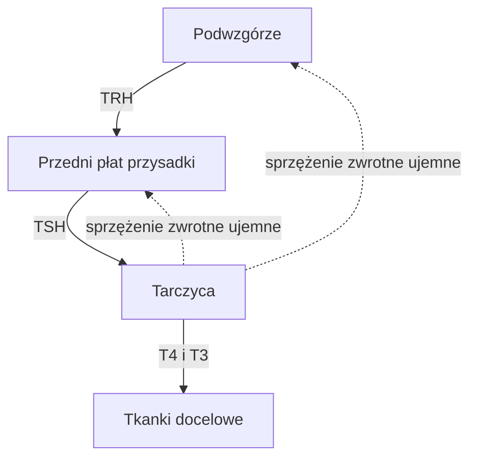
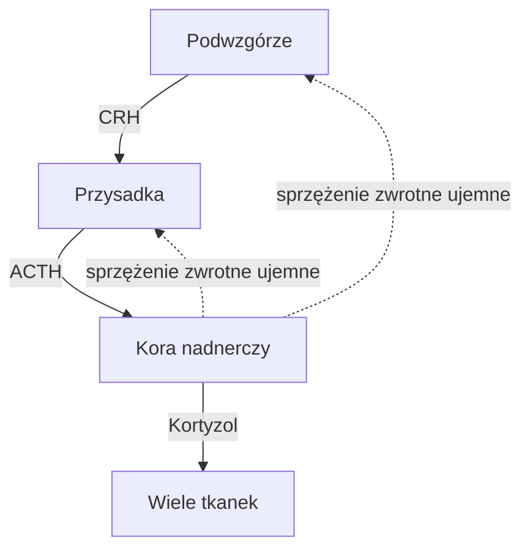
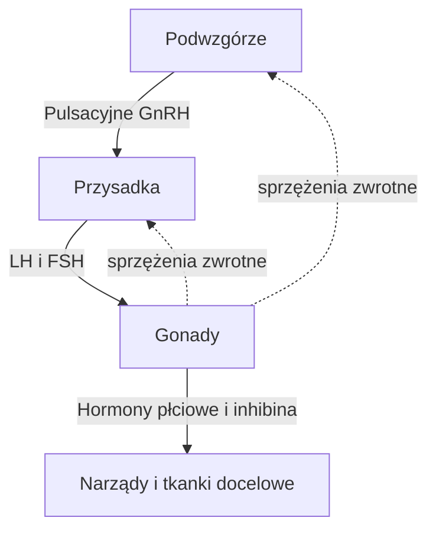
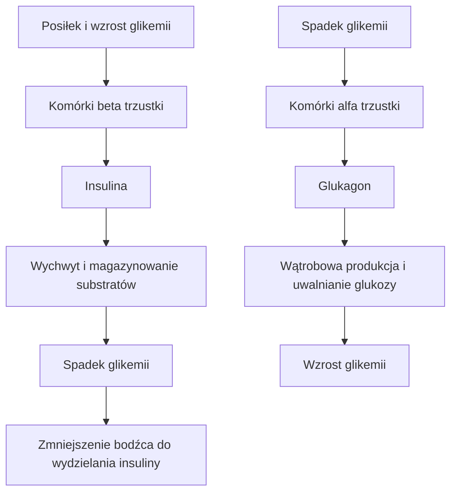

# 1.1. Podstawowe pojęcia i definicje

> **Moduł 1. Wprowadzenie do endokrynologii**  
> **Rozdział:** Podstawowe pojęcia i definicje  
> **Poziom:** kształcenie medyczne i okołomedyczne – z zakresem dostosowanym do kwalifikacji uczestnika  
> **Charakter materiału:** opracowanie dydaktyczne, kliniczno-funkcjonalne i terminologiczne

---

## 1. Cele kształcenia i efekty uczenia się

### 1.1.1. Cel ogólny

Celem rozdziału jest uporządkowanie podstawowego języka endokrynologii oraz wyjaśnienie, w jaki sposób układ hormonalny uczestniczy w utrzymaniu homeostazy, adaptacji do zmieniających się warunków środowiska, wzrastaniu, dojrzewaniu, rozmnażaniu, gospodarce energetycznej i funkcjonowaniu narządów. Uczestnik powinien rozumieć podstawowe pojęcia, odróżniać procesy fizjologiczne od patologicznych i umieć opisać obserwowane zjawiska bez wyciągania wniosków wykraczających poza posiadane kwalifikacje.

Endokrynologia nie jest wyłącznie nauką o gruczołach. Jest dziedziną opisującą sieć sygnałów chemicznych i biologicznych, które łączą narządy oraz komórki w jeden współpracujący organizm. Hormony oddziałują na metabolizm, układ krążenia, nerwowy, odpornościowy, kostno-mięśniowy i rozrodczy. Dlatego objaw pojawiający się w jednym układzie może być skutkiem zaburzenia powstałego w innym miejscu.

### 1.1.2. Efekty uczenia się

Po ukończeniu rozdziału uczestnik:

- definiuje pojęcia: układ endokrynologiczny, gruczoł dokrewny, komórka endokrynna, hormon, receptor, narząd docelowy i endokrynopatia;
- rozróżnia sygnalizację endokrynną, parakrynną, autokrynną i neuroendokrynną;
- wyjaśnia, dlaczego wydzielanie hormonu i odpowiedź tkanki na hormon są odrębnymi etapami regulacji;
- opisuje pojęcia niedoczynności, nadczynności, niedoboru, nadmiaru oraz oporności hormonalnej;
- wskazuje, że stężenie hormonu w pojedynczym pomiarze nie zawsze odzwierciedla całkowitą aktywność osi hormonalnej;
- rozumie rolę sprzężeń zwrotnych, rytmów wydzielania, transportu i metabolizmu hormonów;
- posługuje się terminologią w dokumentacji i komunikacji interdyscyplinarnej;
- rozpoznaje sytuacje, w których konieczne jest skierowanie pacjenta do lekarza lub pilna pomoc medyczna;
- odróżnia obserwację, pomiar, wynik laboratoryjny, interpretację i rozpoznanie kliniczne.

### 1.1.3. Zakres odpowiedzialności i granice kompetencji

Zakres czynności zależy od wykształcenia, prawa wykonywania zawodu, uprawnień zawodowych, lokalnych procedur i charakteru udzielanej świadczeniowej opieki. Samo ukończenie kursu nie nadaje uprawnień do rozpoznawania chorób, zlecania leków ani modyfikowania terapii, jeśli odrębne przepisy nie przyznają takich kompetencji.

Osoba wykonująca czynności medyczne lub okołomedyczne powinna:

1. gromadzić informacje i dokumentować je zgodnie z zakresem kompetencji;
2. odróżniać dane zgłaszane przez pacjenta od własnych obserwacji i pomiarów;
3. informować o niepokojących objawach i kierować pacjenta do właściwego specjalisty;
4. nie interpretować pojedynczego wyniku w oderwaniu od kontekstu klinicznego;
5. nie zalecać samodzielnego odstawienia ani zmiany dawek hormonów, glikokortykosteroidów, insuliny lub innych leków;
6. respektować autonomię, intymność, godność i poufność pacjenta.

---

## 2. Pojęcie układu endokrynologicznego

### 1.1.4. Definicja układu endokrynologicznego

Układ endokrynologiczny (dokrewny, hormonalny) to funkcjonalna sieć komórek, tkanek i narządów, które wytwarzają, uwalniają, transportują lub przekształcają biologicznie czynne sygnały chemiczne, a następnie uczestniczą w regulacji czynności innych komórek i narządów. Podstawowym nośnikiem komunikacji są hormony oraz inne mediatory sygnałowe.

W wąskim, klasycznym ujęciu pojęcie odnosi się do gruczołów dokrewnych pozbawionych przewodów wyprowadzających, których produkty wydzielane są do płynu śródmiąższowego i krwi. Współczesna fizjologia posługuje się jednak szerszym ujęciem: funkcje endokrynne pełnią również rozproszone komórki przewodu pokarmowego, tkanka tłuszczowa, nerki, serce, wątroba, kości, łożysko i inne tkanki.

Układ hormonalny działa równolegle z układem nerwowym i odpornościowym. Nie są to niezależne systemy. Wzajemnie oddziałują na siebie za pośrednictwem neuroprzekaźników, hormonów, cytokin i lokalnych mediatorów.

### 1.1.5. Najważniejsze funkcje układu hormonalnego

| Obszar regulacji | Przykładowe procesy | Przykładowe mediatory |
|---|---|---|
| Metabolizm energetyczny | wykorzystanie glukozy, lipoliza, synteza i rozkład białek | insulina, glukagon, hormony tarczycy, kortyzol |
| Wzrost i rozwój | wzrastanie kości, dojrzewanie tkanek | GH, IGF-1, hormony tarczycy, hormony płciowe |
| Gospodarka wodno-elektrolitowa | retencja sodu i wody, regulacja osmolalności | wazopresyna, aldosteron, peptydy natriuretyczne |
| Gospodarka wapniowo-fosforanowa | stężenie wapnia, obrót kostny | PTH, witamina D, FGF23, kalcytonina |
| Rozród | gametogeneza, cykl miesiączkowy, ciąża, laktacja | FSH, LH, estrogeny, progesteron, testosteron, prolaktyna |
| Adaptacja do stresu | odpowiedź metaboliczna i krążeniowa | kortyzol, adrenalina, noradrenalina |
| Rytmy biologiczne | sen i czuwanie, rytmy dobowe | melatonina, kortyzol i inne sygnały rytmiczne |
| Apetyt i bilans energii | głód, sytość, wydatek energetyczny | leptyna, grelina, insulina, peptydy jelitowe |

Wymienione mediatory nie działają w izolacji. Ich skutki zależą od stężenia, czasu ekspozycji, dostępności receptorów, stanu metabolicznego, wieku, płci biologicznej, ciąży, chorób współistniejących i przyjmowanych leków.

### 1.1.6. Homeostaza jako nadrzędna zasada działania

Homeostaza oznacza utrzymywanie parametrów środowiska wewnętrznego w zakresie umożliwiającym prawidłowe funkcjonowanie komórek. Nie oznacza niezmienności. Organizm stale dostosowuje wartości fizjologiczne do aktywności, pory dnia, posiłków, temperatury, stresu, snu i innych obciążeń.

Przykład stanowi regulacja glikemii. Po spożyciu posiłku wzrost stężenia glukozy pobudza wydzielanie insuliny. Insulina sprzyja wykorzystaniu i magazynowaniu substratów energetycznych, a w miarę obniżania się glikemii bodziec do jej wydzielania słabnie. W okresie między posiłkami rośnie znaczenie mechanizmów przeciwdziałających nadmiernemu obniżeniu glukozy, w tym działania glukagonu.

Homeostaza jest więc wynikiem dynamicznej równowagi, a nie stałej wartości każdego hormonu.

---

## 3. Gruczoł dokrewny

### 1.1.7. Definicja gruczołu dokrewnego

Gruczoł dokrewny to struktura złożona z komórek wyspecjalizowanych w syntezie i uwalnianiu substancji sygnałowych do płynu śródmiąższowego, skąd mogą one przedostawać się do krążenia i oddziaływać na odległe tkanki. Gruczoły dokrewne nie odprowadzają swoich wydzielin przewodami na powierzchnię ciała ani do światła narządu, w odróżnieniu od typowych gruczołów zewnątrzwydzielniczych.

Do klasycznie wyróżnianych gruczołów dokrewnych zalicza się między innymi:

- przysadkę mózgową;
- tarczycę;
- przytarczyce;
- nadnercza;
- szyszynkę.

Trzustka, gonady i łożysko mają funkcje mieszane lub zależne od okresu życia. Trzustka łączy funkcję zewnątrzwydzielniczą, związaną z wydzielaniem enzymów trawiennych, z funkcją wewnątrzwydzielniczą wysp trzustkowych. Jajniki i jądra wytwarzają gamety oraz hormony. Łożysko działa jako narząd endokrynny w czasie ciąży.

### 1.1.8. Cechy budowy i unaczynienia gruczołów

Wiele gruczołów dokrewnych jest silnie unaczynionych. Bliski kontakt komórek wydzielniczych z naczyniami włosowatymi ułatwia przekazywanie hormonów do krwi. Budowa naczyń i rodzaj śródbłonka różnią się między narządami, co wpływa na transport substancji.

Ważne znaczenie ma również układ wrotny podwzgórzowo-przysadkowy. Umożliwia on transport hormonów uwalniających i hamujących z podwzgórza do przedniego płata przysadki w wysokim stężeniu miejscowym, bez konieczności ich uprzedniego rozcieńczenia w krążeniu ogólnym.

Nie każdy narząd, który wpływa na stężenie hormonu we krwi, jest gruczołem dokrewnym w klasycznym znaczeniu. Wątroba wytwarza białka wiążące hormony, metabolizuje wiele związków i syntetyzuje mediatory, takie jak IGF-1. Nerki uczestniczą w aktywacji witaminy D oraz wytwarzaniu reniny i erytropoetyny.

### 1.1.9. Gruczoły dokrewne a gruczoły zewnątrzwydzielnicze

| Cecha | Gruczoł dokrewny | Gruczoł zewnątrzwydzielniczy |
|---|---|---|
| Droga wydzielania | do płynu śródmiąższowego, następnie zwykle do krwi | przez przewód wyprowadzający |
| Typowy cel | odległe komórki lub narządy, czasem tkanki lokalne | powierzchnia ciała lub światło narządu |
| Przykład | tarczyca, przytarczyce | gruczoły ślinowe, część zewnątrzwydzielnicza trzustki |
| Produkt | hormony i inne mediatory | np. enzymy, śluz, pot, ślina |

Podział ma charakter funkcjonalny. Niektóre narządy łączą oba typy aktywności, dlatego nie należy utożsamiać całego narządu wyłącznie z jedną funkcją.

---

## 4. Komórka endokrynna

### 1.1.10. Definicja komórki endokrynnej

Komórka endokrynna to komórka zdolna do syntezy, magazynowania, uwalniania lub regulowanego udostępniania biologicznie czynnego mediatora, który wpływa na aktywność tej samej komórki, komórek sąsiednich lub tkanek położonych dalej.

Komórki endokrynne mogą występować w skupiskach tworzących gruczoł albo jako pojedyncze lub rozproszone populacje w obrębie innych narządów. Przykładem są komórki wysp trzustkowych oraz komórki enteroendokrynne przewodu pokarmowego.

### 1.1.11. Etapy działania komórki endokrynnej

Typowy proces obejmuje:

1. rozpoznanie bodźca regulacyjnego przez receptor lub mechanizm wewnątrzkomórkowy;
2. uruchomienie szlaków przekazywania sygnału;
3. syntezę mediatora albo mobilizację wcześniej zgromadzonych zapasów;
4. uwolnienie mediatora do otoczenia komórki;
5. transport do miejsca działania;
6. rozpoznanie sygnału przez odpowiedni receptor;
7. uruchomienie odpowiedzi komórkowej;
8. zakończenie sygnału przez metabolizm, wychwyt, degradację lub wydalenie mediatora.

Nie każdy hormon jest magazynowany w pęcherzykach. Hormony peptydowe są zwykle syntetyzowane jako większe prekursory, przetwarzane i przechowywane w pęcherzykach wydzielniczych. Steroidy są na ogół syntetyzowane w miarę zapotrzebowania z cholesterolu i łatwo przechodzą przez błony komórkowe. Hormony tarczycy mają odmienną organizację syntezy i magazynowania w koloidzie pęcherzyków tarczycowych.

### 1.1.12. Komórki o funkcji endokrynnej poza klasycznymi gruczołami

- **Przewód pokarmowy:** komórki enteroendokrynne wydzielają m.in. gastrynę, sekretynę, cholecystokininę, GLP-1 i GIP.
- **Tkanka tłuszczowa:** adipocyty wytwarzają leptynę, adiponektynę i liczne mediatory zapalne.
- **Nerki:** komórki aparatu przykłębuszkowego uczestniczą w wydzielaniu reniny; nerki wytwarzają także erytropoetynę i aktywną postać witaminy D.
- **Serce:** kardiomiocyty wydzielają peptydy natriuretyczne, uczestniczące w regulacji objętości płynów i ciśnienia.
- **Kość:** osteoblasty i osteocyty uczestniczą w sygnalizacji wpływającej na metabolizm mineralny i inne funkcje organizmu.
- **Wątroba:** syntetyzuje m.in. IGF-1, hepcydynę i angiotensynogen oraz metabolizuje wiele hormonów.

Pojęcie narządu endokrynnego należy zatem rozumieć funkcjonalnie, a nie wyłącznie anatomicznie.

---

## 5. Hormon

### 1.1.13. Definicja hormonu

Hormon jest biologicznie czynną substancją sygnałową wytwarzaną przez wyspecjalizowane komórki lub tkanki, która w odpowiednich warunkach wiąże się ze swoistym receptorem i zmienia czynność komórki docelowej. Hormon może docierać do celu przez krew, płyn śródmiąższowy albo drogą lokalnej komunikacji.

W języku klinicznym określenie „hormon” obejmuje różnorodne cząsteczki: peptydy, białka, steroidy, pochodne aminokwasów i niektóre lipidy. Nie każda substancja wykazująca aktywność biologiczną jest hormonem w ścisłym sensie. Terminologię należy stosować zgodnie z mechanizmem działania i przyjętą konwencją naukową.

### 1.1.14. Klasyfikacja chemiczna hormonów

| Grupa | Przykłady | Typowe cechy |
|---|---|---|
| Peptydowe i białkowe | insulina, glukagon, ACTH, GH, prolaktyna | rozpuszczalne w wodzie; działają zwykle przez receptory błonowe |
| Steroidowe | kortyzol, aldosteron, estradiol, progesteron, testosteron | pochodne cholesterolu; zwykle transportowane z udziałem białek osocza i działają przez receptory wewnątrzkomórkowe |
| Pochodne aminokwasów | adrenalina, noradrenalina, dopamina, T3, T4 | zróżnicowana budowa i mechanizmy działania |
| Pochodne kwasów tłuszczowych | prostaglandyny i inne eikozanoidy | często działają lokalnie i krótkotrwale |
| Inne mediatory o działaniu hormonalnym | np. aktywna witamina D, niektóre peptydy tkankowe | wymagają rozpatrywania w kontekście konkretnego układu regulacyjnego |

To podział orientacyjny. Właściwości farmakokinetyczne i biologiczne konkretnej cząsteczki zależą od jej budowy, białek transportujących, receptorów i metabolizmu.

### 1.1.15. Najważniejsze właściwości hormonów

**Swoistość biologiczna.** Hormon działa na komórki posiadające odpowiedni receptor i zdolne do uruchomienia dalszego szlaku sygnałowego. Wpływ może być odmienny w różnych tkankach, nawet gdy receptor należy do tej samej rodziny.

**Zależność od stężenia.** Odpowiedź zazwyczaj zależy od stężenia hormonu, jednak zależność ta nie zawsze jest liniowa. Znaczenie ma nasycenie receptorów, liczba receptorów, powinowactwo ligandu oraz stan komórki.

**Regulacja w czasie.** Wydzielanie może być pulsacyjne, dobowe, sezonowe, zależne od posiłku, wysiłku, stresu, snu, cyklu miesiączkowego lub etapu rozwoju.

**Transport.** Część hormonów krąży w osoczu w postaci wolnej, a część jest związana z białkami. Dla wielu hormonów steroidowych i hormonów tarczycy białka transportujące istotnie wpływają na stężenia całkowite i czas półtrwania.

**Metabolizm i eliminacja.** Hormony są przekształcane m.in. w wątrobie, nerkach i tkankach obwodowych. Zmiana funkcji tych narządów może wpływać na wynik oznaczenia i aktywność biologiczną.

**Współdziałanie.** Hormony mogą wykazywać działanie synergistyczne, antagonistyczne lub permisywne. Odpowiedź na jeden hormon może zależeć od obecności innego.

### 1.1.16. Hormon a neuroprzekaźnik i cytokina

Granice między kategoriami mediatorów biologicznych nie zawsze są ostre. Ta sama cząsteczka może pełnić różne funkcje zależnie od miejsca uwalniania i drogi transportu. Noradrenalina może działać jako neuroprzekaźnik w synapsie, a uwalniana do krążenia z rdzenia nadnerczy uczestniczy w odpowiedzi hormonalnej. Cytokiny są przede wszystkim mediatorami komunikacji odpornościowej, lecz mogą wpływać na oś podwzgórze–przysadka–nadnercza i inne procesy endokrynne.

O klasyfikacji decyduje zatem kontekst biologiczny, źródło, sposób przekazywania sygnału i funkcja, a nie wyłącznie nazwa cząsteczki.

---

## 6. Narząd docelowy i komórka docelowa

### 1.1.17. Definicja narządu docelowego

Narząd docelowy to narząd, tkanka lub populacja komórek, których funkcja ulega zmianie pod wpływem określonego hormonu. Pojęcie to jest funkcjonalne: narząd docelowy nie musi być położony blisko miejsca wydzielania hormonu.

Przykładowo TSH oddziałuje przede wszystkim na komórki pęcherzykowe tarczycy; ACTH pobudza korę nadnerczy, szczególnie warstwy odpowiedzialne za syntezę glikokortykosteroidów i androgenów nadnerczowych; insulina wpływa na liczne tkanki, w tym mięśnie, wątrobę i tkankę tłuszczową.

### 1.1.18. Warunki uzyskania odpowiedzi hormonalnej

Do wystąpienia odpowiedzi potrzebne są co najmniej:

- obecność odpowiedniego receptora lub mechanizmu rozpoznającego sygnał;
- odpowiednie stężenie aktywnego ligandu w miejscu działania;
- prawidłowe przekazanie sygnału wewnątrz komórki;
- zachowana zdolność komórki do wykonania odpowiedzi;
- właściwe warunki metaboliczne i środowiskowe.

Samo wykrycie hormonu we krwi nie przesądza o jego skutecznym działaniu. Z kolei prawidłowe stężenie hormonu nie wyklucza zaburzenia odpowiedzi tkankowej.

### 1.1.19. Odpowiedź tkankowa i jej zróżnicowanie

Ta sama substancja może wywoływać różne efekty w odmiennych tkankach. Wynika to z różnic w ekspresji receptorów, białkach sygnałowych, enzymach, dostępności kofaktorów i regulacji genów. Ponadto jeden hormon może wpływać na wiele procesów w obrębie tego samego narządu.

W interpretacji klinicznej należy zatem odróżnić:
- stężenie hormonu w krwi;
- stężenie frakcji wolnej lub biologicznie dostępnej;
- aktywność biologiczną hormonu;
- wrażliwość komórki na hormon;
- końcowy efekt w narządzie.

---

## 7. Receptor hormonalny

### 1.1.20. Definicja receptora

Receptor hormonalny to białko lub kompleks białkowy zdolny do rozpoznania określonego ligandu i przekształcenia tego związania w sygnał biologiczny. Receptory mogą znajdować się w błonie komórkowej, cytoplazmie lub jądrze komórkowym.

Receptor nie jest biernym „miejscem przyczepienia”. Po związaniu ligandu może zmieniać konformację, uruchamiać kaskadę fosforylacji, wpływać na stężenie wtórnych przekaźników lub regulować ekspresję genów.

### 1.1.21. Receptory błonowe

Receptory błonowe są szczególnie istotne dla wielu hormonów peptydowych i aminowych, które nie przechodzą swobodnie przez dwuwarstwę lipidową. Do ważnych klas należą:

- receptory sprzężone z białkami G;
- receptory o aktywności kinazy tyrozynowej;
- receptory związane z kinazami, np. szlakiem JAK–STAT;
- receptory z aktywnością cyklazy guanylanowej;
- kanały jonowe i inne układy receptorowe, zależnie od mediatora.

Przykłady obejmują receptor insulinowy (receptor o aktywności kinazy tyrozynowej), receptory adrenergiczne (receptory sprzężone z białkami G) oraz receptor GH, który przekazuje sygnał m.in. przez szlak JAK–STAT.

### 1.1.22. Receptory wewnątrzkomórkowe i jądrowe

Hormony steroidowe oraz hormony tarczycy mogą działać przez receptory wewnątrzkomórkowe. Po związaniu ligandu receptor wpływa na regulację transkrypcji genów, a więc na wytwarzanie określonych białek. W wielu sytuacjach odpowiedź genomowa rozwija się wolniej niż typowa odpowiedź błonowa, ale może utrzymywać się dłużej.

Nie należy jednak przyjmować uproszczenia, że każdy efekt steroidu jest wyłącznie genomowy ani że wszystkie efekty hormonów peptydowych są krótkotrwałe. Niektóre hormony uruchamiają zarówno szybkie, jak i wolniejsze mechanizmy odpowiedzi.

### 1.1.23. Powinowactwo, liczba receptorów i regulacja wrażliwości

**Powinowactwo** określa skłonność receptora do wiązania ligandu. **Gęstość receptorów** opisuje liczbę receptorów dostępnych w określonej liczbie komórek lub w danej ilości tkanki. Oba parametry wpływają na odpowiedź, lecz nie wyczerpują jej mechanizmu.

Komórka może zwiększać lub zmniejszać ekspresję receptorów. Długotrwała ekspozycja na wysokie stężenie ligandu może prowadzić do desensytyzacji lub zmniejszenia liczby receptorów, natomiast niedobór sygnału może w określonych układach sprzyjać zwiększeniu ich ekspresji. Zjawiska te zależą od konkretnego receptora i tkanki.

### 1.1.24. Oporność na hormon

Oporność hormonalna to zmniejszona odpowiedź biologiczna na hormon, mimo jego obecności w organizmie. Może wynikać z:
- zmniejszonej liczby receptorów;
- nieprawidłowej budowy receptora;
- zaburzeń przekazywania sygnału za receptorem;
- zmian w regulacji genów i czynności komórki;
- zaburzeń transportu lub metabolizmu hormonu;
- czynników wtórnych, np. stanu zapalnego lub zaburzeń metabolicznych.

Oporność może być uogólniona lub ograniczona do określonej tkanki. W niektórych stanach organizm kompensacyjnie zwiększa wydzielanie hormonu, dlatego stężenie krążące może być podwyższone, mimo że efekt biologiczny jest niewystarczający.

---

## 8. Rodzaje komunikacji hormonalnej i komórkowej

### 1.1.25. Sygnalizacja endokrynna

Sygnalizacja endokrynna polega na uwalnianiu mediatora do krążenia, którym dociera on do odległych komórek docelowych. Klasycznym przykładem jest wydzielanie insuliny przez komórki beta wysp trzustkowych i jej oddziaływanie na tkanki obwodowe.

Cechą charakterystyczną jest wykorzystanie układu krążenia jako drogi dystrybucji. Skuteczność sygnału zależy jednak od stężenia hormonu, jego transportu, metabolizmu, receptorów i lokalnych warunków tkankowych.

### 1.1.26. Sygnalizacja parakrynna

Sygnalizacja parakrynna polega na oddziaływaniu mediatora na sąsiednie komórki w obrębie tej samej tkanki lub mikrośrodowiska. Sygnał dyfunduje lokalnie, a jego stężenie zwykle zmniejsza się wraz z odległością od źródła.

Przykładem są lokalne oddziaływania komórek wysp trzustkowych, gdzie somatostatyna wydzielana przez komórki delta wpływa na aktywność innych komórek wysp. W wielu tkankach lokalne mediatory regulują przepływ krwi, proliferację, wydzielanie i odpowiedź zapalną.

### 1.1.27. Sygnalizacja autokrynna

Sygnalizacja autokrynna występuje wtedy, gdy mediator uwalniany przez komórkę działa na tę samą komórkę lub na komórki tego samego typu. Może tworzyć mechanizm samoregulacji, wzmacniania albo hamowania odpowiedzi.

Ważne jest, aby nie utożsamiać autokrynności z „samodzielnym działaniem” komórki bez udziału otoczenia. Nawet lokalny sygnał podlega wpływom innych komórek, macierzy pozakomórkowej i czynników krążących.

### 1.1.28. Sygnalizacja neuroendokrynna

Sygnalizacja neuroendokrynna polega na uwalnianiu substancji sygnałowej przez neuron do krążenia lub do specjalnego układu naczyń, z którego może ona dotrzeć do komórek docelowych. Neurosekrecja łączy właściwości komunikacji nerwowej z hormonalną.

Przykładem są neurony podwzgórza wytwarzające hormony uwalniające i hamujące, które regulują przedni płat przysadki. Inny przykład stanowią neurony syntetyzujące wazopresynę i oksytocynę, których zakończenia znajdują się w tylnym płacie przysadki.

### 1.1.29. Porównanie sposobów sygnalizacji

| Rodzaj sygnalizacji | Droga przekazania | Typowy zasięg | Przykład |
|---|---|---|---|
| Endokrynna | krążenie krwi | odległy | insulina |
| Parakrynna | płyn śródmiąższowy | lokalny, sąsiednie komórki | somatostatyna w obrębie wysp |
| Autokrynna | mediator wraca do komórki źródłowej lub jej typu | ta sama komórka/populacja | lokalna samoregulacja cytokinowa |
| Neuroendokrynna | neuron uwalnia mediator do krwi lub układu wrotnego | odległy lub wyspecjalizowany układ | hormony podwzgórza |

W praktyce kilka sposobów komunikacji może występować równocześnie. Klasyfikacja ma ułatwiać rozumienie mechanizmu, a nie narzucać sztuczny podział.

### 1.1.30. Sygnalizacja synaptyczna jako odrębny model komunikacji

W sygnalizacji synaptycznej neuron uwalnia neuroprzekaźnik do szczeliny synaptycznej, a sygnał oddziałuje na pobliską komórkę postsynaptyczną. Działanie jest zwykle szybkie i przestrzennie precyzyjne. Niektóre mediatory mogą jednak pełnić funkcję zarówno neuroprzekaźnika, jak i hormonu, zależnie od miejsca uwalniania.

---

## 9. Endokrynopatia i podstawowe określenia kliniczne

### 1.1.31. Endokrynopatia

Endokrynopatia to zaburzenie czynności układu hormonalnego. Może dotyczyć syntezy, wydzielania, transportu, metabolizmu, aktywacji, unieczynniania hormonu, działania receptora lub odpowiedzi tkanki docelowej. Zaburzenie może być pierwotne, wtórne, trzeciorzędowe, wrodzone, nabyte, przejściowe albo przewlekłe.

Określenie „endokrynopatia” ma charakter szeroki i nie wskazuje samo w sobie konkretnej choroby ani etiologii.

### 1.1.32. Niedoczynność hormonalna

Niedoczynność oznacza niewystarczającą czynność gruczołu lub osi hormonalnej. Może wynikać z:
- uszkodzenia komórek wydzielniczych;
- niedostatecznej stymulacji przez hormon nadrzędny;
- zaburzeń syntezy lub uwalniania hormonu;
- niedoboru substratów lub niezbędnych kofaktorów;
- zaburzeń rozwojowych lub genetycznych;
- działań leków, zabiegów albo napromieniania.

Niedoczynność narządu nie zawsze jest równoznaczna z niskim stężeniem hormonu w pojedynczym badaniu. Należy uwzględnić położenie zaburzenia w osi, sprzężenia zwrotne i odpowiednie zakresy decyzyjne.

### 1.1.33. Nadczynność hormonalna

Nadczynność oznacza nadmierną czynność gruczołu lub osi hormonalnej, prowadzącą do zwiększonej produkcji albo wydzielania określonego hormonu. Może być wywołana autonomiczną aktywnością tkanki, nadmierną stymulacją, procesem zapalnym powodującym uwalnianie zgromadzonego hormonu lub innym mechanizmem.

Należy rozróżnić nadczynność gruczołu od tyreotoksykozy, czyli zespołu klinicznego nadmiernego działania hormonów tarczycy w tkankach. Przykład ten pokazuje, że nazwy opisujące mechanizm i nazwy opisujące efekt kliniczny nie są zamienne.

### 1.1.34. Niedobór i nadmiar hormonu

Niedobór oznacza zbyt małą dostępność biologicznie czynnego hormonu w stosunku do potrzeb organizmu. Nadmiar oznacza zbyt dużą dostępność lub nadmierny efekt biologiczny hormonu. Pojęcia te nie zawsze wskazują na pierwotną chorobę gruczołu. Mogą wynikać z zaburzeń transportu, metabolizmu, aktywacji lub unieczynniania.

### 1.1.35. Oporność hormonalna

Oporność hormonalna występuje, gdy odpowiedź komórki lub narządu na określony hormon jest zmniejszona. Przykładem jest insulinooporność, w której odpowiedź tkanek na insulinę jest osłabiona, co może prowadzić do kompensacyjnego zwiększenia wydzielania insuliny, a w dalszej perspektywie do zaburzeń regulacji glikemii.

Wysokie stężenie hormonu nie musi oznaczać nadczynności gruczołu w sensie pierwotnym. Może być odpowiedzią kompensacyjną na zmniejszoną wrażliwość tkanek.

### 1.1.36. Zaburzenia pierwotne, wtórne i trzeciorzędowe

W opisie osi hormonalnej położenie zaburzenia ma zasadnicze znaczenie:

- **Pierwotne** – uszkodzenie lub nieprawidłowość dotyczy gruczołu obwodowego.
- **Wtórne** – zaburzenie wynika z nieprawidłowej czynności przysadki.
- **Trzeciorzędowe** – zaburzenie wynika z nieprawidłowej regulacji podwzgórzowej.

Przykładowo niedoczynność tarczycy może być pierwotna, gdy problem dotyczy samej tarczycy, albo centralna, gdy przyczyną jest niewystarczająca stymulacja osi przez przysadkę lub podwzgórze. Samo oznaczenie TSH bez FT4 i kontekstu klinicznego może być niewystarczające do prawidłowego rozpoznania zaburzenia centralnego.

### 1.1.37. Zaburzenia jawne i subkliniczne

Określenie „jawne” zwykle oznacza, że wyniki badań hormonalnych wskazują na wyraźne zaburzenie osi według właściwych kryteriów. „Subkliniczne” odnosi się do nieprawidłowości laboratoryjnej przy braku typowych objawów lub przy objawach niewielkich i nieswoistych. Definicje oraz kryteria zależą od konkretnej choroby.

Termin „subkliniczny” nie oznacza automatycznie, że stan jest nieistotny, ani że zawsze wymaga leczenia. Decyzja kliniczna zależy od ryzyka, wieku, ciąży, chorób współistniejących, stopnia odchylenia i aktualnych wytycznych.

### 1.1.38. Zaburzenia wrodzone i nabyte

Zaburzenia wrodzone mogą wynikać z wariantów genetycznych, nieprawidłowego rozwoju gruczołu, zaburzeń syntezy hormonów lub działania czynników prenatalnych. Zaburzenia nabyte rozwijają się po urodzeniu, np. w przebiegu autoimmunizacji, zapalenia, nowotworu, urazu, zabiegu, infekcji, niedoboru substratu lub działania leków.

Wiek pojawienia się objawów nie przesądza samodzielnie o etiologii. Choroba wrodzona może ujawnić się późno, a zaburzenie nabyte może wystąpić w dzieciństwie.

---

## 10. Hormony w osoczu: stężenie, frakcja wolna i aktywność biologiczna

### 1.1.39. Hormon wolny i związany

W osoczu część hormonów występuje w postaci wolnej, a część jest związana z białkami transportującymi. Białka te mogą ograniczać natychmiastową dostępność hormonu, chronić go przed szybką degradacją i przedłużać jego czas obecności w krążeniu.

W przypadku hormonów tarczycy i steroidowych oznacza się niekiedy zarówno stężenia całkowite, jak i wolne. Stężenie całkowite zależy od frakcji wolnej oraz ilości białek wiążących. Zmiany stężenia białek mogą zmieniać wynik całkowity bez proporcjonalnej zmiany biologicznie aktywnej frakcji.

### 1.1.40. Przykłady białek wiążących

- TBG – globulina wiążąca tyroksynę;
- albumina – wiąże m.in. hormony tarczycy i steroidy;
- SHBG – globulina wiążąca hormony płciowe;
- CBG – białko wiążące kortyzol.

Stężenia tych białek mogą zmieniać się m.in. w ciąży, chorobach wątroby, stanach zapalnych, zaburzeniach odżywienia i pod wpływem określonych leków. Interpretacja oznaczeń musi uwzględniać te okoliczności oraz ograniczenia zastosowanej metody laboratoryjnej.

### 1.1.41. Stężenie a efekt biologiczny

Wynik laboratoryjny jest pomiarem określonego analitu w określonym materiale, oznaczonym określoną metodą. Nie jest bezpośrednim pomiarem wszystkich skutków biologicznych hormonu. Na efekt wpływają:
- proporcja frakcji wolnej i związanej;
- lokalna konwersja prohormonu do aktywnej postaci;
- inaktywacja hormonu w tkance;
- liczba i funkcja receptorów;
- stan szlaków wewnątrzkomórkowych;
- czas i rytm ekspozycji;
- współistniejące choroby i leki.

Dlatego rozpoznanie endokrynologiczne wymaga zestawienia objawów, badania przedmiotowego, wyników laboratoryjnych i – w razie potrzeby – badań obrazowych lub dynamicznych.

---

## 11. Rytm wydzielania i zmienność biologiczna

### 1.1.42. Rytm dobowy i pulsacyjność

Wydzielanie wielu hormonów zmienia się w ciągu doby. Kortyzol wykazuje typowy rytm dobowy, z wyższymi wartościami w godzinach porannych i niższymi w godzinach nocnych u osób o konwencjonalnym rytmie snu i czuwania. GH jest wydzielany pulsacyjnie, a istotne wyrzuty często wiążą się z określonymi fazami snu. LH, FSH i hormony płciowe podlegają zmianom zależnym od wieku, płci i etapu cyklu rozrodczego.

Pojedynczy pomiar może nie odzwierciedlać typowego wzorca wydzielania. Dlatego czas pobrania, przygotowanie pacjenta i rodzaj testu są częścią procedury diagnostycznej, a nie detalem technicznym.

### 1.1.43. Zmienność biologiczna i czynniki zakłócające

Na wynik hormonalny mogą wpływać:
- pora dnia i rytm snu;
- posiłek i stan na czczo;
- wysiłek fizyczny;
- stres, ból i ostra choroba;
- ciąża i etap cyklu miesiączkowego;
- wiek i etap dojrzewania;
- pozycja ciała i warunki pobrania;
- leki, suplementy i interferencje analityczne;
- niewydolność nerek lub wątroby.

Dane o czasie pobrania i warunkach przygotowania pacjenta powinny zostać odnotowane, gdy mają znaczenie dla interpretacji.

### 1.1.44. Prohormony, prekursory i aktywacja obwodowa

Niektóre mediatory są wytwarzane jako prekursory, które wymagają przetworzenia przed uzyskaniem pełnej aktywności. Przykładem jest proinsulina, z której powstają insulina i peptyd C. T4 jest w dużej mierze prohormonem przekształcanym w tkankach do aktywniejszej T3 lub do nieaktywnej odwrotnej T3. Witamina D wymaga kolejnych etapów metabolizmu, zanim uzyska pełną aktywność hormonalną.

Z tego powodu funkcja narządów obwodowych, aktywność enzymów i dostępność substratów mogą mieć znaczenie równie istotne jak wydzielanie przez gruczoł.

---

## 12. Podstawowe osie hormonalne – przykłady zastosowania terminologii

### 1.1.45. Oś podwzgórze–przysadka–tarczyca

Podwzgórze wydziela TRH, które pobudza przysadkę do wydzielania TSH. TSH stymuluje tarczycę do syntezy i uwalniania hormonów tarczycy. T4 i T3 oddziałują na liczne tkanki, a ich stężenie wpływa zwrotnie na podwzgórze i przysadkę.

Schemat uproszczony:

Schemat przedstawia główną oś, ale nie uwzględnia wszystkich czynników regulacyjnych, lokalnej konwersji hormonów ani wpływu chorób i leków.

### 1.1.46. Oś podwzgórze–przysadka–nadnercza

Podwzgórze wydziela CRH, który pobudza przysadkę do uwalniania ACTH. ACTH stymuluje korę nadnerczy do wytwarzania kortyzolu. Kortyzol uczestniczy w regulacji metabolizmu, odpowiedzi na stres, ciśnienia tętniczego i funkcji odpornościowych. Wydzielanie jest rytmiczne i podlega sprzężeniu zwrotnemu.

W sytuacji klinicznej trzeba odróżnić niedobór kortyzolu spowodowany uszkodzeniem nadnerczy od niedoboru wynikającego z zaburzeń centralnej regulacji osi. To rozróżnienie wpływa na interpretację ACTH oraz dalszą diagnostykę.

### 1.1.47. Oś podwzgórze–przysadka–gonady

GnRH jest uwalniany pulsacyjnie i reguluje wydzielanie LH oraz FSH. Gonadotropiny wpływają na czynność jajników lub jąder, a wytwarzane hormony płciowe oraz inhibina oddziałują zwrotnie na podwzgórze i przysadkę.

Uwalnianie GnRH w sposób ciągły i pulsacyjny może wywoływać odmienne skutki. Dlatego sama nazwa hormonu nie opisuje w pełni sposobu regulacji – istotny jest także wzorzec jego wydzielania.

### 1.1.48. Regulacja glikemii przez insulinę i glukagon

Komórki beta wysp trzustkowych wydzielają insulinę, a komórki alfa glukagon. Insulina sprzyja obniżeniu glikemii i magazynowaniu substratów energetycznych, natomiast glukagon wspiera utrzymanie dostępności glukozy, szczególnie w okresie między posiłkami.

Regulacja jest bardziej złożona i obejmuje m.in. inkretyny, układ autonomiczny, hormony stresu, czynność nerek, dostępność substratów i wrażliwość tkanek.

---

## 13. Przykłady kliniczne: jak używać pojęć bez nadmiernego wnioskowania

### 1.1.49. Przykład 1 – podwyższone TSH

U pacjenta w badaniu przesiewowym stwierdzono podwyższone TSH. Sam wynik nie powinien być automatycznie utożsamiany z konkretną jednostką chorobową. Należy uwzględnić FT4, objawy, wcześniejsze wyniki, przyjmowane leki, ciążę, niedawne choroby i warunki oznaczenia. Dopiero pełna ocena pozwala ustalić, czy obraz odpowiada pierwotnej niedoczynności tarczycy, zaburzeniu subklinicznemu, przejściowej zmianie czy innemu problemowi.

**Wniosek dydaktyczny:** pojedynczy wynik jest daną, nie pełnym rozpoznaniem.

### 1.1.50. Przykład 2 – wysoka insulina i prawidłowa glikemia

U osoby z otyłością brzuszną oznaczono podwyższone stężenie insuliny przy prawidłowym stężeniu glukozy. Jednym z możliwych wyjaśnień jest kompensacyjne zwiększenie wydzielania insuliny w odpowiedzi na zmniejszoną wrażliwość tkanek. Nie można jednak rozpoznać insulinooporności wyłącznie na podstawie pojedynczego oznaczenia insuliny bez analizy metody, warunków pobrania i całości obrazu klinicznego.

**Wniosek dydaktyczny:** wysokie stężenie hormonu może być odpowiedzią kompensacyjną, a nie dowodem pierwotnej nadczynności gruczołu.

### 1.1.51. Przykład 3 – zaburzenie osi przysadkowej

U pacjenta z bólem głowy i pogorszeniem pola widzenia podejrzewa się zmianę w okolicy przysadki. Objawy mogą wynikać z efektu masy, ucisku skrzyżowania wzrokowego lub niedoboru jednego albo kilku hormonów przysadkowych. Wymaga to oceny lekarskiej, a przy nagłym silnym bólu głowy, zaburzeniach widzenia, wymiotach lub zaburzeniach świadomości – pilnej pomocy medycznej.

**Wniosek dydaktyczny:** objawy neurologiczne mogą być częścią obrazu choroby endokrynnej i nie wolno ograniczać oceny wyłącznie do wyników hormonalnych.

### 1.1.52. Przykład 4 – niski kortyzol po długotrwałej terapii steroidowej

Pacjent przyjmował glikokortykosteroid przez dłuższy czas i samodzielnie go odstawił. Może to prowadzić do zahamowania osi podwzgórze–przysadka–nadnercza i ryzyka niewystarczającej odpowiedzi organizmu na stres. Nie należy sugerować samodzielnego wznowienia, redukowania ani odstawiania leku według schematu znalezionego w internecie. Pacjent wymaga oceny przez lekarza, a objawy sugerujące przełom nadnerczowy stanowią stan nagły.

**Wniosek dydaktyczny:** działania terapeutyczne w zaburzeniach osi hormonalnych wymagają indywidualnego planu medycznego.

### 1.1.53. Przykład 5 – prawidłowy hormon, nieprawidłowa odpowiedź

U pacjenta stężenie hormonu mieści się w zakresie referencyjnym, ale występują cechy zaburzonej odpowiedzi tkankowej. Możliwa jest oporność hormonalna, zaburzenie receptora lub szlaku sygnałowego, lecz także inne przyczyny objawów. Potrzebna jest diagnostyka ukierunkowana na konkretną oś.

**Wniosek dydaktyczny:** prawidłowe stężenie nie zawsze oznacza prawidłową czynność biologiczną.

---

## 14. Bezpieczeństwo, etyka i komunikacja z pacjentem

### 1.1.54. Zasada interpretacji całościowej

W endokrynologii szczególnie ważne jest unikanie nadinterpretacji wyników. Objawy takie jak zmęczenie, przyrost masy ciała, wypadanie włosów, obniżenie nastroju, zaburzenia snu lub zmiany libido są nieswoiste. Mogą występować w chorobach hormonalnych, ale również w wielu innych schorzeniach i sytuacjach fizjologicznych.

Prawidłowa ocena powinna łączyć:
- wywiad i chronologię objawów;
- badanie fizykalne;
- parametry życiowe i antropometryczne;
- badania laboratoryjne wykonane według właściwych wskazań;
- obrazowanie lub testy dynamiczne, gdy są uzasadnione;
- ocenę leków, suplementów i czynników środowiskowych;
- perspektywę pacjenta, jego cele i preferencje.

### 1.1.55. Objawy wymagające pilnej oceny

W przypadku zaburzeń endokrynologicznych szczególnie niepokojące mogą być:
- zaburzenia świadomości, drgawki lub nagłe ciężkie zaburzenia zachowania;
- objawy ciężkiej hipoglikemii, zwłaszcza gdy pacjent nie może samodzielnie przyjąć węglowodanów;
- nasilone odwodnienie, wymioty, ból brzucha i głęboki oddech u osoby z cukrzycą;
- hipotensja, znaczne osłabienie, wymioty lub zaburzenia świadomości przy podejrzeniu niewydolności nadnerczy;
- nagły bardzo silny ból głowy z zaburzeniami widzenia lub objawami neurologicznymi;
- ciężkie zaburzenia rytmu serca, ból w klatce piersiowej lub duszność;
- objawy znacznej hiperkalcemii lub zaburzeń sodowych z objawami neurologicznymi.

W takich sytuacjach należy uruchomić właściwą ścieżkę pilnej pomocy medycznej, w Polsce w razie bezpośredniego zagrożenia życia lub zdrowia dzwoniąc pod numer 112 albo 999. Nie należy opóźniać pomocy w celu wykonania dodatkowych pomiarów lub edukacyjnej analizy przypadku.

### 1.1.56. Szacunek, autonomia i godność pacjenta

Zaburzenia hormonalne mogą dotyczyć masy ciała, owłosienia, wyglądu twarzy, dojrzewania, funkcji seksualnych, płodności, menstruacji, piersi i narządów płciowych. Rozmowa powinna być prowadzona bez stygmatyzacji, zawstydzania i ocen moralnych. Używa się neutralnego, zrozumiałego języka, a pytania intymne zadaje się tylko wtedy, gdy są klinicznie uzasadnione.

Pacjent powinien otrzymać wyjaśnienie celu badania, informacji, które będą zbierane, oraz sposobu wykorzystania danych. Badanie intymne wymaga szczególnej troski o zgodę, prywatność i obowiązujące procedury.

### 1.1.57. Dokumentowanie z zachowaniem rozdziału danych

W dokumentacji warto odróżniać:
- **relację pacjenta:** „Pacjent podaje, że od trzech miesięcy odczuwa wzmożone pragnienie”;
- **obserwację:** „Widoczne przesuszenie błon śluzowych”;
- **pomiar:** „Ciśnienie tętnicze 148/92 mmHg, pomiar w pozycji siedzącej”;
- **wynik zewnętrzny:** „W dostarczonym wyniku TSH 7,1 mIU/l”;
- **interpretację lekarską:** należy do osoby uprawnionej i powinna być oparta na pełnych danych.

Takie rozdzielenie ogranicza ryzyko pomylenia relacji, obserwacji i rozpoznania.

---

## 15. Najczęstsze błędy terminologiczne i poznawcze

### 1.1.58. Błędy, których należy unikać

| Błędne uproszczenie | Prawidłowe podejście |
|---|---|
| „Każdy hormon jest wydzielany przez osobny gruczoł” | Wiele hormonów powstaje w rozproszonych komórkach i tkankach. |
| „Wysoki hormon oznacza nadczynność gruczołu” | Może to być odpowiedź kompensacyjna, zaburzenie transportu lub oporność tkankowa. |
| „Prawidłowy wynik wyklucza chorobę” | Znaczenie ma metoda, pora pobrania, zakres decyzyjny, objawy i lokalizacja zaburzenia. |
| „Hormon działa tak samo w każdej tkance” | Odpowiedź zależy od receptorów i szlaków sygnałowych. |
| „Wszystkie hormony są transportowane swobodnie we krwi” | Część jest związana z białkami transportującymi. |
| „Każde zmęczenie oznacza chorobę hormonalną” | Zmęczenie jest objawem nieswoistym i wymaga diagnostyki różnicowej. |
| „Subkliniczny znaczy nieistotny” | Znaczenie kliniczne zależy od konkretnej choroby i ryzyka pacjenta. |
| „Wynik laboratoryjny jest diagnozą” | Wynik jest jedną z przesłanek rozpoznania. |
| „Kurs nadaje uprawnienia do diagnozowania” | Uprawnienia wynikają z przepisów i kwalifikacji zawodowych, nie z samego udziału w kursie. |

### 1.1.59. Język precyzyjny w praktyce

Zaleca się używanie sformułowań:
- „wynik wskazuje na…” zamiast „pacjent na pewno ma…”;
- „wymaga weryfikacji w kontekście klinicznym” zamiast „to jest norma”;
- „możliwe zaburzenie osi…” zamiast przypisywania rozpoznania bez wystarczających danych;
- „pacjent zgłasza…” zamiast przedstawiania subiektywnego objawu jako pomiaru obiektywnego;
- „należy skierować do oceny lekarskiej” zamiast proponowania samodzielnej zmiany terapii.

---

## 16. Podsumowanie rozdziału

Układ endokrynologiczny jest rozproszonym systemem komunikacji, który reguluje czynność organizmu za pośrednictwem hormonów i innych mediatorów. Gruczoły dokrewne stanowią ważną, lecz nie jedyną część tego systemu. Funkcje endokrynne pełnią także komórki i tkanki wielu narządów.

Hormon wywołuje efekt poprzez rozpoznanie przez właściwy receptor i uruchomienie mechanizmów wewnątrzkomórkowych. Ostateczna odpowiedź zależy nie tylko od stężenia hormonu, lecz także od transportu, metabolizmu, rytmu wydzielania, liczby i funkcji receptorów oraz stanu tkanki docelowej. Sygnalizacja może być endokrynna, parakrynna, autokrynna lub neuroendokrynna, a w rzeczywistym organizmie różne drogi komunikacji współdziałają.

Niedoczynność, nadczynność, niedobór, nadmiar i oporność hormonalna opisują różne aspekty zaburzenia. Nie wolno traktować ich jako pojęć zamiennych. Poprawne rozumowanie kliniczne wymaga odróżnienia miejsca zaburzenia w osi hormonalnej, mechanizmu choroby, wyniku pomiaru i efektu biologicznego.

Najważniejszą zasadą praktyczną pozostaje ocena całościowa i bezpieczna: dane z wywiadu, badania fizykalnego i diagnostyki należy integrować, uwzględniając ograniczenia metod oraz kompetencje osoby prowadzącej ocenę. Pacjent nie jest pojedynczym wynikiem laboratoryjnym. Jest osobą, której zdrowie wymaga rzetelności, szacunku, odpowiedzialności i współpracy.

---

## 17. Pytania kontrolne

1. Czym różni się układ endokrynologiczny w ujęciu klasycznym od współczesnego ujęcia funkcjonalnego?
2. Dlaczego tkanka tłuszczowa może być uznawana za narząd o funkcji endokrynnej?
3. Na czym polega różnica między gruczołem dokrewnym a zewnątrzwydzielniczym?
4. Czym różnią się sygnalizacja endokrynna, parakrynna, autokrynna i neuroendokrynna?
5. Dlaczego komórka docelowa musi posiadać odpowiedni receptor lub mechanizm rozpoznawania sygnału?
6. Jakie znaczenie ma liczba receptorów i ich wrażliwość?
7. Dlaczego stężenie hormonu we krwi nie jest równoznaczne z efektem biologicznym?
8. Jaką rolę odgrywają białka transportujące hormony?
9. Czym różni się niedoczynność pierwotna od wtórnej i trzeciorzędowej?
10. Co oznacza oporność hormonalna i dlaczego może prowadzić do kompensacyjnego wzrostu stężenia hormonu?
11. Dlaczego pora pobrania ma znaczenie w diagnostyce niektórych hormonów?
12. Jakie informacje należy uwzględnić przed interpretacją wyniku laboratoryjnego?
13. Dlaczego termin „subkliniczny” nie oznacza automatycznie braku znaczenia klinicznego?
14. Jakie objawy mogą wskazywać na konieczność pilnej pomocy?
15. Jak odróżnić relację pacjenta, obserwację, pomiar i rozpoznanie?

## 18. Zadania praktyczne i ćwiczenia

### Zadanie A – klasyfikacja sygnalizacji

Dla każdego przykładu określ dominujący sposób komunikacji:
- insulina uwalniana do krwi przez komórki beta;
- lokalne oddziaływanie somatostatyny w wyspie trzustkowej;
- mediator działający zwrotnie na komórkę, która go wydzieliła;
- TRH uwalniany przez neurony podwzgórza do układu wrotnego przysadki.

### Zadanie B – analiza pojęć

Przygotuj krótkie zestawienie różnic między:
- niedoczynnością gruczołu;
- niedoborem hormonu;
- opornością na hormon;
- zaburzeniem transportu hormonu;
- zaburzeniem metabolizmu lub aktywacji hormonu.

### Zadanie C – precyzja dokumentacji

Na podstawie fikcyjnej sytuacji klinicznej przygotuj zapis, rozdzielając:
1. objawy zgłaszane przez pacjenta;
2. obserwacje osoby badającej;
3. wykonane pomiary;
4. wyniki badań dostarczone przez pacjenta;
5. pytania wymagające oceny lekarskiej.

### Zadanie D – mapa pojęć

Utwórz mapę łączącą pojęcia: hormon, receptor, komórka docelowa, narząd docelowy, sprzężenie zwrotne, homeostaza i endokrynopatia. Wyjaśnij relacje między nimi własnymi słowami.

---

## 19. Mini-test sprawdzający

**1. Układ endokrynologiczny obejmuje:**

A. Wyłącznie klasyczne gruczoły dokrewne  
B. Tylko przysadkę, tarczycę i nadnercza  
C. Gruczoły oraz inne komórki i tkanki pełniące funkcje hormonalne  
D. Wyłącznie układ nerwowy

**Prawidłowa odpowiedź: C.** Współczesne ujęcie obejmuje również rozproszone komórki endokrynne i tkanki innych narządów.

**2. Sygnalizacja parakrynna polega przede wszystkim na:**

A. Oddziaływaniu na odległe narządy przez krew  
B. Oddziaływaniu na komórki sąsiednie  
C. Przewodzeniu impulsu wzdłuż aksonu  
D. Wydzielaniu do przewodu gruczołowego

**Prawidłowa odpowiedź: B.**

**3. Oporność hormonalna oznacza:**

A. Zawsze brak wydzielania hormonu  
B. Zmniejszoną odpowiedź biologiczną na hormon  
C. Zawsze nadmierną aktywność gruczołu  
D. Wyłącznie niedobór substratu

**Prawidłowa odpowiedź: B.**

**4. Receptory dla wielu hormonów peptydowych znajdują się:**

A. Wyłącznie w jądrze komórkowym  
B. W błonie komórkowej  
C. Wyłącznie w mitochondriach  
D. W przestrzeni pozakomórkowej

**Prawidłowa odpowiedź: B.**

**5. Prawidłowe stężenie hormonu we krwi:**

A. Zawsze wyklucza zaburzenie hormonalne  
B. Zawsze potwierdza prawidłową odpowiedź tkanek  
C. Nie wyklucza zaburzenia receptora lub szlaku sygnałowego  
D. Nie wymaga odniesienia do warunków pobrania

**Prawidłowa odpowiedź: C.**

**6. Zaburzenie pierwotne w osi hormonalnej dotyczy:**

A. Gruczołu obwodowego  
B. Wyłącznie podwzgórza  
C. Wyłącznie przysadki  
D. Zawsze narządu docelowego

**Prawidłowa odpowiedź: A.**

**7. Który czynnik może wpływać na wynik oznaczenia hormonalnego?**

A. Pora pobrania  
B. Przyjmowane leki  
C. Stan ostrej choroby  
D. Wszystkie wymienione

**Prawidłowa odpowiedź: D.**

**8. Określenie „subkliniczny” oznacza:**

A. Zawsze brak ryzyka  
B. Zawsze brak potrzeby obserwacji  
C. Określony wzorzec nieprawidłowości, którego znaczenie zależy od sytuacji klinicznej  
D. Błąd laboratoryjny

**Prawidłowa odpowiedź: C.**

**9. Hormon związany z białkiem transportującym:**

A. Nie może być biologicznie dostępny  
B. Może stanowić część puli krążącej i wpływać na wynik stężenia całkowitego  
C. Zawsze jest nieaktywny i nie podlega równowadze z frakcją wolną  
D. Nie ulega metabolizmowi

**Prawidłowa odpowiedź: B.**

**10. Najbezpieczniejsza interpretacja wyniku hormonalnego wymaga:**

A. Analizy wyłącznie wartości liczbowej  
B. Porównania z przypadkowym zakresem z internetu  
C. Uwzględnienia objawów, wywiadu, metody, warunków pobrania i innych danych  
D. Samodzielnej zmiany dawkowania leku

**Prawidłowa odpowiedź: C.**

---

## 20. Słownik najważniejszych pojęć

| Pojęcie | Definicja |
|---|---|
| Układ endokrynologiczny | Sieć komórek, tkanek i narządów uczestniczących w komunikacji hormonalnej. |
| Gruczoł dokrewny | Narząd lub struktura wydzielająca mediatory do płynu śródmiąższowego i krążenia. |
| Komórka endokrynna | Komórka syntetyzująca lub uwalniająca mediatory sygnałowe o działaniu hormonalnym. |
| Hormon | Biologicznie czynny sygnał chemiczny działający przez swoisty mechanizm rozpoznania. |
| Receptor | Białko lub kompleks rozpoznający ligand i przekazujący sygnał. |
| Ligand | Cząsteczka wiążąca się z receptorem. |
| Narząd docelowy | Narząd, którego czynność jest regulowana przez dany sygnał. |
| Komórka docelowa | Komórka zdolna do rozpoznania i odpowiedzi na określony sygnał. |
| Homeostaza | Dynamiczne utrzymywanie warunków środowiska wewnętrznego w zakresie umożliwiającym funkcjonowanie. |
| Sygnalizacja endokrynna | Przekazywanie sygnału na odległość, zwykle przez krew. |
| Sygnalizacja parakrynna | Lokalna komunikacja z komórkami sąsiednimi. |
| Sygnalizacja autokrynna | Oddziaływanie mediatora na komórkę źródłową lub jej populację. |
| Sygnalizacja neuroendokrynna | Wydzielanie mediatora przez neuron do krążenia lub wyspecjalizowanego układu naczyniowego. |
| Endokrynopatia | Zaburzenie czynności układu hormonalnego. |
| Niedoczynność | Niewystarczająca czynność gruczołu lub osi hormonalnej. |
| Nadczynność | Nadmierna czynność gruczołu lub osi hormonalnej. |
| Niedobór hormonalny | Zbyt mała biologiczna dostępność hormonu w stosunku do potrzeb. |
| Oporność hormonalna | Zmniejszona odpowiedź tkanek na określony hormon. |
| Sprzężenie zwrotne | Mechanizm, w którym efekt lub produkt szlaku reguluje wcześniejsze etapy jego aktywności. |
| Prohormon | Prekursor wymagający przetworzenia do aktywnej postaci hormonu. |
| Pulsacyjność | Uwalnianie mediatora w powtarzających się epizodach. |
| Frakcja wolna | Część hormonu niezwiązana z białkiem transportującym w danym momencie. |
| Desensytyzacja | Zmniejszenie wrażliwości układu receptorowego na sygnał. |

---

## 21. Literatura i źródła do dalszej nauki

Poniższe pozycje stanowią punkt wyjścia do pogłębiania wiedzy. W praktyce klinicznej należy korzystać z aktualnych wytycznych właściwych dla konkretnej choroby, kraju i grupy pacjentów. Nie należy traktować podręcznika jako zamiennika bieżących zaleceń klinicznych.

1. Melmed S, Auchus RJ, Goldfine AB, Koenig RJ, Rosen CJ, red. *Williams Textbook of Endocrinology*. Elsevier. Aktualne wydanie dostępne w katalogu wydawcy.
2. Hall JE, Hall ME. *Guyton and Hall Textbook of Medical Physiology*. Elsevier. Rozdziały dotyczące hormonów i regulacji endokrynnej.
3. Boron WF, Boulpaep EL. *Medical Physiology*. Elsevier. Zagadnienia komunikacji komórkowej i fizjologii narządowej.
4. Jameson JL, De Groot LJ, red. *Endocrinology: Adult and Pediatric*. Elsevier.
5. Endotext – aktualizowany, recenzowany zbiór rozdziałów z endokrynologii, udostępniany przez NCBI Bookshelf: https://www.ncbi.nlm.nih.gov/books/NBK278958/
6. NCBI Bookshelf – materiały z fizjologii i endokrynologii: https://www.ncbi.nlm.nih.gov/books/
7. European Society of Endocrinology (ESE) – wytyczne i stanowiska eksperckie: https://www.ese-hormones.org/
8. Endocrine Society – wytyczne praktyki klinicznej i materiały edukacyjne: https://www.endocrine.org/clinical-practice-guidelines
9. Polskie Towarzystwo Endokrynologiczne – informacje i materiały środowiska specjalistycznego: https://www.ptendo.org.pl/

**Uwaga bibliograficzna:** przed wykorzystaniem rozdziału w formalnym programie kształcenia należy sprawdzić aktualne wydania podręczników, datę aktualizacji rozdziałów internetowych i obowiązujące wytyczne. Linki są punktami dostępu do źródeł, nie potwierdzeniem, że każda treść danego źródła ma zastosowanie do każdego pacjenta.

---

## 22. Kluczowe przesłanie

Rzetelna endokrynologia zaczyna się od precyzyjnych pojęć. Hormon nie działa w oderwaniu od receptora, narządu docelowego, mechanizmu regulacji i całego organizmu. Wynik laboratoryjny nie zastępuje pacjenta, a terminologia nie może zastępować rozumowania klinicznego. Właściwe rozumienie podstawowych definicji stanowi fundament bezpiecznego badania, dobrej komunikacji i odpowiedzialnej współpracy między zawodami medycznymi.
