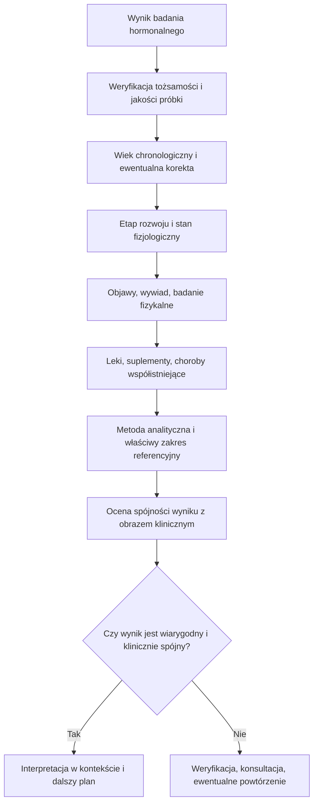
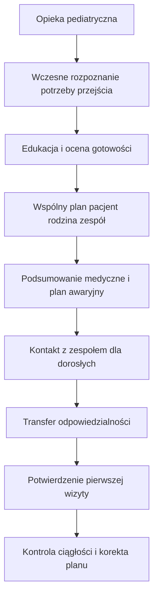

# 1.9. Podstawy endokrynologii dzieci i dorosłych

> **Cel rozdziału:** zrozumienie, że czynność układu hormonalnego zmienia się w toku rozwoju i starzenia, a wynik badania hormonalnego można prawidłowo interpretować wyłącznie w odniesieniu do wieku, etapu rozwoju, płci biologicznej istotnej dla danego parametru, sytuacji fizjologicznej, stosowanych leków, metody analitycznej i obrazu klinicznego.

## Informacje organizacyjne i zastrzeżenia

Rozdział ma charakter dydaktyczny. Nie zastępuje badania lekarskiego, aktualnych wytycznych, charakterystyki produktu leczniczego ani procedur danego laboratorium. Podane granice wieku i przykłady służą orientacji klinicznej; nie są samodzielnymi kryteriami rozpoznania. W praktyce należy korzystać z lokalnych, zwalidowanych zakresów referencyjnych i przedziałów decyzyjnych, właściwych dla metody oraz populacji.

W pediatrii interpretacja wyniku wymaga szczególnej ostrożności: wartości stężeń hormonów mogą zmieniać się szybko w okresie noworodkowym, niemowlęcym i dojrzewania. Zakres dla osoby dorosłej nie może być automatycznie przenoszony na dziecko. Również określenie „norma dla wieku” bywa niewystarczające, jeśli nie uwzględnia etapu dojrzewania, wieku kostnego, fazy cyklu, ciąży lub metody oznaczenia.

---

## 1. Miejsce rozdziału w kursie

Rozdział łączy wiedzę o fizjologii i regulacji hormonalnej z praktyką wywiadu, badania fizykalnego oraz diagnostyki laboratoryjnej. Jego zadaniem jest nauczenie uczestnika rozpoznawania, które różnice między grupami wiekowymi są fizjologiczne, a które mogą wskazywać na zaburzenie wymagające dalszej oceny.

### 1.1. Cele kształcenia

Po ukończeniu rozdziału uczestnik powinien:

1. wyjaśniać najważniejsze zmiany osi hormonalnych od okresu płodowego i noworodkowego do późnej starości;
2. rozróżniać fizjologiczne etapy rozwoju od objawów sugerujących endokrynopatię;
3. rozumieć znaczenie wzrastania, tempa wzrastania, dojrzewania płciowego i wieku kostnego w ocenie dziecka;
4. wskazywać odrębności diagnostyki noworodka, niemowlęcia, dziecka, nastolatka, osoby dorosłej, kobiety w ciąży, osoby w okresie menopauzalnym i seniora;
5. wyjaśniać, dlaczego zakresy referencyjne muszą być dostosowane do wieku i kontekstu fizjologicznego;
6. rozpoznawać sytuacje, w których wynik pozornie prawidłowy może być nieadekwatny do stanu pacjenta;
7. planować bezpieczne przekazanie pacjenta między opieką pediatryczną i dla dorosłych;
8. wskazywać objawy alarmowe wymagające pilnej oceny medycznej.

### 1.2. Oczekiwane efekty uczenia się

Uczestnik po zajęciach:

- opisuje podstawowe cechy osi podwzgórze–przysadka–gruczoł obwodowy w kolejnych okresach życia;
- interpretuje znaczenie wieku chronologicznego, wieku skorygowanego i wieku kostnego;
- rozumie rolę siatek centylowych, z-score i pomiarów seryjnych;
- odróżnia fizjologiczną minipubertę od przedwczesnego dojrzewania;
- zna typowe progi wieku używane do uruchomienia diagnostyki zaburzeń dojrzewania, ale nie traktuje ich jako samodzielnego rozpoznania;
- wyjaśnia, dlaczego ciąża wymaga swoistych przedziałów referencyjnych;
- opisuje kliniczne znaczenie menopauzy i zmian hormonalnych związanych z wiekiem;
- wie, kiedy należy skierować pacjenta do endokrynologa dziecięcego, endokrynologa dorosłych lub innego właściwego specjalisty;
- dokumentuje ograniczenia interpretacji wyników i nie podejmuje decyzji wykraczających poza swoje kompetencje.

---

## 2. Zasada nadrzędna: hormon należy interpretować w kontekście rozwoju

Układ hormonalny nie jest układem statycznym. Jego aktywność podlega zmianom związanym z dojrzewaniem osi neuroendokrynnych, wzrastaniem, dojrzewaniem płciowym, cyklem miesiączkowym, ciążą, laktacją, menopauzą, starzeniem, chorobami przewlekłymi i stosowanymi lekami.

To samo stężenie hormonu może mieć inne znaczenie u wcześniaka, zdrowego niemowlęcia, nastolatka w skoku pokwitaniowym, osoby dorosłej i seniora. Z kolei ten sam wiek chronologiczny nie oznacza identycznego stadium biologicznego u wszystkich osób.

### 2.1. Cztery wymiary kontekstu

| Wymiar | Pytania, które należy zadać | Przykładowe znaczenie |
|---|---|---|
| Wiek i rozwój | Ile pacjent ma lat? Czy jest wcześniakiem? Jak przebiega wzrastanie? | TSH, IGF-1, gonadotropiny i hormony płciowe mają zależne od wieku i rozwoju zakresy |
| Stan fizjologiczny | Czy występuje dojrzewanie, cykl, ciąża, połóg lub menopauza? | hCG wpływa na oś tarczycową; faza cyklu wpływa na estradiol i progesteron |
| Stan kliniczny | Czy pacjent jest ostry, przewlekle chory, niedożywiony lub hospitalizowany? | Choroba pozatarczycowa może zmieniać T3, T4 i TSH bez pierwotnej choroby tarczycy |
| Metoda i warunki pomiaru | Jaką metodą oznaczono hormon? O której godzinie? Czy lek lub suplement mógł wpłynąć na wynik? | Testosteron, kortyzol, prolaktyna i hormony tarczycy wymagają interpretacji z uwzględnieniem warunków pobrania i interferencji |

### 2.2. Wiek chronologiczny, skorygowany i biologiczny

- **Wiek chronologiczny** to czas od urodzenia.
- **Wiek skorygowany** uwzględnia wcześniactwo; w określonych ocenach rozwoju dziecka urodzonego przedwcześnie odejmuje się od wieku chronologicznego liczbę tygodni brakujących do 40. tygodnia ciąży. Zakres stosowania korekty zależy od wieku dziecka i celu oceny.
- **Wiek kostny** jest oszacowaniem dojrzałości szkieletu na podstawie obrazu radiologicznego, najczęściej dłoni i nadgarstka. Nie jest tożsamy z wiekiem chronologicznym.
- **Dojrzałość biologiczna** obejmuje m.in. wzrastanie, dojrzewanie płciowe, rozwój narządów i tempo zmian metabolicznych.

Nie wolno utożsamiać wieku kostnego z „wiekiem hormonalnym” ani na podstawie pojedynczego parametru przypisywać dziecku określonego stadium rozwoju.

### 2.3. Schemat interpretacji

**Wniosek:** nie należy rozpoczynać interpretacji od pytania „czy wynik mieści się w normie?”, lecz od pytania „jaki zakres i jakie znaczenie ma ten wynik dla konkretnej osoby w jej aktualnym stanie fizjologicznym?”.

---

## 3. Najważniejsze zmiany osi hormonalnych w toku życia

### 3.1. Oś podwzgórze–przysadka–tarczyca

Oś tarczycowa uczestniczy w regulacji termogenezy, metabolizmu, pracy serca, dojrzewania układu nerwowego, wzrastania i metabolizmu kostnego.

- W życiu płodowym rozwój osi tarczycowej jest stopniowy; płód korzysta również z hormonów tarczycy matki, szczególnie we wczesnym okresie ciąży.
- Po porodzie występuje fizjologiczna odpowiedź hormonalna związana z adaptacją do życia pozamacicznego, w tym przejściowy wzrost TSH i hormonów tarczycy.
- U noworodka wyniki należy interpretować według wieku w godzinach lub dniach życia, rodzaju materiału i programu przesiewowego.
- W dzieciństwie hormony tarczycy wspierają wzrastanie i dojrzewanie ośrodkowego układu nerwowego.
- W ciąży zmieniają się stężenia białek wiążących, objętość dystrybucji i regulacja osi; hCG może pobudzać receptor TSH.
- W starszym wieku rozkład TSH może przesuwać się ku wyższym wartościom, lecz nie wolno automatycznie uznawać każdego podwyższonego TSH za fizjologiczne starzenie.

Wynik TSH zawsze należy odnieść do FT4, objawów, leków, chorób współistniejących i zakresu laboratorium. U niemowląt i dzieci niedoczynność tarczycy może wpływać na rozwój, dlatego nieprawidłowy wynik przesiewowy wymaga terminowej weryfikacji zgodnie z lokalnym algorytmem.

### 3.2. Oś podwzgórze–przysadka–nadnercza

Oś HPA reguluje odpowiedź na stres, metabolizm, ciśnienie tętnicze, odporność i rytm dobowy.

- W życiu płodowym dojrzewanie osi jest związane z rozwojem nadnerczy i przygotowaniem do porodu.
- Po urodzeniu następuje adaptacja do samodzielnej regulacji gospodarki wodno-elektrolitowej i odpowiedzi stresowej.
- U dzieci interpretacja kortyzolu zależy od pory pobrania, ciężkości choroby, snu, stresu, leków i wieku.
- W okresie dojrzewania zmienia się rytm snu, a opóźnienie fazy dobowej może wpływać na czas pobrania.
- W ciąży wzrasta stężenie białek wiążących kortyzol, a fizjologia osi HPA ulega zmianom; nie należy stosować bezrefleksyjnie zakresów osób nieciężarnych.
- U seniorów zmieniają się rytmy dobowe, odpowiedź na stres i częstość ekspozycji na glikokortykosteroidy.

Nie należy rozpoznawać niewydolności nadnerczy ani hiperkortyzolizmu na podstawie pojedynczego losowego oznaczenia kortyzolu. Wybór testu zależy od podejrzenia klinicznego i aktualnych zaleceń.

### 3.3. Oś podwzgórze–przysadka–gonady

Oś HPG ma różne wzorce aktywności w życiu płodowym, wczesnym dzieciństwie, okresie dojrzewania, wieku reprodukcyjnym i po menopauzie.

- W życiu płodowym gonadotropiny i hormony płciowe uczestniczą w różnicowaniu i rozwoju układu rozrodczego.
- Po urodzeniu występuje przejściowa aktywacja osi HPG, określana jako minipuberta.
- W późniejszym dzieciństwie aktywność osi jest zwykle względnie niska, choć nie oznacza całkowitego braku wydzielania gonadotropin.
- W okresie dojrzewania wzrasta pulsacyjne wydzielanie GnRH, a następnie LH i FSH; zwiększa się produkcja steroidów płciowych.
- W wieku reprodukcyjnym u osób miesiączkujących występują cykliczne zmiany estradiolu, progesteronu, LH i FSH.
- W ciąży funkcje endokrynne gonad zmieniają się pod wpływem hCG, progesteronu, estrogenów i hormonów łożyskowych.
- Po menopauzie zmniejsza się czynność pęcherzykowa jajników, spada estradiol i wzrasta FSH; stężenia hormonów zależą jednak od czasu od menopauzy i ewentualnej terapii hormonalnej.
- U mężczyzn stężenie testosteronu zmienia się z wiekiem w sposób zróżnicowany osobniczo; samo starzenie nie wystarcza do rozpoznania hipogonadyzmu.

### 3.4. Oś hormonu wzrostu i IGF-1

GH jest wydzielany pulsacyjnie, szczególnie w powiązaniu ze snem wolnofalowym. IGF-1 odzwierciedla działanie osi GH w sposób bardziej stabilny niż pojedyncze oznaczenie GH, ale jego interpretacja również zależy od wieku, płci, stadium dojrzewania, stanu odżywienia, funkcji wątroby, chorób przewlekłych i metody.

W okresie dojrzewania stężenie IGF-1 fizjologicznie wzrasta, a następnie zmniejsza się w dorosłości. Wiekowo nieadekwatny zakres referencyjny może prowadzić do błędnej interpretacji. Pojedynczy pomiar GH zwykle nie jest właściwym testem przesiewowym z uwagi na pulsacyjne wydzielanie.

### 3.5. Insulina, glukagon i metabolizm

Wrażliwość na insulinę zmienia się w okresie wzrastania, dojrzewania, ciąży, zmian masy ciała, aktywności fizycznej i starzenia.

- U noworodka gospodarka glukozowa musi dostosować się do przerwania stałego dopływu glukozy z łożyska.
- U wcześniaków, dzieci z małą masą urodzeniową i noworodków obciążonych chorobami ryzyko zaburzeń glikemii jest większe.
- W okresie dojrzewania może występować przejściowe zmniejszenie wrażliwości na insulinę.
- W ciąży narasta fizjologiczna insulinooporność, która umożliwia dostarczanie substratów energetycznych płodowi; u części kobiet ujawnia się cukrzyca ciążowa.
- U osób starszych na ryzyko hipoglikemii wpływają m.in. wielochorobowość, niewydolność nerek, zaburzenia odżywiania, ograniczona świadomość objawów i złożone leczenie.

Interpretacja glikemii i HbA1c wymaga uwzględnienia wieku, ciąży, niedokrwistości, hemoglobinopatii, transfuzji, niewydolności nerek i innych czynników wpływających na HbA1c.

---

## 4. Okres noworodkowy i niemowlęcy

### 4.1. Adaptacja hormonalna po porodzie

Poród oznacza nagłą zmianę środowiska: ustaje łożyskowy transport tlenu, glukozy i hormonów, a noworodek rozpoczyna samodzielną termoregulację, oddychanie, odżywianie i regulację gospodarki wodno-elektrolitowej.

Najważniejsze procesy obejmują:

- przejściową aktywację osi tarczycowej;
- zmianę regulacji glukozy i zwiększenie znaczenia glikogenolizy oraz glukoneogenezy;
- dojrzewanie odpowiedzi kortyzolowej i katecholaminowej;
- zmianę stężeń hormonów płciowych po odłączeniu od krążenia łożyskowego;
- adaptację gospodarki wapniowo-fosforanowej;
- stopniowe dojrzewanie mechanizmów regulacji apetytu, sytości i wzrastania.

Wartość hormonu bez podania dokładnego czasu od urodzenia może być nieinterpretowalna. W neonatologii „wiek pacjenta” bywa liczony w godzinach, dniach lub tygodniach, a nie tylko w ukończonych latach.

### 4.2. Przesiew noworodkowy

Programy przesiewowe mają na celu wykrycie wybranych chorób, zanim pojawią się objawy lub nieodwracalne następstwa. W zależności od kraju i programu obejmują m.in. wrodzoną niedoczynność tarczycy oraz wrodzony przerost nadnerczy.

Zasady interpretacji:

1. Przesiew nie jest tym samym co rozpoznanie.
2. Wynik dodatni wymaga pilnej weryfikacji zgodnie z algorytmem programu.
3. Termin pobrania ma znaczenie; zbyt wczesna próbka, wcześniactwo, transfuzja, ciężka choroba i inne okoliczności mogą wpływać na wynik.
4. Wynik fałszywie ujemny jest możliwy, dlatego objawy kliniczne mają znaczenie nawet po prawidłowym przesiewie.
5. Nie należy opóźniać konsultacji lub diagnostyki potwierdzającej z powodu oczekiwania na kolejny rutynowy termin badania.

### 4.3. Wrodzona niedoczynność tarczycy

Wrodzona niedoczynność tarczycy może być związana z dysgenezją tarczycy, zaburzeniami syntezy hormonów, niedoborem lub nadmiarem jodu, przejściowym wpływem przeciwciał matczynych, leków lub innymi przyczynami.

Wczesne rozpoznanie i leczenie są istotne dla rozwoju układu nerwowego. U noworodka objawy mogą być skąpe lub nieswoiste, dlatego kluczową rolę odgrywa przesiew. Nieprawidłowy wynik wymaga pilnego postępowania według standardu neonatologicznego i pediatryczno-endokrynologicznego.

Możliwe objawy kliniczne, jeśli występują, obejmują przedłużającą się żółtaczkę, trudności w karmieniu, zaparcia, hipotonię, obniżoną aktywność, hipotermię, przepuklinę pępkową i powiększony język. Brak objawów nie wyklucza choroby.

### 4.4. Wrodzony przerost nadnerczy i ryzyko utraty soli

Wrodzony przerost nadnerczy, najczęściej związany z niedoborem 21-hydroksylazy, może prowadzić do niedoboru kortyzolu, niekiedy aldosteronu, oraz nadmiernej produkcji androgenów.

Postać z utratą soli może prowadzić do odwodnienia, wymiotów, zaburzeń elektrolitowych, hipoglikemii, hipotensji i wstrząsu. U noworodka pogorszenie może być szybkie. Nieprawidłowy przesiew lub objawy sugerujące przełom wymagają pilnej oceny lekarskiej.

Nie wolno opierać rozpoznania wyłącznie na wyglądzie zewnętrznych narządów płciowych. Wymagana jest diagnostyka hormonalna, elektrolitowa i specjalistyczna, z poszanowaniem godności dziecka i wsparciem rodziny.

### 4.5. Minipuberta

Po porodzie dochodzi do przejściowej aktywacji osi podwzgórze–przysadka–gonady. W pierwszych miesiącach życia mogą być wykrywalne zwiększone stężenia LH, FSH i hormonów płciowych. Wzorzec oraz czas trwania różnią się między płciami i osobniczo.

Minipuberta:

- jest zjawiskiem fizjologicznym;
- stanowi ważny okres dojrzewania osi rozrodczej;
- może mieć znaczenie w diagnostyce wybranych zaburzeń rozwoju gonad i osi HPG;
- powoduje, że interpretacja gonadotropin u niemowlęcia nie może opierać się na zakresach dla starszych dzieci;
- nie jest równoznaczna z przedwczesnym dojrzewaniem płciowym.

### 4.6. Wzrastanie i żywienie niemowlęcia

W pierwszych latach życia tempo wzrastania jest duże i stopniowo zwalnia. Ocena wymaga seryjnych pomiarów długości ciała, masy, obwodu głowy oraz proporcji tych parametrów.

Należy uwzględniać:

- wiek ciążowy i masę urodzeniową;
- wcześniactwo i wiek skorygowany;
- sposób żywienia i tolerancję pokarmową;
- choroby przewlekłe i wady wrodzone;
- przebieg wzrastania w kolejnych pomiarach;
- obciążenie rodzinne i wzrost rodziców.

Pojedynczy pomiar poniżej określonego centyla nie rozstrzyga o przyczynie. Niepokojące jest m.in. utrwalone odchylanie się od dotychczasowego kanału wzrastania, spowolnienie wzrostu liniowego, nieproporcjonalność ciała lub współistnienie objawów ogólnych.

---

## 5. Dzieciństwo i okres przedpokwitaniowy

### 5.1. Wzrost jako parametr kliniczny

W dzieciństwie wzrost jest wynikiem współdziałania genetyki, odżywienia, zdrowia ogólnego, hormonów tarczycy, GH–IGF-1, glikokortykosteroidów i hormonów płciowych.

W ocenie wzrastania należy rozpatrywać:

- wzrost w odniesieniu do wieku i płci;
- tempo wzrastania w czasie;
- wzrost rodziców i docelowy zakres wzrostu rodzinnego;
- proporcje ciała;
- masę ciała i jej zmianę;
- stadium dojrzewania;
- wiek kostny, jeśli jest wskazany;
- choroby przewlekłe, odżywienie i przyjmowane leki.

**Tempo wzrastania** bywa bardziej informacyjne niż pojedynczy wynik centylowy. Dziecko może być niskie, ale rosnąć stabilnie w swoim kanale; inne może mieć wzrost pozornie prawidłowy, lecz szybko zwalniać.

### 5.2. Siatki centylowe i z-score

Siatki centylowe przedstawiają rozkład cechy w określonej populacji referencyjnej. Z-score opisuje odległość wyniku od średniej wyrażoną w odchyleniach standardowych.

- Centyl nie jest procentem „prawidłowości”.
- Przejście przez kanały centylowe może wynikać z błędu pomiaru, zmiany siatki, choroby lub fizjologicznego wyrównywania wzrostu; wymaga oceny w kontekście.
- Dwa pomiary wykonane nieprawidłową techniką nie tworzą wiarygodnego trendu.
- Do oceny tempa wzrastania należy zachować odpowiedni odstęp między pomiarami, zależny od wieku i sytuacji klinicznej.

W pierwszych dwóch latach życia stosuje się pomiar długości w pozycji leżącej, a następnie wzrostu w pozycji stojącej. Zmiana techniki i siatki może powodować pozorną zmianę klasyfikacji. Należy stosować standardy przyjęte w danym kraju i placówce.

### 5.3. Hormony i czynniki wpływające na wzrastanie

| Czynnik | Rola w rozwoju | Możliwe znaczenie kliniczne |
|---|---|---|
| GH i IGF-1 | Wspierają wzrost liniowy i metabolizm | Niedobór, oporność, nadmiar |
| Hormony tarczycy | Niezbędne dla rozwoju i wzrastania | Niedoczynność może spowalniać wzrost |
| Estrogeny | Wpływają na dojrzewanie i dojrzewanie chrząstek wzrostowych u obu płci | Przyspieszają dojrzewanie szkieletu i zamykanie chrząstek |
| Androgeny | Współuczestniczą w skoku pokwitaniowym i rozwoju cech płciowych | Nadmiar może przyspieszać wiek kostny |
| Glikokortykosteroidy | Regulują metabolizm i odpowiedź stresową | Nadmiar może hamować wzrastanie |
| Insulina i stan odżywienia | Wpływają na dostępność substratów i anabolizm | Niedobory energetyczne i choroby metaboliczne zaburzają wzrost |

### 5.4. Niski wzrost i spowolnienie wzrastania

Niski wzrost może mieć charakter rodzinny, konstytucjonalny, związany z wcześniactwem, niedożywieniem, chorobą przewlekłą, zaburzeniami genetycznymi, chorobami kości lub endokrynopatią.

Szczególnej uwagi wymagają:

- spadek tempa wzrastania;
- wzrost wyraźnie niezgodny z potencjałem rodzinnym;
- nieproporcjonalność ciała;
- opóźnienie lub przyspieszenie wieku kostnego;
- objawy niedoczynności tarczycy, nadmiaru kortyzolu lub niedoboru GH;
- utrata masy ciała, przewlekłe objawy jelitowe lub ogólnoustrojowe;
- ból głowy, zaburzenia widzenia lub objawy neurologiczne.

Nie należy zlecać panelu hormonów „na wszelki wypadek” bez określenia problemu klinicznego. Diagnostyka powinna być ukierunkowana i prowadzona przez uprawnionego klinicystę.

### 5.5. Przedpokwitaniowe dojrzewanie osi hormonalnych

W okresie przedpokwitaniowym stężenia hormonów płciowych są zazwyczaj niższe niż w okresie dojrzewania, ale nie są zerowe. U części dzieci mogą występować łagodne, izolowane cechy adrenarche, np. zapach potu, niewielki trądzik lub owłosienie łonowe, bez pełnej aktywacji osi gonadalnej.

Wczesne owłosienie łonowe nie zawsze oznacza centralne przedwczesne dojrzewanie. Należy odróżnić adrenarche od gonadarche i ocenić tempo progresji, wzrost, rozwój piersi lub jąder oraz inne objawy.

---

## 6. Dojrzewanie płciowe

### 6.1. Fizjologia pokwitania

Dojrzewanie jest procesem neuroendokrynnym, w którym dochodzi do ponownej aktywacji pulsacyjnego wydzielania GnRH. Zwiększa się wydzielanie LH i FSH, a gonady produkują więcej steroidów płciowych.

Proces obejmuje:

- rozwój drugorzędowych cech płciowych;
- skok pokwitaniowy;
- zmianę składu ciała i masy kostnej;
- dojrzewanie psychoseksualne i psychospołeczne;
- zmianę rytmu snu i aktywności dobowej;
- stopniowe uzyskiwanie płodności.

Dojrzewanie nie przebiega identycznie u wszystkich osób. Wiek rozpoczęcia, tempo progresji i kolejność zmian zależą od genetyki, stanu odżywienia, zdrowia, środowiska i wielu innych czynników.

### 6.2. Ocena kliniczna i skala Tannera

Skala Tannera opisuje etapy rozwoju piersi, narządów płciowych i owłosienia łonowego. Powinna być stosowana przez odpowiednio przeszkolony personel, z poszanowaniem prywatności, zgody i godności pacjenta.

U dziewcząt pierwszym typowym objawem gonadarche jest rozwój tkanki gruczołowej piersi. U chłopców wczesnym objawem aktywacji gonad jest zwiększenie objętości jąder. Samo owłosienie łonowe może wynikać z adrenarche i nie przesądza o aktywacji osi HPG.

| Obszar | Co ocenić | Ważne zastrzeżenie |
|---|---|---|
| Piersi | Stadium rozwoju, symetria, tkanka gruczołowa | Asymetria lub tkliwość mogą występować fizjologicznie |
| Jądra | Objętość, konsystencja, symetria | Pomiar wymaga właściwej techniki i doświadczenia |
| Owłosienie | Rozmieszczenie i stadium | Nie jest samodzielnym wskaźnikiem gonadarche |
| Wzrost | Tempo i skok pokwitaniowy | Interpretować w odniesieniu do stadium dojrzewania |
| Skóra | Trądzik, łojotok, zapach potu | Może wiązać się z adrenarche |
| Rozwój psychospołeczny | Samopoczucie, obraz ciała, relacje | Nie wolno patologizować różnic indywidualnych |

### 6.3. Orientacyjne progi wymagające oceny

W wielu klasycznych algorytmach za sygnał do diagnostyki przedwczesnego dojrzewania przyjmuje się pojawienie cech gonadarche przed 8. rokiem życia u dziewcząt i przed 9. rokiem życia u chłopców. Opóźnione dojrzewanie jest rozważane m.in. przy braku rozwoju piersi do 13. roku życia, braku powiększenia jąder do 14. roku życia, braku menarche do 15. roku życia lub po upływie około 3 lat od początku rozwoju piersi.

Są to progi orientacyjne, a nie samodzielne rozpoznania. Różnice populacyjne, dynamika zmian, stan odżywienia, choroby przewlekłe i aktualne zalecenia mogą wpływać na decyzję diagnostyczną. Szybka progresja, przyspieszenie wzrastania, objawy neurologiczne, wirylizacja lub zaburzenia ogólnego stanu wymagają wcześniejszej oceny.

### 6.4. Przedwczesne i opóźnione dojrzewanie

W diagnostyce należy rozróżnić:

- centralne przedwczesne dojrzewanie, związane z przedwczesną aktywacją osi GnRH;
- obwodowe dojrzewanie zależne od steroidów płciowych, niezależne od centralnej aktywacji GnRH;
- izolowane przedwczesne telarche;
- przedwczesne adrenarche;
- opóźnienie konstytucjonalne wzrastania i dojrzewania;
- hipogonadyzm pierwotny lub wtórny;
- zaburzenia związane z chorobą przewlekłą, niedożywieniem lub nadmiernym wysiłkiem;
- zaburzenia genetyczne i anatomiczne.

Ocena może obejmować wywiad, badanie, tempo wzrastania, wiek kostny, wybrane oznaczenia hormonalne i obrazowanie. Dobór badań należy do lekarza, a interpretacja musi uwzględniać stadium dojrzewania.

### 6.5. Prywatność i komunikacja z nastolatkiem

Badanie dojrzewania jest szczególnie wrażliwe. Należy:

1. wyjaśnić cel i zakres badania;
2. uzyskać zgodę zgodnie z wiekiem i obowiązującymi przepisami;
3. umożliwić zadawanie pytań bez obecności opiekuna, jeśli jest to właściwe i zgodne z prawem;
4. zapewnić odpowiednie okrycie i ograniczyć ekspozycję ciała;
5. zaoferować obecność osoby asystującej zgodnie z procedurą;
6. unikać komentarzy oceniających wygląd, masę ciała lub tempo dojrzewania;
7. dokumentować obiektywne ustalenia, nie używając języka stygmatyzującego.

---

## 7. Wiek reprodukcyjny

### 7.1. Cykliczność hormonalna

U osób miesiączkujących aktywność osi HPG jest związana z cyklem jajnikowym i zmianami endometrium. W uproszczeniu wyróżnia się:

- fazę folikularną;
- owulację;
- fazę lutealną.

FSH wspiera rozwój pęcherzyków, estradiol narasta wraz z dojrzewaniem pęcherzyka, a pik LH uczestniczy w wywołaniu owulacji. Po owulacji ciałko żółte wydziela progesteron. W przypadku braku ciąży dochodzi do spadku progesteronu i estradiolu oraz krwawienia miesiączkowego.

Długość cyklu i zmienność hormonalna są osobniczo zróżnicowane. Wynik estradiolu, progesteronu, LH lub FSH bez informacji o dniu cyklu może mieć ograniczoną wartość.

### 7.2. Diagnostyka zaburzeń miesiączkowania

Wywiad powinien obejmować wiek menarche, regularność cyklu, długość krwawień, obfitość, ból, możliwość ciąży, laktację, antykoncepcję, zmianę masy ciała, wysiłek, stres i leki.

W zależności od problemu rozważa się m.in.:

- ciążę;
- zaburzenia czynności tarczycy;
- hiperprolaktynemię;
- PCOS;
- niewydolność jajników;
- czynnościowe zahamowanie osi HPG;
- zaburzenia anatomiczne;
- choroby przewlekłe i zaburzenia odżywiania.

Nie każda nieregularność cyklu oznacza chorobę endokrynną. Z kolei brak miesiączki, krwawienie bardzo obfite, objawy hiperandrogenizmu o szybkim początku, ból lub objawy ogólne wymagają odpowiedniej oceny.

### 7.3. Antykoncepcja hormonalna i leki

Antykoncepcja hormonalna może zmieniać stężenia gonadotropin, estradiolu, progesteronu, SHBG i androgenów, a także maskować naturalny wzorzec cyklu. Niektóre leki wpływają na prolaktynę, czynność tarczycy, metabolizm steroidów lub wyniki testów.

W dokumentacji należy zapisać preparat, dawkę, drogę podania, czas stosowania i ostatnią dawkę. Nie należy samodzielnie odstawiać antykoncepcji ani terapii hormonalnej wyłącznie w celu „poprawienia” wyników bez uzgodnienia z lekarzem.

### 7.4. Mężczyzna w wieku reprodukcyjnym

Testosteron wykazuje rytm dobowy i zmienność biologiczną. Rozpoznanie hipogonadyzmu wymaga zgodności objawów z powtarzalnie niskim stężeniem testosteronu oznaczonym w odpowiednich warunkach, z uwzględnieniem SHBG, chorób, leków i wieku.

Pojedynczy niski wynik podczas ostrej choroby, po niewyspaniu lub w nieodpowiedniej porze nie jest wystarczającą podstawą do rozpoznania. W ocenie płodności ważne są również FSH, LH, prolaktyna i badanie nasienia, ale zakres zależy od wskazania.

---

## 8. Ciąża i połóg

### 8.1. Ciąża jako odrębny stan endokrynny

Ciąża powoduje głęboką przebudowę regulacji hormonalnej. Łożysko staje się narządem endokrynnym, a organizm matki adaptuje metabolizm do potrzeb płodu.

Ważne mediatory obejmują:

- hCG;
- progesteron;
- estrogeny;
- laktogen łożyskowy;
- prolaktynę;
- kortyzol i białka wiążące;
- hormony tarczycy i białka transportujące;
- czynniki regulujące gospodarkę wapniową i kostną.

### 8.2. Tarczyca w ciąży

hCG może pobudzać receptor TSH, szczególnie we wczesnej ciąży. Zwiększa się stężenie globuliny wiążącej tyroksynę, a stężenia hormonów całkowitych i wolnych mogą zmieniać się zależnie od trymestru i metody analitycznej.

Zasady praktyczne:

1. Preferować zakresy referencyjne swoiste dla ciąży, trymestru, populacji i metody.
2. Nie stosować automatycznie zakresu TSH dla osób nieciężarnych.
3. Interpretować TSH wraz z FT4 lub innymi parametrami zgodnie z metodą i wytycznymi.
4. Uwzględniać przeciwciała tarczycowe, wywiad chorób tarczycy i leczenie.
5. Pamiętać, że wyniki FT4 z niektórych immunoanaliz mogą być trudniejsze do interpretacji w ciąży.
6. Nie opóźniać konsultacji w przypadku istotnych odchyleń lub objawów.

W 2026 r. American Thyroid Association opublikowało zaktualizowane wytyczne dotyczące chorób tarczycy przed poczęciem, w ciąży i po porodzie. W praktyce należy korzystać z aktualnej wersji wytycznych oraz zakresów lokalnego laboratorium, a nie utrwalać pojedynczej uniwersalnej wartości granicznej.

### 8.3. Glikemia i insulinooporność ciążowa

W ciąży narasta insulinooporność, szczególnie w późniejszych trymestrach, pod wpływem hormonów łożyskowych i zmian metabolicznych. Celem jest zapewnienie dostępności glukozy dla płodu, lecz u części kobiet mechanizmy kompensacyjne są niewystarczające i rozwija się cukrzyca ciążowa.

Interpretacja glikemii i OGTT musi opierać się na kryteriach przyjętych w danym systemie opieki i aktualnych zaleceniach. Nie należy przenosić bezpośrednio kryteriów diagnostycznych dla osób nieciężarnych.

### 8.4. Nadnercza i przysadka w ciąży

W ciąży zmienia się stężenie kortyzolu całkowitego z powodu wzrostu białka wiążącego kortyzol, a także aktywność osi HPA. Zwiększa się prolaktyna, a przysadka może fizjologicznie powiększać się w związku z rozrostem komórek laktotropowych.

Bóle głowy, zaburzenia widzenia, objawy niedoczynności przysadki, ciężkie osłabienie lub objawy niewydolności nadnerczy nie powinny być automatycznie przypisywane ciąży. Wymagają oceny klinicznej.

### 8.5. Połóg i laktacja

Po porodzie gwałtownie zmienia się profil hormonów łożyskowych. Laktacja jest regulowana przede wszystkim przez prolaktynę i oksytocynę, a jej przebieg zależy również od stymulacji brodawki, stanu zdrowia, snu i czynników psychospołecznych.

Poporodowe zapalenie tarczycy może wystąpić w ciągu pierwszych 12 miesięcy po porodzie. Może mieć przebieg z fazą tyreotoksyczną, następnie niedoczynnościową i stopniowym powrotem do eutyreozy, choć nie u każdej osoby występują wszystkie fazy. Należy różnicować je m.in. z nawrotem choroby Gravesa-Basedowa.

Nie należy uznawać każdego zmęczenia, wahań nastroju lub zmian masy ciała w połogu za fizjologię. Objawy ciężkie, utrzymujące się lub narastające wymagają oceny, w tym wykluczenia chorób tarczycy, przysadki, nadnerczy, niedokrwistości i zaburzeń psychicznych.

---

## 9. Menopauza i okres pomenopauzalny

### 9.1. Definicje i fizjologia

Menopauza jest ostatnią miesiączką wynikającą z ustania czynności pęcherzykowej jajników. Rozpoznaje się ją retrospektywnie po 12 miesiącach braku miesiączki, jeśli nie ma innej przyczyny.

W okresie przejścia menopauzalnego występują wahania czynności jajników, zmienność estradiolu i wzrost FSH. Po menopauzie stężenia estradiolu zwykle są niższe, a FSH wyższe, lecz wartości zależą od czasu od menopauzy, terapii hormonalnej, masy ciała i innych czynników.

### 9.2. Diagnostyka menopauzy

U zdrowych osób w typowym wieku menopauzalnym rozpoznanie jest zwykle kliniczne, oparte na wieku i objawach. Badanie FSH nie jest rutynowo potrzebne u osób w wieku 45 lat i starszych, a interpretacja jest utrudniona podczas stosowania antykoncepcji hormonalnej lub wysokich dawek progestagenów.

Oznaczenia mogą być rozważane w określonych sytuacjach, np. przy podejrzeniu przedwczesnego wygasania czynności jajników lub menopauzy we wcześniejszym wieku. Należy korzystać z aktualnych zaleceń, ponieważ kryteria diagnostyczne i ścieżki postępowania mogą się różnić zależnie od wieku i kontekstu.

### 9.3. Objawy i następstwa

Możliwe objawy obejmują:

- uderzenia gorąca i poty nocne;
- zaburzenia snu;
- zmiany nastroju i koncentracji;
- dolegliwości ze strony układu moczowo-płciowego;
- zmiany libido;
- zmiany składu ciała i rozmieszczenia tkanki tłuszczowej;
- przyspieszoną utratę masy kostnej;
- zmiany profilu lipidowego i ryzyka sercowo-naczyniowego.

Objawy nie są swoiste. Należy różnicować je m.in. z chorobami tarczycy, niedokrwistością, zaburzeniami snu, działaniami leków, depresją i chorobami układu krążenia.

### 9.4. Przedwczesne wygasanie czynności jajników

Wystąpienie zaburzeń czynności jajników przed 40. rokiem życia wymaga odrębnej oceny. Może wiązać się z przyczynami genetycznymi, autoimmunologicznymi, jatrogenicznymi lub pozostawać niewyjaśnione.

Nie należy utożsamiać przedwczesnego wygasania czynności jajników z typową menopauzą w wieku około 50 lat. Konsekwencje dla kości, układu sercowo-naczyniowego, płodności i zdrowia psychicznego wymagają indywidualnego planu opieki.

### 9.5. Okres pomenopauzalny

W opiece pomenopauzalnej znaczenie mają:

- zdrowie kości i ryzyko złamań;
- ciśnienie tętnicze i ryzyko sercowo-naczyniowe;
- glikemia i profil lipidowy;
- objawy moczowo-płciowe;
- sen, nastrój i jakość życia;
- stosowane leki i suplementy;
- indywidualne przeciwwskazania i preferencje dotyczące terapii.

Decyzje o menopauzalnej terapii hormonalnej wymagają oceny wskazań, ryzyka, wieku, czasu od menopauzy, rodzaju preparatu, drogi podania i preferencji pacjentki. Nie jest to uniwersalna metoda zapobiegania starzeniu ani leczenie wszystkich chorób przewlekłych.

---

## 10. Starzenie się układu hormonalnego

### 10.1. Starzenie fizjologiczne a choroba

Starzenie wiąże się ze zmianami rezerw czynnościowych i odpowiedzi hormonalnej, ale nie oznacza, że każde odchylenie jest nieuniknioną normą wieku. Należy odróżniać fizjologiczne zmiany od choroby, skutków leków, niedożywienia, niewydolności narządów i zespołów geriatrycznych.

### 10.2. Tarczyca u osób starszych

U osób starszych mogą występować zmiany rozkładu TSH i metabolizmu hormonów tarczycy. Objawy niedoczynności i nadczynności mogą być nietypowe: zamiast klasycznej nadpobudliwości może występować osłabienie, spadek masy ciała, zaburzenia rytmu serca, pogorszenie funkcji poznawczych lub zaostrzenie niewydolności serca.

Nie należy rozpoznawać ani wykluczać choroby wyłącznie na podstawie wieku. Warto uwzględnić:

- TSH i FT4;
- objawy i ich dynamikę;
- choroby ostre i przewlekłe;
- leki, w tym amiodaron, lit i glikokortykosteroidy;
- ryzyko migotania przedsionków i osteoporozy;
- ryzyko nadmiernego leczenia.

### 10.3. Oś gonadalna u mężczyzn starszych

Testosteron może obniżać się z wiekiem, ale tempo i znaczenie kliniczne są zmienne. Otyłość, cukrzyca, choroby przewlekłe, bezdech senny, opioidy i glikokortykosteroidy mogą wpływać na stężenie testosteronu.

Rozpoznanie hipogonadyzmu wymaga objawów oraz powtarzalnie niskich wyników oznaczeń wykonanych w odpowiednich warunkach. Należy uwzględnić SHBG i możliwość zmian stężenia testosteronu całkowitego bez proporcjonalnej zmiany frakcji wolnej.

### 10.4. GH–IGF-1, kości i skład ciała

Wraz z wiekiem zmniejsza się aktywność osi GH–IGF-1, zmienia się masa mięśniowa i tłuszczowa, a ryzyko sarkopenii i osteoporozy wzrasta. Nie oznacza to, że każda osoba starsza wymaga oznaczania GH lub IGF-1 ani że należy rutynowo stosować hormon wzrostu w celu przeciwdziałania starzeniu.

Ocena powinna koncentrować się na funkcji, odżywieniu, sile mięśniowej, ryzyku upadków, zdrowiu kości, aktywności i chorobach współistniejących.

### 10.5. Glikemia i hipoglikemia u seniorów

U osób starszych ryzyko hipoglikemii może wzrastać z powodu:

- niewydolności nerek lub wątroby;
- nieregularnego żywienia;
- zaburzeń poznawczych;
- ograniczonej samodzielności;
- wielolekowości;
- stosowania insuliny lub leków zwiększających wydzielanie insuliny;
- osłabionej percepcji objawów adrenergicznych.

Cele leczenia glikemii powinny być indywidualizowane z uwzględnieniem stanu funkcjonalnego, rokowania, preferencji i ryzyka hipoglikemii. U osób kruchych priorytetem może być bezpieczeństwo i unikanie objawowej hiperglikemii, a nie intensywne dążenie do jednego wskaźnika.

### 10.6. Wielochorobowość i wielolekowość

U seniora interpretację hormonalną mogą zmieniać m.in. niewydolność nerek, marskość wątroby, stan zapalny, niedożywienie, hipoalbuminemia i leki. Przed zleceniem badania należy określić, czy jego wynik zmieni postępowanie.

---

## 11. Specyfika diagnostyki w różnych grupach wiekowych

### 11.1. Noworodek

Najważniejsze elementy:

- wiek w godzinach i dniach życia;
- wiek ciążowy i masa urodzeniowa;
- przesiew noworodkowy i jego termin;
- wcześniactwo, transfuzje i ciężka choroba;
- sposób żywienia;
- objawy hipoglikemii, odwodnienia, utraty soli lub zaburzeń tarczycy;
- dobór materiału i objętości próbki;
- pilne postępowanie przy nieprawidłowym wyniku.

### 11.2. Niemowlę i małe dziecko

Należy uwzględnić:

- wiek skorygowany u wcześniaków, gdy ma to zastosowanie;
- seryjne pomiary długości, masy i obwodu głowy;
- siatki wzrastania odpowiednie dla wieku i populacji;
- tempo wzrastania i odżywienie;
- minipubertę w pierwszych miesiącach życia;
- wpływ karmienia, infekcji i leków;
- trudności w pobieraniu krwi i konieczność ograniczenia objętości materiału.

### 11.3. Dziecko w wieku szkolnym

Kluczowe są:

- trend wzrastania;
- wzrost rodziców;
- proporcje ciała;
- objawy chorób przewlekłych;
- stadium przedpokwitaniowe;
- aktywność fizyczna, sen i żywienie;
- funkcjonowanie psychospołeczne.

### 11.4. Nastolatek

W diagnostyce należy uwzględnić:

- stadium Tannera;
- tempo dojrzewania;
- wiek kostny, gdy wskazany;
- rytm snu i porę pobrania;
- zmianę masy ciała i aktywność sportową;
- zaburzenia odżywiania;
- prywatność i poufność;
- wpływ antykoncepcji, suplementów i substancji psychoaktywnych;
- przygotowanie do samodzielnego zarządzania chorobą.

### 11.5. Osoba dorosła

Ważne są:

- wiek, płeć i sytuacja reprodukcyjna;
- faza cyklu lub stosowanie hormonów;
- pora pobrania i rytm dobowy;
- choroby przewlekłe i leki;
- stan odżywienia i aktywność;
- objawy oraz prawdopodobieństwo przedtestowe;
- zakres referencyjny metody.

### 11.6. Ciąża i połóg

Należy stosować zakresy i algorytmy właściwe dla ciąży lub połogu, uwzględniając trymestr, czas od porodu, laktację, choroby tarczycy i przyjmowane leki. Nie wolno mechanicznie przenosić wyników z populacji nieciężarnej.

### 11.7. Senior

Należy rozważyć:

- wielochorobowość i wielolekowość;
- funkcję nerek i wątroby;
- stan odżywienia i albuminę;
- ryzyko hipoglikemii;
- ryzyko upadków i złamań;
- nietypową prezentację chorób;
- cele opieki i preferencje pacjenta.

---

## 12. Pediatryczne i dorosłe zakresy referencyjne

### 12.1. Zakres referencyjny nie jest uniwersalną granicą zdrowia

Zakres referencyjny zwykle opisuje rozkład wyników w wybranej populacji referencyjnej. Przedział decyzyjny jest natomiast granicą stosowaną w określonym celu klinicznym. Nie są to pojęcia tożsame.

Wynik poza zakresem referencyjnym nie zawsze oznacza chorobę, a wynik w zakresie nie wyklucza choroby. Właściwa interpretacja wymaga znajomości metody, populacji i kontekstu klinicznego.

### 12.2. Co powinien uwzględniać zakres pediatryczny?

- dokładny wiek, niekiedy w miesiącach lub dniach;
- płeć biologiczną istotną dla danego parametru;
- stadium dojrzewania;
- wiek ciążowy lub skorygowany, jeśli ma zastosowanie;
- porę pobrania;
- metodę i platformę analityczną;
- populację, w której zwalidowano zakres;
- stan fizjologiczny i warunki pobrania.

Dla niektórych hormonów zakresy zmieniają się na tyle szybko, że konieczne jest rozróżnienie noworodka, niemowlęcia, dziecka przedpokwitaniowego i kolejnych stadiów dojrzewania.

### 12.3. Przykłady parametrów silnie zależnych od wieku i rozwoju

| Parametr | Co wpływa na interpretację? | Typowy błąd |
|---|---|---|
| TSH i FT4 | Wiek, okres noworodkowy, ciąża, metoda | Użycie jednego zakresu dla wszystkich |
| IGF-1 | Wiek, płeć, stadium Tannera, odżywienie | Porównanie wyniku nastolatka z zakresem dorosłych |
| LH i FSH | Wiek, minipuberta, stadium dojrzewania, cykl | Interpretacja niemowlęcia według zakresu dziecka szkolnego |
| Estradiol | Wiek, stadium dojrzewania, faza cyklu, ciąża | Brak informacji o fazie cyklu |
| Progesteron | Faza cyklu, ciąża, terapia hormonalna | Ocenianie wyniku bez daty cyklu |
| Testosteron | Wiek, pora pobrania, SHBG, choroba, leki | Rozpoznanie na podstawie jednego losowego wyniku |
| Kortyzol | Pora, stres, białka wiążące, ciąża, leki | Stosowanie jednego progu niezależnie od testu |
| Prolaktyna | Stres, sen, ciąża, laktacja, leki | Brak uwzględnienia warunków pobrania |
| Glukoza i HbA1c | Wiek, ciąża, niedokrwistość, transfuzja, nerki | Traktowanie HbA1c jako wiarygodnej w każdej sytuacji |
| Wapń | Albumina, pH, funkcja nerek, wiek | Utożsamianie wapnia całkowitego ze zjonizowanym |

### 12.4. Różnice między metodami laboratoryjnymi

Wyniki oznaczeń hormonów mogą różnić się między platformami z powodu przeciwciał, kalibracji, swoistości analitycznej, interferencji i zakresu pomiarowego.

- Nie należy bezrefleksyjnie porównywać wyników z różnych laboratoriów.
- W monitorowaniu trendu warto, jeśli to możliwe, korzystać z tej samej metody.
- Przy wyniku niezgodnym z obrazem klinicznym należy rozważyć interferencję, powtórzenie badania lub metodę alternatywną.
- W przypadku hormonów o niskich stężeniach, np. steroidów płciowych u dzieci, znaczenie może mieć czułość i swoistość metody.
- W razie wątpliwości należy skontaktować się z laboratorium i lekarzem odpowiedzialnym za interpretację.

### 12.5. Wartości referencyjne w ciąży i menopauzie

Ciąża wymaga odrębnych zakresów dla wybranych hormonów i parametrów metabolicznych, najlepiej dostosowanych do trymestru, populacji i metody. W okresie menopauzalnym pojedynczy wynik FSH lub estradiolu nie zawsze pozwala ustalić stan kliniczny, szczególnie przy stosowaniu hormonów.

### 12.6. Zakresy referencyjne a decyzje kliniczne

Przedział referencyjny nie jest automatycznie wskazaniem do leczenia. Decyzja zależy od:

- rozpoznania i prawdopodobieństwa przedtestowego;
- objawów;
- ryzyka powikłań;
- potwierdzenia wyniku;
- aktualnych wytycznych;
- wieku i stanu funkcjonalnego;
- preferencji pacjenta.

---

## 13. Przejście z opieki pediatrycznej do opieki dla dorosłych

### 13.1. Transfer nie jest pojedynczym skierowaniem

Przejście (transition) oznacza zaplanowany, stopniowy proces przygotowania młodej osoby do samodzielniejszego korzystania z opieki zdrowotnej. Transfer (transfer of care) jest konkretnym momentem przekazania odpowiedzialności do zespołu opieki dla dorosłych.

Europejskie wspólne wytyczne ESPE/ESE z 2026 r. podkreślają potrzebę elastycznego, skoordynowanego i zorientowanego na pacjenta programu przejścia, obejmującego m.in. edukację, gotowość do samoopieki, dokumentację, współpracę zespołów, wsparcie psychospołeczne i plan opieki.

### 13.2. Elementy dobrego programu przejścia

1. Wczesne rozpoznanie potrzeby przejścia.
2. Rozmowa z pacjentem i rodziną w sposób dostosowany do rozwoju.
3. Stopniowe zwiększanie samodzielności pacjenta.
4. Ocena umiejętności zarządzania lekami i wizytami.
5. Przygotowanie podsumowania medycznego.
6. Ustalenie zespołu lub lekarza przyjmującego.
7. Przekazanie planu leczenia, monitorowania i postępowania w nagłych sytuacjach.
8. Potwierdzenie, że pacjent zgłosił się do nowego zespołu.
9. Zaplanowanie kontaktu po transferze.
10. Uwzględnienie zdrowia psychicznego, edukacji, pracy i wsparcia społecznego.

### 13.3. Co powinno znaleźć się w podsumowaniu medycznym?

- rozpoznanie i jego etiologia, jeśli znana;
- przebieg choroby i najważniejsze hospitalizacje;
- dotychczasowe leczenie i reakcja na terapię;
- aktualne leki, dawki i sposób przyjmowania;
- alergie i działania niepożądane;
- wyniki kluczowych badań i obrazowania;
- stan wzrastania i dojrzewania, jeśli istotny;
- ryzyko ostrego pogorszenia i plan awaryjny;
- terminy kontroli i badania wymagane w przyszłości;
- dane kontaktowe zespołu przekazującego i przyjmującego;
- preferencje pacjenta dotyczące komunikacji i udziału opiekunów.

### 13.4. Schemat przejścia

Nie należy uzależniać przejścia wyłącznie od ukończenia określonego wieku. Ważne są stabilność kliniczna, gotowość, dostępność opieki i charakter choroby. Proces powinien zapobiegać przerwaniu leczenia.

---

## 14. Bezpieczeństwo pacjenta i sytuacje alarmowe

### 14.1. Noworodek i niemowlę

Pilnej oceny wymagają m.in.:

- zaburzenia świadomości, drgawki lub znaczna wiotkość;
- objawy ciężkiej hipoglikemii;
- uporczywe wymioty, odwodnienie i objawy wstrząsu;
- zaburzenia elektrolitowe lub podejrzenie utraty soli;
- hipotermia, zaburzenia oddychania i ciężki stan ogólny;
- nieprawidłowy wynik przesiewowy wymagający pilnej weryfikacji;
- słabe karmienie z pogorszeniem stanu ogólnego.

### 14.2. Dziecko i nastolatek

Pilnej oceny wymagają:

- zaburzenia świadomości, drgawki i ciężka hipoglikemia;
- nasilone pragnienie, wielomocz, wymioty, ból brzucha i przyspieszony oddech mogące wskazywać na kwasicę ketonową;
- gwałtowny ból głowy z zaburzeniami widzenia lub objawami neurologicznymi;
- szybka progresja cech dojrzewania z objawami neurologicznymi;
- ciężkie odwodnienie, omdlenie lub hipotensja;
- objawy ostrej niewydolności nadnerczy.

### 14.3. Ciąża i połóg

Pilnej oceny wymagają:

- ciężkie zaburzenia świadomości lub objawy wstrząsu;
- ciężka hiperglikemia z objawami odwodnienia lub kwasicy;
- istotne zaburzenia rytmu serca lub niewydolność krążenia;
- silny ból głowy, zaburzenia widzenia i objawy neurologiczne;
- nasilone objawy sugerujące ciężką tyreotoksykozę;
- objawy niewydolności nadnerczy;
- gwałtowne pogorszenie stanu ogólnego.

### 14.4. Osoba starsza

Szczególnej uwagi wymagają:

- hipoglikemia, zwłaszcza z upadkiem lub zaburzeniami świadomości;
- hiperglikemia z odwodnieniem;
- zaburzenia rytmu serca;
- nagłe pogorszenie funkcji poznawczych;
- ciężkie osłabienie, hipotermia lub hipotensja;
- objawy ostrej niewydolności nadnerczy;
- złamanie niskoenergetyczne lub nagły ból kręgosłupa.

**Zasada bezpieczeństwa:** w sytuacji ostrej nie należy opóźniać stabilizacji pacjenta z powodu oczekiwania na planowe oznaczenia hormonalne. Postępowanie ratunkowe prowadzi odpowiednio przygotowany zespół zgodnie z lokalnymi procedurami.

---

## 15. Granice kompetencji i odpowiedzialność zawodowa

Zakres czynności zależy od zawodu, kwalifikacji, uprawnień, miejsca udzielania świadczeń i obowiązujących przepisów. Uczestnik kursu powinien:

- rozpoznawać objawy wymagające skierowania lub pilnej pomocy;
- wykonywać wyłącznie czynności, do których jest przygotowany i uprawniony;
- nie diagnozować endokrynopatii na podstawie pojedynczego wyniku bez właściwej oceny;
- nie modyfikować samodzielnie dawek hormonów, insuliny, glikokortykosteroidów ani leków wpływających na gospodarkę elektrolitową;
- nie zalecać odstawienia terapii w celu uzyskania „lepszego” wyniku;
- nie interpretować samodzielnie testów dynamicznych poza zakresem kompetencji;
- przekazywać niepokojące objawy właściwemu klinicyście;
- dokumentować źródło danych, ograniczenia pomiaru i wykonane czynności;
- respektować zgodę, poufność i prawa pacjenta, w tym małoletniego.

Współpraca z rodzicami lub opiekunami powinna wspierać dobro dziecka, a nie zastępować jego udział w decyzjach w stopniu możliwym do osiągnięcia rozwojowo i zgodnym z prawem.

---

## 16. Praktyczny algorytm doboru zakresu referencyjnego

1. Ustal, jaki hormon lub parametr został oznaczony.
2. Sprawdź jednostkę, metodę i laboratorium.
3. Ustal dokładny wiek; u noworodka również wiek w godzinach lub dniach.
4. U wcześniaka sprawdź wiek ciążowy i skorygowany, jeśli ma zastosowanie.
5. U dziecka i nastolatka ustal etap dojrzewania.
6. U osoby miesiączkującej ustal fazę cyklu i stosowanie hormonów.
7. U ciężarnej ustal trymestr i czas od porodu w połogu.
8. U seniora oceń choroby współistniejące, leki i stan funkcjonalny.
9. Sprawdź warunki pobrania i możliwe interferencje.
10. Wybierz zakres referencyjny właściwy dla metody i populacji.
11. Oceń spójność wyniku z objawami i pozostałymi badaniami.
12. W razie rozbieżności skonsultuj wynik z lekarzem i laboratorium; nie wyciągaj wniosków z pojedynczego parametru.

### 16.1. Lista kontrolna przed interpretacją

- [ ] Czy potwierdzono tożsamość pacjenta i poprawność próbki?
- [ ] Czy znany jest dokładny wiek?
- [ ] Czy uwzględniono wcześniactwo i wiek skorygowany?
- [ ] Czy znane jest stadium dojrzewania?
- [ ] Czy występuje ciąża, połóg lub laktacja?
- [ ] Czy znana jest faza cyklu miesiączkowego?
- [ ] Czy pacjent przyjmuje hormony, glikokortykosteroidy, biotynę lub inne leki mogące wpływać na wynik?
- [ ] Czy uwzględniono porę pobrania i stan kliniczny?
- [ ] Czy zakres pochodzi z właściwej metody i populacji?
- [ ] Czy wynik jest zgodny z obrazem klinicznym?
- [ ] Czy istnieją objawy alarmowe?
- [ ] Czy dalsza interpretacja mieści się w kompetencjach osoby oceniającej?

---

## 17. Przykłady kliniczno-dydaktyczne

Przypadki są fikcyjne i służą nauce rozumowania. Nie stanowią instrukcji samodzielnego rozpoznawania ani leczenia.

### Przypadek 1. Noworodek z nieprawidłowym wynikiem przesiewowym

Noworodek w pierwszych dniach życia ma wynik przesiewowy sugerujący możliwość zaburzenia czynności tarczycy. Dziecko jest aktywne i dobrze ssie.

**Pytania do analizy:**
1. Czy brak objawów wyklucza wrodzoną niedoczynność tarczycy?
2. Jakie znaczenie ma dokładny czas pobrania?
3. Czy wynik przesiewowy jest rozpoznaniem?
4. Jakie działania powinny nastąpić zgodnie z programem przesiewowym?

**Omówienie:** brak objawów nie wyklucza choroby. Wynik przesiewowy wymaga terminowej diagnostyki potwierdzającej według algorytmu. Należy uwzględnić czas pobrania, wiek ciążowy, transfuzje, chorobę noworodka i metodę. Nie wolno uspokajać rodziny wyłącznie na podstawie dobrego wyglądu dziecka ani odkładać weryfikacji.

### Przypadek 2. Dziecko z obniżeniem tempa wzrastania

Dziecko w wieku szkolnym od kilku lat przesuwa się w dół kanałów centylowych wzrostu. Masa ciała pozostaje względnie stabilna, a rodzice zgłaszają przewlekłe zmęczenie.

**Pytania do analizy:**
1. Dlaczego tempo wzrastania jest ważne?
2. Jakie dane rodzinne i żywieniowe należy zebrać?
3. Jakie choroby ogólne i endokrynne mogą być brane pod uwagę?
4. Dlaczego nie wystarczy pojedyncze oznaczenie GH?

**Omówienie:** spowolnienie wzrastania wymaga oceny pomiarów seryjnych, techniki pomiaru, wzrostu rodziców, proporcji ciała, stadium dojrzewania i chorób przewlekłych. GH jest wydzielany pulsacyjnie; diagnostyka osi GH opiera się na całości obrazu i odpowiednio dobranych badaniach, nie na losowym pojedynczym stężeniu.

### Przypadek 3. Nastolatek z wczesnymi cechami dojrzewania

U dziecka przed 8. rokiem życia pojawia się rozwój piersi i przyspieszenie wzrastania. Rodzina zauważa szybką zmianę wyglądu.

**Pytania do analizy:**
1. Czy samo owłosienie łonowe byłoby wystarczające do rozpoznania centralnego dojrzewania?
2. Jak ocenia się tempo progresji?
3. Jakie znaczenie może mieć wiek kostny?
4. Kiedy potrzebna jest pilna konsultacja?

**Omówienie:** rozwój piersi jest cechą gonadarche, ale rozpoznanie wymaga oceny klinicznej i różnicowania przyczyn centralnych i obwodowych. Należy uwzględnić tempo zmian, wzrastanie, objawy neurologiczne i wyniki badań dobranych przez specjalistę. Sam próg wieku jest sygnałem do oceny, nie rozpoznaniem.

### Przypadek 4. Kobieta w ciąży z niejednoznacznym wynikiem TSH

Kobieta w pierwszym trymestrze ciąży ma TSH, które w laboratorium oznaczono jako nieznacznie podwyższone względem zakresu dla osób nieciężarnych.

**Pytania do analizy:**
1. Dlaczego zakres dla osób nieciężarnych może być nieodpowiedni?
2. Jaką rolę odgrywa hCG?
3. Dlaczego trzeba znać metodę i zakres laboratorium?
4. Jakie informacje o wcześniejszej chorobie tarczycy i leczeniu są ważne?

**Omówienie:** ciąża zmienia fizjologię osi tarczycowej i białka transportujące. Wynik należy odnieść do zakresu ciążowego, trymestru, metody, FT4, przeciwciał i wywiadu. Decyzję kliniczną podejmuje lekarz zgodnie z aktualnymi wytycznymi, w tym z uwzględnieniem aktualizacji ATA z 2026 r.

### Przypadek 5. Objawy w okresie menopauzalnym

Osoba w wieku 49 lat zgłasza uderzenia gorąca, zaburzenia snu i nieregularne miesiączki. Przyjmuje antykoncepcję hormonalną.

**Pytania do analizy:**
1. Czy pojedyncze FSH pozwoli wiarygodnie ustalić menopauzę?
2. Jakie znaczenie ma stosowana antykoncepcja?
3. Jakie inne przyczyny objawów należy rozważyć?
4. Jak przeprowadzić rozmowę o jakości życia i preferencjach?

**Omówienie:** hormony stosowane w antykoncepcji mogą utrudniać interpretację FSH i cyklu. W typowym wieku menopauzalnym rozpoznanie jest często kliniczne, lecz wymaga oceny innych przyczyn objawów i krwawień. Nie należy odstawiać leku bez uzgodnienia z lekarzem.

### Przypadek 6. Senior z osłabieniem i niską glikemią

Osoba starsza leczona z powodu cukrzycy doświadcza osłabienia, upadków i epizodów splątania, szczególnie przy nieregularnych posiłkach.

**Pytania do analizy:**
1. Jakie czynniki zwiększają ryzyko hipoglikemii?
2. Jakie znaczenie ma funkcja nerek?
3. Dlaczego cele glikemii powinny być indywidualizowane?
4. Kiedy konieczna jest pilna pomoc?

**Omówienie:** trzeba ocenić leki, żywienie, funkcję nerek, samodzielność, funkcje poznawcze i ryzyko upadków. Splątanie może być objawem hipoglikemii i wymaga szybkiej oceny. Plan leczenia powinien ograniczać ryzyko ciężkich epizodów i być dostosowany do stanu funkcjonalnego.

---

## 18. Ćwiczenia dydaktyczne

### Ćwiczenie 1. Dobór zakresu referencyjnego

Otrzymujesz trzy wyniki IGF-1: noworodka, nastolatka w stadium dojrzewania i osoby dorosłej. Przygotuj listę danych niezbędnych do interpretacji każdego wyniku.

**Oczekiwany rezultat:** uczestnik wskazuje wiek, płeć, stadium dojrzewania, metodę, stan odżywienia i choroby współistniejące; wyjaśnia, dlaczego zakres dorosłych nie może być zastosowany do dziecka.

### Ćwiczenie 2. Ocena wzrastania

Na podstawie przykładowych pomiarów wzrostu i masy z trzech kolejnych wizyt określ, czy trend jest stabilny, czy wymaga dalszej oceny. Uwzględnij błąd pomiaru, wzrost rodziców i stadium dojrzewania.

**Oczekiwany rezultat:** uczestnik nie wyciąga wniosków z pojedynczego centyla i potrafi wskazać znaczenie tempa wzrastania.

### Ćwiczenie 3. Rozróżnianie adrenarche i gonadarche

Przygotuj tabelę porównującą izolowane owłosienie łonowe, rozwój piersi, powiększenie jąder i przyspieszenie wzrastania.

**Oczekiwany rezultat:** uczestnik rozumie, że owłosienie może wynikać z adrenarche, a rozwój gonad jest istotnym elementem oceny aktywacji osi HPG.

### Ćwiczenie 4. Interpretacja wyniku w ciąży

Przeanalizuj hipotetyczny wynik TSH i FT4 u ciężarnej, mając do dyspozycji dwa zakresy: dla osób nieciężarnych i dla określonego trymestru.

**Oczekiwany rezultat:** uczestnik wskazuje właściwy zakres, ograniczenia metody, potrzebę korelacji klinicznej i konieczność decyzji lekarskiej.

### Ćwiczenie 5. Plan przejścia do opieki dla dorosłych

Opracuj plan przekazania 17-letniej osoby z przewlekłą chorobą endokrynną. Uwzględnij edukację, samodzielne przyjmowanie leków, dokumentację, plan awaryjny i pierwszą wizytę w opiece dla dorosłych.

**Oczekiwany rezultat:** uczestnik rozróżnia przejście od transferu i planuje potwierdzenie ciągłości opieki.

---

## 19. Pytania kontrolne

1. Dlaczego ten sam wynik TSH może mieć inne znaczenie u noworodka i dorosłego?
2. Czym różni się wiek chronologiczny od skorygowanego?
3. Kiedy należy rozważyć wiek kostny?
4. Dlaczego wynik przesiewowy noworodka nie jest równoznaczny z rozpoznaniem?
5. Na czym polega minipuberta?
6. Dlaczego pojedynczy pomiar wzrostu nie wystarcza do oceny tempa wzrastania?
7. Jakie czynniki wpływają na interpretację IGF-1?
8. Czym różni się adrenarche od gonadarche?
9. Jakie są orientacyjne progi wieku skłaniające do oceny przedwczesnego dojrzewania?
10. Dlaczego stadium Tannera ma znaczenie dla interpretacji hormonów?
11. Dlaczego wynik estradiolu należy odnieść do fazy cyklu?
12. Jak antykoncepcja hormonalna może wpływać na interpretację badań?
13. Dlaczego ciąża wymaga odrębnych zakresów dla wybranych hormonów?
14. Jak hCG wpływa na oś tarczycową?
15. Czym jest poporodowe zapalenie tarczycy?
16. Dlaczego pojedynczy wynik FSH nie zawsze rozpoznaje menopauzę?
17. Jakie czynniki mogą wpływać na stężenie testosteronu u starszego mężczyzny?
18. Dlaczego u seniora należy oceniać ryzyko hipoglikemii i wielolekowość?
19. Czym różni się zakres referencyjny od przedziału decyzyjnego?
20. Jakie elementy powinno zawierać bezpieczne przekazanie pacjenta z opieki pediatrycznej do opieki dla dorosłych?

---

## 20. Test sprawdzający

W każdym pytaniu wybierz jedną najlepszą odpowiedź, chyba że treść pytania stanowi inaczej.

### Pytanie 1
Wynik hormonu u noworodka należy interpretować przede wszystkim z uwzględnieniem:

A. wyłącznie zakresu dla dorosłych  
B. dokładnego wieku po urodzeniu, wieku ciążowego, metody i kontekstu klinicznego  
C. wyłącznie masy ciała  
D. wyłącznie objawów zgłaszanych przez opiekuna

**Prawidłowa odpowiedź: B.** W okresie noworodkowym zmiany hormonalne są dynamiczne, a czas pobrania i wiek ciążowy mogą istotnie wpływać na wynik.

### Pytanie 2
Minipuberta to:

A. zawsze patologiczne przedwczesne dojrzewanie  
B. przejściowa fizjologiczna aktywacja osi podwzgórze–przysadka–gonady po urodzeniu  
C. wyłącznie wzrost androgenów nadnerczowych  
D. okres menopauzy

**Prawidłowa odpowiedź: B.** Jest to fizjologiczny etap wczesnego rozwoju osi HPG.

### Pytanie 3
Najbardziej użytecznym elementem oceny wzrastania jest:

A. pojedynczy pomiar wzrostu bez wcześniejszych danych  
B. samo BMI  
C. seria wiarygodnych pomiarów i tempo wzrastania  
D. pojedyncze stężenie GH

**Prawidłowa odpowiedź: C.** Trend pozwala ocenić dynamikę wzrostu i ogranicza ryzyko błędnej interpretacji pojedynczego pomiaru.

### Pytanie 4
Owłosienie łonowe u dziecka:

A. zawsze dowodzi aktywacji osi gonadalnej  
B. może wynikać z adrenarche bez centralnej aktywacji osi HPG  
C. zawsze oznacza guz gonady  
D. wyklucza zaburzenia hormonalne

**Prawidłowa odpowiedź: B.** Adrenarche i gonadarche są odrębnymi procesami.

### Pytanie 5
U chłopca wczesnym klinicznym wskaźnikiem gonadarche jest zwykle:

A. wyłącznie trądzik  
B. wyłącznie zapach potu  
C. zwiększenie objętości jąder  
D. wyłącznie owłosienie pachowe

**Prawidłowa odpowiedź: C.** Powiększenie jąder odzwierciedla aktywację gonad, choć wymaga właściwej oceny klinicznej.

### Pytanie 6
Wynik IGF-1 u nastolatka powinien być interpretowany z uwzględnieniem:

A. wyłącznie zakresu dorosłych  
B. wieku, płci, stadium dojrzewania, metody i stanu odżywienia  
C. wyłącznie masy ciała  
D. wyłącznie pory posiłku

**Prawidłowa odpowiedź: B.** IGF-1 silnie zależy od etapu rozwoju i warunków klinicznych.

### Pytanie 7
W ciąży interpretacja TSH powinna uwzględniać:

A. wyłącznie zakres dla osób nieciężarnych  
B. trymestr, populację, metodę i właściwy zakres ciążowy  
C. wyłącznie objawy  
D. wyłącznie masę ciała

**Prawidłowa odpowiedź: B.** Fizjologia ciąży zmienia oś tarczycową i parametry laboratoryjne.

### Pytanie 8
hCG we wczesnej ciąży może:

A. pobudzać receptor TSH  
B. całkowicie hamować wydzielanie T4  
C. działać wyłącznie na nadnercza  
D. nie mieć żadnego wpływu na tarczycę

**Prawidłowa odpowiedź: A.** hCG wykazuje aktywność tyreotropową i może obniżać TSH.

### Pytanie 9
Poporodowe zapalenie tarczycy:

A. zawsze występuje tylko w pierwszym tygodniu po porodzie  
B. może wystąpić w ciągu pierwszych 12 miesięcy po porodzie  
C. zawsze wymaga operacji  
D. jest tym samym co choroba Gravesa-Basedowa

**Prawidłowa odpowiedź: B.** Jest to zaburzenie o możliwym przebiegu fazowym, wymagające różnicowania.

### Pytanie 10
U osoby w wieku 45 lat lub starszej z typowymi objawami menopauzy:

A. FSH musi być oznaczone u każdej osoby  
B. rozpoznanie często jest kliniczne, a FSH nie jest rutynowo konieczne  
C. AMH zawsze rozpoznaje menopauzę  
D. pojedynczy estradiol jest zawsze rozstrzygający

**Prawidłowa odpowiedź: B.** Zalecenia NICE nie rekomendują rutynowego wykorzystywania szeregu badań hormonalnych do identyfikacji menopauzy w tej grupie wieku.

### Pytanie 11
Rozpoznanie hipogonadyzmu u mężczyzny wymaga:

A. wyłącznie wieku powyżej 60 lat  
B. samych nieswoistych objawów  
C. objawów i powtarzalnie niskich wyników testosteronu w odpowiednich warunkach  
D. jednego losowego oznaczenia po południu

**Prawidłowa odpowiedź: C.** Rozpoznanie wymaga korelacji klinicznej i wiarygodnych oznaczeń.

### Pytanie 12
Zakres referencyjny:

A. jest zawsze granicą leczenia  
B. jest identyczny dla wszystkich metod  
C. opisuje wyniki populacji referencyjnej i nie jest automatycznie progiem diagnostycznym  
D. nie zależy od wieku

**Prawidłowa odpowiedź: C.** Przedział referencyjny i kliniczny próg decyzyjny to różne pojęcia.

### Pytanie 13
U seniora z cukrzycą i upadkami należy szczególnie rozważyć:

A. wyłącznie hiperglikemię  
B. ryzyko hipoglikemii, funkcję nerek, żywienie, leki i funkcje poznawcze  
C. wyłącznie wiek  
D. wyłącznie HbA1c

**Prawidłowa odpowiedź: B.** Bezpieczeństwo i indywidualizacja celów są kluczowe.

### Pytanie 14
Przejście z opieki pediatrycznej do opieki dla dorosłych:

A. polega wyłącznie na wystawieniu skierowania w dniu 18. urodzin  
B. jest procesem stopniowym, obejmującym edukację, koordynację i transfer  
C. nie wymaga dokumentacji  
D. powinno odbywać się bez udziału pacjenta

**Prawidłowa odpowiedź: B.** Współczesne zalecenia podkreślają planowanie, gotowość i ciągłość opieki.

### Pytanie 15
Jeżeli wynik hormonalny jest niezgodny z obrazem klinicznym, należy:

A. automatycznie uznać wynik za prawidłowy  
B. automatycznie rozpocząć leczenie  
C. zweryfikować warunki pobrania, metodę, interferencje i skonsultować interpretację  
D. zignorować objawy

**Prawidłowa odpowiedź: C.** Rozbieżność jest wskazaniem do sprawdzenia wiarygodności wyniku i kontekstu klinicznego.

### Klucz odpowiedzi

| Nr | Odpowiedź | Główna kompetencja |
|---:|:---:|---|
| 1 | B | Interpretacja noworodkowa |
| 2 | B | Fizjologia minipuberty |
| 3 | C | Ocena wzrastania |
| 4 | B | Adrenarche i gonadarche |
| 5 | C | Ocena dojrzewania |
| 6 | B | Interpretacja IGF-1 |
| 7 | B | Diagnostyka ciąży |
| 8 | A | Fizjologia hCG |
| 9 | B | Połóg |
| 10 | B | Menopauza |
| 11 | C | Hipogonadyzm |
| 12 | C | Zakresy referencyjne |
| 13 | B | Bezpieczeństwo seniora |
| 14 | B | Ciągłość opieki |
| 15 | C | Weryfikacja wyniku |

**Proponowana interpretacja dydaktyczna wyniku:** 13–15 poprawnych odpowiedzi – bardzo dobre opanowanie; 10–12 – opanowanie dobre, wymagające powtórzenia wybranych zagadnień; 7–9 – potrzebne uzupełnienie; 0–6 – zalecane ponowne przepracowanie rozdziału. Progi są wyłącznie propozycją dydaktyczną, a nie formalnym standardem oceny kompetencji zawodowych.

---

## 21. Słownik pojęć

| Pojęcie | Definicja |
|---|---|
| Wiek chronologiczny | Czas od urodzenia |
| Wiek skorygowany | Wiek uwzględniający wcześniactwo, stosowany w określonych ocenach rozwoju |
| Wiek kostny | Oszacowanie dojrzałości szkieletu na podstawie obrazu radiologicznego |
| Wzrastanie liniowe | Zwiększanie długości lub wysokości ciała |
| Tempo wzrastania | Zmiana wzrostu w jednostce czasu |
| Centyl | Pozycja wyniku w rozkładzie populacji referencyjnej |
| Z-score | Odchylenie wyniku od średniej wyrażone w odchyleniach standardowych |
| Minipuberta | Przejściowa aktywacja osi HPG we wczesnym okresie po urodzeniu |
| Adrenarche | Zwiększenie aktywności androgenowej kory nadnerczy |
| Gonadarche | Aktywacja osi HPG i czynności gonad |
| Pokwitanie | Okres dojrzewania płciowego i zmian somatycznych |
| Stadium Tannera | Klasyfikacja etapów rozwoju cech płciowych |
| Menarche | Pierwsza miesiączka |
| Menopauza | Ostatnia miesiączka rozpoznawana retrospektywnie po 12 miesiącach braku krwawień bez innej przyczyny |
| Połóg | Okres po porodzie, w którym zachodzą zmiany fizjologiczne i hormonalne |
| Laktacja | Wytwarzanie i wydzielanie mleka |
| Zakres referencyjny | Przedział wyników uzyskanych w określonej populacji referencyjnej |
| Przedział decyzyjny | Próg używany do określonej decyzji klinicznej |
| Interferencja analityczna | Czynnik zakłócający oznaczenie i prowadzący do błędnego wyniku |
| Przejście (transition) | Zaplanowany proces przygotowania do opieki dla dorosłych |
| Transfer | Przekazanie odpowiedzialności między zespołami opieki |
| Sarkopenia | Choroba charakteryzująca się postępującym ubytkiem siły i masy mięśniowej oraz pogorszeniem funkcji |
| Wcześniactwo | Urodzenie przed ukończeniem 37. tygodnia ciąży |

---

## 22. Najczęstsze błędy interpretacyjne

1. Stosowanie zakresu dla dorosłych u dziecka.
2. Nieuwzględnianie wieku w godzinach lub dniach u noworodka.
3. Pomijanie wieku skorygowanego u wcześniaka, gdy ma znaczenie.
4. Interpretowanie pojedynczego pomiaru wzrostu bez trendu.
5. Utożsamianie owłosienia łonowego z centralnym dojrzewaniem.
6. Pomijanie stadium Tannera przy interpretacji IGF-1 i hormonów płciowych.
7. Porównywanie wyników z różnych metod bez oceny ich porównywalności.
8. Interpretowanie progesteronu bez informacji o fazie cyklu.
9. Stosowanie zakresów dla osób nieciężarnych w ciąży.
10. Rozpoznawanie menopauzy na podstawie pojedynczego FSH mimo stosowania hormonów.
11. Rozpoznawanie hipogonadyzmu na podstawie jednego przypadkowego wyniku testosteronu.
12. Uznawanie każdego odchylenia u seniora za „normalne starzenie”.
13. Pomijanie leków, suplementów, biotyny i chorób współistniejących.
14. Mylenie zakresu referencyjnego z progiem leczenia.
15. Przerywanie ciągłości opieki w okresie przejścia do opieki dla dorosłych.

---

## 23. Podsumowanie

1. Układ hormonalny zmienia się przez całe życie, a interpretacja badań musi uwzględniać etap rozwoju.
2. U noworodków i niemowląt istotne są czas od urodzenia, wiek ciążowy, przesiew i szybkie zmiany adaptacyjne.
3. U dzieci najważniejsze są pomiary seryjne, tempo wzrastania, stan odżywienia i kontekst rodzinny.
4. U nastolatków niezbędna jest ocena stadium dojrzewania i dynamiki zmian.
5. W wieku reprodukcyjnym wyniki hormonów zależą m.in. od fazy cyklu i stosowanych preparatów.
6. Ciąża i połóg są odrębnymi stanami endokrynnymi wymagającymi właściwych zakresów i algorytmów.
7. Menopauza jest zwykle rozpoznawana klinicznie w typowym wieku, a badania hormonalne mają ograniczone wskazania.
8. U osób starszych trzeba odróżniać fizjologiczne zmiany od choroby, skutków leków i wielochorobowości.
9. Zakresy referencyjne zależą od populacji i metody; nie są automatycznie progami leczenia.
10. Przejście z opieki pediatrycznej do opieki dla dorosłych powinno być planowane i skoordynowane.
11. Objawy alarmowe wymagają pilnej oceny, a stabilizacja pacjenta ma pierwszeństwo przed planową diagnostyką hormonalną.
12. Bezpieczna praktyka wymaga respektowania kompetencji, praw pacjenta i aktualnych wytycznych.

---

## 24. Bibliografia i wiarygodne źródła

Poniższe pozycje stanowią punkt wyjścia do dalszej nauki. Przed zastosowaniem zaleceń klinicznych należy sprawdzić ich aktualność, zakres obowiązywania i zgodność z polskimi procedurami.

1. Le Roux E, Stochholm K, Fassnacht M, Coyne I, Touraine P, Alexandraki KI, et al. European Society for Paediatric Endocrinology and European Society of Endocrinology joint clinical practice guidance for healthcare transition from paediatric to adult endocrine care. *Eur J Endocrinol*. 2026;194(2):G1-G10. doi:10.1093/ejendo/lvag020. Dostęp: https://pubmed.ncbi.nlm.nih.gov/41707689/
2. European Society for Paediatric Endocrinology; European Society of Endocrinology. Joint Clinical Practice Guidance for Healthcare Transition from Paediatric to Adult Endocrine Care. *Horm Res Paediatr*. 2026. doi:10.1159/000550744. Dostęp: https://doi.org/10.1159/000550744
3. American Thyroid Association. American Thyroid Association 2026 Guidelines for Thyroid Disease in Preconception, Pregnancy, and Postpartum. *Thyroid*. 2026. Dostęp: https://doi.org/10.1177/10507256261445624
4. National Institute for Health and Care Excellence. Menopause: identification and management. NICE guideline NG23. Aktualizacja zaleceń dotyczących wczesnej menopauzy: 2024. Dostęp: https://www.nice.org.uk/guidance/ng23
5. World Health Organization. WHO Child Growth Standards. Geneva: WHO. Dostęp: https://www.who.int/tools/child-growth-standards
6. World Health Organization. WHO Growth Reference Data for 5–19 Years. Geneva: WHO. Dostęp: https://www.who.int/tools/growth-reference-data-for-5to19-years
7. Centers for Disease Control and Prevention. Using WHO Growth Standard Charts. Dostęp: https://www.cdc.gov/growth-chart-training/hcp/using-growth-charts/who-using.html
8. Styne DM, Arslanian SA, Connor EL, Farooqi IS, Murad MH, Silverstein JH, et al. Pediatric Obesity—Assessment, Treatment, and Prevention: An Endocrine Society Clinical Practice Guideline. *J Clin Endocrinol Metab*. 2017;102(3):709-757. doi:10.1210/jc.2016-2573.
9. Carel JC, Léger J. Clinical practice. Precocious puberty. *N Engl J Med*. 2008;358:2366-2377. doi:10.1056/NEJMcp0800459.
10. Endotext. Normal and Abnormal Puberty. NCBI Bookshelf. Dostęp: https://www.ncbi.nlm.nih.gov/books/NBK279024/
11. Endotext. Disorders of Pubertal Development. NCBI Bookshelf. Dostęp: https://www.ncbi.nlm.nih.gov/books/
12. National Institute for Health and Care Excellence. Diabetes in pregnancy: management from preconception to the postnatal period. NICE guideline NG3. Dostęp: https://www.nice.org.uk/guidance/ng3
13. American Diabetes Association Professional Practice Committee. Standards of Care in Diabetes—2026. *Diabetes Care*. 2026. Dostęp: https://diabetesjournals.org/care/issue
14. Endocrine Society. Transitions of Care: Pediatric to Adult. Materiały edukacyjne i narzędzia do planowania przejścia. Dostęp: https://support.endocrine.org/improving-practice/transitions
15. Pediatric Endocrine Society. Transition Toolkit for Professionals and Patients. Dostęp: https://pedsendo.org/patient-resources/transition-toolkit/
16. Melmed S, Auchus RJ, Goldfine AB, Koenig RJ, Rosen CJ, editors. Williams Textbook of Endocrinology. 15th ed. Elsevier; 2025.
17. Sperling MA, editor. Sperling Pediatric Endocrinology. 5th ed. Elsevier; 2021.
18. Feingold KR, Anawalt B, Blackman MR, et al., editors. Endotext. South Dartmouth (MA): MDText.com, Inc. Dostęp: https://www.ncbi.nlm.nih.gov/books/NBK278958/
19. World Health Organization. WHO recommendations for care of the preterm or low-birth-weight infant. Geneva: WHO; 2022. Dostęp: https://www.who.int/publications/i/item/9789240058262
20. National Institute for Health and Care Excellence. Faltering growth: recognition and management of faltering growth in children. NICE guideline NG75. Dostęp: https://www.nice.org.uk/guidance/ng75

**Uwaga bibliograficzna:** zalecenia dotyczące ciąży, menopauzy, dojrzewania i przejścia do opieki dla dorosłych podlegają aktualizacjom. W praktyce należy sprawdzić najnowszą wersję dokumentu źródłowego i lokalny standard. W przypadku zakresów laboratoryjnych pierwszeństwo ma zwalidowany zakres laboratorium dla konkretnej metody i populacji.

---

## 25. Wskazówki do wykorzystania rozdziału w Moodle

### Proponowany podział dydaktyczny

- **Lekcja 1:** zasada interpretacji hormonów w kontekście rozwoju.
- **Lekcja 2:** noworodek, niemowlę i przesiew.
- **Lekcja 3:** wzrastanie i okres przedpokwitaniowy.
- **Lekcja 4:** dojrzewanie płciowe.
- **Lekcja 5:** wiek reprodukcyjny, ciąża i połóg.
- **Lekcja 6:** menopauza i starzenie.
- **Lekcja 7:** zakresy referencyjne i diagnostyka zależna od wieku.
- **Lekcja 8:** przejście do opieki dla dorosłych, bezpieczeństwo i przypadki.

### Proponowane aktywności

1. Zadanie typu „przyporządkuj zakres do wieku i stanu fizjologicznego”.
2. Analiza wykresu wzrastania na podstawie kilku pomiarów.
3. Rozpoznawanie elementów minipuberty, adrenarche i gonadarche.
4. Ćwiczenie interpretacji wyników TSH w ciąży.
5. Przygotowanie podsumowania medycznego do transferu pacjenta.
6. Test końcowy z pytaniami sytuacyjnymi.

### Kryteria zaliczenia

Uczestnik powinien wykazać, że potrafi:

- wyjaśnić znaczenie wieku i stadium rozwoju dla interpretacji badań;
- rozpoznać sytuacje wymagające pilnej konsultacji;
- dobrać właściwy kontekst referencyjny;
- wskazać ograniczenia pojedynczego wyniku;
- zaplanować bezpieczne przekazanie pacjenta;
- respektować granice kompetencji.

---

## 26. Nota o aktualizacji treści

Przed wykorzystaniem rozdziału w kursie certyfikacyjnym lub szkoleniu klinicznym zaleca się okresowy przegląd bibliografii, zwłaszcza wytycznych dotyczących ciąży, dojrzewania, menopauzy, cukrzycy i przejścia do opieki dla dorosłych. Materiał powinien być aktualizowany po zmianie rekomendacji towarzystw naukowych, zakresów referencyjnych laboratoriów lub polskich regulacji zawodowych.

**Najważniejsza zasada praktyczna:** prawidłowa interpretacja endokrynologiczna wymaga połączenia wieku, etapu rozwoju, fizjologii, objawów, metody laboratoryjnej i kontekstu pacjenta. Wynik laboratoryjny nie jest samodzielnym rozpoznaniem.
