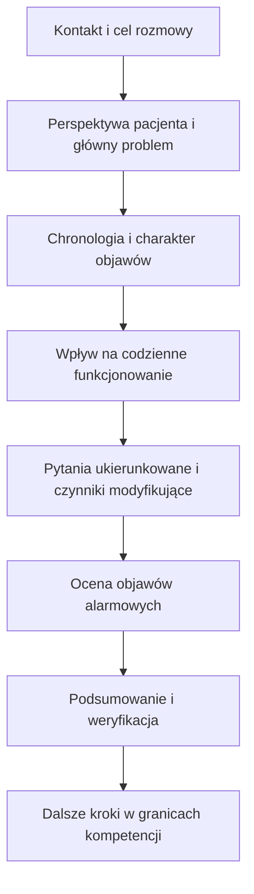
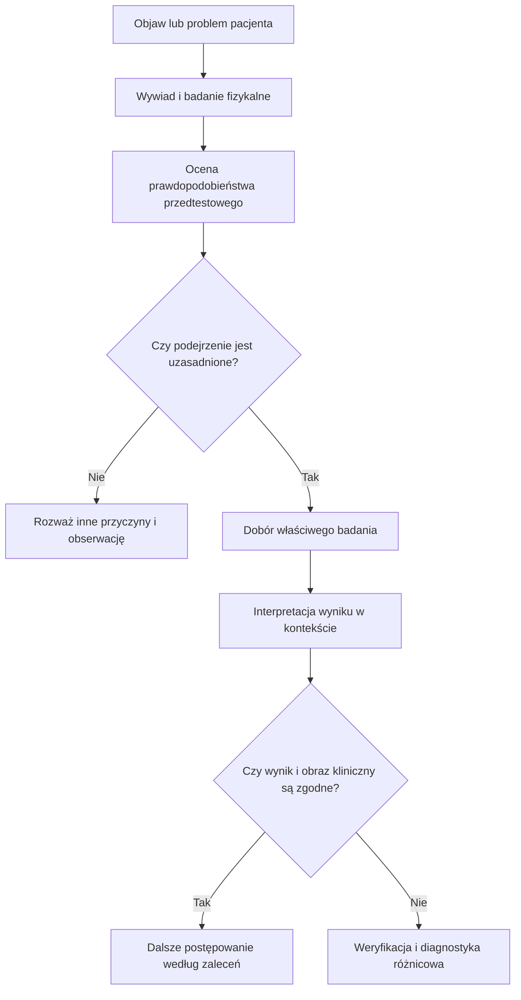

# 2.1. Cel i znaczenie wywiadu w diagnostyce endokrynologicznej

> **Kurs:** Badanie endokrynologiczne pacjenta  
> **Moduł 2:** Wywiad lekarski w endokrynologii  
> **Zakres:** rola wywiadu, powiązanie objawów z osiami hormonalnymi, objawy alarmowe, chronologia dolegliwości, wpływ na funkcjonowanie i podejście zorientowane na pacjenta.

---

## 1. Wprowadzenie

Wywiad jest podstawowym narzędziem poznania pacjenta i jednym z najważniejszych etapów diagnostyki endokrynologicznej. Pozwala ustalić, jakie dolegliwości skłoniły osobę do poszukiwania pomocy, kiedy się pojawiły, jak zmieniały się w czasie, co je nasila lub łagodzi oraz w jaki sposób wpływają na codzienne funkcjonowanie. Dostarcza także informacji o chorobach przebytych, stosowanych lekach, obciążeniach rodzinnych, etapach rozwoju, czynnikach środowiskowych i wcześniejszych wynikach badań.

W endokrynologii znaczenie wywiadu jest szczególne, ponieważ objawy zaburzeń hormonalnych bywają nieswoiste, rozwijają się stopniowo i mogą dotyczyć wielu narządów. Ich interpretacja zależy od wieku, etapu dojrzewania, ciąży, połogu, cyklu miesiączkowego, rytmu snu i czuwania, wysiłku, chorób współistniejących oraz przyjmowanych leków. Wyniki laboratoryjne również wymagają kontekstu: pojedynczy pomiar nie zawsze odzwierciedla wydzielanie pulsacyjne, rytm dobowy, aktywność biologiczną ani wrażliwość tkanek.

Wywiad nie jest mechanicznym odczytywaniem listy pytań. Jest uporządkowaną rozmową, w której osoba prowadząca zbiera dane, sprawdza ich znaczenie, rozpoznaje niepewność i wspólnie z pacjentem ustala priorytety. Wymaga wiedzy medycznej, umiejętności komunikacyjnych, uważności na kontekst życia oraz świadomości granic własnych kompetencji.

## 2. Cele kształcenia i efekty uczenia się

### 2.1.1. Cel ogólny

Celem rozdziału jest przygotowanie uczestnika do rozumienia wywiadu jako procesu klinicznego, komunikacyjnego i dokumentacyjnego, który umożliwia rozpoznanie problemów pacjenta, określenie pilności oceny oraz zaplanowanie dalszego postępowania w granicach kwalifikacji zawodowych.

### 2.1.2. Efekty uczenia się

Po ukończeniu rozdziału uczestnik:
1. wyjaśnia rolę wywiadu w diagnostyce zaburzeń hormonalnych;
2. odróżnia objaw zgłaszany od obserwacji, pomiaru i rozpoznania;
3. wiąże grupy objawów z możliwymi osiami hormonalnymi bez traktowania ich jako dowodu konkretnej choroby;
4. rozumie znaczenie początku, czasu trwania, dynamiki i sekwencji objawów;
5. identyfikuje objawy alarmowe wymagające pilnej oceny;
6. ocenia wpływ dolegliwości na sen, aktywność, pracę, naukę, relacje i samoopiekę;
7. stosuje podstawowe zasady komunikacji zorientowanej na pacjenta;
8. uwzględnia czynniki rozwojowe, reprodukcyjne, społeczne, kulturowe i środowiskowe;
9. formułuje zwięzłe podsumowanie problemu klinicznego;
10. dokumentuje informacje w sposób przejrzysty, neutralny i możliwy do zweryfikowania;
11. rozpoznaje sytuacje, w których należy przerwać rutynowy wywiad i uruchomić pilną ścieżkę pomocy;
12. nie przekracza kompetencji zawodowych.

### 2.1.3. Postawy zawodowe

Oczekiwane postawy obejmują szacunek, cierpliwość, brak stygmatyzacji, ochronę prywatności, gotowość do korygowania własnych hipotez, otwartość na niepewność oraz traktowanie pacjenta jako partnera w procesie opieki.

## 3. Czym jest wywiad kliniczny?

Wywiad kliniczny to celowa, uporządkowana rozmowa służąca pozyskaniu informacji o stanie zdrowia, dolegliwościach, historii choroby, funkcjonowaniu i oczekiwaniach pacjenta. W zależności od sytuacji obejmuje również informacje przekazane przez opiekuna, dokumentację medyczną i dane z innych wiarygodnych źródeł.

Wywiad dostarcza przede wszystkim danych subiektywnych, czyli informacji o tym, co pacjent odczuwa, zauważa, pamięta i interpretuje. Dane te są niezbędne, ale mogą być niepełne lub nieprecyzyjne z powodu pamięci, stresu, języka, zaburzeń poznawczych albo sposobu zadawania pytań. Należy je zestawiać z badaniem fizykalnym, pomiarami, dokumentacją i badaniami dodatkowymi.

### 2.1.4. Cztery kategorie informacji

| Kategoria | Znaczenie | Przykład zapisu |
|---|---|---|
| Objaw zgłaszany | Doświadczenie pacjenta | „Od sześciu tygodni odczuwam wzmożone pragnienie” |
| Obserwacja | Cecha zauważona przez osobę badającą | „Pacjent mówi wolno, widoczne spowolnienie psychoruchowe” |
| Pomiar | Wynik uzyskany określoną metodą | „Ciśnienie 148/92 mmHg, pomiar w pozycji siedzącej” |
| Interpretacja | Wniosek osoby uprawnionej oparty na całości danych | „Wymaga różnicowania przyczyn wielomoczu” |

Nie należy zapisywać interpretacji jako faktu, jeżeli nie została potwierdzona. „Pacjent ma niedoczynność tarczycy” nie jest równoważne zapisowi „pacjent zgłasza zmęczenie i nietolerancję zimna; dostarczony wynik TSH wymaga oceny w kontekście FT4 i dotychczasowego leczenia”.

### 2.1.5. Wywiad jako proces, a nie ankieta

Dobra rozmowa zwykle przechodzi od pytań otwartych do ukierunkowanych. Najpierw należy pozwolić pacjentowi przedstawić problem własnymi słowami, następnie doprecyzować chronologię, charakter i nasilenie objawów, a na końcu sprawdzić informacje istotne dla konkretnych osi hormonalnych i bezpieczeństwa.

Jeśli pojawiają się objawy sugerujące stan nagły, priorytetem przestaje być dokończenie formularza. Należy przejść do oceny bezpieczeństwa i uruchomienia odpowiedniej pomocy.

## 4. Dlaczego wywiad ma szczególne znaczenie w endokrynologii?

### 2.1.6. Objawy są często nieswoiste

Zmęczenie, zmiana masy ciała, zaburzenia snu, obniżenie nastroju, zaparcia, biegunka, kołatanie serca, osłabienie mięśni, wypadanie włosów, zmiany libido i trudności z koncentracją mogą występować w wielu chorobach, nie tylko endokrynologicznych. Mogą też towarzyszyć fizjologicznym zmianom związanym z wiekiem, ciążą, połogiem, menopauzą, stresem, niedoborem snu lub zmianą aktywności.

Wartość objawu rośnie, gdy zostanie opisany dokładnie i powiązany z innymi informacjami. Sama utrata masy ciała jest nieswoista. Jeżeli towarzyszą jej wzmożone pragnienie, wielomocz, odwodnienie i osłabienie, należy rozważyć zaburzenia gospodarki glukozowej lub wodno-elektrolitowej. Jeżeli występuje z kołataniem serca, drżeniem, nietolerancją ciepła i częstymi wypróżnieniami, może uzasadniać ocenę czynności tarczycy. Żaden z tych zestawów nie stanowi samodzielnego rozpoznania.

### 2.1.7. Hormony regulują wiele układów jednocześnie

Zaburzenie hormonalne może manifestować się w kilku obszarach. Niedobór hormonów tarczycy może wpływać na termoregulację, motorykę przewodu pokarmowego, skórę, funkcje poznawcze i układ krążenia. Nadmiar glikokortykosteroidów może oddziaływać na metabolizm glukozy, mięśnie, skórę, kości, ciśnienie tętnicze i nastrój. Niedobór kortyzolu może powodować osłabienie, nudności, spadek masy ciała i hipotensję, a w ciężkim przebiegu prowadzić do stanu zagrożenia życia.

Dlatego wywiad powinien obejmować nie tylko główną dolegliwość, ale także objawy towarzyszące i ich kolejność występowania.

### 2.1.8. Czas i rytm mają znaczenie biologiczne

Wydzielanie wielu hormonów zmienia się w rytmie dobowym, pulsacyjnym, miesięcznym lub zależnym od etapu życia. Należy więc pytać o:
- porę występowania objawów;
- zależność od snu i wybudzania;
- związek z posiłkami i okresem pozostawania na czczo;
- występowanie po wysiłku lub w czasie stresu;
- zależność od cyklu miesiączkowego;
- zmianę objawów w ciąży i połogu;
- sezonowość lub powtarzalność epizodów;
- różnice między dniami pracy a dniami wolnymi.

Pora występowania może być wskazówką, ale sama nie rozstrzyga o przyczynie.

### 2.1.9. Wywiad kieruje doborem badań

Badania hormonalne nie powinny być zlecane jako przypadkowy, szeroki panel bez określonego pytania klinicznego. Wywiad pomaga sformułować hipotezę, wybrać właściwą oś hormonalną, określić porę i warunki pobrania, rozpoznać możliwe interferencje oraz ustalić, czy potrzebny jest test dynamiczny, obrazowanie czy konsultacja specjalistyczna.

Przykładowe pytania kliniczne:
- Czy objawy wskazują na możliwe zaburzenie czynności tarczycy?
- Czy występują cechy niedoboru hormonów przysadkowych?
- Czy napadowe objawy autonomiczne wymagają oceny w kierunku zaburzenia wydzielania katecholamin?
- Czy wielomocz i pragnienie sugerują zaburzenie gospodarki glukozowej lub wodnej?
- Czy nieregularne miesiączki wymagają oceny osi gonadalnej, ciąży lub innych przyczyn?
- Czy długotrwałe stosowanie glikokortykosteroidów może mieć znaczenie dla osi podwzgórze–przysadka–nadnercza?

Pytanie kliniczne powinno poprzedzać dobór badania, a nie być dopisywane po uzyskaniu przypadkowego nieprawidłowego wyniku.

## 5. Rola wywiadu w rozpoznawaniu zaburzeń hormonalnych

### 2.1.10. Budowanie hipotez klinicznych

Wywiad pozwala tworzyć wstępną listę możliwych wyjaśnień dolegliwości. Lista powinna obejmować zarówno przyczyny endokrynologiczne, jak i częste przyczyny nieendokrynologiczne. Właściwe rozumowanie nie polega na dopasowaniu każdego objawu do jednej choroby, lecz na porównywaniu hipotez pod względem prawdopodobieństwa, pilności i możliwości potwierdzenia.

Należy odróżnić:
- **problem główny** – powód zgłoszenia;
- **zespół objawów** – grupa współwystępujących dolegliwości;
- **hipotezę etiologiczną** – możliwe wyjaśnienie przyczyny;
- **rozpoznanie robocze** – wstępne rozpoznanie wymagające weryfikacji;
- **rozpoznanie potwierdzone** – rozpoznanie oparte na odpowiednich kryteriach i całości danych.

### 2.1.11. Związek objawów z osiami hormonalnymi

Tabela ma charakter orientacyjny. Nie jest narzędziem do samodzielnego rozpoznawania chorób ani automatycznego zlecania badań.

| Grupa objawów | Możliwe obszary do rozważenia | Informacje wymagające doprecyzowania |
|---|---|---|
| Zmęczenie, osłabienie, spadek tolerancji wysiłku | Tarczyca, nadnercza, przysadka, gospodarka glukozowa | Początek, nasilenie, omdlenia, gorączka, sen, utrata masy |
| Zmiana masy ciała | Tarczyca, kortyzol, insulina, oś gonadalna, podwzgórze | Tempo zmiany, apetyt, obrzęki, dieta, leki, aktywność |
| Pragnienie i wielomocz | Gospodarka glukozowa, wazopresyna, nerki, elektrolity | Ilość i pora oddawania moczu, nykturia, odwodnienie |
| Kołatanie serca, drżenie, potliwość | Tarczyca, katecholaminy, glikemia, układ autonomiczny | Napadowość, tętno, ciśnienie, omdlenie, ból w klatce |
| Zaburzenia miesiączkowania | Oś gonadalna, prolaktyna, tarczyca, nadnercza, PCOS, ciąża | Ostatnia miesiączka, możliwość ciąży, krwawienie, ból |
| Obniżone libido, zaburzenia erekcji, niepłodność | Oś gonadalna, prolaktyna, tarczyca, metabolizm | Początek, leki, choroby przewlekłe, cele reprodukcyjne |
| Osłabienie mięśni i zmiany skóry | Kortyzol, hormony tarczycy, androgeny, zaburzenia mineralne | Rozmieszczenie osłabienia, siniaki, rozstępy, upadki |
| Ból kości, złamania, utrata wzrostu | PTH, witamina D, wapń, fosforany, hormony płciowe | Mechanizm złamania, dieta, leki, wcześniejsze złamania |
| Ból głowy i zaburzenia widzenia | Przysadka, podwzgórze, przyczyny neurologiczne i okulistyczne | Nagłość, pole widzenia, podwójne widzenie, wymioty |
| Zaburzenia wzrastania i dojrzewania | GH–IGF-1, tarczyca, oś gonadalna, nadnercza | Tempo wzrastania, centyle, wiek kostny, przebieg dojrzewania |

### 2.1.12. Objaw nie jest rozpoznaniem

Utrata masy ciała może wynikać z choroby nowotworowej, przewlekłego zakażenia, zaburzeń odżywiania, choroby przewodu pokarmowego, depresji, działań leków lub choroby metabolicznej. Zmęczenie może być związane z niedokrwistością, bezdechem sennym, chorobą serca, przewlekłym bólem, zaburzeniami nastroju, niedoborem snu albo zaburzeniem endokrynologicznym.

W wywiadzie warto zatem pytać o sygnały wskazujące na inne przyczyny i unikać przedwczesnego zamykania diagnostyki na jednej hipotezie.

## 6. Identyfikacja objawów alarmowych

### 2.1.13. Dlaczego objawy alarmowe mają pierwszeństwo?

Niektóre zaburzenia endokrynologiczne rozwijają się stopniowo, ale mogą również prowadzić do nagłego zagrożenia życia. Wywiad musi więc zawierać ocenę pilności. W razie podejrzenia stanu nagłego nie należy kontynuować rutynowego, szczegółowego zbierania historii kosztem rozpoczęcia pomocy.

Objawy alarmowe nie są rozpoznaniem. Są sygnałem, że pacjent wymaga szybkiej oceny i postępowania zgodnego z lokalnymi procedurami ratunkowymi.

### 2.1.14. Przykładowe stany wymagające pilnej oceny

| Możliwy stan | Niepokojące informacje i objawy | Znaczenie dla bezpieczeństwa |
|---|---|---|
| Ciężka hipoglikemia | Zaburzenia świadomości, drgawki, niemożność samodzielnego przyjęcia węglowodanów | Natychmiastowa pomoc; nie podawać doustnie pokarmu osobie z zaburzeniami świadomości |
| DKA lub HHS | Wymioty, ból brzucha, odwodnienie, głęboki oddech, zaburzenia świadomości, znaczna hiperglikemia lub podejrzenie ketonemii | Pilna ocena szpitalna; objawy mogą być niepełne |
| Przełom nadnerczowy | Ciężkie osłabienie, hipotensja, omdlenie, wymioty, ból brzucha, odwodnienie, splątanie; znana niewydolność lub ryzyko po glikokortykosteroidach | Stan bezpośredniego zagrożenia życia; nie opóźniać pomocy |
| Apopleksja przysadki | Nagły bardzo silny ból głowy, pogorszenie widzenia, podwójne widzenie, wymioty, zaburzenia świadomości | Pilna ocena szpitalna |
| Przełom tarczycowy | Gorączka, nasilona tachykardia, pobudzenie lub splątanie, wymioty/biegunka, niewydolność krążenia | Stan nagły, wymagający pilnej opieki szpitalnej |
| Ciężka dekompensacja niedoczynności tarczycy | Hipotermia, spowolnienie, zaburzenia świadomości, bradykardia, hipotensja, hipowentylacja | Podejrzenie śpiączki hipometabolicznej wymaga pilnej pomocy |
| Ciężkie zaburzenia sodowe lub wapniowe | Drgawki, splątanie, zaburzenia świadomości, tężyczka, zaburzenia rytmu | Pilna ocena kliniczna i laboratoryjna |
| Przełom guza chromochłonnego | Bardzo wysokie ciśnienie z bólem głowy, potliwością, kołataniem, bólem w klatce lub objawami neurologicznymi | Pilna ocena; nie prowokować objawów |
| Ciężkie objawy w ciąży | Krwawienie, silny ból brzucha, omdlenie, duszność, zaburzenia świadomości | Pilna ocena położnicza i ratunkowa |

### 2.1.15. Minimalna ocena bezpieczeństwa

W zależności od stanu pacjenta i kompetencji osoby badającej należy szybko ocenić:
- drożność dróg oddechowych, oddychanie i krążenie, jeśli istnieje podejrzenie stanu nagłego;
- stan świadomości i możliwość bezpiecznej komunikacji;
- obecność drgawek, omdlenia lub objawów ogniskowych;
- ciśnienie tętnicze, tętno, częstość oddechów, temperaturę i saturację, jeżeli jest to wskazane i dostępne;
- glikemię przygodną, jeśli jest to zgodne z procedurami i kompetencjami;
- znane choroby, leki ratunkowe, identyfikator medyczny lub kartę pacjenta.

Nie należy opóźniać wezwania pomocy w celu wykonania pełnego zestawu pomiarów. W Polsce w przypadku bezpośredniego zagrożenia życia lub zdrowia należy wezwać zespół ratownictwa medycznego przez 112 lub 999, zgodnie z obowiązującymi zasadami.

### 2.1.16. Pytania o ryzyko przełomu nadnerczowego

Warto ustalić, czy pacjent:
- ma rozpoznaną niewydolność nadnerczy lub chorobę przysadki;
- przyjmuje glikokortykosteroidy obecnie lub przyjmował je długotrwale;
- niedawno zmniejszył dawkę lub odstawił glikokortykosteroid;
- przebył niedawno infekcję, zabieg, uraz lub silne obciążenie fizjologiczne;
- posiada kartę steroidową lub indywidualny plan postępowania w czasie choroby;
- ma dostęp do zaleconego zestawu ratunkowego i wie, jak go używać.

Samo stwierdzenie stosowania glikokortykosteroidu nie pozwala określić ryzyka bez znajomości preparatu, dawki, czasu stosowania, drogi podania i indywidualnej sytuacji. Nie wolno zalecać samodzielnego odstawiania ani modyfikowania leczenia.

### 2.1.17. Zasada przerwania rutynowego wywiadu

Jeżeli pacjent jest niestabilny, ma zaburzenia świadomości, ciężką duszność, objawy wstrząsu, drgawki lub inne objawy bezpośredniego zagrożenia, priorytetem jest wezwanie pomocy, ocena i postępowanie ratunkowe. Szczegółowe pytania można uzupełnić później, jeśli stan pacjenta na to pozwoli.

## 7. Początek, dynamika i przebieg dolegliwości

### 2.1.18. Dlaczego chronologia jest kluczowa?

Czas pojawienia się objawów i kolejność ich rozwoju mogą pomóc odróżnić zaburzenia ostre, podostre, przewlekłe, napadowe, nawrotowe i postępujące. W endokrynologii objawy często narastają przez miesiące lub lata, dlatego pacjent może nie pamiętać dokładnej daty początku. Należy pomagać w odtwarzaniu osi czasu za pomocą wydarzeń życiowych, zmian leków, infekcji, ciąży, porodu, zabiegu lub innych punktów odniesienia.

### 2.1.19. Podstawowe elementy chronologii

| Element | Pytanie pomocnicze |
|---|---|
| Początek | Kiedy po raz pierwszy zauważył(a) Pan/Pani objaw? |
| Sposób początku | Czy pojawił się nagle, czy narastał stopniowo? |
| Czas trwania | Jak długo trwa pojedynczy epizod? |
| Częstość | Jak często dolegliwość występuje? |
| Nasilenie | Czy objaw jest łagodny, umiarkowany czy bardzo nasilony? |
| Dynamika | Czy staje się częstszy, dłuższy lub silniejszy? |
| Sekwencja | Co pojawiło się jako pierwsze, a co później? |
| Okresy bez objawów | Czy są dni lub tygodnie bez dolegliwości? |
| Czynniki wyzwalające | Co poprzedza epizod? |
| Czynniki łagodzące | Co przynosi poprawę? |
| Dotychczasowe leczenie | Co było stosowane i z jakim skutkiem? |

### 2.1.20. Wzorce czasowe

- **Ostry:** pojawienie się w krótkim czasie, często z wyraźnym punktem początku.
- **Podostry:** rozwój w ciągu dni lub tygodni.
- **Przewlekły:** utrzymywanie się przez dłuższy okres.
- **Napadowy:** epizody oddzielone okresami względnego dobrego samopoczucia.
- **Nawracający:** powtarzające się epizody, czasem o podobnym przebiegu.
- **Postępujący:** stopniowe nasilanie się lub rozszerzanie objawów.
- **Zmienny:** wahania nasilenia zależne od pory, czynności lub innych czynników.

Kategorie są opisowe. Ich granice zależą od konkretnej dolegliwości i nie zastępują rozpoznania.

### 2.1.21. Związek z wydarzeniami życiowymi i leczeniem

Warto ustalić, czy początek lub zmiana objawów zbiegły się z:
- rozpoczęciem, zmianą lub zakończeniem przyjmowania leków;
- zabiegiem operacyjnym, radioterapią lub leczeniem onkologicznym;
- ciążą, porodem, poronieniem lub zakończeniem laktacji;
- rozpoczęciem dojrzewania lub zmianą cyklu miesiączkowego;
- znaczną zmianą masy ciała lub sposobu odżywiania;
- intensywnym treningiem lub ograniczeniem aktywności;
- infekcją, urazem, hospitalizacją lub silnym stresem;
- zmianą pracy, pracy zmianowej lub rytmu snu.

Zbieżność czasowa nie jest dowodem przyczynowości. Stanowi wskazówkę do dalszej oceny.

## 8. Powiązanie objawów z potencjalnymi zaburzeniami hormonalnymi

### 2.1.22. Ocena objawów w układach

Wywiad powinien pozwalać na zebranie informacji o:
1. samopoczuciu, energii i masie ciała;
2. termoregulacji, poceniu się i tolerancji temperatury;
3. pragnieniu, ilości moczu i rytmie wypróżnień;
4. pracy serca, ciśnieniu i tolerancji wysiłku;
5. skórze, włosach, paznokciach i owłosieniu;
6. sile mięśniowej, bólu kości i złamaniach;
7. śnie, nastroju i funkcjach poznawczych;
8. menstruacji, płodności, libido i funkcjach seksualnych;
9. wzrastaniu i dojrzewaniu;
10. objawach neurologicznych i zaburzeniach widzenia.

Nie należy zadawać wszystkich pytań każdemu pacjentowi w identycznym zakresie. Dobór pytań powinien wynikać z problemu głównego, wieku, sytuacji klinicznej i dostępnego czasu.

### 2.1.23. Objawy ogólne i masa ciała

Należy pytać o kierunek i tempo zmiany masy ciała, apetyt, uczucie sytości, zmianę obwodu talii, obrzęki, aktywność fizyczną, sposób żywienia oraz leki. Ważne jest ustalenie, czy zmiana była zamierzona, czy niezamierzona, i czy pacjent zauważył równoczesne zmiany innych funkcji organizmu.

Pytania przykładowe:
- „Czy masa ciała zmieniła się w ostatnich miesiącach?”
- „Czy zmiana była zamierzona?”
- „Czy zmienił się apetyt lub ilość spożywanego jedzenia?”
- „Czy zauważył(a) Pan/Pani obrzęki lub zmianę obwodu brzucha?”
- „Czy zmieniła się siła mięśniowa albo wydolność?”

### 2.1.24. Pragnienie, wielomocz i nykturia

Wzmożone pragnienie i częste oddawanie moczu mogą występować w zaburzeniach gospodarki glukozowej, zaburzeniach działania wazopresyny, chorobach nerek, zaburzeniach elektrolitowych, przyjmowaniu leków moczopędnych lub innych stanach.

Warto ustalić, czy pacjent oddaje duże objętości moczu, czy tylko często korzysta z toalety; czy wstaje w nocy i ile razy; czy występuje suchość w ustach; czy towarzyszy temu utrata masy ciała, osłabienie lub odwodnienie; czy objawy zaczęły się po wprowadzeniu leku lub zmianie dawki.

### 2.1.25. Objawy sercowo-naczyniowe i autonomiczne

Kołatanie serca, potliwość, drżenie, napadowy ból głowy, zaczerwienienie, bladość i wahania ciśnienia mogą mieć wiele przyczyn. Należy ustalić, czy objawy występują napadowo, jak długo trwają, czy towarzyszy im ból w klatce piersiowej, duszność, omdlenie lub objawy neurologiczne. Przy ciężkich objawach nie wolno ograniczać się do rozważania choroby hormonalnej.

### 2.1.26. Objawy skórne i mięśniowo-szkieletowe

Zmiany skóry, rozstępy, siniaki, trądzik, hirsutyzm, łysienie, suchość skóry, osłabienie mięśni i złamania mogą być istotnymi wskazówkami. Warto pytać o czas pojawienia się, tempo narastania, rozmieszczenie, bolesność, urazy, gojenie ran i wcześniejsze leczenie. Opis powinien być neutralny i precyzyjny.

### 2.1.27. Objawy neurologiczne i poznawcze

Bóle głowy, zaburzenia pola widzenia, podwójne widzenie, osłabienie, parestezje, zaburzenia równowagi, splątanie i zmiany zachowania mogą towarzyszyć chorobom endokrynologicznym, ale wymagają także rozważenia przyczyn neurologicznych, okulistycznych, metabolicznych i naczyniowych.

Nagły ból głowy z zaburzeniami widzenia, utratą przytomności, wymiotami lub objawami ogniskowymi wymaga pilnej oceny.

## 9. Ocena wpływu objawów na codzienne funkcjonowanie

### 2.1.28. Dlaczego sama intensywność objawu nie wystarcza?

Dwie osoby mogą opisywać podobne nasilenie zmęczenia, ale doświadczać zupełnie innych ograniczeń. Jedna może nadal wykonywać obowiązki, lecz potrzebować dłuższego odpoczynku; druga może nie być w stanie pracować, prowadzić pojazdu lub opiekować się dzieckiem. Ocena funkcjonalna pozwala zrozumieć realne konsekwencje choroby i ustalić priorytety opieki.

### 2.1.29. Obszary funkcjonowania

| Obszar | Przykładowe pytania |
|---|---|
| Samoopieka | Czy dolegliwości utrudniają mycie, ubieranie, przygotowywanie posiłków? |
| Aktywność domowa | Czy zmieniła się zdolność wykonywania codziennych obowiązków? |
| Praca lub nauka | Czy objawy wpływają na koncentrację, obecność i tempo pracy? |
| Sen | Czy występują trudności z zasypianiem, wybudzenia lub senność dzienna? |
| Mobilność | Czy pojawiły się trudności z chodzeniem, wchodzeniem po schodach, wstawaniem? |
| Relacje | Czy choroba wpływa na życie rodzinne, społeczne lub intymne? |
| Funkcje poznawcze | Czy występują trudności z pamięcią, uwagą i podejmowaniem decyzji? |
| Zdrowie psychiczne | Czy pojawił się lęk, obniżenie nastroju, przeciążenie lub poczucie utraty kontroli? |
| Udział społeczny | Czy pacjent rezygnuje z aktywności, które wcześniej były ważne? |

### 2.1.30. Pytania o punkt odniesienia

Warto porównywać stan obecny z wcześniejszym poziomem sprawności:
- „Jak wyglądał zwykły dzień przed pojawieniem się objawów?”
- „Co jest teraz najtrudniejsze?”
- „Z czego musiał(a) Pan/Pani zrezygnować?”
- „Czy potrzebuje Pan/Pani pomocy innych osób?”
- „Czy są czynności, które nadal udaje się wykonywać bez trudności?”
- „Co chciał(a)by Pan/Pani odzyskać w pierwszej kolejności?”

### 2.1.31. Narzędzia oceny funkcjonalnej

W zależności od populacji i celu można korzystać z narzędzi oceniających:
- podstawowe czynności życia codziennego (ADL);
- złożone czynności życia codziennego (IADL);
- jakość życia zależną od zdrowia (HRQoL);
- nasilenie zmęczenia;
- obciążenie chorobą przewlekłą;
- dobrostan psychiczny;
- wpływ cukrzycy na codzienne życie (diabetes distress);
- funkcjonowanie w szkole, pracy i rodzinie.

Narzędzie powinno być dobrane do wieku, stanu pacjenta, języka i celu oceny. Kwestionariusz nie zastępuje rozmowy ani badania klinicznego.

## 10. Holistyczny i zorientowany na pacjenta wywiad

### 2.1.32. Perspektywa pacjenta

Podejście zorientowane na pacjenta oznacza uwzględnienie nie tylko biologicznego problemu, lecz także doświadczeń, celów, wartości, obaw, zasobów i warunków życia. W endokrynologii ma to znaczenie, ponieważ wiele chorób wymaga długotrwałej samoopieki, monitorowania, zmian stylu życia i podejmowania decyzji dotyczących leczenia.

Holistyczność nie oznacza przypisywania wszystkich problemów jednemu „całościowemu” wyjaśnieniu. Oznacza uwzględnianie wielu wymiarów zdrowia przy zachowaniu krytycznego myślenia i oparcia na dowodach.

### 2.1.33. Trzy podstawowe pytania otwierające

Warto ustalić:
1. **Co się dzieje?** – jaki problem pacjent uważa za najważniejszy?
2. **Co to dla niego oznacza?** – czego się obawia, jak interpretuje objawy?
3. **Czego oczekuje?** – jakiej pomocy potrzebuje i jaki wynik uważa za ważny?

### 2.1.34. Komunikacja bez stygmatyzacji

Szczególnej wrażliwości wymagają rozmowy o masie ciała, płodności, miesiączkowaniu, seksualności, dojrzewaniu, owłosieniu, wyglądzie i zdrowiu psychicznym.

Zaleca się:
- używanie neutralnego, nieoceniającego języka;
- pytanie o zgodę przed przejściem do tematów intymnych;
- unikanie przypisywania winy pacjentowi;
- uznawanie wpływu biologii, środowiska, dostępności opieki i czynników społecznych;
- uwzględnianie preferowanych określeń pacjenta;
- niezakładanie orientacji, sytuacji rodzinnej, aktywności seksualnej ani planów reprodukcyjnych;
- zapewnienie możliwości rozmowy bez osoby towarzyszącej, jeśli pacjent tego potrzebuje.

### 2.1.35. Pytania otwarte i zamknięte

| Pytanie otwarte | Pytanie ukierunkowane |
|---|---|
| „Co najbardziej Pana/Panią niepokoi?” | „Czy kołatanie serca występuje również w spoczynku?” |
| „Jak zmieniło się samopoczucie?” | „Czy występują omdlenia?” |
| „Proszę opowiedzieć o zmianach masy ciała” | „Czy masa zmieniła się o około 5 kg?” |
| „Jak wygląda sen?” | „Czy wybudza się Pan/Pani w nocy z powodu oddawania moczu?” |
| „Jak dolegliwości wpływają na życie?” | „Czy z powodu objawów nie może Pan/Pani pracować?” |

Pytania zamknięte są użyteczne do weryfikacji konkretnych informacji, ale ich nadmiar może ograniczyć spontaniczną relację pacjenta. Najpierw warto uzyskać swobodny opis, a później doprecyzować szczegóły.

### 2.1.36. Sprawdzanie zrozumienia

Po przekazaniu informacji warto zastosować metodę teach-back, prosząc pacjenta o wyjaśnienie własnymi słowami, co zrozumiał i jakie są ustalone kolejne kroki. Nie jest to egzamin pacjenta, lecz sprawdzenie, czy sposób komunikacji był jasny.

Przykład: „Chciałabym sprawdzić, czy wyjaśniłam to wystarczająco jasno. Proszę powiedzieć własnymi słowami, co ma się wydarzyć po dzisiejszej wizycie”.

## 11. Kontekst rozwojowy, reprodukcyjny i społeczny

### 2.1.37. Dzieci i młodzież

Wywiad pediatryczny wymaga uwzględnienia wieku rozwojowego, tempa wzrastania, dojrzewania, historii okołoporodowej i danych od opiekunów. Warto umożliwić dziecku lub nastolatkowi przedstawienie własnej perspektywy w zakresie odpowiednim do wieku i dojrzałości.

W rozmowie z nastolatkiem należy uwzględniać prywatność, poufność i obowiązujące zasady ochrony małoletnich. Wrażliwe pytania powinny być zadawane w sposób bezpieczny, bez obecności osób trzecich, jeśli jest to właściwe i zgodne z prawem oraz procedurami.

### 2.1.38. Ciąża i połóg

W ciąży i połogu objawy mogą wynikać z fizjologicznych zmian hormonalnych, ale nie wolno automatycznie uznawać ich za fizjologiczne. Należy pytać o etap ciąży, przebieg ciąży, wcześniejsze choroby endokrynologiczne, leki, objawy alarmowe i opiekę położniczą. W przypadku bólu, krwawienia, duszności, omdlenia, ciężkich wymiotów lub zaburzeń świadomości potrzebna jest pilna ocena.

### 2.1.39. Osoby starsze

U osób starszych objawy mogą być mniej typowe, a współistnienie wielu chorób i polifarmakoterapia utrudniają interpretację. Zmęczenie, osłabienie, zaburzenia pamięci, utrata masy ciała i upadki wymagają szerokiego różnicowania. Należy pytać o samodzielność, ryzyko upadków, odżywienie, funkcje poznawcze, wsparcie społeczne i cele leczenia.

### 2.1.40. Bariery komunikacyjne i dostępność

Wywiad należy dostosować do:
- niepełnosprawności słuchu, wzroku lub komunikacji;
- zaburzeń poznawczych;
- trudności językowych;
- niskiego poziomu piśmienności zdrowotnej;
- różnic kulturowych;
- ograniczeń związanych z bólem, dusznością lub zmęczeniem;
- potrzeb osób neuroatypowych.

W razie potrzeby należy zapewnić profesjonalnego tłumacza lub wsparcie komunikacyjne. Nie należy wykorzystywać dzieci jako tłumaczy w rozmowach dotyczących wrażliwych informacji medycznych, jeżeli dostępne jest bezpieczniejsze rozwiązanie.

## 12. Wywiad a prawdopodobieństwo przedtestowe

### 2.1.41. Znaczenie prawdopodobieństwa przedtestowego

Prawdopodobieństwo przedtestowe to oszacowanie szansy występowania określonego stanu przed wykonaniem konkretnego badania. Wywiad, badanie fizykalne, częstość choroby w danej populacji, wiek, czynniki ryzyka i dotychczasowe wyniki wpływają na to oszacowanie.

Wynik badania nie powinien być interpretowany w oderwaniu od prawdopodobieństwa przedtestowego. Przy niskim prawdopodobieństwie nawet dodatni wynik może wymagać ostrożnej weryfikacji, a przy wysokim prawdopodobieństwie wynik ujemny nie zawsze wyklucza chorobę.

To schemat edukacyjny, a nie algorytm dla konkretnej choroby. W stanach nagłych postępowanie odbywa się według procedur ratunkowych i nie może być opóźniane.

## 13. Wywiad jako podstawa diagnostyki różnicowej

### 2.1.42. Unikanie błędów poznawczych

W czasie rozmowy mogą pojawić się błędy poznawcze:
- **zakotwiczenie:** nadmierne przywiązanie do pierwszej hipotezy;
- **przedwczesne zamknięcie:** zakończenie diagnostyki po znalezieniu jednego wyjaśnienia;
- **potwierdzanie hipotezy:** zadawanie tylko pytań wspierających pierwotne podejrzenie;
- **efekt dostępności:** przecenianie choroby, którą osoba prowadząca niedawno widziała;
- **atrybucja:** przypisywanie objawów stylowi życia lub cechom pacjenta bez wystarczających danych;
- **błąd reprezentatywności:** zakładanie, że nietypowy obraz wyklucza chorobę.

Praktycznym sposobem ograniczania tych błędów jest pytanie: „Jakie inne wyjaśnienia mogą odpowiadać temu obrazowi?” oraz „Jakie dane przemawiałyby przeciwko mojej pierwszej hipotezie?”.

### 2.1.43. Znaczenie danych negatywnych

Informacja o braku określonego objawu może być przydatna, ale tylko wtedy, gdy została rzeczywiście zebrana i ma znaczenie kliniczne. Nie należy wpisywać „bez objawów” w odniesieniu do całego układu, jeśli zadano jedno pytanie.

„Pacjent zaprzecza omdleniom i bólowi w klatce piersiowej” jest bardziej precyzyjne niż „układ krążenia bez odchyleń”, szczególnie jeśli nie wykonano badania fizykalnego.

## 14. Dokumentowanie wywiadu

### 2.1.44. Zasady dobrego zapisu

Dokumentacja powinna być rzeczowa, chronologiczna, zrozumiała, wolna od nieuzasadnionych ocen, oparta na informacjach rzeczywiście uzyskanych, możliwa do zweryfikowania i zgodna z zasadami ochrony danych.

Warto zapisywać źródło informacji: pacjent, opiekun, dokumentacja, wynik laboratoryjny, karta wypisowa lub inny wiarygodny materiał.

### 2.1.45. Przykład prawidłowego podsumowania

**Przykład dydaktyczny:**

„Pacjent zgłasza narastające od około 8 tygodni osłabienie, wzmożone pragnienie i częstsze oddawanie moczu, także w nocy. Podaje niezamierzoną utratę około 4 kg w tym okresie. Dolegliwości utrudniają wykonywanie pracy i powodują wybudzenia nocne. Nie zgłasza omdleń ani bólu w klatce piersiowej. Dostarczona dokumentacja zawiera wcześniejszy wynik glikemii, którego datę i warunki pobrania należy zweryfikować. Wymaga oceny lekarskiej w kierunku zaburzeń gospodarki glukozowej i innych przyczyn wielomoczu”.

Zapis nie przesądza rozpoznania, zachowuje chronologię, oddziela relację od dokumentacji i wskazuje problem wymagający oceny.

### 2.1.46. Czego unikać?

- wpisywania niezweryfikowanych rozpoznań;
- kopiowania starych danych bez sprawdzenia ich aktualności;
- używania stygmatyzujących określeń;
- pomijania niepewności lub sprzecznych informacji;
- dopisywania pytań, których nie zadano;
- zamieniania subiektywnego objawu na obiektywny pomiar;
- pozostawiania bez planu objawów alarmowych.

## 15. Granice kompetencji i odpowiedzialność zawodowa

### 2.1.47. Wywiad w zależności od zawodu

Wywiad może być prowadzony przez osoby o różnych kwalifikacjach, lecz zakres jego wykorzystania i decyzji zależy od uprawnień zawodowych. Lekarz wykorzystuje wywiad do procesu diagnostyczno-terapeutycznego. Pielęgniarka, położna, fizjoterapeuta, dietetyk kliniczny i inni specjaliści zbierają informacje istotne dla własnego zakresu świadczeń i rozpoznają wskazania do konsultacji lub eskalacji.

Uczestnictwo w kursie nie nadaje automatycznie prawa do stawiania rozpoznań, zlecania badań lub przepisywania leków.

### 2.1.48. Zasady bezpiecznego postępowania

1. Nie rozpoznawać choroby wyłącznie na podstawie jednego objawu.
2. Nie interpretować samodzielnie badań poza zakresem kwalifikacji.
3. Nie zalecać odstawiania, rozpoczynania ani zmiany dawek leków hormonalnych.
4. Nie opóźniać pilnej pomocy dla dokończenia wywiadu.
5. Nie bagatelizować objawów neurologicznych, krążeniowych i zaburzeń świadomości.
6. Nie zakładać, że objawy u pacjenta z rozpoznaną chorobą endokrynną zawsze wynikają z tej choroby.
7. Informować o niepewności i potrzebie dalszej oceny.
8. Dokumentować przekazanie pacjenta i zalecenia zgodnie z procedurami.

## 16. Przypadki kliniczno-dydaktyczne

Przypadki są fikcyjne i służą nauce zbierania informacji. Nie stanowią gotowych algorytmów rozpoznawania ani leczenia.

### 2.1.49. Przypadek 1 – przewlekłe zmęczenie i zmiana masy ciała

Osoba dorosła zgłasza zmęczenie, przyrost masy ciała, zaparcia i uczucie zimna. Objawy narastały stopniowo przez kilka miesięcy. Pacjent śpi krócej z powodu pracy zmianowej, a aktywność fizyczna zmniejszyła się.

**Pytania:**
- Czy zmęczenie występuje przez cały dzień, czy o określonych porach?
- Czy masa ciała wzrosła mimo niezmienionego sposobu żywienia?
- Czy występują obrzęki, sucha skóra lub zmiana głosu?
- Jak wygląda rytm snu i praca zmianowa?
- Czy rozpoczęto nowe leki?
- Czy występują objawy depresyjne, niedokrwistości lub choroby przewlekłej?

**Wniosek dydaktyczny:** obraz może uzasadniać ocenę czynności tarczycy, ale wymaga również uwzględnienia snu, leków, stanu psychicznego i innych przyczyn zmęczenia.

### 2.1.50. Przypadek 2 – pragnienie, wielomocz i utrata masy ciała

Młoda osoba zgłasza wzmożone pragnienie, częste oddawanie moczu i utratę masy ciała. W ostatnich dniach wystąpiły nudności i narastające osłabienie.

**Pytania priorytetowe:**
- Czy występują wymioty, ból brzucha lub głęboki oddech?
- Czy pacjent jest senny, splątany lub odwodniony?
- Czy wcześniej rozpoznano cukrzycę?
- Czy występuje szybkie pogarszanie stanu?

**Wniosek dydaktyczny:** należy pilnie ocenić możliwość ostrego zaburzenia gospodarki glukozowej, w tym kwasicy ketonowej. Nie wolno kontynuować rutynowego wywiadu, jeśli występują objawy stanu nagłego.

### 2.1.51. Przypadek 3 – napadowe kołatanie serca

Pacjent opisuje epizody kołatania serca, potliwości i bólu głowy. Napady występują nagle, trwają kilkanaście minut i ustępują samoistnie.

**Pytania:**
- Czy objawy pojawiają się w spoczynku, podczas wysiłku czy w stresie?
- Czy występuje ból w klatce piersiowej, duszność lub omdlenie?
- Czy pacjent mierzył ciśnienie w trakcie napadu?
- Czy występują leki, używki lub substancje stymulujące?
- Czy objawy są związane z posiłkiem lub wysiłkiem?

**Wniosek dydaktyczny:** napadowe objawy wymagają różnicowania przyczyn sercowo-naczyniowych, autonomicznych, metabolicznych i hormonalnych. Podejrzenie guza chromochłonnego nie powinno być stawiane na podstawie samej triady objawów.

### 2.1.52. Przypadek 4 – zaburzenia miesiączkowania

Pacjentka zgłasza nieregularne miesiączki, trądzik i narastające owłosienie w nietypowych dla niej okolicach. Objawy występują od kilkunastu miesięcy.

**Pytania:**
- Kiedy wystąpiła ostatnia miesiączka?
- Czy możliwa jest ciąża?
- Czy objawy rozwijały się stopniowo czy gwałtownie?
- Czy występuje mlekotok, bóle głowy lub zaburzenia widzenia?
- Czy zmieniła się masa ciała?
- Czy przyjmowane są leki lub preparaty hormonalne?

**Wniosek dydaktyczny:** należy rozważyć kilka przyczyn zaburzeń miesiączkowania i hiperandrogenizmu. Szybko postępująca wirylizacja wymaga pilnej diagnostyki lekarskiej.

### 2.1.53. Przypadek 5 – osłabienie po długotrwałym leczeniu glikokortykosteroidami

Pacjent z chorobą przewlekłą przyjmował glikokortykosteroid przez długi czas. Po samodzielnym przerwaniu leczenia pojawiły się nudności, osłabienie i zawroty głowy. W dniu wizyty zgłasza nasilone wymioty i uczucie omdlewania.

**Pytania:**
- Jaki preparat, dawkę i czas stosowania pamięta pacjent?
- Kiedy przyjął ostatnią dawkę?
- Czy występuje gorączka, infekcja, biegunka lub odwodnienie?
- Czy ma kartę steroidową lub plan ratunkowy?
- Czy występują omdlenie, hipotensja lub zaburzenia świadomości?

**Wniosek dydaktyczny:** istnieje ryzyko ostrej niewydolności nadnerczy. W przypadku objawów ciężkich należy pilnie uruchomić pomoc.

### 2.1.54. Przypadek 6 – ból głowy i pogorszenie widzenia

Pacjent zgłasza nagły, bardzo silny ból głowy, podwójne widzenie i wymioty.

**Wniosek dydaktyczny:** objawy mogą wskazywać na stan neurologiczny lub neuroendokrynologiczny wymagający natychmiastowej oceny szpitalnej, w tym możliwość apopleksji przysadki. Rutynowy wywiad należy przerwać.

## 17. Ćwiczenia praktyczne

### Ćwiczenie 1 – otwarcie rozmowy

W parach przeprowadź 3-minutową rozmowę, w której jedna osoba jest pacjentem zgłaszającym nieswoiste zmęczenie, a druga osobą zbierającą wywiad.

Zadanie:
- rozpocząć od pytania otwartego;
- nie przerywać wypowiedzi;
- ustalić główny problem;
- podsumować relację pacjenta;
- sprawdzić, czy podsumowanie jest zgodne z jego doświadczeniem.

### Ćwiczenie 2 – chronologia

Na podstawie fikcyjnej historii opracuj oś czasu objawów, uwzględniając początek, dynamikę, czynniki wyzwalające, leczenie i wpływ na funkcjonowanie.

### Ćwiczenie 3 – rozpoznawanie objawów alarmowych

Przygotuj listę sygnałów, które wymagają przerwania rutynowego wywiadu. Wskaż, jakie informacje są niezbędne do bezpiecznego wezwania pomocy i jakie czynności wynikają z lokalnych procedur.

### Ćwiczenie 4 – ocena funkcjonowania

Przeprowadź krótką rozmowę z fikcyjnym pacjentem, który z powodu przewlekłego osłabienia ograniczył aktywność zawodową i społeczną. Opisz wpływ objawów na ADL, IADL, sen, relacje i samoopiekę.

### Ćwiczenie 5 – neutralny język

Przekształć pięć stygmatyzujących lub oceniających zapisów na język neutralny, opisowy i możliwy do zweryfikowania.

## 18. Lista kontrolna jakości wywiadu

Przed zakończeniem rozmowy sprawdź, czy:
- [ ] pacjent wie, kto prowadzi rozmowę i w jakim celu;
- [ ] ustalono główny problem i oczekiwania pacjenta;
- [ ] uzyskano opis objawów własnymi słowami pacjenta;
- [ ] określono początek, czas trwania i dynamikę dolegliwości;
- [ ] zapytano o najważniejsze objawy towarzyszące;
- [ ] oceniono wpływ dolegliwości na codzienne funkcjonowanie;
- [ ] sprawdzono objawy alarmowe;
- [ ] uwzględniono istotne choroby, leki i wcześniejsze wyniki;
- [ ] uwzględniono wiek, etap rozwoju i sytuację reprodukcyjną;
- [ ] podsumowano informacje i umożliwiono pacjentowi korektę;
- [ ] ustalono dalsze kroki i sposób przekazania informacji;
- [ ] zapisano dane w sposób neutralny i zgodny z kompetencjami.

Lista ma charakter pomocniczy. Nie zastępuje lokalnych standardów dokumentowania i procedur bezpieczeństwa.

## 19. Pytania kontrolne

1. Czym różni się objaw zgłaszany od obserwacji i pomiaru?
2. Dlaczego wywiad ma szczególne znaczenie w endokrynologii?
3. Dlaczego zmęczenie i zmiana masy ciała są objawami nieswoistymi?
4. Jakie znaczenie ma chronologia objawów?
5. Dlaczego należy pytać o rytm dobowy i zależność objawów od snu?
6. Co oznacza prawdopodobieństwo przedtestowe?
7. Dlaczego wynik laboratoryjny powinien być interpretowany w kontekście klinicznym?
8. Jakie informacje należy uzyskać przy wzmożonym pragnieniu i wielomoczu?
9. Jakie objawy mogą sugerować ciężką hipoglikemię?
10. Jakie objawy mogą wskazywać na przełom nadnerczowy?
11. Dlaczego nagły ból głowy z zaburzeniami widzenia wymaga pilnej oceny?
12. Jak ocenia się wpływ choroby na codzienne funkcjonowanie?
13. Czym różnią się pytania otwarte od zamkniętych?
14. Na czym polega podejście zorientowane na pacjenta?
15. Dlaczego należy unikać stygmatyzującego języka?
16. Jakie znaczenie ma wywiad u nastolatka?
17. Dlaczego u osoby starszej trzeba uwzględnić polifarmakoterapię?
18. Jak ograniczać zakotwiczenie diagnostyczne?
19. Jakie informacje powinny znaleźć się w podsumowaniu wywiadu?
20. Kiedy należy przerwać rutynowy wywiad i uruchomić pomoc ratunkową?

## 20. Test sprawdzający

**1. Głównym celem wywiadu endokrynologicznego jest:**

A. Zastąpienie badań laboratoryjnych  
B. Uzyskanie uporządkowanych informacji o problemie, jego przebiegu i znaczeniu klinicznym  
C. Potwierdzenie pierwszej hipotezy  
D. Zebranie wyłącznie danych o masie ciała

**Prawidłowa odpowiedź: B.** Wywiad służy poznaniu problemu, budowaniu hipotez i określeniu dalszego postępowania.

**2. Objaw zgłaszany przez pacjenta jest:**

A. Zawsze obiektywnym pomiarem  
B. Subiektywnym doświadczeniem pacjenta  
C. Zawsze rozpoznaniem  
D. Wynikiem badania obrazowego

**Prawidłowa odpowiedź: B.**

**3. Które stwierdzenie dotyczące zmęczenia jest prawidłowe?**

A. Zawsze oznacza niedoczynność tarczycy  
B. Jest objawem nieswoistym i wymaga różnicowania  
C. Wyklucza chorobę organiczną  
D. Nie ma znaczenia w wywiadzie

**Prawidłowa odpowiedź: B.**

**4. Najlepszym sposobem rozpoczęcia rozmowy jest zwykle:**

A. Seria pytań zamkniętych  
B. Natychmiastowe pytanie o wszystkie wyniki badań  
C. Pytanie otwarte o główny problem pacjenta  
D. Przekazanie gotowej hipotezy

**Prawidłowa odpowiedź: C.**

**5. Chronologia objawów pozwala:**

A. Zawsze rozpoznać etiologię  
B. Ustalić początek, dynamikę i sekwencję dolegliwości  
C. Zastąpić badanie fizykalne  
D. Wykluczyć choroby współistniejące

**Prawidłowa odpowiedź: B.**

**6. Prawdopodobieństwo przedtestowe oznacza:**

A. Prawdopodobieństwo po otrzymaniu wyniku badania  
B. Szacowaną szansę choroby przed wykonaniem konkretnego testu  
C. Zakres referencyjny laboratorium  
D. Czułość testu

**Prawidłowa odpowiedź: B.**

**7. Która sytuacja wymaga przerwania rutynowego wywiadu?**

A. Przewlekłe, stabilne zmęczenie  
B. Łagodna suchość skóry  
C. Zaburzenia świadomości i drgawki  
D. Wielomiesięczna zmiana masy ciała bez objawów alarmowych

**Prawidłowa odpowiedź: C.**

**8. W przypadku ciężkiej hipoglikemii u osoby z zaburzeniami świadomości:**

A. Należy podać doustnie słodki napój  
B. Należy kontynuować wywiad  
C. Należy uruchomić pilną pomoc i postępować według procedury  
D. Należy odłożyć ocenę do kolejnej wizyty

**Prawidłowa odpowiedź: C.**

**9. W ocenie wpływu choroby na funkcjonowanie należy uwzględnić:**

A. Wyłącznie zdolność do pracy  
B. Wyłącznie masę ciała  
C. Samoopiekę, aktywność, sen, relacje i udział społeczny  
D. Wyłącznie wynik TSH

**Prawidłowa odpowiedź: C.**

**10. Podejście zorientowane na pacjenta oznacza:**

A. Rezygnację z wiedzy medycznej  
B. Uwzględnienie doświadczeń, celów, wartości i kontekstu życia pacjenta  
C. Przyjęcie każdej hipotezy pacjenta jako rozpoznania  
D. Pominięcie ryzyka klinicznego

**Prawidłowa odpowiedź: B.**

**11. W rozmowie z nastolatkiem należy:**

A. Zawsze zadawać wszystkie pytania wyłącznie przy rodzicu  
B. Uwzględniać wiek, dojrzałość, prywatność i zasady ochrony małoletnich  
C. Pomijać pytania o dojrzewanie  
D. Zakładać, że nastolatek nie może przekazać wiarygodnych informacji

**Prawidłowa odpowiedź: B.**

**12. Które zdanie jest najbezpieczniejsze dokumentacyjnie?**

A. „Pacjent na pewno ma chorobę tarczycy”  
B. „Pacjent jest leniwy i nie dba o zdrowie”  
C. „Pacjent zgłasza narastające zmęczenie od około dwóch miesięcy”  
D. „Wszystkie układy prawidłowe” bez badania

**Prawidłowa odpowiedź: C.**

**13. Zakotwiczenie diagnostyczne oznacza:**

A. Prawidłowe podsumowanie wywiadu  
B. Nadmierne przywiązanie do pierwszej hipotezy  
C. Ocenę wszystkich możliwych przyczyn  
D. Sprawdzenie danych negatywnych

**Prawidłowa odpowiedź: B.**

**14. Informacja o stosowaniu glikokortykosteroidów jest istotna, ponieważ:**

A. Leki te nigdy nie wpływają na oś hormonalną  
B. Długotrwałe stosowanie może prowadzić do zahamowania osi podwzgórze–przysadka–nadnercza  
C. Każdy pacjent musi samodzielnie odstawić lek przed badaniem  
D. Nie trzeba pytać o dawkę i czas stosowania

**Prawidłowa odpowiedź: B.**

**15. Po zakończeniu wywiadu należy:**

A. Zakończyć rozmowę bez podsumowania  
B. Przedstawić niezweryfikowane rozpoznanie  
C. Podsumować informacje, sprawdzić ich zgodność z relacją pacjenta i ustalić dalsze kroki  
D. Pominąć dokumentację

**Prawidłowa odpowiedź: C.**

## 21. Słownik najważniejszych pojęć

| Pojęcie | Definicja |
|---|---|
| Wywiad kliniczny | Uporządkowana rozmowa służąca uzyskaniu informacji o zdrowiu i problemach pacjenta. |
| Objaw | Subiektywne doświadczenie zgłaszane przez pacjenta. |
| Oznaka | Obiektywnie stwierdzana cecha lub nieprawidłowość. |
| Chronologia | Kolejność i czas występowania zdarzeń lub objawów. |
| Dynamika objawów | Zmiana nasilenia, częstości lub charakteru dolegliwości w czasie. |
| Objaw alarmowy | Sygnał wymagający pilnej oceny ze względu na możliwe zagrożenie zdrowia lub życia. |
| Diagnostyka różnicowa | Rozważanie i porównywanie możliwych przyczyn objawów. |
| Prawdopodobieństwo przedtestowe | Szacowana szansa występowania choroby przed wykonaniem określonego testu. |
| ADL | Podstawowe czynności życia codziennego. |
| IADL | Złożone czynności życia codziennego. |
| HRQoL | Jakość życia zależna od zdrowia. |
| Teach-back | Metoda sprawdzania zrozumienia przez poproszenie pacjenta o wyjaśnienie informacji własnymi słowami. |
| Stygmatyzacja | Przypisywanie negatywnych cech lub ocen osobie na podstawie choroby lub innych właściwości. |
| Zakotwiczenie | Nadmierne przywiązanie do pierwszej informacji lub hipotezy. |
| Wywiad zorientowany na pacjenta | Rozmowa uwzględniająca doświadczenia, wartości, cele i kontekst życia pacjenta. |
| Oś hormonalna | Układ wzajemnie regulujących się struktur podwzgórza, przysadki i gruczołu obwodowego lub innych elementów. |

## 22. Literatura i źródła do dalszej nauki

1. Bickley LS. *Bates' Guide to Physical Examination and History Taking*. Wolters Kluwer. Aktualne wydanie.
2. Talley NJ, O'Connor S. *Clinical Examination: A Systematic Guide to Physical Diagnosis*. Elsevier.
3. Swartz MH. *Textbook of Physical Diagnosis: History and Examination*. Elsevier.
4. Silverman J, Kurtz S, Draper J. *Skills for Communicating with Patients*. CRC Press.
5. NICE. *Shared decision making*. Guideline NG197. 2021. https://www.nice.org.uk/guidance/ng197
6. NICE. *Patient experience in adult NHS services*. Guideline CG138. https://www.nice.org.uk/guidance/cg138
7. Society for Endocrinology. *Clinical Guidance*. https://www.endocrinology.org/clinical-practice/clinical-guidance/
8. Society for Endocrinology. *Emergency Management of Acute Adrenal Insufficiency (Adrenal Crisis) in Adult Patients*. https://www.endocrinology.org/clinical-practice/clinical-guidance/adrenal-crisis/
9. Society for Endocrinology. *Emergency Management of Pituitary Apoplexy in Adult Patients*. Materiały w katalogu wytycznych towarzystwa.
10. American Diabetes Association. *Standards of Care in Diabetes*. Aktualne wydanie. https://diabetesjournals.org/care/issue
11. World Health Organization. *Framework on integrated, people-centred health services*. https://www.who.int/teams/integrated-health-services
12. World Health Organization. Materiały dotyczące opieki zorientowanej na człowieka.
13. Royal College of Physicians. Materiały dotyczące bezpieczeństwa pacjenta, dokumentowania i eskalacji opieki.
14. NHS England. Materiały dotyczące komunikacji, dostępności i bezpieczeństwa konsultacji.
15. Polskie Towarzystwo Endokrynologiczne. Materiały edukacyjne i stanowiska. https://www.ptendo.org.pl/
16. Polskie Towarzystwo Diabetologiczne. Zalecenia kliniczne dotyczące postępowania u osób z cukrzycą. https://ptdiab.pl/
17. European Society of Endocrinology. Wytyczne i stanowiska dotyczące chorób hormonalnych. https://www.ese-hormones.org/
18. European Society of Paediatric Endocrinology. Materiały dotyczące endokrynologii dziecięcej. https://www.eurospe.org/

**Uwaga bibliograficzna:** przed formalnym wykorzystaniem materiału w programie szkoleniowym należy sprawdzić aktualne wydania podręczników, daty aktualizacji wytycznych i zgodność z polskimi przepisami. Wytyczne dotyczące stanów nagłych powinny być stosowane w wersji aktualnej i zgodnej z lokalnymi procedurami.

## 23. Kluczowe przesłanie rozdziału

Wywiad endokrynologiczny jest nie tylko sposobem zebrania informacji, lecz także podstawą bezpiecznego i logicznego procesu diagnostycznego. Pozwala zrozumieć objawy, ich czas, dynamikę, współwystępowanie i wpływ na życie pacjenta. Ułatwia sformułowanie właściwego pytania klinicznego, dobór badań oraz rozpoznanie sytuacji wymagających pilnej pomocy.

Najważniejsze zasady to: słuchać przed zadawaniem szczegółowych pytań, ustalać chronologię, rozpoznawać objawy alarmowe, oceniać funkcjonowanie, uwzględniać perspektywę pacjenta, dokumentować neutralnie i nie przekraczać kompetencji. Dobrze przeprowadzony wywiad nie gwarantuje rozpoznania, ale istotnie poprawia jakość kolejnych etapów opieki.
