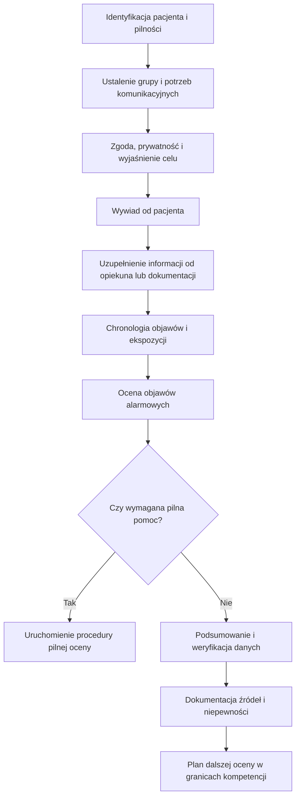

# 2.9. Specyfika wywiadu w grupach specjalnych

## Wprowadzenie

Wywiad endokrynologiczny powinien być dostosowany do wieku, etapu rozwoju, stanu fizjologicznego, możliwości komunikacyjnych, chorób współistniejących i sytuacji społecznej pacjenta. Ta sama dolegliwość może mieć odmienne znaczenie kliniczne u noworodka, nastolatka, osoby ciężarnej, seniora lub pacjenta leczonego onkologicznie. Różnice dotyczą nie tylko częstości chorób, lecz także fizjologii osi hormonalnych, zakresów referencyjnych, sposobu ujawniania objawów, pilności diagnostyki i zasad uzyskiwania zgody.

Celem rozdziału jest nauczenie systematycznego, bezpiecznego i podmiotowego zbierania danych w grupach wymagających szczególnego podejścia. Wywiad nie zastępuje badania fizykalnego, badań laboratoryjnych ani konsultacji specjalistycznej. Nie wolno na jego podstawie samodzielnie rozpoznawać choroby lub zmieniać leczenia poza zakresem uprawnień zawodowych.

> **Zasada nadrzędna:** dostosuj sposób komunikacji, ale nie obniżaj standardu klinicznego, praw pacjenta ani jakości dokumentacji.

## Cele kształcenia

Po ukończeniu rozdziału uczestnik powinien:
1. wyjaśniać, dlaczego wiek, rozwój, ciąża, połóg, starzenie i choroby współistniejące zmieniają interpretację wywiadu endokrynologicznego;
2. prowadzić wywiad z opiekunem dziecka, jednocześnie uwzględniając głos i dobro dziecka;
3. rozpoznawać potrzebę rozmowy z nastolatkiem w warunkach zapewniających prywatność i bezpieczeństwo;
4. uwzględniać fizjologiczne zmiany hormonalne w ciąży, połogu i menopauzie;
5. dostosowywać pytania do ograniczeń poznawczych, sensorycznych, językowych i komunikacyjnych;
6. zbierać informacje istotne u pacjentów starszych, onkologicznych i intensywnie trenujących;
7. identyfikować objawy alarmowe wymagające pilnej oceny;
8. dokumentować źródło informacji, niepewność danych, zgodę i ograniczenia wywiadu;
9. rozpoznawać granice własnych kompetencji i wskazania do konsultacji.

## Efekty uczenia się

Uczestnik:
- **Wiedza:** opisuje specyfikę wywiadu w dziewięciu grupach pacjentów i zna podstawowe zasady ochrony ich praw.
- **Umiejętności:** dobiera pytania, tempo, język i sposób komunikacji; porządkuje chronologię objawów; odróżnia relację pacjenta od informacji opiekuna.
- **Kompetencje społeczne:** zachowuje szacunek, poufność, bezstronność i uważność na nierówności w dostępie do opieki; nie stygmatyzuje pacjentów.

## 1. Zasady wspólne dla wywiadu w grupach szczególnych

### 1.1. Przygotowanie rozmowy

Przed rozpoczęciem należy:
- potwierdzić tożsamość pacjenta zgodnie z procedurą placówki;
- ustalić, kto uczestniczy w rozmowie i w jakiej roli;
- zapytać pacjenta, jak chce być adresowany i czy potrzebuje wsparcia komunikacyjnego;
- zapewnić odpowiednie warunki prywatności, oświetlenia, ciszy i dostępności;
- określić główny problem i pilność sytuacji;
- wyjaśnić cel pytań, przewidywany zakres i możliwość przerwania rozmowy;
- sprawdzić, czy pacjent rozumie przekazywane informacje.

### 1.2. Źródła informacji

Informacje mogą pochodzić od pacjenta, rodzica lub opiekuna, partnera, dokumentacji, zespołu terapeutycznego albo tłumacza. Należy wskazać źródło każdej istotnej informacji. Relacja osoby trzeciej nie powinna automatycznie zastępować wypowiedzi pacjenta, jeżeli pacjent może komunikować się samodzielnie.

| Źródło | Zastosowanie | Ograniczenia |
|---|---|---|
| Pacjent | Objawy subiektywne, cele, preferencje, jakość życia | Pamięć, świadomość, stan kliniczny |
| Rodzic/opiekun | Rozwój dziecka, obserwacje codzienne, historia wczesna | Może nie znać wszystkich danych; konflikt interesów |
| Partner/bliski | Zmiany zachowania, sen, funkcjonowanie | Wymaga poszanowania poufności i zgody |
| Dokumentacja | Daty, wyniki, leczenie, wcześniejsze rozpoznania | Możliwa niekompletność lub błędy |
| Tłumacz | Rzetelna komunikacja językowa | Należy unikać tłumaczenia przez dzieci i osób zainteresowanych |

### 1.3. Technika pytań

Stosuj pytania otwarte, a następnie doprecyzowujące. Unikaj pytań sugerujących, oceniania i zawstydzania. Zamiast „Czy źle się Pan odżywia?” zapytaj: „Jak wygląda typowy dzień żywienia?”. W przypadku objawu ustal początek, przebieg, nasilenie, czynniki modyfikujące, objawy towarzyszące i wpływ na funkcjonowanie.

### 1.4. Bezpieczeństwo i eskalacja

Nie kontynuuj rutynowego wywiadu kosztem pilnej pomocy. Zaburzenia świadomości, drgawki, ciężkie odwodnienie, objawy wstrząsu, ciężka hipoglikemia, podejrzenie przełomu nadnerczowego, kwasicy ketonowej, tyreotoksykozy z dekompensacją lub ostrego powikłania ciąży wymagają natychmiastowej oceny według lokalnych procedur.

## 2. Wywiad u noworodków i niemowląt z udziałem opiekunów

### 2.1. Specyfika okresu noworodkowego

U noworodka objawy zaburzeń endokrynologicznych bywają nieswoiste: trudności w karmieniu, wymioty, przedłużająca się żółtaczka, zaburzenia termoregulacji, senność, drażliwość, nieprawidłowy przyrost masy ciała, odwodnienie lub zaburzenia glikemii. Nasilenie objawów może narastać szybko. Wywiad powinien być zwięzły, ukierunkowany i równolegle prowadzony z oceną stanu klinicznego.

### 2.2. Dane okołoporodowe

Ustal:
- wiek ciążowy i sposób datowania;
- przebieg ciąży, choroby matki i przyjmowane leki;
- ekspozycję prenatalną, w tym leki przeciwtarczycowe, jod, glikokortykosteroidy i substancje psychoaktywne;
- poród, masę i długość urodzeniową, obwód głowy oraz ocenę adaptacji;
- hospitalizację, intensywną terapię, żywienie pozajelitowe i transfuzje;
- wyniki badań przesiewowych noworodków oraz informację o ewentualnym powtórzeniu próbki.

Nie interpretuj pojedynczego wyniku przesiewowego jako ostatecznego rozpoznania. Nieprawidłowy wynik wymaga postępowania zgodnego z programem przesiewowym i pilności określonej przez właściwy zespół.

### 2.3. Karmienie, wzrastanie i wydalanie

Zapytaj o sposób karmienia, częstość i efektywność ssania, czas karmienia, tolerancję pokarmu, wymioty, liczbę mokrych pieluch, charakter stolców i przebieg przyrostu masy ciała. Zapisuj pomiary z datą i porównuj je na odpowiednich siatkach wzrastania, z uwzględnieniem wieku ciążowego i wieku skorygowanego u wcześniaków.

### 2.4. Pytania ukierunkowane

| Obszar | Przykładowe pytania |
|---|---|
| Karmienie | Czy dziecko kończy karmienie? Czy szybko się męczy lub poci? |
| Nawodnienie | Ile jest mokrych pieluch? Czy zmieniła się ilość moczu? |
| Glikemia | Czy występują epizody drżenia, bezdechu, sinienia lub trudności z wybudzeniem? |
| Tarczyca | Czy utrzymuje się żółtaczka, zaparcie, osłabienie ssania lub nadmierna senność? |
| Nadnercza i elektrolity | Czy występują wymioty, utrata masy, odwodnienie, osłabienie lub nietypowe zabarwienie skóry? |
| Rozwój | Czy rodzice zauważyli zmianę napięcia, aktywności lub reakcji dziecka? |

Objawy te nie są swoiste dla endokrynopatii. Wymagają różnicowania z zakażeniem, chorobami przewodu pokarmowego, neurologicznymi, kardiologicznymi i metabolicznymi.

### 2.5. Rola opiekuna i dokumentacja

Wyjaśnij opiekunom, jakie obserwacje są ważne, ale unikaj obwiniania. Zapisuj, kto udzielił informacji, czy dokumenty były dostępne, jakie dane są niepewne i jakie zalecenia przekazano. W razie rozbieżności odnotuj ją neutralnie.

## 3. Wywiad pediatryczny i ocena siatek centylowych

### 3.1. Wzrastanie jako proces dynamiczny

Pojedynczy pomiar wzrostu lub masy ciała ma ograniczoną wartość. Istotne są kolejne pomiary, tempo wzrastania, zmiana kanału centylowego, proporcje ciała, wzrost rodziców, etap dojrzewania i stan odżywienia. Pomiary powinny być wykonane standaryzowaną techniką i nanoszone na siatki właściwe dla wieku, płci i populacji.

### 3.2. Pytania do rodziców i dziecka

- Kiedy zauważono przyspieszenie lub zahamowanie wzrastania?
- Czy ubrania i obuwie przestają pasować w typowym tempie?
- Czy wystąpiła zmiana apetytu, pragnienia, oddawania moczu lub wypróżnień?
- Jak przebiegało dojrzewanie u rodziców i rodzeństwa?
- Czy dziecko choruje przewlekle, przyjmuje leki lub było leczone glikokortykosteroidami?
- Czy występują bóle głowy, zaburzenia widzenia, osłabienie, bóle brzucha lub objawy neurologiczne?
- Jak dziecko funkcjonuje w szkole, sporcie i relacjach?

### 3.3. Interpretacja wzrastania

Niski wzrost nie jest sam w sobie rozpoznaniem niedoboru hormonu wzrostu. Wysoki wzrost nie oznacza automatycznie nadmiaru GH. Należy rozważyć rodzinny wzorzec wzrostu, opóźnione lub przyspieszone dojrzewanie, choroby przewlekłe, niedożywienie, zaburzenia tarczycy, choroby genetyczne i inne przyczyny.

W ocenie wykorzystuje się:
- wzrost i masę ciała;
- BMI dla wieku;
- tempo wzrastania;
- wzrost docelowy wynikający ze wzrostu rodziców;
- proporcje ciała;
- wiek kostny, jeżeli jest wskazany;
- etap dojrzewania.

Wyniki interpretuje się według aktualnych standardów pediatrycznych. Nie należy przenosić norm dla dorosłych na dzieci.

### 3.4. Objawy wymagające pilniejszej oceny

Szczególnej uwagi wymagają: szybka zmiana tempa wzrastania, utrata centyli, ból głowy z zaburzeniami widzenia, wielomocz i polidypsja, objawy odwodnienia, przedwczesne cechy dojrzewania, zahamowanie dojrzewania oraz objawy ogólnoustrojowe.

## 4. Wywiad z nastolatkiem z poszanowaniem prywatności

### 4.1. Relacja z nastolatkiem

Nastolatek powinien być traktowany jako uczestnik rozmowy, a nie wyłącznie przedmiot wywiadu rodzica. Na początku można przeprowadzić część rozmowy wspólnie, a następnie zaproponować krótką część indywidualną. Wyjaśnij z wyprzedzeniem granice poufności: zagrożenie życia lub zdrowia, podejrzenie przemocy i inne ustawowe przesłanki mogą wymagać podjęcia działań ochronnych.

Zasady zgody małoletniego, przedstawicielstwa ustawowego i współdecydowania należy stosować zgodnie z aktualnym prawem polskim, wiekiem pacjenta i rodzajem świadczenia. W razie wątpliwości należy skorzystać z procedur placówki lub konsultacji prawnej.

### 4.2. Obszary wywiadu

Zapytaj w sposób neutralny o:
- wzrastanie i dojrzewanie;
- miesiączkowanie lub inne objawy związane z funkcją gonad, jeśli dotyczą pacjenta;
- sen, odżywianie, aktywność fizyczną i regenerację;
- nastrój, stres, relacje i bezpieczeństwo;
- stosowane leki, suplementy i substancje;
- obraz ciała, restrykcje żywieniowe i zachowania kompensacyjne;
- objawy zaburzeń glikemii i tarczycy;
- możliwość ciąży, aktywność seksualną i ryzyko zakażeń, gdy jest to klinicznie właściwe.

Nie zakładaj aktywności seksualnej ani jej braku. Nie zakładaj, że wygląd zewnętrzny określa tożsamość, zachowania lub potrzeby zdrowotne.

### 4.3. Komunikacja

Używaj języka zrozumiałego, krótkich pytań i podsumowań. Zapytaj, czy pacjent chce, aby opiekun pozostał podczas rozmowy. Nie obiecuj bezwarunkowej tajemnicy, jeżeli istnieją prawne lub kliniczne granice poufności.

## 5. Wywiad u kobiet w ciąży i w połogu

### 5.1. Ciąża jako odmienny stan fizjologiczny

Ciąża istotnie zmienia stężenia hormonów, białek wiążących, objętość osocza, czynność nerek i metabolizm. Interpretacja wyników wymaga zakresów właściwych dla trymestru, metody laboratoryjnej i lokalnych zaleceń. Nie należy stosować bezrefleksyjnie zakresów referencyjnych dla osób niebędących w ciąży.

### 5.2. Zakres wywiadu

Ustal:
- tydzień ciąży i sposób potwierdzenia wieku ciążowego;
- przebieg obecnej i wcześniejszych ciąż;
- cukrzycę przedciążową lub hiperglikemię w ciąży;
- choroby tarczycy, przysadki, nadnerczy i przytarczyc;
- nadciśnienie, choroby nerek i choroby autoimmunologiczne;
- leki, suplementy, jod i preparaty ziołowe;
- wymioty, odwodnienie, kołatanie serca, nietolerancję ciepła lub zimna;
- zaburzenia widzenia, bóle głowy i objawy neurologiczne;
- karmienie piersią, jeśli rozmowa dotyczy połogu.

### 5.3. Połóg i laktacja

Zapytaj o krwotok okołoporodowy, niedociśnienie, transfuzje, trudności z laktacją, nadmierne zmęczenie, utratę masy, kołatania serca, nietolerancję temperatury, zaburzenia nastroju i objawy niedoczynności lub nadczynności tarczycy. Po krwotoku poporodowym i niemożności rozpoczęcia laktacji należy rozważyć, w odpowiednim kontekście klinicznym, uszkodzenie przysadki.

Poporodowe zapalenie tarczycy może przebiegać fazowo, ale nie każdy objaw poporodowy oznacza chorobę tarczycy. Różnicowanie obejmuje m.in. chorobę Gravesa-Basedowa, niedobór snu, niedokrwistość, infekcję i zaburzenia nastroju.

### 5.4. Objawy alarmowe

Pilnej oceny wymagają m.in. silny ból głowy z zaburzeniami widzenia, drgawki, duszność, ból w klatce piersiowej, ciężkie nadciśnienie, omdlenie, znaczne krwawienie, ciężkie odwodnienie, zaburzenia świadomości i podejrzenie przełomu nadnerczowego.

## 6. Wywiad u kobiet w okresie menopauzalnym

### 6.1. Charakterystyka objawów

Ustal wiek ostatniej miesiączki, zmiany cyklu, uderzenia gorąca, poty nocne, zaburzenia snu, nastrój, dolegliwości moczowo-płciowe, libido, bóle stawów, historię złamań i czynniki ryzyka sercowo-naczyniowego. Zapytaj o operacje ginekologiczne, leczenie onkologiczne, terapię hormonalną i przeciwwskazania do określonych metod leczenia.

### 6.2. Nie przypisuj każdego objawu menopauzie

Zmęczenie, kołatanie serca, zaburzenia snu, zmiany masy ciała i obniżenie nastroju mają wiele możliwych przyczyn. Krwawienie po menopauzie wymaga diagnostyki, a nie uspokojenia pacjentki samym wyjaśnieniem hormonalnym. Nowe objawy ogniskowe, guz, ból lub niewyjaśniona utrata masy ciała również wymagają odrębnej oceny.

## 7. Wywiad u osób starszych i wielochorobowych

### 7.1. Kontekst geriatryczny

U seniorów objawy endokrynopatii mogą być nietypowe, nakładać się na choroby przewlekłe i działania niepożądane leków. Należy uwzględnić kruchość, ryzyko upadków, stan poznawczy, odżywienie, nawodnienie, sprawność, wsparcie społeczne i cele opieki.

### 7.2. Uzgadnianie farmakoterapii

Ustal wszystkie leki na receptę, OTC, preparaty doraźne, suplementy i leki przyjmowane nieregularnie. Zapytaj, kto przygotowuje dawki, czy pacjent rozumie schemat i czy występują trudności z połykaniem, pamięcią, wzrokiem lub dostępem do leków. Nie zakładaj, że lista w dokumentacji jest aktualna.

### 7.3. Funkcjonowanie i cele pacjenta

Zapytaj o samodzielność, upadki, zawroty głowy, hipoglikemie, nietrzymanie moczu, apetyt, utratę masy ciała, sen, ból i priorytety pacjenta. Plan diagnostyczny i terapeutyczny powinien uwzględniać spodziewane korzyści, obciążenia, rokowanie i preferencje chorego.

## 8. Wywiad u osób z niepełnosprawnością intelektualną lub komunikacyjną

### 8.1. Dostępność komunikacji

Najpierw zwróć się bezpośrednio do pacjenta. Ustal preferowany sposób komunikacji: mowa, pismo, piktogramy, komunikacja wspomagająca, gesty, urządzenie elektroniczne lub pomoc osoby znającej pacjenta. Zapewnij dodatkowy czas i ogranicz bodźce.

### 8.2. Dostosowanie pytań

Stosuj jedno pytanie naraz, konkretne określenia czasu i proste skale. Sprawdzaj zrozumienie przez prośbę o powtórzenie własnymi słowami. Nie traktuj braku wypowiedzi jako braku bólu lub objawów. Obserwacje opiekuna są ważne, ale powinny być odróżnione od bezpośredniej relacji pacjenta.

### 8.3. Zgoda i wspierane podejmowanie decyzji

Niepełnosprawność nie oznacza automatycznie braku zdolności do podejmowania decyzji. Zdolność ocenia się w odniesieniu do konkretnej decyzji i sytuacji. Należy zapewnić wsparcie, przedstawić informacje w dostępnej formie i postępować zgodnie z prawem oraz procedurami. Nie wolno pomijać pacjenta w rozmowie tylko dlatego, że towarzyszy mu opiekun.

## 9. Wywiad u pacjentów onkologicznych

### 9.1. Leczenie przeciwnowotworowe a układ hormonalny

Niektóre terapie onkologiczne mogą powodować zaburzenia osi przysadka–tarczyca–nadnercza–gonady, zaburzenia glikemii, gospodarki wapniowej i metabolizmu kości. Szczególne znaczenie mają inhibitory punktów kontrolnych układu immunologicznego, radioterapia okolicy głowy i szyi, napromienianie mózgowia, leczenie steroidami, inhibitory aromatazy, terapia deprywacji androgenowej i niektóre leki celowane.

### 9.2. Chronologia ekspozycji

Zapisz:
- typ nowotworu i datę rozpoznania;
- operacje, zakres resekcji i powikłania;
- rodzaj, dawki i daty radioterapii;
- nazwy leków przeciwnowotworowych i cykle terapii;
- stosowanie glikokortykosteroidów i innych leków wspomagających;
- początek objawów w relacji do leczenia;
- wcześniejsze choroby endokrynologiczne;
- wyniki hormonalne sprzed i po leczeniu.

Nie przypisuj automatycznie objawów terapii onkologicznej. Należy rozważyć progresję choroby, zakażenie, niedożywienie, działania leków, zaburzenia elektrolitowe i inne przyczyny.

### 9.3. Objawy wymagające pilnej reakcji

Nowe silne osłabienie, hipotensja, wymioty, ból głowy, zaburzenia widzenia, splątanie, ciężka hiperglikemia, hipoglikemia, duszność lub zaburzenia elektrolitowe u pacjenta leczonego immunoterapią mogą wskazywać na poważne powikłanie. Wymagają pilnej oceny i kontaktu z zespołem onkologicznym lub odpowiednim zespołem ratunkowym.

## 10. Wywiad u sportowców i osób intensywnie trenujących

### 10.1. Obciążenie treningowe i dostępność energii

Ustal rodzaj dyscypliny, objętość i intensywność treningu, liczbę dni odpoczynku, przygotowanie do zawodów, zmianę obciążeń, urazy, regenerację, sen i sposób żywienia. Zapytaj o szybkie redukcje masy, ograniczenia dietetyczne, presję kategorii wagowej i obraz ciała.

Niska dostępność energii może zaburzać funkcje rozrodcze, zdrowie kości, odporność, nastrój i wydolność. Zespół względnego niedoboru energii w sporcie (REDs) dotyczy osób różnych płci. Nie należy rozpoznawać go wyłącznie na podstawie masy ciała lub jednego objawu.

### 10.2. Funkcje rozrodcze i zdrowie kości

Zapytaj o zmianę regularności miesiączek, brak miesiączki, obniżenie libido, zaburzenia erekcji, nawracające urazy przeciążeniowe, złamania zmęczeniowe i spadek wyników. Uwzględnij możliwość innych przyczyn, w tym ciąży, chorób tarczycy, hiperprolaktynemii, zaburzeń odżywiania i chorób przewlekłych.

### 10.3. Suplementy i środki ergogeniczne

Ustal dokładną nazwę produktu, skład, producenta, dawkę, czas i źródło zakupu. Zapytaj o preparaty przedtreningowe, hormony, steroidy anaboliczno-androgenne, selektywne modulatory receptora androgenowego (SARM), hormony tarczycy, stymulanty i środki odchudzające. Nie oceniaj moralnie pacjenta; priorytetem jest bezpieczeństwo i wiarygodna informacja.

## 11. Zintegrowany schemat postępowania

### 11.1. Minimalny zestaw danych

| Element | Co należy zapisać |
|---|---|
| Kontekst | Wiek, etap rozwoju, stan fizjologiczny |
| Uczestnicy | Pacjent, opiekun, tłumacz, osoba wspierająca |
| Źródło | Kto przekazał daną informację |
| Objawy | Początek, przebieg, nasilenie, wpływ na funkcjonowanie |
| Rozwój/wzrastanie | Pomiary seryjne, siatki, tempo zmian |
| Leczenie | Leki, dawki, daty, terapie i ekspozycje |
| Bezpieczeństwo | Objawy alarmowe, ryzyko samouszkodzenia lub przemocy, jeśli dotyczy |
| Ograniczenia | Brak dokumentacji, trudności komunikacyjne, niepewność |
| Dalsze kroki | Pilność, konsultacja, badania zlecone przez uprawnioną osobę |

## 12. Przykładowe sformułowania kliniczne

**Dziecko:** „Wywiad uzyskano od matki; dziecko uczestniczyło w rozmowie w zakresie adekwatnym do wieku. Opiekunka podaje spadek apetytu od około sześciu tygodni. Dane dotyczące wcześniejszych pomiarów wzrostu wymagają weryfikacji w książeczce zdrowia.”

**Nastolatek:** „Część wywiadu przeprowadzono indywidualnie, po wyjaśnieniu zasad poufności i ich ograniczeń. Pacjent udzielał odpowiedzi samodzielnie. Nie odnotowano informacji, których ujawnienie bez podstawy prawnej byłoby konieczne.”

**Ciąża:** „Pacjentka w 24. tygodniu ciąży, wywiad dotyczący chorób tarczycy i stosowanych preparatów uzupełniono o dokumentację położniczą. Interpretacja badań wymaga odniesienia do zakresów właściwych dla ciąży i metody laboratorium.”

**Senior:** „Wywiad bezpośredni uzupełniono listą leków przyniesioną przez pacjenta. Występują rozbieżności dotyczące dawkowania; zalecono uzgodnienie listy z dokumentacją i osobą prowadzącą leczenie.”

**Pacjent z trudnościami komunikacyjnymi:** „Pytania przedstawiano pojedynczo, z użyciem komunikacji wspomagającej. Odpowiedzi pacjenta odnotowano oddzielnie od obserwacji opiekuna.”

## 13. Objawy alarmowe – szybka lista kontrolna

- Zaburzenia świadomości, drgawki lub gwałtowne pogorszenie stanu.
- Ciężka hipoglikemia lub podejrzenie kwasicy ketonowej.
- Wymioty, odwodnienie, hipotensja i podejrzenie przełomu nadnerczowego.
- Nowy silny ból głowy z zaburzeniami widzenia.
- Niemowlę z trudnościami karmienia, letargiem, odwodnieniem lub zaburzeniami oddychania.
- Ciężkie objawy w ciąży lub połogu.
- Pacjent onkologiczny z nowymi objawami sugerującymi toksyczność immunoterapii.
- Podejrzenie przemocy, zaniedbania lub bezpośredniego zagrożenia bezpieczeństwa.

Lista nie zastępuje lokalnych procedur triażu. W razie zagrożenia życia należy niezwłocznie uruchomić właściwy system pomocy.

## 14. Granice kompetencji i odpowiedzialność

Wywiad może być prowadzony przez osoby posiadające odpowiednie przygotowanie i uprawnienia, w zakresie wynikającym z prawa, organizacji świadczenia i procedur. Uczestnik kursu nie powinien:
- samodzielnie rozpoznawać endokrynopatii wyłącznie na podstawie wywiadu;
- interpretować wyników poza swoimi kompetencjami;
- zmieniać dawek leków ani odstawiać terapii;
- wykonywać badań intymnych bez uprawnień, wskazań, zgody i właściwych warunków;
- obiecywać poufności sprzecznej z obowiązkiem ochrony pacjenta;
- pomijać objawów alarmowych;
- przypisywać objawów wieku, niepełnosprawności, ciąży lub menopauzie bez różnicowania.

W razie wątpliwości należy przekazać pacjenta osobie uprawnionej, udokumentować przekazanie i nie opóźniać pilnej pomocy.

## 15. Pytania kontrolne

1. Dlaczego u noworodka objawy endokrynopatii mogą wymagać szybkiej oceny?
2. Jakie dane okołoporodowe są istotne w wywiadzie endokrynologicznym?
3. Dlaczego pojedynczy pomiar wzrostu dziecka nie wystarcza do oceny zaburzeń wzrastania?
4. Jakie zasady należy wyjaśnić nastolatkowi przed rozmową indywidualną?
5. Dlaczego wyniki badań hormonalnych w ciąży wymagają kontekstu trymestru i metody?
6. Jakie objawy połogowe mogą sugerować zaburzenia przysadki lub tarczycy?
7. Dlaczego krwawienia po menopauzie nie należy automatycznie uznawać za objaw fizjologiczny?
8. Jak wielolekowość wpływa na wywiad u osoby starszej?
9. Jak dostosować komunikację do osoby używającej komunikacji wspomagającej?
10. Jakie terapie onkologiczne mogą powodować endokrynopatie?
11. Czym jest niska dostępność energii u sportowca?
12. Jak dokumentować rozbieżności między relacją pacjenta i opiekuna?
13. Kiedy należy przerwać rutynowy wywiad i uruchomić pilną pomoc?
14. Dlaczego niepełnosprawność nie oznacza automatycznie braku zdolności do wyrażenia zgody?
15. Jak odróżnić obserwację opiekuna od bezpośredniej relacji pacjenta?

### Proponowane odpowiedzi

1. Ze względu na ograniczoną swoistość objawów, małe rezerwy fizjologiczne i możliwość szybkiej dekompensacji.
2. Wiek ciążowy, przebieg ciąży i porodu, parametry urodzeniowe, hospitalizacja, leki matki i wyniki przesiewu.
3. Potrzebna jest ocena tempa wzrastania i trendu na właściwej siatce centylowej.
4. Cel rozmowy, dobrowolność, granice poufności i sytuacje wymagające ochrony.
5. Fizjologia ciąży zmienia stężenia hormonów i białek wiążących, a zakresy zależą od trymestru i metody.
6. Brak laktacji po krwotoku, silne osłabienie, hipotensja, zaburzenia widzenia, objawy tarczycowe.
7. Może być objawem patologii endometrium i wymaga diagnostyki.
8. Zwiększa ryzyko interakcji, działań niepożądanych, błędów dawkowania i objawów naśladujących endokrynopatię.
9. Przez krótkie pytania, piktogramy, urządzenia AAC, dodatkowy czas i bezpośrednie zwracanie się do pacjenta.
10. Immunoterapia, radioterapia, inhibitory aromatazy, deprywacja androgenowa i wybrane terapie celowane.
11. Niedostateczna podaż energii w stosunku do wydatku, mogąca zaburzać funkcje fizjologiczne.
12. Oddzielnie wskazać źródło każdej informacji i opisać rozbieżność neutralnie.
13. Przy zagrożeniu życia, ciężkim stanie metabolicznym, zaburzeniach świadomości lub innych objawach alarmowych.
14. Zdolność do decyzji jest indywidualna, zależna od konkretnej decyzji i może być wspierana.
15. W dokumentacji jasno oznaczyć źródło i nie przedstawiać relacji opiekuna jako wypowiedzi pacjenta.

## 16. Ćwiczenia praktyczne

### Ćwiczenie 1. Wywiad z opiekunem niemowlęcia
Przeprowadź symulowany wywiad dotyczący karmienia, nawodnienia, wzrastania i badań przesiewowych. Zapisz źródła danych i trzy sytuacje wymagające pilnej oceny.

### Ćwiczenie 2. Ocena wzrastania
Na podstawie przykładowych pomiarów z kilku wizyt opisz trend wzrostu i masy. Nie stawiaj rozpoznania na podstawie pojedynczego centyla. Wskaż brakujące dane.

### Ćwiczenie 3. Rozmowa z nastolatkiem
Opracuj wstęp rozmowy, wyjaśnienie granic poufności i zestaw neutralnych pytań o sen, odżywianie, dojrzewanie i samopoczucie.

### Ćwiczenie 4. Wywiad w ciąży i połogu
Przygotuj chronologię chorób tarczycy, glikemii, leków i objawów. Wskaż, które wyniki wymagają interpretacji właściwej dla ciąży.

### Ćwiczenie 5. Pacjent starszy z wielolekowością
Porównaj listę leków pacjenta z dokumentacją. Wskaż rozbieżności, ryzyko hipoglikemii, hipotensji i trudności w przestrzeganiu zaleceń.

### Ćwiczenie 6. Pacjent onkologiczny lub sportowiec
Wybierz jeden scenariusz. Opracuj tabelę ekspozycji i objawów, wskaż możliwe mechanizmy endokrynne oraz moment, w którym konieczna jest konsultacja specjalistyczna.

## 17. Test sprawdzający

**1. Która informacja jest szczególnie ważna w wywiadzie noworodka?**
A. Preferencje żywieniowe w wieku szkolnym  
B. Wynik przesiewu noworodkowego i przebieg okołoporodowy  
C. Historia zawodowa pacjenta  
D. Samodzielna ocena libido

**2. Jak należy oceniać wzrastanie dziecka?**
A. Na podstawie jednego pomiaru  
B. Wyłącznie według norm dla dorosłych  
C. Na podstawie seryjnych pomiarów i tempa wzrastania  
D. Wyłącznie według masy ciała

**3. Co należy wyjaśnić nastolatkowi przed rozmową indywidualną?**
A. Że wszystkie informacje zawsze pozostaną tajne  
B. Granice poufności i zasady ochrony bezpieczeństwa  
C. Że opiekun musi znać każdą odpowiedź  
D. Że nie może odmówić odpowiedzi

**4. Jak interpretować wyniki hormonalne w ciąży?**
A. Stosować zawsze normy dla osób niebędących w ciąży  
B. Pominąć metodę laboratoryjną  
C. Uwzględnić trymestr, metodę i właściwe zakresy  
D. Uznać każdy wynik poza zakresem ogólnym za chorobę

**5. Który objaw po krwotoku poporodowym wymaga uwagi w kierunku uszkodzenia przysadki?**
A. Brak możliwości rozpoczęcia laktacji  
B. Krótkotrwały głód  
C. Przejściowe zmęczenie po nieprzespanej nocy  
D. Zwiększony apetyt

**6. Krwawienie po menopauzie:**
A. Zawsze jest fizjologiczne  
B. Nie wymaga oceny  
C. Wymaga diagnostyki  
D. Jest dowodem nadczynności tarczycy

**7. Co jest ważne u seniora z wielolekowością?**
A. Pominięcie suplementów  
B. Uzgodnienie rzeczywiście przyjmowanych leków  
C. Automatyczne odstawienie leków  
D. Założenie, że dokumentacja jest zawsze aktualna

**8. Jak postępować z osobą używającą komunikacji wspomagającej?**
A. Rozmawiać wyłącznie z opiekunem  
B. Zrezygnować z wywiadu  
C. Dostosować pytania i zwracać się bezpośrednio do pacjenta  
D. Uznać brak mowy za brak objawów

**9. Która terapia onkologiczna może wywołać zaburzenia endokrynne?**
A. Wyłącznie antybiotykoterapia  
B. Inhibitory punktów kontrolnych układu immunologicznego  
C. Każda rehabilitacja  
D. Wyłącznie leczenie przeciwbólowe

**10. Co może sugerować niską dostępność energii u sportowca?**
A. Wyłącznie wysoki wzrost  
B. Zaburzenia miesiączkowania, spadek libido i urazy przeciążeniowe  
C. Jednorazowy wzrost apetytu  
D. Sama obecność mięśni

**11. Czy niepełnosprawność intelektualna automatycznie oznacza brak zdolności do wyrażenia zgody?**
A. Tak  
B. Nie; zdolność ocenia się indywidualnie i w odniesieniu do decyzji  
C. Tak, jeśli obecny jest opiekun  
D. Tak, jeśli pacjent używa AAC

**12. Jak dokumentować dane od opiekuna?**
A. Jako wypowiedź pacjenta  
B. Bez wskazania źródła  
C. Z oznaczeniem źródła informacji  
D. Nie dokumentować

**13. Kiedy należy przerwać rutynowy wywiad?**
A. Gdy pacjent zadaje pytania  
B. Gdy pojawiają się objawy zagrożenia życia  
C. Gdy pacjent potrzebuje przerwy  
D. Gdy trzeba doprecyzować datę

**14. Czy objawy menopauzalne wykluczają inne choroby?**
A. Tak  
B. Nie; wymagają różnicowania z innymi przyczynami  
C. Tak, jeśli pacjentka ma ponad 50 lat  
D. Tak, jeśli występują uderzenia gorąca

**15. Jaki jest podstawowy cel dostosowania wywiadu?**
A. Skrócenie rozmowy za wszelką cenę  
B. Ograniczenie udziału pacjenta  
C. Uzyskanie wiarygodnych danych przy zachowaniu praw, bezpieczeństwa i godności  
D. Zastąpienie badania fizykalnego

### Klucz odpowiedzi i uzasadnienia

| Pytanie | Odpowiedź | Uzasadnienie |
|---:|:---:|---|
| 1 | B | Dane okołoporodowe i przesiew są istotne dla wczesnego wykrywania chorób. |
| 2 | C | Liczy się trend i tempo wzrastania. |
| 3 | B | Poufność ma określone granice prawne i kliniczne. |
| 4 | C | Ciąża zmienia fizjologię i interpretację wyników. |
| 5 | A | Może towarzyszyć niedoczynności przysadki po krwotoku. |
| 6 | C | Krwawienie po menopauzie wymaga wyjaśnienia. |
| 7 | B | Uzgodnienie leków zmniejsza ryzyko błędów. |
| 8 | C | Pacjent pozostaje głównym uczestnikiem rozmowy. |
| 9 | B | Immunoterapia może wywoływać zapalenia gruczołów dokrewnych. |
| 10 | B | Są to możliwe następstwa niskiej dostępności energii. |
| 11 | B | Ocena jest indywidualna i zależna od konkretnej decyzji. |
| 12 | C | Źródło informacji musi być jawne. |
| 13 | B | Priorytetem jest pilna pomoc. |
| 14 | B | Objawy mają szerokie różnicowanie. |
| 15 | C | Adaptacja służy jakości i bezpieczeństwu, nie wykluczeniu pacjenta. |

## 18. Słownik pojęć

- **AAC** – komunikacja wspomagająca i alternatywna.
- **Wiek skorygowany** – wiek dziecka wcześniaczego skorygowany o liczbę tygodni wcześniactwa.
- **Centyl** – pozycja wyniku w rozkładzie odniesienia dla danej populacji.
- **Tempo wzrastania** – przyrost wysokości ciała w jednostce czasu.
- **REDs** – zespół względnego niedoboru energii w sporcie.
- **POI** – przedwczesne wygasanie czynności jajników.
- **Immunoterapia inhibitorami punktów kontrolnych** – leczenie przeciwnowotworowe modulujące odpowiedź immunologiczną.
- **Wspierane podejmowanie decyzji** – zapewnienie pomocy umożliwiającej osobie zrozumienie informacji i wyrażenie własnej decyzji.
- **Wywiad heteroanamnestyczny** – informacje uzyskane od osób innych niż pacjent.
- **Uzgadnianie farmakoterapii** – porównanie rzeczywiście stosowanych leków z listą w dokumentacji.
- **Objaw alarmowy** – objaw wskazujący na możliwość stanu wymagającego pilnej oceny.
- **Zakres referencyjny** – przedział wyników określony dla danej populacji i metody, niebędący samodzielnym rozpoznaniem.

## 19. Podsumowanie

Wywiad w grupach szczególnych wymaga jednoczesnego uwzględnienia fizjologii, rozwoju, chorób współistniejących, kontekstu społecznego i praw pacjenta. Najważniejsze jest zachowanie podmiotowości chorego, dostosowanie komunikacji, rzetelna chronologia objawów, rozdzielenie źródeł informacji oraz rozpoznanie sytuacji wymagających pilnej interwencji.

Prawidłowo przeprowadzony wywiad nie jest mechanicznym wypełnianiem formularza. Jest uporządkowaną rozmową, która pozwala zrozumieć sytuację pacjenta, ograniczyć ryzyko błędu i zaplanować dalszą ocenę w granicach kompetencji.

## 20. Bibliografia i źródła do dalszej nauki

1. World Health Organization. WHO recommendations on maternal and newborn care for a positive postnatal experience. Geneva: WHO; 2022.
2. World Health Organization. WHO recommendations for care of the preterm or low-birth-weight infant. Geneva: WHO; 2022.
3. World Health Organization. WHO guideline on school health services. Geneva: WHO; 2021.
4. World Health Organization. Standards for improving the quality of care for children and young adolescents in health facilities. Geneva: WHO; 2018.
5. World Health Organization. International Classification of Functioning, Disability and Health (ICF). Geneva: WHO; 2001.
6. UNICEF. Implementation guidance for the nurturing care framework. New York: UNICEF; aktualne materiały programowe.
7. Centers for Disease Control and Prevention. Child and adolescent growth charts. Atlanta: CDC; aktualizowane materiały internetowe.
8. Centers for Disease Control and Prevention. WHO growth standards and growth charts. Atlanta: CDC; aktualizowane materiały internetowe.
9. Pediatric Endocrine Society. Clinical resources and practice guidance. Beverly, MA: PES; aktualne materiały.
10. European Society for Paediatric Endocrinology. Clinical practice resources. ESPE; aktualne materiały.
11. American Academy of Pediatrics. Bright Futures: Guidelines for Health Supervision of Infants, Children, and Adolescents. 4th ed. Itasca, IL: AAP; 2017.
12. Hagan JF, Shaw JS, Duncan PM, editors. Bright Futures: Guidelines for Health Supervision of Infants, Children, and Adolescents. 4th ed. Itasca, IL: AAP; 2017.
13. World Health Organization. Adolescent health. Geneva: WHO; aktualne materiały programowe.
14. American College of Obstetricians and Gynecologists. Confidentiality in adolescent health care. Committee Opinion; aktualne stanowisko.
15. American College of Obstetricians and Gynecologists. Screening and management of the hyperglycemic disorders of pregnancy. Clinical guidance; aktualne stanowiska.
16. European Society of Endocrinology. Clinical practice guidelines on endocrine disorders in pregnancy. ESE; aktualne wytyczne.
17. American Thyroid Association. Guidelines for the diagnosis and management of thyroid disease during pregnancy and the postpartum. Thyroid. 2017;27(3):315–389.
18. National Institute for Health and Care Excellence. Menopause: identification and management. NICE guideline NG23; aktualna wersja.
19. World Health Organization. Integrated care for older people (ICOPE): guidance for person-centred assessment and pathways in primary care. Geneva: WHO; 2019.
20. World Health Organization. Decade of Healthy Ageing: baseline report. Geneva: WHO; 2020.
21. National Institute for Health and Care Excellence. Multimorbidity: clinical assessment and management. NICE guideline NG56; aktualna wersja.
22. World Health Organization. International Classification of Functioning, Disability and Health: Children and Youth Version (ICF-CY). Geneva: WHO; 2007.
23. Endocrine Society. Endocrine-related adverse effects of immune checkpoint inhibitors: clinical practice resources and guidance. Aktualne materiały.
24. Husebye ES, et al. Endocrine-related adverse conditions in patients receiving immune checkpoint inhibition: an ESE clinical practice guideline. Eur J Endocrinol. 2022;187(6):G1–G21.
25. Mountjoy M, Ackerman KE, Bailey DM, et al. 2023 International Olympic Committee's (IOC) consensus statement on Relative Energy Deficiency in Sport (REDs). Br J Sports Med. 2023;57:1073–1097.
26. International Olympic Committee. REDs Clinical Assessment Tool—Version 2 (REDs CAT2). Br J Sports Med. 2023;57:1109–1121.
27. American Society of Clinical Oncology. Management of immune-related adverse events in patients treated with immune checkpoint inhibitor therapy: guideline update. J Clin Oncol. 2021;39(36):4073–4126.
28. Polska. Ustawa z dnia 6 listopada 2008 r. o prawach pacjenta i Rzeczniku Praw Pacjenta. Dz.U. z późn. zm.
29. Polska. Ustawa z dnia 5 grudnia 1996 r. o zawodach lekarza i lekarza dentysty. Dz.U. z późn. zm.
30. Polska. Ustawa z dnia 15 kwietnia 2011 r. o działalności leczniczej. Dz.U. z późn. zm.

**Uwaga bibliograficzna:** przed wykorzystaniem w procedurze klinicznej należy sprawdzić aktualne wersje wytycznych, lokalne zakresy referencyjne i obowiązujące przepisy. Wskazane źródła stanowią punkt wyjścia do nauki; nie zastępują pełnych dokumentów ani decyzji osoby uprawnionej.

---
