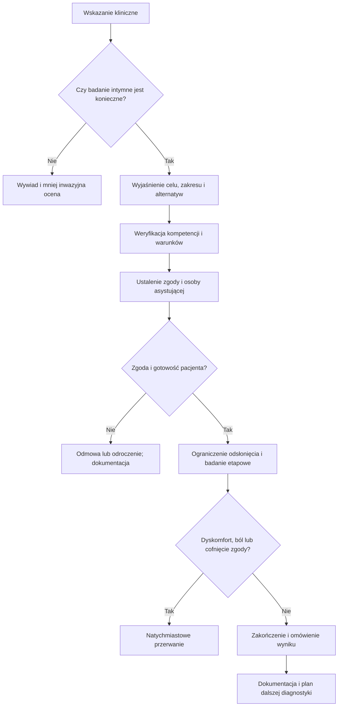
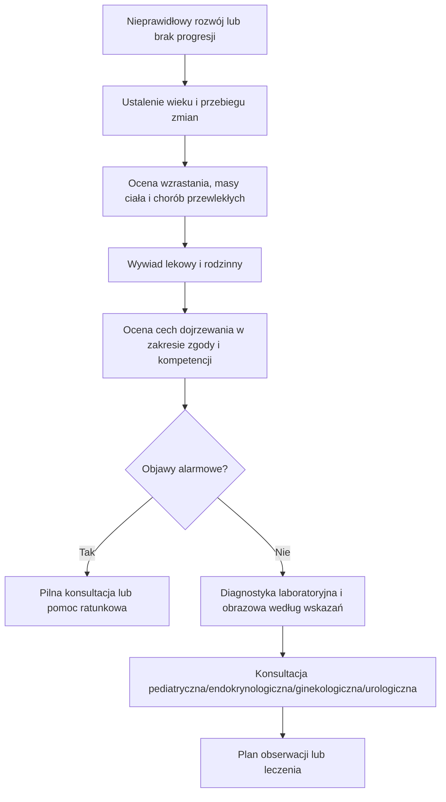

# 3.8. Badanie układu rozrodczego

## Informacja dydaktyczna i zakres rozdziału

Badanie układu rozrodczego w endokrynologii służy ocenie rozwoju i funkcji osi podwzgórze–przysadka–gonady, drugorzędowych cech płciowych, dojrzewania, wybranych cech fenotypowych oraz objawów mogących wskazywać na zaburzenia funkcji gonad lub działania hormonów płciowych. Nie jest ono automatycznie równoznaczne z pełnym badaniem ginekologicznym, urologicznym ani andrologicznym. Zakres czynności musi wynikać z konkretnego wskazania, kompetencji osoby badającej, świadomej zgody pacjenta i lokalnych procedur.

Badanie okolic intymnych wymaga szczególnej dbałości o autonomię, prywatność, godność, bezpieczeństwo fizyczne i psychiczne. Nie wolno wykonywać go rutynowo tylko dlatego, że pacjent zgłosił się do poradni endokrynologicznej. Każdy element powinien mieć uzasadnienie kliniczne, być wyjaśniony zrozumiałym językiem i poprzedzony uzyskaniem właściwej zgody. Pacjent może odmówić badania lub zażądać jego przerwania. Odmowa nie może prowadzić do zawstydzania, karania ani ograniczania dostępu do innych uzasadnionych świadczeń.

W rozdziale rozróżnia się:
- ocenę drugorzędowych cech płciowych i stopnia dojrzewania;
- ukierunkowaną inspekcję piersi i zewnętrznych narządów płciowych;
- badanie jąder, jeżeli jest klinicznie wskazane i wykonywane przez osobę kompetentną;
- ocenę cech wirylizacji, feminizacji i zaburzeń rozwoju płciowego;
- badanie ginekologiczne, które jest odrębną procedurą, wykonywaną wyłącznie przy wskazaniach, przez osobę z odpowiednimi kwalifikacjami i po odrębnej zgodzie.

Treść ma charakter edukacyjny. Nie zastępuje szkolenia praktycznego, nadzoru klinicznego, przepisów prawa ani procedur podmiotu leczniczego. Nie stanowi upoważnienia do wykonywania badań intymnych przez osoby, których zakres kompetencji zawodowych ich nie obejmuje.

---

## 1. Cele kształcenia

Po ukończeniu rozdziału uczestnik powinien:

1. Wyjaśnić znaczenie oceny układu rozrodczego w diagnostyce endokrynologicznej.
2. Rozróżnić cechy płciowe pierwszo- i drugorzędowe oraz wskazać ich zależność od osi hormonalnych.
3. Omówić zasady oceny dojrzewania według skali Tannera, z uwzględnieniem odrębnej oceny rozwoju piersi, narządów płciowych i owłosienia łonowego.
4. Wyjaśnić, dlaczego owłosienie łonowe nie jest samodzielnym miernikiem aktywacji osi gonadalnej.
5. Rozpoznać sytuacje, w których brak lub nieprawidłowa progresja dojrzewania wymaga diagnostyki specjalistycznej.
6. Opisać zasady ukierunkowanej oceny piersi, ginekomastii, zewnętrznych narządów płciowych i jąder.
7. Wskazać ograniczenia pomiaru objętości jąder orchidometrem Pradera.
8. Wymienić cechy kliniczne mogące sugerować hipogonadyzm, hiperandrogenizm, wirylizację lub feminizację.
9. Rozpoznać objawy alarmowe wymagające pilnej konsultacji lub postępowania ratunkowego.
10. Przeprowadzić rozmowę poprzedzającą badanie intymne w sposób jasny, neutralny i niedyskryminujący.
11. Zastosować zasady zgody, poufności, obecności osoby asystującej oraz dokumentowania przebiegu badania.
12. Określić granice własnych kompetencji i wskazania do skierowania do endokrynologa, ginekologa, urologa, androloga lub zespołu multidyscyplinarnego.

## 2. Oczekiwane efekty uczenia się

### 2.1. Wiedza

Uczestnik:
- opisuje podstawowe etapy dojrzewania płciowego;
- zna kliniczne znaczenie rozwoju piersi, jąder, prącia i owłosienia łonowego;
- zna najważniejsze cechy badania układu rozrodczego w kontekście endokrynologicznym;
- rozumie ograniczenia oceny fizykalnej i konieczność korelacji z wywiadem, badaniami laboratoryjnymi i obrazowymi;
- zna podstawowe zasady prawne dotyczące zgody na badanie małoletniego i osoby dorosłej.

### 2.2. Umiejętności

Uczestnik potrafi:
- zebrać ukierunkowany wywiad dotyczący dojrzewania, miesiączkowania, funkcji gonad, płodności, leków i ekspozycji hormonalnych;
- wyjaśnić cel, zakres, przebieg i ograniczenia proponowanego badania;
- uzyskać zgodę adekwatną do rodzaju świadczenia i sytuacji prawnej pacjenta;
- ocenić drugorzędowe cechy płciowe w zakresie swoich uprawnień;
- opisać obserwowane cechy bez przedwczesnego formułowania rozpoznania;
- udokumentować odmowę, ograniczenia badania, obecność osoby asystującej i wynik oceny.

### 2.3. Kompetencje społeczne i etyczne

Uczestnik:
- respektuje autonomię, intymność i prawo pacjenta do przerwania badania;
- rozpoznaje ryzyko retraumatyzacji i stosuje podejście uwzględniające doświadczenie traumy;
- komunikuje się bez oceniania wyglądu, anatomii, tożsamości, zachowań seksualnych i płodności;
- współpracuje z zespołem specjalistycznym;
- nie wykonuje czynności przekraczających jego kwalifikacje.

---

## 3. Znaczenie badania układu rozrodczego w endokrynologii

Układ rozrodczy jest narządem docelowym i jednocześnie źródłem hormonów. Jego rozwój i funkcjonowanie zależą od współdziałania podwzgórza, przysadki, gonad, nadnerczy oraz tkanek obwodowych. Ocena kliniczna może dostarczyć informacji o:
- aktywacji osi podwzgórze–przysadka–gonady;
- czynności komórek Leydiga i Sertolego;
- czynności jajników i dojrzewaniu pęcherzyków;
- działaniu androgenów, estrogenów i progesteronu;
- prawidłowości przebiegu dojrzewania;
- możliwych zaburzeniach syntezy lub działania hormonów;
- skutkach leczenia hormonalnego, operacji lub radioterapii.

Wynik badania fizykalnego nie określa samodzielnie stężenia hormonów ani płodności. Przykładowo:
- prawidłowo rozwinięte drugorzędowe cechy płciowe nie wykluczają zaburzeń spermatogenezy;
- obecność miesiączkowania nie wyklucza wszystkich zaburzeń owulacji;
- brak miesiączki nie oznacza automatycznie niewydolności jajników;
- objętość jąder jest jednym z elementów oceny, ale nie zastępuje badań hormonalnych ani badania nasienia;
- wygląd zewnętrznych narządów płciowych nie pozwala samodzielnie ustalić kariotypu, budowy gonad ani pełnego profilu hormonalnego.

### 3.1. Oś podwzgórze–przysadka–gonady

Pulsacyjne wydzielanie gonadoliberyny (GnRH) z podwzgórza pobudza przysadkę do wydzielania LH i FSH. Gonadotropiny oddziałują na gonady:
- u osób z jądrami LH pobudza komórki Leydiga do syntezy testosteronu, a FSH wraz z wysokim miejscowym stężeniem testosteronu wspiera funkcje komórek Sertolego i spermatogenezę;
- u osób z jajnikami FSH wspiera wzrost pęcherzyków i aktywność komórek ziarnistych, a LH uczestniczy w steroidogenezie, owulacji i funkcjonowaniu ciałka żółtego.

Hormony gonadalne wywierają sprzężenie zwrotne na podwzgórze i przysadkę. Inhibina B, aktywiny i inne sygnały lokalne modyfikują wydzielanie gonadotropin. W okresie dojrzewania dochodzi do reaktywacji pulsacyjnego wydzielania GnRH, a następnie do stopniowego rozwoju cech płciowych.

### 3.2. Gonadarche i adrenarche — dwa powiązane, lecz różne procesy

Gonadarche oznacza aktywację osi podwzgórze–przysadka–gonady. Adrenarche oznacza wzrost wydzielania androgenów nadnerczowych, w szczególności DHEA i DHEAS. Procesy te mogą przebiegać w różnym tempie.

Konsekwencje kliniczne:
- pojawienie się owłosienia łonowego może wynikać z adrenarche i nie dowodzi jeszcze aktywacji gonad;
- trądzik i zapach potu mogą pojawić się przed wyraźnym rozwojem piersi lub zwiększeniem objętości jąder;
- rozwój piersi u dziewcząt i zwiększenie objętości jąder u chłopców są bardziej użytecznymi klinicznymi wskaźnikami początku gonadarche;
- izolowane przedwczesne adrenarche wymaga różnicowania z przedwczesnym dojrzewaniem i innymi przyczynami androgenizacji.

### 3.3. Cechy płciowe pierwszo- i drugorzędowe

| Grupa cech | Przykłady | Znaczenie kliniczne |
|---|---|---|
| Pierwszorzędowe | Gonady i zewnętrzne oraz wewnętrzne narządy układu rozrodczego | Rozwój anatomiczny, obecność i budowa narządów |
| Drugorzędowe | Rozwój piersi, owłosienie płciowe, zmiana proporcji ciała, zmiana głosu, rozwój masy mięśniowej | Pośrednie wskaźniki działania hormonów w okresie dojrzewania |
| Cechy funkcjonalne | Miesiączkowanie, erekcja, ejakulacja, libido, płodność | Wymagają wywiadu i odpowiednich badań; nie są w pełni oceniane przez oglądanie |

Nie należy używać jednej cechy jako jedynego kryterium dojrzałości płciowej. Rozwój jest indywidualny, etapowy i zależny od wieku, stanu odżywienia, chorób przewlekłych, czynników genetycznych, leczenia i środowiska.

---

## 4. Przygotowanie do oceny układu rozrodczego

### 4.1. Uzasadnienie kliniczne i proporcjonalność

Przed zaproponowaniem badania należy odpowiedzieć na pytania:
1. Jakie konkretne pytanie kliniczne ma rozstrzygnąć badanie?
2. Czy wystarczy wywiad, ocena ogólna lub badanie nieintymne?
3. Czy wynik może zmienić dalsze postępowanie?
4. Czy dana czynność należy do kompetencji badającego?
5. Czy można ją wykonać w warunkach zapewniających prywatność i bezpieczeństwo?
6. Czy pacjent rozumie cel i ma możliwość odmowy?

Nie wykonuje się badania intymnego wyłącznie z ciekawości, w celach demonstracyjnych bez zgody ani jako obowiązkowego elementu każdej wizyty endokrynologicznej.

### 4.2. Warunki pomieszczenia i wyposażenie

Pomieszczenie powinno zapewniać:
- zamykane drzwi i ochronę przed przypadkowym wejściem;
- możliwość zasłonięcia okien i ograniczenia dostępu osób postronnych;
- odpowiednią temperaturę, oświetlenie i stabilne podłoże;
- parawan lub zasłonę;
- czystą leżankę, prześcieradło jednorazowe lub czystą bieliznę ochronną;
- środki higieny rąk i rękawiczki jednorazowe, gdy wskazane;
- pojemnik na odpady medyczne;
- sprzęt do pomiaru wzrostu, masy ciała i ciśnienia, jeżeli jest potrzebny;
- orchidometr Pradera tylko wtedy, gdy badanie objętości jąder jest wskazane, a osoba badająca ma odpowiednie przygotowanie;
- dostęp do personelu asystującego zgodnie z procedurą placówki.

Nie należy pozostawiać pacjenta rozebranego podczas przygotowywania sprzętu. Odsłania się wyłącznie obszar niezbędny do wykonania konkretnej czynności.

### 4.3. Przygotowanie komunikacyjne

Przed badaniem należy:
- przedstawić się i potwierdzić tożsamość pacjenta;
- zapytać, jak pacjent chce być nazywany;
- wyjaśnić, które okolice będą oceniane i dlaczego;
- opisać, czy planowana jest wyłącznie obserwacja, czy również palpacja;
- poinformować o możliwych odczuciach, np. chłodzie dłoni, krótkotrwałym ucisku lub dyskomforcie;
- wyjaśnić możliwość przerwania badania w dowolnym momencie;
- ustalić preferencję dotyczącą osoby asystującej;
- uzgodnić sposób sygnalizowania przerwy;
- zapytać o wcześniejsze doświadczenia, które mogą wpływać na komfort, bez wymuszania ujawniania szczegółów.

Przykładowa neutralna formuła:

„Chciałabym zaproponować ocenę rozwoju piersi i owłosienia, ponieważ może to pomóc w wyjaśnieniu zgłaszanych zaburzeń miesiączkowania. Badanie ograniczy się do krótkiej obserwacji i — jeżeli będzie to potrzebne oraz wyrazi Pani/Pan zgodę — delikatnego badania palpacyjnego. Nie wykonamy badania wewnętrznego. Może Pani/Pan w każdej chwili poprosić o przerwę albo zrezygnować. Czy chce Pani/Pan, żebym wyjaśniła każdy etap przed jego wykonaniem?”

### 4.4. Zgoda pacjenta i pacjenta małoletniego — zasady polskie

Zgoda musi dotyczyć określonego świadczenia i być poprzedzona informacją adekwatną do rodzaju czynności. Zgoda na rozmowę lub zwykłe badanie ogólne nie oznacza automatycznie zgody na badanie piersi, narządów płciowych, badanie wewnętrzne, fotografię ani obecność dodatkowych osób.

W polskim porządku prawnym, zgodnie z ustawą o prawach pacjenta i Rzeczniku Praw Pacjenta oraz informacjami Rzecznika Praw Pacjenta:
- pacjent dorosły, który może świadomie podjąć decyzję, sam wyraża zgodę lub odmawia;
- w przypadku pacjenta małoletniego przed ukończeniem 16 lat zgodę co do zasady wyraża przedstawiciel ustawowy, z jednoczesnym obowiązkiem poszanowania zdania i godności dziecka stosownie do jego wieku i dojrzałości;
- pacjent, który ukończył 16 lat, ma prawo współdecydować i wyrażać zgodę; w typowych sytuacjach wymagana jest również zgoda przedstawiciela ustawowego;
- w razie sprzecznych oświadczeń pacjenta i przedstawiciela ustawowego zastosowanie mają ustawowe zasady rozstrzygnięcia, w tym w odpowiednich przypadkach udział sądu opiekuńczego;
- pacjent małoletni posiadający dostateczne rozeznanie ma prawo wyrazić sprzeciw, który wymaga uwzględnienia i prawidłowego rozstrzygnięcia zgodnie z przepisami;
- opiekun faktyczny ma ograniczone uprawnienia, w szczególności dotyczące zgody na samo badanie w sytuacjach wskazanych w ustawie; nie jest automatycznie równoważny przedstawicielowi ustawowemu.

Szczegółowa kwalifikacja prawna zależy od rodzaju czynności, wieku, zdolności do świadomego wyrażenia zgody, sytuacji nagłej i aktualnego brzmienia przepisów. W razie wątpliwości należy postępować według procedury placówki i zasięgnąć konsultacji prawnej lub przełożonego. Wyjątki dotyczące stanów nagłych nie mogą być wykorzystywane jako uzasadnienie rutynowego pomijania zgody.

W praktyce edukacyjnej warto odróżnić:
- zgodę prawną osoby uprawnionej;
- zgodę/akceptację pacjenta (assent) adekwatną do wieku i rozumienia;
- bieżącą gotowość pacjenta do kontynuowania kolejnego etapu;
- zgodę na obecność osoby asystującej;
- odrębną zgodę na dokumentację fotograficzną lub inne dodatkowe czynności.

Brak protestu nie jest równoznaczny z dobrowolną zgodą. Zamarcie, milczenie, płacz, wyraźne napięcie lub wycofanie mogą świadczyć o dyskomforcie; należy zatrzymać czynność, sprawdzić samopoczucie i ponownie wyjaśnić sytuację.

### 4.5. Osoba asystująca lub chaperon

Obecność osoby asystującej podczas badania intymnego zwiększa poczucie bezpieczeństwa, wspiera komunikację i pomaga zapewnić przejrzystość przebiegu czynności. Zalecenia AAP z 2025 r. dotyczące dzieci i młodzieży oraz ACOG odnoszą się do wspólnego podejmowania decyzji, jasno określonej roli osoby asystującej i dokumentowania jej obecności. W polskiej placówce należy stosować lokalną procedurę, przepisy i standardy zawodowe.

Dobra praktyka:
- zaproponować osobę asystującą przed badaniem;
- wyjaśnić jej rolę i uzyskać akceptację pacjenta;
- preferować przeszkolonego członka personelu medycznego;
- nie utożsamiać automatycznie osoby bliskiej z profesjonalnym chaperonem;
- nie wykorzystywać obecności rodzica jako substytutu rozmowy z nastolatkiem w warunkach poufności, gdy przepisy i sytuacja kliniczna pozwalają na rozmowę indywidualną;
- uszanować preferencję pacjenta co do płci osoby asystującej, jeśli jest to możliwe;
- odnotować imię, nazwisko lub identyfikację służbową i rolę osoby asystującej;
- jeśli pacjent odmawia jej obecności, omówić przyczyny i alternatywy oraz postępować zgodnie z procedurą placówki;
- jeśli osoba badająca nie może bezpiecznie i zgodnie z zasadami wykonać badania bez chaperona, można odroczyć niepilną czynność i zorganizować ją w odpowiednich warunkach.

Osoba asystująca nie zastępuje zgody pacjenta, nie przejmuje decyzji klinicznej i nie powinna naruszać poufności.

### 4.6. Podejście uwzględniające doświadczenie traumy

Pacjent może mieć za sobą przemoc seksualną, przemoc domową, dysforię, bolesne badania, zabiegi, doświadczenia medyczne odbierane jako upokarzające lub inne zdarzenia traumatyczne. Nie trzeba wymagać ujawnienia szczegółów, aby dostosować badanie.

Zasady:
1. Zapowiedz każdą czynność przed jej rozpoczęciem.
2. Ustal słowo lub gest oznaczający „stop”.
3. Pozwól pacjentowi samodzielnie odsłonić badaną okolicę, jeżeli to możliwe.
4. Nie wykonuj gwałtownych ruchów ani niespodziewanego dotyku.
5. Nie komentuj wyglądu w sposób oceniający.
6. Ogranicz liczbę osób w pomieszczeniu.
7. Nie powtarzaj badania dla celów dydaktycznych bez odrębnej zgody.
8. Jeżeli pojawia się silny lęk, dysocjacja, ból lub wycofanie zgody — przerwij.
9. Rozważ alternatywną metodę diagnostyczną albo konsultację w innym terminie.
10. W razie podejrzenia przemocy u dziecka lub osoby zależnej zastosuj procedury ochrony małoletnich i postępowania w sytuacji podejrzenia krzywdzenia.

---

## 5. Ocena drugorzędowych cech płciowych

### 5.1. Zakres oceny

Ocena obejmuje — zależnie od wskazania i anatomii pacjenta:
- rozwój piersi;
- rozwój zewnętrznych narządów płciowych;
- objętość jąder;
- rozmieszczenie i charakter owłosienia;
- zmiany głosu;
- proporcje ciała;
- rozwój masy mięśniowej;
- cechy androgenizacji lub niedoboru hormonów płciowych;
- ewentualne cechy nietypowego rozwoju płciowego.

Nie wszystkie elementy są konieczne u każdego pacjenta. Należy oceniać tylko te cechy, które odpowiadają na pytanie kliniczne.

### 5.2. Skala Tannera — zasady ogólne

Skala Tannera opisuje kolejne etapy dojrzewania somatycznego. Obejmuje odrębne skale:
- B1–B5 — rozwój piersi;
- G1–G5 — rozwój narządów płciowych u chłopców;
- P1–P5 — rozwój owłosienia łonowego.

Wynik powinien być zapisywany oddzielnie dla każdej ocenianej cechy, np. B3/P2 albo G2/P3. Nie należy sprowadzać całego dojrzewania do jednej liczby, ponieważ poszczególne cechy mogą rozwijać się w różnym tempie.

Skala jest narzędziem porządkowym. Nie jest bezpośrednim pomiarem stężenia estradiolu, testosteronu, LH ani FSH. Nie określa samodzielnie wieku kostnego, płodności ani przyczyny zaburzenia.

### 5.3. Rozwój piersi — stadium B

| Stadium | Opis kliniczny |
|---|---|
| B1 | Stadium przedpokwitaniowe; brak rozwoju tkanki gruczołowej, brodawka może być nieznacznie wyniesiona |
| B2 | Pojawia się zawiązek piersiowy; wyczuwalne lub widoczne uwypuklenie tkanki pod otoczką, otoczka może się powiększać |
| B3 | Dalsze powiększanie piersi i otoczki, bez wyraźnego oddzielenia jej od obrysu piersi |
| B4 | Otoczka i brodawka tworzą wtórne uwypuklenie ponad obrys piersi |
| B5 | Dojrzały kształt piersi; otoczka zwykle układa się w obrębie ogólnego obrysu piersi, brodawka pozostaje uwypuklona |

Wskazówki:
- ocena powinna uwzględniać budowę ciała i ilość tkanki tłuszczowej;
- lipomastia (powiększenie wynikające głównie z tkanki tłuszczowej) nie jest tym samym co rozwój gruczołowy;
- palpacja tkanki gruczołowej może być potrzebna do różnicowania, ale wymaga uzasadnienia, kompetencji i odrębnej zgody;
- fizjologiczna asymetria w okresie dojrzewania jest możliwa;
- bolesność lub tkliwość w okresie rozwoju może występować, ale nasilony ból, guz pozaotoczkowy, wciągnięcie skóry lub krwisty wyciek wymagają dalszej diagnostyki.

### 5.4. Rozwój narządów płciowych u chłopców — stadium G

| Stadium | Opis kliniczny |
|---|---|
| G1 | Obraz przedpokwitaniowy; jądra, moszna i prącie bez cech dojrzewania pokwitaniowego |
| G2 | Powiększenie jąder i moszny, zmiana tekstury skóry moszny; prącie nieznacznie lub jeszcze bez wyraźnego powiększenia |
| G3 | Wyraźniejsze wydłużanie prącia; dalszy wzrost jąder i moszny |
| G4 | Zwiększenie długości i szerokości prącia, rozwój żołędzi, dalsze powiększenie jąder i moszny oraz ciemniejsza skóra moszny |
| G5 | Rozwój dojrzały; wielkość i kształt narządów płciowych odpowiadają dojrzałemu stadium |

Ocena G nie jest tym samym co ocena owłosienia łonowego. U chłopca owłosienie może pojawić się przed wyraźnym powiększeniem jąder w przebiegu adrenarche.

### 5.5. Owłosienie łonowe — stadium P

| Stadium | Opis kliniczny |
|---|---|
| P1 | Brak terminalnego owłosienia łonowego; obecne może być delikatne owłosienie typu dziecięcego |
| P2 | Pojedyncze, rzadkie, dłuższe i lekko pigmentowane włosy w okolicy narządów płciowych |
| P3 | Włosy stają się ciemniejsze, grubsze i bardziej skręcone; obejmują większą część wzgórka łonowego |
| P4 | Owłosienie ma cechy zbliżone do dorosłego, ale zajmuje mniejszy obszar i nie obejmuje jeszcze typowo przyśrodkowych powierzchni ud |
| P5 | Owłosienie o dorosłym charakterze i rozmieszczeniu, zwykle obejmujące także przyśrodkowe powierzchnie ud |

Ocena P:
- wymaga zapewnienia prywatności i odsłonięcia tylko koniecznego obszaru;
- nie powinna być wykonywana przy braku wskazania;
- jest zależna od pochodzenia etnicznego, genetyki, wieku i indywidualnego rozmieszczenia włosów;
- nie może być interpretowana jako samodzielny dowód prawidłowego dojrzewania gonadalnego;
- powinna być opisywana neutralnie, bez wartościowania estetycznego.

### 5.6. Ograniczenia skali Tannera

Najważniejsze ograniczenia:
1. Skala jest porządkowa, a nie liniowa.
2. Ocena wzrokowa może różnić się między badającymi.
3. Stadium piersi może być mylone z lipomastią.
4. Stadium owłosienia zależy częściowo od androgenów nadnerczowych.
5. Wcześniejsze leczenie hormonalne może zmieniać obraz.
6. Choroby przewlekłe i zaburzenia odżywiania mogą opóźniać rozwój.
7. Populacyjne normy wieku dojrzewania różnią się geograficznie i historycznie.
8. U osób z różnicami rozwoju płciowego typowa sekwencja dojrzewania może nie występować.
9. U osób po operacjach lub terapii hormonalnej interpretacja wymaga uwzględnienia historii leczenia.
10. Samodzielna ocena przez pacjenta lub opiekuna może być pomocna w edukacji, ale nie zastępuje profesjonalnej oceny klinicznej, jeżeli istnieje wskazanie do badania.

---

## 6. Ocena owłosienia i cech androgenizacji

### 6.1. Owłosienie płciowe i androgenizacja

Androgeny wpływają na:
- wzrost włosów terminalnych w okolicach zależnych od androgenów;
- aktywność gruczołów łojowych;
- rozwój trądziku;
- zmianę zapachu potu;
- rozwój masy mięśniowej;
- zmianę barwy głosu w okresie dojrzewania;
- rozwój zewnętrznych narządów płciowych w określonych okresach rozwoju.

W ocenie należy odróżnić:
- fizjologiczne dojrzewanie;
- hirsutyzm — terminalne owłosienie u kobiet w typowo androgenozależnych lokalizacjach;
- hipertrychozę — nadmierne owłosienie, które nie musi wynikać z androgenów;
- wirylizację — bardziej nasilony zespół cech maskulinizacji, np. pogłębienie głosu, klitoromegalia, zwiększenie masy mięśniowej i szybko narastające owłosienie.

### 6.2. Objawy wymagające szybkiej oceny

Szczególną uwagę należy zwrócić na:
- szybki początek i progresję hirsutyzmu;
- nagłe pojawienie się nasilonego trądziku i łysienia androgenowego;
- obniżenie głosu;
- powiększenie łechtaczki;
- zwiększenie masy mięśniowej bez adekwatnej zmiany treningu;
- zanik miesiączkowania lub szybkie zaburzenie cyklu;
- objawy androgenizacji po menopauzie;
- wyczuwalny guz w jamie brzusznej lub miednicy.

Takie objawy mogą wskazywać na ciężki hiperandrogenizm, w tym rzadki guz wydzielający androgeny. Nie należy jednak rozpoznawać guza na podstawie wyglądu. Konieczna jest pilna ocena lekarska i diagnostyka biochemiczna oraz obrazowa według wskazań.

### 6.3. Ocena owłosienia według skali Ferrimana–Gallweya

Skala Ferrimana–Gallweya służy do półilościowej oceny terminalnego owłosienia w wybranych okolicach androgenozależnych. W klasycznej wersji ocenia się dziewięć obszarów, przyznając każdemu ocenę od 0 do 4. W praktyce stosuje się także wersje zmodyfikowane.

Ograniczenia:
- progi zależą od pochodzenia etnicznego i populacji;
- usuwanie owłosienia, depilacja i laseroterapia mogą zaniżać ocenę;
- niektóre osoby mają rodzinne, niepatologiczne nasilenie owłosienia;
- wynik skali nie jest samodzielnym rozpoznaniem PCOS ani guza;
- skala nie ocenia wszystkich postaci hiperandrogenizmu;
- szybka wirylizacja jest klinicznie ważna nawet przy niezbyt wysokim wyniku skali.

Dokumentując wynik, należy podać wersję skali, oceniane okolice, ewentualne ograniczenia i historię usuwania owłosienia, jeśli pacjent chce ją ujawnić.

---

## 7. Badanie piersi i ginekomastii

### 7.1. Wskazania

Badanie piersi może być uzasadnione w przypadku:
- ginekomastii lub asymetrii;
- bólu i tkliwości;
- wydzieliny z brodawki;
- zaburzeń dojrzewania;
- podejrzenia hiperprolaktynemii;
- podejrzenia zaburzeń hormonalnych lub działań niepożądanych leków;
- objawów choroby piersi wymagających diagnostyki.

Nie należy wykonywać palpacji piersi bez wskazania i zgody. W przypadku pacjenta, u którego badanie nie jest konieczne do rozwiązania problemu klinicznego, należy rozważyć ograniczenie się do wywiadu lub skierowania.

### 7.2. Inspekcja

W zakresie uzasadnionym klinicznie ocenia się:
- symetrię;
- obrys;
- położenie brodawek;
- zmiany skórne;
- wciągnięcia lub owrzodzenia;
- obrzęk;
- widoczną asymetrię;
- wydzielinę z brodawki, jeśli występuje samoistnie.

Nie należy wyciskać brodawki wyłącznie po to, aby sprawdzić, czy pojawi się wydzielina, jeżeli nie ma wskazania. Ucisk może sam wywołać wydzielinę i utrudnić interpretację.

### 7.3. Ginekomastia a lipomastia

Ginekomastia oznacza rozrost tkanki gruczołowej piersi u osoby z jądrami; może występować fizjologicznie w okresie noworodkowym, dojrzewania i w starszym wieku. Lipomastia jest powiększeniem piersi związanym głównie z tkanką tłuszczową.

| Cecha | Ginekomastia | Lipomastia |
|---|---|---|
| Dominująca tkanka | Gruczołowa | Tłuszczowa |
| Typowy obraz palpacyjny | Sprężysty lub twardszy dysk pod otoczką | Rozlane, miękkie nagromadzenie tkanki |
| Lokalizacja | Zwykle centralnie pod brodawką | Rozlana, bez wyraźnego dysku |
| Bolesność | Może występować, zwłaszcza w fazie aktywnej | Zwykle nieobecna, chyba że współistnieje inna przyczyna |
| Znaczenie | Wymaga oceny przyczyn, leków i przebiegu | Może towarzyszyć otyłości, ale nie wyklucza ginekomastii |

Cechy alarmowe:
- twardy, nieruchomy lub położony poza otoczką guz;
- wciągnięcie skóry lub brodawki;
- owrzodzenie;
- krwista lub samoistna jednostronna wydzielina;
- powiększone węzły chłonne pachowe;
- szybki wzrost masy;
- guz jądra lub objawy hipogonadyzmu.

Ginekomastia nie jest sama w sobie dowodem hiperestrogenizmu. Może wynikać ze zmiany równowagi działania estrogenów i androgenów, chorób wątroby, nerek, tarczycy, nowotworów, leków lub fizjologicznego dojrzewania. Rozpoznanie etiologiczne wymaga wywiadu, badania lekarskiego i badań dobranych do sytuacji.

### 7.4. Wydzielina z brodawki

W wywiadzie należy ustalić:
- czy wydzielina pojawia się samoistnie czy po ucisku;
- czy jest jedno- czy obustronna;
- czy pochodzi z jednego czy wielu przewodów;
- jaki ma kolor i charakter;
- czy współistnieje ból, guz, zaburzenie miesiączkowania, ból głowy lub zaburzenia widzenia;
- czy pacjent przyjmuje leki wpływające na prolaktynę;
- czy występuje ciąża lub laktacja.

Mlekotok może wiązać się z hiperprolaktynemią, lekami, niedoczynnością tarczycy, ciążą, stymulacją brodawek lub innymi przyczynami. Krwista, samoistna, jednostronna wydzielina wymaga diagnostyki piersi, niezależnie od podejrzenia endokrynopatii.

---

## 8. Ocena zewnętrznych narządów płciowych

### 8.1. Zasady ogólne

Inspekcja zewnętrznych narządów płciowych jest badaniem intymnym. Może być uzasadniona w diagnostyce:
- nieprawidłowego dojrzewania;
- braku lub opóźnienia rozwoju cech płciowych;
- podejrzenia zaburzeń rozwoju płciowego;
- wirylizacji lub feminizacji;
- zaburzeń miesiączkowania, gdy występują wskazania do oceny anatomii zewnętrznej;
- nieprawidłowości w budowie, bólu, obrzęku lub zmian skórnych;
- podejrzenia urazu, zakażenia lub innego stanu wymagającego oceny.

Nie należy wykonywać takiego badania w celu potwierdzania tożsamości płciowej, oceny „dziewictwa”, weryfikowania zachowań seksualnych ani zaspokajania ciekawości.

### 8.2. Inspekcja zewnętrznych narządów płciowych u osób z sromem

Jeżeli badanie jest wskazane, zakres może obejmować:
- ogólną ocenę skóry i błon śluzowych;
- wargi sromowe większe i mniejsze;
- przedsionek pochwy;
- ujście cewki moczowej;
- widoczną okolicę wejścia do pochwy;
- łechtaczkę, jeżeli ocena jest uzasadniona klinicznie;
- owłosienie łonowe;
- widoczne zmiany, obrzęk, uraz, owrzodzenie lub cechy zapalenia.

Wskazówki:
- należy wyjaśnić pozycję i sposób badania;
- pacjent może samodzielnie przyjąć pozycję, jeśli jest to możliwe;
- nie wolno wykonywać gwałtownego rozchylania tkanek;
- nie należy wykonywać pomiarów łechtaczki bez wskazania i odpowiedniego przygotowania;
- nie wolno oceniać aktywności seksualnej ani „dziewictwa” na podstawie wyglądu błony dziewiczej;
- w przypadku bólu, skurczu, lęku lub wycofania zgody badanie należy przerwać.

### 8.3. Inspekcja zewnętrznych narządów płciowych u osób z prąciem i moszną

Jeżeli badanie jest wskazane, można ocenić:
- położenie ujścia zewnętrznego cewki moczowej;
- wygląd prącia i napletka;
- widoczne blizny, skrzywienie, obrzęk lub zmiany skórne;
- położenie jąder;
- symetrię moszny;
- obecność obrzęku, zaczerwienienia, guza lub bólu;
- owłosienie łonowe;
- ewentualne cechy zaburzeń dojrzewania.

Nie należy na siłę odprowadzać napletka u dziecka. Fizjologiczna nieodprowadzalność napletka w młodym wieku nie jest automatycznie patologią. U dorosłych zakres oceny napletka powinien wynikać ze wskazania, a pacjent powinien samodzielnie wykonać czynność, jeśli jest to bezpieczne i możliwe.

### 8.4. Różnice rozwoju płciowego

W przypadku atypowej anatomii narządów płciowych, niezgodności między cechami rozwoju, braku typowej progresji dojrzewania lub niejednoznacznych wyników nie należy podejmować prób samodzielnego rozstrzygania rozpoznania. Różnice rozwoju płciowego obejmują wiele odmiennych stanów o złożonej etiologii.

Zasady:
- zachować neutralny język;
- nie stosować stygmatyzujących określeń;
- nie wykonywać powtarzanych badań przez wielu obserwatorów;
- nie wykonywać fotografii bez odrębnego wskazania, zgody i bezpiecznej procedury;
- skierować do doświadczonego zespołu multidyscyplinarnego;
- zapewnić wsparcie psychologiczne i pielęgniarskie;
- omówić z pacjentem i rodziną cel każdej kolejnej czynności;
- nie przedstawiać niepewnych hipotez jako rozpoznania.

W wytycznych Society for Endocrinology UK z 2021 r. podkreślono potrzebę oceny dzieci i młodzieży z podejrzeniem różnic rozwoju płciowego przez doświadczony zespół multidyscyplinarny.

---

## 9. Badanie jąder

### 9.1. Wskazania

Ocena jąder może być wskazana w:
- opóźnionym lub nieprawidłowym dojrzewaniu;
- podejrzeniu hipogonadyzmu;
- ginekomastii o nieustalonej przyczynie;
- niepłodności;
- podejrzeniu wnętrostwa lub nieprawidłowego położenia jąder;
- podejrzeniu guza jądra;
- bólu, obrzęku lub asymetrii moszny;
- monitorowaniu wybranych stanów po leczeniu onkologicznym lub hormonalnym.

### 9.2. Oglądanie

Ocenia się, jeśli istnieje wskazanie:
- symetrię moszny;
- położenie jąder;
- obrzęk i zaczerwienienie;
- widoczne poszerzenie żył;
- blizny pooperacyjne;
- cechy urazu lub zmian skórnych;
- asymetrię lub nietypowy kształt.

### 9.3. Palpacja

Badanie palpacyjne jąder powinno być wykonywane wyłącznie przez osobę mającą odpowiednie kwalifikacje i po uzyskaniu zgody. Należy:
- ogrzać dłonie;
- zapewnić spokojne warunki;
- wyjaśnić każdy etap;
- badać delikatnie, bez nadmiernego ucisku;
- oceniać każde jądro oddzielnie;
- porównać wielkość, konsystencję, powierzchnię i bolesność;
- odróżnić jądro od najądrza i powrózka nasiennego;
- odnotować ewentualną masę, asymetrię, obrzęk lub bolesność.

Prawidłowe jądro jest zwykle gładkie i sprężysto-jędrne. Drobna asymetria może być wariantem prawidłowym. Twarda, ogniskowa, niebolesna masa wewnątrz jądra wymaga pilnej diagnostyki urologicznej i ultrasonograficznej. Nie należy jej uznawać za łagodną tylko dlatego, że nie boli.

### 9.4. Pomiar objętości jąder orchidometrem Pradera

Orchidometr Pradera składa się z porównawczych modeli o określonych objętościach. Służy do orientacyjnej oceny objętości jąder, zwłaszcza w monitorowaniu dojrzewania.

Zasady:
1. Wyjaśnić cel i uzyskać zgodę.
2. Zapewnić odpowiednią temperaturę pomieszczenia.
3. Ułożyć pacjenta w pozycji umożliwiającej bezpieczny dostęp.
4. Delikatnie wyodrębnić jądro od skóry moszny i najądrza.
5. Porównać jądro z koralikami orchidometru.
6. Nie obejmować pomiarem skóry moszny ani najądrza.
7. Zapisać objętość prawego i lewego jądra osobno.
8. Zapisać metodę i ograniczenia pomiaru.

Wzrost objętości jąder do około 4 mL mierzonej orchidometrem Pradera jest często przyjmowany jako kliniczny marker początku dojrzewania gonadalnego u chłopców. Wartość ta nie jest jednak uniwersalną granicą biologiczną i zależy od metody pomiaru, populacji oraz doświadczenia badającego. W badaniu ultrasonograficznym objętości mogą być inne niż w orchidometrze. Nie należy porównywać liczb uzyskanych różnymi metodami bez uwzględnienia ich odmienności.

### 9.5. Interpretacja objętości i konsystencji

| Obserwacja | Możliwe znaczenie | Dalsze postępowanie |
|---|---|---|
| Mała objętość jąder i brak progresji dojrzewania | Opóźnione dojrzewanie, hipogonadyzm lub wariant rozwojowy | Ocena pediatryczno-endokrynologiczna |
| Bardzo małe, jędrne jądra u dorosłego | Możliwa niewydolność jąder, np. zespół Klinefeltera | Diagnostyka hormonalna i specjalistyczna |
| Małe, miękkie jądra | Możliwa wtórna niewydolność gonad lub inne przyczyny | Korelacja z LH, FSH, testosteronem i wywiadem |
| Wyraźna asymetria | Wariant anatomiczny, następstwo urazu, żylaki, guz lub inne przyczyny | Badanie lekarskie; USG według wskazań |
| Twardy guzek wewnątrz jądra | Podejrzenie guza | Pilna konsultacja urologiczna i USG |
| Nagły silny ból jądra | Skręt jądra lub inny ostry stan moszny | Natychmiastowa pomoc ratunkowa |

### 9.6. Objawy wymagające pilnej pomocy

Nagły, silny ból jądra, zwłaszcza z nudnościami, wymiotami, wysokim położeniem jądra lub obrzękiem moszny, wymaga natychmiastowej oceny w kierunku skrętu jądra. Nie wolno opóźniać konsultacji przez wykonywanie długiego badania endokrynologicznego, oczekiwanie na rutynowe wyniki laboratoryjne ani próbę obserwacji domowej.

---

## 10. Cechy hipogonadyzmu

### 10.1. Hipogonadyzm u osób z jądrami

Możliwe cechy kliniczne:
- opóźniony lub niepełny rozwój dojrzewania;
- mała objętość jąder;
- zmniejszona ilość owłosienia androgenozależnego;
- zmniejszona masa mięśniowa;
- zwiększenie tkanki tłuszczowej;
- ginekomastia;
- obniżone libido;
- zaburzenia erekcji;
- zmniejszona częstość porannych erekcji;
- niepłodność;
- zmniejszenie gęstości mineralnej kości i złamania;
- eunuchoidalne proporcje ciała w przypadku niedoboru androgenów przed zakończeniem wzrastania.

Objawy są nieswoiste. Otyłość, przewlekła choroba, niedobór snu, depresja, leki opioidowe, glikokortykosteroidy i wiele innych czynników mogą wpływać na funkcję osi gonadalnej. Rozpoznanie wymaga połączenia obrazu klinicznego z odpowiednimi badaniami biochemicznymi, zwykle powtarzanymi w odpowiednich warunkach.

### 10.2. Hipogonadyzm u osób z jajnikami

Możliwe cechy:
- brak lub opóźnienie rozwoju piersi;
- pierwotny lub wtórny brak miesiączki;
- nieregularne miesiączkowanie;
- objawy niedoboru estrogenów;
- uderzenia gorąca i poty nocne;
- suchość pochwy lub dyskomfort w obrębie narządów płciowych;
- zmniejszenie libido;
- obniżenie gęstości mineralnej kości;
- trudności z płodnością.

Objawy mogą wynikać z zaburzeń czynności jajników, podwzgórza, przysadki, chorób przewlekłych, niedożywienia, nadmiernego wysiłku, hiperprolaktynemii, zaburzeń tarczycy lub stosowanych leków. Nie należy rozpoznawać niewydolności jajników na podstawie samego braku miesiączki.

### 10.3. Cechy hipogonadyzmu a etap życia

Interpretacja zależy od:
- wieku;
- etapu dojrzewania;
- przebytych operacji;
- leczenia przeciwnowotworowego;
- przyjmowanych hormonów;
- chorób przewlekłych;
- stanu odżywienia;
- historii ciąży, porodu i laktacji;
- menopauzy;
- indywidualnych różnic rozwojowych.

---

## 11. Cechy wirylizacji i feminizacji

### 11.1. Wirylizacja

Wirylizacja oznacza rozwój cech androgenizacji wykraczających poza typowy zakres fizjologiczny dla danej osoby i etapu życia. Może obejmować:
- nasilony hirsutyzm;
- łysienie typu androgenowego;
- trądzik o ciężkim przebiegu;
- obniżenie barwy głosu;
- zwiększenie masy mięśniowej;
- powiększenie łechtaczki;
- zaburzenia lub zanik miesiączkowania;
- zmiany proporcji ciała.

Szybka progresja w ciągu tygodni lub miesięcy, zwłaszcza z klitoromegalią, obniżeniem głosu i nasilonym hirsutyzmem, wymaga pilnej diagnostyki hiperandrogenizmu. W różnicowaniu uwzględnia się guzy jajnika lub nadnerczy, wrodzony przerost nadnerczy, ekspozycję na androgeny, stosowanie steroidów anabolicznych oraz inne przyczyny.

### 11.2. Feminizacja u osób z jądrami

Możliwe cechy:
- ginekomastia;
- zmniejszenie owłosienia androgenozależnego;
- zmniejszenie masy mięśniowej;
- zmiana rozmieszczenia tkanki tłuszczowej;
- zmniejszenie objętości jąder;
- zaburzenia libido i erekcji.

Feminizacja może być związana z zaburzeniem równowagi androgenowo-estrogenowej, chorobą wątroby, niewydolnością jąder, chorobami tarczycy, lekami lub innymi stanami. Nie należy automatycznie utożsamiać jej z konkretną diagnozą.

### 11.3. Ocena tempa zmian

Tempo pojawienia się objawów ma istotne znaczenie:
- wieloletni, stabilny przebieg może sugerować przyczyny przewlekłe lub rodzinne;
- szybka progresja wymaga wykluczenia ciężkiego hiperandrogenizmu i guza wydzielającego hormony;
- nagła zmiana po rozpoczęciu leku lub suplementu wymaga oceny możliwego działania niepożądanego;
- objawy po ekspozycji na żel testosteronowy stosowany przez domownika mogą wynikać z przypadkowego kontaktu skórnego.

---

## 12. Badanie ginekologiczne jako odrębna procedura

### 12.1. Różnica między oceną endokrynologiczną a badaniem ginekologicznym

Badanie endokrynologiczne może obejmować wywiad miesiączkowy, ocenę drugorzędowych cech płciowych, inspekcję zewnętrznych narządów płciowych, jeśli istnieje wskazanie, oraz ocenę piersi. Nie oznacza to automatycznie konieczności:
- badania we wzierniku;
- badania dwuręcznego;
- badania przez odbytnicę;
- pobierania wymazów;
- wykonywania USG przezpochwowego;
- pobierania materiału z szyjki macicy;
- wykonywania biopsji.

Każda z tych procedur ma odrębne wskazania, wymagania kompetencyjne, przygotowanie i zasady zgody.

### 12.2. Kiedy badanie ginekologiczne może być wskazane

Przykładowe wskazania:
- nieprawidłowe krwawienia;
- ból miednicy;
- podejrzenie patologii narządów miednicy;
- objawy zakażenia;
- podejrzenie przeszkody w odpływie krwi miesiączkowej;
- ocena anatomii w wybranych przypadkach pierwotnego braku miesiączki;
- kontrola po określonych zabiegach lub w określonych chorobach.

Wizyta z powodu zaburzeń miesiączkowania lub podejrzenia PCOS nie oznacza automatycznie wskazania do badania wewnętrznego. U nastolatków badanie wewnętrzne zwykle nie jest konieczne podczas pierwszej wizyty, jeśli nie ma objawów i wskazań. W wielu sytuacjach wystarczają wywiad, badanie ogólne, ocena zewnętrzna, badania laboratoryjne i obrazowanie dobrane do wieku oraz sytuacji klinicznej.

### 12.3. Badanie przezpochwowe i wziernikowanie

Wykonywanie badania we wzierniku lub badania dwuręcznego wymaga:
- konkretnego wskazania;
- wyjaśnienia alternatyw;
- uzyskania odrębnej zgody;
- kompetencji i odpowiedniego przygotowania;
- zapewnienia prywatności i osoby asystującej zgodnie z procedurą;
- zastosowania odpowiedniego sprzętu i techniki;
- przerwania czynności na żądanie pacjenta.

Nie należy wykonywać badania przezpochwowego u pacjenta bez wskazania tylko po to, aby „potwierdzić” określoną anatomię. Wybór metody obrazowania powinien być dostosowany do sytuacji klinicznej, wieku, anatomii, preferencji i zgody pacjenta.

### 12.4. Zakaz tzw. testów dziewictwa

Wygląd błony dziewiczej nie pozwala wiarygodnie ustalić, czy dana osoba odbyła stosunek seksualny. Nie istnieje medycznie uzasadnione badanie pozwalające potwierdzić „dziewictwo”. Nie należy wykonywać ani zlecać tzw. testów dziewictwa, a w dokumentacji nie należy używać określeń sugerujących możliwość medycznego potwierdzenia historii seksualnej na podstawie wyglądu narządów płciowych.

### 12.5. Granice kompetencji

Badanie ginekologiczne, procedury wewnętrzne, ultrasonografia przezpochwowa i inne specjalistyczne czynności powinny być wykonywane przez osoby posiadające odpowiednie kwalifikacje, uprawnienia i doświadczenie. Sam udział w kursie endokrynologicznym nie nadaje uprawnień do wykonywania tych procedur.

---

## 13. Specyfika oceny u dzieci i młodzieży

### 13.1. Zasady komunikacji

Dziecko i nastolatek są podmiotami badania. Należy:
- wyjaśniać czynności językiem odpowiednim do wieku;
- umożliwić zadawanie pytań;
- respektować wstyd i niechęć;
- nie komentować wyglądu w sposób zawstydzający;
- uwzględnić zdanie dziecka niezależnie od formalnej zgody opiekuna;
- zapewnić prywatność odpowiednią do wieku;
- omówić zasady poufności i jej prawne ograniczenia;
- zapewnić obecność rodzica lub opiekuna w sposób zgodny z wolą pacjenta, przepisami i bezpieczeństwem.

W okresie dojrzewania należy umożliwić nastolatkowi rozmowę bez opiekuna w zakresie dopuszczalnym prawem i procedurą. Nie należy automatycznie zakładać, że rodzic ma być obecny przy każdej części rozmowy lub badania.

### 13.2. Wiek rozpoczęcia dojrzewania i wskazania do oceny

W praktyce klinicznej często przyjmuje się następujące progi orientacyjne:
- brak rozwoju piersi do 13. roku życia — wskazanie do oceny opóźnionego dojrzewania;
- brak powiększenia jąder do objętości około 4 mL do 14. roku życia — wskazanie do oceny opóźnionego dojrzewania;
- brak menarche do 15. roku życia lub po upływie około 3 lat od początku rozwoju piersi — wskazanie do oceny pierwotnego braku miesiączki;
- pojawienie się cech dojrzewania przed 8. rokiem życia u dziewcząt lub przed 9. rokiem życia u chłopców — może wymagać oceny w kierunku przedwczesnego dojrzewania.

Progi te są kryteriami orientacyjnymi i nie zastępują oceny wieku kostnego, tempa wzrastania, wywiadu rodzinnego, stanu odżywienia, chorób przewlekłych oraz badań laboratoryjnych. Wskazania do diagnostyki zależą od obrazu klinicznego i aktualnych zaleceń pediatryczno-endokrynologicznych.

### 13.3. Tempo progresji

Ocenia się nie tylko aktualne stadium, ale także:
- wiek początku zmian;
- tempo przechodzenia do kolejnych stadiów;
- wzrastanie i przyrost masy ciała;
- wiek kostny, jeśli został oznaczony;
- czas od początku rozwoju piersi do menarche;
- zmianę objętości jąder w kolejnych pomiarach;
- obecność objawów neurologicznych;
- choroby przewlekłe i przyjmowane leki.

Brak progresji lub zatrzymanie dojrzewania jest równie ważne jak jego opóźniony początek. Utrzymywanie się tego samego stadium przez dłuższy czas, szczególnie z zaburzeniem wzrastania lub innymi objawami, wymaga oceny specjalistycznej.

### 13.4. Objawy wymagające pilnej konsultacji pediatrycznej lub endokrynologicznej

- szybka progresja cech dojrzewania;
- gwałtowny wzrost owłosienia i wirylizacja;
- ból głowy, zaburzenia widzenia lub objawy neurologiczne;
- nagły ból jądra;
- guz jądra;
- atypowe narządy płciowe u noworodka lub dziecka;
- objawy niewydolności nadnerczy, hipoglikemii lub zaburzeń elektrolitowych;
- pierwotny brak miesiączki z bólem sugerującym przeszkodę w odpływie krwi;
- nieprawidłowe krwawienie lub silny ból brzucha.

---

## 14. Pacjenci dorośli, osoby po leczeniu hormonalnym i osoby o zróżnicowanej tożsamości płciowej

### 14.1. Ocena według anatomii i celu klinicznego

U pacjentów dorosłych należy uwzględnić:
- aktualną anatomię;
- przebyty przebieg dojrzewania;
- operacje i zabiegi;
- obecność gonad i narządów wewnętrznych, jeśli jest znana i istotna;
- leczenie hormonalne;
- leczenie przeciwnowotworowe;
- historię płodności;
- objawy i cel konsultacji.

Nie należy zakładać anatomii na podstawie imienia, wyglądu, dokumentu tożsamości lub tożsamości płciowej. W razie potrzeby należy zapytać, jakich określeń anatomicznych pacjent preferuje i jakie informacje są istotne dla planowanej diagnostyki.

### 14.2. Osoby transpłciowe i niebinarne

Zasady bezpiecznej opieki:
- używać imienia i formy językowej wskazanej przez pacjenta;
- wyjaśnić, dlaczego dana informacja anatomiczna jest potrzebna;
- pytać o narządy, których dotyczy planowane badanie, zamiast zakładać ich obecność;
- uwzględnić rodzaj, dawkę, czas i drogę podawania hormonów;
- uwzględnić przebyte operacje i ewentualne usunięcie gonad;
- zapytać o działania niepożądane i oczekiwane efekty terapii;
- nie traktować samej tożsamości płciowej jako choroby;
- nie wykonywać badań intymnych tylko w celu potwierdzenia tożsamości;
- zapewnić możliwość przerwania badania i obecność osoby asystującej zgodnie z preferencją pacjenta oraz procedurą.

Terapia testosteronem może wpływać m.in. na owłosienie, trądzik, masę mięśniową, głos i krwawienia miesiączkowe. Terapia estrogenowa i antyandrogenowa może wpływać na rozwój piersi, rozmieszczenie tkanki tłuszczowej, libido i objętość jąder. Interpretacja wyników wymaga znajomości stosowanego schematu terapii i czasu od jego rozpoczęcia.

### 14.3. Osoby z niepełnosprawnością

Dostosowanie badania może obejmować:
- łatwe do zrozumienia wyjaśnienia;
- komunikację wspomaganą;
- odpowiedni czas;
- wsparcie osoby wybranej przez pacjenta;
- modyfikację pozycji;
- możliwość wykonania części badania etapami;
- ocenę zdolności do świadomego wyrażenia zgody w odniesieniu do konkretnej czynności.

Niepełnosprawność intelektualna, sensoryczna lub ruchowa sama w sobie nie oznacza braku zdolności do wyrażenia zgody. Należy ocenić realną możliwość zrozumienia informacji i komunikowania decyzji, stosując odpowiednie wsparcie.

---

## 15. Nieprawidłowości i możliwe kierunki diagnostyczne

Poniższa tabela ma charakter orientacyjny. Nie służy do samodzielnego rozpoznawania chorób.

| Obserwacja | Możliwe kierunki diagnostyczne | Uwagi |
|---|---|---|
| Brak rozwoju piersi u nastolatki | Opóźnione dojrzewanie, hipogonadyzm, zaburzenia podwzgórzowo-przysadkowe, choroby przewlekłe | Wymaga oceny wieku, wzrastania, wieku kostnego i badań |
| Brak powiększenia jąder u chłopca w wieku 14 lat | Opóźnione dojrzewanie, hipogonadyzm pierwotny lub wtórny | Próg objętości ok. 4 mL jest orientacyjny |
| Pierwotny brak miesiączki | Zaburzenia osi gonadalnej, anomalie anatomiczne, różnice rozwoju płciowego, choroby przewlekłe | Nie zakładać jednej przyczyny |
| Ginekomastia | Zmiana równowagi estrogenowo-androgenowej, fizjologia dojrzewania, leki, choroby wątroby, nerek, tarczycy, guzy | Ocena piersi i jąder oraz wywiad lekowy |
| Szybka wirylizacja | Ciężki hiperandrogenizm, guz jajnika/nadnercza, ekspozycja na androgeny | Pilna diagnostyka |
| Małe jądra i niepłodność | Hipogonadyzm pierwotny, wtórny, następstwa leczenia, zaburzenia spermatogenezy | Badanie nasienia jest odrębnym badaniem |
| Bolesność lub obrzęk moszny | Skręt, zapalenie, uraz, przepuklina, inne stany ostre | Nagły ból wymaga pilnej oceny |
| Zmiana głosu i utrata masy mięśniowej | Niedobór androgenów, choroby przewlekłe, inne zaburzenia | Objawy nieswoiste |
| Mlekotok i zaburzenia miesiączkowania | Hiperprolaktynemia, leki, niedoczynność tarczycy, ciąża, inne przyczyny | Potrzebna diagnostyka laboratoryjna |
| Atypowy rozwój narządów płciowych | Różnice rozwoju płciowego, zaburzenia steroidogenezy lub działania hormonów | Wskazana opieka specjalistycznego zespołu |

---

## 16. Algorytm postępowania przed i w trakcie badania



### 16.1. Schemat decyzyjny w sytuacji nieprawidłowego dojrzewania



### 16.2. Schemat opisu badania

```text
Wskazanie kliniczne
       |
       v
Informacja i zgoda
       |
       v
Zakres wykonanej oceny
       |
       v
Opis cech (bez etykietowania)
       |
       v
Ograniczenia i tolerancja badania
       |
       v
Wnioski robocze / potrzeba konsultacji
       |
       v
Plan dalszego postępowania
```

---

## 17. Bezpieczeństwo pacjenta i sytuacje alarmowe

### 17.1. Zasady bezpiecznego badania

- Wykonuj wyłącznie czynności uzasadnione klinicznie i mieszczące się w kompetencjach.
- Zadbaj o higienę rąk i odpowiednie środki ochrony.
- Używaj rękawiczek, gdy istnieje ryzyko kontaktu z błonami śluzowymi, wydzielinami lub uszkodzoną skórą.
- Nie używaj narzędzi wielorazowych bez prawidłowego przygotowania.
- Nie wykonuj niepotrzebnego ucisku.
- Nie wykonuj palpacji jąder w przypadku nagłego silnego bólu, jeśli opóźniłoby to pilną pomoc.
- Nie odsłaniaj całego ciała, jeśli wystarczy odsłonięcie ograniczonej okolicy.
- Nie wykonuj zdjęć telefonem prywatnym.
- Dokumentację fotograficzną rozważaj tylko przy wskazaniu, zgodzie i zgodnym z prawem, bezpiecznym systemie placówki.
- Nie przeprowadzaj badania intymnego w obecności osób postronnych.
- Nie omawiaj szczegółów badania w miejscu, w którym mogą je usłyszeć inne osoby.
- Po badaniu umożliw pacjentowi ubranie się w prywatności.

### 17.2. Objawy alarmowe

| Objaw | Znaczenie | Postępowanie |
|---|---|---|
| Nagły silny ból jądra | Możliwy skręt jądra | Natychmiastowa pomoc ratunkowa i konsultacja urologiczna |
| Szybko narastający obrzęk, zaczerwienienie i ból moszny | Ostry stan moszny, zakażenie lub uraz | Pilna ocena lekarska |
| Twardy guz jądra | Podejrzenie nowotworu | Pilna diagnostyka urologiczna i USG |
| Priapizm utrzymujący się około 4 godzin lub dłużej | Ryzyko niedokrwienia ciał jamistych | Natychmiastowa pomoc ratunkowa |
| Szybka wirylizacja | Możliwy guz wydzielający androgeny lub ciężki hiperandrogenizm | Pilna konsultacja endokrynologiczna/ginekologiczna |
| Krwista samoistna wydzielina z brodawki | Możliwa patologia przewodów lub piersi | Pilna diagnostyka piersi |
| Silny ból miednicy z omdleniem, krwawieniem lub objawami wstrząsu | Możliwy stan nagły w obrębie jamy brzusznej lub miednicy | Natychmiastowa pomoc ratunkowa |
| Zaburzenia widzenia i silny ból głowy z objawami hormonalnymi | Możliwa patologia przysadki lub inny stan neurologiczny | Pilna ocena lekarska |
| Ujawnienie przemocy seksualnej lub podejrzenie krzywdzenia dziecka | Zagrożenie bezpieczeństwa | Zastosowanie procedur ochrony i właściwej ścieżki pomocy |

### 17.3. Podejrzenie przemocy lub wykorzystania seksualnego

Jeżeli pacjent ujawnia przemoc:
- wysłuchaj bez oceniania;
- nie zadawaj pytań sugerujących odpowiedź;
- nie obiecuj bezwzględnej tajemnicy, jeśli istnieją ustawowe obowiązki ochrony lub zgłoszenia;
- nie wykonuj powtarzanych badań ani czynności o charakterze dowodowym bez odpowiednich kompetencji;
- zapewnij bezpieczeństwo i uruchom procedury placówki;
- skieruj do zespołu odpowiedzialnego za pomoc osobom doświadczającym przemocy;
- dokumentuj rzeczowo, oddzielając cytaty pacjenta od obserwacji i interpretacji.

W przypadku dziecka należy stosować standardy ochrony małoletnich oraz obowiązujące procedury interwencji. Badanie sądowo-lekarskie i zabezpieczenie materiału dowodowego powinno być wykonywane przez odpowiednio przygotowane osoby.

---

## 18. Dokumentowanie badania

Dokumentacja powinna być rzeczowa, chronologiczna, ograniczona do informacji potrzebnych klinicznie i pozbawiona ocen moralnych lub estetycznych.

### 18.1. Elementy dokumentacji

1. Data i godzina.
2. Wskazanie do badania.
3. Informacja przekazana pacjentowi.
4. Rodzaj i zakres uzyskanej zgody.
5. Informacja o odmowie lub ograniczeniu badania, jeśli wystąpiły.
6. Obecność osoby asystującej i jej rola.
7. Zakres odsłonięcia i wykonanych czynności.
8. Wyniki oceny cech dojrzewania, jeśli była wskazana.
9. Metoda pomiaru objętości jąder, jeśli wykonano.
10. Opis zmian w piersiach lub zewnętrznych narządach płciowych, jeśli oceniano.
11. Tolerancja badania i ewentualny dyskomfort.
12. Ograniczenia badania.
13. Objawy alarmowe i podjęte działania.
14. Wnioski robocze i plan dalszej diagnostyki.

### 18.2. Przykładowy zapis — ocena dojrzewania

„Badanie ukierunkowane na ocenę tempa dojrzewania wykonano po wyjaśnieniu celu, zakresu i uzyskaniu zgody pacjenta oraz przedstawiciela ustawowego, zgodnie z sytuacją prawną. Obecna osoba asystująca: [dane/rola]. Ocenę ograniczono do cech wskazanych klinicznie. Stadium rozwoju piersi: B2; owłosienie łonowe: P2. Pacjent tolerował badanie. Wynik wymaga korelacji z wiekiem, tempem wzrastania, wywiadem i badaniami hormonalnymi.”

### 18.3. Przykładowy zapis — ocena jąder

„Po uzyskaniu zgody i wyjaśnieniu przebiegu wykonano ukierunkowaną ocenę jąder. Jądra położone w mosznie, bez widocznych zmian skórnych. Objętość oceniona orchidometrem Pradera: prawe [wartość] mL, lewe [wartość] mL. Konsystencja [opis], bolesność [tak/nie], wyczuwalna masa [tak/nie]. Wynik wymaga interpretacji w odniesieniu do wieku i etapu dojrzewania. Wskazano dalszą ocenę [opis].”

### 18.4. Przykładowy zapis — odmowa badania

„Pacjent otrzymał informację o celu, zakresie i możliwych alternatywach proponowanego badania. Pacjent odmówił badania intymnego. Odmowę uszanowano; nie podejmowano próby przymusu ani perswazji wykraczającej poza wyjaśnienie znaczenia diagnostycznego. Omówiono możliwe ograniczenia dalszej oceny i zaproponowano alternatywne postępowanie: [opis].”

### 18.5. Język dokumentacji

| Unikać | Preferowany zapis |
|---|---|
| „Dziwnie rozwinięte narządy” | „Opis anatomiczny zgodny/niezgodny z oczekiwanym etapem rozwoju; wskazana konsultacja” |
| „Pacjent nie współpracuje” | „Pacjent nie wyraził zgody na tę część badania; badania nie wykonano” |
| „Nieprawidłowa kobiecość/męskość” | „Opis konkretnych cech anatomicznych i stopnia dojrzewania” |
| „Brzydka ginekomastia” | „Powiększenie tkanki gruczołowej piersi, lokalizacja i cechy palpacyjne” |
| „Dziewica” / „nie dziewica” | Nie stosować; nie istnieje wiarygodny test anatomiczny potwierdzający historię seksualną |
| „Pacjent transseksualny” bez potrzeby | Stosować określenia preferowane przez pacjenta i podawać tylko informacje klinicznie istotne |

---

## 19. Przypadki kliniczne

### Przypadek 1. Brak rozwoju piersi u trzynastolatki

Pacjentka w wieku 13 lat zgłasza brak rozwoju piersi. Wzrost znajduje się na niskim, ale stabilnym centylu. W wywiadzie rodzinnym późne dojrzewanie u matki. Nie występują bóle głowy ani zaburzenia widzenia.

**Pytania:**
1. Czy wskazana jest ocena dojrzewania?
2. Jakie dane należy zebrać?
3. Czy można rozpoznać hipogonadyzm na podstawie samego stadium B1?

**Omówienie:** brak rozwoju piersi do 13. roku życia stanowi wskazanie do oceny opóźnionego dojrzewania. Należy zebrać dane o tempie wzrastania, masie ciała, stanie odżywienia, aktywności fizycznej, chorobach przewlekłych, lekach i wywiadzie rodzinnym. Stadium B1 nie jest samoistnym rozpoznaniem. Dalsza diagnostyka może obejmować ocenę wieku kostnego i badania hormonalne zlecone przez lekarza.

### Przypadek 2. Chłopiec w wieku 14 lat bez powiększenia jąder

Pacjent zgłasza się z powodu niskiego wzrostu w porównaniu z rówieśnikami. Nie obserwuje wyraźnych zmian pokwitaniowych. W badaniu wykonanym przez uprawnionego lekarza objętość jąder jest mniejsza niż 4 mL.

**Pytania:**
1. Jakie znaczenie ma ten wynik?
2. Dlaczego należy ocenić tempo wzrastania?
3. Jakie rozpoznania należy rozważyć?

**Omówienie:** brak powiększenia jąder do około 4 mL w wieku 14 lat jest ważnym kryterium opóźnionego dojrzewania. Należy różnicować konstytucjonalne opóźnienie wzrastania i dojrzewania z hipogonadyzmem pierwotnym lub wtórnym, chorobami przewlekłymi, niedożywieniem i innymi przyczynami. Potrzebna jest konsultacja pediatryczno-endokrynologiczna. Pomiar orchidometrem ma ograniczenia i powinien być interpretowany z uwzględnieniem metody.

### Przypadek 3. Pierwotny brak miesiączki

Pacjentka w wieku 15 lat ma rozwinięte piersi, ale nigdy nie miesiączkowała. Nie zgłasza bólu. Nie przeprowadzono wcześniej diagnostyki.

**Pytania:**
1. Czy brak miesiączki wymaga oceny?
2. Czy badanie wewnętrzne jest automatycznie konieczne?
3. Jakie są możliwe kierunki diagnostyki?

**Omówienie:** brak menarche do 15. roku życia lub po upływie około 3 lat od początku rozwoju piersi wymaga oceny. Należy zebrać wywiad dotyczący wzrastania, odżywienia, wysiłku, chorób przewlekłych, objawów hiperandrogenizmu i bólu cyklicznego. Badanie wewnętrzne nie jest automatycznie konieczne. Dalsze postępowanie może obejmować badania hormonalne, USG i konsultację ginekologiczną.

### Przypadek 4. Ginekomastia u nastolatka

Szesnastolatek zgłasza tkliwość pod brodawkami i powiększenie jednej piersi bardziej niż drugiej. Nie ma gorączki ani wydzieliny. Rozwój dojrzewania postępuje.

**Pytania:**
1. Czy asymetria wyklucza fizjologiczną ginekomastię?
2. Jakie cechy wymagają pogłębionej diagnostyki?
3. Jakie znaczenie ma wywiad lekowy?

**Omówienie:** asymetria może występować w fizjologicznej ginekomastii okresu dojrzewania. Należy ocenić charakter tkanki, czas trwania, ból, leki, suplementy i substancje anaboliczne. Twardy guz pozaotoczkowy, wciągnięcie skóry, krwista wydzielina lub powiększone węzły wymagają dalszej diagnostyki.

### Przypadek 5. Szybka wirylizacja u dorosłej pacjentki

Pacjentka w wieku 34 lat zgłasza szybki przyrost owłosienia na twarzy, obniżenie głosu i zanik miesiączkowania w ciągu kilku miesięcy. W badaniu zauważono nasilony trądzik i cechy androgenizacji.

**Pytania:**
1. Dlaczego tempo zmian jest ważne?
2. Czy można rozpoznać PCOS bez dalszej diagnostyki?
3. Jakie przyczyny wymagają wykluczenia?

**Omówienie:** szybka progresja i objawy wirylizacji wymagają pilnej diagnostyki ciężkiego hiperandrogenizmu, w tym guzów wydzielających androgeny. PCOS jest częstą przyczyną hiperandrogenizmu, ale nie wolno automatycznie przypisywać mu szybko postępujących, nasilonych objawów. Potrzebna jest ocena hormonalna i obrazowa według wskazań.

### Przypadek 6. Małe jądra i niepłodność

Mężczyzna w wieku 29 lat zgłasza niepłodność. W badaniu lekarskim stwierdzono małą objętość obu jąder i ginekomastię. Nie ma ostrego bólu.

**Pytania:**
1. Jakie kierunki diagnostyczne należy rozważyć?
2. Czy objętość jąder rozpoznaje zespół Klinefeltera?
3. Jakie badania mogą być potrzebne?

**Omówienie:** należy rozważyć hipogonadyzm pierwotny, w tym zespół Klinefeltera, oraz inne przyczyny zaburzeń funkcji jąder. Sama objętość nie ustala rozpoznania. Lekarz może zlecić testosteron, LH, FSH, prolaktynę, badanie nasienia i badania genetyczne według wskazań.

### Przypadek 7. Atypowy rozwój narządów płciowych

Nastolatek zgłasza się z powodu braku typowej progresji dojrzewania i niejednoznacznych cech anatomicznych. W dokumentacji wcześniejszej znajdują się niepełne informacje dotyczące rozwoju w okresie noworodkowym.

**Pytania:**
1. Czy należy wykonać wielokrotne badanie przez różne osoby?
2. Jakie znaczenie ma zespół multidyscyplinarny?
3. Jak rozmawiać z pacjentem?

**Omówienie:** należy ograniczyć badanie do niezbędnego zakresu, wyjaśnić cel każdej czynności i skierować pacjenta do doświadczonego zespołu zajmującego się różnicami rozwoju płciowego. Wielokrotne badania bez wskazania mogą być szkodliwe. Potrzebne jest wsparcie psychologiczne i koordynacja diagnostyki.

### Przypadek 8. Osoba transpłciowa po rozpoczęciu terapii hormonalnej

Pacjent zgłasza się z powodu bólu piersi i zmian skórnych po rozpoczęciu terapii hormonalnej. Nie chce badania narządów płciowych.

**Pytania:**
1. Czy odmowa badania narządów płciowych uniemożliwia całą konsultację?
2. Jakie informacje są potrzebne?
3. Jak należy zaplanować dalsze postępowanie?

**Omówienie:** nie. Należy uszanować odmowę i skupić się na objawach oraz badaniach, na które pacjent wyraża zgodę. Ważne są rodzaj i czas terapii, dawki, droga podania, choroby współistniejące, leki i objawy alarmowe. Można zaproponować alternatywne badania lub konsultację specjalistyczną.

---

## 20. Lista kontrolna przed badaniem

### 20.1. Przed badaniem

- [ ] Potwierdzono tożsamość pacjenta.
- [ ] Ustalono konkretny cel kliniczny.
- [ ] Rozważono mniej inwazyjne alternatywy.
- [ ] Potwierdzono, że czynność mieści się w kompetencjach badającego.
- [ ] Wyjaśniono zakres i przebieg.
- [ ] Omówiono możliwe odczucia i ograniczenia.
- [ ] Uzyskano właściwą zgodę.
- [ ] Ustalono obecność osoby asystującej.
- [ ] Zapewniono prywatność i warunki higieniczne.
- [ ] Przygotowano potrzebny sprzęt.
- [ ] Ustalono sposób przerwania badania.

### 20.2. W trakcie badania

- [ ] Odsłonięto wyłącznie niezbędną okolicę.
- [ ] Każdy etap został zapowiedziany.
- [ ] Pacjent zachowuje możliwość odmowy.
- [ ] Nie wykonuje się czynności nieobjętych zgodą.
- [ ] Obserwuje się reakcję pacjenta.
- [ ] W razie bólu, lęku lub wycofania zgody badanie zostaje przerwane.
- [ ] Nie wykonuje się nieuzasadnionych zdjęć.
- [ ] Zachowuje się poufność.

### 20.3. Po badaniu

- [ ] Umożliwiono pacjentowi ubranie się w prywatności.
- [ ] Omówiono wynik w zrozumiały sposób.
- [ ] Wyjaśniono ograniczenia oceny.
- [ ] Przekazano dalsze zalecenia.
- [ ] Udokumentowano zgodę, zakres i wynik.
- [ ] Udokumentowano osobę asystującą lub odmowę.
- [ ] Zdezynfekowano i przygotowano sprzęt.
- [ ] Zaplanowano konsultację lub diagnostykę, jeśli wskazana.

---

## 21. Pytania kontrolne z odpowiedziami

**1. Czy ocena układu rozrodczego jest obowiązkowa podczas każdej wizyty endokrynologicznej?**

Nie. Wykonuje się ją wyłącznie przy uzasadnieniu klinicznym, w zakresie kompetencji i po uzyskaniu właściwej zgody.

**2. Jakie elementy obejmuje skala Tannera?**

Odrębne skale rozwoju piersi (B1–B5), narządów płciowych u chłopców (G1–G5) i owłosienia łonowego (P1–P5).

**3. Dlaczego owłosienie łonowe nie jest samodzielnym wskaźnikiem gonadarche?**

Ponieważ może wynikać z adrenarche, czyli aktywności androgenów nadnerczowych, niezależnej od pełnej aktywacji osi gonadalnej.

**4. Jaki objaw jest ważnym klinicznym markerem początku dojrzewania gonadalnego u chłopców?**

Powiększenie jąder do około 4 mL w ocenie orchidometrem Pradera, z uwzględnieniem ograniczeń metody.

**5. Kiedy brak rozwoju piersi u dziewczynki wymaga oceny?**

Gdy nie występuje do 13. roku życia lub gdy rozwój nie postępuje zgodnie z oczekiwanym przebiegiem.

**6. Kiedy brak powiększenia jąder wymaga oceny u chłopca?**

Gdy do 14. roku życia nie pojawia się powiększenie do około 4 mL.

**7. Czy stadium B2 oznacza prawidłowe stężenie estradiolu?**

Nie. Stadium opisuje wygląd i rozwój tkanki, a nie bezpośrednie stężenie hormonu.

**8. Jak odróżnia się ginekomastię od lipomastii?**

Ginekomastia obejmuje tkankę gruczołową, zwykle wyczuwalną centralnie pod otoczką; lipomastia wynika głównie z tkanki tłuszczowej. Ostateczna ocena zależy od badania i kontekstu.

**9. Jakie objawy mogą sugerować ciężki hiperandrogenizm?**

Szybka progresja hirsutyzmu, obniżenie głosu, klitoromegalia, nasilony trądzik, łysienie androgenowe i zwiększenie masy mięśniowej.

**10. Czy wygląd błony dziewiczej pozwala ustalić historię seksualną?**

Nie. Nie istnieje wiarygodny anatomiczny test potwierdzający „dziewictwo”.

**11. Czy każda pacjentka z zaburzeniami miesiączkowania wymaga badania wewnętrznego?**

Nie. Badanie wewnętrzne wykonuje się wyłącznie przy wskazaniach i po odrębnej zgodzie.

**12. Jakie znaczenie ma orchidometr Pradera?**

Umożliwia orientacyjne oszacowanie objętości jąder, szczególnie w ocenie dojrzewania. Wynik zależy od techniki i nie zastępuje ultrasonografii.

**13. Czy nagły ból jądra można obserwować do następnej planowej wizyty?**

Nie. Wymaga natychmiastowej oceny w kierunku skrętu jądra i innych ostrych stanów moszny.

**14. Co należy zrobić, gdy pacjent cofa zgodę w trakcie badania?**

Natychmiast przerwać czynność, zapewnić pacjentowi komfort, omówić sytuację i udokumentować przebieg.

**15. Czy obecność rodzica zawsze zastępuje profesjonalną osobę asystującą?**

Nie. Rodzic może być osobą wspierającą, ale nie jest automatycznie przeszkolonym chaperonem.

**16. Czy osoba z niepełnosprawnością intelektualną automatycznie nie może wyrazić zgody?**

Nie. Należy ocenić zdolność do zrozumienia konkretnej informacji i wyrażenia decyzji, zapewniając odpowiednie wsparcie.

**17. Jakie są podstawowe zasady badania osoby transpłciowej?**

Ocena według anatomii i celu klinicznego, używanie preferowanego imienia i formy językowej, pytanie o istotne narządy i leczenie hormonalne oraz poszanowanie zgody i granic.

**18. Kiedy należy skierować pacjenta do zespołu zajmującego się różnicami rozwoju płciowego?**

Gdy występuje atypowy rozwój narządów płciowych, nietypowa progresja dojrzewania lub inne cechy sugerujące złożone zaburzenie rozwoju płciowego.

**19. Jakie informacje należy uwzględnić w dokumentacji?**

Wskazanie, zakres, zgodę, osobę asystującą, wyniki, ograniczenia, tolerancję badania, odmowę i plan dalszego postępowania.

**20. Czy udział w tym kursie upoważnia do wykonywania badania ginekologicznego?**

Nie. Uprawnienia wynikają z przepisów, kwalifikacji zawodowych i procedur, a nie z samego ukończenia kursu.

---

## 22. Ćwiczenia praktyczne

### Ćwiczenie 1. Rozróżnianie gonadarche i adrenarche

Przygotuj tabelę, w której rozdzielisz cechy wskazujące na aktywację gonad od cech zależnych głównie od androgenów nadnerczowych. Uzasadnij, dlaczego owłosienie łonowe nie jest wystarczającym wskaźnikiem dojrzewania gonadalnego.

### Ćwiczenie 2. Interpretacja stadium Tannera

Otrzymujesz opisy przypadków:
- B2/P2;
- B3/P4;
- G2/P3;
- G4/P2.

Wyjaśnij, dlaczego stadium poszczególnych cech może się różnić i dlaczego nie należy wyliczać jednej łącznej wartości.

### Ćwiczenie 3. Rozmowa przed badaniem intymnym

Przygotuj krótką rozmowę, w której:
- wyjaśnisz wskazanie;
- opiszesz zakres;
- zaproponujesz osobę asystującą;
- poinformujesz o prawie do przerwania;
- zapytasz o preferencje pacjenta.

Oceń, czy rozmowa jest neutralna, zrozumiała i nie wywiera presji.

### Ćwiczenie 4. Ginekomastia i lipomastia

Na podstawie dwóch opisów klinicznych określ, które cechy mogą przemawiać za tkanką gruczołową, a które za tłuszczową. Wskaż, kiedy konieczna jest dalsza diagnostyka.

### Ćwiczenie 5. Pomiar objętości jąder

Na fantomie lub modelu anatomicznym przećwicz:
- prawidłowe wyjaśnienie czynności;
- identyfikację jądra, najądrza i powrózka nasiennego;
- porównanie z modelem orchidometru;
- zapis wyniku dla prawej i lewej strony;
- wskazanie ograniczeń metody.

Ćwiczenie nie powinno być wykonywane na osobie bez uzasadnienia klinicznego, zgody i nadzoru osoby kompetentnej.

### Ćwiczenie 6. Rozpoznawanie objawów alarmowych

Przeanalizuj scenariusze: nagły ból jądra, szybka wirylizacja, krwista wydzielina z brodawki, guz jądra i silny ból miednicy. Ustal priorytet postępowania i właściwą ścieżkę konsultacji.

### Ćwiczenie 7. Dokumentacja odmowy

Napisz zapis dokumentacji w sytuacji, w której pacjent wyraża zgodę na wywiad i badanie ogólne, ale odmawia badania narządów płciowych. Uwzględnij alternatywy i dalszy plan.

### Ćwiczenie 8. Analiza przypadku różnic rozwoju płciowego

Opracuj plan bezpiecznego skierowania nastolatka do zespołu multidyscyplinarnego. Uwzględnij ograniczenie liczby badań, wsparcie psychologiczne, komunikację i dokumentację.

---

## 23. Test sprawdzający

Wybierz jedną najlepszą odpowiedź, o ile pytanie nie stanowi inaczej.

**1. Skala Tannera obejmuje:**

A. Wyłącznie rozwój owłosienia łonowego  
B. Odrębne oceny piersi, narządów płciowych i owłosienia łonowego  
C. Wyłącznie objętość jąder  
D. Stężenie hormonów płciowych

**2. Owłosienie łonowe może pojawić się przed gonadarche, ponieważ:**

A. Zawsze świadczy o owulacji  
B. Może zależeć od androgenów nadnerczowych  
C. Jest bezpośrednim skutkiem wzrostu LH  
D. Zawsze oznacza prawidłowe dojrzewanie

**3. Ważnym markerem początku dojrzewania gonadalnego u chłopca jest:**

A. Pojawienie się trądziku  
B. Zmiana zapachu potu  
C. Powiększenie jąder do około 4 mL w orchidometrze Pradera  
D. Samo pojawienie się owłosienia pachowego

**4. Brak rozwoju piersi do 13. roku życia:**

A. Zawsze jest wariantem normy  
B. Może wymagać oceny opóźnionego dojrzewania  
C. Rozpoznaje zespół Turnera  
D. Wyklucza hipogonadyzm

**5. Ginekomastia oznacza:**

A. Wyłącznie nagromadzenie tkanki tłuszczowej  
B. Rozrost tkanki gruczołowej piersi  
C. Nowotwór złośliwy piersi  
D. Zawsze hiperprolaktynemię

**6. Która cecha najbardziej zwiększa pilność diagnostyki hiperandrogenizmu?**

A. Stabilne owłosienie od wielu lat  
B. Szybka progresja z obniżeniem głosu i klitoromegalią  
C. Izolowany trądzik w okresie dojrzewania  
D. Rodzinne owłosienie kończyn

**7. Nagły silny ból jądra wymaga:**

A. Obserwacji przez tydzień  
B. Natychmiastowej oceny w kierunku skrętu jądra  
C. Wyłącznie oznaczenia testosteronu  
D. Planowej kontroli endokrynologicznej

**8. Badanie wewnętrzne ginekologiczne:**

A. Jest obowiązkowe przy każdej wizycie endokrynologicznej  
B. Wymaga wskazania, kompetencji i odrębnej zgody  
C. Może być wykonane bez informowania pacjenta  
D. Zawsze jest konieczne przy podejrzeniu PCOS

**9. Wygląd błony dziewiczej:**

A. Pozwala wiarygodnie ustalić historię seksualną  
B. Pozwala potwierdzić „dziewictwo”  
C. Nie pozwala wiarygodnie ustalić, czy doszło do stosunku  
D. Zastępuje wywiad

**10. Pacjent wycofuje zgodę podczas badania. Należy:**

A. Dokończyć czynność  
B. Przerwać badanie  
C. Poprosić osobę asystującą o przytrzymanie pacjenta  
D. Zignorować sygnał

**11. U pacjenta w wieku 16 lat:**

A. Zgoda opiekuna zawsze wystarcza  
B. Pacjent nie ma prawa do współdecydowania  
C. Należy uwzględnić zgodę pacjenta i przedstawiciela ustawowego zgodnie z prawem  
D. Badanie intymne nie wymaga wyjaśnienia

**12. Orchidometr Pradera:**

A. Jest bezpośrednim pomiarem ultrasonograficznym  
B. Daje orientacyjne oszacowanie objętości jąder  
C. Mierzy stężenie testosteronu  
D. Rozpoznaje zespół Klinefeltera

**13. W przypadku podejrzenia różnic rozwoju płciowego należy:**

A. Wykonać wielokrotne badania przez wiele osób  
B. Samodzielnie ustalić rozpoznanie na podstawie wyglądu  
C. Zapewnić ocenę doświadczonego zespołu multidyscyplinarnego  
D. Zaniechać komunikacji z pacjentem

**14. U osoby transpłciowej badanie należy planować:**

A. Wyłącznie na podstawie płci metrykalnej  
B. Według anatomii, celu klinicznego, historii leczenia i zgody pacjenta  
C. Z pominięciem wywiadu hormonalnego  
D. W celu potwierdzenia tożsamości

**15. Mlekotok może być związany z:**

A. Hiperprolaktynemią  
B. Wyłącznie chorobą piersi  
C. Wyłącznie ciążą  
D. Wyłącznie niedoborem androgenów

**16. Która cecha wymaga pilnej diagnostyki piersi?**

A. Symetryczna tkliwość w okresie dojrzewania  
B. Krwista, samoistna, jednostronna wydzielina z brodawki  
C. Brak bólu  
D. Niewielka fizjologiczna asymetria

**17. W dokumentacji należy:**

A. Używać ocen estetycznych  
B. Opisywać obiektywne cechy, zakres i ograniczenia badania  
C. Pomijać odmowę  
D. Zawsze zapisywać jedną łączną wartość Tannera

**18. Osoba asystująca:**

A. Zastępuje zgodę pacjenta  
B. Podejmuje decyzje diagnostyczne  
C. Wspiera bezpieczeństwo i przejrzystość badania  
D. Może wykonywać badanie bez kwalifikacji

**19. Brak miesiączki do 15. roku życia:**

A. Nie wymaga oceny  
B. Jest wskazaniem do oceny pierwotnego braku miesiączki  
C. Rozpoznaje PCOS  
D. Wyklucza prawidłowy rozwój piersi

**20. Udział w kursie endokrynologicznym:**

A. Nadaje uprawnienia do badania ginekologicznego  
B. Zastępuje szkolenie praktyczne  
C. Nie zastępuje kwalifikacji zawodowych i uprawnień prawnych  
D. Pozwala wykonywać każdą procedurę intymną

---

## 24. Klucz odpowiedzi i uzasadnienia

| Pytanie | Odpowiedź | Uzasadnienie |
|---|---|---|
| 1 | B | Skala Tannera obejmuje odrębne oceny B, G i P. |
| 2 | B | Adrenarche może poprzedzać lub przebiegać niezależnie od gonadarche. |
| 3 | C | Około 4 mL w orchidometrze jest orientacyjnym markerem początku dojrzewania jąder. |
| 4 | B | Brak rozwoju piersi do 13. roku życia wymaga oceny. |
| 5 | B | Ginekomastia dotyczy tkanki gruczołowej, a nie wyłącznie tłuszczowej. |
| 6 | B | Szybka wirylizacja może wskazywać na ciężki hiperandrogenizm lub guz wydzielający androgeny. |
| 7 | B | Skręt jądra jest stanem nagłym i wymaga pilnej oceny. |
| 8 | B | Badanie wewnętrzne jest odrębną procedurą. |
| 9 | C | Nie istnieje wiarygodny anatomiczny test potwierdzający historię seksualną. |
| 10 | B | Wycofanie zgody wymaga przerwania czynności. |
| 11 | C | Pacjent po ukończeniu 16 lat ma ustawowe prawo współdecydowania. |
| 12 | B | Orchidometr jest narzędziem porównawczym, nie obrazowym. |
| 13 | C | Złożona diagnostyka wymaga doświadczenia i opieki multidyscyplinarnej. |
| 14 | B | Badanie powinno być oparte na anatomii, wskazaniu i zgodzie. |
| 15 | A | Hiperprolaktynemia jest jedną z możliwych przyczyn mlekotoku. |
| 16 | B | Krwista, samoistna wydzielina wymaga diagnostyki piersi. |
| 17 | B | Dokumentacja powinna być obiektywna i kompletna. |
| 18 | C | Chaperon wspiera bezpieczeństwo i transparentność, nie zastępuje zgody. |
| 19 | B | Brak menarche do 15. roku życia wymaga oceny. |
| 20 | C | Uprawnienia wynikają z prawa i kwalifikacji, a nie z samego kursu. |

**Proponowana interpretacja wyniku:**
- 18–20 poprawnych odpowiedzi — bardzo dobre opanowanie materiału;
- 15–17 — dobry poziom, zalecane utrwalenie zagadnień prawnych i klinicznych;
- 12–14 — konieczne powtórzenie kluczowych zasad;
- poniżej 12 — zalecane ponowne przejście rozdziału i konsultacja z prowadzącym.

Wynik testu nie potwierdza praktycznej umiejętności wykonywania badania intymnego. Do tego konieczne są szkolenie, obserwacja, nadzorowana praktyka i ocena kompetencji.

---

## 25. Słownik pojęć

**Adrenarche** — dojrzewanie czynnościowe kory nadnerczy związane ze wzrostem wydzielania androgenów nadnerczowych.

**Amenorrhoea (brak miesiączki)** — brak krwawień miesiączkowych; może być pierwotny lub wtórny.

**Androgenizacja** — rozwój cech zależnych od działania androgenów.

**Assent** — świadoma akceptacja czynności przez dziecko lub nastolatka adekwatna do wieku i stopnia rozumienia, niezależnie od formalnej zgody przedstawiciela ustawowego.

**Chaperon / osoba asystująca** — przeszkolona osoba obecna podczas badania intymnego w celu wsparcia bezpieczeństwa, komfortu i przejrzystości.

**Ginekomastia** — rozrost tkanki gruczołowej piersi u osoby z jądrami.

**Gonadarche** — aktywacja osi podwzgórze–przysadka–gonady.

**Hiperandrogenizm** — nadmierne działanie androgenów, kliniczne lub biochemiczne.

**Hirsutyzm** — nadmierne owłosienie terminalne w typowo androgenozależnych okolicach u kobiet.

**Hipogonadyzm** — niewystarczająca czynność gonad dotycząca produkcji hormonów i/lub gamet.

**Lipomastia** — powiększenie piersi wynikające głównie z nagromadzenia tkanki tłuszczowej.

**Menarche** — pierwsza miesiączka.

**Orchidometr Pradera** — zestaw porównawczy służący do orientacyjnego szacowania objętości jąder.

**Przedwczesne dojrzewanie** — pojawienie się cech dojrzewania przed typowym zakresem wieku, wymagające oceny w kontekście klinicznym.

**Skala Ferrimana–Gallweya** — narzędzie półilościowej oceny terminalnego owłosienia w wybranych okolicach androgenozależnych.

**Skala Tannera** — pięciostopniowa skala oceny rozwoju piersi, narządów płciowych i owłosienia łonowego.

**Thelarche** — początek rozwoju piersi.

**Wnętrostwo** — brak jądra w mosznie z powodu nieprawidłowego zstępowania lub położenia.

**Wirylizacja** — rozwój wyraźnych cech maskulinizacji związanych z działaniem androgenów.

**Różnice rozwoju płciowego (DSD)** — zróżnicowana grupa stanów, w których rozwój chromosomalny, gonadalny lub anatomiczny cech płciowych odbiega od typowego wzorca.

**Zgoda świadoma** — dobrowolna decyzja podjęta po otrzymaniu zrozumiałej informacji o celu, zakresie, ryzyku, alternatywach i możliwych konsekwencjach odmowy.

---

## 26. Bibliografia i źródła

1. Marshall WA, Tanner JM. Variations in pattern of pubertal changes in girls. Arch Dis Child. 1969;44(235):291–303. doi:10.1136/adc.44.235.291. https://pubmed.ncbi.nlm.nih.gov/5785179/

2. Marshall WA, Tanner JM. Variations in the pattern of pubertal changes in boys. Arch Dis Child. 1970;45(239):13–23. doi:10.1136/adc.45.239.13. https://pubmed.ncbi.nlm.nih.gov/5440182/

3. Lopez Dacal J, Castro S, Suco S, Correa Brito L, Grinspon RP, Rey RA. Assessment of testicular function in boys and adolescents. Clin Endocrinol (Oxf). 2024;101(5):455–465. doi:10.1111/cen.14979. https://onlinelibrary.wiley.com/doi/10.1111/cen.14979

4. Pediatric Endocrine Society. Child with Suspected Delayed Puberty. Clinical Resource. https://pedsendo.org/clinical-resource/child-with-suspected-delayed-puberty/

5. Bhasin S, Brito JP, Cunningham GR, Hayes FJ, Hodis HN, Matsumoto AM, et al. Testosterone Therapy in Men With Hypogonadism: An Endocrine Society Clinical Practice Guideline. J Clin Endocrinol Metab. 2018;103(5):1715–1744. doi:10.1210/jc.2018-00229. https://doi.org/10.1210/jc.2018-00229

6. European Association of Urology. EAU Guidelines on Sexual and Reproductive Health: Male Hypogonadism. 2026 edition. https://uroweb.org/guidelines/sexual-and-reproductive-health/chapter/male-hypogonadism

7. Ahmed SF, Achermann JC, Alderson J, Crouch NS, Elford S, Hughes IA, Krone N, McGowan R, Mushtaq T, O’Toole S, Perry L, Rodie ME, Skae M, Turner HE. Society for Endocrinology UK Guidance on the initial evaluation of a suspected difference or disorder of sex development (Revised 2021). Clin Endocrinol (Oxf). 2021;95(6):818–840. doi:10.1111/cen.14528. https://doi.org/10.1111/cen.14528

8. Berhane A, Hackell JM, Wallace S; American Academy of Pediatrics Committee on Practice and Ambulatory Medicine; Committee on Adolescence. Use of Chaperones for the Pediatric and Adolescent Encounter: Policy Statement. Pediatrics. 2025;155(6):e2025071810. doi:10.1542/peds.2025-071810. https://doi.org/10.1542/peds.2025-071810

9. American College of Obstetricians and Gynecologists. The Initial Reproductive Health Visit. Committee Opinion. 2020. https://www.acog.org/clinical/clinical-guidance/committee-opinion/articles/2020/10/the-initial-reproductive-health-visit

10. American College of Obstetricians and Gynecologists. Menstruation in Girls and Adolescents: Using the Menstrual Cycle as a Vital Sign. Committee Opinion No. 651. Obstet Gynecol. 2015;126:e143–e146. https://www.acog.org/clinical/clinical-guidance/committee-opinion/articles/2015/12/menstruation-in-girls-and-adolescents-using-the-menstrual-cycle-as-a-vital-sign

11. American College of Obstetricians and Gynecologists. The Utility and Indications for Routine Pelvic Examination. Committee Opinion No. 754. Obstet Gynecol. 2018;132:e174–e180. https://www.acog.org/clinical/clinical-guidance/committee-opinion/articles/2018/10/the-utility-of-and-indications-for-routine-pelvic-examination

12. American College of Obstetricians and Gynecologists. Confidentiality in Adolescent Health Care. Committee Opinion. 2020. https://www.acog.org/clinical/clinical-guidance/committee-opinion/articles/2020/04/confidentiality-in-adolescent-health-care

13. Elhassan YS, Hawley JM, Cussen L, Abbara A, Clarke SA, Kempegowda P, Dhillon-Smith RK, Thadani P, Busby M, Owusu-Darkwah L, Marrington R, Duncan WC, Semple RK, Quinton R, et al. Society for Endocrinology Clinical Practice Guideline for the Evaluation of Androgen Excess in Women. Clin Endocrinol (Oxf). 2025;103(4):540–566. doi:10.1111/cen.15265. https://doi.org/10.1111/cen.15265

14. Martin KA, Anderson RR, Chang RJ, Ehrmann DA, Lobo RA, Murad MH, Pugeat MM, Rosenfield RL. Evaluation and Treatment of Hirsutism in Premenopausal Women: An Endocrine Society Clinical Practice Guideline. J Clin Endocrinol Metab. 2018;103(4):1233–1257. doi:10.1210/jc.2018-00241. https://doi.org/10.1210/jc.2018-00241

15. Rzecznik Praw Pacjenta. Prawo do wyrażenia zgody — pacjent małoletni. Portal Gov.pl. https://www.gov.pl/web/rpp/prawo-do-wyrazenia-zgody-pacjent-maloletni2

16. Ministerstwo Zdrowia. Masz prawo do wyrażenia zgody na udzielenie świadczeń zdrowotnych. Portal Gov.pl. https://www.gov.pl/web/zdrowie/masz-prawo-do-wyrazenia-zgody-na-udzielenie-swiadczen-zdrowotnych

17. Polska. Ustawa z dnia 6 listopada 2008 r. o prawach pacjenta i Rzeczniku Praw Pacjenta. Tekst jednolity z późniejszymi zmianami. W szczególności art. 9, 16–18, 20–22 i 23–30. Aktualny tekst należy sprawdzić w ISAP przed wykorzystaniem w praktyce. https://isap.sejm.gov.pl/

18. Polska. Ustawa z dnia 5 grudnia 1996 r. o zawodach lekarza i lekarza dentysty. Tekst jednolity z późniejszymi zmianami. https://isap.sejm.gov.pl/

19. Polska. Ustawa z dnia 15 lipca 2011 r. o zawodach pielęgniarki i położnej. Tekst jednolity z późniejszymi zmianami. https://isap.sejm.gov.pl/

20. Polska. Rozporządzenie Ministra Zdrowia w sprawie rodzajów, zakresu i wzorów dokumentacji medycznej oraz sposobu jej przetwarzania. Aktualne brzmienie należy weryfikować w Dzienniku Ustaw. https://dziennikustaw.gov.pl/

21. American Academy of Pediatrics. Confidentiality in the Care of Adolescents: Policy Statement. Pediatrics. 2024/2025. https://publications.aap.org/pediatrics/

22. World Health Organization. Adolescent health and development. WHO. https://www.who.int/health-topics/adolescent-health

23. National Institute for Health and Care Excellence. Suspected cancer: recognition and referral. NICE guideline NG12. Aktualizowana wersja. https://www.nice.org.uk/guidance/ng12

24. National Health Service. Testicular lumps and swellings. NHS. https://www.nhs.uk/conditions/testicle-lumps-and-swellings/

25. American College of Obstetricians and Gynecologists. Pelvic Exams. Patient FAQ. https://www.acog.org/womens-health/faqs/pelvic-exams

**Uwaga bibliograficzna:** wytyczne i akty prawne mogą być aktualizowane. Przed zastosowaniem w praktyce należy sprawdzić najnowszą wersję dokumentu, datę obowiązywania i lokalne procedury. W szczególności należy weryfikować aktualny stan prawny w oficjalnych publikatorach.

---

## 27. Wskazówki dla prowadzącego

### 27.1. Zalecana organizacja zajęć

Proponowany podział:
1. Wykład wprowadzający — 45 minut.
2. Omówienie osi hormonalnych i dojrzewania — 45 minut.
3. Analiza skali Tannera i ograniczeń oceny — 45 minut.
4. Warsztat komunikacji, zgody i chaperoningu — 60 minut.
5. Analiza przypadków klinicznych — 60 minut.
6. Ćwiczenia dokumentacyjne i test — 45 minut.

### 27.2. Bezpieczne metody dydaktyczne

Do nauczania techniki badania intymnego należy preferować:
- modele anatomiczne;
- plansze i schematy edukacyjne;
- symulację rozmowy z pacjentem;
- scenariusze kliniczne;
- fantomy i modele orchidometru;
- nagrania dydaktyczne przygotowane zgodnie z prawem i zasadami ochrony danych;
- nadzorowane szkolenie kliniczne wyłącznie w odpowiednim środowisku i z poszanowaniem zgody pacjenta.

Nie należy wykorzystywać studentów jako obiektów demonstracyjnego badania intymnego bez rzeczywistego wskazania klinicznego. Nie należy wykonywać powtarzanych badań u pacjenta tylko po to, aby wielu uczestników mogło przećwiczyć tę samą technikę.

### 27.3. Kryteria oceny umiejętności

| Kryterium | Oczekiwany standard |
|---|---|
| Uzasadnienie | Uczestnik wskazuje cel i ogranicza zakres do potrzeb klinicznych |
| Komunikacja | Jasno wyjaśnia przebieg i alternatywy |
| Zgoda | Rozpoznaje właściwą osobę uprawnioną do wyrażenia zgody |
| Prywatność | Zapewnia intymność i ogranicza odsłonięcie |
| Osoba asystująca | Omawia jej rolę i dokumentuje obecność |
| Technika | Wykonuje wyłącznie czynności objęte kompetencjami |
| Reakcja na dyskomfort | Natychmiast reaguje na ból, lęk i wycofanie zgody |
| Dokumentacja | Zapisuje obiektywne dane i ograniczenia |
| Eskalacja | Rozpoznaje objawy alarmowe i wskazania do konsultacji |
| Etyka | Nie stygmatyzuje, nie ocenia i nie wywiera presji |

### 27.4. Najważniejsze błędy, których należy unikać

1. Wykonywanie badania intymnego bez wskazania.
2. Traktowanie zgody na wizytę jako zgody na wszystkie czynności.
3. Pomijanie prawa do przerwania badania.
4. Utożsamianie owłosienia łonowego z aktywacją gonad.
5. Traktowanie skali Tannera jako pomiaru hormonów.
6. Rozpoznawanie hipogonadyzmu na podstawie jednej cechy.
7. Uznawanie każdej ginekomastii za patologię lub każdej za fizjologię.
8. Opóźnianie pomocy w przypadku ostrego bólu jądra.
9. Wykonywanie badania wewnętrznego bez wskazania i odrębnej zgody.
10. Używanie wyglądu błony dziewiczej do wnioskowania o aktywności seksualnej.
11. Wykonywanie zdjęć narządów płciowych bez właściwej procedury i zgody.
12. Przekraczanie kompetencji zawodowych.
13. Ujawnianie informacji o dojrzewaniu lub funkcji rozrodczej osobom nieuprawnionym.
14. Niewłaściwe traktowanie pacjentów z różnicami rozwoju płciowego lub zróżnicowaną tożsamością płciową.

---

## 28. Podsumowanie

Badanie układu rozrodczego jest ważnym, ale nieobowiązkowym elementem ukierunkowanej oceny endokrynologicznej. Jego wartość zależy od właściwego wskazania, znajomości fizjologii dojrzewania, prawidłowej techniki, umiejętności interpretacji i poszanowania praw pacjenta.

Najważniejsze zasady:
- oceniać rozwój piersi, narządów płciowych i owłosienia jako odrębne cechy;
- rozróżniać gonadarche i adrenarche;
- interpretować skalę Tannera w kontekście wieku i przebiegu rozwoju;
- traktować orchidometr jako metodę orientacyjną;
- nie utożsamiać wyglądu z płodnością ani stężeniem hormonów;
- odróżniać ocenę endokrynologiczną od badania ginekologicznego i urologicznego;
- uzyskiwać zgodę na konkretną czynność i respektować jej wycofanie;
- zapewniać prywatność, odpowiednią osobę asystującą i bezpieczne warunki;
- rozpoznawać objawy alarmowe;
- dokumentować obiektywnie i w granicach kompetencji.

Profesjonalne badanie nie polega na wykonaniu jak największej liczby czynności, lecz na wykonaniu czynności rzeczywiście potrzebnych, bezpiecznych, uzasadnionych i zaakceptowanych przez pacjenta.
