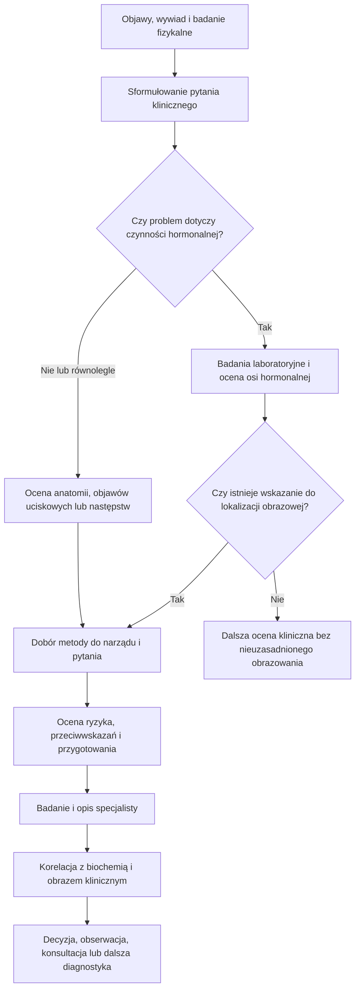

# 5.1. Wprowadzenie do diagnostyki obrazowej w endokrynologii

## Informacje o rozdziale

**Moduł:** 5. Diagnostyka obrazowa w endokrynologii  
**Poziom:** kształcenie zawodowe i podyplomowe; zakres interpretacji należy dostosować do kwalifikacji uczestnika  
**Charakter materiału:** dydaktyczny, interdyscyplinarny, oparty na zasadach medycyny opartej na dowodach  
**Aktualizacja bibliografii:** 27 listopada 2026 r.

> **Zastrzeżenie kliniczne.** Rozdział uczy rozumowania diagnostycznego i bezpiecznego korzystania z badań obrazowych. Nie zastępuje skierowania, opisu lekarza radiologa lub lekarza medycyny nuklearnej, lokalnych procedur, aktualnych wytycznych ani indywidualnej oceny pacjenta. Samodzielne zlecanie, wykonywanie, opisywanie lub interpretowanie badań oraz podawanie środków kontrastowych jest dopuszczalne wyłącznie w granicach odpowiednich kwalifikacji, uprawnień i organizacji świadczenia.

## 1. Cele i efekty uczenia się

### 1.1. Cel główny

Celem rozdziału jest przygotowanie uczestnika do rozumienia roli obrazowania w diagnostyce chorób układu hormonalnego, doboru metody do konkretnego pytania klinicznego, rozpoznawania ograniczeń badań oraz bezpiecznej współpracy z zespołem diagnostycznym. Obrazowanie nie jest samodzielnym rozpoznaniem choroby. Stanowi źródło danych, które należy zestawić z wywiadem, badaniem fizykalnym, wynikami laboratoryjnymi, prawdopodobieństwem przedtestowym i celem postępowania.

### 1.2. Szczegółowe efekty uczenia się

Po ukończeniu rozdziału uczestnik powinien:

1. wyjaśnić różnicę między obrazowaniem anatomicznym, czynnościowym i hybrydowym;
2. wskazać podstawowe możliwości i ograniczenia ultrasonografii, tomografii komputerowej, rezonansu magnetycznego, scyntygrafii, PET/CT, PET/MR oraz densytometrii DXA;
3. sformułować pytanie kliniczne, na które ma odpowiedzieć badanie;
4. rozpoznać sytuacje, w których wynik laboratoryjny powinien poprzedzać obrazowanie lub kierować wyborem metody;
5. wskazać podstawowe zagrożenia związane z promieniowaniem jonizującym, środkami jodowymi i gadolinowymi oraz radiofarmaceutykami;
6. omówić znaczenie ciąży, laktacji, wieku dziecięcego, niewydolności nerek, wcześniejszych reakcji na kontrast i implantów;
7. wyjaśnić pojęcie znaleziska przypadkowego, nadrozpoznawalności i kaskady diagnostycznej;
8. krytycznie odczytać opis badania, nie przekraczając własnych kompetencji;
9. wskazać sytuacje wymagające pilnej konsultacji lub eskalacji;
10. przygotować zwięzłą, użyteczną informację kliniczną dla pracowni obrazowej.

### 1.3. Kryteria osiągnięcia efektów

Efekt uznaje się za osiągnięty, gdy uczestnik potrafi uzasadnić wybór metody, wskazać co najmniej dwa istotne ograniczenia tej metody, opisać środki bezpieczeństwa i przedstawić sposób korelacji wyniku z danymi klinicznymi. Samo zapamiętanie nazw badań nie jest wystarczającym dowodem kompetencji.

## 2. Rola diagnostyki obrazowej w endokrynologii

Układ hormonalny obejmuje narządy o różnej lokalizacji, wielkości, budowie i funkcji. Niektóre gruczoły, takie jak tarczyca, są łatwo dostępne w badaniu ultrasonograficznym. Inne, takie jak przysadka, nadnercza czy przytarczyce położone ektopowo, wymagają technik przekrojowych lub czynnościowych. Z kolei zaburzenia metabolizmu kości mogą wymagać oceny gęstości mineralnej, a nie poszukiwania guza.

Obrazowanie odpowiada na kilka odrębnych pytań:

- **Czy narząd jest obecny i gdzie się znajduje?** Przykład: lokalizacja ektopowej tarczycy lub przytarczycy.
- **Jaka jest anatomia narządu?** Przykład: wielkość przysadki, morfologia nadnercza, objętość tarczycy.
- **Czy występuje zmiana ogniskowa i jakie ma cechy?** Przykład: guzek tarczycy, guz nadnercza, zmiana siodła tureckiego.
- **Czy zmiana wpływa na sąsiednie struktury?** Przykład: ucisk skrzyżowania wzrokowego przez guz okolicy siodła.
- **Czy tkanka wykazuje określoną aktywność biologiczną?** Przykład: autonomiczna czynność guzka tarczycy lub ekspresja receptorów somatostatynowych w guzie neuroendokrynnym.
- **Czy występują następstwa narządowe zaburzeń hormonalnych?** Przykład: złamania kręgów, zmniejszenie gęstości mineralnej kości lub powikłania naczyniowe.

W endokrynologii istotna jest kolejność rozumowania. Jeśli pytanie dotyczy czynności gruczołu, pierwszym krokiem bywa badanie hormonalne, a nie obrazowanie. Jeśli biochemia potwierdza zaburzenie i wskazuje prawdopodobne źródło, obrazowanie może służyć lokalizacji, ocenie rozległości lub planowaniu leczenia. W innych sytuacjach, na przykład przy objawach ucisku struktur nerwowych, obrazowanie może być pilne i równoległe do badań laboratoryjnych.

### 2.1. Obrazowanie anatomiczne

Obrazowanie anatomiczne przedstawia położenie, kształt, rozmiar, strukturę i relacje przestrzenne narządów. Należą do niego przede wszystkim USG, TK i MRI. Metody te nie mierzą bezpośrednio wydzielania hormonów. Zmiana o niepokojącym wyglądzie może być hormonalnie nieczynna, a zaburzenie hormonalne może występować bez widocznej zmiany strukturalnej.

### 2.2. Obrazowanie czynnościowe

Obrazowanie czynnościowe ocenia wybrane procesy biologiczne, na przykład wychwyt radioznacznika, metabolizm glukozy, perfuzję lub ekspresję określonych receptorów. W medycynie nuklearnej sygnał zależy od właściwości radiofarmaceutyku i biologii tkanki. Nie jest to bezpośredni pomiar stężenia hormonu we krwi.

### 2.3. Obrazowanie hybrydowe

PET/CT, SPECT/CT i PET/MR łączą dane czynnościowe z anatomicznymi. Połączenie może poprawić lokalizację ogniska i charakterystykę zmian, ale nie usuwa ograniczeń żadnej z metod składowych. Wynik nadal wymaga korelacji klinicznej.

## 3. Podstawowe modalności obrazowania

| Metoda | Główna zasada | Typowe zastosowania endokrynologiczne | Najważniejsze ograniczenia |
|---|---|---|---|
| USG | Fale ultradźwiękowe i analiza odbić | Tarczyca, szyja, wybrane przytarczyce, tkanki powierzchowne, prowadzenie biopsji | Zależność od operatora, ograniczenia przez gaz, kości i głębokość |
| TK | Promieniowanie rentgenowskie i rekonstrukcja przekrojów | Nadnercza, zwapnienia, anatomia, ocena rozległości zmian | Promieniowanie jonizujące; kontrast może wpływać na ryzyko i interpretację |
| MRI | Sygnał protonów w polu magnetycznym i sekwencje impulsowe | Przysadka, podwzgórze, tkanki miękkie, wybrane zmiany nadnerczy i oczodołów | Czas badania, artefakty ruchowe, ograniczenia implantów, klaustrofobia |
| Scyntygrafia/SPECT | Rozkład radiofarmaceutyku i rejestracja promieniowania gamma | Czynność tarczycy, lokalizacja wybranych gruczolaków przytarczyc, wybrane wskazania receptorowe | Promieniowanie, rozdzielczość przestrzenna, wpływ leków i przygotowania |
| PET | Rejestracja anihilacji pozytonów po podaniu radiofarmaceutyku | Wybrane guzy neuroendokrynne, diagnostyka onkologiczna i poszukiwanie ognisk | Wskazania zależne od znacznika; wyniki fałszywie dodatnie i ujemne |
| DXA | Dwuenergetyczna absorpcjometria rentgenowska | Ocena gęstości mineralnej kości i składu ciała w wybranych wskazaniach | Nie jest pełnym obrazem struktury kości; wyniki zależą od jakości technicznej i kontekstu |

Nie istnieje jedna metoda najlepsza dla wszystkich narządów i wszystkich pytań. Wybór powinien uwzględniać cel badania, prawdopodobieństwo rozpoznania, dostępność, bezpieczeństwo, koszt, wcześniejsze badania i to, czy wynik zmieni dalsze postępowanie.

## 4. Wybór metody zależnie od pytania klinicznego

### 4.1. Zasada pytania klinicznego

Skierowanie powinno opisywać problem, a nie tylko podejrzenie ogólnej choroby. Informacja „diagnostyka endokrynologiczna” jest niewystarczająca. Lepszy zapis wskazuje objawy, wyniki badań, czas ich wykonania, wcześniejsze leczenie i konkretną wątpliwość.

Przykłady:

- „Guzek tarczycy wykryty palpacyjnie; TSH w zakresie referencyjnym; ocena cech ryzyka w USG i węzłów chłonnych szyi”.
- „Biochemicznie potwierdzona nadczynność tarczycy; pytanie o rozkład czynności i różnicowanie autonomii od rozlanego zwiększenia wychwytu”.
- „Podejrzenie zmiany przysadki przy hiperprolaktynemii po wykluczeniu częstych przyczyn wtórnych; ocena okolicy siodła i relacji do skrzyżowania wzrokowego”.
- „Przypadkowo wykryta zmiana nadnercza; potrzebna charakterystyka tkankowa i ocena cech sugerujących łagodność lub złośliwość zgodnie z aktualnym algorytmem”.
- „Złamanie niskoenergetyczne i przewlekła ekspozycja na glikokortykosteroidy; ocena wskazań do DXA i ewentualnej oceny złamań kręgów”.

### 4.2. Algorytm doboru

1. Zdefiniuj problem kliniczny.
2. Ustal, czy pytanie dotyczy anatomii, funkcji, rozległości choroby czy następstw narządowych.
3. Oceń, czy badanie laboratoryjne powinno poprzedzać obrazowanie.
4. Sprawdź, czy wynik może zmienić decyzję diagnostyczną lub terapeutyczną.
5. Oceń ryzyko badania i dostępne alternatywy.
6. Uwzględnij ciążę, wiek, czynność nerek, implanty, wcześniejsze reakcje i leki.
7. Wybierz metodę i protokół adekwatny do pytania.
8. Zapewnij kompletne dane kliniczne dla pracowni.
9. Po otrzymaniu wyniku zestaw opis z biochemią i obrazem klinicznym.
10. Ustal dalsze postępowanie w granicach kompetencji i zgodnie z wytycznymi.

### 4.3. Przykładowa mapa narząd–pytanie–metoda

| Narząd lub problem | Pytanie kliniczne | Często rozważana metoda | Uwagi |
|---|---|---|---|
| Tarczyca | Struktura, guzki, węzły chłonne | USG | Scyntygrafia odpowiada na inne pytanie: czynność i rozkład wychwytu |
| Przysadka | Mikro- lub makrostruktura, ucisk, relacje anatomiczne | MRI okolicy siodła | Protokół dedykowany; korelacja z hormonami i oceną wzroku |
| Nadnercza | Charakter zmiany, gęstość, jednorodność, rozległość | TK bez kontrastu jako częsty punkt wyjścia; MRI w wybranych sytuacjach | Wybór według cech zmiany, historii nowotworowej i lokalnych wytycznych |
| Przytarczyce | Lokalizacja przed zabiegiem | USG, scyntygrafia, SPECT/CT lub inne metody lokalizacyjne | Rozpoznanie nadczynności jest biochemiczne; obrazowanie służy lokalizacji |
| Kości | Gęstość mineralna i ryzyko złamania | DXA | Interpretacja według wieku, płci, stanu hormonalnego i wskazań |
| Guz neuroendokrynny | Lokalizacja i ekspresja celu molekularnego | TK/MRI oraz wybrane PET z radiofarmaceutykami receptorowymi | Dobór zależy od typu guza, stopnia zróżnicowania i pytania klinicznego |

Tabela przedstawia typowe kierunki rozumowania, a nie automatyczne wskazania do wykonania badania u każdego pacjenta.

## 5. Wskazania i przeciwwskazania – sposób myślenia

### 5.1. Wskazania

Obrazowanie jest uzasadnione, gdy istnieje konkretne pytanie, a spodziewana informacja może wpłynąć na dalsze postępowanie. Do typowych wskazań należą:

- wykrycie i charakterystyka zmiany ogniskowej;
- ocena wielkości narządu, jego struktury i relacji anatomicznych;
- lokalizacja zmiany przed zabiegiem lub biopsją;
- ocena ucisku, naciekania lub przerzutów;
- określenie rozkładu czynności tkanki w wybranych zaburzeniach;
- ocena odpowiedzi na leczenie, jeśli dana metoda jest odpowiednia do monitorowania;
- ocena powikłań kostnych i złamań;
- rozwiązanie rozbieżności między obrazem klinicznym i wynikami badań, gdy obrazowanie może tę rozbieżność wyjaśnić.

### 5.2. Przeciwwskazania i ograniczenia

Przeciwwskazanie zależy od modalności, protokołu i konkretnego pacjenta. Nie należy przenosić ograniczeń jednej techniki na wszystkie badania.

| Czynnik | Możliwy problem | Właściwe postępowanie |
|---|---|---|
| Ciąża | Promieniowanie jonizujące, radiofarmaceutyk, niektóre kontrasty | Ocena pilności i alternatyw; USG/MRI bez kontrastu często preferowane, jeśli odpowiadają na pytanie |
| Laktacja | Przenikanie wybranych radiofarmaceutyków lub kontrastów do mleka | Indywidualna instrukcja zależna od konkretnego środka i procedury |
| Niewydolność nerek | Ryzyko związane z wybranymi kontrastami i chorobą podstawową | Ocena eGFR, ostrego uszkodzenia nerek, rodzaju środka i korzyści diagnostycznej |
| Wcześniejsza reakcja na kontrast | Ryzyko reakcji ponownej | Ustalenie rodzaju i ciężkości reakcji, alternatywy, planu zabezpieczenia |
| Implant lub urządzenie | Możliwe zagrożenie lub artefakt w MRI | Sprawdzenie dokładnego modelu i warunków MR Safe/MR Conditional/MR Unsafe |
| Klaustrofobia lub niemożność pozostania bez ruchu | Niepełne lub niediagnostyczne badanie | Przygotowanie, alternatywny aparat/protokół, ewentualne postępowanie zgodne z procedurą |
| Otyłość i ograniczenia techniczne | Ograniczona jakość obrazu lub limit stołu/aparatu | Sprawdzenie możliwości technicznych przed rezerwacją |
| Niestabilny stan pacjenta | Ryzyko transportu i opóźnienia leczenia | Najpierw stabilizacja i decyzja zespołu odpowiedzialnego za stan nagły |

Ciąża nie jest automatycznym zakazem każdego badania obrazowego. Badanie konieczne do rozpoznania stanu zagrażającego zdrowiu lub życiu może być uzasadnione, jeśli korzyść przewyższa ryzyko i zastosowano właściwy protokół. Decyzję podejmuje uprawniony zespół zgodnie z przepisami i zasadami ochrony radiologicznej.

## 6. Obrazowanie anatomiczne a czynnościowe – konsekwencje interpretacyjne

### 6.1. Obraz nie jest hormonem

Wykrycie guzka nie dowodzi, że wydziela on hormon. Brak widocznej zmiany nie wyklucza zaburzenia czynności. Przykładowo:

- pacjent może mieć biochemiczną nadczynność tarczycy bez pojedynczego guzka;
- zmiana przysadki może być przypadkowa i nie odpowiadać za objawy;
- guz nadnercza może być hormonalnie nieczynny albo wydzielać hormony mimo niewielkich rozmiarów;
- prawidłowy obraz anatomiczny nie wyklucza zaburzeń receptorowych lub enzymatycznych;
- obraz scyntygraficzny zależy od radiofarmaceutyku, przygotowania i leków, a nie tylko od stężenia hormonu.

### 6.2. Zasada zgodności danych

Dane kliniczne, laboratoryjne i obrazowe powinny tworzyć spójną hipotezę. Jeśli wyniki są sprzeczne, nie wolno arbitralnie uznać jednego z nich za prawdziwy bez analizy przyczyn rozbieżności. Należy sprawdzić:

- czy badanie odpowiadało na właściwe pytanie;
- czy zastosowano odpowiedni protokół;
- czy pacjent był właściwie przygotowany;
- czy lek lub suplement mógł zmienić wynik;
- czy występuje błąd przedanalityczny lub interferencja laboratoryjna;
- czy zmiana obrazowa jest przypadkowa;
- czy choroba może mieć charakter czynnościowy bez widocznej zmiany;
- czy potrzebna jest ponowna ocena przez radiologa, endokrynologa lub zespół wielodyscyplinarny.

## 7. Ograniczenia badań obrazowych

### 7.1. Ograniczenia techniczne

Każda metoda ma granice rozdzielczości, kontrastu tkankowego i zakresu pola obrazowania. Niewielka zmiana może być niewidoczna, a zmiana widoczna może być trudna do scharakteryzowania. Ruch, oddech, artefakty metaliczne, niejednorodność pola magnetycznego, gaz jelitowy, budowa ciała i jakość aparatu mogą wpływać na wynik.

### 7.2. Ograniczenia biologiczne

Obrazowanie pokazuje określone cechy tkanki w konkretnym momencie. Zmiana może zmieniać się w czasie, mieć niejednorodną budowę lub wykazywać aktywność tylko w części objętości. Nie wszystkie cechy biologiczne da się wiarygodnie wywnioskować z obrazu. Przykładowo, obrazowanie nie zastępuje histopatologii w sytuacjach, w których rozpoznanie tkankowe jest wymagane.

### 7.3. Zmienność między obserwatorami

Ocena niektórych cech, zwłaszcza w USG, zależy od doświadczenia osoby wykonującej i opisującej badanie. Standaryzowane systemy, takie jak ACR TI-RADS dla guzków tarczycy, pomagają ujednolicić opis i progi dalszego postępowania, ale nie eliminują potrzeby uwzględnienia kontekstu klinicznego.

### 7.4. Wynik ujemny nie zawsze wyklucza chorobę

Czułość zależy od metody, wielkości zmiany, jej lokalizacji, protokołu i prawdopodobieństwa przedtestowego. Ujemny wynik badania o ograniczonej czułości nie powinien zamykać diagnostyki, jeśli podejrzenie kliniczne pozostaje wysokie. Należy jednak unikać automatycznego powtarzania kolejnych badań bez określonego pytania.

## 8. Znaleziska przypadkowe i kaskada diagnostyczna

### 8.1. Definicja

Znalezisko przypadkowe (incidentaloma) to zmiana wykryta podczas badania wykonanego z innego powodu niż podejrzenie choroby w danym narządzie. Przykładem może być guz nadnercza uwidoczniony w TK jamy brzusznej wykonywanej z powodu kolki nerkowej albo zmiana okolicy siodła tureckiego opisana w MRI mózgu z powodu bólu głowy.

Znalezisko przypadkowe nie jest równoznaczne z nowotworem złośliwym ani z przyczyną objawów. Może być łagodne, hormonalnie czynne, hormonalnie nieczynne lub wymagać dalszej oceny.

### 8.2. Ryzyko nadrozpoznawalności

Nadrozpoznawalność polega na wykrywaniu zmian, które nie spowodowałyby objawów ani szkody w życiu pacjenta. Może prowadzić do niepotrzebnych biopsji, operacji, lęku, powikłań i kosztów. Ryzyko zwiększa się, gdy wykonuje się badania bez jasnego wskazania lub powtarza je bez oceny wcześniejszych wyników.

### 8.3. Racjonalne postępowanie

1. Zweryfikuj, czy zmiana rzeczywiście jest nowa i czy dostępne są wcześniejsze obrazy.
2. Odczytaj dokładny opis: lokalizacja, rozmiar, morfologia, jednorodność, cechy ryzyka i ograniczenia.
3. Ustal, czy istnieją objawy lub wyniki biochemiczne wskazujące na czynność hormonalną.
4. Zastosuj wytyczne właściwe dla danego narządu i rodzaju zmiany.
5. Unikaj badań kontrolnych, które nie zmienią postępowania.
6. Omów niejednoznaczne lub potencjalnie istotne znalezisko z odpowiednim specjalistą.

W przypadku incydentaloma nadnerczy wytyczne European Society of Endocrinology z 2023 r. podkreślają potrzebę oceny cech obrazowych i hormonalnych. Jednorodna zmiana o gęstości nieprzekraczającej 10 HU w TK bez kontrastu ma cechy typowe dla łagodnego gruczolaka i w określonym kontekście może nie wymagać dalszego obrazowania. Nie wolno jednak stosować tego progu bez sprawdzenia pełnych kryteriów, jakości badania i sytuacji klinicznej.

W przypadku incydentaloma przysadki opublikowano międzynarodowy konsensus Pituitary Society z 2025 r., który aktualizuje podejście do oceny hormonalnej, dedykowanego MRI, pola widzenia i obserwacji. Nie należy automatycznie przenosić dawnych harmonogramów kontroli na wszystkich pacjentów; decyzja zależy od wielkości, położenia, cech klinicznych i aktualnych zaleceń.

## 9. Bezpieczeństwo promieniowania jonizującego

### 9.1. Zasady ochrony radiologicznej

W badaniach wykorzystujących promieniowanie jonizujące obowiązują zasady uzasadnienia i optymalizacji. Uzasadnienie oznacza, że oczekiwana korzyść diagnostyczna powinna przewyższać potencjalne ryzyko. Optymalizacja oznacza dobór parametrów tak, aby uzyskać jakość wystarczającą do odpowiedzi na pytanie kliniczne przy możliwie małej ekspozycji. W praktyce stosuje się zasadę ALARA – dawka tak mała, jak jest to rozsądnie osiągalne, przy zachowaniu wymaganej jakości diagnostycznej.

Nie oznacza to mechanicznego obniżania dawki kosztem niediagnostycznego obrazu. Nie oznacza również stosowania stałych limitów dawki dla pacjenta w procedurach medycznych tak, jak dla narażenia zawodowego. Decyzja musi uwzględniać korzyść kliniczną.

### 9.2. Badania wykorzystujące promieniowanie

- TK wykorzystuje promieniowanie rentgenowskie.
- Scyntygrafia, SPECT i PET wykorzystują radiofarmaceutyki emitujące promieniowanie wykrywane przez aparaturę.
- DXA wykorzystuje promieniowanie rentgenowskie o niskiej dawce.
- USG i MRI nie wykorzystują promieniowania jonizującego.

Brak promieniowania jonizującego nie oznacza braku wszelkiego ryzyka. MRI wymaga kontroli bezpieczeństwa pola magnetycznego, a USG powinno być wykonywane zgodnie z zasadą ostrożnego i uzasadnionego użycia energii akustycznej.

### 9.3. Szczególne grupy

**Dzieci i młodzież.** Tkanki rozwijającego się organizmu są bardziej wrażliwe na promieniowanie, a przewidywany czas życia jest dłuższy. Należy preferować metodę bez promieniowania, jeśli jest równie skuteczna i dostępna, a w badaniach rentgenowskich dostosować protokół do rozmiarów pacjenta.

**Ciąża.** Należy ustalić, czy pacjentka jest w ciąży lub może być w ciąży, jeśli ma to znaczenie dla wyboru procedury. Nie należy opóźniać koniecznego rozpoznania stanu nagłego bez oceny ryzyka i korzyści przez zespół. USG i MRI bez kontrastu są często rozważanymi alternatywami, lecz wybór zależy od pytania.

**Powtarzane badania.** Należy sprawdzić wcześniejsze obrazy i opisy. Powtórzenie TK bez uzasadnienia może zwiększać skumulowaną ekspozycję i nie wnosić dodatkowej informacji.

### 9.4. Komunikacja ryzyka

Ryzyko należy przedstawiać proporcjonalnie, bez straszenia i bez bagatelizowania. Warto wyjaśnić, dlaczego badanie jest potrzebne, jakie są alternatywy i jakie informacje mogą zmienić dalsze postępowanie. Ostateczne informacje o dawce i protokole powinny pochodzić z pracowni wykonującej badanie.

## 10. Środki kontrastowe i bezpieczeństwo pacjenta

### 10.1. Kontrast jodowy w TK

Jodowe środki kontrastowe poprawiają różnicowanie tkanek i ocenę unaczynienia. Przed podaniem należy zebrać informacje o wcześniejszych reakcjach na środek kontrastowy, czynności nerek w sytuacjach wskazanych przez protokół, ciąży, przyjmowanych lekach i aktualnym stanie klinicznym.

Nie należy używać określenia „alergia na jod” jako precyzyjnego rozpoznania. Reakcje na kontrast jodowy nie są tym samym co alergia na jod jako pierwiastek, a uczulenie na owoce morza samo w sobie nie jest szczególnym przeciwwskazaniem do kontrastu jodowego. Kluczowe znaczenie ma rodzaj i ciężkość wcześniejszej reakcji na konkretny środek.

Wśród potencjalnych problemów znajdują się reakcje natychmiastowe o charakterze alergicznym lub fizjologicznym, wynaczynienie oraz ryzyko związane z ostrym uszkodzeniem nerek u wybranych pacjentów. Postępowanie zależy od aktualnego stanu nerek, rodzaju kontrastu, dawki, drogi podania i pilności badania. Należy korzystać z aktualnego ACR Manual on Contrast Media oraz lokalnych procedur.

### 10.2. Kontrast gadolinowy w MRI

Środki gadolinowe poprawiają ocenę unaczynienia, granic zmian i wybranych struktur. Ryzyko włóknienia układowego nerkopochodnego jest związane przede wszystkim z określonymi preparatami i ciężkim upośledzeniem czynności nerek; współczesne klasyfikacje grup kontrastowych różnicują to ryzyko. Należy ocenić wskazanie, czynność nerek według lokalnej procedury i rodzaj środka. Nie wolno zakładać, że każdy preparat gadolinowy ma identyczny profil bezpieczeństwa.

W ciąży gadolin nie jest stosowany rutynowo. Może być rozważony wyłącznie w szczególnych okolicznościach, gdy oczekiwana korzyść kliniczna uzasadnia potencjalne ryzyko i decyzję podejmuje właściwy zespół.

### 10.3. Kontrast ultrasonograficzny

Mikropęcherzyki stosowane w ultrasonografii kontrastowej nie są tym samym co kontrast jodowy lub gadolinowy. Wskazania i przeciwwskazania zależą od konkretnego preparatu, stanu pacjenta i lokalnej rejestracji. Nie należy przenosić na nie automatycznie zasad dotyczących innych grup kontrastów.

### 10.4. Lista kontrolna przed kontrastem

- Czy wskazanie jest jasno określone?
- Czy wcześniejsza reakcja na kontrast została opisana z nazwą środka, objawami i ciężkością?
- Czy oceniono czynność nerek, gdy jest to wymagane?
- Czy uwzględniono ciążę lub możliwość ciąży?
- Czy sprawdzono aktualne leki i choroby współistniejące?
- Czy wybrano właściwy preparat i protokół?
- Czy pacjent otrzymał informację o badaniu i możliwych reakcjach?
- Czy pracownia ma procedurę rozpoznawania i leczenia reakcji?
- Czy po badaniu istnieje plan obserwacji, jeśli jest potrzebny?

## 11. Bezpieczeństwo MRI i implantów

MRI nie wykorzystuje promieniowania jonizującego, ale silne pole magnetyczne może stanowić zagrożenie dla niektórych implantów i przedmiotów ferromagnetycznych. Każdy pacjent musi przejść kontrolę bezpieczeństwa zgodną z procedurą pracowni.

Oznaczenia urządzeń:

- **MR Safe** – urządzenie nie stwarza znanych zagrożeń w środowisku MR;
- **MR Conditional** – bezpieczeństwo potwierdzono tylko przy spełnieniu określonych warunków;
- **MR Unsafe** – urządzenie stwarza niedopuszczalne zagrożenie w środowisku MR.

Nie wolno uznawać urządzenia za bezpieczne wyłącznie na podstawie nazwy handlowej lub podobieństwa do innego modelu. Potrzebne mogą być dokładny model, dokumentacja producenta, parametry aparatu i ocena zespołu MR. Dotyczy to między innymi rozruszników, kardiowerterów-defibrylatorów, neurostymulatorów, pomp, implantów ślimakowych, klipsów naczyniowych i ciał obcych.

W endokrynologii szczególne znaczenie ma MRI przysadki i podwzgórza. Badanie może wymagać cienkich warstw i dedykowanych sekwencji. Niewłaściwy protokół mózgowia nie zawsze wystarcza do oceny niewielkiej zmiany siodła.

## 12. Radiofarmaceutyki i medycyna nuklearna

Radiofarmaceutyk jest związkiem zawierającym radionuklid, którego rozmieszczenie zależy od określonych procesów fizjologicznych lub molekularnych. Wybór znacznika musi wynikać z pytania klinicznego. Różne radiofarmaceutyki nie są wymienne.

W endokrynologii i onkologii endokrynnej można wykorzystywać między innymi:

- radiojod i nadtechnecjan w wybranych badaniach tarczycy;
- znaczniki stosowane w ocenie przytarczyc;
- analogi somatostatyny znakowane galem-68 lub miedzią-64 w PET guzów z ekspresją receptorów somatostatynowych;
- FDG w PET w wybranych wskazaniach onkologicznych i ocenie metabolizmu glukozy;
- inne radiofarmaceutyki dobierane do określonego celu biologicznego.

Przygotowanie zależy od znacznika. Znaczenie mogą mieć dieta, glikemia, leki, suplementacja jodu, niedawne badania z kontrastem jodowym, ciąża i laktacja. Instrukcje powinny pochodzić z pracowni medycyny nuklearnej i dotyczyć konkretnego preparatu. Nie należy samodzielnie odstawiać leków ani zalecać przerwania karmienia piersią bez uzyskania dokładnej instrukcji dla użytego radiofarmaceutyku.

## 13. Korelacja obrazu z wynikami hormonalnymi

### 13.1. Dlaczego korelacja jest konieczna

Obrazowanie odpowiada na pytanie o strukturę lub wybrany proces biologiczny, natomiast badania laboratoryjne określają stężenia hormonów i metabolitów. Obie grupy danych uzupełniają się, lecz nie zastępują.

Przykłady:

- **Tarczyca:** TSH i FT4/FT3 określają czynność, USG ocenia morfologię, a scyntygrafia może ocenić rozkład wychwytu w określonych wskazaniach.
- **Przysadka:** profil hormonalny określa nadmiar lub niedobór hormonów, MRI charakteryzuje okolicę siodła, a badanie pola widzenia ocenia następstwa ucisku.
- **Nadnercza:** testy hormonalne określają czynność, a TK/MRI charakteryzuje zmianę i jej relacje anatomiczne.
- **Przytarczyce:** stężenia wapnia, fosforanów, PTH i funkcja nerek ustalają biochemiczny problem; obrazowanie pomaga lokalizować gruczoł przed leczeniem zabiegowym.
- **Kości:** DXA ocenia gęstość mineralną, ale interpretacja wymaga uwzględnienia wieku, menopauzy, złamań, leków i chorób wpływających na metabolizm kości.

### 13.2. Macierz interpretacyjna

| Wynik laboratoryjny | Obrazowanie | Możliwa interpretacja | Następny krok |
|---|---|---|---|
| Zaburzenie hormonalne | Zmiana zgodna z lokalizacją | Możliwa korelacja, nie automatyczny dowód przyczynowości | Ocena zgodności klinicznej i specjalistyczna interpretacja |
| Zaburzenie hormonalne | Brak widocznej zmiany | Zmiana zbyt mała, poza polem, czynnościowa lub inny mechanizm | Ocena czułości metody i dalszego algorytmu |
| Wyniki hormonalne prawidłowe | Zmiana przypadkowa | Możliwa zmiana nieczynna | Ocena ryzyka strukturalnego i wskazań do obserwacji |
| Wyniki sprzeczne | Obraz niejednoznaczny | Możliwy błąd pomiaru, protokołu lub hipotezy | Weryfikacja danych, wcześniejszych badań i konsultacja |
| Objawy alarmowe | Obrazowanie niejednoznaczne | Nie można wykluczyć stanu pilnego | Eskalacja kliniczna, nie opierać się wyłącznie na pojedynczym opisie |

## 14. Jakość skierowania i przygotowanie pacjenta

Dobre skierowanie zwiększa szansę, że pracownia dobierze właściwy protokół. Powinno zawierać:

1. dane identyfikacyjne zgodne z zasadami ochrony danych;
2. najważniejsze objawy i czas ich trwania;
3. konkretne pytanie kliniczne;
4. istotne wyniki hormonalne wraz z datami i jednostkami;
5. informacje o wcześniejszych badaniach obrazowych;
6. rozpoznania, przebyte operacje i leczenie;
7. informacje o ciąży, laktacji, implantach i wcześniejszych reakcjach na kontrast, jeśli są istotne;
8. dane o czynności nerek, gdy mają znaczenie dla planowanego kontrastu;
9. informację o pilności badania i dane kontaktowe do osoby kierującej.

Przygotowanie pacjenta zależy od procedury. Nie każde USG, MRI lub TK wymaga bycia na czczo. Nie należy zalecać odstawiania leków bez instrukcji lekarza lub pracowni. Pacjent powinien otrzymać informację o czasie trwania, konieczności pozostania bez ruchu, ewentualnym podaniu kontrastu, możliwych odczuciach i sposobie uzyskania wyniku.

### 14.1. Przykładowy szablon informacji klinicznej

**Problem kliniczny:**  
**Objawy i czas trwania:**  
**Pytanie diagnostyczne:**  
**Wyniki laboratoryjne z datami:**  
**Wcześniejsze obrazowanie:**  
**Istotne choroby i zabiegi:**  
**Leki i suplementy wpływające na badanie:**  
**Ciąża/laktacja – jeśli dotyczy:**  
**Implanty lub urządzenia – jeśli dotyczy:**  
**Czynność nerek i wcześniejsze reakcje na kontrast – jeśli dotyczy:**  
**Pilność i osoba do kontaktu:**

## 15. Odczytywanie i wykorzystywanie opisu badania

Opis radiologiczny lub medycyny nuklearnej jest dokumentem specjalistycznym. Uczestnik szkolenia powinien umieć odnaleźć w nim:

- rodzaj badania i zastosowany protokół;
- informację o kontraście lub radiofarmaceutyku;
- ograniczenia jakościowe;
- lokalizację i wymiary zmiany;
- cechy morfologiczne;
- relacje do sąsiednich struktur;
- porównanie z wcześniejszym badaniem;
- wnioski i zalecenia opisującego.

Wniosek końcowy nie powinien być czytany w oderwaniu od części opisowej. Jeśli raport zawiera zastrzeżenia, na przykład ograniczenie przez artefakty lub niepełne uwidocznienie narządu, należy uwzględnić je w dalszym rozumowaniu.

Nie należy samodzielnie zmieniać kategorii ryzyka, dopisywać rozpoznania histopatologicznego ani podejmować decyzji o biopsji lub operacji poza zakresem uprawnień. W razie rozbieżności można poprosić o wyjaśnienie lub ponowną ocenę obrazów przez właściwego specjalistę.

## 16. Sytuacje wymagające pilnej eskalacji

Pilnej oceny klinicznej wymagają w szczególności:

- nagły, bardzo silny ból głowy z zaburzeniami widzenia, oftalmoplegią, zaburzeniami świadomości lub objawami niewydolności hormonalnej – możliwy udar/przełom przysadki;
- szybko narastające zaburzenia pola widzenia lub inne objawy ucisku struktur nerwowych;
- podejrzenie guza chromochłonnego z niestabilnością hemodynamiczną;
- ciężkie zaburzenia elektrolitowe lub glikemiczne z objawami neurologicznymi;
- podejrzenie złośliwego guza z objawami ucisku, krwawienia lub przerzutów;
- ciężka reakcja na środek kontrastowy lub radiofarmaceutyk;
- wynaczynienie kontrastu z nasilającym się bólem, obrzękiem, zaburzeniami czucia lub ukrwienia;
- nieoczekiwane znalezisko o potencjalnie bezpośrednim zagrożeniu, opisane jako wymagające pilnego kontaktu.

W stanach nagłych priorytetem jest ocena i stabilizacja pacjenta. Nie wolno opóźniać koniecznego postępowania z powodu oczekiwania na rutynowy termin obrazowania.

## 17. Granice kompetencji i współpraca interdyscyplinarna

Zakres kompetencji zależy od zawodu, kwalifikacji, przepisów, rodzaju świadczenia i procedur jednostki. W szczególności należy rozróżniać:

- **osobę kierującą** – formułuje wskazanie i pytanie kliniczne w granicach uprawnień;
- **lekarza radiologa lub lekarza medycyny nuklearnej** – odpowiada za specjalistyczną ocenę i opis w zakresie swojej dziedziny;
- **elektroradiologa/radiografera i personel pracowni** – wykonuje czynności zgodnie z kwalifikacjami i procedurami;
- **fizyka medycznego** – wspiera bezpieczeństwo, dozymetrię, kontrolę jakości i optymalizację;
- **endokrynologa i zespół kliniczny** – integruje wyniki z biochemią, objawami i planem leczenia;
- **patomorfologa** – ocenia materiał tkankowy, gdy wykonano biopsję lub zabieg.

Fizjoterapeuta, technik, terapeuta, dietetyk lub uczestnik kursu może wykorzystywać informacje z dokumentacji do planowania działań w zakresie własnych kompetencji, ale nie powinien samodzielnie rozpoznawać guza na podstawie obrazu ani modyfikować ścieżki onkologicznej. Wątpliwości wymagają przekazania osobie odpowiedzialnej za diagnostykę i leczenie.

## 18. Przypadki kliniczne

### Przypadek 1. Guzek tarczycy i prawidłowe TSH

U 46-letniej osoby podczas badania szyi wyczuto niewielki guzek. TSH jest w zakresie referencyjnym, brak objawów uciskowych.

**Pytanie:** Czy prawidłowe TSH wyklucza potrzebę obrazowania?

**Omówienie:** Nie. TSH opisuje czynność osi tarczycowej, a nie morfologię guzka. USG może ocenić cechy zmiany i węzły chłonne. Decyzja o biopsji lub obserwacji zależy od systemu oceny ryzyka, wymiarów, kontekstu klinicznego i aktualnych zaleceń. Samo wykrycie guzka nie oznacza nowotworu.

### Przypadek 2. Podejrzenie guza przysadki

U pacjenta występują bóle głowy, zaburzenia miesiączkowania u partnerki nie są tu istotne, natomiast u pacjenta stwierdzono hiperprolaktynemię. Należy zweryfikować leki, makroprolaktynę, czynność tarczycy i inne przyczyny wtórne. Jeśli utrzymuje się wskazanie, rozważa się MRI z protokołem przysadkowym.

**Pytanie:** Czy każda hiperprolaktynemia wymaga natychmiastowego MRI?

**Omówienie:** Nie. Najpierw ocenia się kontekst, powtarzalność wyniku i przyczyny wtórne. MRI jest dobierane do utrzymującego się podejrzenia klinicznego. Objawy ucisku lub zaburzenia widzenia zmieniają pilność.

### Przypadek 3. Przypadkowa zmiana nadnercza

W TK wykonanej z powodu bólu brzucha opisano jednorodną zmianę nadnercza. Pacjent nie zgłasza typowych objawów nadmiaru hormonów.

**Pytanie:** Czy wystarczy powtórzyć TK za rok?

**Omówienie:** Nie można przyjąć takiego schematu automatycznie. Trzeba przeanalizować gęstość w TK bez kontrastu, jednorodność, rozmiar, wcześniejsze obrazy, historię nowotworową i wskazania do oceny hormonalnej. Aktualne wytyczne ESE/ENSAT z 2023 r. zalecają indywidualną ocenę, a w określonej grupie jednoznacznie łagodnych zmian dalsze obrazowanie może nie być potrzebne.

### Przypadek 4. Nadczynność tarczycy i wybór badania

U pacjenta stwierdzono obniżone TSH i podwyższone FT4. USG wykazuje niejednorodny miąższ, bez dominującego guzka.

**Pytanie:** Czy USG rozstrzyga przyczynę tyreotoksykozy?

**Omówienie:** Nie. USG opisuje strukturę i unaczynienie, ale rozróżnienie nadmiernej syntezy hormonów od ich uwalniania w zapaleniu może wymagać dodatkowych danych. W odpowiednich sytuacjach scyntygrafia lub badania przeciwciał mogą pomóc. Wybór zależy od ciąży, ekspozycji na jod, leków i lokalnych zaleceń.

### Przypadek 5. Podejrzenie ucisku skrzyżowania wzrokowego

Pacjent zgłasza postępujące ograniczenie widzenia obwodowego i bóle głowy. W badaniu hormonalnym podejrzewa się niedoczynność kilku osi.

**Pytanie:** Czy można zaplanować MRI jako badanie rutynowe za kilka miesięcy?

**Omówienie:** Nie bez oceny pilności. Objawy mogą wskazywać na zmianę okolicy siodła z uciskiem struktur wzrokowych. Potrzebna jest pilna ocena lekarska, odpowiednie obrazowanie i badanie okulistyczne/neurookulistyczne. Przy nagłym początku i ciężkich objawach należy rozważyć stan nagły.

### Przypadek 6. Pacjent z implantem i wskazaniem do MRI

U pacjenta z podejrzeniem zmiany przysadki wszczepiono wcześniej urządzenie elektroniczne.

**Pytanie:** Czy MRI jest bezwzględnie wykluczone?

**Omówienie:** Nie można tego stwierdzić bez identyfikacji urządzenia. Należy uzyskać model, dokumentację i warunki MR Conditional. Decyzję podejmuje zespół pracowni MRI. Nie wolno kierować pacjenta do aparatu na podstawie samego zapewnienia, że implant jest „nowoczesny”.

### Przypadek 7. Pacjent z przewlekłą chorobą nerek i planowanym kontrastem

Pacjent wymaga TK z kontrastem z powodu podejrzenia guza.

**Pytanie:** Czy przewlekła choroba nerek zawsze wyklucza kontrast?

**Omówienie:** Nie. Należy ocenić aktualną czynność nerek, obecność ostrego uszkodzenia, wskazanie, rodzaj kontrastu i dostępne alternatywy. Bilans korzyści i ryzyka powinien być udokumentowany, a decyzja podjęta zgodnie z aktualnym podręcznikiem ACR i lokalną procedurą.

### Przypadek 8. Złamanie niskoenergetyczne

U 68-letniej kobiety po niewielkim upadku wystąpiło złamanie kręgu. Pacjentka ma w wywiadzie nadczynność przytarczyc.

**Pytanie:** Czy prawidłowy wynik pojedynczej DXA wyklucza ryzyko złamań?

**Omówienie:** Nie. Ryzyko złamania jest wieloczynnikowe. Należy uwzględnić lokalizację i rodzaj złamania, wyniki DXA, wiek, leki, choroby współistniejące i ewentualną ocenę kręgów. DXA nie jest jedynym źródłem informacji.

### Przypadek 9. Zmiana w PET u chorego z guzem neuroendokrynnym

U pacjenta wykonano PET z analogiem somatostatyny. Stwierdzono ognisko zwiększonego wychwytu.

**Pytanie:** Czy zwiększony wychwyt jest równoznaczny z potwierdzeniem przerzutu?

**Omówienie:** Nie. Wychwyt zależy od ekspresji celu molekularnego i może występować także w innych stanach. Interpretacja wymaga lokalizacji anatomicznej, typu radiofarmaceutyku, historii choroby, wyników histopatologicznych i oceny specjalistycznej.

### Przypadek 10. Znalezisko przypadkowe w MRI mózgu

W MRI wykonanym z powodu zawrotów głowy opisano niewielką zmianę okolicy siodła.

**Pytanie:** Czy należy od razu kierować pacjenta na zabieg?

**Omówienie:** Nie. Potrzebna jest ocena, czy jest to rzeczywista zmiana przysadki, czy wymaga dedykowanego MRI, oceny hormonalnej i pola widzenia. Konsensus Pituitary Society z 2025 r. podkreśla indywidualizację postępowania i współpracę interdyscyplinarną.

## 19. Ćwiczenia dydaktyczne

### Ćwiczenie 1. Sformułowanie pytania klinicznego

Dla pacjenta z podwyższonym IGF-1 i powiększeniem dłoni przygotuj jednozdaniowe pytanie do pracowni obrazowej.

**Oczekiwany element:** podejrzenie akromegalii, informacja o wynikach biochemicznych i pytanie o ocenę okolicy przysadki w dedykowanym MRI.

### Ćwiczenie 2. Dobór metody

Dobierz metodę do trzech problemów: guzek tarczycy, podejrzenie zmiany przysadki, ocena gęstości mineralnej kości.

**Oczekiwany element:** USG, MRI przysadki, DXA, wraz z uzasadnieniem i ograniczeniami.

### Ćwiczenie 3. Rozpoznanie rodzaju obrazowania

Wyjaśnij, dlaczego scyntygrafia tarczycy i USG tarczycy nie są badaniami zamiennymi.

**Oczekiwany element:** różnica między oceną rozkładu wychwytu/czynności a morfologią.

### Ćwiczenie 4. Ocena ryzyka kontrastu

Przygotuj listę informacji koniecznych przed TK z kontrastem u pacjenta z przewlekłą chorobą nerek i wcześniejszą reakcją po kontraście.

**Oczekiwany element:** opis wcześniejszej reakcji, aktualna funkcja nerek, wskazanie, alternatywy, rodzaj środka i plan bezpieczeństwa.

### Ćwiczenie 5. Znalezisko przypadkowe

Opracuj plan pierwszych kroków po wykryciu zmiany nadnercza w TK wykonanej z innego powodu.

**Oczekiwany element:** przegląd obrazów, charakterystyka radiologiczna, ocena hormonalna według wytycznych i konsultacja, bez automatycznego powtarzania TK.

### Ćwiczenie 6. Rozbieżność danych

Pacjent ma wyraźne objawy tyreotoksykozy, ale opis USG jest mało charakterystyczny. Wskaż, dlaczego nie można wykluczyć choroby na podstawie USG.

**Oczekiwany element:** USG nie jest bezpośrednim testem czynności; potrzebna jest korelacja laboratoryjna i kliniczna.

### Ćwiczenie 7. Bezpieczeństwo MRI

Przygotuj procedurę sprawdzenia bezpieczeństwa MRI u pacjenta z implantem.

**Oczekiwany element:** dokładny model, dokumentacja, status MR, warunki producenta, ocena zespołu pracowni i udokumentowanie decyzji.

### Ćwiczenie 8. Komunikacja z pacjentem

Wyjaśnij pacjentowi, dlaczego wykrycie małej zmiany przysadki nie oznacza automatycznie nowotworu złośliwego.

**Oczekiwany element:** spokojna informacja o częstości znalezisk przypadkowych, potrzebie korelacji hormonalnej i indywidualnym planie kontroli.

## 20. Pytania kontrolne

1. Jaka jest różnica między obrazowaniem anatomicznym a czynnościowym?
2. Dlaczego wynik USG tarczycy nie zastępuje oznaczenia TSH i FT4?
3. W jakich sytuacjach MRI może być preferowane względem TK?
4. Dlaczego przed badaniem należy określić konkretne pytanie kliniczne?
5. Co oznacza znalezisko przypadkowe?
6. Na czym polega zasada uzasadnienia ekspozycji medycznej?
7. Co oznacza optymalizacja dawki promieniowania?
8. Czy każde badanie obrazowe wymaga środka kontrastowego?
9. Jak należy rozumieć określenia MR Safe i MR Conditional?
10. Dlaczego ciąża wymaga indywidualnej oceny, a nie automatycznego odrzucenia wszystkich badań?
11. Dlaczego wcześniejsza reakcja na kontrast powinna być dokładnie opisana?
12. Czy alergia na owoce morza oznacza alergię na kontrast jodowy?
13. Dlaczego nie należy automatycznie powtarzać TK po wykryciu incydentaloma?
14. Jakie informacje powinny znaleźć się w skierowaniu?
15. Dlaczego ujemny wynik obrazowania nie zawsze wyklucza chorobę?
16. Czym różni się PET/CT od samej TK?
17. Dlaczego obrazowanie przytarczyc nie ustala samoistnie rozpoznania nadczynności przytarczyc?
18. Jakie są konsekwencje nieprawidłowego protokołu MRI przysadki?
19. Kiedy potrzebna jest konsultacja wielodyscyplinarna?
20. Jak postąpić, gdy opis badania jest sprzeczny z wynikami laboratoryjnymi i objawami?

## 21. Test sprawdzający

**Wybierz jedną najlepszą odpowiedź.**

### Pytanie 1
Podstawową rolą USG tarczycy jest:

A. Bezpośredni pomiar wydzielania TSH  
B. Ocena morfologii gruczołu i zmian ogniskowych  
C. Wykluczenie wszystkich chorób autoimmunologicznych  
D. Pomiar stężenia hormonów wolnych

**Odpowiedź: B.** USG ocenia strukturę, nie mierzy bezpośrednio czynności hormonalnej.

### Pytanie 2
Obrazowanie czynnościowe ocenia przede wszystkim:

A. Wyłącznie wielkość narządu  
B. Proces biologiczny lub rozkład znacznika w tkance  
C. Wyłącznie histologię  
D. Wyłącznie przepływ krwi w dużych tętnicach

**Odpowiedź: B.** Przykładem jest wychwyt radiofarmaceutyku.

### Pytanie 3
Najważniejszym punktem wyjścia do wyboru badania jest:

A. Dostępność najdroższego aparatu  
B. Preferencja pacjenta bez oceny klinicznej  
C. Jasno sformułowane pytanie kliniczne  
D. Wykonanie wszystkich metod po kolei

**Odpowiedź: C.** Metoda musi odpowiadać na konkretny problem.

### Pytanie 4
MRI wykorzystuje:

A. Promieniowanie rentgenowskie  
B. Pole magnetyczne i impulsy radiowe  
C. Radiofarmaceutyk w każdym badaniu  
D. Promieniowanie gamma z radionuklidu

**Odpowiedź: B.** MRI nie wykorzystuje promieniowania jonizującego.

### Pytanie 5
Zasada ALARA oznacza:

A. Zawsze najniższą możliwą dawkę niezależnie od jakości obrazu  
B. Optymalizację ekspozycji przy zachowaniu jakości wystarczającej do celu diagnostycznego  
C. Całkowity zakaz TK  
D. Obowiązek wykonywania osłon w każdej sytuacji bez wyjątku

**Odpowiedź: B.** Celem jest diagnostycznie wystarczający obraz przy rozsądnej minimalizacji ekspozycji.

### Pytanie 6
Wykrycie guzka tarczycy oznacza:

A. Automatyczne rozpoznanie raka  
B. Automatyczne wskazanie do operacji  
C. Konieczność oceny cech USG i kontekstu klinicznego  
D. Pewność autonomicznej czynności

**Odpowiedź: C.** Większość guzków nie jest rakiem; dalsze postępowanie zależy od ryzyka i wymiarów.

### Pytanie 7
Znalezisko przypadkowe to:

A. Zmiana wykryta podczas badania wykonanego z innego wskazania  
B. Zmiana zawsze złośliwa  
C. Błąd techniczny aparatu  
D. Wynik laboratoryjny bez objawów

**Odpowiedź: A.** Definicja odnosi się do okoliczności wykrycia.

### Pytanie 8
Przed MRI pacjenta z implantem należy:

A. Założyć, że każdy nowoczesny implant jest bezpieczny  
B. Sprawdzić dokładny model i warunki MR  
C. Zignorować dokumentację urządzenia  
D. Zastąpić MRI kontrastową TK bez oceny

**Odpowiedź: B.** Status i warunki urządzenia muszą być potwierdzone.

### Pytanie 9
Określenie „alergia na jod” w kontekście kontrastu:

A. Jest zawsze precyzyjnym rozpoznaniem  
B. Powinno zastąpić opis wcześniejszej reakcji  
C. Nie jest właściwym opisem mechanizmu reakcji na kontrast  
D. Oznacza zakaz wszystkich badań obrazowych

**Odpowiedź: C.** Należy opisać konkretny środek, objawy i ciężkość reakcji.

### Pytanie 10
Przy podejrzeniu guza przysadki z objawami ucisku skrzyżowania wzrokowego ważne jest:

A. Wyłącznie USG szyi  
B. Dedykowane MRI okolicy siodła i pilna ocena kliniczna  
C. Samo oznaczenie wapnia  
D. Oczekiwanie bez oceny pola widzenia

**Odpowiedź: B.** Należy ocenić anatomię, ucisk i funkcję wzrokową.

### Pytanie 11
Prawidłowe TSH u pacjenta z guzkiem tarczycy:

A. Wyklucza potrzebę oceny morfologicznej  
B. Nie informuje o wszystkich cechach strukturalnych guzka  
C. Potwierdza złośliwość  
D. Jest wskazaniem do PET

**Odpowiedź: B.** Czynność i morfologia są odrębnymi aspektami oceny.

### Pytanie 12
Rozpoznanie pierwotnej nadczynności przytarczyc opiera się przede wszystkim na:

A. Samym USG szyi  
B. Biochemii, w tym wapniu i PTH, z uwzględnieniem kontekstu  
C. Samym PET  
D. Samym obrazie DXA

**Odpowiedź: B.** Obrazowanie służy przede wszystkim lokalizacji przed leczeniem zabiegowym.

### Pytanie 13
Ujemny wynik obrazowania:

A. Zawsze wyklucza chorobę  
B. Musi być oceniony w kontekście czułości metody i prawdopodobieństwa przedtestowego  
C. Zawsze oznacza błąd pracowni  
D. Nie wymaga interpretacji

**Odpowiedź: B.** Wynik ujemny nie ma jednakowej wartości w każdej sytuacji.

### Pytanie 14
W TK z kontrastem u pacjenta z przewlekłą chorobą nerek:

A. Kontrast jest zawsze zakazany  
B. Należy ocenić aktualną funkcję nerek, wskazanie, preparat i alternatywy  
C. Nie trzeba znać eGFR  
D. Należy zawsze wykonać badanie bez kontrastu

**Odpowiedź: B.** Decyzja jest indywidualna i zgodna z procedurą.

### Pytanie 15
PET z analogiem somatostatyny wykorzystuje:

A. Wyłącznie ocenę gęstości kości  
B. Ekspresję receptorów somatostatynowych w odpowiednich tkankach  
C. Pomiar stężenia TSH  
D. Ocenę wyłącznie wielkości tarczycy

**Odpowiedź: B.** Jest to obrazowanie ukierunkowane na określony cel molekularny.

### Pytanie 16
DXA służy przede wszystkim do:

A. Oceny wydzielania kortyzolu  
B. Oceny gęstości mineralnej kości  
C. Lokalizacji mikrogruczolaka przysadki  
D. Pomiaru przepływu w tętnicach

**Odpowiedź: B.** DXA jest podstawową metodą oceny BMD w odpowiednich wskazaniach.

### Pytanie 17
W przypadku znaleziska przypadkowego najlepszym pierwszym krokiem jest:

A. Automatyczne skierowanie na operację  
B. Ocena opisu, wcześniejszych badań, cech zmiany i kontekstu klinicznego  
C. Zignorowanie wyniku  
D. Wykonanie wszystkich dostępnych badań

**Odpowiedź: B.** Postępowanie powinno być uporządkowane i proporcjonalne do ryzyka.

### Pytanie 18
Przygotowanie do scyntygrafii:

A. Jest identyczne dla wszystkich radiofarmaceutyków  
B. Zależy od konkretnego znacznika, leków i pytania klinicznego  
C. Nigdy nie wymaga uwzględnienia ciąży  
D. Nie wymaga informacji o wcześniejszym kontraście jodowym

**Odpowiedź: B.** Instrukcje muszą być specyficzne dla procedury.

### Pytanie 19
Jeżeli opis obrazowy jest sprzeczny z biochemią, należy:

A. Zawsze odrzucić wynik laboratoryjny  
B. Zawsze odrzucić opis radiologa  
C. Zweryfikować protokół, dane, wcześniejsze obrazy i hipotezę kliniczną  
D. Rozpoznać chorobę na podstawie jednego elementu

**Odpowiedź: C.** Rozbieżność jest sygnałem do uporządkowanej weryfikacji.

### Pytanie 20
Najważniejszą granicą kompetencji uczestnika kursu jest:

A. Zakaz czytania dokumentacji  
B. Obowiązek samodzielnego opisywania obrazów  
C. Działanie wyłącznie w zakresie uprawnień i przekazywanie wątpliwości właściwemu specjaliście  
D. Samodzielne zlecanie każdej procedury

**Odpowiedź: C.** Bezpieczeństwo wymaga jasnego podziału odpowiedzialności.

### 21.1. Interpretacja wyniku testu

- 18–20 poprawnych odpowiedzi: bardzo dobre opanowanie podstaw;
- 15–17: dobry poziom, zalecane utrwalenie zasad bezpieczeństwa i korelacji danych;
- 12–14: wymagane powtórzenie doboru modalności, wskazań i ograniczeń;
- 0–11: konieczne ponowne opracowanie rozdziału i konsultacja z prowadzącym.

Wynik testu nie potwierdza uprawnień do wykonywania ani interpretowania badań obrazowych.

## 22. Słownik pojęć

| Pojęcie | Definicja |
|---|---|
| Modalność | Rodzaj techniki obrazowania, np. USG, TK, MRI lub PET |
| Obrazowanie anatomiczne | Ocena struktury i relacji przestrzennych narządów |
| Obrazowanie czynnościowe | Ocena wybranych procesów biologicznych lub rozkładu znacznika |
| Obrazowanie hybrydowe | Połączenie danych czynnościowych i anatomicznych |
| USG | Ultrasonografia wykorzystująca fale ultradźwiękowe |
| TK | Tomografia komputerowa wykorzystująca promieniowanie rentgenowskie |
| MRI | Rezonans magnetyczny wykorzystujący pole magnetyczne i impulsy radiowe |
| PET | Pozytonowa tomografia emisyjna |
| SPECT | Tomografia emisyjna pojedynczego fotonu |
| DXA | Dwuenergetyczna absorpcjometria rentgenowska |
| Radiofarmaceutyk | Preparat zawierający radionuklid używany do diagnostyki lub terapii |
| Kontrast | Środek poprawiający widoczność określonych struktur lub procesów |
| Incidentaloma | Zmiana wykryta przypadkowo podczas badania wykonanego z innego wskazania |
| Nadrozpoznawalność | Wykrycie zmiany, która nie spowodowałaby szkody w życiu pacjenta |
| Artefakt | Zniekształcenie obrazu niezwiązane bezpośrednio z badaną anatomią lub procesem |
| Protokół badania | Zestaw parametrów i sekwencji dobranych do pytania klinicznego |
| ALARA | Zasada optymalizacji ekspozycji do poziomu rozsądnie osiągalnego przy wymaganej jakości |
| Uzasadnienie | Ocena, czy korzyść z badania przewyższa potencjalne ryzyko |
| MR Conditional | Bezpieczne w MRI wyłącznie po spełnieniu określonych warunków |
| Korelacja kliniczna | Łączna interpretacja obrazu, objawów, badania fizykalnego i wyników laboratoryjnych |
| Prawdopodobieństwo przedtestowe | Szacowane prawdopodobieństwo choroby przed wykonaniem konkretnego testu |
| Kaskada diagnostyczna | Łańcuch kolejnych badań i interwencji wywołany niejednoznacznym lub przypadkowym wynikiem |
| Pole widzenia | Zakres przestrzeni widziany przez pacjenta; jego ocena jest ważna przy ucisku drogi wzrokowej |
| Protokół dedykowany | Zestaw sekwencji lub parametrów zoptymalizowanych pod określony narząd i problem |

## 23. Najważniejsze zasady do zapamiętania

1. Nie zlecaj obrazowania bez określonego pytania klinicznego.
2. Nie utożsamiaj obrazu strukturalnego z czynnością hormonalną.
3. Dobieraj metodę do narządu, pytania, pacjenta i możliwego wpływu wyniku na postępowanie.
4. Sprawdzaj wcześniejsze obrazy, zanim zlecisz powtórne badanie.
5. Uzasadniaj i optymalizuj ekspozycję na promieniowanie.
6. Weryfikuj bezpieczeństwo implantów przed MRI.
7. Oceniaj ryzyko kontrastu na podstawie konkretnego środka, stanu pacjenta i aktualnych zaleceń.
8. Traktuj znaleziska przypadkowe według właściwych wytycznych, a nie według automatycznego schematu.
9. Koreluj obrazowanie z biochemią i obrazem klinicznym.
10. Nie przekraczaj własnych kompetencji; wątpliwości przekazuj odpowiedniemu specjaliście.

## 24. Bibliografia i źródła do dalszej nauki

1. **Fassnacht Martin, Tsagarakis Stylianos, Terzolo Massimo, Tabarin Antoine, Sahdev Anju, Newell-Price John, Pelsma Iris, Marina Ljiljana, Lorenz Kerstin, Bancos Irina, Arlt Wiebke, Dekkers Olaf M.** European Society of Endocrinology clinical practice guidelines on the management of adrenal incidentalomas, in collaboration with the European Network for the Study of Adrenal Tumors. *European Journal of Endocrinology*. 2023;189(1):G1–G42. DOI: [10.1093/ejendo/lvad066](https://doi.org/10.1093/ejendo/lvad066). [Strona ESE](https://www.ese-hormones.org/publications/directory/ese-clinical-practice-guideline-on-the-management-of-adrenal-incidentalomas-in-collaboration-with-the-european-network-for-the-study-of-adrenal-tumors).
2. **Fleseriu Maria, Gurnell Mark, McCormack Ann, Fukuoka Hidenori, Glezer Andrea, Langlois Fabienne, Schwartz Theodore H., Greenman Yona, Agrawal Nidhi, Akirov Amit, Bancos Irina, Capatina Cristina, Castinetti Frederic, Catalino Michael, Christ-Crain Mirjam, i współautorzy.** Pituitary incidentaloma: a Pituitary Society international consensus guideline statement. *Nature Reviews Endocrinology*. 2025;21:638–655. DOI: [10.1038/s41574-025-01134-8](https://doi.org/10.1038/s41574-025-01134-8).
3. **American College of Radiology.** ACR Manual on Contrast Media. Wersja i aktualizacje dostępne w 2025–2026 r. [Oficjalna strona podręcznika](https://www.acr.org/Clinical-Resources/Clinical-Tools-and-Reference/Contrast-Manual). Dostęp: 27.11.2026.
4. **American College of Radiology.** ACR Appropriateness Criteria. Zbiór zaleceń dotyczących doboru badań obrazowych do scenariusza klinicznego. [Oficjalna strona](https://www.acr.org/Clinical-Resources/Clinical-Tools-and-Reference/Appropriateness-Criteria). Dostęp: 27.11.2026.
5. **Tessler Franklin N., Middleton William D., Grant Edward G., Hoang Jenny K., Berland Lincoln L., Teefey Sharlene A., Cronan John J., Beland Michael D., Desser Terry S., Frates Mary C., Hammers Lynwood W., Hamper Ulrike M., Langer Jill E., Reading Carl C., Scoutt Leslie M., Stavros A. Thomas.** ACR Thyroid Imaging, Reporting and Data System (TI-RADS): White Paper of the ACR TI-RADS Committee. *Journal of the American College of Radiology*. 2017;14(5):587–595. DOI: [10.1016/j.jacr.2017.01.046](https://doi.org/10.1016/j.jacr.2017.01.046).
6. **Giovanella Luca, Avram Anca M., Iakovou Ioanna, Kwak Jae Hoon, Lawson Sophie A., Luster Markus, Piccardo Arnoldo, Schmidt Daniela, Smit Johannes W. A., Sundram Francis X., Verburg Frederik A., i współautorzy.** EANM/SNMMI guideline for radioiodine uptake and thyroid scintigraphy. [Standard EANM/SNMMI udostępniany przez SNMMI](https://snmmi.org/Web/Web/Clinical-Practice/Procedure-Standards/Standards/EANM%20SNMMI%20guideline-for-Radio-Iodine-Uptake--RAIU--and-Scintigraphy--V-3-0.aspx).
7. **Hope Thomas A., Allen-Auerbach Martin, Bodei Lisa, Calais Jeremie, Dahlbom Magnus, Dunnwald Lisa K., Graham Michael M., Jacene Heather A., Heath Courtney L., Mittra Erik S., Wright Chadwick L., Fendler Wolfgang P., Herrmann Ken, Taïeb David, Kjaer Andreas.** SNMMI Procedure Standard/EANM Practice Guideline for SSTR PET: Imaging Neuroendocrine Tumors. *Journal of Nuclear Medicine*. 2023;64(2):204–210. DOI: [10.2967/jnumed.122.264860](https://doi.org/10.2967/jnumed.122.264860).
8. **International Society for Clinical Densitometry.** 2023 ISCD Official Positions – Adult. [Oficjalna strona](https://iscd.org/official-positions-2023/). Dostęp: 27.11.2026.
9. **U.S. Food and Drug Administration.** Medical X-ray Imaging: principles of justification and optimization. [FDA](https://www.fda.gov/radiation-emitting-products/medical-imaging/medical-x-ray-imaging). Dostęp: 27.11.2026.
10. **World Health Organization.** Communicating radiation risks in paediatric imaging: information to support healthcare discussions about benefit and risk. WHO. [Materiał WHO](https://www.who.int/publications/i/item/9789241510349).
11. **International Atomic Energy Agency.** Radiation Protection of Patients – materiały dotyczące uzasadniania i optymalizacji ekspozycji medycznej. [IAEA](https://www.iaea.org/resources/rpop).
12. **European Society of Radiology.** ESR iGuide – referral guidelines for medical imaging. [ESR iGuide](https://www.myesr.org/esriguide). Dostęp: 27.11.2026.
13. **European Society of Endocrinology / European Network for the Study of Adrenal Tumors.** Materiały edukacyjne i wytyczne dotyczące zmian nadnerczy. [ESE](https://www.ese-hormones.org/).
14. **RadiologyInfo.org.** Patient and professional information on radiologic procedures, CT, MRI, ultrasound and nuclear medicine. [RadiologyInfo](https://www.radiologyinfo.org/). Dostęp: 27.11.2026.
15. **International Commission on Radiological Protection.** The 2007 Recommendations of the International Commission on Radiological Protection. *ICRP Publication 103*. *Annals of the ICRP*. 2007;37(2–4). DOI: [10.1016/j.icrp.2007.10.003](https://doi.org/10.1016/j.icrp.2007.10.003).

**Uwaga bibliograficzna:** przed wykorzystaniem zaleceń w praktyce należy sprawdzić najnowszą wersję dokumentu, lokalne procedury, aktualną rejestrację preparatów i przepisy krajowe. Daty aktualizacji strony internetowej nie muszą być datą wydania wszystkich rozdziałów danego podręcznika.

## 25. Podsumowanie dydaktyczne

Diagnostyka obrazowa jest niezbędnym, ale selektywnym elementem postępowania endokrynologicznego. Jej wartość zależy od właściwego pytania klinicznego, doboru metody, jakości protokołu, bezpieczeństwa pacjenta i korelacji z wynikami hormonalnymi. USG, TK, MRI, scyntygrafia, PET i DXA dostarczają różnych rodzajów informacji i nie są wzajemnie zamienne.

Najważniejszą umiejętnością nie jest wskazanie „najbardziej zaawansowanego” badania, lecz wybór badania, które w danej sytuacji wniesie użyteczną informację przy akceptowalnym ryzyku. Szczególnej ostrożności wymagają ciąża, dzieci, pacjenci z niewydolnością nerek, implantami i wcześniejszymi reakcjami na kontrast, a także osoby z przypadkowymi zmianami w nadnerczach i przysadce.

W dalszych rozdziałach modułu zostaną szczegółowo omówione poszczególne techniki i ich zastosowania w diagnostyce tarczycy, przytarczyc, nadnerczy, przysadki, gonad oraz układu kostnego. Rozdział 5.1 stanowi podstawę do zrozumienia, dlaczego konkretna metoda została wybrana, jakie pytanie może rozstrzygnąć i czego nie wolno z jej wyniku wywnioskować.
