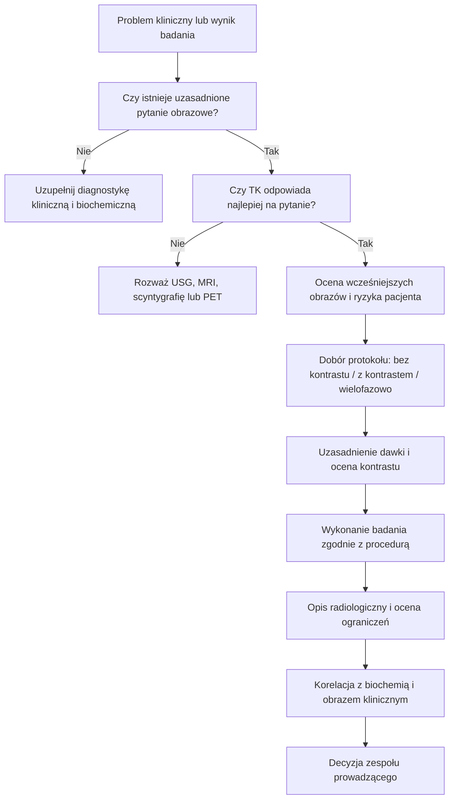

# 5.4. Tomografia komputerowa (TK) w endokrynologii

## Informacje o rozdziale

**Moduł:** 5. Diagnostyka obrazowa w endokrynologii  
**Poziom:** kształcenie zawodowe, medyczne i podyplomowe; zakres wykonywania, opisywania i interpretowania badań zależy od kwalifikacji uczestnika  
**Charakter materiału:** dydaktyczny, interdyscyplinarny, oparty na medycynie opartej na dowodach i zasadzie proporcjonalności diagnostycznej  
**Stan przeglądu piśmiennictwa:** 27 listopada 2026 r.

> **Zastrzeżenie kliniczne i kompetencyjne.** Tomografia komputerowa jest badaniem wykorzystującym promieniowanie jonizujące, a w wielu protokołach również dożylny środek kontrastowy. Rozdział służy zrozumieniu wskazań, możliwości, ograniczeń, zasad bezpieczeństwa i sposobu współpracy z pracownią radiologiczną. Nie upoważnia do samodzielnego zlecania lub wykonywania TK, podawania kontrastu, opisywania obrazów, rozpoznawania nowotworów ani podejmowania decyzji terapeutycznych poza zakresem kwalifikacji zawodowych. Protokół badania ustala lekarz radiolog we współpracy z lekarzem kierującym, uwzględniając pytanie kliniczne, wcześniejsze badania, stan pacjenta, funkcję nerek, ciążę, ekspozycję na jod i lokalne procedury. Wynik obrazowy nie zastępuje diagnostyki hormonalnej ani oceny klinicznej.

## 1. Cele i efekty uczenia się

### 1.1. Cel główny

Celem rozdziału jest przygotowanie uczestnika do rozumienia zastosowania tomografii komputerowej w diagnostyce chorób gruczołów dokrewnych, ze szczególnym uwzględnieniem zmian nadnerczy, okolicy siodła tureckiego, tarczycy i przytarczyc, guzów ektopowo wydzielających hormony oraz nowotworów endokrynnych. Uczestnik ma umieć odróżnić obrazowanie anatomiczne od rozpoznania czynności hormonalnej, rozumieć znaczenie faz badania i pomiarów gęstości w jednostkach Hounsfielda, a także wskazać główne zagrożenia związane z promieniowaniem i kontrastem jodowym.

### 1.2. Szczegółowe efekty uczenia się

Po ukończeniu rozdziału uczestnik powinien:

1. Wyjaśnić zasadę rekonstrukcji obrazu TK, znaczenie jednostek Hounsfielda, grubości warstwy, okna obrazowania i artefaktów.
2. Rozróżnić TK bez kontrastu, TK po kontraście, badanie wielofazowe i protokół ukierunkowany na konkretny narząd.
3. Omówić rolę niekontrastowej TK nadnerczy w ocenie gęstości, jednorodności, rozmiaru i cech podejrzanych.
4. Objaśnić wzory obliczania bezwzględnego i względnego wypłukiwania kontrastu oraz ograniczenia klasycznych progów.
5. Wyjaśnić, dlaczego zmiana o jednorodnej strukturze i gęstości nieprzekraczającej 10 HU w TK bez kontrastu ma zwykle cechy łagodnego gruczolaka, a niejednoznaczne zmiany wymagają indywidualnej oceny.
6. Wskazać, kiedy TK może być pomocna w diagnostyce przysadki, a kiedy preferowany jest rezonans magnetyczny.
7. Omówić wskazania do TK szyi i śródpiersia w chorobach tarczycy i przytarczyc.
8. Rozumieć zastosowanie TK wielofazowej w lokalizacji guzów neuroendokrynnych i ektopowego źródła wydzielania ACTH.
9. Wskazać rolę TK w ocenie zaawansowania raka tarczycy, raka kory nadnerczy i wybranych nowotworów neuroendokrynnych.
10. Ocenić podstawowe czynniki ryzyka związane z promieniowaniem, kontrastem jodowym, funkcją nerek, ciążą i wcześniejszą reakcją na kontrast.
11. Przygotować kompletne skierowanie zawierające pytanie kliniczne i istotne dane, bez narzucania pracowni nieuzasadnionego protokołu.
12. Rozpoznać sytuacje wymagające pilnej konsultacji lub przekazania wyniku lekarzowi prowadzącemu.

### 1.3. Zakładane kompetencje

Wiedza o TK nie jest równoznaczna z kompetencją do samodzielnego wykonywania badania. Uczestnik powinien umieć:
- wyjaśnić pacjentowi cel badania i typowe etapy przygotowania w granicach swojej roli;
- zebrać informacje o wcześniejszych reakcjach na środki kontrastowe, chorobach nerek, ciąży i istotnych lekach;
- rozpoznać braki w skierowaniu i skierować je do uzupełnienia;
- zrozumieć opis radiologiczny i zestawić go z danymi klinicznymi;
- nie utożsamiać przypadkowego znaleziska z rozpoznaniem choroby;
- przekazać niepokojące objawy lub pilny wynik właściwemu lekarzowi.

## 2. Miejsce TK w diagnostyce endokrynologicznej

### 2.1. Obrazowanie anatomiczne a czynność hormonalna

TK przedstawia przede wszystkim anatomię, gęstość tkanek, ich wzmocnienie po podaniu kontrastu, relacje przestrzenne i cechy naciekania. Nie mierzy bezpośrednio wydzielania kortyzolu, aldosteronu, katecholamin, hormonów tarczycy, parathormonu ani ACTH. Guz może być hormonalnie nieczynny, mimo wyraźnego obrazu w TK; z kolei zaburzenie hormonalne może występować bez widocznej zmiany strukturalnej.

Dlatego proces diagnostyczny powinien przebiegać w logicznej kolejności:
1. sformułowanie problemu klinicznego na podstawie wywiadu, badania i badań biochemicznych;
2. określenie, czy potrzebna jest lokalizacja anatomiczna, ocena rozległości, różnicowanie zmiany czy kontrola leczenia;
3. wybór metody i protokołu odpowiadających na konkretne pytanie;
4. interpretacja obrazu w zestawieniu z wynikami hormonalnymi i prawdopodobieństwem przedtestowym;
5. ustalenie dalszego postępowania przez właściwy zespół kliniczny.

### 2.2. Kiedy TK jest szczególnie przydatna

TK może być użyteczna, gdy:
- potrzebna jest ocena nadnerczy w badaniu bez kontrastu, w tym pomiar HU;
- należy określić relacje guza do naczyń, narządów sąsiednich, dróg oddechowych lub przewodu pokarmowego;
- podejrzewa się guz ektopowo wydzielający hormon, zwłaszcza w klatce piersiowej, jamie brzusznej lub miednicy;
- trzeba ocenić rozległość nowotworu, węzły chłonne, przerzuty lub powikłania;
- USG jest ograniczone przez położenie zmiany, gaz jelitowy, budowę ciała lub głębokość anatomiczną;
- MRI jest przeciwwskazane, niedostępne albo nie odpowiada wystarczająco szybko na pilne pytanie kliniczne;
- potrzebne jest planowanie zabiegu lub procedury interwencyjnej.

### 2.3. Kiedy TK nie jest badaniem pierwszego wyboru

TK zwykle nie jest pierwszym badaniem:
- w rutynowej ocenie guzków tarczycy, dla której podstawą pozostaje USG;
- w szczegółowej ocenie mikrogruczolaków przysadki, gdy dostępne jest MRI z protokołem przysadkowym;
- w rozpoznawaniu czynności hormonalnej guza;
- w przesiewowym poszukiwaniu guza bez uprzedniego uzasadnienia biochemicznego;
- do rutynowego monitorowania stabilnej zmiany łagodnej, gdy nie ma wskazań do dalszego obrazowania;
- do oceny gęstości mineralnej kości, która wymaga odrębnych metod, np. DXA.

### 2.4. Dobór badania do pytania klinicznego

| Pytanie kliniczne | Możliwa rola TK | Metoda często preferowana lub uzupełniająca |
|---|---|---|
| Czy zmiana nadnercza ma cechy lipidowego gruczolaka? | TK bez kontrastu, pomiar HU i ocena jednorodności | MRI z przesunięciem chemicznym lub badanie uzupełniające w zmianie niejednoznacznej |
| Czy guz nadnercza nacieka sąsiednie struktury? | TK z kontrastem, ocena naczyń i narządów | MRI w wybranych przypadkach; ocena wielodyscyplinarna |
| Czy istnieje guz przysadki? | TK w sytuacji ograniczonej dostępności MRI, pilnych wskazań lub oceny kości/zwapnień | MRI przysadki z cienkimi warstwami i odpowiednim protokołem |
| Czy wole schodzi do śródpiersia? | TK szyi i klatki piersiowej, często z kontrastem | USG szyi jako badanie uzupełniające |
| Czy rak tarczycy nacieka tchawicę lub śródpiersie? | TK szyi i śródpiersia z kontrastem | USG, MRI, endoskopia według wskazań |
| Gdzie znajduje się przytarczyca przed reoperacją? | 4D-TK w wybranych przypadkach | USG, scyntygrafia/SPECT-CT, MRI |
| Gdzie znajduje się ektopowe źródło ACTH? | TK klatki piersiowej, a następnie odpowiednio dobrana TK jamy brzusznej i miednicy | MRI, PET/CT z analogiem somatostatyny lub FDG według biologii guza |
| Jak ocenić raka kory nadnerczy? | TK klatki piersiowej, jamy brzusznej i miednicy z kontrastem | MRI, FDG-PET/CT w wybranych wskazaniach |

## 3. Podstawy techniczne tomografii komputerowej

### 3.1. Zasada powstawania obrazu

W tomografii komputerowej lampa rentgenowska obraca się wokół pacjenta, a detektory rejestrują osłabienie promieniowania po przejściu przez tkanki. Dane są przetwarzane komputerowo i rekonstruowane w postaci przekrojów, a następnie mogą być przedstawiane jako obrazy wielopłaszczyznowe lub trójwymiarowe.

Wartość osłabienia promieniowania zależy m.in. od gęstości i składu tkanki, energii wiązki oraz parametrów akwizycji. Obraz TK nie jest bezpośrednią fotografią narządu; stanowi rekonstrukcję matematyczną opartą na pomiarach.

### 3.2. Jednostki Hounsfielda (HU)

Skala Hounsfielda opisuje względne osłabienie promieniowania w odniesieniu do wody i powietrza. W przybliżeniu:
- powietrze: około −1000 HU;
- tłuszcz: wartości ujemne, zwykle około −100 do −30 HU;
- woda: około 0 HU;
- tkanki miękkie: wartości dodatnie, zależne od rodzaju tkanki;
- zwapnienia i kość: wysokie wartości dodatnie.

W praktyce endokrynologicznej HU mają szczególne znaczenie w ocenie zmian nadnerczy. Pomiar wykonuje się na obrazie bez kontrastu, w obszarze zainteresowania (ROI), który powinien obejmować reprezentatywną część zmiany, z pominięciem brzegów, naczyń, zwapnień, obszarów martwicy i artefaktów. Pomiar zbyt małego ROI może być obciążony błędem częściowej objętości.

### 3.3. Grubość warstwy i rekonstrukcje

Cieńsze warstwy zwiększają możliwość wykrywania małych struktur i rekonstrukcji wielopłaszczyznowych, ale mogą zwiększać szum. Grubsze warstwy ułatwiają ocenę ogólnej anatomii, lecz mogą ukrywać drobne zmiany. Właściwy dobór zależy od narządu, pytania klinicznego i protokołu.

Rekonstrukcje osiowe, czołowe i strzałkowe pomagają ocenić:
- przebieg naczyń;
- relację guza do narządów sąsiednich;
- szerzenie się zmiany wzdłuż powięzi i przestrzeni anatomicznych;
- położenie węzłów chłonnych;
- zasięg wola zamostkowego;
- naciekanie struktur klatki piersiowej lub jamy brzusznej.

### 3.4. Okna obrazowania

Okno tkanek miękkich służy ocenie narządów, węzłów, guzów i naczyń. Okno płucne pomaga ocenić miąższ płuc, a okno kostne – kość, zwapnienia i przebudowę struktur kostnych. Jedna seria obrazów może być rekonstruowana w kilku oknach, bez konieczności ponownego napromieniania pacjenta.

### 3.5. Artefakty i błędy pomiarowe

| Artefakt lub problem | Możliwy skutek | Znaczenie praktyczne |
|---|---|---|
| Ruch oddechowy | rozmycie brzegów i pozorna zmiana kształtu | szczególnie istotny w nadnerczach i małych guzach |
| Artefakt utwardzania wiązki | smugi i zniekształcenie gęstości | może utrudniać ocenę szyi, barków i struktur przy metalach |
| Częściowa objętość | nieprawidłowa wartość HU małej zmiany | ryzyko błędnej klasyfikacji małego guzka |
| Metalowe implanty | smugi i utrata szczegółów | może ograniczyć ocenę pooperacyjną |
| Niewłaściwe ROI | zaniżony lub zawyżony pomiar HU | nie należy włączać tłuszczu okołoguzowego, naczyń ani martwicy |
| Niewłaściwa faza kontrastowa | nieporównywalne wzmocnienie | ogranicza ocenę wypłukiwania lub unaczynienia |
| Różne aparaty i protokoły | różnice w HU i obrazie | porównania seryjne powinny uwzględniać technikę badania |

## 4. Rodzaje protokołów TK

### 4.1. TK bez dożylnego środka kontrastowego

Badanie bez kontrastu jest kluczowe dla pomiaru natywnej gęstości nadnerczy. Umożliwia również ocenę zwapnień, krwiaka, zawartości tłuszczu i części cech strukturalnych. W wybranych sytuacjach wystarcza do rozstrzygnięcia, że jednorodna zmiana nadnercza ma typowe cechy łagodnego gruczolaka.

### 4.2. TK po dożylnym podaniu kontrastu

Jodowy środek kontrastowy zwiększa różnicowanie struktur naczyniowych i unaczynionych. Ułatwia ocenę:
- relacji guza do naczyń;
- wzmocnienia guza i jego części litych;
- naciekania sąsiednich narządów;
- przerzutów w wątrobie;
- węzłów chłonnych;
- zmian w śródpiersiu;
- przebiegu naczyń przed zabiegiem.

Wzmocnienie po kontraście nie jest samo w sobie dowodem złośliwości. Wiele zmian łagodnych, w tym guzy chromochłonne i niektóre gruczolaki, może intensywnie się wzmacniać.

### 4.3. Badanie wielofazowe

Badanie wielofazowe obejmuje akwizycję w różnych momentach po podaniu kontrastu. W zależności od pytania klinicznego mogą być wykonywane:
- faza bez kontrastu;
- faza tętnicza lub późna tętnicza;
- faza wrotna/żylna;
- faza opóźniona.

Nie należy automatycznie wykonywać wszystkich faz. Każda dodatkowa akwizycja zwiększa dawkę promieniowania. Protokół powinien zawierać tylko fazy niezbędne do odpowiedzi na pytanie kliniczne.

### 4.4. Faza tętnicza, wrotna i opóźniona

Faza tętnicza jest przydatna w ocenie zmian silnie unaczynionych, niektórych guzów neuroendokrynnych trzustki, przyzwojaków i guzów wątroby. Faza wrotna umożliwia ocenę narządów jamy brzusznej, węzłów i wielu przerzutów. Faza opóźniona może służyć do oceny wypłukiwania kontrastu w zmianach nadnerczy lub do określonych analiz naczyniowych.

Dokładne czasy zależą od aparatu, szybkości podania kontrastu, objętości, masy ciała, krążenia pacjenta i celu badania. Nie wolno przenosić jednego schematu czasowego do każdego ośrodka bez walidacji.

## 5. TK nadnerczy – znaczenie kliniczne i wskazania

### 5.1. Najczęstsze pytania diagnostyczne

TK nadnerczy może pomóc odpowiedzieć na pytania:
- Czy zmiana ma cechy typowego gruczolaka bogatego w lipidy?
- Czy jest jednorodna, czy zawiera martwicę, krwotok, zwapnienia lub obszary tłuszczowe?
- Jakie są jej wymiary i położenie?
- Czy nacieka sąsiednie struktury lub naczynia?
- Czy występują zmiany obustronne?
- Czy obraz jest zgodny z przerzutem, guzem chromochłonnym, rakiem kory nadnercza, myelolipoma lub torbielą?
- Czy badanie wymaga dalszej charakterystyki lub oceny wielodyscyplinarnej?

### 5.2. Incydentaloma nadnercza

Incydentaloma nadnercza to zmiana wykryta przypadkowo podczas obrazowania wykonywanego z innego powodu niż podejrzenie choroby nadnerczy. Samo wykrycie guza nie oznacza, że jest on hormonalnie czynny ani złośliwy.

Ocena obejmuje dwa odrębne tory:
1. **Ocena hormonalna** – ustalenie, czy zmiana wydziela nadmierne ilości hormonów.
2. **Ocena obrazowa** – określenie prawdopodobieństwa łagodności lub złośliwości.

Obie oceny są konieczne, ponieważ obraz łagodny nie wyklucza autonomicznego wydzielania kortyzolu, a obraz niejednoznaczny nie przesądza o czynności hormonalnej.

### 5.3. Jednorodność i gęstość w TK bez kontrastu

Jednorodna zmiana nadnercza o gęstości ≤10 HU w TK bez kontrastu ma cechy typowe dla bogatego w lipidy gruczolaka. Wytyczne ESE/ENSAT z 2023 r. wskazują, że przy jednoznacznie jednorodnym obrazie i HU ≤10 dodatkowe obrazowanie nie jest konieczne, niezależnie od rozmiaru zmiany, jeśli nie ma innych szczególnych okoliczności klinicznych.

Wartość ≤10 HU nie może być stosowana mechanicznie do:
- zmiany niejednorodnej;
- pomiaru wykonanego po kontraście;
- obszaru martwicy lub krwotoku;
- zmiany z dużą ilością zwapnień;
- bardzo małej zmiany, w której występuje istotny efekt częściowej objętości;
- pacjenta z wywiadem nowotworu pozanadnerczowego bez uwzględnienia całego kontekstu.

### 5.4. Znaczenie rozmiaru i cech morfologicznych

Rozmiar pozostaje ważnym elementem oceny, ale nie jest samodzielnym kryterium rozpoznania. Należy opisać:
- maksymalny wymiar w trzech płaszczyznach;
- kształt i granice;
- jednorodność;
- gęstość w HU na obrazie bez kontrastu;
- obecność tłuszczu, zwapnień, krwotoku lub martwicy;
- relację do żyły głównej dolnej, żył nerkowych, aorty, nerki, wątroby i przepony;
- ewentualne naciekanie lub zakrzep nowotworowy;
- obecność zmian w drugim nadnerczu i poza nadnerczami.

Zmiany o średnicy ≥4 cm, niejednorodne lub o gęstości >20 HU wymagają szczególnej uwagi. W wytycznych ESE/ENSAT zmiana ≥4 cm, niejednorodna lub o HU >20 jest kategorią, w której ryzyko złośliwości jest istotniejsze i zwykle należy rozważyć postępowanie operacyjne po omówieniu w zespole wielodyscyplinarnym. Nie oznacza to, że każda taka zmiana jest rakiem; decyzja zależy od wieku, stanu pacjenta, czynności hormonalnej, obrazu, dynamiki i możliwości leczenia.

### 5.5. Przykładowa klasyfikacja obrazu według ESE/ENSAT 2023

| Obraz w TK bez kontrastu | Ogólna interpretacja | Typowy kierunek dalszego postępowania |
|---|---|---|
| Jednorodna zmiana, HU ≤10 | obraz typowy dla łagodnego gruczolaka | zwykle bez dalszego obrazowania; nadal ocena hormonalna według wskazań |
| Jednorodna zmiana, HU 11–20, <4 cm | zmiana niejednoznaczna, ale często łagodna | dodatkowe obrazowanie od razu lub kontrola w określonym odstępie, zależnie od kontekstu |
| Jednorodna zmiana, HU >20, <4 cm | niejednoznaczna; wymaga indywidualizacji | omówienie wielodyscyplinarne i dodatkowa charakterystyka |
| Zmiana niejednorodna, <4 cm | niejednoznaczna | ocena ekspercka; nie stosować automatycznie washout do heterogennej masy |
| Zmiana ≥4 cm i niejednorodna lub HU >20 | większe ryzyko złośliwości | pilna ocena wielodyscyplinarna, zwykle rozważenie leczenia operacyjnego |

Tabela przedstawia uproszczony schemat edukacyjny, a nie algorytm zastępujący pełne wytyczne. Wymiary, jednorodność, HU i kontekst kliniczny należy oceniać łącznie.

### 5.6. Różnicowanie wybranych zmian nadnerczy

| Zmiana | Możliwe cechy TK | Ważne ograniczenia |
|---|---|---|
| Gruczolak bogaty w lipidy | jednorodny, HU ≤10 bez kontrastu | nie rozstrzyga o autonomicznym wydzielaniu hormonów |
| Gruczolak ubogi w lipidy | HU >10; może wykazywać wypłukiwanie kontrastu | washout ma ograniczoną swoistość |
| Myelolipoma | widoczne obszary makroskopowego tłuszczu o ujemnych HU | należy ocenić rozmiar, objawy i ewentualne krwawienie |
| Guz chromochłonny | często >10 HU, niejednorodny, intensywnie wzmacniający się, czasem torbielowaty | może wykazywać szybkie wypłukiwanie i naśladować gruczolaka |
| Rak kory nadnercza | duży, niejednorodny, martwica, krwotok, nieregularne granice, naciekanie | obraz nie zastępuje oceny histopatologicznej i hormonalnej |
| Przerzut | często >10 HU, niejednorodny lub obustronny; wzmocnienie zmienne | w wywiadzie nowotworowym interpretacja musi uwzględniać typ guza pierwotnego |
| Torbiel | zwykle jednorodna, płynowa gęstość, cienka ściana | gęstość może wzrosnąć przy krwawieniu lub zakażeniu |
| Krwiak | gęstość może być wysoka w fazie ostrej, zmienia się w czasie | należy uwzględnić uraz, leczenie przeciwkrzepliwe i stan kliniczny |

## 6. TK z oceną wypłukiwania kontrastu

### 6.1. Mechanizm wypłukiwania

Gruczolaki nadnerczy często szybko gromadzą jodowy środek kontrastowy i stosunkowo szybko go wypłukują. Niektóre zmiany złośliwe lub inne guzy mogą wykazywać wolniejsze wypłukiwanie. Różnica ta może wspierać charakterystykę zmiany, lecz nie jest bezwzględnym testem histologicznym.

Dedykowany protokół może obejmować:
1. pomiar gęstości bez kontrastu;
2. pomiar po podaniu kontrastu w określonej fazie, często około 60 sekund;
3. pomiar w fazie opóźnionej, często po 10–15 minutach.

Czasy są zależne od protokołu. Porównanie jest wiarygodne tylko wtedy, gdy fazy zostały wykonane i opisane zgodnie z ustalonym standardem.

### 6.2. Wzory

**Bezwzględne wypłukiwanie kontrastu (APW – absolute percentage washout):**

\[
APW = 100 \times \frac{HU_{kontrast} - HU_{opóźnione}}{HU_{kontrast} - HU_{bez\ kontrastu}}
\]

**Względne wypłukiwanie kontrastu (RPW – relative percentage washout):**

\[
RPW = 100 \times \frac{HU_{kontrast} - HU_{opóźnione}}{HU_{kontrast}}
\]

W klasycznych protokołach często przywołuje się wartości APW >60% i RPW >40% jako cechy wspierające rozpoznanie gruczolaka. Nie są to jednak progi, które samodzielnie i bez kontekstu wykluczają złośliwość. Różne protokoły, czasy opóźnienia, technika pomiaru, wielkość zmiany i rodzaj guza wpływają na wynik.

### 6.3. Przykład obliczenia

Załóżmy, że w jednorodnej zmianie uzyskano:
- 18 HU bez kontrastu;
- 92 HU po kontraście;
- 42 HU w fazie opóźnionej.

APW:

\[
100 \times \frac{92-42}{92-18}
=100 \times \frac{50}{74}
\approx 67{,}6\%
\]

RPW:

\[
100 \times \frac{92-42}{92}
=100 \times \frac{50}{92}
\approx 54{,}3\%
\]

Wyniki przekraczają klasyczne progi, co może wspierać rozpoznanie gruczolaka. Nie wolno jednak formułować wniosku „na pewno łagodny” wyłącznie na tej podstawie. Należy uwzględnić jednorodność, wyjściowe HU, morfologię, historię nowotworową, wyniki hormonalne i ograniczenia metody.

### 6.4. Pułapki interpretacyjne

- Guz chromochłonny może wykazywać szybkie wypłukiwanie i spełniać historyczne progi dla gruczolaka.
- Niektóre przerzuty mogą mieć cechy pozornie łagodne.
- W zmianie niejednorodnej pomiar w jednym ROI może nie reprezentować całej masy.
- Zbyt mały ROI zwiększa błąd pomiaru.
- Różne czasy fazy opóźnionej utrudniają porównywanie wyników.
- Brak fazy bez kontrastu uniemożliwia wiarygodne obliczenie APW.
- Nie należy wykonywać badania wielofazowego tylko po to, aby uzyskać liczbę, jeśli wynik nie zmieni postępowania.
- Dodatkowe fazy zwiększają dawkę promieniowania i obciążenie pacjenta.

### 6.5. Czy washout rozstrzyga o łagodności?

Nie. Wypłukiwanie jest jednym z elementów charakterystyki. Wytyczne ESE/ENSAT z 2023 r. podkreślają znaczenie TK bez kontrastu i jednorodności zmiany. W zmianach o jednorodnym obrazie i HU ≤10 dodatkowe obrazowanie zwykle nie jest potrzebne. W pozostałych przypadkach dobór dodatkowej metody powinien być indywidualny. Washout może być rozważony w wybranych sytuacjach, ale nie powinien być traktowany jako uniwersalny test wykluczający raka lub guz chromochłonny.

## 7. Bezpieczeństwo w diagnostyce guzów chromochłonnych

### 7.1. Najpierw biochemia, potem lokalizacja

W przypadku podejrzenia guza chromochłonnego lub przyzwojaka podstawą rozpoznania jest odpowiednia diagnostyka biochemiczna, najczęściej oznaczenie wolnych metanefryn w osoczu lub frakcjonowanych metanefryn w moczu. Obrazowanie powinno być wykonywane po uzasadnieniu biochemicznym lub w szczególnych sytuacjach klinicznych ustalonych przez specjalistę.

TK z kontrastem może być bardzo przydatna do lokalizacji guza w klatce piersiowej, jamie brzusznej i miednicy. Nie należy jednak utożsamiać intensywnego wzmocnienia z rozpoznaniem. Guz chromochłonny może mieć obraz lity, torbielowaty, krwotoczny lub niejednorodny.

### 7.2. Ważne ostrzeżenia

1. Nie wykonuje się biopsji nadnercza bez wykluczenia guza chromochłonnego, ponieważ manipulacja przy guzie może wywołać ciężki przełom katecholaminowy.
2. Nie wolno rozpoznawać guza chromochłonnego wyłącznie na podstawie HU, wzmocnienia lub washout.
3. W przypadku zmiany niejednoznacznej, szczególnie przed biopsją lub operacją, należy wykluczyć wydzielanie katecholamin zgodnie z zaleceniami specjalisty.
4. U pacjenta z napadowym nadciśnieniem, bólem głowy, kołataniem serca, potliwością, bladością lub niewyjaśnioną kardiomiopatią należy uwzględnić możliwość PPGL.
5. Wybór kontrastu i przygotowanie pacjenta powinny być uzgodnione z radiologiem i lekarzem prowadzącym. Nie należy samodzielnie wprowadzać blokady adrenergicznej ani modyfikować leczenia.

### 7.3. TK w przyzwojakach pozanadnerczowych

Przyzwojaki mogą występować w obrębie głowy i szyi, śródpiersia, przestrzeni zaotrzewnowej i miednicy. TK dobrze obrazuje anatomię, zwapnienia, kości i relacje do naczyń, lecz MRI i obrazowanie receptorowe mogą być lepsze w wybranych lokalizacjach lub przy podejrzeniu choroby wieloogniskowej i przerzutowej. Dobór metody powinien uwzględniać lokalizację, genotyp, wydzielanie i plan leczenia.

## 8. TK przysadki i okolicy siodła tureckiego

### 8.1. Dlaczego MRI jest zwykle preferowane

MRI zapewnia lepszy kontrast tkanek miękkich i większą zdolność rozróżniania drobnych struktur przysadki, szypuły, skrzyżowania wzrokowego, zatok jamistych i podwzgórza. W diagnostyce mikrogruczolaków oraz ocenie relacji guza do struktur nerwowych MRI z cienkimi warstwami i protokołem przysadkowym jest zwykle metodą z wyboru.

Rutynowa TK nie jest zalecana do szczegółowej oceny gruczolaków przysadki, gdy dostępne jest odpowiednie MRI. Wykrycie zmiany siodła w TK wykonanej z innego powodu powinno zwykle prowadzić do oceny kliniczno-hormonalnej i rozważenia dedykowanego MRI.

### 8.2. Kiedy TK może być przydatna

TK może mieć rolę:
- gdy MRI jest przeciwwskazane lub niedostępne;
- w pilnej ocenie wybranych stanów neurologicznych, gdy TK jest najszybciej dostępną metodą;
- w ocenie zwapnień, przebudowy kości, poszerzenia siodła i zmian kostnych;
- w ocenie anatomii przedoperacyjnej lub pooperacyjnej, jeśli istnieje konkretne pytanie;
- jako element badania wielonarządowego, gdy zmiana została wykryta przypadkowo.

TK nie powinna być przedstawiana jako równoważna MRI w wykrywaniu mikrogruczolaków. Ujemna TK nie wyklucza małej zmiany przysadki.

### 8.3. Apopleksja przysadki

Apopleksja przysadki jest stanem nagłym związanym z krwotokiem lub zawałem w obrębie przysadki, często w guzie. Może objawiać się nagłym, silnym bólem głowy, zaburzeniami widzenia, oftalmoplegią, wymiotami, zaburzeniami świadomości i ostrą niewydolnością przysadkowo-nadnerczową.

TK głowy może być wykonana w trybie pilnym, szczególnie w różnicowaniu krwawienia śródczaszkowego, ale MRI zwykle lepiej charakteryzuje zmianę przysadkową. Ujemna TK nie wyklucza apopleksji. Podejrzenie wymaga natychmiastowej oceny lekarskiej, pilnej diagnostyki hormonalnej i elektrolitowej oraz konsultacji endokrynologicznej, okulistycznej i neurochirurgicznej według stanu pacjenta. Nie wolno opóźniać stabilizacji chorego w oczekiwaniu na pełne obrazowanie.

### 8.4. Incydentaloma siodła tureckiego

Przypadkowe wykrycie zmiany w okolicy przysadki wymaga ustalenia:
- czy zmiana rzeczywiście pochodzi z przysadki;
- czy uciska skrzyżowanie wzrokowe lub inne struktury;
- czy występują objawy neurologiczne lub okulistyczne;
- czy występuje nadmierne wydzielanie hormonów lub niedoczynność przysadki;
- czy potrzebne jest dedykowane MRI;
- czy konieczna jest konsultacja w ośrodku zajmującym się chorobami przysadki.

Wytyczne i konsensus Pituitary Society z 2025 r. podkreślają indywidualizację postępowania i brak roli rutynowej TK w charakterystyce typowego incidentaloma przysadki, jeśli MRI może dostarczyć lepszych informacji.

## 9. TK szyi i śródpiersia w chorobach tarczycy

### 9.1. Wole zamostkowe i śródpiersiowe

TK szyi i klatki piersiowej jest przydatna, gdy tarczyca schodzi poniżej wcięcia mostka, gdy dolna granica wola jest niewidoczna w USG lub gdy występują objawy ucisku. Może określić:
- zakres wola w śródpiersiu;
- przemieszczenie lub zwężenie tchawicy;
- ucisk przełyku;
- relację do dużych naczyń;
- obecność ektopowej tkanki tarczycowej;
- położenie węzłów chłonnych;
- stopień zwężenia dróg oddechowych.

W badaniu z kontrastem można lepiej ocenić naczynia i relacje guza do struktur śródpiersia. Protokół powinien być uzgodniony z radiologiem, szczególnie gdy pacjent ma objawy duszności lub ucisku.

### 9.2. Rak tarczycy i miejscowe zaawansowanie

W raku zróżnicowanym tarczycy podstawowym badaniem przedoperacyjnym szyi pozostaje USG. TK lub MRI szyi i śródpiersia z kontrastem jest wskazana jako uzupełnienie, gdy istnieje podejrzenie choroby zaawansowanej lub naciekającej, np.:
- masywnych lub rozległych przerzutów węzłowych;
- naciekania tchawicy, krtani, przełyku lub dużych naczyń;
- szerzenia się guza do śródpiersia;
- rozległej choroby nawrotowej, której granic nie można ocenić w USG;
- wysokiego stężenia tyreoglobuliny lub narastających przeciwciał anty-TG przy ujemnym USG, jeśli dalsze obrazowanie może zmienić postępowanie.

Wytyczne ATA 2025 zalecają obrazowanie przekrojowe szyi i śródpiersia z kontrastem w przypadku klinicznego podejrzenia choroby zaawansowanej lub naciekającej, jako uzupełnienie badania fizykalnego i USG. Rutynowe PET/CT przed operacją nie jest zalecane u wszystkich pacjentów.

### 9.3. Wpływ kontrastu jodowego na diagnostykę i leczenie radiojodem

Jodowy środek kontrastowy zwiększa zasób jodu w organizmie. Może to przejściowo wpływać na wychwyt radiojodu i interpretację niektórych badań. Według aktualnych wytycznych ATA 2025 u większości pacjentów jod po dożylnym kontraście jest usuwany w ciągu około 4–6 tygodni; obawa o klinicznie istotne opóźnienie leczenia radiojodem nie powinna automatycznie prowadzić do rezygnacji z potrzebnego obrazowania przekrojowego. Jeśli istnieje konkretna wątpliwość dotycząca eliminacji jodu, lekarz może rozważyć oznaczenie jodu w moczu i ustalić termin dalszej procedury.

Nie należy samodzielnie odraczać TK ani leczenia radiojodem. Korzyści i ryzyka powinny być ocenione przez zespół prowadzący.

## 10. TK przytarczyc i lokalizacja ektopowych gruczołów

### 10.1. Rozpoznanie biochemiczne a lokalizacja przedoperacyjna

Rozpoznanie pierwotnej nadczynności przytarczyc jest przede wszystkim rozpoznaniem biochemicznym, opartym na odpowiednio interpretowanym stężeniu wapnia i PTH oraz wykluczeniu przyczyn wtórnych i rodzinnych. Badania obrazowe nie służą do potwierdzania nadczynności przytarczyc. Ich rolą jest lokalizacja nieprawidłowego gruczołu przed planowanym zabiegiem.

USG szyi i scyntygrafia z sestamibi/SPECT-CT są często stosowanymi metodami lokalizacyjnymi. 4D-TK może być przydatna, gdy badania pierwszego wyboru są ujemne, niejednoznaczne lub rozbieżne, w chorobie nawrotowej, w reoperacji albo przy podejrzeniu ektopowej lokalizacji.

### 10.2. Na czym polega 4D-TK

Określenie „czterowymiarowa” odnosi się do obrazowania anatomicznego w trzech wymiarach i zmian wzmocnienia w czasie. W praktyce stosuje się sekwencje w różnych fazach po podaniu kontrastu, najczęściej obejmujące fazę bez kontrastu oraz jedną lub więcej faz po kontraście. Gruczoł przytarczyczny może wykazywać charakterystyczny wzorzec wzmocnienia, często silniejsze wzmocnienie tętnicze i względne wypłukiwanie w późniejszych fazach.

Protokół różni się między ośrodkami. Nie ma jednego uniwersalnego schematu, który można bezrefleksyjnie przenieść do każdej pracowni. Wariant z wieloma fazami zwiększa dawkę promieniowania, dlatego należy dążyć do minimalnej liczby faz niezbędnych do odpowiedzi na pytanie.

### 10.3. Ograniczenia 4D-TK

- węzły chłonne, guzki tarczycy i naczynia mogą naśladować gruczoł przytarczyczny;
- małe lub ektopowe gruczoły mogą pozostać niewidoczne;
- wyniki zależą od doświadczenia radiologa i jakości protokołu;
- przebyte operacje zmieniają anatomię;
- promieniowanie jest istotnym elementem bilansu korzyści i ryzyka;
- wynik ujemny nie wyklucza nadczynności przytarczyc;
- obrazowanie nie powinno decydować o operacji bez rozpoznania biochemicznego i oceny klinicznej.

### 10.4. Lokalizacje ektopowe

Gruczoły przytarczyczne mogą znajdować się w śródpiersiu, wzdłuż drogi migracji embrionalnej, w obrębie grasicy, przy osłonce naczyń lub w innych nietypowych miejscach. TK może przedstawić relacje do dużych naczyń, tchawicy, przełyku i grasicy, co ma znaczenie dla planowania zabiegu. W przypadku zmiany śródpiersiowej należy różnicować przytarczycę z węzłem chłonnym, guzem neurogennym, zmianą grasicy i innymi strukturami.

## 11. TK klatki piersiowej, jamy brzusznej i miednicy w poszukiwaniu guzów ektopowych

### 11.1. Zasada postępowania

Poszukiwanie guza ektopowo wydzielającego hormon powinno wynikać z potwierdzonego biochemicznie zespołu hormonalnego. Obrazowanie wykonywane bez odpowiedniego uzasadnienia może prowadzić do wykrycia przypadkowych zmian, które nie są źródłem zaburzenia.

Przykłady:
- zespół ektopowego wydzielania ACTH – guzy neuroendokrynne oskrzela, grasicy, trzustki i inne rzadziej spotykane nowotwory;
- guzy wydzielające katecholaminy – przyzwojaki w różnych lokalizacjach;
- guzy neuroendokrynne przewodu pokarmowego i trzustki – lokalizacja guza pierwotnego i przerzutów;
- rzadkie zespoły hormonalne związane z nowotworami płuc, wątroby, nerek lub innych narządów.

### 11.2. Podejrzenie ektopowego wydzielania ACTH

Po potwierdzeniu hiperkortyzolizmu i ustaleniu zależności od ACTH, gdy wyniki wskazują na możliwość źródła ektopowego, TK klatki piersiowej z kontrastem jest często jednym z pierwszych badań lokalizacyjnych. Należy zwrócić uwagę na:
- małe guzki oskrzelowe;
- guzy grasicy;
- zmiany w śródpiersiu;
- masy płucne;
- węzły chłonne;
- przerzuty.

Jeżeli TK klatki piersiowej jest ujemna, a podejrzenie utrzymuje się, dalsze obrazowanie jamy brzusznej i miednicy, MRI lub PET/CT z analogiem somatostatyny może być rozważone przez zespół specjalistyczny. Małe guzy mogą być niewidoczne w TK, a znalezienie przypadkowej zmiany nie dowodzi, że jest ona źródłem ACTH.

### 11.3. Wielofazowa TK w guzach neuroendokrynnych

Niektóre dobrze zróżnicowane guzy neuroendokrynne są silnie unaczynione. Faza tętnicza może zwiększyć ich widoczność, zwłaszcza w trzustce i wątrobie. Faza wrotna pomaga w ocenie narządów i przerzutów. Wybór faz zależy od lokalizacji, typu guza, stopnia zróżnicowania, celu badania i wcześniejszych wyników.

W wybranych nowotworach TK jest uzupełniana przez:
- MRI wątroby z sekwencjami dyfuzyjnymi i dynamicznymi;
- PET/CT lub PET/MR z analogami somatostatyny znakowanymi izotopami pozytonowymi;
- FDG-PET w guzach o większej aktywności metabolicznej lub słabszej ekspresji receptorów somatostatynowych;
- badania endoskopowe i ultrasonografię endoskopową, gdy lokalizacja guza trzustki lub przewodu pokarmowego tego wymaga.

### 11.4. Dobór faz do biologii guza

| Cel badania | Faza lub metoda, która może być szczególnie przydatna | Ograniczenia |
|---|---|---|
| Guz neuroendokrynny trzustki | późna faza tętnicza i faza wrotna | małe guzy mogą być niewidoczne; zależność od unaczynienia |
| Przerzuty do wątroby | faza wrotna, niekiedy wielofazowo | MRI wątroby może być czulsze dla małych zmian |
| Guz chromochłonny | TK z kontrastem, ocena całego obszaru anatomicznego | obraz nieswoisty; konieczne potwierdzenie biochemiczne |
| Guz grasicy lub oskrzela wydzielający ACTH | TK klatki piersiowej z kontrastem | drobne guzy mogą pozostać niewidoczne |
| Przyzwojak głowy i szyi | TK do oceny kości i zwapnień; MRI do tkanek miękkich i naczyń | dobór zależy od lokalizacji i podejrzenia wieloogniskowości |

## 12. TK w diagnostyce i ocenie zaawansowania nowotworów endokrynnych

### 12.1. Rak kory nadnercza

Podejrzenie raka kory nadnercza wymaga oceny w ośrodku doświadczonym w leczeniu nowotworów nadnerczy. TK klatki piersiowej, jamy brzusznej i miednicy z kontrastem może pomóc określić:
- rozmiar i lokalizację guza;
- naciekanie wątroby, nerki, trzustki, przepony lub dużych naczyń;
- zakrzep nowotworowy;
- zajęcie węzłów chłonnych;
- przerzuty do płuc, wątroby i innych narządów;
- możliwość resekcji w granicach onkologicznych.

W ocenie zaawansowania można wykorzystywać klasyfikację ENSAT. Obrazowanie powinno być zintegrowane z profilem hormonalnym, oceną kliniczną i wynikiem histopatologicznym. Biopsja nie jest rutynową metodą rozpoznawania pierwotnego raka kory nadnercza i może być niewłaściwa, jeśli planuje się radykalne leczenie chirurgiczne.

### 12.2. Rak tarczycy

TK ma szczególne znaczenie w chorobie miejscowo zaawansowanej, przy rozległej limfadenopatii, podejrzeniu naciekania dróg oddechowych lub przełyku oraz w ocenie śródpiersia. W wybranych sytuacjach służy również ocenie przerzutów odległych. Nie zastępuje USG szyi w rutynowej ocenie węzłów ani badań biochemicznych w monitorowaniu.

W raku rdzeniastym tarczycy dobór obrazowania przekrojowego może uwzględniać stężenie kalcytoniny, CEA, tempo ich narastania, objawy i podejrzenie przerzutów. TK klatki piersiowej, jamy brzusznej i miednicy może być częścią oceny zaawansowania, ale wybór zakresu zależy od sytuacji klinicznej i aktualnych wytycznych.

### 12.3. Guzy neuroendokrynne

TK umożliwia ocenę guza pierwotnego, regionalnych węzłów chłonnych, przerzutów do wątroby, płuc, kości i innych narządów oraz relacji do naczyń. W guzach dobrze zróżnicowanych obrazowanie receptorów somatostatynowych może dostarczać informacji biologicznej, której sama TK nie zapewnia. W guzach słabo zróżnicowanych FDG-PET może być bardziej przydatny. Dobór badań powinien być oparty na histologii, stopniu zróżnicowania, Ki-67, lokalizacji i pytaniu klinicznym.

### 12.4. Zasada porównywania badań

W ocenie progresji lub odpowiedzi na leczenie należy:
- porównywać badania wykonane możliwie podobną techniką;
- wskazywać konkretne zmiany docelowe;
- podawać ich wymiary i lokalizację;
- odnotowywać nowe ogniska;
- rozróżniać zmianę rozmiaru od zmiany gęstości lub wzmocnienia;
- uwzględniać przebyte leczenie, zabiegi i radioterapię;
- stosować odpowiednie kryteria odpowiedzi, jeśli są wskazane.

## 13. Ograniczenia TK w endokrynologii

### 13.1. Ograniczenia biologiczne

- TK nie określa czynności hormonalnej guza.
- Zmiana łagodna może wydzielać hormony.
- Guz złośliwy może nie wydzielać hormonów.
- Obraz może być podobny w różnych typach nowotworów.
- Mały guz może nie być widoczny.
- Niektóre guzy mają zmienną morfologię, martwicę lub krwotok.
- Obrazowanie może ujawnić przypadkową zmianę niezwiązaną z aktualnym zespołem hormonalnym.

### 13.2. Ograniczenia techniczne

- ruch oddechowy;
- ograniczona rozdzielczość przestrzenna dla bardzo małych struktur;
- artefakty metaliczne;
- niewłaściwa faza kontrastowa;
- nieprawidłowe ROI;
- różnice między aparatami i protokołami;
- trudności w ocenie zmian pooperacyjnych;
- wpływ budowy ciała i jakości współpracy pacjenta.

### 13.3. Nadrozpoznawalność i kaskady diagnostyczne

Wykrycie małej zmiany nie zawsze poprawia rokowanie. Nadmierne obrazowanie może prowadzić do:
- powtarzanych badań bez wpływu na decyzje;
- niepotrzebnych biopsji;
- lęku pacjenta;
- przypadkowych wyników fałszywie dodatnich;
- ekspozycji na promieniowanie;
- powikłań po kontraście;
- kosztów i opóźnień w diagnostyce rzeczywistego problemu.

Przed zleceniem badania warto odpowiedzieć: „Jak wynik zmieni postępowanie?”. Jeżeli nie ma wiarygodnej odpowiedzi, zasadność badania należy ponownie ocenić.

## 14. Promieniowanie jonizujące i zasada ALARA

### 14.1. Ryzyko promieniowania

TK wykorzystuje promieniowanie rentgenowskie. Ryzyko zależy od dawki, wieku, płci, obszaru ciała, liczby akwizycji i indywidualnej wrażliwości. Dawka nie jest stała dla każdego badania; zależy od aparatu, parametrów technicznych, budowy pacjenta i protokołu.

Nie należy podawać jednej wartości mSv jako uniwersalnej dla „TK nadnerczy” czy „TK szyi”. Wartości publikowane w materiałach edukacyjnych są orientacyjne i mogą różnić się wielokrotnie między ośrodkami.

### 14.2. ALARA

Zasada ALARA oznacza utrzymywanie ekspozycji na promieniowanie na poziomie tak niskim, jak jest to rozsądnie osiągalne, przy zachowaniu jakości wystarczającej do odpowiedzi na pytanie kliniczne.

W praktyce oznacza:
- wykonywanie badania tylko przy uzasadnionym wskazaniu;
- korzystanie z wcześniejszych obrazów i opisów;
- unikanie niepotrzebnego powtarzania badań;
- ograniczenie zakresu skanowania do obszaru niezbędnego;
- dobór parametrów do budowy pacjenta i celu badania;
- ograniczenie liczby faz;
- stosowanie automatycznej kontroli ekspozycji i rekonstrukcji redukujących szum;
- korzystanie z diagnostycznych poziomów referencyjnych;
- uwzględnianie wieku i szczególnej wrażliwości dzieci oraz młodych dorosłych.

### 14.3. Ciąża i możliwość ciąży

Przed badaniem należy ustalić, czy pacjentka jest w ciąży lub może być w ciąży, zgodnie z procedurą pracowni. TK nie jest automatycznie zakazana w ciąży, jeżeli jest niezbędna klinicznie, ale decyzja wymaga uzasadnienia, oceny alternatyw i optymalizacji dawki. W miarę możliwości preferuje się metodę bez promieniowania jonizującego, jeśli zapewnia odpowiedź na pytanie kliniczne i nie opóźnia potrzebnego postępowania.

### 14.4. Dzieci i młodzież

U dzieci należy stosować protokoły pediatryczne, dostosowane do wieku i masy ciała. Należy unikać przenoszenia parametrów dorosłych. Szczególną uwagę zwraca się na konieczność uzasadnienia, ograniczenie liczby faz i rozważenie USG lub MRI, jeśli są równoważne diagnostycznie.

## 15. Dożylny środek kontrastowy na bazie jodu

### 15.1. Dlaczego stosuje się kontrast

Jodowy środek kontrastowy zwiększa pochłanianie promieniowania w naczyniach i tkankach unaczynionych. Umożliwia ocenę:
- wzmocnienia guza;
- naczyń i ich drożności;
- naciekania;
- węzłów chłonnych;
- przerzutów;
- różnic między fazami przepływu.

### 15.2. Wywiad przed podaniem kontrastu

Należy ustalić, zgodnie z procedurą pracowni:
- wcześniejsze reakcje na jodowy środek kontrastowy i ich charakter;
- astmę i istotne choroby alergiczne;
- aktualne lub przebyte ostre uszkodzenie nerek;
- przewlekłą chorobę nerek i ostatni wynik eGFR, jeśli jest wymagany;
- cukrzycę i stosowane leki, w tym metforminę;
- choroby tarczycy, zwłaszcza autonomię guzkową lub nadczynność;
- ciążę i karmienie piersią;
- odwodnienie, niestabilność krążeniową i istotne choroby współistniejące;
- wcześniejsze zabiegi i dostęp naczyniowy.

„Alergia na jod” nie jest prawidłowym rozpoznaniem alergologicznym. Reakcję należy opisać w odniesieniu do konkretnego środka kontrastowego, czasu wystąpienia i objawów. Uczulenie na owoce morza lub środki odkażające zawierające jod nie oznacza samo w sobie swoistej alergii na jodowy środek kontrastowy.

### 15.3. Nerki i kontrast – właściwe rozróżnienia

Należy odróżniać:
- **AKI** – ostre uszkodzenie nerek;
- **CA-AKI** – ostre uszkodzenie nerek występujące po podaniu kontrastu, bez dowodu, że kontrast był jego przyczyną;
- **CI-AKI** – ostre uszkodzenie nerek przypisywane przyczynowo kontrastowi.

Ryzyko bywa zawyżane, gdy wszystkie wzrosty kreatyniny po badaniu przypisuje się kontrastowi. Współczesne zalecenia ACR–NKF podkreślają potrzebę indywidualnej oceny, zwłaszcza u osób z AKI lub eGFR <30 ml/min/1,73 m².

### 15.4. Praktyczne zasady oceny ryzyka nerkowego

- W razie AKI lub eGFR <30 ml/min/1,73 m² konieczna jest indywidualna ocena korzyści i ryzyka.
- U pacjentów z AKI lub ciężką przewlekłą chorobą nerek, którzy nie są dializowani, można rozważyć profilaktyczne nawodnienie dożylne izotonicznym płynem, jeśli nie ma przeciwwskazań, np. niewydolności serca.
- Przy eGFR 30–44 ml/min/1,73 m² decyzja zależy od dodatkowych czynników ryzyka i pilności badania.
- Nie należy automatycznie odmawiać niezbędnego badania każdemu pacjentowi z obniżonym eGFR.
- Nie należy zmniejszać dawki kontrastu poniżej poziomu zapewniającego diagnostyczną jakość bez uzasadnienia, ponieważ badanie może stać się niediagnostyczne.
- Nie należy rozpoczynać ani zmieniać dializoterapii wyłącznie z powodu podania kontrastu.

### 15.5. Metformina

Metformina sama w sobie nie zwiększa ryzyka uszkodzenia nerek po kontraście. Problem dotyczy ryzyka kumulacji leku i kwasicy mleczanowej, jeżeli u pacjenta wystąpi AKI lub ciężkie pogorszenie funkcji nerek.

Zgodnie z podejściem ACR:
- u pacjentów bez AKI i z eGFR ≥30 ml/min/1,73 m² zwykle nie ma konieczności odstawiania metforminy przed dożylnym podaniem kontrastu ani rutynowej kontroli funkcji nerek wyłącznie z tego powodu;
- przy AKI lub eGFR <30 ml/min/1,73 m² metforminę należy czasowo wstrzymać w związku z badaniem i ponownie ocenić funkcję nerek przed wznowieniem, zgodnie z lokalnym protokołem i decyzją lekarza;
- lokalne charakterystyki produktów leczniczych i procedury mogą zawierać dodatkowe wymagania – należy je uwzględnić.

Nie należy samodzielnie odstawiać pacjentowi metforminy ani innych leków bez uzgodnienia z osobą uprawnioną do prowadzenia terapii.

### 15.6. Reakcje na środek kontrastowy

Reakcje mogą być:
- łagodne, np. ograniczona pokrzywka, świąd, nudności lub uczucie ciepła;
- umiarkowane, np. nasilona pokrzywka, obrzęk twarzy, skurcz oskrzeli bez ciężkiej hipoksji;
- ciężkie, np. obrzęk krtani, ciężki skurcz oskrzeli, wstrząs lub zatrzymanie krążenia.

Reakcje fizjologiczne, takie jak uczucie ciepła, metaliczny smak lub nudności, nie są tożsame z reakcją alergiczną. Każda podejrzana reakcja wymaga oceny personelu zgodnie z procedurą. Pracownia musi dysponować wyposażeniem i personelem przygotowanym do rozpoznawania i leczenia reakcji nagłych.

### 15.7. Wynaczynienie kontrastu

Wynaczynienie oznacza przedostanie się środka kontrastowego poza naczynie. Może powodować ból, obrzęk, rumień i rzadko poważniejsze uszkodzenie tkanek. Pacjent powinien otrzymać instrukcje zgłaszania narastającego bólu, zaburzeń czucia, pęcherzy, ograniczenia ruchu lub objawów niedokrwienia. Postępowanie prowadzi personel zgodnie z procedurą pracowni.

### 15.8. Kontrast jodowy a tarczyca

Duża podaż jodu może wywołać zaburzenia czynności tarczycy u osób predysponowanych, zwłaszcza z autonomią guzkową, utajoną nadczynnością lub niektórymi postaciami choroby Gravesa-Basedowa. U większości pacjentów pojedyncze podanie kontrastu nie prowadzi do klinicznie istotnej tyreotoksykozy, ale ryzyko powinno być rozważone u osób z grup szczególnych.

W razie podejrzenia jodowej tyreotoksykozy konieczna jest ocena kliniczna i hormonalna. Nie należy rutynowo wykonywać badań tarczycy u wszystkich osób po kontraście bez wskazań.

## 16. Przygotowanie pacjenta i organizacja badania

### 16.1. Informacje przekazywane pacjentowi

Pacjent powinien wiedzieć:
- dlaczego badanie jest wykonywane;
- czy planowane jest podanie kontrastu;
- czy może odczuć krótkotrwałe uczucie ciepła lub metaliczny smak;
- jak długo powinien pozostawać nieruchomo;
- czy wymagane jest czasowe wstrzymanie oddechu;
- jak zgłaszać duszność, świąd, ból lub inne niepokojące objawy;
- kiedy może wrócić do zwykłej aktywności;
- gdzie otrzyma wynik i kto go omówi.

Nie należy obiecywać, że badanie jest całkowicie pozbawione ryzyka. Należy przekazywać informacje zgodne z lokalną procedurą i rolą zawodową.

### 16.2. Skierowanie na TK

Dobre skierowanie zawiera:
1. dane identyfikacyjne i kontaktowe pacjenta;
2. konkretne pytanie kliniczne;
3. rozpoznanie lub podejrzenie wraz z wynikami uzasadniającymi badanie;
4. lokalizację i zakres wcześniejszych zmian;
5. wyniki badań hormonalnych, jeśli są istotne;
6. informacje o wcześniejszych badaniach obrazowych;
7. informację o nowotworze w wywiadzie;
8. dane o funkcji nerek, jeśli są wymagane;
9. informację o wcześniejszej reakcji na kontrast;
10. informację o ciąży lub jej możliwości;
11. informację o istotnych implantach, zabiegach i leczeniu.

### 16.3. Przykład dobrego pytania klinicznego

Nieprecyzyjne: „TK brzucha – guz nadnercza”.

Lepsze: „W TK wykonanej z powodu bólu brzucha wykryto jednorodną zmianę prawego nadnercza o średnicy 28 mm, bez dostępnej fazy bez kontrastu. Proszę o charakterystykę zmiany w kontekście incydentaloma. W wywiadzie nadciśnienie i epizody kołatania serca; metanefryny w trakcie diagnostyki. Dostępny opis i obrazy poprzedniego badania z dnia …”.

Takie skierowanie dostarcza kontekstu, nie przesądza rozpoznania i umożliwia radiologowi dobór właściwego protokołu.

## 17. Dokumentowanie i czytanie opisu TK

### 17.1. Elementy opisu zmiany nadnercza

W opisie powinny znaleźć się, jeśli są możliwe do oceny:
- strona i lokalizacja;
- trzy wymiary;
- jednorodność;
- gęstość w HU bez kontrastu;
- charakter wzmocnienia;
- wartości HU w fazach potrzebnych do obliczenia washout;
- obecność tłuszczu, zwapnień, martwicy lub krwotoku;
- granice i relacje do sąsiednich narządów;
- cechy naciekania, zakrzepu lub przerzutów;
- porównanie z poprzednimi badaniami;
- ograniczenia techniczne;
- wniosek z określeniem stopnia pewności i zaleceniem dalszego postępowania, jeśli jest uzasadnione.

### 17.2. Przykładowy schemat opisu

**Lokalizacja:** prawe/lewe nadnercze.  
**Wymiary:** … × … × … mm.  
**Morfologia:** jednorodna/niejednorodna; granice gładkie/nieregularne.  
**Gęstość natywna:** … HU, pomiar w reprezentatywnym ROI.  
**Wzmocnienie:** … HU w fazie …; … HU w fazie opóźnionej.  
**Wypłukiwanie:** APW …%; RPW …%, jeśli protokół pozwala na obliczenie.  
**Cechy dodatkowe:** tłuszcz, zwapnienia, martwica, krwotok, naciekanie, węzły, zmiany odległe.  
**Porównanie:** …  
**Wniosek:** opis cech obrazowych i stopnia pewności; korelacja z oceną hormonalną i konsultacją specjalistyczną według wskazań.

### 17.3. Jak interpretować sformułowania w opisie

- „Obraz typowy dla gruczolaka” – wniosek obrazowy, nie dowód braku czynności hormonalnej.
- „Zmiana niejednoznaczna” – obraz nie pozwala na pewną klasyfikację; potrzebna jest ocena kontekstu i możliwych metod uzupełniających.
- „Podejrzenie naciekania” – wymaga pilnej oceny w zespole specjalistycznym.
- „Stabilna w porównaniu z badaniem poprzednim” – oznacza brak istotnej zmiany w ocenianym okresie, ale nie zawsze wyklucza czynność hormonalną.
- „Zmiana przypadkowa” – opisuje sposób wykrycia, a nie rozpoznanie biologiczne.
- „Brak zmian ogniskowych” – nie wyklucza zaburzeń hormonalnych bez uchwytnej zmiany strukturalnej.

## 18. Algorytm podejmowania decyzji o TK

### 18.1. Zasada „najpierw pytanie, potem protokół”

Protokół nie powinien być dobierany wyłącznie na podstawie nazwy narządu. „TK nadnerczy” może oznaczać badanie bez kontrastu do oceny HU, protokół washout lub badanie z kontrastem do oceny zaawansowania. „TK szyi” może wymagać kontrastu, jeżeli celem jest ocena naciekania i węzłów, albo innego zakresu, jeśli pytanie dotyczy kości lub zwapnień.

### 18.2. Współpraca interdyscyplinarna

W zależności od problemu uczestniczą:
- lekarz kierujący;
- radiolog;
- endokrynolog;
- chirurg endokrynologiczny lub onkologiczny;
- neurochirurg;
- onkolog;
- lekarz medycyny nuklearnej;
- anestezjolog;
- nefrolog;
- fizyk medyczny i technik elektroradiologii.

W przypadkach niejednoznacznych lub potencjalnie złośliwych decyzje powinny być podejmowane w zespole wielodyscyplinarnym.

## 19. Objawy alarmowe i sytuacje wymagające pilnej reakcji

Pilnej oceny lekarskiej wymagają m.in.:
- nagły, silny ból głowy z zaburzeniami widzenia, oftalmoplegią lub zaburzeniami świadomości – podejrzenie apopleksji przysadki lub innego ostrego procesu neurologicznego;
- szybko narastająca duszność, stridor lub objawy ucisku tchawicy przez wole albo guz szyi;
- cechy przełomu katecholaminowego: ciężkie nadciśnienie, ból w klatce piersiowej, zaburzenia rytmu, obrzęk płuc lub objawy neurologiczne;
- podejrzenie krwawienia do guza nadnercza z niestabilnością hemodynamiczną;
- ciężka reakcja po kontraście: duszność, obrzęk krtani, hipotensja, utrata przytomności;
- nasilający się ból i obrzęk po wynaczynieniu kontrastu z zaburzeniami czucia lub perfuzji;
- wynik obrazowy wskazujący na rozległe naciekanie, zakrzep nowotworowy lub masywną chorobę przerzutową, gdy wymaga pilnego przekazania.

Nie należy oczekiwać na rutynową wizytę, jeżeli występują objawy ostrego zagrożenia życia.

## 20. Bezpieczeństwo pacjenta i granice kompetencji

### 20.1. Obowiązki zespołu

- zweryfikować tożsamość pacjenta i zgodność skierowania;
- sprawdzić, czy badanie ma uzasadnienie;
- przeprowadzić wymagany wywiad dotyczący kontrastu, nerek i ciąży;
- dobrać protokół do pytania klinicznego;
- ograniczyć liczbę faz i zakres skanowania;
- zapewnić gotowość do rozpoznania i leczenia reakcji na kontrast;
- udokumentować parametry badania i ewentualne zdarzenia niepożądane;
- przekazać wynik zgodnie z procedurą, zwłaszcza gdy wykryto zmianę pilną.

### 20.2. Czego nie należy robić

- nie interpretować HU z badania po kontraście jako natywnej gęstości;
- nie uznawać washout za dowód łagodności;
- nie wykonywać biopsji zmiany nadnercza przed wykluczeniem guza chromochłonnego;
- nie traktować TK jako testu czynności hormonalnej;
- nie uznawać ujemnej TK przysadki za wykluczenie mikrogruczolaka;
- nie zlecać wielofazowego badania bez pytania klinicznego;
- nie odstawiać samodzielnie metforminy, leków hipotensyjnych, przeciwkrzepliwych ani hormonów;
- nie bagatelizować wcześniejszej ciężkiej reakcji na kontrast;
- nie opóźniać pilnej stabilizacji pacjenta w celu wykonania pełnego protokołu obrazowego.

### 20.3. Granice kompetencji

Uczestnik kursu powinien wykonywać wyłącznie czynności przewidziane dla jego zawodu, kwalifikacji, uprawnień i miejsca pracy. Samodzielne podawanie kontrastu, dobór parametrów ekspozycji, interpretacja obrazu, opis radiologiczny, kwalifikacja do biopsji i decyzje terapeutyczne należą do osób uprawnionych. W razie wątpliwości należy przerwać czynność, zabezpieczyć pacjenta i skonsultować problem z właściwym specjalistą.

## 21. Przypadki kliniczne

### Przypadek 1. Jednorodna zmiana nadnercza o niskiej gęstości

U 58-letniej osoby wykonano TK jamy brzusznej z powodu kolki nerkowej. W prawym nadnerczu opisano jednorodną zmianę 22 mm. W dodatkowej TK bez kontrastu uzyskano 6 HU.

**Interpretacja:** jednorodna zmiana o HU ≤10 ma typowe cechy łagodnego gruczolaka. Nie należy jednak wnioskować o czynności hormonalnej na podstawie obrazu. Potrzebna jest ocena hormonalna według wytycznych i kontekstu klinicznego.

**Pytanie:** Czy należy automatycznie wykonywać TK z washout?  
**Odpowiedź:** Nie. Przy jednoznacznie jednorodnej zmianie ≤10 HU dodatkowe obrazowanie zwykle nie jest potrzebne.

### Przypadek 2. Zmiana 18 HU i klasyczne wypłukiwanie

U 46-letniej osoby wykryto zmianę nadnercza 27 mm, jednorodną, o gęstości 18 HU bez kontrastu. W badaniu wielofazowym obliczono APW 65%.

**Interpretacja:** wynik może wspierać rozpoznanie gruczolaka ubogiego w lipidy, ale nie jest samodzielnym dowodem łagodności. Należy uwzględnić morfologię, historię nowotworową, biochemię i ograniczenia washout.

**Pytanie:** Czy APW >60% wyklucza guz chromochłonny?  
**Odpowiedź:** Nie. Guz chromochłonny może wykazywać szybkie wypłukiwanie.

### Przypadek 3. Duża, niejednorodna masa nadnercza

U 63-letniego pacjenta stwierdzono 6,5-centymetrową niejednorodną masę nadnercza z obszarami martwicy i podejrzeniem naciekania żyły.

**Interpretacja:** obraz jest niepokojący i wymaga pilnej oceny w ośrodku specjalistycznym oraz pełnej oceny hormonalnej i zaawansowania. Nie należy wykonywać rutynowej biopsji bez ustalenia charakteru zmiany i wykluczenia guza chromochłonnego.

**Pytanie:** Czy rozmiar samodzielnie potwierdza raka?  
**Odpowiedź:** Nie. Rozmiar zwiększa podejrzenie, ale rozpoznanie wymaga całościowej oceny.

### Przypadek 4. Podejrzenie guza chromochłonnego

U 42-letniej osoby występują napady bólu głowy, kołatania serca i potliwości. Metanefryny są podwyższone. TK wykazuje silnie wzmacniającą się zmianę nadnercza.

**Interpretacja:** obraz lokalizuje zmianę, ale rozpoznanie opiera się na danych klinicznych i biochemicznych. Konieczne jest postępowanie w ośrodku doświadczonym w PPGL.

**Pytanie:** Czy można wykonać biopsję w celu potwierdzenia?  
**Odpowiedź:** Nie przed wykluczeniem PPGL; biopsja może wywołać groźny przełom katecholaminowy.

### Przypadek 5. Incydentaloma przysadki w TK

U 55-letniej osoby wykonano TK głowy z powodu urazu. Opisano poszerzenie siodła i podejrzenie zmiany przysadki.

**Interpretacja:** TK nie jest optymalną metodą szczegółowej charakterystyki przysadki. Należy ocenić objawy, wykonać badania hormonalne i rozważyć dedykowane MRI, jeśli nie ma przeciwwskazań.

**Pytanie:** Czy prawidłowa TK wykluczyłaby mikrogruczolaka?  
**Odpowiedź:** Nie.

### Przypadek 6. Wole zamostkowe

U 71-letniego pacjenta z dużym wolem występuje duszność przy leżeniu i uczucie ucisku. USG nie uwidacznia dolnej granicy tarczycy.

**Interpretacja:** TK szyi i klatki piersiowej może określić zakres wola, stopień przemieszczenia i zwężenia tchawicy oraz relacje do naczyń.

**Pytanie:** Czy samo USG wystarczy do planowania zabiegu?  
**Odpowiedź:** Niekoniecznie; przy komponencie zamostkowym TK może dostarczyć kluczowych informacji anatomicznych.

### Przypadek 7. Podejrzenie ektopowego wydzielania ACTH

U pacjenta potwierdzono ACTH-zależny hiperkortyzolizm. MRI przysadki nie wykazało jednoznacznego gruczolaka, a badania dynamiczne wymagają dalszej interpretacji. Zespół podejrzewa źródło ektopowe.

**Interpretacja:** po potwierdzeniu wskazań do lokalizacji można rozważyć TK klatki piersiowej, a następnie dalsze badania zależnie od wyniku i prawdopodobieństwa klinicznego.

**Pytanie:** Czy pojedynczy guzek płuca w TK dowodzi źródła ACTH?  
**Odpowiedź:** Nie. Może być przypadkowy; lokalizację należy potwierdzić w kontekście biochemicznym i wielodyscyplinarnym.

### Przypadek 8. 4D-TK w nawrotowej nadczynności przytarczyc

U osoby po wcześniejszej paratyreoidektomii utrzymuje się hiperkalcemia z nieadekwatnie wysokim PTH. USG i SPECT/CT są niejednoznaczne.

**Interpretacja:** 4D-TK może być rozważona w celu lokalizacji ektopowego lub pozostawionego gruczołu, z uwzględnieniem dawki promieniowania i doświadczenia ośrodka.

**Pytanie:** Czy 4D-TK potwierdza biochemiczną nadczynność?  
**Odpowiedź:** Nie. Jest badaniem lokalizacyjnym przed ewentualnym leczeniem.

### Przypadek 9. Rak tarczycy z podejrzeniem naciekania

U pacjenta z rozpoznanym rakiem tarczycy występuje chrypka, dysfagia i szybko narastający guz. USG sugeruje naciekanie poza tarczycę.

**Interpretacja:** TK szyi i śródpiersia z kontrastem może określić zasięg choroby, relacje do tchawicy, przełyku i dużych naczyń oraz pomóc w planowaniu leczenia.

**Pytanie:** Czy TK zastępuje USG?  
**Odpowiedź:** Nie. Jest badaniem uzupełniającym w chorobie zaawansowanej.

### Przypadek 10. Niewydolność nerek i pilna potrzeba TK

U pacjenta z podejrzeniem zaawansowanego nowotworu eGFR wynosi 27 ml/min/1,73 m². Wynik TK z kontrastem może zdecydować o pilnym postępowaniu.

**Interpretacja:** potrzebna jest indywidualna ocena korzyści i ryzyka, rozważenie alternatyw, ewentualnego nawodnienia i konsultacji. Obniżony eGFR nie oznacza automatycznego zakazu niezbędnego badania.

**Pytanie:** Czy należy zawsze wykonać badanie bez kontrastu?  
**Odpowiedź:** Nie. Badanie bez kontrastu może nie odpowiedzieć na pytanie kliniczne; decyzja wymaga oceny specjalistycznej.

## 22. Ćwiczenia praktyczne

### Ćwiczenie 1. Odczyt HU

Uczestnik otrzymuje opis jednorodnej zmiany nadnercza o wartości 7 HU bez kontrastu, o średnicy 35 mm. Ma wskazać, jakie cechy wspierają łagodny charakter zmiany i czego nie można wywnioskować.

**Oczekiwany rezultat:** rozpoznanie typowych cech lipidowego gruczolaka i oddzielenie oceny obrazowej od oceny hormonalnej.

### Ćwiczenie 2. Obliczanie washout

Dane: HU bez kontrastu 15, po kontraście 85, opóźnione 35. Oblicz APW i RPW.

**Rozwiązanie:**
- APW = 100 × (85−35)/(85−15) = 71,4%;
- RPW = 100 × (85−35)/85 = 58,8%.

Uczestnik powinien wyjaśnić, że wartości wspierają określony wzorzec, ale nie przesądzają o łagodności.

### Ćwiczenie 3. Ocena niejednorodnej masy

Przedstawiono zmianę 5 cm, 28 HU, z martwicą. Uczestnik ma wskazać, dlaczego klasyczne obliczanie washout może być nieodpowiednie i dlaczego potrzebna jest ocena wielodyscyplinarna.

### Ćwiczenie 4. Dobór metody dla przysadki

Przedstawiono trzy sytuacje: podejrzenie mikrogruczolaka, incydentalna zmiana w TK i podejrzenie apopleksji. Uczestnik dobiera MRI lub TK i uzasadnia kolejność postępowania.

### Ćwiczenie 5. Przygotowanie skierowania

Uczestnik otrzymuje niepełne skierowanie „TK nadnerczy – guz”. Ma uzupełnić pytanie kliniczne, dane hormonalne, historię nowotworową, wcześniejsze badania i informacje o kontraście.

### Ćwiczenie 6. Bezpieczeństwo kontrastu

Uczestnik analizuje przypadek pacjenta z eGFR 26 ml/min/1,73 m², metforminą i wcześniejszą reakcją na kontrast. Ma przygotować listę kwestii do przekazania radiologowi i lekarzowi prowadzącemu, bez samodzielnego odstawiania leków.

### Ćwiczenie 7. Wole zamostkowe

Na podstawie opisu TK uczestnik wskazuje, jakie informacje są istotne dla planowania leczenia: zakres zamostkowy, zwężenie tchawicy, relacje do naczyń, przełyku i śródpiersia.

### Ćwiczenie 8. Ocena przypadkowego znaleziska

Uczestnik otrzymuje opis niewielkiego guzka nadnercza wykrytego podczas TK z innego powodu. Ma odróżnić informacje wymagające oceny hormonalnej od informacji wymagających dalszej charakterystyki obrazowej i wskazać, dlaczego nie należy automatycznie zlecać kolejnej TK.

## 23. Pytania kontrolne

1. Czym różni się obrazowanie anatomiczne od oceny czynności hormonalnej?
2. Co oznacza jednostka Hounsfielda?
3. Dlaczego pomiar HU w zmianie nadnercza powinien być wykonywany na obrazie bez kontrastu?
4. Jakie cechy pozwalają uznać zmianę nadnercza za typową dla lipidowego gruczolaka?
5. Dlaczego jednorodność zmiany jest ważna w interpretacji HU?
6. Jak oblicza się bezwzględne wypłukiwanie kontrastu?
7. Jakie są ograniczenia klasycznych progów APW i RPW?
8. Dlaczego guz chromochłonny może naśladować gruczolaka w badaniu washout?
9. Dlaczego przed biopsją zmiany nadnercza należy wykluczyć guz chromochłonny?
10. Dlaczego MRI jest zwykle preferowane w diagnostyce mikrogruczolaków przysadki?
11. W jakich sytuacjach TK może być przydatna w ocenie siodła tureckiego?
12. Jakie objawy mogą sugerować apopleksję przysadki?
13. Kiedy TK szyi i śródpiersia jest przydatna w raku tarczycy?
14. Dlaczego obrazowanie przytarczyc służy lokalizacji przedoperacyjnej, a nie rozpoznaniu biochemicznemu?
15. Na czym polega 4D-TK przytarczyc?
16. Dlaczego nie należy wykonywać wszystkich faz TK bez uzasadnienia?
17. Jakie znaczenie ma faza tętnicza w lokalizacji niektórych guzów neuroendokrynnych?
18. Czym różni się CA-AKI od CI-AKI?
19. Jakie informacje o wcześniejszej reakcji na kontrast powinny znaleźć się w wywiadzie?
20. Dlaczego przypadkowe znalezisko w TK nie powinno automatycznie prowadzić do kolejnych badań?

## 24. Test sprawdzający

**Wybierz jedną najlepszą odpowiedź.** Pytania służą ocenie rozumienia zasad diagnostycznych, a nie samodzielnej kwalifikacji pacjenta do badania.

### Pytanie 1
Najważniejszym zastosowaniem TK bez kontrastu w ocenie incydentaloma nadnercza jest:
A. pomiar wydzielania kortyzolu  
B. ocena natywnej gęstości w HU i jednorodności  
C. potwierdzenie guza chromochłonnego  
D. ocena wydzielania aldosteronu

### Pytanie 2
Jednorodna zmiana nadnercza o HU 6 w TK bez kontrastu:
A. zawsze wymaga biopsji  
B. ma cechy typowe dla lipidowego gruczolaka  
C. potwierdza raka kory nadnercza  
D. dowodzi autonomicznego wydzielania kortyzolu

### Pytanie 3
APW oblicza się jako:
A. 100 × (HU opóźnione − HU natywne)/HU natywne  
B. 100 × (HU po kontraście − HU opóźnione)/(HU po kontraście − HU natywne)  
C. 100 × HU natywne/HU po kontraście  
D. 100 × (HU po kontraście + HU opóźnione)

### Pytanie 4
Klasyczne progi washout:
A. bezwzględne >60% i względne >40% mogą wspierać rozpoznanie gruczolaka, ale nie rozstrzygają samodzielnie  
B. zawsze wykluczają guz chromochłonny  
C. są równoważne badaniu histopatologicznemu  
D. można stosować w każdej zmianie niejednorodnej

### Pytanie 5
Przed biopsją zmiany nadnercza szczególnie ważne jest:
A. wykluczenie guza chromochłonnego  
B. wykonanie DXA  
C. oznaczenie TSH jako jedynego badania  
D. rutynowe odstawienie wszystkich leków

### Pytanie 6
W szczegółowej diagnostyce mikrogruczolaka przysadki metodą preferowaną jest zwykle:
A. radiogram czaszki  
B. MRI z protokołem przysadkowym  
C. USG przezbrzuszne  
D. TK bez kontrastu jako metoda równoważna MRI

### Pytanie 7
Ujemna TK przysadki:
A. wyklucza wszystkie guzy przysadki  
B. wyklucza niedoczynność przysadki  
C. nie wyklucza mikrogruczolaka  
D. potwierdza czynność prawidłową osi hormonalnych

### Pytanie 8
TK szyi i śródpiersia w raku tarczycy jest szczególnie uzasadniona, gdy:
A. każdy guzek ma średnicę 4 mm  
B. podejrzewa się rozległą chorobę, naciekanie lub zajęcie śródpiersia  
C. TSH jest prawidłowe  
D. pacjent nie ma żadnych objawów ani nieprawidłowości

### Pytanie 9
Badania obrazowe przytarczyc służą przede wszystkim:
A. potwierdzeniu stężenia PTH  
B. lokalizacji gruczołu przed planowanym zabiegiem  
C. rozpoznaniu hiperkalcemii  
D. wykluczeniu wszystkich przyczyn wtórnych

### Pytanie 10
4D-TK przytarczyc:
A. nie wykorzystuje promieniowania  
B. ocenia anatomię i zmianę wzmocnienia w czasie  
C. zastępuje oznaczenie wapnia i PTH  
D. jest obowiązkowa u każdego pacjenta z hiperkalcemią

### Pytanie 11
W podejrzeniu ektopowego wydzielania ACTH:
A. obrazowanie powinno poprzedzać potwierdzenie hiperkortyzolizmu w każdym przypadku  
B. TK klatki piersiowej może być jednym z pierwszych badań lokalizacyjnych po ustaleniu wskazań biochemicznych  
C. każdy guzek płuca potwierdza źródło ACTH  
D. prawidłowa TK wyklucza zespół ektopowego ACTH

### Pytanie 12
Faza tętnicza może być szczególnie przydatna w ocenie:
A. niektórych silnie unaczynionych guzów neuroendokrynnych  
B. gęstości mineralnej kości  
C. T-score  
D. wydzielania TSH

### Pytanie 13
Zasada ALARA oznacza:
A. wykonywanie maksymalnej liczby faz dla pełnej dokumentacji  
B. utrzymywanie dawki na możliwie niskim poziomie przy zachowaniu jakości diagnostycznej  
C. całkowity zakaz TK u osób młodych  
D. rezygnację z badań w stanach nagłych

### Pytanie 14
CA-AKI oznacza:
A. uszkodzenie nerek, które wystąpiło po kontraście, bez przesądzenia związku przyczynowego  
B. zawsze udowodnione uszkodzenie wywołane kontrastem  
C. przewlekłą chorobę tarczycy  
D. reakcję alergiczną na jod

### Pytanie 15
Wytyczne ACR dotyczące metforminy wskazują, że przy eGFR ≥30 ml/min/1,73 m² i bez AKI:
A. zawsze trzeba odstawić metforminę na 7 dni  
B. zwykle nie ma konieczności jej odstawiania wyłącznie z powodu dożylnego kontrastu  
C. należy wykonać dializę  
D. trzeba zmniejszyć dawkę kontrastu poniżej poziomu diagnostycznego

### Pytanie 16
W przypadku AKI lub eGFR <30 ml/min/1,73 m²:
A. kontrast jest zawsze bezwzględnie zakazany  
B. konieczna jest indywidualna ocena korzyści i ryzyka oraz postępowanie według procedur  
C. badanie bez kontrastu zawsze daje taką samą informację  
D. należy automatycznie rozpocząć dializę

### Pytanie 17
Uczulenie na owoce morza:
A. dowodzi alergii na jodowy środek kontrastowy  
B. nie jest samo w sobie swoistym dowodem alergii na kontrast  
C. jest bezwzględnym przeciwwskazaniem do każdej TK  
D. oznacza konieczność podania większej dawki kontrastu

### Pytanie 18
Najbardziej właściwą reakcją na przypadkowe wykrycie małej zmiany nadnercza jest:
A. automatyczna biopsja  
B. ocena obrazu, kontekstu klinicznego i wskazań do diagnostyki hormonalnej  
C. natychmiastowe rozpoznanie raka  
D. wykonanie PET/CT u każdego pacjenta

### Pytanie 19
W raku kory nadnercza TK klatki piersiowej, jamy brzusznej i miednicy może służyć:
A. wyłącznie pomiarowi TSH  
B. ocenie zaawansowania i relacji guza do sąsiednich struktur  
C. potwierdzeniu wydzielania kortyzolu  
D. zastąpieniu badania histopatologicznego

### Pytanie 20
Najważniejsza zasada interpretacji TK w endokrynologii to:
A. obraz zawsze ma pierwszeństwo przed biochemią  
B. obraz należy korelować z kliniką, badaniami hormonalnymi i pytaniem diagnostycznym  
C. każdy guz jest hormonalnie czynny  
D. prawidłowy obraz wyklucza chorobę endokrynną

### Klucz odpowiedzi i uzasadnienie

| Pytanie | Odpowiedź | Uzasadnienie |
|---:|:---:|---|
| 1 | B | TK bez kontrastu pozwala ocenić natywną gęstość i jednorodność. |
| 2 | B | Jednorodność i ≤10 HU są typowe dla lipidowego gruczolaka. |
| 3 | B | To prawidłowy wzór APW. |
| 4 | A | Progi są pomocnicze i mają ograniczenia. |
| 5 | A | Biopsja PPGL może wywołać przełom katecholaminowy. |
| 6 | B | MRI ma lepszy kontrast tkanek miękkich i rozdzielczość dla małych zmian. |
| 7 | C | Małe gruczolaki mogą być niewidoczne w TK. |
| 8 | B | TK uzupełnia USG przy chorobie zaawansowanej i naciekaniu. |
| 9 | B | Obrazowanie jest lokalizacyjne, nie biochemicznie rozpoznawcze. |
| 10 | B | „Czwarty wymiar” odnosi się do dynamiki wzmocnienia. |
| 11 | B | Lokalizacja powinna wynikać z potwierdzonego zespołu hormonalnego. |
| 12 | A | Niektóre NET-y są silnie unaczynione. |
| 13 | B | ALARA ogranicza ekspozycję bez utraty potrzebnej jakości. |
| 14 | A | CA-AKI nie oznacza automatycznie przyczynowości kontrastu. |
| 15 | B | Przy eGFR ≥30 i bez AKI zwykle nie ma potrzeby odstawienia wyłącznie z tego powodu. |
| 16 | B | Ryzyko wymaga indywidualnej oceny, nie automatycznej odmowy. |
| 17 | B | Alergia na owoce morza nie jest alergią na jod. |
| 18 | B | Przypadkowe znalezisko wymaga racjonalnej oceny, nie automatycznej biopsji. |
| 19 | B | TK służy ocenie miejscowego i odległego zaawansowania. |
| 20 | B | Interpretacja wymaga integracji danych. |

## 25. Słownik pojęć

| Pojęcie | Definicja |
|---|---|
| TK | Tomografia komputerowa wykorzystująca promieniowanie rentgenowskie i rekonstrukcję komputerową. |
| HU | Jednostka Hounsfielda opisująca względne osłabienie promieniowania. |
| ROI | Region of interest – obszar zainteresowania wykorzystywany do pomiaru. |
| Incydentaloma | Zmiana wykryta przypadkowo podczas obrazowania wykonanego z innego powodu. |
| Gruczolak lipidowy | Gruczolak zawierający dużą ilość lipidów wewnątrzkomórkowych, zwykle o niskiej gęstości w TK bez kontrastu. |
| APW | Bezwzględny procent wypłukiwania kontrastu. |
| RPW | Względny procent wypłukiwania kontrastu. |
| Faza tętnicza | Faza obrazowania po kontraście ukierunkowana na ocenę tętnic i silnie unaczynionych zmian. |
| Faza wrotna | Faza po kontraście przydatna w ocenie narządów jamy brzusznej i wielu zmian ogniskowych. |
| Faza opóźniona | Akwizycja wykonywana po określonym czasie od podania kontrastu. |
| PPGL | Guzy chromochłonne i przyzwojaki. |
| NET | Nowotwór neuroendokrynny. |
| Ektopowe ACTH | ACTH wydzielane przez guz poza przysadką. |
| 4D-TK | Wielofazowa TK, w której ocenia się anatomię i zmianę wzmocnienia w czasie. |
| ALARA | Zasada utrzymywania ekspozycji na możliwie niskim poziomie przy zachowaniu jakości diagnostycznej. |
| CTDIvol | Wskaźnik objętościowej dawki tomograficznej, parametr techniczny badania. |
| DLP | Iloczyn dawki i długości skanowania, wskaźnik ekspozycji dla całego zakresu badania. |
| CA-AKI | Ostre uszkodzenie nerek występujące w związku czasowym z podaniem kontrastu. |
| CI-AKI | Ostre uszkodzenie nerek przypisywane przyczynowo kontrastowi. |
| Wole zamostkowe | Powiększona tarczyca schodząca poniżej wcięcia mostka do śródpiersia. |
| Apopleksja przysadki | Ostry krwotok lub zawał w obrębie przysadki, często w guzie. |
| Naciek | Szerzenie się zmiany nowotworowej do sąsiednich tkanek. |
| Przerzut | Wtórne ognisko nowotworowe powstałe w wyniku rozsiewu. |
| Badanie wielofazowe | TK obejmująca kilka akwizycji w różnych fazach po kontraście. |
| Protokół narządowy | Zestaw parametrów i faz dostosowany do konkretnego narządu i pytania klinicznego. |

## 26. Najważniejsze zasady do zapamiętania

1. TK jest metodą obrazowania anatomicznego; nie mierzy bezpośrednio wydzielania hormonów.
2. W ocenie incydentaloma nadnercza kluczowe znaczenie ma TK bez kontrastu, jednorodność i natywne HU.
3. Jednorodna zmiana o HU ≤10 ma typowe cechy łagodnego gruczolaka i zwykle nie wymaga dalszego obrazowania.
4. Wypłukiwanie kontrastu może wspierać charakterystykę, ale nie jest samodzielnym testem wykluczającym złośliwość ani guz chromochłonny.
5. Biopsja nadnercza wymaga szczególnej ostrożności; przed jej rozważeniem trzeba wykluczyć PPGL.
6. MRI jest zwykle preferowane do szczegółowej diagnostyki przysadki.
7. TK szyi i śródpiersia ma istotną rolę w wolu zamostkowym i zaawansowanym raku tarczycy.
8. Obrazowanie przytarczyc jest lokalizacyjne i służy planowaniu zabiegu po rozpoznaniu biochemicznym.
9. TK wielofazowa może zwiększać wykrywalność niektórych guzów neuroendokrynnych, ale każda dodatkowa faza wymaga uzasadnienia.
10. Bezpieczeństwo obejmuje ocenę wskazań, promieniowania, funkcji nerek, reakcji na kontrast, ciąży i wpływu jodu na tarczycę.
11. Nie należy automatycznie odmawiać niezbędnej TK pacjentowi z obniżonym eGFR; decyzja wymaga indywidualizacji.
12. Każdy wynik powinien być skorelowany z obrazem klinicznym i badaniami hormonalnymi.

## 27. Bibliografia i źródła

1. Fassnacht M, Tsagarakis S, Terzolo M, Tabarin A, Sahdev A, Newell-Price J, et al. European Society of Endocrinology clinical practice guidelines on the management of adrenal incidentalomas, in collaboration with the European Network for the Study of Adrenal Tumors. *Eur J Endocrinol*. 2023;189(1):G1–G42. DOI: [10.1093/ejendo/lvad066](https://doi.org/10.1093/ejendo/lvad066).
2. European Society of Endocrinology. ESE Clinical Practice Guideline on the management of adrenal incidentalomas. 2023. [https://www.ese-hormones.org/publications/directory/ese-clinical-practice-guideline-on-the-management-of-adrenal-incidentalomas-in-collaboration-with-the-european-network-for-the-study-of-adrenal-tumors](https://www.ese-hormones.org/publications/directory/ese-clinical-practice-guideline-on-the-management-of-adrenal-incidentalomas-in-collaboration-with-the-european-network-for-the-study-of-adrenal-tumors).
3. Fleseriu M, Gurnell M, McCormack A, Fukuoka H, Glezer A, Langlois F, et al. Pituitary incidentaloma: a Pituitary Society international consensus guideline statement. *Nat Rev Endocrinol*. 2025. DOI: [10.1038/s41574-025-01134-8](https://doi.org/10.1038/s41574-025-01134-8).
4. American College of Radiology. ACR Manual on Contrast Media. Aktualizowane wydanie internetowe; rozdziały dotyczące reakcji na kontrast, funkcji nerek, metforminy i przygotowania pacjenta. [https://www.acr.org/Clinical-Resources/Clinical-Tools-and-Reference/Contrast-Manual](https://www.acr.org/Clinical-Resources/Clinical-Tools-and-Reference/Contrast-Manual).
5. Davenport MS, Perazella MA, Yee J, Dillman JR, Fine D, McDonald RJ, et al. Use of Intravenous Iodinated Contrast Media in Patients with Kidney Disease: Consensus Statements from the American College of Radiology and the National Kidney Foundation. *Radiology*. 2020;294(3):660–668. DOI: [10.1148/radiol.2019192094](https://doi.org/10.1148/radiol.2019192094).
6. Expert Panel on Neurological Imaging. ACR Appropriateness Criteria® Parathyroid Adenoma. *J Am Coll Radiol*. 2022;19(5S):S1–S15. DOI: [10.1016/j.jacr.2021.08.013](https://doi.org/10.1016/j.jacr.2021.08.013).
7. American Thyroid Association. 2025 American Thyroid Association Management Guidelines for Adult Patients with Differentiated Thyroid Cancer. *Thyroid*. 2025. DOI: [10.1177/10507256251390877](https://doi.org/10.1177/10507256251390877).
8. European Society of Endocrinology. Clinical Practice Guidelines on the management of adrenocortical carcinoma in adults, in collaboration with ENSAT. *Eur J Endocrinol*. 2018;179(4):G1–G46. DOI: [10.1530/EJE-18-0608](https://doi.org/10.1530/EJE-18-0608).
9. Lenders JWM, Duh QY, Eisenhofer G, Gimenez-Roqueplo AP, Grebe SKG, Murad MH, et al. Pheochromocytoma and Paraganglioma: An Endocrine Society Clinical Practice Guideline. *J Clin Endocrinol Metab*. 2014;99(6):1915–1942. DOI: [10.1210/jc.2014-1498](https://doi.org/10.1210/jc.2014-1498).
10. European Society of Neuroendocrine Tumors. ENETS 2025 guidance paper for lung and thymic carcinoids. *J Neuroendocrinol*. 2025. DOI: [10.1111/jne.70174](https://doi.org/10.1111/jne.70174).
11. Mount Sinai Clinical Pathway. The Mount Sinai Clinical Pathway for the Diagnosis and Management of Hypercortisolism due to Ectopic ACTH Syndrome. *J Endocr Soc*. 2022;6(7):bvac073. DOI: [10.1210/jendso/bvac073](https://doi.org/10.1210/jendso/bvac073).
12. American College of Radiology. ACR Appropriateness Criteria® Staging and Follow-up of Adrenal Cancer. [https://acsearch.acr.org/docs/3196045/Narrative](https://acsearch.acr.org/docs/3196045/Narrative).
13. U.S. Food and Drug Administration. What are the Radiation Risks from CT? [https://www.fda.gov/radiation-emitting-products/medical-x-ray-imaging/what-are-radiation-risks-ct](https://www.fda.gov/radiation-emitting-products/medical-x-ray-imaging/what-are-radiation-risks-ct).
14. American College of Radiology. ACR Appropriateness Criteria® – wytyczne doboru badań obrazowych w zależności od scenariusza klinicznego. [https://acsearch.acr.org](https://acsearch.acr.org).
15. European Society of Endocrinology / European Network for the Study of Adrenal Tumors. Materiały edukacyjne i zalecenia dotyczące diagnostyki guzów nadnerczy. [https://www.ensat.org](https://www.ensat.org).

**Uwaga bibliograficzna:** zalecenia i progi mogą ulegać aktualizacji. Przed zastosowaniem w praktyce należy sprawdzić aktualną wersję wytycznych, charakterystykę produktu kontrastowego, lokalne procedury radiologiczne i zakres kompetencji zawodowych.

## 28. Podsumowanie dydaktyczne

Tomografia komputerowa jest ważnym narzędziem diagnostyki endokrynologicznej, ale jej wartość zależy od prawidłowo sformułowanego pytania klinicznego i właściwie dobranego protokołu. W ocenie nadnerczy szczególne znaczenie ma natywna gęstość w HU i jednorodność. Wypłukiwanie kontrastu jest metodą pomocniczą, której nie wolno traktować jako samodzielnego dowodu łagodności. W diagnostyce przysadki MRI pozostaje zwykle metodą preferowaną, natomiast TK szyi i śródpiersia ma istotne znaczenie w chorobie tarczycy zaawansowanej, wolu zamostkowym i wybranych przypadkach lokalizacji przytarczyc. Wielofazowa TK może wspierać poszukiwanie guzów ektopowych i ocenę nowotworów neuroendokrynnych, ale wymaga racjonalnego ograniczania dawki.

Bezpieczna diagnostyka wymaga rozdzielenia obrazu od czynności hormonalnej, uwzględnienia promieniowania i ryzyka kontrastu, unikania nieuzasadnionych badań oraz współpracy między lekarzem kierującym, radiologiem i zespołem specjalistycznym. Najważniejszą zasadą jest dobór badania do konkretnego pytania klinicznego i interpretowanie wyniku w pełnym kontekście pacjenta.
