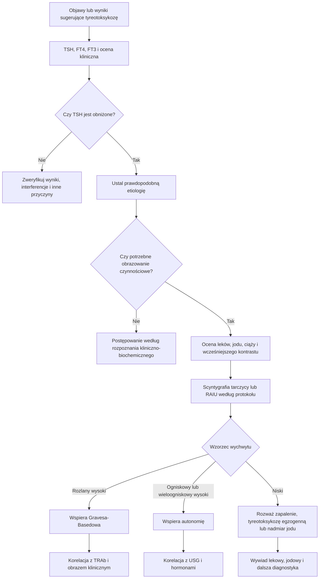

# 5.6. Scyntygrafia i diagnostyka radioizotopowa

## Informacje o rozdziale

**Moduł:** 5. Diagnostyka obrazowa w endokrynologii  
**Poziom:** kształcenie medyczne, zawodowe i podyplomowe; zakres czynności zależy od kwalifikacji uczestnika  
**Charakter materiału:** dydaktyczny, interdyscyplinarny, oparty na medycynie opartej na dowodach, uzasadnieniu ekspozycji medycznej i optymalizacji ochrony radiologicznej  
**Stan przeglądu piśmiennictwa:** 28 listopada 2026 r.

> **Zastrzeżenie kliniczne i kompetencyjne.** Scyntygrafia i inne badania radioizotopowe polegają na podaniu pacjentowi radiofarmaceutyku, a następnie rejestracji jego rozmieszczenia, wychwytu, transportu lub wiązania z określonym celem biologicznym. Badania te wykorzystują promieniowanie jonizujące. Nie są równoważne z badaniami laboratoryjnymi, USG, TK, MRI ani PET, choć mogą być z nimi łączone. Niniejszy rozdział nie upoważnia do samodzielnego kwalifikowania pacjenta do podania radiofarmaceutyku, ustalania jego aktywności, przygotowywania preparatu, wykonywania badania, interpretacji diagnostycznej ani wydawania zaleceń dotyczących przerwania farmakoterapii lub karmienia piersią. Czynności te należą do odpowiednio uprawnionego zespołu medycyny nuklearnej, zgodnie z prawem, charakterystyką produktu leczniczego, procedurami pracowni i indywidualną sytuacją pacjenta. Wynik scyntygrafii nie zastępuje oceny klinicznej, biochemicznej, histopatologicznej ani obrazowania anatomicznego.

## 1. Cele i efekty uczenia się

### 1.1. Cel główny

Celem rozdziału jest przygotowanie uczestnika do rozumienia podstaw diagnostyki radioizotopowej w endokrynologii, właściwego rozpoznawania jej wskazań i ograniczeń oraz bezpiecznego współuczestniczenia w przygotowaniu pacjenta i dokumentacji. Szczególny nacisk położono na scyntygrafię tarczycy i ocenę wychwytu radioznacznika, lokalizację nadczynnych przytarczyc z użyciem 99mTc-sestamibi, obrazowanie receptorów somatostatynowych w guzach neuroendokrynnych oraz wybrane zastosowania 123I-MIBG.

### 1.2. Szczegółowe efekty uczenia się

Po ukończeniu rozdziału uczestnik powinien:

1. Wyjaśnić różnicę między obrazowaniem anatomicznym, czynnościowym i molekularnym oraz wskazać, jakie informacje wnosi scyntygrafia.
2. Zdefiniować radiofarmaceutyk, radionuklid, aktywność, okres półtrwania fizycznego, biologicznego i efektywnego oraz dawkę pochłoniętą i skuteczną.
3. Opisać podstawy rejestracji obrazu planarnego, SPECT i SPECT/CT oraz znaczenie korekcji osłabienia i lokalizacji anatomicznej.
4. Rozróżnić właściwości 99mTc-pertechnetatu, 123I-jodku sodu i 131I-jodku sodu w obrazowaniu tarczycy.
5. Wskazać typowe wskazania do scyntygrafii tarczycy i testu wychwytu radiojodu, z uwzględnieniem stężenia TSH, tyreotoksykozy, guzków autonomicznych i tkanki ektopowej.
6. Zinterpretować podstawowe wzorce rozmieszczenia znacznika w chorobie Gravesa-Basedowa, autonomicznym guzku toksycznym, wolu wieloguzkowym toksycznym, zapaleniu tarczycy i tyreotoksykozie egzogennej.
7. Wyjaśnić, dlaczego wynik „gorącego” lub „zimnego” guzka nie jest samodzielnym rozpoznaniem histopatologicznym i wymaga korelacji z USG oraz obrazem klinicznym.
7. Wyjaśnić rolę 99mTc-sestamibi, obrazowania dwufazowego, metod odejmowania znaczników oraz SPECT/CT w przedoperacyjnej lokalizacji nadczynnej tkanki przytarczyc.
8. Odróżnić potwierdzenie biochemiczne nadczynności przytarczyc od lokalizacji zmiany przed planowanym leczeniem operacyjnym.
9. Opisać zastosowanie scyntygrafii receptorów somatostatynowych z 111In-pentetreotydem i wskazać, dlaczego PET z analogami somatostatyny znakowanymi 68Ga lub 64Cu jest obecnie preferowane, gdy jest dostępne i właściwe klinicznie.
10. Omówić wybrane wskazania do 123I-MIBG w obrazowaniu guzów chromochłonnych i przyzwojaków oraz ograniczenia tej metody.
11. Zebrać dane o lekach, suplementach, podaży jodu, wcześniejszym kontraście jodowym, amiodaronie, ciąży i laktacji przed badaniem.
12. Wyjaśnić zasady uzasadnienia i optymalizacji ekspozycji, ochrony pacjenta, personelu i osób z otoczenia.
13. Rozpoznać artefakty i czynniki powodujące wyniki fałszywie dodatnie lub fałszywie ujemne.
14. Przygotować kompletne skierowanie i uporządkowany opis danych klinicznych potrzebnych pracowni medycyny nuklearnej.
15. Rozpoznać sytuacje wymagające pilnego kontaktu z lekarzem kierującym lub lekarzem medycyny nuklearnej.

### 1.3. Zakres kompetencji

Wiedza o scyntygrafii nie jest równoznaczna z uprawnieniem do samodzielnego wykonywania czynności medycyny nuklearnej. W granicach kwalifikacji uczestnik może:

- zebrać i uporządkować wywiad o lekach, suplementach, preparatach jodu, wcześniejszych badaniach z kontrastem, ciąży i karmieniu piersią;
- sprawdzić kompletność skierowania i dostępność wcześniejszych wyników;
- wyjaśnić pacjentowi ogólny cel badania i konieczność przestrzegania instrukcji pracowni;
- rozumieć podstawowe terminy używane w opisie scyntygraficznym;
- przekazać lekarzowi prowadzącemu informację o możliwej interferencji lekowej lub niezgodności wyniku z obrazem klinicznym;
- dokumentować przekazane informacje i wykonane czynności.

Nie wolno samodzielnie zalecać odstawienia tyreostatyku, lewotyroksyny, amiodaronu, leków psychotropowych, analogów somatostatyny ani innych preparatów w celu „poprawienia” wyniku. Nie wolno także ustalać przerwy w karmieniu piersią na podstawie ogólnej tabeli, bez identyfikacji konkretnego radiofarmaceutyku, jego aktywności, czystości radionuklidowej i obowiązującej charakterystyki produktu.

## 2. Miejsce diagnostyki radioizotopowej w endokrynologii

### 2.1. Obrazowanie czynnościowe a anatomiczne

Badanie anatomiczne odpowiada przede wszystkim na pytania: gdzie znajduje się struktura, jakie ma wymiary, kształt, gęstość lub sygnał oraz jaki jest jej stosunek do sąsiednich narządów. Badanie czynnościowe odpowiada na inne pytania: czy tkanka wychwytuje określony substrat lub ligand, czy wykazuje aktywność transportową, czy gromadzi znacznik i jak zmienia się jego rozmieszczenie w czasie.

Scyntygrafia pozwala zatem oceniać funkcję tkanki w sposób pośredni, przez zachowanie radiofarmaceutyku. Nie mierzy bezpośrednio stężenia hormonu w surowicy i nie określa automatycznie, czy zmiana jest łagodna lub złośliwa.

Przykłady:

- scyntygrafia tarczycy pokazuje rozmieszczenie znacznika zależne od transportu jodków lub anionów podobnych do jodków;
- scyntygrafia przytarczyc z 99mTc-sestamibi pomaga lokalizować tkankę o określonych właściwościach metabolicznych i mitochondrialnych;
- obrazowanie receptorów somatostatynowych wskazuje tkanki wykazujące ekspresję receptorów SSTR w stopniu umożliwiającym związanie radioznacznika;
- 123I-MIBG obrazuje wychwyt i magazynowanie analogu noradrenaliny w wybranych komórkach układu współczulnego.

W każdym z tych przypadków sygnał jest wynikiem złożonej biologii tkanki, farmakokinetyki radiofarmaceutyku, parametrów aparatu i warunków badania.

### 2.2. Pytania, na które scyntygrafia może odpowiedzieć

| Pytanie kliniczne | Potencjalna informacja ze scyntygrafii | Czego badanie nie rozstrzyga samodzielnie |
|---|---|---|
| Czy tarczyca syntetyzuje nadmierną ilość hormonów? | Wzorzec wychwytu może wspierać rozpoznanie nadczynności produkcyjnej | Nie zastępuje oznaczeń TSH, FT4, FT3 i oceny klinicznej |
| Czy guzek tarczycy jest autonomiczny? | Względnie zwiększony wychwyt w obrębie guzka i supresja otaczającego miąższu | Nie określa histologii ani nie wyklucza wszystkich nowotworów |
| Czy tyreotoksykoza wynika z nadmiernej syntezy, czy z uwalniania hormonów? | Wysoki lub niski wychwyt może pomóc w różnicowaniu | Nie zawsze rozróżnia przyczyny przy ekspozycji na jod lub amiodaron |
| Gdzie znajduje się nadczynna przytarczyca? | Lokalizacja typowa lub ektopowa przed operacją | Nie potwierdza sama rozpoznania biochemicznego nadczynności przytarczyc |
| Czy guz neuroendokrynny wykazuje ekspresję SSTR? | Rozmieszczenie ligandu receptorowego w zmianach | Nie określa samodzielnie stopnia złośliwości ani pełnego zróżnicowania histologicznego |
| Czy PPGL wychwytuje MIBG? | Informacja o transporcie i magazynowaniu analogu noradrenaliny | Wynik ujemny nie wyklucza guza ani choroby przerzutowej |

### 2.3. Scyntygrafia a PET

W potocznym języku termin „badanie izotopowe” bywa stosowany do scyntygrafii, SPECT i PET. Technicznie są to różne metody:

- **Scyntygrafia planarna** – obraz dwuwymiarowy rozmieszczenia promieniowania gamma.
- **SPECT** – tomograficzna rekonstrukcja rozkładu aktywności emitującego fotony gamma.
- **SPECT/CT** – połączenie informacji czynnościowej SPECT z lokalizacją anatomiczną z TK.
- **PET** – tomografia wykorzystująca radionuklidy emitujące pozytony i rejestrację fotonów powstałych w wyniku anihilacji.
- **PET/CT lub PET/MR** – połączenie obrazowania molekularnego z anatomią.

Moduł 5.7 szczegółowo omawia PET/CT i PET/MR. W niniejszym rozdziale PET jest przywoływany przede wszystkim po to, aby prawidłowo umieścić klasyczną scyntygrafię w aktualnym algorytmie diagnostycznym.

## 3. Podstawy fizyczne i techniczne

### 3.1. Radiofarmaceutyk i radionuklid

Radiofarmaceutyk jest preparatem zawierającym radionuklid, który emituje promieniowanie wykrywane przez aparaturę. Część biologiczna cząsteczki może odpowiadać za transport, wiązanie z receptorem, gromadzenie w określonej tkance lub udział w przemianie metabolicznej.

Radiofarmaceutyk powinien charakteryzować się odpowiednią:

- czystością radiochemiczną;
- czystością radionuklidową;
- aktywnością i stabilnością;
- biodostępnością i profilem farmakokinetycznym;
- zgodnością z wymaganiami jakościowymi;
- dokumentacją przygotowania i kontroli jakości.

W praktyce klinicznej istotne jest rozróżnienie radionuklidu od związku chemicznego, z którym został połączony. Ten sam radionuklid może być używany w różnych radiofarmaceutykach, a ten sam ligand może być znakowany różnymi radionuklidami i dawać inne właściwości obrazowania.

### 3.2. Aktywność, dawka i okres półtrwania

**Aktywność** wyrażana w bekerelach (Bq) opisuje liczbę przemian jądrowych na sekundę. W medycynie nuklearnej zwykle posługujemy się kBq lub MBq.

**Dawka pochłonięta** wyrażana w grejach (Gy) opisuje energię promieniowania pochłoniętą w jednostce masy tkanki. **Dawka równoważna i skuteczna** wyrażane w siwertach (Sv) uwzględniają odpowiednio rodzaj promieniowania i wrażliwość tkanek w modelu ochrony radiologicznej.

Nie należy utożsamiać aktywności podanej pacjentowi z dawką skuteczną. Dwie osoby, którym podano tę samą aktywność, mogą otrzymać różną dawkę narządową i skuteczną z powodu różnic w masie ciała, czynności nerek, rozmieszczeniu znacznika i czasie jego przebywania w organizmie.

Wyróżnia się:

- **fizyczny okres półtrwania** – czas, po którym liczba jąder promieniotwórczych zmniejsza się o połowę;
- **biologiczny okres półtrwania** – czas, w którym organizm usuwa połowę danej substancji z określonego przedziału biologicznego;
- **efektywny okres półtrwania** – wynik łącznego działania rozpadu fizycznego i eliminacji biologicznej.

Dla procesów pierwszego rzędu zależność można zapisać:

$$
\frac{1}{T_{ef}}=\frac{1}{T_{fiz}}+\frac{1}{T_{bio}}
$$

Wartość ta jest uproszczeniem modelowym i nie oznacza, że wszystkie tkanki lub radiofarmaceutyki zachowują się jednorodnie.

### 3.3. Radionuklidy istotne w endokrynologii

| Radionuklid | Rodzaj emisji istotny diagnostycznie | Przykładowe zastosowanie | Uwagi |
|---|---|---|---|
| 99mTc | Fotony gamma | Scyntygrafia tarczycy, sestamibi przytarczyc | Krótki okres półtrwania fizycznego, szeroka dostępność |
| 123I | Fotony gamma | Scyntygrafia tarczycy, test wychwytu radiojodu, wybrane protokoły odejmowania | Zachowuje się jak jod i podlega organifikacji w tarczycy |
| 131I | Beta i gamma | Głównie leczenie radiojodem i wybrane badania po leczeniu | Nie jest rutynowym zamiennikiem 123I w diagnostyce czynnościowej |
| 111In | Fotony gamma | Klasyczna scyntygrafia receptorów somatostatynowych z pentetreotydem | Obrazowanie opóźnione, dłuższy czas badania |
| 123I | Fotony gamma | MIBG w wybranych guzach chromochłonnych i przyzwojakach | Wymaga oceny leków wpływających na wychwyt i ochrony tarczycy zgodnie z protokołem |

Podane przykłady nie stanowią listy wszystkich radiofarmaceutyków. Dostępność, rejestracja i wskazania zależą od kraju, produktu, ośrodka i aktualnych przepisów.

### 3.4. Gamma-kamera, obraz planarny i SPECT

Gamma-kamera rejestruje fotony gamma opuszczające ciało pacjenta. Kolimator ogranicza kierunki fotonów docierających do kryształu scyntylacyjnego, a układ detekcyjny przekształca energię promieniowania w sygnał elektryczny. Po obróbce powstaje obraz rozmieszczenia aktywności.

W badaniu planarnym otrzymuje się projekcję dwuwymiarową. W SPECT detektory obracają się wokół pacjenta, a komputer rekonstruuje rozkład aktywności w przekrojach. W SPECT/CT dołącza się obraz TK, co ułatwia przypisanie ogniska aktywności do konkretnej struktury anatomicznej.

SPECT/CT jest szczególnie przydatne, gdy:

- zmiana może być położona ektopowo;
- anatomia została zmieniona przez wcześniejszą operację;
- obraz planarny nie pozwala jednoznacznie określić lokalizacji;
- potrzebne jest odróżnienie aktywności w narządzie od aktywności w sąsiedniej strukturze;
- wynik ma wpływać na planowanie zabiegu.

Komponent TK w SPECT/CT może służyć jedynie korekcji osłabienia i lokalizacji, a nie pełnej diagnostyce radiologicznej. Zakres protokołu trzeba odczytać z dokumentacji badania.

### 3.5. Korekcja osłabienia i rozpraszania

Fotony emitowane wewnątrz ciała są częściowo pochłaniane i rozpraszane. Głębiej położona struktura może zatem generować słabszy sygnał niż powierzchowna struktura o podobnej aktywności. Korekcja osłabienia, odpowiedni dobór okna energetycznego i rekonstrukcja ograniczają te problemy, ale ich nie eliminują.

Nieprawidłowe ustawienie pacjenta, ruch, metal, nieprawidłowa korekcja lub błędne dopasowanie obrazów SPECT i CT mogą powodować pozorną lokalizację zmiany. Wątpliwy wynik wymaga oceny jakości technicznej, a nie tylko interpretacji biologicznej.

## 4. Ogólny przebieg badania radioizotopowego

### 4.1. Etapy postępowania

Typowe badanie obejmuje następujące etapy:

1. Uzasadnienie wskazania klinicznego.
2. Weryfikację tożsamości pacjenta i skierowania.
3. Zebranie informacji o ciąży, laktacji, lekach, suplementach i wcześniejszych ekspozycjach.
4. Ocenę, czy przygotowanie pacjenta jest zgodne z protokołem.
5. Kontrolę jakości i identyfikację radiofarmaceutyku.
6. Podanie radiofarmaceutyku przez uprawniony personel.
7. Odczekanie czasu potrzebnego do uzyskania odpowiedniego rozmieszczenia znacznika.
7. Akwizycję obrazów planarnych, SPECT lub SPECT/CT.
8. Kontrolę jakości obrazu i ewentualne uzupełnienie akwizycji.
9. Interpretację przez uprawnionego lekarza medycyny nuklearnej.
10. Sporządzenie opisu i przekazanie wyniku.
11. Udzielenie pacjentowi indywidualnych zaleceń po badaniu.

### 4.2. Dane kliniczne niezbędne do prawidłowej interpretacji

Skierowanie powinno zawierać konkretne pytanie kliniczne. Samo sformułowanie „diagnostyka endokrynologiczna” jest niewystarczające.

Przydatne dane zależą od rodzaju badania, ale mogą obejmować:

- objawy i czas ich trwania;
- wyniki TSH, FT4, FT3, przeciwciał przeciwtarczycowych;
- stężenie wapnia, fosforanów, PTH, kreatyniny i 25-OH-D;
- wyniki metanefryn lub innych badań biochemicznych;
- rozpoznanie histopatologiczne i stopień zróżnicowania guza;
- wyniki USG, TK i MRI;
- przebieg wcześniejszego leczenia;
- wcześniejsze operacje szyi lub przytarczyc;
- wcześniejsze podanie jodowego środka kontrastowego;
- stosowane leki i suplementy;
- informację o ciąży lub karmieniu piersią.

### 4.3. Kontrola przed podaniem radiofarmaceutyku

Przed podaniem należy potwierdzić co najmniej:

- właściwego pacjenta;
- właściwy radiofarmaceutyk;
- właściwą drogę podania;
- właściwą aktywność zgodną ze zleceniem i procedurą;
- ważność i jakość preparatu;
- wskazanie do badania;
- ocenę ciąży i laktacji;
- zgodność przygotowania z protokołem;
- dostępność informacji o wcześniejszych badaniach i lekach.

Wszelkie rozbieżności należy wyjaśnić przed podaniem. Nie należy „ratować” nieprawidłowego przygotowania przez samodzielną zmianę dawki lub czasu akwizycji.

## 5. Scyntygrafia tarczycy

### 5.1. Cel i znaczenie badania

Scyntygrafia tarczycy ocenia rozmieszczenie znacznika w miąższu gruczołu i umożliwia rozpoznanie wzorców czynnościowych. W połączeniu z testem wychwytu radiojodu może pomóc określić, czy tyreotoksykoza wynika z nasilonej syntezy hormonów, czy z procesów, w których dochodzi do uwalniania wcześniej zmagazynowanych hormonów lub dostarczenia ich z zewnątrz.

Scyntygrafia jest szczególnie przydatna w:

- diagnostyce przyczyny tyreotoksykozy;
- ocenie autonomii czynnościowej guzka lub wola wieloguzkowego;
- różnicowaniu rozlanej i ogniskowej nadczynności;
- wykrywaniu tkanki tarczycowej ektopowej;
- wybranych sytuacjach planowania leczenia radiojodem;
- ocenie wybranych niejednoznacznych zmian, jeśli wynik może zmienić postępowanie.

Nie jest automatycznie konieczna u każdego pacjenta z guzkiem tarczycy. W wielu algorytmach podstawą kwalifikacji do scyntygrafii jest obniżone lub zahamowane TSH, ale decyzja uwzględnia także wywiad, obszar niedoboru jodu, USG, wcześniejsze leczenie i pytanie kliniczne.

### 5.2. 99mTc-pertechnetat a 123I-jodek sodu

Oba radiofarmaceutyki są wychwytywane przez komórki pęcherzykowe tarczycy z udziałem symportera sodowo-jodkowego (NIS), lecz ich dalsze zachowanie jest odmienne.

**99mTc-pertechnetat:**

- jest wychwytywany przez NIS;
- nie jest organifikowany w tyreoglobulinie;
- obrazuje przede wszystkim etap wychwytu i uwięzienia znacznika;
- umożliwia stosunkowo szybkie badanie;
- jest powszechnie wykorzystywany w rutynowej scyntygrafii tarczycy.

**123I-jodek sodu:**

- jest wychwytywany przez NIS;
- może być organifikowany i włączany do związków jodowanych w tarczycy;
- lepiej odzwierciedla fizjologię metabolizmu jodu;
- może być stosowany do ilościowej oceny wychwytu radiojodu;
- jest przydatny, gdy pytanie dotyczy także organifikacji lub gdy obraz z pertechnetatem jest niejednoznaczny.

**131I-jodek sodu** emituje promieniowanie beta i gamma, ma dłuższy okres półtrwania fizycznego i jest wykorzystywany przede wszystkim terapeutycznie. Nie należy utożsamiać diagnostycznej scyntygrafii z 123I z leczeniem radiojodem 131I. Zastosowanie 131I w diagnostyce jest ograniczone do wybranych sytuacji i wymaga odrębnego uzasadnienia.

### 5.3. Wychwyt radiojodu – zasada pomiaru

Test wychwytu radiojodu (RAIU, radioiodine uptake) określa odsetek podanej aktywności jodu radioaktywnego, który znajduje się w tarczycy w określonym czasie po podaniu.

W uproszczeniu pomiar można przedstawić jako:

$$
RAIU(t)=
\frac{C_{szyja}(t)-C_{tło}(t)}
{C_{wzorzec}(t)-C_{tło,wzorzec}(t)}
\times 100\%
$$

gdzie:

- $C_{szyja}$ oznacza zliczenia z obszaru tarczycy;
- $C_{tło}$ oznacza zliczenia tła;
- $C_{wzorzec}$ oznacza zliczenia wzorca odniesienia;
- $t$ oznacza czas od podania znacznika.

W rzeczywistym protokole konieczne są odpowiednie korekcje, kontrola geometrii pomiaru, rozpadu fizycznego, tła, odległości sondy i charakterystyki aparatury. Wartości referencyjne zależą od podaży jodu w populacji, protokołu, rodzaju znacznika, czasu pomiaru i metody. Nie istnieje jeden uniwersalny zakres prawidłowego wychwytu, który można bezkrytycznie przenosić między ośrodkami i populacjami.

W praktyce pomiar wykonuje się w określonych punktach czasowych, na przykład po kilku godzinach i po około dobie, zgodnie z protokołem pracowni. Wynik powinien być interpretowany razem z obrazem scyntygraficznym i danymi klinicznymi.

**Ważne rozróżnienie:** wychwyt jodu (RAIU) i wychwyt pertechnetatu nie są tym samym pomiarem. Nie należy przenosić wartości referencyjnych RAIU na badanie z 99mTc-pertechnetatem.

### 5.4. Wzorce scyntygraficzne w chorobach tarczycy

| Obraz scyntygraficzny | Typowy wzorzec | Możliwe znaczenie kliniczne | Ważne zastrzeżenie |
|---|---|---|---|
| Rozlany, jednorodny, zwiększony wychwyt | Cały gruczoł intensywnie gromadzi znacznik | Choroba Gravesa-Basedowa | Wymaga korelacji z TRAb, TSH i hormonami |
| Ognisko zwiększonego wychwytu z supresją reszty miąższu | Jeden obszar czynnościowo dominuje | Autonomiczny gruczolak toksyczny | Należy zestawić z USG i anatomią |
| Wieloogniskowy, niejednorodny rozkład | Liczne obszary różnej aktywności | Wole wieloguzkowe toksyczne | Małe guzki mogą być poniżej rozdzielczości |
| Niski lub niemal niewidoczny wychwyt | Znacznik słabo gromadzi się w tarczycy | Zapalenie destrukcyjne, tyreotoksykoza egzogenna, nadmiar jodu | Trzeba wykluczyć interferencje i wcześniejsze leczenie |
| Ognisko ektopowe | Aktywność poza typowym położeniem gruczołu | Tkanka tarczycowa ektopowa | Wymaga korelacji anatomicznej |
| Niejednorodny, obniżony wychwyt | Rozproszone obszary różnej aktywności | Zapalenie, zmiany guzkowe lub wpływ leczenia | Obraz jest nieswoisty |

### 5.5. Choroba Gravesa-Basedowa

W klasycznym obrazie scyntygraficznym choroby Gravesa-Basedowa widoczny jest rozlany, względnie jednorodny i zwiększony wychwyt znacznika w obu płatach tarczycy. Zwiększona aktywność wynika z pobudzenia receptora TSH przez przeciwciała stymulujące.

Wzorzec może wspierać rozpoznanie, ale nie jest samodzielnym kryterium. Należy uwzględnić:

- stężenie TSH, FT4 i FT3;
- przeciwciała przeciw receptorowi TSH (TRAb);
- obraz kliniczny;
- USG i unaczynienie w Dopplerze;
- wcześniejsze leczenie tyreostatykami lub radiojodem;
- możliwą ekspozycję na jod.

W niektórych przypadkach wychwyt może być mniejszy niż oczekiwany, na przykład po ekspozycji na duże ilości jodu, podczas terapii lub w szczególnych wariantach choroby.

### 5.6. Autonomiczny guzek toksyczny

Autonomiczny guzek wykazuje wychwyt większy niż otaczający miąższ. W wyraźnej autonomii reszta tarczycy może być względnie lub niemal całkowicie zahamowana przez ujemne sprzężenie zwrotne zależne od hormonów tarczycy.

Określenia:

- **guzek gorący (hot)** – wychwyt większy niż w otaczającym miąższu;
- **guzek ciepły (warm)** – wychwyt zbliżony do otoczenia;
- **guzek zimny (cold)** – wychwyt mniejszy niż w otoczeniu.

Są to określenia czynnościowe, a nie histopatologiczne. Guzek gorący jest na ogół związany z mniejszym prawdopodobieństwem złośliwości niż guzek nieczynny, ale nie daje absolutnej gwarancji łagodności. Jeżeli istnieje istotna niezgodność między scyntygrafią, USG, objawami i dynamiką zmiany, potrzebna jest indywidualna ocena specjalistyczna.

### 5.7. Wole wieloguzkowe toksyczne

Wole wieloguzkowe toksyczne może dawać obraz mozaikowy, z licznymi ogniskami o zwiększonym wychwycie oraz obszarami względnie zahamowanej aktywności. Obraz odzwierciedla niejednorodną autonomię czynnościową różnych części gruczołu.

Scyntygrafia pomaga określić, które obszary są czynne, a które nie wykazują istotnego wychwytu. Nie określa jednak sama wielkości, granic i cech morfologicznych każdego guzka. Do tego potrzebne jest USG.

### 5.8. Tyreotoksykoza o niskim wychwycie

Niski wychwyt może występować w:

- zapaleniu podostrym;
- zapaleniu bezbolesnym lub poporodowym;
- tyreotoksykozie factitia, związanej z egzogennymi hormonami tarczycy;
- nadmiernej podaży jodu;
- niektórych fazach amiodaronowego zapalenia tarczycy;
- po leczeniu radiojodem lub lekami przeciwtarczycowymi;
- innych stanach, w których tkanka nie syntetyzuje aktywnie hormonów lub nie wychwytuje znacznika.

Niski wychwyt nie wskazuje automatycznie jednej przyczyny. Rozróżnienie wymaga zestawienia z wywiadem, wynikami hormonów, przeciwciałami, markerami zapalenia, informacją o lekach i podaży jodu.

### 5.9. Amiodaron i obciążenie jodem

Amiodaron zawiera dużą ilość jodu. Może zmieniać czynność tarczycy, wpływać na wychwyt znacznika i utrudniać interpretację badań radiojodowych. W tyreotoksykozie indukowanej amiodaronem rozróżnia się mechanizmy związane z nadmierną syntezą hormonów i z procesem destrukcyjnym, ale klasyczna scyntygrafia może być mało użyteczna, gdy wychwyt jest znacznie zahamowany przez obciążenie jodem.

Nie wolno odstawiać amiodaronu wyłącznie w celu wykonania scyntygrafii bez decyzji lekarza prowadzącego. Decyzja o badaniu i interpretacji powinna uwzględniać czas ekspozycji, stężenie jodu, stan kliniczny i dostępność alternatywnych metod.

### 5.10. Guzki tarczycy a scyntygrafia

Scyntygrafia nie zastępuje USG ani klasyfikacji ryzyka ultrasonograficznego. W typowym algorytmie:

1. Ocenia się TSH.
2. Przy obniżonym TSH rozważa się scyntygrafię w celu oceny autonomii.
3. Lokalizację czynnościową zestawia się z lokalizacją anatomiczną guzka w USG.
4. Węzły o obniżonym wychwycie ocenia się według cech ultrasonograficznych i wskazań do biopsji.
5. Guzek autonomiczny wymaga oceny klinicznej i planu leczenia, a nie automatycznego odstąpienia od wszelkiej dalszej oceny.

Guzek zimny nie jest równoznaczny z rakiem. Większość guzków zimnych jest łagodna. Guzek gorący nie powinien być uznany za „na pewno łagodny” bez uwzględnienia niezgodnych cech klinicznych i morfologicznych.

### 5.11. Tkanka tarczycowa ektopowa i wady rozwojowe

Scyntygrafia może wykryć czynnośćową tkankę tarczycową poza typowym położeniem, na przykład w obrębie nasady języka (tarczyca językowa) lub w przebiegu zstępowania zawiązka tarczycy. Jest to szczególnie ważne, gdy w typowym położeniu gruczoł jest niewidoczny lub mały, a pacjent ma zaburzenia czynności tarczycy.

U dzieci badanie może być częścią diagnostyki wrodzonej niedoczynności tarczycy, jeżeli wynik odpowie na pytanie o obecność i lokalizację tkanki. Interpretacja wymaga uwzględnienia wieku, czasu od rozpoczęcia leczenia, stanu TSH i możliwych interferencji.

## 6. Scyntygrafia przytarczyc z użyciem 99mTc-sestamibi

### 6.1. Cel badania

Scyntygrafia przytarczyc służy przede wszystkim do przedoperacyjnej lokalizacji nadczynnej tkanki przytarczyc u pacjenta, u którego rozpoznanie biochemiczne zostało już ustalone. Najczęstszym wskazaniem jest pierwotna nadczynność przytarczyc, zwłaszcza gdy planuje się zabieg ukierunkowany na pojedynczy gruczolak.

W wybranych przypadkach metoda może być stosowana w nadczynności wtórnej lub trzeciorzędowej, szczególnie przed leczeniem operacyjnym i w chorobie przetrwałej lub nawrotowej.

**Scyntygrafia nie służy do rozpoznawania nadczynności przytarczyc u osoby z prawidłowymi lub niepełnymi danymi biochemicznymi.** Rozpoznanie opiera się na ocenie wapnia, PTH i czynników wpływających na gospodarkę wapniowo-fosforanową.

### 6.2. Mechanizm wychwytu 99mTc-sestamibi

99mTc-sestamibi jest lipofilnym kationowym kompleksem, który gromadzi się w komórkach zależnie między innymi od potencjału błon i właściwości mitochondriów. Tkanka przytarczyc z dużą zawartością mitochondriów, w tym komórki oksyfilne, może wykazywać utrzymywanie znacznika.

Nie jest to ligand swoisty wyłącznie dla przytarczyc. Znacznik może gromadzić się także w tarczycy, zwłaszcza w guzkach z komórkami oksyfilnymi, zmianach onkocytarnych i niektórych nowotworach. Dlatego interpretacja wymaga znajomości anatomii, dynamiki wypłukiwania i korelacji z USG oraz SPECT/CT.

### 6.3. Metoda dwufazowa

W klasycznej metodzie dwufazowej wykonuje się wczesne i opóźnione obrazowanie po podaniu 99mTc-sestamibi. W uproszczeniu zakłada się, że znacznik może szybciej wypłukiwać się z prawidłowej tkanki tarczycy, a dłużej utrzymywać się w części gruczolaków przytarczyc.

Typowe punkty czasowe w zaleceniach EANM obejmują wczesne obrazowanie po około 10–15 minutach i późne po około 90–150 minutach, ale dokładny protokół zależy od ośrodka i aparatury.

Ognisko utrzymujące aktywność w projekcji odpowiadającej typowej lub ektopowej lokalizacji przytarczyc może sugerować nadczynną tkankę. Nie jest to jednak wynik swoisty w każdej sytuacji.

### 6.4. Metody dwuznacznikowe i odejmowanie

W metodzie dwuznacznikowej porównuje się obrazowanie 99mTc-sestamibi z obrazem tkanki tarczycowej uzyskanym innym radiofarmaceutykiem, na przykład 123I lub 99mTc-pertechnetatem. Po odpowiedniej normalizacji można wykonać cyfrowe odejmowanie obrazu tarczycy od obrazu sestamibi.

Pozostała aktywność może ułatwić identyfikację ogniska pochodzącego z przytarczyc. Metoda wymaga precyzyjnego dopasowania obrazów i nie eliminuje wszystkich źródeł błędu.

### 6.5. SPECT/CT w lokalizacji przytarczyc

SPECT/CT łączy informację czynnościową z lokalizacją anatomiczną. Szczególne znaczenie ma ocena obszaru od podstawy czaszki do okolicy podstawy serca, ponieważ nadczynna tkanka może być położona ektopowo, na przykład w śródpiersiu, w obrębie grasicy lub wzdłuż drogi zstępowania przytarczyc.

SPECT/CT może pomóc:

- określić, czy ognisko znajduje się wewnątrz tarczycy, za tarczycą czy poza nią;
- zlokalizować zmianę względem tchawicy, przełyku i dużych naczyń;
- wykryć tkankę ektopową;
- zaplanować dostęp operacyjny;
- wyjaśnić niejednoznaczny obraz planarny.

### 6.6. Przyczyny wyników fałszywie dodatnich

Do możliwych przyczyn należą:

- guzki tarczycy z dużą zawartością komórek oksyfilnych;
- gruczolaki i zmiany onkocytarne tarczycy;
- niektóre nowotwory tarczycy;
- węzły chłonne i inne struktury o zwiększonym metabolizmie;
- aktywność w śliniankach lub mięśniach, jeśli lokalizacja jest nieprawidłowo oceniona;
- artefakty ruchowe i błędy dopasowania obrazów.

Wynik dodatni musi być zestawiony z USG i danymi anatomicznymi. Nie należy przypisywać każdej zmiany aktywności w okolicy szyi przytarczycom.

### 6.7. Przyczyny wyników fałszywie ujemnych

Wynik może być ujemny mimo obecności nadczynnej przytarczycy, na przykład gdy:

- gruczolak jest mały;
- występuje wielogruczołowa hiperplazja;
- znacznik szybko wypłukuje się z tkanki;
- tkanka ma małą zawartość komórek oksyfilnych;
- zmiana jest położona ektopowo lub poza polem obrazowania;
- jakość techniczna badania jest niewystarczająca;
- anatomia jest zmieniona po wcześniejszej operacji;
- aktywność tarczycy utrudnia odróżnienie sąsiednich struktur.

Ujemna scyntygrafia nie wyklucza pierwotnej nadczynności przytarczyc i nie oznacza, że pacjent nie może być kandydatem do operacji. W razie utrzymującego się wskazania klinicznego zespół może rozważyć inne metody lokalizacyjne, w tym USG, TK 4D lub PET z 18F-fluorocholiną, zależnie od dostępności i sytuacji.

### 6.8. Ograniczenia w chorobie wielogruczołowej

Scyntygrafia może łatwiej wykrywać pojedynczy gruczolak niż niewielkie, wieloogniskowe zmiany w hiperplazji. W chorobach dziedzicznych, takich jak MEN, ryzyko wielogruczołowej patologii jest większe. Wynik należy więc interpretować ostrożnie i nie zakładać, że wykrycie jednego ogniska wyklucza pozostałe nieprawidłowe gruczoły.

### 6.9. Co powinno znaleźć się w skierowaniu

W skierowaniu na lokalizację przytarczyc należy podać:

- potwierdzone wyniki wapnia całkowitego i/lub zjonizowanego;
- stężenie PTH;
- fosforany, kreatyninę/eGFR i 25-OH-D, jeżeli są dostępne;
- podejrzenie pierwotnej, wtórnej lub trzeciorzędowej nadczynności;
- informację o wcześniejszej operacji szyi;
- wyniki USG tarczycy i przytarczyc;
- informację o guzkach tarczycy;
- pytanie, czy chodzi o lokalizację przed pierwszą operacją, czy o chorobę przetrwałą/nawrotową.

## 7. Obrazowanie receptorów somatostatynowych w guzach neuroendokrynnych

### 7.1. Biologiczna podstawa obrazowania

Wiele dobrze zróżnicowanych nowotworów neuroendokrynnych (NET) wykazuje ekspresję receptorów somatostatynowych, szczególnie podtypu SSTR2. Radioznaczony analog somatostatyny może wiązać się z receptorami na powierzchni komórek nowotworowych, a następnie być internalizowany lub pozostawać związany z tkanką.

Obrazowanie dostarcza informacji o rozmieszczeniu tkanki receptorowo dodatniej. Może być wykorzystywane do:

- lokalizacji guza pierwotnego;
- oceny zasięgu choroby;
- poszukiwania przerzutów;
- oceny wznowy;
- określenia ekspresji receptorów;
- kwalifikacji do wybranych metod leczenia receptorowego, w tym terapii radionuklidowej.

Wynik zależy od biologii nowotworu, stopnia zróżnicowania, ekspresji receptorów, wielkości zmian, aktywności podanego znacznika i jakości obrazowania.

### 7.2. 111In-pentetreotyd – klasyczna scyntygrafia receptorowa

111In-pentetreotyd, znany jako klasyczny OctreoScan, jest analogiem somatostatyny znakowanym indem-111. Obrazowanie wykonuje się techniką planarną i SPECT, często z komponentem CT.

W klasycznych protokołach akwizycja może obejmować obrazy wczesne i opóźnione, na przykład po kilku godzinach i następnego dnia. Dłuższy czas oczekiwania wynika z farmakokinetyki znacznika i konieczności uzyskania odpowiedniego stosunku sygnału zmiany do tła.

Scyntygrafia receptorowa z 111In-pentetreotydem ma obecnie rolę ograniczoną tam, gdzie dostępne jest właściwie wskazane PET z analogiem somatostatyny znakowanym 68Ga lub 64Cu. PET oferuje zwykle lepszą rozdzielczość, większą czułość wykrywania małych zmian, krótszy protokół i niższą dawkę w porównaniu z klasycznym SPECT z 111In-pentetreotydem.

Nie oznacza to, że klasyczna scyntygrafia jest bezużyteczna. Może być wykorzystywana w ośrodkach bez dostępu do PET, przy określonych wskazaniach lub w sytuacjach wynikających z dostępności i lokalnych procedur.

### 7.3. 99mTc-znakowane analogi somatostatyny

W niektórych ośrodkach wykorzystuje się analogi somatostatyny znakowane 99mTc, na przykład preparaty z grupy HYNIC-TOC lub HYNIC-TATE. Ich dostępność i rejestracja zależą od kraju oraz ośrodka.

Nie należy zakładać, że wszystkie preparaty znakowane 99mTc mają identyczne właściwości biologiczne, protokół i wskazania. W opisie powinien być jednoznacznie podany użyty radiofarmaceutyk.

### 7.4. Fizjologiczny wychwyt i pułapki interpretacyjne

Receptory somatostatynowe występują także w tkankach prawidłowych. Fizjologiczna aktywność może być widoczna między innymi w:

- śledzionie;
- wątrobie;
- nerkach i układzie moczowym;
- przysadce;
- nadnerczach;
- śliniankach;
- tarczycy;
- niektórych odcinkach przewodu pokarmowego.

Nie każde ognisko wychwytu jest nowotworem. Wychwyt może występować w zmianach zapalnych, aktywowanych węzłach chłonnych, niektórych guzach nienowotworowych i strukturach o fizjologicznej ekspresji receptorów.

Z kolei brak wychwytu nie wyklucza NET. Zmiany mogą mieć niską ekspresję SSTR, małe rozmiary, heterogenną biologię lub fenotyp bardziej glikolityczny niż receptorowy.

### 7.5. Zróżnicowanie nowotworu a wybór znacznika

Dobrze zróżnicowane NET G1 i G2 często wykazują wysoką ekspresję SSTR. W części NET G3 ekspresja może być zachowana, ale jest bardziej zmienna. Słabo zróżnicowane raki neuroendokrynne (NEC) częściej mają niską ekspresję SSTR i większy metabolizm glukozy, dlatego obrazowanie 18F-FDG PET może być bardziej przydatne.

Wybór znacznika powinien uwzględniać:

- wynik histopatologii;
- indeks proliferacyjny Ki-67;
- stopień zróżnicowania;
- lokalizację guza;
- tempo progresji;
- wyniki wcześniejszego obrazowania;
- pytanie kliniczne i plan leczenia.

Nie należy opierać wyboru badania wyłącznie na określeniu „guz neuroendokrynny”.

### 7.6. Klasyczna scyntygrafia a PET receptorów somatostatynowych

| Cecha | 111In-pentetreotyd SPECT/SPECT-CT | 68Ga- lub 64Cu-DOTA-SSA PET/CT |
|---|---|---|
| Technika | Fotony gamma, SPECT | Emisja pozytonów, PET |
| Rozdzielczość | Niższa | Zwykle wyższa |
| Czas badania | Często obrazy opóźnione | Zwykle krótszy protokół |
| Małe zmiany | Mniejsza czułość | Zwykle większa czułość |
| Dostępność | Zależna od ośrodka | Zależna od dostępności PET i radiofarmaceutyku |
| Rola współczesna | Alternatywa, gdy PET jest niedostępny lub niewłaściwy | Preferowane w wielu wskazaniach NET, gdy dostępne |
| Informacja biologiczna | Ekspresja receptorów SSTR | Ekspresja receptorów SSTR z wyższą rozdzielczością przestrzenną |

PET receptorowy jest odrębną techniką i szczegółowo zostanie omówiony w rozdziale 5.7. W tym miejscu istotne jest, aby nie przedstawiać klasycznego OctreoScanu jako bezwarunkowo aktualnej metody pierwszego wyboru w każdym NET.

### 7.7. Analogi somatostatyny a przygotowanie pacjenta

Leki takie jak oktreotyd i lanreotyd mogą wpływać na biodostępność ligandów receptorowych i rozkład sygnału. Znaczenie ma rodzaj preparatu, dawka, droga podania i czas od ostatniego podania. W praktyce protokoły ośrodków mogą różnić się w sposobie planowania badania względem kolejnej dawki analogu.

Pacjent nie powinien samodzielnie odstawiać analogu somatostatyny. Decyzję podejmuje lekarz medycyny nuklearnej we współpracy z zespołem prowadzącym NET. Nagłe przerwanie leczenia może doprowadzić do nasilenia objawów hormonalnych lub destabilizacji choroby.

## 8. Wybrane zastosowania 123I-MIBG w guzach chromochłonnych i przyzwojakach

### 8.1. Mechanizm wychwytu MIBG

Metajodobenzyloguanidyna (MIBG, iobenguane) jest analogiem noradrenaliny. Może być wychwytywana przez komórki posiadające mechanizmy transportu katecholamin i magazynowania w ziarnistościach.

123I-MIBG jest wykorzystywany w wybranych badaniach scyntygraficznych guzów chromochłonnych i przyzwojaków (PPGL). Wybór tej metody zależy od lokalizacji, wielkości, fenotypu biochemicznego, ryzyka przerzutów, podłoża genetycznego, wcześniejszego obrazowania i planowanego leczenia.

### 8.2. Wskazania i miejsce w algorytmie

123I-MIBG nie jest automatycznie badaniem pierwszego wyboru u każdego pacjenta z podejrzeniem PPGL. Współczesne algorytmy uwzględniają także PET z 18F-FDOPA, 18F-FDG, 68Ga-DOTA-SSA lub inne metody, zależnie od biologii guza.

MIBG może być szczególnie przydatny, gdy:

- trzeba potwierdzić zdolność guza do wychwytu i magazynowania MIBG;
- rozważa się leczenie 131I-MIBG i konieczna jest ocena wychwytu terapeutycznego;
- dostępność innych metod jest ograniczona;
- fenotyp i lokalizacja guza odpowiadają sytuacji, w której MIBG ma uzasadnioną wartość.

### 8.3. Ograniczenia MIBG

Czułość MIBG nie jest jednakowa we wszystkich PPGL. Może być niższa w:

- przyzwojakach głowy i szyi;
- guzach związanych z niektórymi mutacjami SDHx, szczególnie SDHB;
- chorobie wieloogniskowej;
- przerzutach;
- małych zmianach;
- guzach o zmienionej ekspresji transporterów i mechanizmów magazynowania katecholamin.

Wynik ujemny nie wyklucza PPGL. Interpretacja powinna uwzględniać wyniki metanefryn, TK/MRI, dane genetyczne i inne badania czynnościowe.

### 8.4. Leki i blokada tarczycy

Niektóre leki mogą wpływać na wychwyt MIBG, w tym wybrane leki przeciwdepresyjne, sympatykomimetyki i leki wpływające na transport noradrenaliny. Lista zależy od protokołu i preparatu. Pracownia powinna otrzymać pełny wykaz leków, a decyzję o ewentualnym odstawieniu podejmuje lekarz.

W protokołach z radiojodowanym MIBG może być stosowana blokada tarczycy stabilnym jodem lub innym środkiem zgodnie z charakterystyką produktu i procedurą. Ma ona ograniczać wychwyt wolnego radiojodu przez tarczycę. Nie jest to uniwersalna instrukcja do samodzielnego stosowania jodu przez pacjenta.

### 8.5. MIBG diagnostyczny a terapeutyczny

123I-MIBG służy do obrazowania. 131I-MIBG może być wykorzystywany w leczeniu wybranych PPGL, ale wymaga odrębnej kwalifikacji, znacznie innych aktywności, warunków ochrony radiologicznej i procedur. Nie wolno utożsamiać diagnostycznego podania 123I-MIBG z terapią 131I-MIBG.

## 9. Przygotowanie pacjenta i interferencje lekowe

### 9.1. Dlaczego przygotowanie jest kluczowe

Nieprawidłowe przygotowanie może zmienić wychwyt znacznika i doprowadzić do błędnej interpretacji. Czynnik zakłócający może działać przez:

- konkurencję o transporter;
- zmianę puli jodu w organizmie;
- zahamowanie syntezy lub uwalniania hormonów;
- zmianę ekspresji receptorów;
- wpływ na przepływ krwi lub metabolizm;
- zmianę eliminacji nerkowej;
- zmianę farmakokinetyki radiofarmaceutyku.

Przygotowanie powinno być dobrane do konkretnego badania, a nie przenoszone automatycznie z jednego protokołu na inny.

### 9.2. Czynniki wpływające na scyntygrafię tarczycy

| Czynnik | Możliwy wpływ | Postępowanie organizacyjne |
|---|---|---|
| Jodowy środek kontrastowy | Nadmiar jodu może obniżać wychwyt radiojodu i pertechnetatu | Podać datę, rodzaj i drogę podania kontrastu; decyzja o terminie należy do pracowni |
| Amiodaron | Duże obciążenie jodem i długotrwały wpływ na tarczycę | Podać czas stosowania i ostatniej dawki; nie odstawiać samodzielnie |
| Suplementy jodu i algi morskie | Mogą zmieniać pulę jodu | Ujawnić preparat, dawkę i czas stosowania |
| Płyn Lugola i jodki | Mogą silnie zmniejszać wychwyt | Przekazać informację przed kwalifikacją |
| Lewotyroksyna | Zmienia stężenia TSH i czynność tarczycy | Nie odstawiać bez zlecenia |
| Liotyronina | Może silniej i szybciej wpływać na TSH i wychwyt | Zgłosić dawkę i termin ostatniego podania |
| Tyreostatyki | Mogą zmieniać syntezę i wychwyt znacznika | Ewentualne przerwanie wyłącznie według instrukcji lekarza |
| Niedawne leczenie radiojodem | Może zmienić rozmieszczenie i aktywność tkanki | Podać datę i rodzaj leczenia |
| Dieta o dużej zawartości jodu | Może zmieniać wychwyt | Wywiad żywieniowy, zwłaszcza algi i preparaty „na tarczycę” |

Czasy ewentualnego odstawienia leków różnią się w zależności od preparatu, dawki, czynności tarczycy i protokołu. Tabela nie jest harmonogramem odstawiania leków.

### 9.3. Przygotowanie do scyntygrafii przytarczyc

Przed badaniem należy zebrać:

- wyniki wapnia i PTH;
- informację o chorobie tarczycy i guzkach;
- wyniki USG szyi;
- informację o wcześniejszej operacji tarczycy lub przytarczyc;
- dane o ewentualnych zmianach w śródpiersiu;
- informacje o wcześniejszej scyntygrafii i innych badaniach lokalizacyjnych.

W przeciwieństwie do scyntygrafii tarczycy, 99mTc-sestamibi nie zależy od wychwytu jodków przez NIS. Nie należy więc automatycznie stosować do niego wszystkich ograniczeń dotyczących podaży jodu i kontrastu jodowego. Nadal jednak trzeba uwzględnić procedury pracowni, jakość obrazów i wcześniejsze badania.

### 9.4. Przygotowanie do obrazowania SSTR

Należy podać:

- typ guza i wynik histopatologii;
- stopień zróżnicowania i Ki-67;
- lokalizację pierwotną i znane przerzuty;
- stosowane analogi somatostatyny;
- datę ostatniego podania preparatu krótko- lub długodziałającego;
- wcześniejsze badania SSTR PET/SPECT;
- planowane leczenie, w tym ewentualną terapię radionuklidową.

Termin badania względem analogu somatostatyny ustala zespół medycyny nuklearnej. Nie należy samodzielnie pomijać dawki leku.

### 9.5. Przygotowanie do 123I-MIBG

Przed badaniem należy uzyskać pełną listę leków, zwłaszcza preparatów mogących wpływać na transport noradrenaliny. Należy również podać wyniki metanefryn, lokalizację podejrzanej zmiany i wyniki wcześniejszych badań obrazowych.

W zależności od protokołu może być konieczna blokada tarczycy. Rodzaj preparatu, czas rozpoczęcia i czas stosowania określa pracownia. Pacjent nie powinien samodzielnie przyjmować dużych dawek jodu.

## 10. Bezpieczeństwo pacjenta i ochrona radiologiczna

### 10.1. Uzasadnienie i optymalizacja

Każde badanie z użyciem promieniowania jonizującego powinno być uzasadnione: oczekiwana korzyść diagnostyczna powinna przewyższać potencjalne ryzyko ekspozycji. Następnie należy zoptymalizować procedurę, aby uzyskać obraz wystarczający do odpowiedzi na pytanie kliniczne przy możliwie małej ekspozycji.

W praktyce oznacza to:

- wybór badania odpowiadającego pytaniu klinicznemu;
- unikanie powtarzania badań bez wskazania;
- wykorzystanie wcześniejszych obrazów i opisów;
- dobór aktywności zgodnie z protokołem i masą ciała, gdy ma to zastosowanie;
- skrócenie akwizycji tylko wtedy, gdy nie obniża to istotnie jakości diagnostycznej;
- ograniczenie zakresu obrazowania do obszaru potrzebnego klinicznie;
- uwzględnienie wieku, ciąży, laktacji i czynności narządów.

Zasada ALARA oznacza utrzymywanie ekspozycji na poziomie tak niskim, jak jest to rozsądnie osiągalne, przy zachowaniu celu diagnostycznego. Nie oznacza mechanicznego zmniejszania aktywności kosztem niediagnostycznego obrazu.

### 10.2. Ciąża

Przed badaniem należy ustalić, czy pacjentka jest w ciąży lub może być w ciąży, zgodnie z procedurą pracowni i obowiązującymi przepisami. W przypadku ciąży większość planowych badań radioizotopowych odracza się lub wybiera alternatywę bez promieniowania jonizującego, jeśli jest ona wystarczająca.

Jeżeli istnieje pilna i istotna klinicznie potrzeba badania, decyzja wymaga indywidualnej oceny przez lekarza medycyny nuklearnej i lekarza prowadzącego, z uwzględnieniem rodzaju radiofarmaceutyku, aktywności, drogi wydalania, etapu ciąży i możliwej dawki dla płodu.

**Radiojod, zwłaszcza 131I, jest przeciwwskazany w ciąży**, ponieważ jod może przechodzić przez łożysko i gromadzić się w tarczycy płodu. Nie wolno wykonywać badania radiojodowego u pacjentki w ciąży bez odpowiedniego, specjalistycznego uzasadnienia i procedury.

### 10.3. Karmienie piersią

Nie ma jednej uniwersalnej przerwy w karmieniu piersią po każdym badaniu medycyny nuklearnej. Zalecenia zależą od:

- konkretnego radiofarmaceutyku;
- radionuklidu i jego czystości;
- podanej aktywności;
- ilości znacznika wydzielanego do mleka;
- farmakokinetyki;
- charakterystyki produktu;
- aktualnych zaleceń krajowych i procedury ośrodka.

Przed badaniem należy poinformować pacjentkę o możliwości konieczności czasowego przerwania karmienia. Jeśli przerwa jest wymagana, należy ustalić, czy mleko należy odciągać i odrzucać, czy możliwe jest jego przechowanie do czasu bezpiecznego wykorzystania. Instrukcje powinny pochodzić od pracowni medycyny nuklearnej.

W przypadku radiojodu należy zachować szczególną ostrożność. 131I nie powinien być podawany kobiecie karmiącej w celu obrazowania lub leczenia bez uwzględnienia konieczności zakończenia laktacji zgodnie z odpowiednimi wytycznymi. Dla 123I i 99mTc czas przerwy zależy od preparatu i protokołu; nie należy przenosić danych jednego radiofarmaceutyku na inny.

### 10.4. Dzieci i młodzież

U dzieci szczególnie ważne są:

- ścisłe uzasadnienie badania;
- wybór metody bez promieniowania, jeśli odpowiada na pytanie kliniczne;
- aktywność dostosowana do masy ciała i protokołu pediatrycznego;
- ograniczenie liczby akwizycji;
- wsparcie opiekuna i przygotowanie psychologiczne;
- zapobieganie ruchom podczas obrazowania;
- szczególna kontrola ciąży u nastolatek, gdy jest to klinicznie i prawnie właściwe.

Nie należy stosować dawek dla dorosłych bez dostosowania do pacjenta pediatrycznego.

### 10.5. Kontakt z otoczeniem po badaniu

Po badaniu pacjent może otrzymać indywidualne zalecenia dotyczące:

- nawodnienia;
- częstego oddawania moczu;
- higieny po skorzystaniu z toalety;
- ograniczenia bliskiego, długotrwałego kontaktu z małymi dziećmi lub kobietami w ciąży;
- czasu obowiązywania zaleceń.

Zalecenia zależą od podanego radiofarmaceutyku, aktywności i krajowych przepisów. Nie należy automatycznie nakazywać każdemu pacjentowi izolacji ani stosować tych samych zaleceń dla wszystkich badań.

### 10.6. Ekspozycja personelu i osób towarzyszących

Personel powinien stosować zasady ochrony radiologicznej zgodnie z procedurami jednostki. Obejmują one ograniczanie czasu przebywania przy źródle, zwiększanie odległości i stosowanie osłon, jeśli są właściwe dla danego promieniowania i czynności.

Osoba towarzysząca może uczestniczyć w badaniu, jeżeli jest to uzasadnione, na przykład w przypadku dziecka lub osoby z niepełnosprawnością wymagającej wsparcia. Ekspozycja opiekuna powinna być uzasadniona i zoptymalizowana.

### 10.7. Zdarzenia niepożądane i sytuacje wymagające reakcji

Możliwe problemy obejmują:

- reakcję nadwrażliwości na składniki preparatu, choć większość radiofarmaceutyków jest dobrze tolerowana;
- wynaczynienie po podaniu dożylnym;
- omdlenie wazowagalne;
- ból lub krwiak w miejscu wkłucia;
- błąd identyfikacji pacjenta lub preparatu;
- podanie niewłaściwego radiofarmaceutyku lub aktywności;
- przypadkowe podanie pacjentce w ciąży;
- nieprawidłowe postępowanie z laktacją.

Każde zdarzenie należy zgłosić zgodnie z procedurą, udokumentować i przekazać odpowiedzialnemu lekarzowi. Nie należy bagatelizować pomyłki w podaniu radionuklidu tylko dlatego, że pacjent nie zgłasza objawów.

## 11. Ograniczenia diagnostyki radioizotopowej

### 11.1. Rozdzielczość przestrzenna

Rozdzielczość scyntygrafii jest zwykle niższa niż w TK i MRI. Małe zmiany mogą być niewidoczne, a dwa blisko położone ogniska mogą zlewać się w jeden obszar aktywności. Zjawisko częściowej objętości może powodować zaniżenie sygnału w małych strukturach.

### 11.2. Nieswoistość wychwytu

Radiofarmaceutyk nie zawsze wiąże się wyłącznie z tkanką chorobową. Wychwyt może być fizjologiczny, zapalny, reaktywny lub związany z innymi zmianami. Nie wolno interpretować pojedynczego ogniska bez znajomości biodystybucji danego preparatu.

### 11.3. Wyniki fałszywie ujemne

Wynik ujemny może wynikać z:

- zbyt małej zmiany;
- niskiej ekspresji transportera lub receptora;
- zmiany fenotypu nowotworu;
- interferencji lekowej;
- nadmiaru jodu;
- niewłaściwego czasu obrazowania;
- niewystarczającej aktywności lub złej jakości preparatu;
- ruchu pacjenta;
- niewłaściwego zakresu obrazowania;
- nieprawidłowej korekcji lub rekonstrukcji.

### 11.4. Wyniki fałszywie dodatnie

Wynik fałszywie dodatni może być związany z:

- fizjologicznym wychwytem;
- zapaleniem;
- zmianami łagodnymi o zwiększonej aktywności metabolicznej;
- wychwytem w sąsiednim narządzie;
- zanieczyszczeniem skóry lub odzieży radiofarmaceutykiem;
- aktywnością w układzie moczowym;
- artefaktem ruchowym lub technicznym.

### 11.5. Konieczność korelacji multimodalnej

Najlepsza interpretacja często wymaga zestawienia:

- wyników hormonalnych;
- wyników biochemicznych;
- USG;
- TK lub MRI;
- scyntygrafii/SPECT/CT;
- PET/CT, jeśli wskazane;
- histopatologii;
- danych genetycznych;
- przebiegu klinicznego.

Wynik czynnościowy i anatomiczny nie muszą być zgodne. Niezgodność nie oznacza automatycznie błędu jednej z metod, lecz może wynikać z różnego pytania biologicznego, które każda metoda mierzy.

## 12. Jakość obrazu i artefakty

### 12.1. Ruch pacjenta

Ruch podczas akwizycji może powodować rozmycie, podwójne kontury i błędną rekonstrukcję. Należy wyjaśnić pacjentowi, jak długo powinien pozostawać nieruchomo i w jaki sposób zgłosić dyskomfort.

### 12.2. Wynaczynienie radiofarmaceutyku

Wynaczynienie może zmienić biodystybucję, obniżyć ilość znacznika dostępnego do obrazowania i prowadzić do artefaktów w miejscu podania. Informację należy odnotować, a postępowanie dobrać do rodzaju preparatu i lokalnej procedury.

### 12.3. Zanieczyszczenie powierzchniowe

Aktywność na skórze, odzieży lub pościeli może imitować ognisko patologiczne. W razie podejrzenia zanieczyszczenia personel może wykonać kontrolę i odpowiednie oczyszczenie zgodnie z zasadami ochrony radiologicznej.

### 12.4. Aktywność fizjologiczna i eliminacja

Aktywność w nerkach, pęcherzu, śliniankach, wątrobie, śledzionie lub przewodzie pokarmowym może utrudniać interpretację w zależności od użytego radiofarmaceutyku. Należy znać prawidłową biodystybucję preparatu.

### 12.5. Artefakty SPECT/CT

Niedopasowanie obrazów SPECT i CT, ruch oddechowy, metal, błędna korekcja osłabienia i rekonstrukcja mogą powodować pozorne ogniska lub przesunięcie lokalizacji. Interpretacja powinna obejmować ocenę obrazów źródłowych, rekonstrukcji i komponentu anatomicznego.

## 13. Zasady interpretacji i raportowania

### 13.1. Elementy prawidłowego opisu

Opis badania powinien zawierać:

1. Wskazanie i pytanie kliniczne.
2. Zastosowany radiofarmaceutyk i radionuklid.
3. Podaną aktywność i drogę podania, zgodnie z dokumentacją.
4. Czas między podaniem a akwizycją.
5. Zakres i rodzaj akwizycji: planarnej, SPECT, SPECT/CT.
6. Ocenę jakości technicznej.
7. Opis biodystybucji i rozmieszczenia znacznika.
7. Lokalizację ognisk nieprawidłowego wychwytu.
8. Porównanie z wcześniejszymi badaniami, jeśli są dostępne.
9. Wnioski odnoszące się do pytania klinicznego.
10. Ograniczenia badania.
11. Wskazanie, czy potrzebna jest korelacja z inną metodą.

### 13.2. Przykładowe sformułowania

**Przykład – scyntygrafia tarczycy:**

„Obraz rozlanego, względnie jednorodnego zwiększonego wychwytu znacznika w obu płatach tarczycy. Wzorzec może odpowiadać rozlanej nadczynności czynnościowej; interpretacja wymaga korelacji z TSH, FT4, FT3 i TRAb.”

**Przykład – autonomiczny guzek:**

„W projekcji dolnego bieguna prawego płata widoczne ognisko zwiększonego wychwytu ze względnym zahamowaniem aktywności pozostałego miąższu. Obraz może odpowiadać autonomicznemu ognisku czynnościowemu. Lokalizację należy zestawić z USG.”

**Przykład – lokalizacja przytarczyc:**

„W dolnej części lewego łoża tarczycy widoczne ognisko utrzymującego się wychwytu 99mTc-sestamibi, z lokalizacją potwierdzoną w SPECT/CT. Obraz jest podejrzany o nadczynną tkankę przytarczycy w podanej lokalizacji. Wynik ma charakter lokalizacyjny i wymaga korelacji z rozpoznaniem biochemicznym.”

**Przykład – SSTR:**

„Widoczne ogniska zwiększonego wychwytu analogu somatostatyny w lokalizacjach odpowiadających zmianom opisanym w TK. Obraz sugeruje ekspresję receptorów somatostatynowych w tych zmianach. Interpretacja wymaga korelacji z histopatologią, stopniem zróżnicowania i badaniami anatomicznymi.”

### 13.3. Czego unikać w opisie

Nie należy:

- rozpoznawać raka wyłącznie na podstawie zimnego guzka;
- rozpoznawać gruczolaka przytarczyc wyłącznie na podstawie jednego ogniska sestamibi bez korelacji;
- wykluczać nadczynności przytarczyc po ujemnej scyntygrafii;
- wykluczać NET po ujemnym obrazowaniu receptorowym;
- określać wszystkich ognisk SSTR jako przerzutów;
- utożsamiać niskiego wychwytu tarczycy z zapaleniem bez oceny ekspozycji na jod;
- przenosić zakresów referencyjnych wychwytu między różnymi radionuklidami i ośrodkami;
- pomijać ograniczeń technicznych i interferencji lekowych.

## 14. Algorytmy decyzyjne

### 14.1. Uproszczony algorytm diagnostyki tyreotoksykozy



### 14.2. Uproszczony algorytm lokalizacji nadczynnej przytarczycy

```@mermaid
flowchart TD
    A[Hiperkalcemia lub nieprawidłowy PTH] --> B[Potwierdzenie rozpoznania biochemicznego]
    B --> C[Ocena przyczyn wtórnych i różnicowych]
    C --> D{Czy istnieje wskazanie do leczenia operacyjnego?}
    D -- Nie --> E[Postępowanie kliniczne i monitorowanie]
    D -- Tak --> F[USG szyi i badanie lokalizacyjne]
    F --> G[99mTc-sestamibi planar/SPECT/CT]
    G --> H{Czy lokalizacja jest jednoznaczna?}
    H -- Tak --> I[Omówienie z chirurgiem i zespołem]
    H -- Nie --> J[Ocena ograniczeń i rozważenie innej metody lokalizacyjnej]
    J --> I
    I --> K[Wynik lokalizacyjny nie zastępuje rozpoznania biochemicznego]
```

### 14.3. Uproszczony algorytm obrazowania NET

```@mermaid
flowchart TD
    A[Podejrzenie lub rozpoznanie NET] --> B[Histopatologia, Ki-67 i stopień zróżnicowania]
    B --> C[TK/MRI i ocena kliniczna]
    C --> D{Czy obrazowanie receptorowe odpowiada na pytanie?}
    D -- Tak --> E{Czy dostępne jest właściwe SSTR PET?}
    E -- Tak --> F[PET z analogiem somatostatyny]
    E -- Nie --> G[111In-pentetreotyd SPECT/CT lub inna dostępna metoda]
    D -- Nie --> H[Dobór innego obrazowania czynnościowego]
    F --> I[Korelacja z anatomią i histopatologią]
    G --> I
    H --> I
    I --> J[Ocena zasięgu, fenotypu i możliwości leczenia]
```

## 15. Przypadki kliniczne

Poniższe przypadki są dydaktyczne. Nie stanowią instrukcji leczenia konkretnego pacjenta.

### Przypadek 1. Rozlana tyreotoksykoza

Kobieta, 34 lata, zgłasza kołatanie serca, utratę masy ciała i nietolerancję ciepła. TSH jest zahamowane, FT4 i FT3 podwyższone, TRAb dodatnie. W scyntygrafii widoczny jest rozlany, jednorodny, zwiększony wychwyt w obu płatach.

**Interpretacja:** wzorzec wspiera rozpoznanie choroby Gravesa-Basedowa. Wynik należy zestawić z badaniami hormonalnymi i przeciwciałami. Nie jest konieczne przypisywanie każdej rozlanej aktywności innej przyczynie, jeśli całość danych jest spójna.

**Pytania dydaktyczne:**
1. Jakie dane biochemiczne wspierają rozpoznanie?
2. Czy scyntygrafia jest samodzielnym kryterium rozpoznania?
3. Jakie czynniki mogłyby zmniejszyć wychwyt?

### Przypadek 2. Autonomiczny guzek tarczycy

Mężczyzna, 61 lat, ma guzek prawego płata wykryty w USG. TSH jest obniżone. Scyntygrafia pokazuje ognisko zwiększonego wychwytu w lokalizacji odpowiadającej guzkowi i względną supresję pozostałego miąższu.

**Interpretacja:** obraz jest zgodny z autonomicznym guzkiem czynnościowym. Wymaga korelacji z USG, wielkością, cechami morfologicznymi i stopniem tyreotoksykozy.

**Pytania dydaktyczne:**
1. Co oznacza „gorący guzek”?
2. Czy wynik wyklucza każdą możliwość nowotworu?
3. Jakie informacje powinny znaleźć się w opisie USG?

### Przypadek 3. Niski wychwyt po kontraście jodowym

Pacjentka, 58 lat, ma tyreotoksykozę i scyntygrafię z bardzo niskim wychwytem. W wywiadzie ujawnia TK z kontrastem jodowym wykonane trzy tygodnie wcześniej.

**Interpretacja:** niedawna ekspozycja na jod może istotnie obniżyć wychwyt. Niski wynik nie może być automatycznie uznany za dowód zapalenia tarczycy.

**Pytania dydaktyczne:**
1. Dlaczego kontrast może zmienić wynik?
2. Jakie dane trzeba przekazać pracowni?
3. Czy można samodzielnie ustalić nowy termin badania?

### Przypadek 4. Podejrzenie zapalenia tarczycy

Pacjentka, 42 lata, ma ból szyi, podwyższone CRP, niskie TSH i podwyższone FT4. W scyntygrafii wychwyt jest bardzo niski.

**Interpretacja:** obraz może odpowiadać tyreotoksykozie destrukcyjnej, w której uwalniane są wcześniej zmagazynowane hormony. Należy uwzględnić przebieg kliniczny, markery zapalne i wywiad.

**Pytania dydaktyczne:**
1. Dlaczego wychwyt może być niski mimo wysokiego FT4?
2. Jak odróżnić syntezę hormonów od ich uwalniania?
3. Jakie znaczenie ma wywiad lekowy?

### Przypadek 5. Lokalizacja przytarczycy

Pacjentka, 67 lat, ma potwierdzoną hiperkalcemię i nieadekwatnie wysokie PTH. USG wskazuje podejrzaną zmianę za dolnym biegunem lewego płata tarczycy. Wczesne i późne obrazy 99mTc-sestamibi oraz SPECT/CT pokazują utrzymujące się ognisko w tej lokalizacji.

**Interpretacja:** badanie wspiera lokalizację nadczynnej tkanki przytarczyc. Rozpoznanie biochemiczne było ustalone wcześniej; scyntygrafia pomaga zaplanować zabieg.

**Pytania dydaktyczne:**
1. Czy scyntygrafia potwierdza sama nadczynność przytarczyc?
2. Dlaczego SPECT/CT jest przydatne?
3. Jakie zmiany tarczycy mogą dawać fałszywie dodatni wychwyt?

### Przypadek 6. Ujemna scyntygrafia przytarczyc

Pacjent z rozpoznaną pierwotną nadczynnością przytarczyc ma ujemny wynik scyntygrafii. W USG widoczne są niewielkie, niejednoznaczne struktury przytarczyc.

**Interpretacja:** wynik ujemny nie wyklucza choroby. Możliwa jest mała zmiana, hiperplazja wielogruczołowa, szybkie wypłukiwanie znacznika lub ograniczenie techniczne.

**Pytania dydaktyczne:**
1. Dlaczego wynik może być fałszywie ujemny?
2. Czy należy odrzucić rozpoznanie biochemiczne?
3. Jakie dalsze metody lokalizacji mogą być rozważone przez zespół?

### Przypadek 7. NET z ekspresją receptorów somatostatynowych

Pacjent, 55 lat, ma histopatologicznie potwierdzony dobrze zróżnicowany NET jelita cienkiego G2. W klasycznej scyntygrafii receptorowej widoczne są ogniska zwiększonego wychwytu w obrębie zmian znanych z TK.

**Interpretacja:** obraz wspiera ekspresję receptorów somatostatynowych. Jeśli dostępne jest właściwe SSTR PET, może ono dostarczyć dokładniejszej oceny zasięgu choroby i fenotypu receptorowego.

**Pytania dydaktyczne:**
1. Dlaczego stopień zróżnicowania ma znaczenie?
2. Czy wychwyt receptorowy jest swoisty dla NET?
3. Jakie znaczenie ma badanie dla planowania terapii receptorowej?

### Przypadek 8. PPGL i MIBG

Pacjent, 46 lat, ma napadowe bóle głowy, poty, kołatanie serca i znacznie podwyższone metanefryny. W TK widoczna jest zmiana nadnercza. Zespół rozważa 123I-MIBG w ramach oceny wybranej cechy biologicznej guza.

**Interpretacja:** MIBG może być przydatne w określonych wskazaniach, ale wybór obrazowania czynnościowego powinien uwzględniać lokalizację, ryzyko przerzutów, genotyp i dostępność PET.

**Pytania dydaktyczne:**
1. Dlaczego badanie biochemiczne powinno poprzedzać lokalizację?
2. Jakie leki mogą wpływać na wychwyt MIBG?
3. Dlaczego wynik ujemny nie wyklucza PPGL?

## 16. Ćwiczenia praktyczne

### Ćwiczenie 1. Rozpoznawanie wzorców tarczycowych

Otrzymujesz cztery schematyczne opisy:

- A: rozlany, jednorodny i zwiększony wychwyt;
- B: jedno ognisko zwiększonego wychwytu z supresją reszty miąższu;
- C: wiele ognisk o różnej aktywności;
- D: bardzo niski wychwyt w całym gruczole.

Przyporządkuj najbardziej prawdopodobne kategorie czynnościowe i podaj co najmniej dwa ograniczenia interpretacji.

**Oczekiwany wynik:** A – obraz wspierający Gravesa-Basedowa; B – autonomia ogniskowa; C – autonomia wieloogniskowa; D – przyczyny niskiego wychwytu, w tym zapalenie, tyreotoksykoza egzogenna lub nadmiar jodu. Odpowiedź musi uwzględniać kontekst kliniczny i interferencje.

### Ćwiczenie 2. Weryfikacja przygotowania

Pacjent przed scyntygrafią tarczycy zgłasza stosowanie amiodaronu, preparatu z algami i niedawne badanie TK z kontrastem.

**Zadanie:** sporządź listę informacji, które należy przekazać pracowni, i wskaż, dlaczego nie wolno samodzielnie odstawiać leków.

**Oczekiwany wynik:** pełna lista preparatów, dawek i dat; wskazanie wpływu obciążenia jodem na wychwyt; przekazanie decyzji o terminie i przygotowaniu lekarzowi medycyny nuklearnej.

### Ćwiczenie 3. Wychwyt radiojodu a pertechnetatu

Wyjaśnij różnicę między wychwytem 123I i 99mTc-pertechnetatu.

**Oczekiwany wynik:** oba znaczniki są wychwytywane przez NIS, ale pertechnet nie jest organifikowany, natomiast jod może być włączany do związków jodowanych. Wartości wychwytu nie są bezpośrednio wymienne.

### Ćwiczenie 4. Ograniczenia sestamibi

W opisie scyntygrafii przytarczyc widoczne jest ognisko utrzymującego się wychwytu w obrębie guzka tarczycy.

**Zadanie:** wymień możliwe źródła fałszywie dodatniego wyniku i zaproponuj, jakie informacje anatomiczne należy sprawdzić.

**Oczekiwany wynik:** uwzględnienie guzków z komórkami oksyfilnymi, zmian onkocytarnych i nowotworów tarczycy; korelacja z USG i SPECT/CT.

### Ćwiczenie 5. Ujemna scyntygrafia przytarczyc

Pacjent ma potwierdzoną biochemicznie pierwotną nadczynność przytarczyc, ale wynik sestamibi jest ujemny.

**Zadanie:** przedstaw trzy możliwe przyczyny i wyjaśnij, dlaczego wynik nie wyklucza choroby.

**Oczekiwany wynik:** mała zmiana, hiperplazja wielogruczołowa, szybki washout, mała zawartość komórek oksyfilnych, ektopia poza polem obrazowania lub ograniczenie techniczne.

### Ćwiczenie 6. Wybór obrazowania NET

Pacjent ma NET G1, a inny pacjent NEC G3. Wyjaśnij, dlaczego wybór znacznika może być różny.

**Oczekiwany wynik:** dobrze zróżnicowane NET często zachowują ekspresję SSTR, natomiast NEC G3 może mieć mniejszą ekspresję receptorów i większy metabolizm glukozy. Wybór wymaga danych histopatologicznych i decyzji zespołu.

### Ćwiczenie 7. Ochrona radiologiczna

Pacjentka zgłasza możliwość ciąży i karmi piersią.

**Zadanie:** opisz, jakie informacje trzeba zebrać i dlaczego nie wolno udzielać uniwersalnej instrukcji dotyczącej przerwy w karmieniu.

**Oczekiwany wynik:** weryfikacja ciąży, identyfikacja radiofarmaceutyku, aktywności, charakterystyki produktu, laktacji i procedury ośrodka; decyzja specjalisty.

### Ćwiczenie 8. Audyt opisu

W opisie badania zapisano: „zimny guzek, prawdopodobnie rak tarczycy”.

**Zadanie:** wskaż błąd i zaproponuj bezpieczniejsze sformułowanie.

**Oczekiwany wynik:** zimny guzek nie rozpoznaje raka. Należy opisać obniżony wychwyt w danej lokalizacji i zalecić korelację z USG oraz kryteriami dalszej diagnostyki.

## 17. Pytania kontrolne

1. Czym różni się obrazowanie czynnościowe od anatomicznego?
2. Co oznacza aktywność radiofarmaceutyku i w jakiej jednostce się ją wyraża?
3. Czym różnią się okres półtrwania fizycznego, biologicznego i efektywnego?
4. Jakie są różnice między 99mTc-pertechnetatem a 123I-jodkiem sodu?
5. Dlaczego wychwyt pertechnetatu nie jest równoważny RAIU?
6. Jak wygląda typowy wzorzec scyntygraficzny choroby Gravesa-Basedowa?
7. Co oznacza autonomiczny guzek tarczycy?
7. Jakie przyczyny mogą powodować niski wychwyt w tyreotoksykozie?
8. Dlaczego amiodaron i kontrast jodowy mogą utrudniać interpretację?
9. Dlaczego guzek zimny nie oznacza automatycznie raka?
10. Na czym polega dwufazowa scyntygrafia przytarczyc z 99mTc-sestamibi?
11. Jakie są zalety SPECT/CT w lokalizacji przytarczyc?
12. Dlaczego ujemny wynik sestamibi nie wyklucza nadczynności przytarczyc?
13. Jakie zmiany tarczycy mogą powodować fałszywie dodatni wychwyt sestamibi?
14. Co obrazuje 111In-pentetreotyd?
15. Dlaczego PET z analogami somatostatyny często zastępuje klasyczną scyntygrafię SSTR?
16. Jak stopień zróżnicowania NET wpływa na wybór obrazowania receptorowego?
17. Czym różni się 123I-MIBG diagnostyczny od 131I-MIBG terapeutycznego?
18. Jakie informacje należy zebrać przed badaniem u kobiety karmiącej piersią?
19. Jakie są podstawowe zasady uzasadnienia i optymalizacji ekspozycji medycznej?

## 18. Test sprawdzający

W każdym pytaniu wybierz jedną najlepszą odpowiedź.

### Pytanie 1

Główną cechą 99mTc-pertechnetatu w tarczycy jest:

A. Organifikacja w tyreoglobulinie  
B. Wychwyt przez NIS bez organifikacji  
C. Selektywne wiązanie z receptorem TSH  
D. Bezpośredni pomiar stężenia T4

**Prawidłowa odpowiedź: B.** Pertechnetat jest wychwytywany przez NIS, ale nie jest organifikowany.

### Pytanie 2

123I-jodek sodu:

A. Nie jest wychwytywany przez tarczycę  
B. Jest wyłącznie znacznikiem przepływu krwi  
C. Jest wychwytywany i może być organifikowany  
D. Nie może być stosowany diagnostycznie

**Prawidłowa odpowiedź: C.** Jod jest transportowany do komórek tarczycy i może zostać włączony do związków jodowanych.

### Pytanie 3

Rozlany, jednorodny, zwiększony wychwyt w całej tarczycy może wspierać rozpoznanie:

A. Choroby Gravesa-Basedowa  
B. Tyreotoksykozy factitia  
C. Zapalenia destrukcyjnego w fazie z niskim wychwytem  
D. Całkowitej supresji tarczycy

**Prawidłowa odpowiedź: A.** Typowy obraz Gravesa-Basedowa obejmuje rozlany zwiększony wychwyt.

### Pytanie 4

Ognisko zwiększonego wychwytu ze względną supresją reszty miąższu sugeruje:

A. Autonomiczny guzek  
B. Zawsze raka tarczycy  
C. Całkowity brak czynności gruczołu  
D. Wyłącznie zapalenie

**Prawidłowa odpowiedź: A.** Wzorzec jest typowy dla autonomii ogniskowej, ale wymaga korelacji z USG.

### Pytanie 5

Niski wychwyt tarczycy u pacjenta z tyreotoksykozą może występować:

A. Wyłącznie w Gravesie  
B. Po nadmiarze jodu, w zapaleniu destrukcyjnym lub tyreotoksykozie egzogennej  
C. Tylko w autonomicznym guzku  
D. Tylko po operacji tarczycy

**Prawidłowa odpowiedź: B.** Niski wychwyt ma wiele możliwych przyczyn.

### Pytanie 6

Niedawne podanie jodowego środka kontrastowego może:

A. Zwiększyć zawsze wychwyt radiojodu  
B. Nie mieć żadnego wpływu  
C. Zmniejszyć wychwyt i utrudnić interpretację  
D. Zmienić 99mTc w 123I

**Prawidłowa odpowiedź: C.** Duże obciążenie jodem może zmniejszać wychwyt znacznika.

### Pytanie 7

Określenie „guzek zimny” oznacza:

A. Rozpoznanie raka  
B. Niższy wychwyt znacznika niż w otaczającym miąższu  
C. Zawsze torbiel  
D. Zawsze zmianę zapalną

**Prawidłowa odpowiedź: B.** Jest to określenie czynnościowe, a nie histopatologiczne.

### Pytanie 8

Test RAIU:

A. Mierzy bezpośrednio stężenie TSH  
B. Określa odsetek podanej aktywności jodu gromadzący się w tarczycy  
C. Jest tym samym co USG Doppler  
D. Nie wymaga uwzględnienia czasu pomiaru

**Prawidłowa odpowiedź: B.** Wynik zależy od czasu i protokołu pomiarowego.

### Pytanie 9

W scyntygrafii przytarczyc najczęściej stosuje się:

A. 99mTc-sestamibi  
B. 18F-FDG jako jedyny znacznik  
C. Gadol  
D. 131I-MIBG

**Prawidłowa odpowiedź: A.** 99mTc-sestamibi jest szeroko stosowanym radiofarmaceutykiem lokalizacyjnym.

### Pytanie 10

Głównym celem scyntygrafii przytarczyc jest:

A. Zastąpienie oznaczenia PTH  
B. Potwierdzenie hiperkalcemii  
C. Lokalizacja nadczynnej tkanki przed leczeniem operacyjnym  
D. Rozpoznanie każdego nowotworu szyi

**Prawidłowa odpowiedź: C.** Jest to przede wszystkim badanie lokalizacyjne.

### Pytanie 11

Ujemna scyntygrafia przytarczyc:

A. Wyklucza pierwotną nadczynność  
B. Nie wyklucza choroby przy potwierdzeniu biochemicznym  
C. Oznacza zawsze niedoczynność  
D. Jest wskazaniem do odstawienia witaminy D

**Prawidłowa odpowiedź: B.** Możliwe są wyniki fałszywie ujemne.

### Pytanie 12

Fałszywie dodatni wychwyt sestamibi może wystąpić w:

A. Niektórych guzkach tarczycy z komórkami oksyfilnymi  
B. Wyłącznie w prawidłowej przytarczycy  
C. Każdym mięśniu szkieletowym  
D. Każdym węźle chłonnym bez wyjątku

**Prawidłowa odpowiedź: A.** Sestamibi nie jest swoisty wyłącznie dla przytarczyc.

### Pytanie 13

SPECT/CT w obrazowaniu przytarczyc:

A. Łączy informację czynnościową z anatomiczną  
B. Zastępuje wszystkie badania biochemiczne  
C. Nie wykorzystuje promieniowania jonizującego  
D. Jest zawsze równoważne MRI

**Prawidłowa odpowiedź: A.** SPECT pokazuje aktywność, a CT pomaga zlokalizować ją anatomicznie.

### Pytanie 14

111In-pentetreotyd obrazuje przede wszystkim:

A. Receptory somatostatynowe  
B. Receptory insulinowe  
C. Transporter jodkowy wyłącznie w tarczycy  
D. Mineralizację kości

**Prawidłowa odpowiedź: A.** Jest to analog somatostatyny znakowany radionuklidem.

### Pytanie 15

W wielu wskazaniach NET, gdy jest dostępne i właściwe klinicznie, klasyczną scyntygrafię SSTR zastępuje:

A. USG jamy brzusznej  
B. PET z analogiem somatostatyny znakowanym 68Ga lub 64Cu  
C. Radiogram klatki piersiowej  
D. Densytometria

**Prawidłowa odpowiedź: B.** PET receptorowy zwykle ma lepszą rozdzielczość i większą czułość.

### Pytanie 16

Ujemny wynik obrazowania SSTR:

A. Zawsze wyklucza NET  
B. Może wynikać z niskiej ekspresji receptorów lub małych rozmiarów zmian  
C. Potwierdza NEC  
D. Oznacza brak przerzutów

**Prawidłowa odpowiedź: B.** Ekspresja receptorów jest zmienna, a małe zmiany mogą być niewidoczne.

### Pytanie 17

123I-MIBG jest:

A. Analog noradrenaliny używanym w wybranych wskazaniach PPGL  
B. Standardowym znacznikiem wszystkich guzków tarczycy  
C. Radiofarmaceutykiem do pomiaru PTH  
D. Środkiem kontrastowym MRI

**Prawidłowa odpowiedź: A.** MIBG wykorzystuje mechanizmy transportu i magazynowania katecholamin.

### Pytanie 18

Przed 123I-MIBG należy szczególnie:

A. Pominąć wywiad lekowy  
B. Zebrać listę leków mogących wpływać na wychwyt i przekazać ją pracowni  
C. Samodzielnie odstawić wszystkie leki  
D. Podać każdemu pacjentowi 131I

**Prawidłowa odpowiedź: B.** Modyfikacje leczenia ustala uprawniony zespół.

### Pytanie 19

W przypadku ciąży przed planowaną scyntygrafią należy:

A. Zignorować możliwość ciąży  
B. Ustalić status ciąży i przeprowadzić indywidualną ocenę uzasadnienia  
C. Zawsze podać 131I  
D. Zawsze wykonać badanie bez konsultacji

**Prawidłowa odpowiedź: B.** Ciąża wymaga szczególnej oceny, a radiojod jest przeciwwskazany.

### Pytanie 20

Zasada ALARA oznacza:

A. Zawsze najmniejszą możliwą aktywność, niezależnie od jakości obrazu  
B. Utrzymywanie ekspozycji tak nisko, jak rozsądnie osiągalne, przy zachowaniu celu diagnostycznego  
C. Całkowity zakaz badań izotopowych  
D. Brak potrzeby uzasadnienia badania

**Prawidłowa odpowiedź: B.** Optymalizacja musi zachować diagnostyczną użyteczność badania.

## 19. Klucz odpowiedzi i podsumowanie testu

| Pytanie | Odpowiedź | Główna kompetencja |
|---:|:---:|---|
| 1 | B | Właściwości pertechnetatu |
| 2 | C | Metabolizm jodu |
| 3 | A | Wzorzec Gravesa-Basedowa |
| 4 | A | Autonomia guzka |
| 5 | B | Przyczyny niskiego wychwytu |
| 6 | C | Interferencja jodu |
| 7 | B | Terminologia czynnościowa |
| 8 | B | RAIU |
| 9 | A | Sestamibi |
| 10 | C | Cel lokalizacji przytarczyc |
| 11 | B | Ograniczenia wyniku ujemnego |
| 12 | A | Fałszywie dodatni sestamibi |
| 13 | A | SPECT/CT |
| 14 | A | Receptory SSTR |
| 15 | B | PET receptorowy |
| 16 | B | Ograniczenia obrazowania SSTR |
| 17 | A | MIBG |
| 18 | B | Bezpieczeństwo farmakologiczne |
| 19 | B | Ciąża i uzasadnienie |
| 20 | B | Ochrona radiologiczna |

**Proponowana interpretacja dydaktyczna wyniku:**

- 18–20 poprawnych odpowiedzi: bardzo dobre opanowanie podstaw;
- 15–17: dobre opanowanie, wskazane utrwalenie ograniczeń i interferencji;
- 11–14: częściowe opanowanie, potrzebna powtórka kluczowych algorytmów;
- 0–10: konieczne ponowne opracowanie rozdziału i ćwiczeń.

Progi są propozycją dydaktyczną, a nie formalnym standardem certyfikacji.

## 20. Słownik pojęć

- **Aktywność radiofarmaceutyku** – liczba przemian promieniotwórczych na jednostkę czasu, wyrażana w Bq.
- **ALARA** – zasada optymalizacji ekspozycji do poziomu tak niskiego, jak jest rozsądnie osiągalne przy zachowaniu celu diagnostycznego.
- **Autonomia czynnościowa** – zdolność tkanki do działania niezależnie od fizjologicznej regulacji, na przykład niezależnej syntezy hormonów tarczycy.
- **Biodystybucja** – rozmieszczenie radiofarmaceutyku w organizmie w określonym czasie.
- **Czystość radiochemiczna** – udział radioaktywności występujący w wymaganej postaci chemicznej.
- **Czystość radionuklidowa** – udział aktywności pochodzącej od właściwego radionuklidu w całkowitej aktywności preparatu.
- **Guzek gorący** – obszar tarczycy o względnie zwiększonym wychwycie znacznika.
- **Guzek zimny** – obszar tarczycy o względnie zmniejszonym wychwycie znacznika.
- **Guzek ciepły** – obszar o wychwycie zbliżonym do otaczającego miąższu.
- **Internalizacja** – wnikanie kompleksu ligand–receptor do komórki po związaniu z receptorem.
- **MIBG** – metajodobenzyloguanidyna, analog noradrenaliny stosowany w wybranych badaniach PPGL.
- **NIS** – symporter sodowo-jodkowy odpowiedzialny za wychwyt jodków i niektórych anionów podobnych do jodków przez komórki tarczycy.
- **Organifikacja jodu** – włączanie jodu do reszt tyrozynowych tyreoglobuliny.
- **PET** – pozytonowa tomografia emisyjna.
- **Radiofarmaceutyk** – preparat zawierający radionuklid i składnik biologiczny lub chemiczny odpowiadający za jego rozmieszczenie.
- **RAIU** – test wychwytu radiojodu, określający odsetek podanej aktywności jodu gromadzący się w tarczycy.
- **Radionuklid** – niestabilny nuklid ulegający rozpadowi promieniotwórczemu.
- **Sestamibi** – lipofilny kationowy radiofarmaceutyk znakowany 99mTc, stosowany między innymi w lokalizacji nadczynnej tkanki przytarczyc.
- **SPECT** – tomografia emisyjna pojedynczych fotonów.
- **SPECT/CT** – połączenie SPECT z tomografią komputerową.
- **SSTR** – receptory somatostatynowe.
- **Wychwyt znacznika** – gromadzenie radiofarmaceutyku w tkance w wyniku określonych procesów biologicznych.
- **Washout** – wypłukiwanie radiofarmaceutyku z tkanki w czasie.
- **Wynaczynienie** – wydostanie się podanego dożylnie preparatu poza światło naczynia.
- **Zjawisko częściowej objętości** – zaniżenie lub rozmycie sygnału w strukturach mniejszych od efektywnej rozdzielczości systemu obrazującego.

## 21. Lista kontrolna dla skierowania i przygotowania pacjenta

### 21.1. Przed scyntygrafią tarczycy

- [ ] Podano pytanie kliniczne.
- [ ] Dostępne są aktualne TSH, FT4 i FT3, jeśli są wskazane.
- [ ] Podano wyniki TRAb, jeśli są dostępne.
- [ ] Udokumentowano wcześniejsze leczenie tarczycy.
- [ ] Udokumentowano stosowanie tyreostatyków i hormonów tarczycy.
- [ ] Udokumentowano amiodaron.
- [ ] Udokumentowano suplementy jodu, algi i preparaty ziołowe.
- [ ] Podano datę ostatniego kontrastu jodowego.
- [ ] Zweryfikowano ciążę i laktację zgodnie z procedurą.
- [ ] Przygotowanie zostało potwierdzone przez pracownię.

### 21.2. Przed scyntygrafią przytarczyc

- [ ] Potwierdzono dane biochemiczne.
- [ ] Podano wapń i PTH.
- [ ] Dostępne są wyniki USG szyi.
- [ ] Podano informację o guzkach tarczycy.
- [ ] Udokumentowano wcześniejsze operacje szyi.
- [ ] Określono, czy chodzi o pierwszą operację, chorobę przetrwałą czy nawrót.
- [ ] Zweryfikowano ciążę i laktację.

### 21.3. Przed obrazowaniem SSTR lub MIBG

- [ ] Podano rozpoznanie histopatologiczne.
- [ ] Podano stopień zróżnicowania i Ki-67, jeśli są dostępne.
- [ ] Udokumentowano wcześniejsze badania obrazowe.
- [ ] Podano stosowane analogi somatostatyny.
- [ ] Zebrano pełną listę leków wpływających na wychwyt MIBG.
- [ ] Określono pytanie kliniczne: lokalizacja, zasięg, fenotyp receptorowy czy kwalifikacja do leczenia.
- [ ] Zweryfikowano ciążę i laktację.
- [ ] Potwierdzono protokół i przygotowanie z pracownią medycyny nuklearnej.

## 22. Najważniejsze wnioski dydaktyczne

1. Scyntygrafia dostarcza informacji o czynności tkanki i biodystybucji radiofarmaceutyku, a nie wyłącznie o anatomii.
2. 99mTc-pertechnetat jest wychwytywany przez tarczycę, ale nie jest organifikowany; 123I może być organifikowany.
3. Wychwyt radiojodu i wychwyt pertechnetatu nie są tożsame.
4. Rozlany zwiększony wychwyt wspiera rozpoznanie Gravesa-Basedowa, a ogniskowy lub wieloogniskowy może wskazywać na autonomię.
5. Niski wychwyt wymaga uwzględnienia zapalenia, tyreotoksykozy egzogennej, nadmiaru jodu, amiodaronu i leczenia.
6. Guzek zimny nie jest rozpoznaniem raka, a guzek gorący nie jest absolutną gwarancją łagodności.
7. 99mTc-sestamibi służy przede wszystkim do lokalizacji nadczynnej tkanki przytarczyc po ustaleniu rozpoznania biochemicznego.
7. Wynik ujemny sestamibi nie wyklucza nadczynności przytarczyc.
8. Klasyczna scyntygrafia SSTR ma obecnie ograniczoną rolę tam, gdzie dostępne jest właściwe PET receptorowe.
9. MIBG jest metodą selektywną, a jej przydatność zależy od biologii i genotypu PPGL.
10. Leki, jod, kontrast, ciąża i laktacja muszą być ocenione przed badaniem.
11. Każde badanie z użyciem promieniowania jonizującego wymaga uzasadnienia i optymalizacji.
12. Wynik scyntygrafii należy interpretować w korelacji z biochemią, USG, TK/MRI, histopatologią i przebiegiem klinicznym.
13. Decyzje dotyczące radiofarmaceutyków i ochrony radiologicznej należą do uprawnionego zespołu.

## 23. Bibliografia i źródła do dalszej nauki

1. Giovanella L, Avram AM, Iakovou I, Kwak J, Lawson SA, Lulaj E, Luster M, Piccardo A, Schmidt M, Tulchinsky M, Verburg FA, Wolin E. EANM practice guideline/SNMMI procedure standard for RAIU and thyroid scintigraphy. *Eur J Nucl Med Mol Imaging*. 2019;46(12):2514–2525. doi: [10.1007/s00259-019-04472-8](https://doi.org/10.1007/s00259-019-04472-8). PMID: 31392371.
2. Petranović Ovčariček P, Giovanella L, Carrió Gasset I, Hindié E, Huellner MW, Luster M, Piccardo A, Weber T, Talbot JN, Verburg FA. The EANM practice guidelines for parathyroid imaging. *Eur J Nucl Med Mol Imaging*. 2021;48(9):2801–2822. doi: [10.1007/s00259-021-05334-y](https://doi.org/10.1007/s00259-021-05334-y). PMID: 33839893.
3. Hope TA, Allen-Auerbach M, Bodei L, Calais J, Dahlbom M, Dunnwald LK, Graham MM, Jacene HA, Heath CL, Mittra ES, Wright CW, Fendler WP, Herrmann K, Taïeb D, Kjaer A. SNMMI Procedure Standard/EANM Practice Guideline for SSTR PET: Imaging Neuroendocrine Tumors. *J Nucl Med*. 2023;64(2):204–210. doi: [10.2967/jnumed.122.264860](https://doi.org/10.2967/jnumed.122.264860).
4. Taïeb D, Hicks RJ, Hindié E, Guillet BA, Avram A, Ghedini P, Timmers HJ, Scott AT, Elojeimy S, Rubello D, Virgolini IJ, Fanti S, Balogova S, Pandit-Taskar N, Pacak K. European Association of Nuclear Medicine Practice Guideline/Society of Nuclear Medicine and Molecular Imaging Procedure Standard 2019 for radionuclide imaging of phaeochromocytoma and paraganglioma. *Eur J Nucl Med Mol Imaging*. 2019;46(10):2112–2137. doi: [10.1007/s00259-019-04398-1](https://doi.org/10.1007/s00259-019-04398-1). PMID: 31254038.
5. Lenders JWM, Duh QY, Eisenhofer G, Gimenez-Roqueplo AP, Grebe SKG, Murad MH, Naruse M, Pacak K, Young WF Jr. Pheochromocytoma and paraganglioma: an Endocrine Society clinical practice guideline. *J Clin Endocrinol Metab*. 2014;99(6):1915–1942. doi: [10.1210/jc.2014-1498](https://doi.org/10.1210/jc.2014-1498).
6. Rao D, van Berkel A, Piscaer I, Young WF Jr, Gruber L, Deutschbein T, Fassnacht M, Beuschlein F, Spyroglou A, Prejbisz A, Hanus K, Eisenhofer G, Manelli M, Canu L, Lenders JWM, Bancos I, Timmers HJLM. Impact of 123I-MIBG scintigraphy on clinical decision-making in pheochromocytoma and paraganglioma. *J Clin Endocrinol Metab*. 2019;104(9):3812–3820. doi: [10.1210/jc.2018-02355](https://doi.org/10.1210/jc.2018-02355).
7. Kos-Kudła B, Foltyn W, Malczewska A, Bednarczuk T, Bolanowski M, Borowska M, Chmielik E, Ćwikła JB, Gisterek I, Handkiewicz-Junak D, Hubalewska-Dydejczyk A, Jarząb B, Jarząb M, Junik R, Kajdaniuk D, Kamiński G, Kolasińska-Ćwikła A, Kowalska A, Królicki L, Krzakowski M, Kunikowska J, Kuśnierz K, Lewiński A, Liszka Ł, Londzin-Olesik M, Marek B, Nasierowska-Guttmejer A, Nowakowska-Duława E, Pavel ME, Pilch-Kowalczyk J, Reguła J, Rosiek V, Ruchała M, Rydzewska G, Siemińska L, Sowa-Staszczak A, Starzyńska T, Stojčev Z, Strzelczyk J, Studniarek M, Syrenicz A, Szczepkowski M, Wachuła E, Zajęcki W, Zemczak A, Zgliczyński W, Zieniewicz K. Update of the diagnostic and therapeutic guidelines for gastro-entero-pancreatic neuroendocrine neoplasms (recommended by the Polish Network of Neuroendocrine Tumours). *Endokrynol Pol*. 2022;73(3):387–454. doi: [10.5603/EP.a2022.0049](https://doi.org/10.5603/EP.a2022.0049).
8. International Atomic Energy Agency. *Radiation Protection and Safety in Medical Uses of Ionizing Radiation*. Specific Safety Guide No. SSG-46. Vienna: IAEA; 2018. [Publikacja IAEA](https://www.iaea.org/publications/11102/radiation-protection-and-safety-in-medical-uses-of-ionizing-radiation).
9. International Atomic Energy Agency. *Radiation Protection of Patients: Nuclear Medicine*. Materiały edukacyjne i aktualizowane zasoby dotyczące uzasadnienia, optymalizacji, ciąży i laktacji. [IAEA – Radiation Protection of Patients](https://www.iaea.org/resources/rpop).
10. International Commission on Radiological Protection. *Radiation Dose to Patients from Radiopharmaceuticals: A Compendium of Current Information Related to Frequently Used Substances*. ICRP Publication 128. *Ann ICRP*. 2015;44(2 Suppl).
11. Stabin MG. *Radiation Protection and Dosimetry: An Introduction to Health Physics*. New York: Springer; 2007.
12. Saha GB. *Fundamentals of Nuclear Pharmacy*. 7th ed. Cham: Springer; 2018.
13. Silberstein EB, Alavi A, Balon HR, Clarke SEM, Divgi C, Gelfand MJ, Goldsmith SJ, Jadvar H, Marcus CS, Martin WH, Parker JA, Royal HD, Sarkar SD, Stabin MG, Waxman AD. The SNMMI Practice Guideline for Parathyroid Scintigraphy 4.0. *J Nucl Med Technol*. 2012;40(2):111–118. Materiał historyczny i techniczny; interpretować w połączeniu z nowszymi wytycznymi EANM z 2021 r.
14. National Library of Medicine. Sodium Pertechnetate Tc 99m. *Drugs and Lactation Database (LactMed)*. Last revision: 15 November 2024. [NCBI Bookshelf](https://www.ncbi.nlm.nih.gov/books/NBK501578/).
15. Excretion of radionuclides in human breast milk after nuclear medicine examinations: biokinetic and dosimetric data and recommendations on breastfeeding interruption. *Eur J Nucl Med Mol Imaging*. 2016. [PubMed](https://pubmed.ncbi.nlm.nih.gov/26732471/).
16. International Atomic Energy Agency. *Summary of the IAEA Technical Meeting on Radiation Protection of Paediatric and Pregnant Patients*. 2023. [IAEA](https://www.iaea.org/sites/default/files/23/03/summary-of-the-iaea-technical-meeting-on-radiation-protection-of-paediatric-and-pregnant-patients.pdf).
17. European Association of Nuclear Medicine. Clinical practice guidelines, procedure standards and educational resources. [EANM](https://eanm.org/).

**Uwaga bibliograficzna:** przed wykorzystaniem w procedurze klinicznej należy sprawdzić aktualność wersji wytycznych, charakterystykę konkretnego radiofarmaceutyku, krajowe przepisy i procedury lokalnej pracowni. Rozdział ma charakter edukacyjny i nie zastępuje aktualnych standardów wykonywania badań w medycynie nuklearnej.
