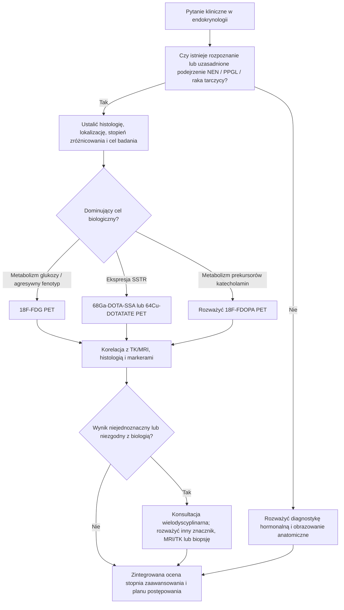

# 5.7. Pozytonowa tomografia emisyjna (PET/CT i PET/MR)

## Informacje o rozdziale

**Moduł:** 5. Diagnostyka obrazowa w endokrynologii  
**Poziom:** kształcenie medyczne, zawodowe i podyplomowe; zakres czynności zależy od kwalifikacji uczestnika  
**Charakter materiału:** dydaktyczny, interdyscyplinarny, oparty na medycynie opartej na dowodach, zasadzie uzasadnienia ekspozycji medycznej i optymalizacji ochrony radiologicznej  
**Stan przeglądu piśmiennictwa:** 28 listopada 2026 r.

> **Zastrzeżenie kliniczne i kompetencyjne.** PET/CT i PET/MR są badaniami medycyny nuklearnej wykorzystującymi radiofarmaceutyki emitujące pozytony. Dobór znacznika, kwalifikacja do badania, ustalenie aktywności, podanie radiofarmaceutyku, wykonanie akwizycji i interpretacja należą do odpowiednio uprawnionego zespołu, zgodnie z aktualnymi przepisami, charakterystyką produktu leczniczego i procedurami pracowni. Niniejszy rozdział nie upoważnia do samodzielnego zlecania lub wykonywania tych czynności poza zakresem kwalifikacji zawodowych. Wynik PET nie jest samodzielnym rozpoznaniem histopatologicznym, nie zastępuje badań hormonalnych ani oceny klinicznej i nie powinien być interpretowany wyłącznie na podstawie wartości SUV. Decyzje diagnostyczne i terapeutyczne wymagają korelacji z obrazowaniem anatomicznym, biochemią, histopatologią, genetyką i przebiegiem choroby.

## 1. Cele i efekty uczenia się

### 1.1. Cel główny

Celem rozdziału jest przygotowanie uczestnika do rozumienia zasad pozytonowej tomografii emisyjnej w diagnostyce endokrynologicznej, rozróżniania najważniejszych radioznaczników, rozpoznawania sytuacji, w których PET/CT lub PET/MR może dostarczyć informacji zmieniającej postępowanie, oraz krytycznej oceny ograniczeń badania. Szczególny nacisk położono na:
- obrazowanie metabolizmu glukozy za pomocą 18F-FDG;
- obrazowanie ekspresji receptorów somatostatynowych za pomocą znakowanych analogów somatostatyny, zwłaszcza 68Ga-DOTATATE, 68Ga-DOTATOC i 64Cu-DOTATATE;
- zastosowanie PET w guzach neuroendokrynnych (NEN), raku tarczycy i guzach chromochłonnych/przyzwojakach (PPGL);
- dobór znacznika do biologii guza, stopnia zróżnicowania, genotypu, lokalizacji i celu klinicznego;
- ocenę choroby przerzutowej oraz pułapki interpretacyjne, w tym wyniki fałszywie dodatnie i fałszywie ujemne.

### 1.2. Szczegółowe efekty uczenia się

Po ukończeniu rozdziału uczestnik powinien:

1. Wyjaśnić zasadę emisji pozytonu, anihilacji i rejestracji pary fotonów w PET.
2. Odróżnić PET od PET/CT, PET/MR, SPECT/CT oraz klasycznego obrazowania anatomicznego.
3. Opisać mechanizm gromadzenia 18F-FDG w tkankach o zwiększonym metabolizmie glukozy.
4. Wyjaśnić, dlaczego 18F-FDG nie jest znacznikiem swoistym dla nowotworu.
5. Opisać celowanie radioznaczników 68Ga-DOTATATE, 68Ga-DOTATOC i 64Cu-DOTATATE w receptory somatostatynowe.
6. Wskazać typowe zastosowania SSTR-PET w dobrze zróżnicowanych guzach neuroendokrynnych.
7. Wyjaśnić komplementarność SSTR-PET i FDG-PET w ocenie heterogeniczności biologicznej NEN.
8. Wskazać wybrane sytuacje, w których FDG-PET/CT może być użyteczne w raku tarczycy.
9. Omówić dobór radioznacznika PET w PPGL z uwzględnieniem genotypu i lokalizacji guza.
10. Rozpoznać ograniczenia badania, prawidłową dystrybucję fizjologiczną i częste przyczyny wyników fałszywie dodatnich.
11. Wyjaśnić wpływ wielkości zmiany, ekspresji celu molekularnego, glikemii, leczenia i parametrów technicznych na wynik.
12. Przygotować pacjenta do badania w granicach własnych kompetencji i zgodnie z instrukcjami pracowni.
13. Rozumieć zasady ochrony radiologicznej, postępowania w ciąży i laktacji oraz dokumentowania ekspozycji.
14. Krytycznie odczytać opis PET, nie utożsamiając wzmożonego wychwytu ze złośliwością ani braku wychwytu z wykluczeniem choroby.
15. Przekazać wynik i istotne ograniczenia osobie prowadzącej pacjenta oraz rozpoznać wskazania do konsultacji wielodyscyplinarnej.

### 1.3. Zakres kompetencji

| Czynność | Zakres odpowiedzialności |
|---|---|
| Zebranie informacji o rozpoznaniu, leczeniu, implantach, cukrzycy, ciąży i wcześniejszych badaniach | Personel uczestniczący w przygotowaniu pacjenta, zgodnie z procedurą i zakresem uprawnień |
| Udzielenie informacji organizacyjnej o przygotowaniu | Przeszkolony personel, według zatwierdzonych instrukcji pracowni |
| Decyzja o wskazaniu i wyborze radioznacznika | Lekarz kierujący i lekarz medycyny nuklearnej, z uwzględnieniem lokalnych zasad |
| Ocena ryzyka radiologicznego i decyzja o podaniu radiofarmaceutyku | Uprawniony zespół medycyny nuklearnej |
| Przygotowanie i podanie radiofarmaceutyku | Osoby posiadające wymagane kwalifikacje i uprawnienia |
| Akwizycja i kontrola jakości | Personel medycyny nuklearnej zgodnie z kompetencjami |
| Interpretacja obrazu i sporządzenie opisu | Lekarz posiadający właściwe kwalifikacje w zakresie medycyny nuklearnej i diagnostyki obrazowej |
| Rozpoznanie nowotworu i wybór leczenia | Zespół prowadzący; wymaga integracji danych klinicznych, obrazowych, laboratoryjnych i patomorfologicznych |
| Zmiana leczenia hormonalnego, insulinoterapii lub analogów somatostatyny | Wyłącznie osoba uprawniona, po indywidualnej ocenie ryzyka |

## 2. Podstawy fizyczne i biologiczne PET

### 2.1. Emisja pozytonu i anihilacja

Pozytonowa tomografia emisyjna wykorzystuje radionuklidy, które podczas rozpadu emitują pozytony. Pozyton jest antycząstką elektronu. Po przebyciu krótkiej drogi w tkance ulega anihilacji z elektronem, czemu zwykle towarzyszy emisja dwóch fotonów o energii 511 keV, poruszających się w przybliżeniu w przeciwnych kierunkach.

Detektory aparatu rejestrują fotony w koincydencji czasowej. Z dużej liczby zdarzeń rekonstruuje się przestrzenny rozkład radiofarmaceutyku. Współczesne aparaty mogą wykorzystywać również informację o czasie przelotu fotonów (time-of-flight, TOF), co poprawia lokalizację zdarzenia i stosunek sygnału do szumu, lecz nie eliminuje wszystkich ograniczeń rozdzielczości.

PET przedstawia rozmieszczenie znacznika w organizmie, a nie bezpośrednio strukturę histologiczną guza. Znaczenie obrazu zależy od biologii radiofarmaceutyku: może on odzwierciedlać metabolizm, ekspresję receptora, transport aminokwasu albo inny proces komórkowy.

### 2.2. PET/CT i PET/MR

| Metoda | Informacja funkcjonalna | Informacja anatomiczna | Najważniejsze zalety | Ograniczenia |
|---|---|---|---|---|
| PET | Rozkład radiofarmaceutyku | Ograniczona lokalizacja przestrzenna | Obrazowanie procesów biologicznych całego ciała | Mniejsza precyzja lokalizacji bez korelacji anatomicznej |
| PET/CT | Rozkład radiofarmaceutyku | TK | Szeroka dostępność, szybka akwizycja, dobra lokalizacja zmian i ocena płuc/kości | Promieniowanie z radiofarmaceutyku i TK; artefakty wynikające z ruchu i korekcji osłabienia |
| PET/MR | Rozkład radiofarmaceutyku | MRI | Wysoki kontrast tkanek miękkich, dobre obrazowanie wątroby, miednicy i mózgowia; możliwość ograniczenia dawki z komponentu TK | Ograniczona dostępność, dłuższy czas badania, wymagania bezpieczeństwa MR, trudniejsza standaryzacja korekcji osłabienia |

PET/CT może obejmować niskodawkową TK służącą przede wszystkim korekcji osłabienia i lokalizacji albo diagnostyczną TK z kontrastem. Nie są to równoważne protokoły. W opisie należy wskazać, jaki rodzaj TK wykonano. Jeżeli pytanie kliniczne wymaga dokładnej oceny naciekania, naczyń, wątroby lub struktur szyi, może być konieczne odrębne, odpowiednio zaplanowane badanie anatomiczne.

PET/MR łączy dane PET z sekwencjami MRI. Szczególną wartość może mieć w ocenie przerzutów wątrobowych NEN, zmian w mózgowiu, miednicy i tkankach miękkich. Nie oznacza to, że PET/MR jest zawsze lepsze od PET/CT. Wybór zależy od celu badania, lokalizacji zmian, dostępności, przeciwwskazań i doświadczenia ośrodka.

### 2.3. Radiofarmaceutyk, radioznacznik i cel biologiczny

Radiofarmaceutyk składa się z radionuklidu oraz cząsteczki nośnikowej lub ligandu, który wpływa na jego dystrybucję. W diagnostyce endokrynologicznej najważniejsze są następujące grupy:

- znaczniki metabolizmu glukozy, np. 18F-FDG;
- znakowane analogi somatostatyny, np. 68Ga-DOTATATE, 68Ga-DOTATOC i 64Cu-DOTATATE;
- znaczniki metabolizmu aminokwasów i prekursorów katecholamin, np. 18F-FDOPA;
- inne znaczniki stosowane w wyspecjalizowanych wskazaniach, zależnie od dostępności i lokalnych rejestracji.

| Radiofarmaceutyk | Główny mechanizm | Typowe zastosowanie endokrynologiczne |
|---|---|---|
| 18F-FDG | Transport glukozy i fosforylacja analogu | Agresywne lub słabo zróżnicowane NEN, wybrane raki tarczycy, PPGL, ocena aktywności metabolicznej |
| 68Ga-DOTATATE | Wiązanie z receptorami somatostatynowymi, głównie SSTR2 | Dobrze zróżnicowane NEN, PPGL z ekspresją SSTR, kwalifikacja do terapii receptorowej |
| 68Ga-DOTATOC | Wiązanie z receptorami somatostatynowymi | Obrazowanie SSTR-dodatnich NEN; charakterystyka zależy od ligandu i protokołu |
| 64Cu-DOTATATE | Wiązanie z SSTR, z użyciem radionuklidu 64Cu | Obrazowanie SSTR-dodatnich NEN w ośrodkach dysponujących preparatem |
| 18F-FDOPA | Transport i metabolizm prekursorów amin katecholowych | Wybrane PPGL, niektóre guzy neuroendokrynne, w tym rak rdzeniasty tarczycy w określonych sytuacjach |

Dostępność, rejestracja, refundacja i doświadczenie w poszczególnych radiofarmaceutykach różnią się między krajami i ośrodkami. Nie należy zakładać, że każdy znacznik jest dostępny lub zatwierdzony do każdego wskazania.

## 3. 18F-FDG PET/CT

### 3.1. Mechanizm gromadzenia 18F-FDG

18F-fluorodeoksyglukoza jest analogiem glukozy znakowanym fluorem-18. Po podaniu dożylnym jest transportowana do komórek za pośrednictwem transporterów glukozy, a następnie fosforylowana przez heksokinazę do 18F-FDG-6-fosforanu. Produkt ten nie jest dalej metabolizowany w taki sam sposób jak glukoza i może ulegać wewnątrzkomórkowemu zatrzymaniu.

Wzmożony wychwyt może występować w komórkach nowotworowych o zwiększonym metabolizmie glukozy, ale także w:
- aktywowanych leukocytach i makrofagach;
- tkankach objętych infekcją lub zapaleniem;
- mięśniach po wysiłku;
- brunatnej tkance tłuszczowej;
- niektórych tkankach o fizjologicznie wysokim metabolizmie.

Dlatego 18F-FDG nie jest znacznikiem swoistym dla raka. Obraz wymaga korelacji z anatomią, czasem od wystąpienia objawów, leczeniem, wynikami laboratoryjnymi i kontekstem klinicznym.

### 3.2. Wskazania do FDG-PET w endokrynologii

FDG-PET może być przydatne w następujących sytuacjach:

1. Podejrzenie agresywnego, słabo zróżnicowanego lub wysokiego stopnia NEN.
2. Ocena heterogeniczności biologicznej guza, szczególnie gdy część zmian jest słabo widoczna w SSTR-PET.
3. Ocena choroby przerzutowej, gdy wynik może zmienić strategię leczenia.
4. Ocena odpowiedzi metabolicznej na wybrane terapie, z zachowaniem porównywalności protokołu i czasu badania.
5. Rak tarczycy o wysokim ryzyku nawrotu z podwyższoną tyreoglobuliną lub przeciwciałami anty-Tg, szczególnie przy ujemnym lub niejednoznacznym obrazowaniu jodowym i odpowiednio dobranym obrazowaniu anatomicznym.
6. Rak oksyfilny tarczycy (onkocytarny), rak słabo zróżnicowany lub inne agresywne histologie, jeśli istnieje kliniczne podejrzenie utrzymywania się choroby.
7. Wybrane PPGL, zwłaszcza w kontekście choroby przerzutowej, agresywnej biologii lub określonego profilu molekularnego.

Nie jest zalecane rutynowe wykonywanie FDG-PET/CT przed operacją u każdego pacjenta z nowo rozpoznanym zróżnicowanym rakiem tarczycy. Badanie powinno odpowiadać na konkretne pytanie kliniczne, a nie zastępować USG szyi, TK/MRI lub diagnostykę radiojodową.

### 3.3. FDG-PET w guzach neuroendokrynnych

NEN obejmują nowotwory o bardzo zróżnicowanej biologii. Dobrze zróżnicowane guzy G1 i część G2 mogą wykazywać silną ekspresję SSTR i względnie niewielki wychwyt FDG. Wraz ze wzrostem stopnia złośliwości, proliferacji i utratą zróżnicowania może wzrastać metabolizm glukozy, a ekspresja receptorów somatostatynowych może ulegać zmniejszeniu lub stawać się niejednorodna.

FDG-PET jest szczególnie przydatne:
- w NEN G3 i rakach neuroendokrynnych (NEC);
- przy szybkim wzroście guza lub progresji mimo leczenia;
- w przypadku zmian widocznych w TK/MRI, ale niewykazujących spodziewanego wychwytu SSTR;
- gdy ocena agresywniejszego komponentu może wpłynąć na wybór leczenia;
- w wybranych sytuacjach przed leczeniem miejscowym lub systemowym, jeżeli wynik może zmienić zakres postępowania.

Nie wolno utożsamiać kategorii G3 z jednym obrazem PET. Dobrze zróżnicowany NET G3 może zachowywać ekspresję SSTR, natomiast słabo zróżnicowany NEC często ma wysoką aktywność FDG. Klasyfikacja histopatologiczna, indeks Ki-67, morfologia i przebieg kliniczny pozostają niezbędne.

### 3.4. Związek między FDG a rokowaniem

W wielu NEN większa aktywność FDG wiąże się z bardziej agresywną biologią i gorszym rokowaniem. Jest to jednak zależność populacyjna, a nie indywidualny wyrok prognostyczny. Wynik zależy od typu guza, stopnia zróżnicowania, lokalizacji, obciążenia chorobą, leczenia i kryteriów oceny.

Nie należy przedstawiać samej wartości SUVmax jako bezpośredniej miary przeżycia ani podejmować decyzji terapeutycznej wyłącznie na tej podstawie. Wartość prognostyczna jest większa, gdy obraz PET jest interpretowany razem z histologią, Ki-67, obrazowaniem anatomicznym i danymi klinicznymi.

## 4. PET z analogami somatostatyny znakowanymi 68Ga i 64Cu

### 4.1. Receptory somatostatynowe

Receptory somatostatynowe (SSTR1–SSTR5) są receptorami błonowymi sprzężonymi z białkami G. Występują w prawidłowych tkankach oraz w wielu guzach neuroendokrynnych. W dobrze zróżnicowanych NEN często dochodzi do nadekspresji receptorów, zwłaszcza podtypu SSTR2.

Analogi somatostatyny połączone z chelatorem DOTA mogą być znakowane radionuklidami emitującymi pozytony. Najczęściej stosuje się:
- 68Ga-DOTATATE;
- 68Ga-DOTATOC;
- 64Cu-DOTATATE.

Różnią się one powinowactwem do poszczególnych podtypów receptorów, właściwościami fizycznymi radionuklidu, czasem półtrwania, logistyką produkcji i dostępnością. Nie należy traktować ich nazw jako synonimów identycznego preparatu.

### 4.2. 68Ga-DOTATATE

68Ga-DOTATATE wiąże się z dużym powinowactwem przede wszystkim z SSTR2. Jest szeroko stosowany do obrazowania dobrze zróżnicowanych guzów neuroendokrynnych. Typowe wskazania obejmują:
- lokalizację ogniska pierwotnego, gdy istnieje uzasadnione podejrzenie NEN;
- ocenę zasięgu choroby przed leczeniem;
- wykrywanie zmian przerzutowych;
- ocenę nawrotu lub progresji;
- ocenę ekspresji SSTR przed rozważeniem terapii radionuklidowej;
- ocenę wybranych PPGL, zwłaszcza związanych z SDHx lub lokalizacją przyzwojaka głowy i szyi.

SSTR-PET może wykrywać zmiany, które nie są widoczne w klasycznej scyntygrafii receptorowej z 111In-pentetreotydem, jednak jego czułość nie jest nieograniczona. Małe zmiany, niska ekspresja receptora, dedyferencjacja, lokalizacja przy narządach o dużym fizjologicznym wychwycie i ruch oddechowy mogą utrudniać ocenę.

### 4.3. 68Ga-DOTATOC

68Ga-DOTATOC jest analogiem somatostatyny o profilu powinowactwa do SSTR różniącym się od DOTATATE. Może być używany w podobnych wskazaniach, zależnie od rejestracji i doświadczenia ośrodka. Porównywanie wartości SUV pomiędzy różnymi ligandami, skanerami i protokołami wymaga ostrożności. Zmiana radiofarmaceutyku w kolejnych badaniach może utrudnić ilościową ocenę dynamiki.

### 4.4. 64Cu-DOTATATE

64Cu-DOTATATE wykorzystuje miedź-64, radionuklid o dłuższym okresie półtrwania niż gal-68. Może to ułatwiać logistykę dystrybucji i pozwalać na akwizycję w innych przedziałach czasowych, zależnie od zatwierdzonego protokołu. Nie należy jednak zakładać, że dłuższy okres półtrwania automatycznie oznacza większą czułość w każdym wskazaniu.

Dostępność 64Cu-DOTATATE jest ograniczona geograficznie. W dokumentacji należy podać konkretny zastosowany ligand i radionuklid, ponieważ różnice preparatu, czasu obrazowania i protokołu mają znaczenie dla interpretacji oraz porównywania badań.

### 4.5. Typowe wskazania SSTR-PET w NEN

| Sytuacja kliniczna | Możliwa rola SSTR-PET | Ważne zastrzeżenie |
|---|---|---|
| Nowo rozpoznany dobrze zróżnicowany NET | Ocena zasięgu i lokalizacja ognisk | Należy znać typ histologiczny i cel badania |
| NEN o nieznanym ognisku pierwotnym | Poszukiwanie ogniska SSTR-dodatniego | Wynik ujemny nie wyklucza NEN |
| Podejrzenie nawrotu | Lokalizacja zmian, jeżeli wynik wpłynie na leczenie | Korelować z TK/MRI i markerami |
| Podejrzenie przerzutów | Ocena całego ciała i rozkładu ekspresji SSTR | Zmiany o niskiej ekspresji mogą być niewidoczne |
| Kwalifikacja do PRRT | Ocena obecności i intensywności ekspresji celu | Obrazowanie nie zastępuje oceny funkcji nerek, szpiku i kryteriów klinicznych |
| Progresja w trakcie leczenia | Ocena zmian receptorowych i heterogeniczności | Należy uwzględnić czas od terapii i zmianę biologii guza |

### 4.6. Skala wychwytu i ocena ekspresji SSTR

W praktyce można stosować jakościową ocenę wychwytu w porównaniu z tłem narządowym, a także zmodyfikowane skale Krenninga. W różnych publikacjach i protokołach występują odmienne warianty skali; raport powinien wskazywać zastosowaną metodę.

Przykładowa koncepcja jakościowa:
- brak wychwytu;
- wychwyt nie większy niż tło puli krwi;
- wychwyt większy od puli krwi, ale nie większy niż wątroba;
- wychwyt większy niż wątroba, ale nie większy niż śledziona;
- wychwyt większy niż w śledzionie.

Wartość kliniczna nie wynika wyłącznie z najwyższego wychwytu pojedynczej zmiany. Istotna jest ekspresja SSTR w całej mierzalnej masie choroby, jej heterogeniczność i zgodność z kryteriami terapii. W kwalifikacji do PRRT konieczna jest ocena całego obrazu, stanu klinicznego, morfologii krwi, czynności nerek, wątroby, wcześniejszego leczenia oraz przeciwwskazań.

## 5. Dobór znacznika do biologii guza

### 5.1. Zasada biologicznego dopasowania

Najważniejszym pytaniem nie jest: „który PET jest najczulszy?”, lecz: „jaki proces biologiczny chcemy uwidocznić?”. Znacznik powinien być dobrany do:
- typu histologicznego i stopnia zróżnicowania guza;
- indeksu proliferacyjnego Ki-67, jeśli jest dostępny;
- ekspresji receptorów somatostatynowych;
- profilu molekularnego i genotypu w wybranych chorobach;
- lokalizacji ogniska pierwotnego;
- podejrzenia przerzutów i ich lokalizacji;
- wcześniejszego leczenia;
- celu badania: rozpoznanie, staging, restaging, ocena odpowiedzi, kwalifikacja do terapii celowanej.

### 5.2. Uproszczona macierz wyboru

| Fenotyp biologiczny / pytanie | Rozważany znacznik | Uzasadnienie | Ograniczenie |
|---|---|---|---|
| Dobrze zróżnicowany NET z ekspresją SSTR | 68Ga-DOTATATE / DOTATOC lub 64Cu-DOTATATE | Obrazowanie celu receptorowego | Brak ekspresji lub heterogeniczność może dać wynik ujemny |
| NEN wysokiego stopnia lub NEC | 18F-FDG | Wysoka aktywność glikolityczna | Nie określa samodzielnie histologii |
| NET z niejednorodną ekspresją SSTR i podejrzeniem dedyferencjacji | SSTR-PET oraz rozważenie FDG-PET | Uwidocznienie odmiennych fenotypów zmian | Interpretacja wymaga zespołu wielodyscyplinarnego |
| PPGL związany z SDHx lub choroba przerzutowa | Często SSTR-PET; w wybranych sytuacjach FDG lub FDOPA | Dobór do genotypu, lokalizacji i biologii | Nie istnieje jeden znacznik optymalny dla wszystkich PPGL |
| Pheochromocytoma sporadyczny lub niektóre dziedziczne zespoły bez SDHx | W wybranych sytuacjach 18F-FDOPA | Obrazowanie szlaku syntezy katecholamin | Dostępność i wskazania są ograniczone |
| Zróżnicowany rak tarczycy z podejrzeniem choroby jodoopornej | 18F-FDG w wybranych wskazaniach | Wykrywanie aktywnych metabolicznie zmian | Nie zastępuje oceny tyreoglobuliny i obrazowania strukturalnego |
| Rak oksyfilny lub słabo zróżnicowany tarczycy | 18F-FDG w odpowiednim kontekście | Często większy metabolizm glukozy | Wynik nie przesądza o możliwości leczenia |
| Rak rdzeniasty tarczycy | Znacznik dobierany indywidualnie; m.in. 18F-FDOPA, FDG lub SSTR w wybranych sytuacjach | Zmienna ekspresja celów molekularnych | Nie należy rutynowo zakładać przewagi jednego preparatu |

Powyższa tabela jest mapą koncepcyjną, a nie algorytmem automatycznego zlecania. Ostateczny wybór należy do zespołu prowadzącego i medycyny nuklearnej.

### 5.3. Obrazowanie dwóch fenotypów jednocześnie

U wybranych pacjentów z NEN wykonuje się zarówno SSTR-PET, jak i FDG-PET. Celem jest ocena, czy wszystkie ogniska zachowują ekspresję receptorów, czy też część wykazuje bardziej agresywny fenotyp metaboliczny.

Możliwe wzorce:
- **SSTR-dodatni / FDG-ujemny lub słabo dodatni:** często spotykany w dobrze zróżnicowanych, wolniej rosnących NET;
- **SSTR-dodatni / FDG-dodatni:** może wskazywać na aktywny metabolicznie, ale nadal receptorowo dodatni guz;
- **SSTR-ujemny / FDG-dodatni:** może sugerować utratę ekspresji receptorów i dedyferencjację;
- **SSTR-ujemny / FDG-ujemny:** nie wyklucza nowotworu; należy rozważyć rozmiar zmian, typ histologiczny, inne znaczniki i obrazowanie anatomiczne.

Wyniki badań dwuznacznikowych mogą dostarczyć informacji prognostycznej i pomóc w wyborze miejsca biopsji, jeżeli jest ona klinicznie uzasadniona. Nie należy jednak traktować pojedynczego wzorca jako zamiennika badania patomorfologicznego. Biopsja powinna być planowana po analizie ryzyka, dostępności zmiany i wpływu wyniku na leczenie.

## 6. PET w guzach neuroendokrynnych

### 6.1. Lokalizacja ogniska pierwotnego

W NEN o nieznanym ognisku pierwotnym SSTR-PET może pomóc zlokalizować guz i wykryć przerzuty. Obrazowanie powinno być zestawione z:
- wynikiem histopatologii i immunohistochemii;
- informacją o różnicowaniu i Ki-67;
- endoskopią, jeżeli wskazana;
- wielofazową TK lub MRI;
- wynikami hormonalnymi i markerami, jeśli są właściwe dla danego zespołu klinicznego.

Wynik PET nie zawsze pozwala ustalić narząd pochodzenia. Fizjologiczny wychwyt w trzustce, śledzionie, nadnerczach, przysadce i innych narządach może utrudniać lokalizację. W przypadku podejrzanego ogniska konieczna może być korelacja z MRI, wielofazową TK, endoskopią lub badaniem histopatologicznym.

### 6.2. Ocena choroby przerzutowej

PET może ujawniać przerzuty w:
- węzłach chłonnych;
- wątrobie;
- kościach;
- płucach i śródpiersiu;
- otrzewnej;
- innych lokalizacjach zależnych od typu NEN.

SSTR-PET jest szczególnie użyteczne w dobrze zróżnicowanych NEN, natomiast FDG-PET może lepiej odzwierciedlać agresywne lub dedyferencjonowane komponenty. Wątroba stanowi szczególne wyzwanie ze względu na fizjologiczny wychwyt i zmienność tła. MRI wątroby z odpowiednim protokołem, w tym sekwencjami dyfuzyjnymi i kontrastem hepatotropowym, może uzupełniać PET, zwłaszcza przy małych zmianach.

### 6.3. Ocena odpowiedzi na leczenie

Interpretacja odpowiedzi wymaga porównywalności:
- rodzaju radiofarmaceutyku;
- czasu od podania do rozpoczęcia akwizycji;
- parametrów aparatu i rekonstrukcji;
- zakresu badania;
- poziomu glikemii w FDG-PET;
- czasu od ostatniego leczenia;
- zastosowanego leczenia objawowego i przeciwnowotworowego.

Zmniejszenie wychwytu nie zawsze oznacza zmniejszenie masy guza, a zwiększenie wychwytu może być przejściowo związane z zapaleniem, leczeniem lub zmianą ekspresji celu. W niektórych sytuacjach obrazowanie strukturalne i metaboliczne mogą dawać pozornie sprzeczne wyniki.

W przypadku FDG-PET można stosować kryteria odpowiedzi metabolicznej, np. PERCIST, jeżeli spełniono wymagania techniczne i kliniczne. Nie należy jednak przenosić tych kryteriów automatycznie na SSTR-PET ani na każdy typ NEN.

### 6.4. SSTR-PET a terapia radionuklidowa (PRRT)

Terapia radionuklidowa ukierunkowana na receptor, np. z użyciem 177Lu-DOTATATE, wymaga obecności odpowiedniej ekspresji SSTR w zmianach nowotworowych. SSTR-PET jest ważnym elementem kwalifikacji, ale nie jedynym.

Zespół kwalifikujący uwzględnia:
- rozpoznanie histopatologiczne i stopień zróżnicowania;
- rozkład i intensywność ekspresji SSTR w zmianach;
- progresję choroby i wcześniejsze leczenie;
- czynność nerek i wątroby;
- morfologię krwi i rezerwę szpikową;
- stan ogólny, choroby współistniejące i oczekiwane korzyści;
- ryzyko toksyczności oraz dostępność alternatywnych metod leczenia.

PET nie jest samodzielnym testem „kwalifikującym” do PRRT. Obrazowanie wskazuje, czy istnieje cel molekularny, natomiast ostateczna decyzja wymaga pełnej oceny klinicznej i laboratoryjnej.

## 7. PET w raku tarczycy

### 7.1. Zróżnicowany rak tarczycy

W zróżnicowanym raku tarczycy (DTC) komórki nowotworowe mogą zachowywać zdolność wychwytu jodu, dlatego diagnostyka radiojodowa ma odrębną rolę. FDG-PET/CT jest szczególnie rozważane u pacjentów z wysokim ryzykiem nawrotu, podwyższoną lub narastającą tyreoglobuliną (Tg) albo przeciwciałami anty-Tg, zwłaszcza gdy badanie radiojodowe jest ujemne lub nie wyjaśnia obrazu klinicznego.

Wskazania mogą obejmować:
- podejrzenie choroby utrzymującej się lub nawrotowej przy niejednoznacznym USG i obrazowaniu radiojodowym;
- raka o bardziej agresywnej histologii;
- raka oksyfilnego (onkocytarnego), który może wykazywać ograniczony wychwyt jodu;
- ocenę choroby przerzutowej, gdy wynik wpłynie na decyzję terapeutyczną;
- ocenę odpowiedzi w wybranych przypadkach zaawansowanej choroby.

Wytyczne ATA 2025 nie zalecają rutynowego przedoperacyjnego FDG-PET/CT u każdego chorego z DTC. Badanie może być rozważane u pacjentów wysokiego ryzyka z podwyższoną Tg, szczególnie przy agresywnej histologii lub ujemnym obrazowaniu radiojodowym. Wynik powinien być interpretowany razem z trendem Tg/TgAb, statusem TSH, wcześniejszym leczeniem i badaniami strukturalnymi.

### 7.2. Zjawisko „flip-flop”

W niektórych nowotworach tarczycy wraz z utratą zdolności wychwytu jodu wzrasta metabolizm glukozy. Może to prowadzić do wzorca:
- słaby lub brak wychwytu radiojodu;
- wzmożony wychwyt 18F-FDG.

Zjawisko to określa się jako „flip-flop”. Jest ono związane z biologiczną dedyferencjacją w części przypadków, ale nie występuje u każdego pacjenta i nie powinno być interpretowane jako samodzielne kryterium jodooporności. Ocena jodooporności wymaga uwzględnienia historii podania radiojodu, wyników scyntygrafii po leczeniu, dynamiki zmian i kryteriów klinicznych.

### 7.3. Rak rdzeniasty tarczycy

Rak rdzeniasty tarczycy (MTC) wywodzi się z komórek C i nie jest typowym nowotworem wychwytującym jod. W wybranych sytuacjach PET może wspomagać lokalizację choroby przy wzroście kalcytoniny lub CEA i ujemnym albo niejednoznacznym obrazowaniu konwencjonalnym.

Możliwe znaczniki obejmują:
- 18F-FDOPA, odzwierciedlający metabolizm prekursorów amin biogennych;
- 18F-FDG, zwłaszcza w bardziej agresywnych lub słabo zróżnicowanych zmianach;
- analogi somatostatyny znakowane PET, jeżeli guz wykazuje odpowiednią ekspresję SSTR i istnieje konkretne pytanie kliniczne.

Czułość zależy od stężenia markerów, czasu podwojenia kalcytoniny i CEA, obciążenia chorobą, lokalizacji zmian i właściwości znacznika. Wynik ujemny nie wyklucza nawrotu MTC.

### 7.4. Inne nowotwory tarczycy

W raku anaplastycznym i słabo zróżnicowanym FDG-PET może być użyteczne w ocenie rozległości choroby, odległych przerzutów i odpowiedzi na leczenie, jeśli wynik wpływa na postępowanie. W każdym przypadku należy uwzględnić pilność kliniczną i nie opóźniać leczenia wymagającego natychmiastowej interwencji.

## 8. PET w guzach chromochłonnych i przyzwojakach (PPGL)

### 8.1. Biologia PPGL a obrazowanie funkcjonalne

PPGL obejmują guzy chromochłonne rdzenia nadnerczy i przyzwojaki pozanadnerczowe. Ich obrazowanie zależy od:
- lokalizacji (nadnerczowa, współczulna pozanadnerczowa, głowa i szyja);
- wydzielania katecholamin i metabolitów;
- mutacji germinalnych lub somatycznych, w tym SDHx, RET, VHL, NF1, MAX i innych;
- wieloogniskowości i ryzyka przerzutów;
- ekspresji transporterów, enzymów i receptorów;
- wcześniejszego leczenia.

Przed obrazowaniem funkcjonalnym należy zwykle przeprowadzić odpowiednią diagnostykę biochemiczną, np. oznaczenie wolnych metanefryn w osoczu lub frakcjonowanych metanefryn w moczu, jeśli jest to właściwe klinicznie. Ujemne badanie biochemiczne nie wyklucza każdego PPGL, zwłaszcza małego, nieme­tanefrynowego lub określonego genetycznie guza. Dobór badań powinien uwzględniać fenotyp kliniczny.

### 8.2. 68Ga-DOTA-SSA w PPGL

SSTR-PET może być szczególnie przydatne w:
- przyzwojakach głowy i szyi;
- chorobie związanej z SDHx;
- wieloogniskowych lub przerzutowych PPGL;
- ocenie ekspresji SSTR przed rozważeniem terapii receptorowej;
- lokalizacji zmian, których nie wykryto w obrazowaniu anatomicznym.

W niektórych populacjach 68Ga-DOTA-SSA wykazuje wysoką czułość, zwłaszcza w przerzutowych i SDHx-zależnych PPGL. Nie jest jednak uniwersalnie najlepszym znacznikiem dla każdego guza chromochłonnego.

### 8.3. 18F-FDOPA

18F-FDOPA jest analogiem aminokwasu, którego transport i metabolizm mogą być wykorzystywane do obrazowania guzów związanych z syntezą amin biogennych. W wybranych PPGL, zwłaszcza sporadycznych guzach chromochłonnych i niektórych przypadkach bez mutacji SDHx, może wykazywać wysoką czułość. Może być również użyteczne w niektórych przypadkach MTC i innych nowotworów neuroendokrynnych.

### 8.4. 18F-FDG

FDG-PET może być przydatne w PPGL o bardziej agresywnej biologii, w chorobie przerzutowej i w niektórych zespołach związanych z SDHx. Zwiększony wychwyt może odzwierciedlać zwiększony metabolizm, ale nie jest samodzielnym dowodem złośliwości.

### 8.5. Dobór znacznika w PPGL – zasada praktyczna

| Profil kliniczny | Znacznik, który może być rozważony | Uwagi |
|---|---|---|
| Pojedynczy, sporadyczny pheochromocytoma | 18F-FDOPA w wybranych ośrodkach; inne metody zależnie od dostępności | W wielu przypadkach obrazowanie anatomiczne może być wystarczające |
| Przyzwojak głowy i szyi | 68Ga-DOTA-SSA, ewentualnie 18F-FDOPA | SSTR-PET często zapewnia wysoką czułość |
| PPGL związany z SDHx | 68Ga-DOTA-SSA lub FDG, zależnie od genotypu i fenotypu | Często konieczna ocena całego ciała |
| Choroba przerzutowa | 68Ga-DOTA-SSA, FDG lub FDOPA w zależności od biologii | Możliwe obrazowanie wieloznacznikowe |
| Ocena przed terapią receptorową | SSTR-PET | Wymaga oceny ekspresji w całej mierzalnej chorobie |
| Podejrzenie progresji lub dedyferencjacji | Rozważenie FDG-PET obok SSTR-PET | Należy porównać z TK/MRI i biologią guza |

Tabela nie zastępuje algorytmów uwzględniających genotyp, wiek, lokalizację, aktywność hormonalną, dostępność radiofarmaceutyków i lokalne zalecenia. W PPGL szczególnie ważne jest poradnictwo genetyczne, ponieważ wynik badania molekularnego może zmienić dobór obrazowania i nadzór rodziny.

## 9. PET/MR w endokrynologii

### 9.1. Potencjalne korzyści

PET/MR może łączyć informację metaboliczną lub receptorową PET z wysoką rozdzielczością tkanek miękkich MRI. Potencjalne zastosowania obejmują:
- ocenę przerzutów wątrobowych NEN;
- ocenę zmian w mózgowiu i okolicy siodła tureckiego w wybranych wskazaniach;
- ocenę miednicy i tkanek miękkich;
- ocenę zmian, w których kontrast tkanek miękkich ma szczególne znaczenie;
- ograniczenie komponentu promieniowania z TK, jeżeli protokół PET/MR rzeczywiście zastępuje PET/CT.

PET/MR nie eliminuje ekspozycji na promieniowanie pochodzące z radiofarmaceutyku. Jeżeli używa się gadolinowego środka kontrastowego, pozostają zasady oceny wskazań, funkcji nerek, wcześniejszych reakcji i bezpieczeństwa MR.

### 9.2. PET/MR w guzach neuroendokrynnych

W NEN szczególną rolę może odgrywać MRI wątroby, ponieważ małe przerzuty wątrobowe bywają trudne do oceny w PET/CT, zwłaszcza przy fizjologicznym wychwycie wątrobowym znacznika SSTR. Sekwencje T1, T2, DWI i obrazowanie po kontraście mogą poprawić wykrywanie i charakterystykę zmian.

PET/MR może zatem dostarczyć informacji komplementarnych. Nie należy jednak zakładać, że PET/MR zawsze wykryje każdą zmianę niewidoczną w PET/CT. Wynik zależy od jakości sekwencji, aparatu, ruchu oddechowego, wielkości zmian i doświadczenia zespołu.

### 9.3. Ograniczenia PET/MR

- mniejsza dostępność i wyższy koszt;
- dłuższy czas badania;
- ryzyko artefaktów ruchowych;
- konieczność oceny zgodności implantów i urządzeń z warunkami MR;
- bardziej złożona korekcja osłabienia fotonów;
- różnice w protokołach i standaryzacji;
- ograniczenia w ocenie niektórych zmian płucnych i zwapnień w porównaniu z TK.

## 10. Ocena choroby przerzutowej i rozkładu zmian

### 10.1. Ocena całego ciała

Zakres obrazowania powinien wynikać z pytania klinicznego i protokołu. W endokrynologii często konieczna jest ocena całego ciała, ponieważ NEN i PPGL mogą dawać przerzuty w wielu lokalizacjach, a rak tarczycy może zajmować węzły chłonne, płuca, kości lub inne narządy.

W opisie należy określić:
- lokalizację zmian;
- liczbę i przybliżone wymiary ognisk;
- rozkład wychwytu;
- relację do struktur anatomicznych;
- zgodność z wcześniejszymi badaniami;
- cechy sugerujące powikłania lub zagrożenie narządowe;
- ograniczenia badania, w tym obszary o niepełnej ocenie.

### 10.2. PET a klasyfikacja stopnia zaawansowania

PET może wpływać na stopień zaawansowania, ale nie zastępuje pełnego systemu klasyfikacji dla danego nowotworu. Węzły chłonne lub ogniska kostne z wychwytem nie powinny być automatycznie uznawane za przerzuty bez uwzględnienia lokalizacji, morfologii, prawdopodobieństwa przedtestowego i ewentualnego potwierdzenia.

Wynik może prowadzić do:
- zmiany planu operacji;
- wyboru miejsca biopsji;
- poszerzenia lub ograniczenia pola leczenia;
- zmiany kwalifikacji do terapii systemowej lub radionuklidowej;
- decyzji o obserwacji lub wykonaniu dodatkowego badania.

Każda zmiana postępowania powinna wynikać z oceny korzyści i ryzyka. Jeżeli wynik PET jest jedyną podstawą do istotnej decyzji, a obraz nie jest jednoznaczny, należy rozważyć konsultację ekspercką, badanie uzupełniające lub potwierdzenie histopatologiczne.

## 11. Przygotowanie pacjenta do PET

### 11.1. Informacje wymagane przed badaniem

Przed badaniem należy zweryfikować, zgodnie z procedurą pracowni:
- dane identyfikacyjne pacjenta;
- wskazanie i konkretne pytanie kliniczne;
- rozpoznanie histopatologiczne, jeśli jest dostępne;
- wcześniejsze badania obrazowe i radioizotopowe;
- leczenie operacyjne, radioterapię i leczenie systemowe;
- ostatnie podanie analogów somatostatyny, jeśli dotyczy;
- cukrzycę, insulinoterapię i ryzyko hipoglikemii;
- aktualną glikemię, jeżeli badanie tego wymaga;
- ciążę, możliwość ciąży i karmienie piersią;
- wcześniejsze reakcje na środki kontrastowe, jeśli planowana jest diagnostyczna TK z kontrastem;
- niewydolność nerek, jeśli planuje się kontrast lub jest to istotne dla bezpieczeństwa;
- klaustrofobię, ból, trudności w leżeniu nieruchomo;
- implanty, urządzenia i przeciwwskazania do MRI w przypadku PET/MR.

### 11.2. Przygotowanie do 18F-FDG

Szczegółowe instrukcje zależą od protokołu pracowni i sytuacji klinicznej. Zwykle obejmują:
- pozostawanie na czczo przez okres określony w instrukcji, często co najmniej 4–6 godzin;
- unikanie napojów i preparatów zawierających cukier;
- unikanie intensywnego wysiłku przed badaniem, zwykle przez co najmniej 6 godzin, a preferencyjnie dłużej zgodnie z procedurą;
- odpowiednie nawodnienie, jeżeli nie ma przeciwwskazań;
- pomiar i udokumentowanie glikemii;
- ograniczenie aktywności mięśniowej w okresie wychwytu;
- utrzymanie komfortu cieplnego, aby ograniczyć aktywację brunatnej tkanki tłuszczowej;
- opróżnienie pęcherza przed akwizycją, jeżeli zalecono.

U pacjentów z cukrzycą planowanie wymaga indywidualnego uzgodnienia. Nie wolno samodzielnie zalecać odstawienia insuliny, pomijania posiłku lub modyfikowania leków bez zatwierdzonego planu. Ryzyko hipoglikemii jest realne, szczególnie przy insulinie i pochodnych sulfonylomocznika. Zespół powinien ustalić termin badania, postępowanie z insuliną i monitorowanie glikemii.

Podwyższona glikemia może wpływać na dystrybucję FDG i interpretację ilościową, lecz nie istnieje jeden próg właściwy dla wszystkich protokołów klinicznych i badań naukowych. Należy stosować aktualne procedury ośrodka i odnotować glikemię, czas podania insuliny oraz inne czynniki mogące zmienić wychwyt.

### 11.3. Przygotowanie do SSTR-PET

W przypadku SSTR-PET szczegółowe wymagania dotyczące posiłków, nawodnienia, leków i czasu badania zależą od radiofarmaceutyku oraz procedury ośrodka. Należy przekazać zespołowi informację o:
- krótko- i długodziałających analogach somatostatyny;
- terminie ostatniego podania i planowanej kolejnej dawce;
- leczeniu PRRT lub innymi terapiami;
- wcześniejszych badaniach SSTR;
- zmianach klinicznych i wynikach obrazowania anatomicznego.

Nie należy automatycznie odstawiać analogów somatostatyny. W niektórych sytuacjach czas badania może być koordynowany z podaniem leku, ale decyzja należy do lekarza medycyny nuklearnej i zespołu prowadzącego. Nie wolno opóźniać koniecznego leczenia objawowego bez indywidualnego uzasadnienia.

### 11.4. PET/MR – dodatkowe przygotowanie

W PET/MR należy przeprowadzić standardową kwalifikację bezpieczeństwa MR:
- identyfikacja implantów i urządzeń;
- sprawdzenie warunków MR Safe, MR Conditional lub MR Unsafe;
- ocena ciał obcych i wcześniejszych zabiegów;
- usunięcie metalowych przedmiotów;
- ocena klaustrofobii i możliwości pozostania nieruchomo;
- ocena wskazań do gadolinowego środka kontrastowego;
- weryfikacja ciąży i innych czynników wpływających na bezpieczeństwo.

Nie wolno wprowadzać pacjenta do strefy MR na podstawie samego zapewnienia, że „implant jest bezpieczny”. Należy sprawdzić dokładny model urządzenia i wszystkie warunki producenta.

## 12. Ograniczenia interpretacji i wyniki fałszywie dodatnie

### 12.1. Zasada: wychwyt nie jest równoznaczny z rakiem

Wzmożony wychwyt radiofarmaceutyku oznacza zwiększoną dostępność określonego procesu biologicznego lub celu molekularnego. Nie jest samodzielnym dowodem złośliwości. W FDG-PET wychwyt może wynikać z aktywności zapalnej. W SSTR-PET może wynikać z fizjologicznej ekspresji receptorów w prawidłowych tkankach, komórkach zapalnych lub zmianach łagodnych.

### 12.2. Fałszywie dodatni wychwyt FDG

| Przyczyna | Przykładowy obraz | Sposób weryfikacji |
|---|---|---|
| Infekcja i zapalenie | Ogniska w płucach, węzłach, tkankach miękkich | Objawy, CRP, morfologia, TK/MRI, kontrola po leczeniu |
| Reakcja ziarniniakowa, sarkoidoza | Węzły wnękowe i śródpiersiowe | Obraz anatomiczny, wywiad, ewentualna biopsja |
| Zmiany pooperacyjne i popromienne | Wychwyt w polu zabiegu lub radioterapii | Czas od leczenia, porównanie badań, obraz TK/MRI |
| Brunatna tkanka tłuszczowa | Symetryczny wychwyt szyjno-nadobojczykowy i przykręgosłupowy | Rozkład anatomiczny, warunki termiczne, korelacja z TK |
| Wysiłek mięśniowy | Wychwyt w mięśniach kończyn lub tułowia | Wywiad o aktywności i rozkład mięśniowy |
| Reaktywne węzły chłonne po szczepieniu | Wychwyt w węzłach regionalnych | Wywiad o szczepieniu, lokalizacja i dynamika |
| Złamanie i przebudowa kostna | Ogniskowy wychwyt w kości | TK/MRI, wywiad urazowy, kontrola |
| Leki stymulujące szpik, np. G-CSF | Rozlany wychwyt szpiku i śledziony | Informacja o leczeniu i czasie podania |
| Choroby autoimmunologiczne | Zmiany zapalne wielu narządów | Korelacja kliniczna i laboratoryjna |

Wychwyt FDG w tarczycy może być ogniskowy lub rozlany. Ogniskowy wychwyt wymaga odrębnej oceny, często korelacji z USG i rozważenia dalszej diagnostyki zgodnie z ryzykiem klinicznym. Rozlany wychwyt może towarzyszyć zapaleniu lub innym stanom czynnościowym. Żaden z tych wzorców nie jest samodzielnym rozpoznaniem.

### 12.3. Fałszywie dodatni wychwyt SSTR

W SSTR-PET należy znać fizjologiczną dystrybucję znacznika. Wychwyt może być widoczny w:
- śledzionie i śledzionach dodatkowych;
- prawidłowej trzustce, zwłaszcza w wyrostku haczykowatym;
- przysadce;
- nadnerczach;
- nerkach i drogach moczowych;
- wątrobie, jelitach i innych tkankach w zależności od preparatu;
- niektórych zmianach kostnych związanych z przebudową;
- komórkach zapalnych i węzłach reaktywnych.

Szczególną pułapką jest fizjologiczny wychwyt w głowie i wyrostku haczykowatym trzustki. SUV może nakładać się na wartości obserwowane w zmianach nowotworowych. Należy ocenić morfologię, lokalizację, charakter rozkładu i korelację z MRI lub wielofazową TK. Podobnie śledziona dodatkowa lub splenoza mogą naśladować przerzuty.

SSTR2 może być obecny w komórkach zapalnych, makrofagach i osteoblastach. Wychwyt może występować w zmianach zwyrodnieniowych, złamaniach, dysplazji włóknistej, sarkoidozie lub infekcjach. Ogniska kostne wymagają korelacji z TK/MRI i obrazem klinicznym.

### 12.4. Wyniki fałszywie ujemne

Do przyczyn należą:
- mały rozmiar zmiany i efekt objętości częściowej;
- niska ekspresja celu molekularnego;
- dedyferencjacja lub heterogeniczność guza;
- zmiany torbielowate, martwicze lub z dużym komponentem włóknistym;
- lokalizacja przy narządach o wysokim fizjologicznym wychwycie;
- nieoptymalna glikemia lub insulinemia w FDG-PET;
- niewłaściwy czas akwizycji;
- artefakty ruchowe i oddechowe;
- niedostateczna jakość rekonstrukcji;
- niedawne leczenie zmieniające metabolizm lub ekspresję receptora.

Ujemny wynik PET nie wyklucza nowotworu, wznowy ani przerzutów. W razie utrzymującego się wysokiego podejrzenia należy rozważyć badanie anatomiczne, inny radioznacznik, kontrolę w odpowiednim czasie lub biopsję, jeśli jest uzasadniona.

## 13. SUV i ilościowa analiza PET

### 13.1. Czym jest SUV?

SUV (standardized uptake value) jest półilościową miarą wychwytu radiofarmaceutyku, znormalizowaną do podanej aktywności i wybranego parametru pacjenta, np. masy ciała lub beztłuszczowej masy ciała.

Najczęściej spotyka się:
- SUVmax – najwyższą wartość w obrębie wybranego obszaru;
- SUVmean – średnią wartość w określonym obszarze;
- SUL – SUV znormalizowany do beztłuszczowej masy ciała;
- metaboliczną objętość guza (MTV) i całkowitą glikolizę zmiany (TLG) w wybranych protokołach FDG.

SUV nie jest bezpośrednim pomiarem liczby komórek nowotworowych ani stężenia receptora. Wartość zależy od wielu czynników technicznych i biologicznych.

### 13.2. Czynniki wpływające na SUV

- masa ciała i skład ciała;
- czas od podania do akwizycji;
- aktywność podanego radiofarmaceutyku i jej kalibracja;
- glikemia i insulinemia w FDG-PET;
- funkcja nerek i wydalanie znacznika;
- aparat, kalibracja i rekonstrukcja;
- rozdzielczość przestrzenna;
- wielkość i kształt zmiany;
- ruch pacjenta i oddychanie;
- wybór obszaru pomiaru;
- wcześniejsze leczenie;
- zastosowany ligand i radionuklid.

Nie istnieje uniwersalny próg SUV, który rozstrzyga o złośliwości, aktywności hormonalnej, progresji lub odpowiedzi na leczenie. Porównywanie badań wymaga możliwie identycznego protokołu, a różnice powinny być interpretowane w kontekście całego obrazu.

### 13.3. Wartość badania ilościowego

Analiza ilościowa może wspierać:
- porównanie zmian w czasie;
- ocenę odpowiedzi metabolicznej;
- ocenę heterogeniczności guza;
- prognozowanie w określonych grupach;
- wybór miejsca biopsji lub dalszej diagnostyki.

Wynik ilościowy powinien być raportowany razem z opisem jakościowym i ograniczeniami pomiaru.

## 14. Bezpieczeństwo pacjenta i ochrona radiologiczna

### 14.1. Uzasadnienie i optymalizacja

Każde badanie z użyciem promieniowania jonizującego powinno być uzasadnione: oczekiwana korzyść diagnostyczna musi przeważać nad potencjalnym ryzykiem. Należy dobrać radiofarmaceutyk, aktywność i protokół do konkretnego pytania klinicznego oraz ograniczyć ekspozycję do poziomu niezbędnego do uzyskania diagnostycznej informacji.

W PET/CT całkowita ekspozycja obejmuje radiofarmaceutyk oraz komponent TK. W PET/MR nie ma komponentu TK, ale radiofarmaceutyk nadal emituje promieniowanie jonizujące. Nie należy przedstawiać PET/MR jako badania całkowicie pozbawionego promieniowania.

### 14.2. Ciąża i możliwość ciąży

W przypadku ciąży lub jej podejrzenia należy:
1. zweryfikować wskazanie i pilność badania;
2. poinformować lekarza medycyny nuklearnej;
3. ocenić, czy istnieje alternatywa bez promieniowania jonizującego;
4. rozważyć, czy wynik rzeczywiście zmieni postępowanie;
5. udokumentować decyzję i uzasadnienie.

Badanie PET w ciąży nie jest rutynową procedurą. Jeżeli wyjątkowo jest niezbędne, wymaga indywidualnej oceny, optymalizacji i zgodności z przepisami. Nie należy samodzielnie podejmować decyzji o wykonaniu lub odwołaniu badania bez konsultacji z uprawnionym zespołem.

### 14.3. Karmienie piersią

Zalecenia po podaniu radiofarmaceutyku zależą od konkretnego preparatu, aktywności, farmakokinetyki i aktualnych rekomendacji. Nie wolno stosować jednego uniwersalnego czasu przerwania karmienia dla wszystkich radiofarmaceutyków PET. Pacjentka powinna otrzymać indywidualne, pisemne zalecenie od pracowni medycyny nuklearnej. Należy odróżnić:
- przenikanie radiofarmaceutyku do mleka;
- zewnętrzne narażenie dziecka z bliskiego kontaktu;
- zalecenia dotyczące przechowywania i utylizacji odciągniętego pokarmu;
- ograniczenia kontaktu z małym dzieckiem.

### 14.4. Bezpieczeństwo po badaniu

Zalecenia dotyczące nawodnienia, częstszego oddawania moczu, higieny, kontaktu z dziećmi i osobami w ciąży zależą od konkretnego radiofarmaceutyku i aktywności. Należy przekazać pacjentowi instrukcję zgodną z procedurą pracowni, nie stosować niezweryfikowanych, nadmiernie restrykcyjnych zaleceń i nie bagatelizować indywidualnej sytuacji pacjenta.

### 14.5. Reakcje niepożądane i zdarzenia niepożądane

Radiofarmaceutyki PET są zwykle podawane w niewielkich ilościach masowych, jednak mogą wystąpić:
- reakcje związane z wkłuciem;
- wynaczynienie;
- reakcje nadwrażliwości, rzadkie, ale wymagające gotowości do postępowania;
- zaburzenia glikemii wynikające z przygotowania;
- omdlenie lub reakcja wazowagalna;
- problemy związane z długim leżeniem lub klaustrofobią;
- zdarzenia związane z kontrastem, jeśli wykonywana jest diagnostyczna TK lub MRI z kontrastem.

Każde istotne zdarzenie należy udokumentować i zgłosić zgodnie z lokalną procedurą.

## 15. Korelacja PET z innymi danymi endokrynologicznymi

### 15.1. Dane laboratoryjne

PET powinno być interpretowane z uwzględnieniem właściwych dla danego nowotworu markerów i hormonów, np.:
- Tg i anty-Tg w zróżnicowanym raku tarczycy;
- kalcytoniny i CEA w raku rdzeniastym tarczycy;
- metanefryn i normetanefryn w PPGL;
- hormonów wydzielanych przez czynny hormonalnie NEN;
- chromograniny A, jeżeli jej oznaczenie jest uzasadnione i interpretowane z uwzględnieniem ograniczeń;
- wyników histopatologii, immunohistochemii i Ki-67.

Nie należy oczekiwać prostego liniowego związku między stężeniem markera a SUV. Wysokie stężenie markera może współistnieć z ujemnym PET, a wzmożony wychwyt może wystąpić przy prawidłowych markerach.

### 15.2. Korelacja z obrazowaniem anatomicznym

Wynik PET należy zestawić z:
- USG i Dopplerem;
- TK;
- MRI;
- scyntygrafią lub SPECT/CT;
- endoskopią;
- badaniami patomorfologicznymi.

W przypadku podejrzanego ogniska w PET korelacja z TK/MRI pozwala określić, czy istnieje odpowiadająca mu zmiana strukturalna, jaki jest jej charakter i czy wymaga dalszej diagnostyki.

### 15.3. Znaczenie historii leczenia

Przed interpretacją należy znać:
- datę i rodzaj operacji;
- zakres radioterapii;
- czas od chemioterapii, immunoterapii i terapii celowanej;
- stosowanie G-CSF i innych leków wpływających na szpik;
- czas od podania analogów somatostatyny;
- przebytą terapię PRRT;
- leczenie glikokortykosteroidami i immunosupresją;
- wcześniejsze wyniki PET oraz różnice protokołów.

Leczenie może wpływać na metabolizm glukozy, ekspresję receptorów, aktywność zapalną i dystrybucję radiofarmaceutyku.

## 16. Schemat decyzyjny – dobór badania PET w endokrynologii

Poniższy schemat ma charakter dydaktyczny. Nie zastępuje indywidualnej kwalifikacji i lokalnych algorytmów.

## 17. Przykłady kliniczne

### 17.1. Przypadek 1 – dobrze zróżnicowany NET jelita cienkiego

Pacjent po resekcji guza jelita cienkiego. Histopatologia: dobrze zróżnicowany NET G2, Ki-67 5%. W kontrolnej TK widoczne są podejrzane węzły krezkowe i dwie drobne zmiany w wątrobie. Pytanie kliniczne dotyczy zasięgu choroby i ekspresji SSTR.

**Rozumowanie:** SSTR-PET może być właściwym badaniem funkcjonalnym, ponieważ guz jest dobrze zróżnicowany i prawdopodobnie wykazuje ekspresję receptorów somatostatynowych. Wątroba wymaga równoległej oceny anatomicznej, często z użyciem MRI. Wynik może pomóc w planowaniu leczenia, ale nie zastępuje histopatologii.

**Błąd do uniknięcia:** uznanie każdego ogniska wychwytu w trzustce lub śledzionie za przerzut.

### 17.2. Przypadek 2 – NEN G3 z szybką progresją

Pacjent z rozpoznanym NEN G3, Ki-67 45%, szybko powiększającymi się zmianami w wątrobie. SSTR-PET wykazuje nierównomierny wychwyt, a część zmian jest niemal niewidoczna.

**Rozumowanie:** FDG-PET może ujawnić komponent o wysokiej aktywności metabolicznej i pomóc ocenić heterogeniczność. Należy skorelować wyniki z histopatologią, a w razie potrzeby rozważyć biopsję najbardziej reprezentatywnej, klinicznie dostępnej zmiany.

**Błąd do uniknięcia:** traktowanie wyniku SSTR-PET jako dowodu, że wszystkie zmiany mają ten sam fenotyp.

### 17.3. Przypadek 3 – podwyższona tyreoglobulina i ujemne obrazowanie radiojodowe

Pacjent po całkowitej tyreoidektomii i leczeniu radiojodem. W kolejnych pomiarach Tg narasta, a badanie radiojodowe nie lokalizuje ogniska. USG szyi nie wykazuje zmiany umożliwiającej biopsję.

**Rozumowanie:** po ocenie TSH, anty-Tg, ryzyka nawrotu i wcześniejszych badań można rozważyć FDG-PET/CT, zwłaszcza w chorobie wysokiego ryzyka lub przy agresywnej histologii. Należy pamiętać o ograniczonej czułości dla małych zmian i możliwych wynikach fałszywie dodatnich.

**Błąd do uniknięcia:** automatyczne zlecanie FDG-PET przy każdym pojedynczym, niewielkim wzroście Tg bez oceny trendu i kontekstu.

### 17.4. Przypadek 4 – przyzwojak głowy i szyi

Pacjent z guzem przestrzeni przyzwojowej szyi, dodatnim wywiadem rodzinnym i podejrzeniem mutacji SDHx. MRI wykazuje zmianę miejscową, ale nie ocenia całego możliwego obciążenia chorobą.

**Rozumowanie:** SSTR-PET może być użyteczne do oceny wieloogniskowości i przerzutów, szczególnie w kontekście SDHx. Należy skoordynować obrazowanie z poradnictwem genetycznym i oceną biochemiczną.

**Błąd do uniknięcia:** ograniczenie diagnostyki do pojedynczej zmiany szyjnej bez uwzględnienia dziedzicznego i wieloogniskowego charakteru PPGL.

### 17.5. Przypadek 5 – podejrzenie agresywnego PPGL

Pacjent po operacji guza chromochłonnego, z narastającymi metanefrynami i zmianami w kościach. Obrazowanie anatomiczne wskazuje na liczne ogniska.

**Rozumowanie:** dobór PET zależy od genotypu, lokalizacji, podejrzenia przerzutów i planowanego leczenia. SSTR-PET może ocenić ekspresję receptorów, a FDG-PET może dostarczyć informacji o agresywnym fenotypie. W wybranych sytuacjach rozważa się FDOPA.

**Błąd do uniknięcia:** uznanie jednego radioznacznika za optymalny niezależnie od mutacji i fenotypu guza.

### 17.6. Przypadek 6 – ogniskowy wychwyt FDG w tarczycy

U pacjenta badanego z powodu innego nowotworu PET/CT wykazuje ogniskowy wychwyt w tarczycy. Pacjent nie zgłasza objawów.

**Rozumowanie:** ogniskowy wychwyt wymaga korelacji z USG tarczycy i oceną kliniczną. Dalsze postępowanie zależy od morfologii guzka, ryzyka klinicznego i wskazań do biopsji. Sam SUV nie rozstrzyga o złośliwości.

**Błąd do uniknięcia:** automatyczne kierowanie do operacji na podstawie samego wychwytu PET.

### 17.7. Przypadek 7 – fizjologiczny wychwyt w wyrostku haczykowatym trzustki

W SSTR-PET widoczny jest intensywny wychwyt w okolicy głowy trzustki bez jednoznacznej zmiany w TK.

**Rozumowanie:** należy rozważyć fizjologiczny wychwyt w wyrostku haczykowatym. Pomocne może być MRI lub wielofazowa TK. Jeżeli obraz pozostaje niejednoznaczny, decyzję o kontroli lub dalszej diagnostyce podejmuje zespół.

**Błąd do uniknięcia:** uznanie samego ogniska SSTR za insulinoma lub inny guz trzustki.

### 17.8. Przypadek 8 – FDG-dodatni węzeł po infekcji

U pacjenta z NEN wykonano FDG-PET kilka tygodni po ciężkiej infekcji. Wykazano wychwyt w węzłach śródpiersia.

**Rozumowanie:** należy uwzględnić reaktywny charakter węzłów, czas od infekcji, ich morfologię i wcześniejsze badania. W razie braku pilnej potrzeby terapeutycznej może być właściwa kontrola obrazowa lub dodatkowa diagnostyka.

**Błąd do uniknięcia:** automatyczne przypisanie wszystkich węzłów do przerzutów.

## 18. Ćwiczenia praktyczne

### Ćwiczenie 1 – dopasowanie radioznacznika do pytania

Dla każdego przypadku wybierz radioznacznik, który można rozważyć, i uzasadnij wybór:
1. Dobrze zróżnicowany NET G1 jelita cienkiego.
2. NEC trzustki z Ki-67 80%.
3. PPGL związany z mutacją SDHB.
4. Zróżnicowany rak tarczycy z narastającą Tg i ujemnym obrazowaniem radiojodowym.
5. Sporadyczny pheochromocytoma bez cech przerzutów.

**Oczekiwane rozwiązanie:** SSTR-PET dla dobrze zróżnicowanego NET; FDG-PET dla NEC; SSTR-PET i/lub FDG-PET w SDHB-PPGL zależnie od celu; FDG-PET w wybranym DTC wysokiego ryzyka; FDOPA w wybranych sporadycznych pheochromocytoma, z uwzględnieniem dostępności i lokalnych zaleceń.

### Ćwiczenie 2 – analiza wyniku SSTR-PET

Opis: ogniskowy wychwyt w głowie trzustki, brak jednoznacznej zmiany strukturalnej, prawidłowa morfologia narządu.

**Zadanie:** wymień trzy możliwe wyjaśnienia i zaproponuj dalsze kroki.

**Oczekiwane rozwiązanie:** fizjologiczny wychwyt w wyrostku haczykowatym, zmiana łagodna z ekspresją SSTR, mały NEN. Korelacja z MRI lub wielofazową TK, porównanie z poprzednimi badaniami i ocena kliniczna; bez automatycznego rozpoznawania guza.

### Ćwiczenie 3 – ograniczenia FDG-PET

Pacjent po intensywnym treningu dzień przed badaniem, z podwyższoną glikemią i niedawną infekcją.

**Zadanie:** wskaż czynniki mogące zakłócić interpretację i dane, które powinny znaleźć się w dokumentacji.

**Oczekiwane rozwiązanie:** wysiłek może zwiększyć wychwyt mięśniowy, glikemia i insulinemia wpływają na dystrybucję FDG, infekcja może powodować wychwyt zapalny. Należy udokumentować glikemię, czas i rodzaj aktywności, infekcję, leczenie i odstęp od podania znacznika.

### Ćwiczenie 4 – porównanie dwóch badań

W badaniu SSTR-PET sprzed roku zmiany w wątrobie wykazywały intensywny wychwyt. Obecnie część zmian jest słabo widoczna, a FDG-PET wykazuje wzrost aktywności.

**Zadanie:** przedstaw możliwe wyjaśnienia.

**Oczekiwane rozwiązanie:** heterogeniczność, dedyferencjacja, progresja, zmiana ekspresji SSTR, różnice protokołu, leczenie między badaniami, różnice techniczne. Należy skorelować z histopatologią, Ki-67, TK/MRI i historią leczenia.

### Ćwiczenie 5 – PET w raku tarczycy

Pacjent po leczeniu DTC ma narastającą Tg, ujemne badanie radiojodowe i niejednoznaczne TK.

**Zadanie:** określ, jakie dodatkowe dane należy uzyskać przed rozważeniem FDG-PET.

**Oczekiwane rozwiązanie:** trend Tg i anty-Tg, TSH, ryzyko nawrotu, histologia, wcześniejsze dawki radiojodu, wyniki USG, TK/MRI, objawy i wpływ wyniku na leczenie.

### Ćwiczenie 6 – kwalifikacja do PET/MR

Pacjent ma wszczepiony stymulator i skierowanie na PET/MR.

**Zadanie:** wskaż niezbędne czynności przed badaniem.

**Oczekiwane rozwiązanie:** identyfikacja dokładnego modelu urządzenia i elektrod, sprawdzenie statusu MR Conditional, warunków producenta, procedury monitorowania i dostępności odpowiedniego zespołu. Nie wolno zakładać bezpieczeństwa na podstawie samej nazwy urządzenia.

### Ćwiczenie 7 – ocena wyniku w kontekście zapalenia

U pacjenta z NEN SSTR-PET wykazuje wychwyt w węzłach chłonnych, a pacjent ma aktywną chorobę zapalną.

**Zadanie:** wyjaśnij, dlaczego wychwyt nie musi oznaczać przerzutów.

**Oczekiwane rozwiązanie:** aktywowane leukocyty i makrofagi mogą wykazywać ekspresję SSTR. Konieczna jest korelacja z morfologią, objawami, badaniami laboratoryjnymi i dynamiką zmian.

### Ćwiczenie 8 – krytyczna analiza SUV

Dwa badania wykonano w różnych ośrodkach, z innymi skanerami, radiofarmaceutykami i czasem akwizycji. SUVmax wzrósł z 7 do 12.

**Zadanie:** czy można uznać to za progresję?

**Oczekiwane rozwiązanie:** nie na podstawie samych wartości. Należy ocenić protokół, radiofarmaceutyk, kalibrację, czas od podania, glikemię, rekonstrukcję, morfologię i cały obraz kliniczny. W miarę możliwości porównywać badania wykonane w standaryzowanych warunkach.

## 19. Pytania kontrolne

1. Na czym polega anihilacja pozytonu i elektronu?
2. Jakie informacje biologiczne może dostarczyć PET?
3. Dlaczego 18F-FDG nie jest znacznikiem swoistym dla nowotworu?
4. Jaki proces biologiczny odzwierciedla SSTR-PET?
5. Jakie są najważniejsze różnice pomiędzy 68Ga-DOTATATE i 64Cu-DOTATATE?
6. W jakich typach NEN FDG-PET jest szczególnie przydatne?
7. Dlaczego SSTR-PET i FDG-PET mogą być badaniami komplementarnymi?
8. Jakie są typowe wskazania do FDG-PET w DTC?
9. Dlaczego FDG-PET nie jest rutynowym badaniem przedoperacyjnym u każdego chorego z DTC?
10. Jak genotyp wpływa na dobór znacznika w PPGL?
11. Jakie są możliwe przyczyny fałszywie dodatniego wychwytu FDG?
12. Dlaczego wyrostek haczykowaty trzustki jest pułapką w SSTR-PET?
13. Jakie czynniki mogą powodować wynik fałszywie ujemny?
14. Co oznacza SUVmax i jakie są jego ograniczenia?
15. Dlaczego nie istnieje uniwersalny próg SUV rozstrzygający o złośliwości?
16. Jak należy przygotować pacjenta z cukrzycą do FDG-PET?
17. Dlaczego nie należy samodzielnie odstawiać analogów somatostatyny przed SSTR-PET?
18. Jakie dodatkowe zagadnienia bezpieczeństwa należy uwzględnić w PET/MR?
19. Jakie informacje są potrzebne do porównania dwóch badań PET?
20. Dlaczego wynik PET wymaga korelacji z histopatologią, biochemią i obrazowaniem anatomicznym?

## 20. Test sprawdzający

W każdym pytaniu jednokrotnego wyboru prawidłowa jest jedna odpowiedź, chyba że zaznaczono inaczej.

**1. PET rejestruje przede wszystkim:**

A. Odbicie fal ultradźwiękowych.  
B. Rozkład radiofarmaceutyku na podstawie fotonów powstających po anihilacji pozytonu.  
C. Pochłanianie promieniowania rentgenowskiego przez tkanki.  
D. Sygnał protonów w polu magnetycznym.

**2. 18F-FDG odzwierciedla przede wszystkim:**

A. Ekspresję receptorów somatostatynowych.  
B. Wychwyt i metabolizm analogu glukozy.  
C. Wychwyt jodu przez tarczycę.  
D. Syntezę kortyzolu.

**3. Wzmożony wychwyt FDG może występować:**

A. Wyłącznie w nowotworach złośliwych.  
B. Wyłącznie w tkankach o wysokim metabolizmie glukozy, ale nigdy w zapaleniu.  
C. W nowotworach, zapaleniu, infekcji i niektórych tkankach prawidłowych.  
D. Wyłącznie w komórkach mięśniowych.

**4. SSTR-PET jest szczególnie użyteczne w:**

A. Każdym raku tarczycy bez wyjątku.  
B. Dobrze zróżnicowanych NEN z ekspresją receptorów somatostatynowych.  
C. Każdym guzie o niskim Ki-67 niezależnie od ekspresji receptorów.  
D. Diagnostyce niedoczynności tarczycy.

**5. Który radiofarmaceutyk celuje w receptory somatostatynowe?**

A. 18F-FDG.  
B. 68Ga-DOTATATE.  
C. 99mTc-pertechnetat.  
D. 18F-FDG w połączeniu z kontrastem jodowym.

**6. FDG-PET w NEN jest szczególnie przydatne, gdy:**

A. Guz jest dobrze zróżnicowany i ma silną ekspresję SSTR w każdym ognisku.  
B. Istnieje podejrzenie agresywnego fenotypu, dedyferencjacji lub heterogeniczności.  
C. Chcemy zastąpić badanie histopatologiczne.  
D. Pacjent nie ma żadnych objawów ani rozpoznania.

**7. Fizjologiczny wychwyt SSTR w wyrostku haczykowatym trzustki:**

A. Zawsze oznacza insulinoma.  
B. Może naśladować ognisko nowotworowe i wymaga korelacji anatomicznej.  
C. Jest zawsze większy niż wychwyt w śledzionie.  
D. Nie występuje u zdrowych osób.

**8. W zróżnicowanym raku tarczycy FDG-PET/CT:**

A. Jest rutynowo zalecane przed każdą operacją.  
B. Może być rozważane w wybranych przypadkach wysokiego ryzyka, np. przy podwyższonej Tg i ujemnym obrazowaniu radiojodowym.  
C. Zastępuje oznaczanie Tg i anty-Tg.  
D. Zawsze wykrywa wszystkie przerzuty.

**9. „Flip-flop” w raku tarczycy odnosi się do:**

A. Zmiany położenia tarczycy podczas połykania.  
B. Możliwej odwrotnej relacji między wychwytem jodu i FDG w części nowotworów.  
C. Naprzemiennego wzrostu i spadku TSH.  
D. Artefaktu ruchowego w MRI.

**10. W PPGL dobór znacznika PET powinien uwzględniać:**

A. Wyłącznie wiek pacjenta.  
B. Genotyp, lokalizację, wieloogniskowość, ryzyko przerzutów i cel badania.  
C. Wyłącznie wielkość guza w TK.  
D. Wyłącznie stężenie sodu.

**11. SUVmax:**

A. Jest bezpośrednim pomiarem liczby komórek nowotworowych.  
B. Jest półilościową miarą wychwytu zależną od wielu czynników technicznych i biologicznych.  
C. Jest identyczny dla wszystkich skanerów i radiofarmaceutyków.  
D. Samodzielnie rozstrzyga o złośliwości.

**12. Wynik fałszywie dodatni FDG-PET może wynikać z:**

A. Aktywnej infekcji.  
B. Zapalenia.  
C. Aktywacji brunatnej tkanki tłuszczowej.  
D. Wszystkich wymienionych.

**13. Wynik fałszywie ujemny PET może być spowodowany:**

A. Małym rozmiarem zmiany.  
B. Niską ekspresją celu molekularnego.  
C. Dedyferencjacją lub heterogenicznością guza.  
D. Wszystkimi wymienionymi.

**14. Przygotowanie pacjenta z cukrzycą do FDG-PET:**

A. Zawsze wymaga całkowitego odstawienia insuliny.  
B. Powinno być indywidualnie uzgodnione, aby uniknąć hipoglikemii i ograniczyć wpływ insulinemii na dystrybucję FDG.  
C. Nie wymaga pomiaru glikemii.  
D. Zawsze polega na podaniu dodatkowej dawki insuliny tuż przed FDG.

**15. Przed SSTR-PET pacjent powinien:**

A. Samodzielnie odstawić wszystkie analogi somatostatyny.  
B. Poinformować o terminie ostatniego i planowanego podania analogów somatostatyny; decyzję o harmonogramie podejmuje zespół.  
C. Odstawić wszystkie leki hormonalne na tydzień.  
D. Zawsze przyjąć dodatkową dawkę analogu.

**16. PET/MR:**

A. Nie wiąże się z żadną ekspozycją na promieniowanie.  
B. Łączy informację PET z obrazowaniem MRI, ale nadal obejmuje ekspozycję na radiofarmaceutyk.  
C. Zawsze zastępuje PET/CT.  
D. Nie wymaga kontroli implantów.

**17. U pacjentki karmiącej po PET:**

A. Zawsze obowiązuje identyczny czas przerwania karmienia niezależnie od znacznika.  
B. Zalecenia zależą od konkretnego radiofarmaceutyku i powinny pochodzić z pracowni medycyny nuklearnej.  
C. Karmienie zawsze należy przerwać na miesiąc.  
D. Nie ma potrzeby przekazywania zaleceń.

**18. W kwalifikacji do PRRT SSTR-PET:**

A. Jest jedynym kryterium kwalifikacji.  
B. Pomaga ocenić ekspresję celu, ale musi być połączone z oceną kliniczną, laboratoryjną i narządową.  
C. Zastępuje morfologię i ocenę funkcji nerek.  
D. Nie ma znaczenia.

**19. Wzmożony wychwyt SSTR w zmianie kostnej:**

A. Zawsze oznacza przerzut NEN.  
B. Może występować także w przebudowie kostnej, złamaniu lub zmianie łagodnej.  
C. Nie wymaga korelacji z TK/MRI.  
D. Zawsze wskazuje na przerzut do szpiku.

**20. Najbardziej właściwa interpretacja wyniku PET to:**

A. Odczytanie wyłącznie najwyższej wartości SUV.  
B. Ocena radiofarmaceutyku, rozkładu wychwytu, anatomii, historii leczenia i danych klinicznych.  
C. Uznanie każdego ogniska za przerzut.  
D. Odrzucenie wyniku, jeśli jest ujemny.

### 20.1. Klucz odpowiedzi i uzasadnienia

| Nr | Odpowiedź | Uzasadnienie |
|---:|:---:|---|
| 1 | B | PET wykorzystuje detekcję fotonów po anihilacji pozytonu i elektronu. |
| 2 | B | FDG jest analogiem glukozy i odzwierciedla jej transport oraz fosforylację. |
| 3 | C | FDG gromadzi się również w zapaleniu, infekcji i niektórych tkankach prawidłowych. |
| 4 | B | SSTR-PET jest szczególnie użyteczne w dobrze zróżnicowanych SSTR-dodatnich NEN. |
| 5 | B | DOTATATE jest analogiem somatostatyny wiążącym SSTR. |
| 6 | B | FDG może uwidaczniać bardziej agresywny lub dedyferencjonowany komponent. |
| 7 | B | Wychwyt w wyrostku haczykowatym może być fizjologiczny. |
| 8 | B | PET ma selektywne wskazania w DTC wysokiego ryzyka, a nie rutynowe zastosowanie przed operacją. |
| 9 | B | W części nowotworów utracie wychwytu jodu może towarzyszyć wzrost metabolizmu glukozy. |
| 10 | B | PPGL są biologicznie i genetycznie heterogenne. |
| 11 | B | SUV zależy od wielu czynników i nie jest samodzielnym kryterium złośliwości. |
| 12 | D | Wszystkie wymienione stany mogą zwiększać wychwyt FDG. |
| 13 | D | Małe zmiany, niska ekspresja celu i heterogeniczność mogą obniżać czułość. |
| 14 | B | Plan musi minimalizować ryzyko hipoglikemii i uwzględniać wpływ insuliny. |
| 15 | B | Nie wolno samodzielnie odstawiać analogów; harmonogram ustala zespół. |
| 16 | B | PET/MR nadal wykorzystuje radiofarmaceutyk emitujący promieniowanie. |
| 17 | B | Zalecenia laktacyjne są zależne od preparatu i aktywności. |
| 18 | B | Obrazowanie jest ważne, ale nie stanowi pełnej kwalifikacji do PRRT. |
| 19 | B | SSTR może występować w osteoblastach i zmianach przebudowy kostnej. |
| 20 | B | Interpretacja musi być zintegrowana i uwzględniać kontekst kliniczny. |

## 21. Słownik pojęć

| Pojęcie | Definicja |
|---|---|
| PET | Pozytonowa tomografia emisyjna – metoda obrazowania rozkładu radiofarmaceutyku emitującego pozytony. |
| PET/CT | Badanie łączące PET z tomografią komputerową. |
| PET/MR | Badanie łączące PET z rezonansem magnetycznym. |
| Radiofarmaceutyk | Preparat zawierający radionuklid i cząsteczkę wpływającą na jego dystrybucję. |
| Pozyton | Antycząstka elektronu emitowana przez niektóre radionuklidy. |
| Anihilacja | Proces zderzenia pozytonu z elektronem, któremu towarzyszy emisja fotonów. |
| 18F-FDG | Fluorodeoksyglukoza znakowana fluorem-18, znacznik metabolizmu glukozy. |
| SSTR | Receptor somatostatynowy. |
| DOTATATE | Analog somatostatyny znakowany chelatorem DOTA, o wysokim powinowactwie do SSTR2. |
| DOTATOC | Analog somatostatyny stosowany w obrazowaniu SSTR. |
| 64Cu-DOTATATE | Analog somatostatyny znakowany miedzią-64. |
| FDOPA | Fluorodopa – znacznik metabolizmu prekursorów amin biogennych. |
| SUV | Standaryzowana wartość wychwytu radiofarmaceutyku. |
| SUVmax | Maksymalna wartość SUV w wybranym obszarze. |
| SUL | SUV znormalizowany do beztłuszczowej masy ciała. |
| MTV | Metaboliczna objętość guza w wybranych protokołach FDG. |
| TLG | Całkowita glikoliza zmiany, parametr łączący objętość i średni wychwyt. |
| SSTR-PET | PET z radiofarmaceutykiem wiążącym receptory somatostatynowe. |
| NEN | Nowotwór neuroendokrynny. |
| NET | Dobrze zróżnicowany guz neuroendokrynny, zgodnie z klasyfikacją histopatologiczną. |
| NEC | Słabo zróżnicowany rak neuroendokrynny. |
| Ki-67 | Marker proliferacji komórek, używany w klasyfikacji wielu NEN. |
| PPGL | Guzy chromochłonne i przyzwojaki. |
| SDHx | Geny kodujące podjednostki dehydrogenazy bursztynianowej. |
| DTC | Zróżnicowany rak tarczycy. |
| MTC | Rak rdzeniasty tarczycy. |
| Tg | Tyreoglobulina – marker wykorzystywany w monitorowaniu wybranych pacjentów z DTC. |
| TgAb | Przeciwciała przeciw tyreoglobulinie. |
| PRRT | Terapia radionuklidowa ukierunkowana na receptory, np. SSTR. |
| Dedyferencjacja | Utrata cech zróżnicowania komórek nowotworowych, często związana ze zmianą ekspresji celów biologicznych. |
| Efekt objętości częściowej | Zaniżenie mierzonego sygnału w małych strukturach z powodu ograniczonej rozdzielczości systemu. |
| TOF | Time-of-flight – wykorzystanie różnicy czasu dotarcia fotonów do detektorów. |
| PERCIST | Kryteria oceny odpowiedzi metabolicznej w obrazowaniu FDG-PET w określonych warunkach. |
| Wynik fałszywie dodatni | Wynik sugerujący chorobę, której nie potwierdza dalsza ocena. |
| Wynik fałszywie ujemny | Brak wykrycia zmiany mimo jej obecności. |
| Wychwyt fizjologiczny | Gromadzenie znacznika w prawidłowych tkankach zgodnie z jego biodystybucją. |
| Korekcja osłabienia | Matematyczna korekta utraty fotonów w tkankach, istotna dla rekonstrukcji obrazu PET. |

## 22. Lista kontrolna – skierowanie, przygotowanie i interpretacja

### 22.1. Przed skierowaniem

- [ ] Sformułowano konkretne pytanie kliniczne.
- [ ] Zebrano wyniki badań hormonalnych i markerów.
- [ ] Dostępne są wyniki histopatologii i Ki-67, jeśli zostały wykonane.
- [ ] Zebrano wcześniejsze badania obrazowe.
- [ ] Ustalono, czy wynik może zmienić postępowanie.
- [ ] Rozważono alternatywy i uzasadnienie ekspozycji.

### 22.2. Przed podaniem radiofarmaceutyku

- [ ] Zweryfikowano tożsamość pacjenta i wskazanie.
- [ ] Zebrano informacje o leczeniu i wcześniejszych radiofarmaceutykach.
- [ ] Oceniono możliwość ciąży i karmienie piersią.
- [ ] W przypadku FDG sprawdzono glikemię i plan postępowania w cukrzycy.
- [ ] W przypadku SSTR-PET odnotowano analogi somatostatyny.
- [ ] W przypadku PET/MR sprawdzono bezpieczeństwo MR.
- [ ] Pacjent otrzymał instrukcję przygotowania i informacje o badaniu.

### 22.3. Przy interpretacji

- [ ] Znany jest radiofarmaceutyk, aktywność i czas akwizycji.
- [ ] Oceniono fizjologiczną dystrybucję znacznika.
- [ ] Uwzględniono glikemię i inne czynniki wpływające na FDG.
- [ ] Oceniono zmiany w korelacji z TK/MRI.
- [ ] Uwzględniono wcześniejsze leczenie i porównywalność protokołów.
- [ ] SUV nie jest traktowany jako samodzielne kryterium rozpoznania.
- [ ] Wskazano ograniczenia, niejednoznaczności i potrzebę dalszej diagnostyki.
- [ ] Wnioski odpowiadają na pytanie kliniczne.

## 23. Wzór struktury opisu badania PET

Poniższy wzór jest pomocą dydaktyczną. Ostateczny raport powinien odpowiadać procedurze pracowni, rodzajowi badania i lokalnym standardom.

**Dane kliniczne i wskazanie:**  
Rozpoznanie, histologia, Ki-67, markery hormonalne/nowotworowe, cel badania, wcześniejsze leczenie.

**Radiofarmaceutyk i protokół:**  
Nazwa radiofarmaceutyku, radionuklid, podana aktywność, czas od podania do akwizycji, zakres badania, rodzaj komponentu CT lub MR, glikemia dla FDG.

**Przebieg i jakość badania:**  
Informacja o przygotowaniu, ewentualnych artefaktach, ograniczeniach ruchowych i technicznych.

**Opis:**
1. Rozkład fizjologiczny radiofarmaceutyku.
2. Zmiany ogniskowe i ich lokalizacja.
3. Korelacja z obrazem anatomicznym.
4. Parametry ilościowe, jeśli mają uzasadnienie.
5. Porównanie z poprzednimi badaniami.
6. Ograniczenia interpretacji.

**Wnioski:**  
Odpowiedź na pytanie kliniczne, ocena rozkładu choroby, ewentualne niejednoznaczności oraz zalecane korelacje lub badania uzupełniające.

## 24. Bezpieczeństwo komunikacji z pacjentem

Pacjent powinien otrzymać zrozumiałą informację:
- dlaczego badanie jest proponowane;
- jaki radiofarmaceutyk zostanie zastosowany;
- jakie są zasady przygotowania;
- jakie ograniczenia ma metoda;
- kiedy i w jaki sposób otrzyma wynik;
- jakie zalecenia po badaniu dotyczą promieniowania i kontaktu z innymi osobami;
- z kim skontaktować się w przypadku nieprzestrzegania przygotowania, hipoglikemii, ciąży lub innych istotnych okoliczności.

Należy unikać sformułowań: „PET wykrywa każdy nowotwór”, „ujemny PET wyklucza raka”, „wysoki SUV oznacza złośliwość” oraz „każdy wychwyt oznacza przerzut”. Takie komunikaty są nieprawdziwe i mogą wywoływać niepotrzebny lęk lub prowadzić do błędnych decyzji.

## 25. Podsumowanie najważniejszych zasad

1. PET jest metodą obrazowania biologii tkanek, a nie bezpośrednim badaniem histologicznym.
2. 18F-FDG odzwierciedla metabolizm glukozy, ale nie jest swoiste dla nowotworu.
3. SSTR-PET uwidacznia ekspresję receptorów somatostatynowych i jest szczególnie ważne w dobrze zróżnicowanych NEN.
4. FDG-PET i SSTR-PET mogą być komplementarne, zwłaszcza w heterogenicznych i agresywnych NEN.
5. W PPGL dobór znacznika zależy od genotypu, lokalizacji, ryzyka przerzutów i celu badania.
6. W DTC FDG-PET ma zastosowanie selektywne, szczególnie w wybranych przypadkach wysokiego ryzyka i podejrzeniu choroby niewychwytującej jodu.
7. PET/MR może poprawiać ocenę tkanek miękkich, zwłaszcza wątroby, ale nie jest automatycznie lepsze od PET/CT.
8. SUV jest parametrem półilościowym, zależnym od techniki i biologii, a nie samodzielnym progiem złośliwości.
9. Wychwyt fizjologiczny, zapalny i związany z przebudową tkanek może naśladować nowotwór.
10. Wynik ujemny nie wyklucza choroby, szczególnie przy małych zmianach lub niskiej ekspresji celu.
11. Przygotowanie pacjenta, zwłaszcza z cukrzycą, wymaga indywidualnego planu i ochrony przed hipoglikemią.
12. Każde badanie z promieniowaniem jonizującym wymaga uzasadnienia i optymalizacji.
13. Ciąża i laktacja wymagają indywidualnych zaleceń dla konkretnego radiofarmaceutyku.
14. Wynik PET musi być zintegrowany z biochemią, histopatologią i obrazowaniem anatomicznym.
15. Decyzje o leczeniu, biopsji i terapii receptorowej należą do zespołu prowadzącego i wielodyscyplinarnego.

## 26. Bibliografia i wiarygodne źródła

Poniższe pozycje stanowią podstawę dydaktyczną. Przed zastosowaniem w praktyce należy sprawdzić aktualną wersję wytycznych, rejestrację preparatu, lokalną dostępność i przepisy krajowe.

1. Hope TA, Allen-Auerbach M, Bodei L, Calais J, Dahlbom M, Dunnwald LK, Graham MM, Jacene HA, Heath CL, Mittra ES, Wright CL, Fendler WP, Herrmann K, Taïeb D, Kjaer A. SNMMI Procedure Standard/EANM Practice Guideline for SSTR PET: Imaging Neuroendocrine Tumors. *J Nucl Med*. 2023;64(2):204–210. doi:10.2967/jnumed.122.264860. [PubMed](https://pubmed.ncbi.nlm.nih.gov/36725249/).
2. Bozkurt MF, Virgolini I, Balogova S, Beurlet S, Decristoforo C, Eberlein U, et al. Guideline for PET/CT imaging of neuroendocrine neoplasms with 68Ga-DOTA-conjugated somatostatin receptor targeting peptides and 18F-DOPA. *Eur J Nucl Med Mol Imaging*. 2017;44:1588–1601. [PubMed](https://pubmed.ncbi.nlm.nih.gov/28547177/).
3. European Association of Nuclear Medicine. [Clinical practice guidelines and procedure standards](https://eanm.org/). Aktualne dokumenty dotyczące radiofarmaceutyków, obrazowania receptorowego i ochrony radiologicznej.
4. European Association of Nuclear Medicine. [18F-FDG PET and PET/CT: EANM procedure guidelines for tumour imaging, version 3.0](https://doi.org/10.1016/j.eanmj.2025.100006). *Eur J Nucl Med Mol Imaging*. 2025. doi:10.1016/j.eanmj.2025.100006.
5. Hope TA, Calais J, et al. [Use and perceived utility of 18F-FDG PET/CT in neuroendocrine neoplasms: ENETS Advisory Board consensus report](https://doi.org/10.1111/jne.13359). *J Neuroendocrinol*. 2023. doi:10.1111/jne.13359.
6. Smooke Praw S, Gigliotti BJ, Tessnow A, Kang H, Margulies DJ, et al. Executive Summary of the 2025 American Thyroid Association Management Guidelines for Adult Patients with Differentiated Thyroid Cancer. *Thyroid*. 2025. doi:10.1177/10507256251390877. [Full text](https://journals.sagepub.com/doi/10.1177/10507256251390877).
7. American Thyroid Association. 2025 American Thyroid Association Management Guidelines for Adult Patients with Differentiated Thyroid Cancer. *Thyroid*. 2025. doi:10.1177/10507256251363120. [Guideline](https://doi.org/10.1177/10507256251363120).
8. Timmers HJLM, Taïeb D, Pacak K, Lenders JWM. Imaging of Pheochromocytomas and Paragangliomas. *Endocr Rev*. 2024;45(3):414–434. doi:10.1210/endrev/bnae001. [Endocrine Reviews](https://academic.oup.com/edrv/article/45/3/414/7516259).
9. Positron Emission Tomography Imaging of Pheochromocytoma and Paraganglioma—18F-FDOPA vs Somatostatin Analogues. *J Clin Endocrinol Metab*. 2025;110(2):303–316. doi:10.1210/clinem/dgae764. [PubMed](https://pubmed.ncbi.nlm.nih.gov/39468778/).
10. EANM/SNMMI. Radionuclide Imaging of Pheochromocytoma and Paraganglioma. [SNMMI Procedure Standard](https://snmmi.org/Web/Web/Clinical-Practice/Procedure-Standards/Standards/Radionuclide-Imaging-of-Pheochromocytoma-and-Paraganglioma.aspx).
11. European Neuroendocrine Tumor Society. [Guidelines and consensus papers](https://www.enets.org/). Materiały dotyczące diagnostyki, klasyfikacji, obrazowania i leczenia NEN.
12. Society of Nuclear Medicine and Molecular Imaging. [Procedure Standards](https://snmmi.org/Web/Web/Clinical-Practice/Procedure-Standards/Procedure-Standards.aspx). Standardy wykonywania, kontroli jakości i interpretacji badań medycyny nuklearnej.
13. International Atomic Energy Agency. [Radiation Protection of Patients](https://www.iaea.org/resources/rpop). Materiały dotyczące uzasadnienia i optymalizacji ekspozycji medycznej.
14. International Commission on Radiological Protection. [Radiological Protection in Medicine](https://www.icrp.org/). Zasady ochrony radiologicznej pacjentów.
15. American College of Radiology. [Manual on Contrast Media](https://www.acr.org/Clinical-Resources/Clinical-Tools-and-Reference/Contrast-Manual). Zasady bezpieczeństwa środków kontrastowych w komponencie TK lub MRI.
16. National Cancer Institute. [Neuroendocrine Tumors](https://www.cancer.gov/types/neuroendocrine-tumors). Informacje o klasyfikacji i diagnostyce NEN.
17. European Society of Endocrinology. [Clinical practice guidelines](https://www.ese-hormones.org/). Zalecenia dotyczące chorób endokrynologicznych, w tym PPGL i nowotworów endokrynnych.
18. International Agency for Research on Cancer. [WHO Classification of Tumours](https://tumourclassification.iarc.who.int/). Klasyfikacja nowotworów, w tym guzów endokrynnych i neuroendokrynnych.

**Uwaga końcowa:** rozdział jest materiałem edukacyjnym. Nie zastępuje lokalnych procedur medycyny nuklearnej, aktualnych charakterystyk produktów leczniczych, przepisów ochrony radiologicznej, konsultacji specjalistycznej ani indywidualnej decyzji klinicznej.
