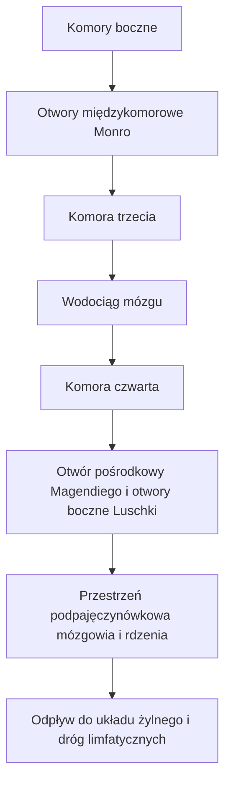

# 1.2. Anatomia funkcjonalna układu nerwowego

> **Moduł 1. Wprowadzenie do badania neurologicznego**  
> **Rozdział:** Anatomia funkcjonalna układu nerwowego  
> **Poziom:** kształcenie medyczne i okołomedyczne – zakres czynności dostosowany do kwalifikacji uczestnika  
> **Charakter materiału:** opracowanie anatomiczne, funkcjonalne, kliniczne i lokalizacyjne  
> **Zasada przewodnia:** strukturę należy rozumieć przez jej połączenia i funkcję, a wynik badania interpretować w kontekście całego obrazu klinicznego.

---

## 1. Cele kształcenia i efekty uczenia się

### 1.1. Cel ogólny

Celem rozdziału jest przedstawienie organizacji anatomicznej układu nerwowego w takim ujęciu, aby uczestnik potrafił powiązać położenie struktur, przebieg dróg nerwowych i wzajemne połączenia ośrodków z funkcjami obserwowanymi podczas badania neurologicznego. Anatomia funkcjonalna nie jest wyłącznie nauką o nazwach części mózgowia, nerwów i rdzenia kręgowego. Jest sposobem rozumienia, jak informacja czuciowa dociera do ośrodkowego układu nerwowego, jak jest integrowana, w jaki sposób powstaje odpowiedź ruchowa oraz jak układ nerwowy reguluje świadomość, zachowanie, mowę, pamięć, równowagę i czynności narządów wewnętrznych.

W praktyce klinicznej znajomość anatomii funkcjonalnej pozwala stawiać hipotezy lokalizacyjne. Osłabienie kończyny, zaburzenie czucia, asymetria odruchów, podwójne widzenie, ataksja lub zaburzenie mowy nie są samodzielnym wskazaniem do rozpoznania konkretnej choroby. Ich rozmieszczenie, współwystępowanie, dynamika oraz zgodność z określonym układem anatomicznym pomagają ustalić, na jakim poziomie może znajdować się zaburzenie. Dopiero później rozważa się jego mechanizm i etiologię.

Rozdział porządkuje wiedzę o ośrodkowym i obwodowym układzie nerwowym, korze mózgu, strukturach podkorowych, pniu mózgu, móżdżku, rdzeniu kręgowym, korzeniach, splotach i nerwach obwodowych, a także o oponach, płynie mózgowo-rdzeniowym oraz układzie autonomicznym. Szczególny nacisk położono na zależności istotne dla badania pacjenta, lokalizacji uszkodzeń i bezpiecznego przekazywania informacji klinicznych.

### 1.2. Efekty uczenia się

Po ukończeniu rozdziału uczestnik:

- opisuje podział układu nerwowego na część ośrodkową i obwodową oraz wyjaśnia ich wzajemne zależności;
- rozróżnia istotę szarą i białą, korę, jądra, drogi, korzenie, zwoje, sploty i nerwy;
- wskazuje główne płaty półkul mózgowych i wiąże ich obszary z podstawowymi funkcjami;
- wyjaśnia znaczenie kory ruchowej, czuciowej, wzrokowej, słuchowej i obszarów językowych;
- rozpoznaje rolę torebki wewnętrznej, wzgórza, podwzgórza i jąder podstawy;
- opisuje funkcjonalny podział pnia mózgu i znaczenie tworu siatkowatego;
- wyjaśnia organizację móżdżku i znaczenie jego połączeń dla koordynacji, równowagi oraz kontroli ruchu;
- przedstawia segmentarną budowę rdzenia kręgowego i przebieg najważniejszych dróg wstępujących i zstępujących;
- rozróżnia korzeń, splot i nerw obwodowy oraz wyjaśnia kliniczne znaczenie dermatomów i miotomów;
- przedstawia podstawową organizację układu współczulnego, przywspółczulnego i jelitowego;
- opisuje opony mózgowo-rdzeniowe, układ komorowy, krążenie płynu mózgowo-rdzeniowego i barierę krew–mózg;
- wskazuje podstawowe zależności anatomiczne pomocne w lokalizacji objawów;
- rozpoznaje ograniczenia uproszczonych schematów neuroanatomicznych;
- stosuje terminologię anatomiczną w sposób precyzyjny i zrozumiały;
- uwzględnia, że wnioskowanie lokalizacyjne jest hipotezą kliniczną wymagającą zestawienia wywiadu, badania i – gdy są wskazane – badań dodatkowych.

### 1.3. Zakres kompetencji i odpowiedzialności

Materiał służy edukacji i doskonaleniu rozumienia anatomii klinicznej. Nie zastępuje kształcenia praktycznego, nadzoru osoby uprawnionej ani aktualnych procedur medycznych. Samo ukończenie rozdziału nie nadaje uprawnień do stawiania rozpoznań, zlecania badań, wykonywania procedur inwazyjnych ani modyfikowania leczenia, jeżeli czynności te nie wynikają z odrębnych kwalifikacji i przepisów.

Wykorzystując wiedzę anatomiczną w praktyce, należy:

1. wykonywać wyłącznie czynności mieszczące się w granicach własnych kompetencji;
2. odróżniać opis stwierdzonej nieprawidłowości od hipotezy dotyczącej jej lokalizacji;
3. nie wyprowadzać wniosku o rozpoznaniu choroby z pojedynczego objawu lub schematu;
4. uwzględniać warianty anatomiczne, współistniejące choroby i ograniczenia badania;
5. traktować nagły deficyt neurologiczny, zaburzenia świadomości, objawy pniowe oraz ostre objawy rdzeniowe jako potencjalne stany nagłe;
6. nie opóźniać wezwania pomocy przez wykonywanie rozbudowanych prób, gdy stan pacjenta wymaga pilnej interwencji;
7. dokumentować stronę ciała, poziom anatomiczny, warunki badania i niepewność interpretacji;
8. komunikować pacjentowi informacje w sposób zrozumiały, z poszanowaniem jego godności, autonomii i prywatności.

---

## 2. Podstawowe zasady organizacji anatomicznej

### 2.1. Ośrodkowy i obwodowy układ nerwowy

Układ nerwowy dzieli się anatomicznie na:

- **ośrodkowy układ nerwowy (OUN)** – mózgowie i rdzeń kręgowy;
- **obwodowy układ nerwowy (ObUN)** – struktury nerwowe położone poza OUN, w tym nerwy czaszkowe i rdzeniowe, korzenie, sploty, nerwy obwodowe oraz zwoje.

OUN odbiera, integruje i przetwarza informacje, a następnie uczestniczy w organizowaniu odpowiedzi. ObUN łączy struktury ośrodkowe z receptorami, mięśniami, gruczołami i narządami wewnętrznymi. Podział ten jest użyteczny, ale nie oznacza niezależności obu części. Funkcja ruchowa kończyny wymaga współdziałania kory mózgu, dróg zstępujących, motoneuronów rdzenia, korzeni, splotów, nerwów, złącza nerwowo-mięśniowego i mięśni. Informacja zwrotna z receptorów mięśniowych, ścięgnistych, stawowych i skórnych stale modyfikuje wykonywany ruch.

W ujęciu funkcjonalnym można dodatkowo wyróżnić:

- część **aferentną (dośrodkową)** – przewodzącą informacje od receptorów do OUN;
- część **eferentną (odśrodkową)** – przekazującą sygnały z OUN do struktur wykonawczych;
- układy **somatyczne** – związane przede wszystkim z czuciem somatycznym i kontrolą mięśni szkieletowych;
- układy **autonomiczne** – regulujące między innymi mięśnie gładkie, mięsień sercowy i gruczoły;
- układ **jelitowy** – rozbudowaną sieć neuronów ściany przewodu pokarmowego, współpracującą z układem autonomicznym i ośrodkami mózgowia.

### 2.2. Istota szara i istota biała

**Istota szara** zawiera przede wszystkim ciała komórek nerwowych, dendryty, synapsy, komórki glejowe i lokalne obwody neuronalne. W mózgowiu występuje między innymi jako kora oraz skupiska jąder położone głębiej. W rdzeniu kręgowym tworzy centralnie położoną strukturę przypominającą w przekroju literę H lub motyla.

**Istota biała** składa się głównie z pęczków aksonów, z których wiele jest otoczonych osłonką mielinową. Tworzy drogi łączące różne obszary OUN. W półkulach mózgowych leży w większości pod korą, natomiast w rdzeniu kręgowym otacza istotę szarą.

| Pojęcie | Znaczenie anatomiczne | Przykład |
|---|---|---|
| Kora | warstwa istoty szarej na powierzchni struktury | kora mózgu, kora móżdżku |
| Jądro | skupisko ciał neuronów w OUN | jądro ogoniaste, jądro czerwienne |
| Droga lub szlak | uporządkowany przebieg włókien nerwowych | droga korowo-rdzeniowa |
| Pęczek | wiązka włókien o wspólnym przebiegu lub funkcji | pęczek smukły |
| Spoidło | włókna łączące struktury obu stron | ciało modzelowate |
| Korzeń | włókna łączące rdzeń z nerwem rdzeniowym | korzeń tylny i przedni |
| Zwój | skupisko ciał neuronów w ObUN | zwój rdzeniowy |
| Nerw | pęczki włókien nerwowych poza OUN | nerw pośrodkowy |

Nazewnictwo może zależeć od tradycji anatomicznej i kontekstu. W opisie klinicznym najważniejsza jest jednoznaczność: należy podać strukturę, stronę, poziom i funkcję, której dotyczy wniosek.

### 2.3. Neuron i komórki glejowe

Neuron jest wyspecjalizowaną komórką pobudliwą. Typowy neuron posiada ciało komórkowe, dendryty odbierające sygnały i akson przewodzący potencjały czynnościowe do innych komórek. Zakończenia aksonalne tworzą synapsy, w których sygnał może być przekazywany chemicznie lub – rzadziej – elektrycznie. W praktyce klinicznej istotne jest, że uszkodzenie neuronu, jego aksonu, osłonki mielinowej lub synapsy może powodować odmienne wzorce zaburzeń.

Główne typy komórek glejowych obejmują:

- **astrocyty** – uczestniczą w utrzymaniu środowiska pozakomórkowego, metabolizmie neuronów, regulacji synaps i współtworzeniu jednostki neuro-naczyniowej;
- **oligodendrocyty** – tworzą mielinę w OUN; pojedynczy oligodendrocyt może mielinizować odcinki wielu aksonów;
- **komórki Schwanna** – tworzą mielinę w ObUN; jedna komórka Schwanna mielinizuje zasadniczo jeden odcinek jednego aksonu;
- **mikroglej** – pełni funkcje odpornościowe i fagocytarne w OUN;
- **komórki ependymalne** – wyściełają układ komorowy i kanał centralny rdzenia;
- **komórki satelitarne** – otaczają ciała neuronów w zwojach obwodowych.

Mielina zwiększa szybkość przewodzenia dzięki przewodzeniu skokowemu między przewężeniami Ranviera. Demielinizacja może spowalniać przewodzenie, powodować blok przewodzenia lub zwiększać podatność włókna na nieprawidłowe pobudzenia. Nie każda choroba mieliny ma jednak ten sam mechanizm ani lokalizację: w OUN i ObUN uczestniczą odmienne komórki glejowe.

### 2.4. Kierunki anatomiczne i płaszczyzny

W opisie struktur nerwowych stosuje się terminy:

- **rostralnie** – w kierunku przodu mózgowia;
- **kaudalnie** – w kierunku ogona, a w mózgowiu ku rdzeniowi;
- **grzbietowo (dorsalnie)** – ku stronie grzbietowej;
- **brzusznie (wentralnie)** – ku stronie brzusznej;
- **przyśrodkowo** – w kierunku linii pośrodkowej;
- **bocznie** – od linii pośrodkowej;
- **ipsilateralnie** – po tej samej stronie;
- **kontralateralnie** – po stronie przeciwnej;
- **proksymalnie** – bliżej tułowia lub punktu przyczepu;
- **dystalnie** – dalej od tułowia lub punktu przyczepu.

W rdzeniu kręgowym i pniu mózgu orientacja grzbietowo-brzuszna jest szczególnie przydatna. W półkulach mózgowych, ze względu na zakrzywienie osi neurorozwojowej, niektóre określenia mogą wymagać odniesienia do konkretnej płaszczyzny. W dokumentacji nie należy zastępować precyzyjnych określeń potocznym „wyżej” lub „niżej”, jeśli możliwe jest podanie kierunku anatomicznego.

---

## 3. Ośrodkowy układ nerwowy – mózgowie

### 3.1. Główne części mózgowia

Mózgowie obejmuje półkule mózgowe, międzymózgowie, pień mózgu i móżdżek. Granice funkcjonalne nie zawsze pokrywają się z prostymi granicami widocznymi na preparacie anatomicznym. Wiele czynności powstaje dzięki współpracy rozległych sieci obejmujących kilka struktur.

Schemat orientacyjny:

```text
MÓZGOWIE
│
├── Kresomózgowie
│   ├── półkule mózgowe i kora
│   ├── istota biała i spoidła
│   └── jądra podstawy
│
├── Międzymózgowie
│   ├── wzgórze
│   ├── podwzgórze
│   └── okolice nadwzgórza i niskowzgórza
│
├── Pień mózgu
│   ├── śródmózgowie
│   ├── most
│   └── rdzeń przedłużony
│
└── Móżdżek
    ├── półkule
    ├── robak
    └── płat kłaczkowo-grudkowy
```

W badaniu klinicznym należy pamiętać, że struktury te nie działają w izolacji. Przykładowo zaburzenia ruchu mogą wynikać z uszkodzenia kory, torebki wewnętrznej, pnia, móżdżku, jąder podstawy, rdzenia lub układu obwodowego. Rozstrzygające znaczenie ma wzorzec objawów.

### 3.2. Półkule mózgowe i płaty kory

Każda półkula mózgowa posiada powierzchnię boczną, przyśrodkową i dolną. Powierzchnia jest pofałdowana: wypukłości tworzą zakręty, a zagłębienia – bruzdy i szczeliny. Pofałdowanie zwiększa powierzchnię kory mieszczącą się w obrębie czaszki.

W tradycyjnym podziale wyróżnia się płaty czołowy, ciemieniowy, skroniowy i potyliczny. Wyodrębnia się również wyspę oraz struktury przyśrodkowe i limbiczne. Płaty są kategoriami topograficznymi, natomiast funkcje poznawcze i ruchowe nie są przypisane wyłącznie do jednego płata.

#### 3.2.1. Płat czołowy

Płat czołowy leży przed bruzdą środkową. Obejmuje obszary związane z ruchem dowolnym, planowaniem, kontrolą zachowania, uwagą, pamięcią roboczą i funkcjami wykonawczymi.

Najważniejsze okolice:

- **pierwotna kora ruchowa** – zakręt przedśrodkowy, zasadniczo pole 4 Brodmanna; uczestniczy w wykonywaniu ruchów dowolnych;
- **kora przedruchowa** – część boczna pola 6; uczestniczy w przygotowaniu ruchów zależnych od bodźców i wyuczonych schematów;
- **dodatkowa kora ruchowa** – część przyśrodkowa pola 6; uczestniczy w planowaniu i sekwencjonowaniu ruchów, zwłaszcza złożonych i obustronnych;
- **przedczołowe obszary grzbietowo-boczne** – uczestniczą w pamięci roboczej, planowaniu, elastyczności poznawczej i kontroli działania;
- **obszary oczodołowo-czołowe i przyśrodkowe** – uczestniczą w ocenie znaczenia bodźców, motywacji, hamowaniu reakcji i regulacji zachowania;
- **obszary językowe w półkuli dominującej** – sieci dolnego zakrętu czołowego i połączeń z obszarami skroniowo-ciemieniowymi uczestniczą w planowaniu i produkcji wypowiedzi.

Uszkodzenia płata czołowego mogą prowadzić do niedowładu, zaburzeń inicjowania ruchu, apraksji, zmian zachowania, trudności planowania, odhamowania, apatii lub zaburzeń mowy. Obraz zależy od położenia, rozległości, strony i zajęcia połączeń podkorowych.

#### 3.2.2. Płat ciemieniowy

Płat ciemieniowy leży za bruzdą środkową i uczestniczy w przetwarzaniu informacji somatyczno-czuciowych, integracji bodźców oraz orientacji przestrzennej.

Ważne struktury:

- **pierwotna kora somatosensoryczna** – zakręt zaśrodkowy, pola 3, 1 i 2; odbiera i przetwarza informacje z przeciwnej połowy ciała;
- **płacik ciemieniowy górny** – integruje informacje czuciowe i wzrokowo-przestrzenne, wspierając kierowanie ruchem;
- **płacik ciemieniowy dolny** – obejmuje między innymi zakręt nadbrzeżny i kątowy; uczestniczy w integracji języka, symboli, uwagi i schematu ciała;
- **okolice przyśrodkowe** – uczestniczą w reprezentacji czuciowej kończyny dolnej i integracji przestrzennej.

Uszkodzenie może powodować zaburzenia czucia korowego, trudności rozpoznawania przedmiotów dotykiem, zaburzenia schematu ciała, apraksję, agnozję, pomijanie stronne lub trudności orientacji przestrzennej. Pomijanie stronne częściej występuje po uszkodzeniu prawej półkuli, ale nie jest zjawiskiem ograniczonym wyłącznie do jednej lokalizacji.

#### 3.2.3. Płat skroniowy

Płat skroniowy leży poniżej bruzdy bocznej. Uczestniczy w analizie słuchowej, rozumieniu języka, pamięci, rozpoznawaniu obiektów i przetwarzaniu znaczenia bodźców.

Ważne okolice:

- pierwotna kora słuchowa w zakrętach skroniowych poprzecznych;
- obszary asocjacyjne słuchowe;
- tylne obszary skroniowe sieci językowej w półkuli dominującej;
- przyśrodkowe struktury skroniowe, w tym hipokamp i okolice przyhipokampowe;
- ciało migdałowate, związane z przetwarzaniem znaczenia emocjonalnego i uczeniem emocjonalnym.

Uszkodzenia mogą powodować zaburzenia rozumienia mowy, pamięci epizodycznej, rozpoznawania bodźców słuchowych, napady padaczkowe o początku skroniowym, zaburzenia węchu lub zmiany zachowania. Objawy zależą od tego, czy zajęta jest część boczna, przyśrodkowa, przednia czy tylna płata.

#### 3.2.4. Płat potyliczny

Płat potyliczny znajduje się w tylnej części półkul. Zawiera pierwotną korę wzrokową wokół bruzdy ostrogowej oraz liczne obszary asocjacyjne.

Informacja wzrokowa dociera z siatkówki przez nerwy wzrokowe, skrzyżowanie wzrokowe, pasma wzrokowe, ciało kolankowate boczne wzgórza i promienistość wzrokową do kory wzrokowej. Dalsze przetwarzanie odbywa się w sieciach potyliczno-skroniowych i potyliczno-ciemieniowych, uczestniczących odpowiednio między innymi w rozpoznawaniu obiektów oraz analizie przestrzennej i kierowaniu ruchem.

Uszkodzenie może powodować ubytki pola widzenia, zaburzenia rozpoznawania wzrokowego, omamy wzrokowe lub zaburzenia integracji bodźców. Wzorzec ubytku pola widzenia pomaga określić poziom uszkodzenia drogi wzrokowej, ale jego interpretacja wymaga prawidłowo przeprowadzonego badania.

#### 3.2.5. Wyspa i kora obręczy

**Wyspa** jest położona głęboko w bruździe bocznej. Uczestniczy w przetwarzaniu informacji trzewnych, smaku, odczuć cielesnych, bólu, emocji i świadomości stanu organizmu.

**Kora obręczy** obejmuje część przyśrodkowej powierzchni półkuli. Uczestniczy w motywacji, uwadze, przetwarzaniu bólu, monitorowaniu konfliktu i regulacji zachowania. Jest połączona z obszarami przedczołowymi, strukturami limbicznymi i podkorowymi.

Nie należy traktować pojedynczego zakrętu jako samodzielnego „ośrodka” z jedną funkcją. Współczesna neuroanatomia funkcjonalna opisuje sieci, w których poszczególne obszary wnoszą określony wkład, a ich działanie zależy od połączeń.

### 3.3. Organizacja somatotopowa kory

W pierwotnej korze ruchowej i somatosensorycznej występuje uporządkowana reprezentacja części ciała, nazywana somatotopią. W uproszczeniu:

- okolice przyśrodkowe półkuli reprezentują przede wszystkim kończynę dolną;
- część górno-boczna reprezentuje tułów i kończynę górną;
- okolice najbardziej boczne reprezentują twarz, jamę ustną i gardło.

Reprezentacja nie jest proporcjonalna do rzeczywistej wielkości części ciała. Obszary wymagające precyzyjnej kontroli ruchu lub bogatego przetwarzania czuciowego zajmują relatywnie większą powierzchnię kory.

```text
PRZYŚRODKOWO                         BOCZNIE
┌────────────────────────────────────────────┐
│ kończyna dolna → tułów → ręka → twarz/język│
└────────────────────────────────────────────┘
      reprezentacja ruchowa i czuciowa
      (schemat poglądowy, nie mapa pomiarowa)
```

Somatotopia pomaga rozumieć, dlaczego niewielkie uszkodzenie przyśrodkowej części półkuli może dawać przewagę objawów w kończynie dolnej, a uszkodzenie bocznej powierzchni – w twarzy i kończynie górnej. Rzeczywisty obraz zależy jednak od unaczynienia, rozległości i przebiegu włókien.

### 3.4. Półkule mózgowe i lateralizacja

Półkule są połączone między innymi przez ciało modzelowate, spoidło przednie i inne układy włókien. Wykazują pewną specjalizację funkcjonalną, ale nie działają niezależnie.

U większości osób sieci językowe są bardziej rozwinięte funkcjonalnie w lewej półkuli. Prawa półkula często wnosi istotny wkład w uwagę przestrzenną, prozodię, interpretację kontekstu i przetwarzanie części informacji niewerbalnych. Są to tendencje populacyjne, a nie reguły bez wyjątków. Dominacja językowa może być odmienna, zwłaszcza u osób leworęcznych, i powinna być rozpatrywana indywidualnie.

Ciało modzelowate umożliwia wymianę informacji między półkulami. Jego uszkodzenie może powodować zaburzenia integracji informacji, które nie zawsze są widoczne w prostym badaniu siły czy czucia.

### 3.5. Istota biała półkul i torebka wewnętrzna

Włókna istoty białej półkul można podzielić na:

1. **włókna kojarzeniowe** – łączą obszary tej samej półkuli;
2. **włókna spoidłowe** – łączą obie półkule;
3. **włókna rzutowe** – łączą korę z jądrami podkorowymi, wzgórzem, pniem mózgu i rdzeniem.

Do ważnych struktur zalicza się:

- **ciało modzelowate** – największe spoidło półkul;
- **torebkę wewnętrzną** – zwarte skupisko włókien wstępujących i zstępujących;
- **promienistość wzrokową** – włókna drogi wzrokowej od ciała kolankowatego bocznego do kory potylicznej;
- **pęczki kojarzeniowe** – między innymi pęczek podłużny górny i dolny, pęczek haczykowaty i obręcz.

Torebka wewnętrzna ma szczególne znaczenie kliniczne, ponieważ przebiega przez nią wiele włókien ruchowych i czuciowych skupionych na niewielkiej przestrzeni. Jej uszkodzenie może wywołać wyraźny deficyt obejmujący twarz, kończynę górną i dolną po stronie przeciwnej do uszkodzenia. Ułożenie włókien różni się zależnie od części torebki:

- kolano zawiera między innymi włókna korowo-jądrowe;
- odnoga tylna zawiera istotne włókna korowo-rdzeniowe i czuciowe wzgórzowo-korowe;
- odnoga przednia zawiera liczne połączenia czołowo-mostowe i wzgórzowo-czołowe;
- część zasoczewkowa i podsoczewkowa przewodzą między innymi włókna wzrokowe i słuchowe.

Uszkodzenie torebki wewnętrznej jest jednym z przykładów sytuacji, w której mała zmiana anatomiczna może wywołać rozległe następstwa funkcjonalne.

### 3.6. Unaczynienie półkul – znaczenie orientacyjne

Główne tętnice zaopatrujące półkule to tętnica przednia mózgu (ACA), środkowa mózgu (MCA) i tylna mózgu (PCA). Ich obszary unaczynienia mają znaczenie w interpretacji nagłych objawów ogniskowych.

| Terytorium | Obszary zaopatrywane w przybliżeniu | Możliwy wzorzec objawów |
|---|---|---|
| ACA | przyśrodkowe części płata czołowego i ciemieniowego, w tym reprezentacja kończyny dolnej | niedowład i zaburzenia czucia z przewagą kończyny dolnej; możliwe zaburzenia inicjacji i kontroli zachowania |
| MCA | znaczna część bocznej powierzchni półkuli, wyspa i struktury głębokie przez gałęzie perforujące | objawy twarzy i kończyny górnej; afazja przy zajęciu dominującej półkuli lub zaniedbywanie przy zajęciu odpowiednich sieci niedominującej |
| PCA | płat potyliczny i części przyśrodkowego płata skroniowego oraz struktury głębokie | zaburzenia pola widzenia; możliwe zaburzenia pamięci i inne objawy zależne od obszaru |

Tabela ma charakter orientacyjny. Krążenie oboczne, warianty anatomiczne, gałęzie perforujące i rozległość niedokrwienia mogą istotnie zmieniać obraz. Nagłe wystąpienie objawów sugerujących udar wymaga natychmiastowego uruchomienia odpowiedniej ścieżki ratunkowej; nie należy próbować samodzielnie rozstrzygać typu udaru na podstawie samego badania.

---

## 4. Jądra podstawy i układy pozapiramidowe

### 4.1. Główne struktury

Jądra podstawy to zespół głęboko położonych struktur istoty szarej, które uczestniczą w wyborze, inicjowaniu, hamowaniu i skalowaniu programów ruchowych, a także w procesach poznawczych, motywacyjnych i nawykowych. Określenie „jądra podstawy” jest anatomicznie trafniejsze niż historyczne „jądra pozapiramidowe”, ponieważ nie wszystkie elementy układu są położone w podstawie mózgu, a pojęcie układu pozapiramidowego ma charakter funkcjonalny.

Do kluczowych struktur należą:

- **jądro ogoniaste**;
- **skorupa**;
- **gałka blada**, z częścią zewnętrzną i wewnętrzną;
- **jądro niskowzgórzowe**;
- **istota czarna**, z częścią zbitą i siatkowatą;
- **prążkowie brzuszne**, obejmujące między innymi jądro półleżące.

Jądro ogoniaste i skorupa tworzą prążkowie grzbietowe. Prążkowie jest głównym obszarem wejściowym wielu obwodów jąder podstawy. Gałka blada wewnętrzna i istota czarna część siatkowata należą do ważnych struktur wyjściowych.

### 4.2. Organizacja obwodów

Obwody jąder podstawy obejmują połączenia kory, prążkowia, gałki bladej, istoty czarnej, jądra niskowzgórzowego i wzgórza. W uproszczonym modelu wyróżnia się:

- **drogę bezpośrednią** – ułatwiającą uruchomienie wybranego programu ruchowego poprzez zmniejszenie hamującego wpływu struktur wyjściowych na wzgórze;
- **drogę pośrednią** – zwiększającą hamowanie konkurencyjnych programów ruchowych;
- **drogę nadbezpośrednią** – umożliwiającą szybką modulację aktywności obwodu.

Dopamina uwalniana przez neurony istoty czarnej części zbitej moduluje aktywność prążkowia. W klasycznym ujęciu pobudza neurony szlaku bezpośredniego przez receptory D1 i osłabia aktywność neuronów szlaku pośredniego przez receptory D2, co sprzyja płynności i odpowiedniemu skalowaniu ruchu. Jest to model dydaktyczny – rzeczywiste obwody są bardziej złożone i obejmują równoległe pętle ruchowe, poznawcze, limbiczne i asocjacyjne.

### 4.3. Znaczenie kliniczne

Zaburzenia funkcji jąder podstawy mogą prowadzić do:

- **hipokinezji i bradykinezji** – zmniejszenia amplitudy i szybkości ruchu, trudności w jego inicjowaniu;
- **sztywności** – wzmożonego oporu podczas ruchów biernych, często niezależnego od szybkości rozciągania;
- **drżenia spoczynkowego** – obserwowanego między innymi w chorobie Parkinsona;
- **dystonii** – utrwalonych lub przerywanych skurczów powodujących nieprawidłowe postawy i ruchy skręcające;
- **pląsawicy** – nieregularnych, krótkich, mimowolnych ruchów;
- **balizmu** – gwałtownych, obszernych ruchów kończyn, klasycznie wiązanych z uszkodzeniem okolicy jądra niskowzgórzowego;
- **tików i dyskinez** – których mechanizmy i lokalizacja są zróżnicowane.

Objawów tych nie należy automatycznie przypisywać jednej strukturze. Rozpoznanie zespołu pozapiramidowego wymaga oceny jakości ruchu, napięcia, szybkości, amplitudy, symetrii, wpływu leków i innych możliwych przyczyn.

---

## 5. Międzymózgowie: wzgórze i podwzgórze

### 5.1. Wzgórze

Wzgórze jest parzystą strukturą międzymózgowia, położoną po obu stronach komory trzeciej. Stanowi ważny węzeł przetwarzania i przekazywania informacji między strukturami podkorowymi a korą. Nie jest wyłącznie bierną „stacją przekaźnikową”: uczestniczy w selekcji, synchronizacji i modulacji informacji, a także w regulacji czuwania, uwagi i procesów poznawczych.

Wybrane jądra wzgórza:

| Jądro lub grupa jąder | Główne połączenia i funkcje – ujęcie orientacyjne |
|---|---|
| VPL | przekazywanie informacji somatosensorycznej z tułowia i kończyn do kory |
| VPM | przekazywanie informacji czuciowej z twarzy; udział w przekazywaniu smaku |
| Ciało kolankowate boczne | przekaźnik drogi wzrokowej |
| Ciało kolankowate przyśrodkowe | przekaźnik drogi słuchowej |
| VA i VL | połączenia z jądrami podstawy i móżdżkiem, udział w obwodach ruchowych |
| Jądra przednie | połączenia z układem limbicznym i obwodami pamięci |
| Jądro grzbietowo-przyśrodkowe | połączenia z korą przedczołową, udział w procesach poznawczych i emocjonalnych |
| Jądro siatkowate | modulacja aktywności innych jąder wzgórza |

Uszkodzenie wzgórza może powodować zaburzenia czucia po stronie przeciwnej, ból ośrodkowy, zaburzenia uwagi, pamięci lub świadomości. Obraz zależy od zajętych jąder, ich połączeń i rozległości zmiany.

### 5.2. Podwzgórze

Podwzgórze leży poniżej wzgórza, tworzy część dna i ścian bocznych komory trzeciej oraz łączy układ nerwowy z układem hormonalnym. Jest kluczowym ośrodkiem homeostazy.

Uczestniczy w regulacji:

- temperatury ciała;
- łaknienia i sytości;
- pragnienia i gospodarki wodnej;
- rytmu snu i czuwania;
- reakcji autonomicznych;
- odpowiedzi na stres;
- zachowań rozrodczych i części zachowań motywacyjnych;
- czynności przysadki mózgowej.

Podwzgórze komunikuje się z przysadką przez połączenia nerwowe i układ wrotny przysadki. Wytwarza między innymi wazopresynę i oksytocynę, które są transportowane do tylnego płata przysadki, oraz czynniki uwalniające i hamujące regulujące przedni płat przysadki.

Klinicznie uszkodzenie podwzgórza może wiązać się z zaburzeniami termoregulacji, pragnienia, łaknienia, snu, gospodarki wodno-elektrolitowej i funkcji hormonalnych. Objawy mogą być niespecyficzne i wymagają oceny w kontekście całego stanu pacjenta.

---

## 6. Układ limbiczny i sieci emocjonalno-pamięciowe

### 6.1. Pojęcie układu limbicznego

Układ limbiczny jest funkcjonalnym określeniem zespołu struktur korowych i podkorowych uczestniczących w pamięci, emocjach, motywacji, uczeniu się i integracji reakcji autonomicznych. Nie istnieje jedna, niezmienna lista elementów, które zawsze należy do niego zaliczać. Współczesne ujęcie podkreśla sieciowe powiązania struktur limbicznych z korą przedczołową, wzgórzem, podwzgórzem, pniem mózgu i układami nagrody.

Do struktur często uwzględnianych w tym układzie należą:

- hipokamp i okolice przyhipokampowe;
- ciało migdałowate;
- zakręt obręczy;
- kora śródwęchowa;
- sklepienie;
- ciała suteczkowate;
- wybrane jądra wzgórza;
- obszary przegrody i prążkowia brzusznego.

### 6.2. Hipokamp i pamięć

Hipokamp, położony w przyśrodkowej części płata skroniowego, jest ważny dla tworzenia i konsolidacji nowych wspomnień deklaratywnych, zwłaszcza epizodycznych. Nie jest magazynem wszystkich wspomnień. Pamięć długotrwała jest reprezentowana w rozległych sieciach kory, a hipokamp uczestniczy w organizowaniu i utrwalaniu nowych śladów pamięciowych.

Obustronne uszkodzenie przyśrodkowych struktur skroniowych może prowadzić do znacznych trudności zapamiętywania nowych informacji. W badaniu należy odróżniać zaburzenia kodowania, przechowywania i wydobywania informacji, a także uwzględniać uwagę, nastrój, sen, leki i stan ogólny.

### 6.3. Ciało migdałowate

Ciało migdałowate uczestniczy w ocenie znaczenia emocjonalnego bodźców, uczeniu skojarzeń emocjonalnych i organizowaniu reakcji obronnych. Współpracuje z podwzgórzem, pniem mózgu, hipokampem i korą przedczołową. Nie jest jedynym „ośrodkiem strachu” ani samodzielnym generatorem emocji.

### 6.4. Obwody pamięci i emocji

Klasyczny obwód Papeza opisuje część połączeń hipokampa, sklepienia, ciał suteczkowatych, jąder przednich wzgórza i kory obręczy. Jest użytecznym modelem historycznym i dydaktycznym, ale współczesne badania wskazują na znacznie szersze sieci pamięci i emocji.

W badaniu neurologicznym objawy takie jak zaburzenia pamięci, zmiany zachowania, napady o początku skroniowym, zaburzenia emocjonalne i objawy autonomiczne mogą wskazywać na zajęcie struktur przyśrodkowego płata skroniowego lub ich połączeń. Nie pozwalają jednak na lokalizację bez dalszej analizy.

---

## 7. Pień mózgu

### 7.1. Budowa ogólna

Pień mózgu łączy półkule mózgowe i międzymózgowie z rdzeniem kręgowym. Składa się z:

1. śródmózgowia;
2. mostu;
3. rdzenia przedłużonego.

Zawiera jądra nerwów czaszkowych, drogi wstępujące i zstępujące, struktury siatkowate oraz ośrodki i sieci uczestniczące w regulacji oddychania, krążenia, połykania, kaszlu, wymiotów, czuwania i innych funkcji. Przebiegają przez niego włókna łączące korę, móżdżek, wzgórze i rdzeń.

W pniu mózgu obok siebie znajdują się struktury o różnych funkcjach. Niewielka zmiana może jednocześnie wpływać na jądro nerwu czaszkowego, drogę ruchową, drogę czuciową i połączenia móżdżkowe. Z tego powodu zespoły pniowe często mają charakterystyczne połączenie objawów nerwów czaszkowych i objawów dotyczących kończyn.

### 7.2. Śródmózgowie

Śródmózgowie jest najwyższą częścią pnia mózgu. Zawiera między innymi:

- konary mózgu, przez które przebiegają włókna zstępujące;
- nakrywkę z jądrami i drogami;
- wzgórki górne związane z odruchami i orientacją wzrokową;
- wzgórki dolne związane z przetwarzaniem słuchowym;
- istotę czarną, uczestniczącą w obwodach jąder podstawy;
- jądro czerwienne, związane z obwodami ruchowymi;
- jądra nerwów III i IV oraz struktury odpowiedzialne za wybrane ruchy gałek ocznych.

Uszkodzenia śródmózgowia mogą powodować zaburzenia ruchów gałek ocznych, opadanie powieki, zaburzenia źrenic, niedowład, drżenie, ataksję lub zaburzenia świadomości – zależnie od zajętych struktur.

### 7.3. Most

Most leży między śródmózgowiem a rdzeniem przedłużonym. Zawiera jądra mostu, włókna łączące korę z móżdżkiem, drogi wstępujące i zstępujące oraz elementy układów nerwów czaszkowych.

W obrębie mostu znajdują się struktury związane między innymi z:

- ruchami twarzy i żuciem;
- odwodzeniem gałki ocznej;
- słuchem i równowagą;
- przewodzeniem informacji między korą a móżdżkiem;
- regulacją oddychania i snu;
- kontrolą spojrzenia poziomego.

W okolicy mostowo-opuszkowej znajdują się jądra i połączenia nerwów VI–VIII, jednak ich dokładne położenie i przebieg włókien są zróżnicowane. Nie należy utożsamiać całego nerwu czaszkowego z jednym poziomem pnia.

### 7.4. Rdzeń przedłużony

Rdzeń przedłużony przechodzi ku dołowi w rdzeń kręgowy. Zawiera piramidy, oliwki, jądra sznurów tylnych, jądra nerwów czaszkowych oraz liczne drogi.

Ważne struktury i funkcje:

- **piramidy** – zawierają włókna drogi korowo-rdzeniowej; większość włókien krzyżuje się w dolnej części rdzenia przedłużonego;
- **jądro smukłe i klinowate** – uczestniczą w przekazywaniu informacji z dróg sznurów tylnych;
- **jądro oliwki dolnej** – uczestniczy w obwodach uczenia i kontroli ruchowej móżdżku;
- **jądro dwuznaczne i jądro grzbietowe nerwu błędnego** – uczestniczą w funkcjach ruchowych i autonomicznych;
- **jądra nerwów IX, X, XI (część czaszkowa w tradycyjnym ujęciu) i XII** – związane z połykaniem, fonacją, ruchem języka i innymi funkcjami.

Rdzeń przedłużony zawiera sieci niezbędne do regulacji oddychania i krążenia oraz koordynacji odruchów ochronnych. Uszkodzenie tej okolicy może stanowić bezpośrednie zagrożenie życia.

### 7.5. Jądra nerwów czaszkowych i zasada lokalizacji

Większość jąder nerwów czaszkowych znajduje się w pniu mózgu. Nerwy I i II są związane z przodomózgowiem i nie mają typowych jąder pniowych. Jądra III i IV leżą w śródmózgowiu; jądra V–VIII są związane głównie z mostem i granicą mostowo-opuszkową; jądra IX–XII są związane głównie z rdzeniem przedłużonym, przy czym nerw XI ma także istotny komponent rdzeniowy.

Uszkodzenie pnia może powodować objawy po tej samej stronie twarzy lub dotyczące nerwu czaszkowego oraz objawy po stronie przeciwnej w kończynach, jeśli zmiana obejmuje długie drogi, które krzyżują się na innym poziomie. Takie połączenie nazywa się wzorcem skrzyżowanym i może być ważną wskazówką lokalizacyjną. Nie każdy zespół pniowy musi jednak mieć pełny, klasyczny obraz skrzyżowany.

### 7.6. Twór siatkowaty i układ aktywujący

Twór siatkowaty jest rozległą siecią neuronów i połączeń w obrębie pnia mózgu. Uczestniczy w regulacji:

- poziomu czuwania i przejść między snem a czuwaniem;
- napięcia mięśniowego i postawy;
- odruchów ochronnych i autonomicznych;
- reakcji na bodźce sensoryczne;
- współpracy układów ruchowych i autonomicznych.

Wstępujący układ aktywujący obejmuje połączenia pnia mózgu ze wzgórzem, podwzgórzem, przodomózgowiem podstawnym i korą. Utrzymanie świadomości wymaga zarówno odpowiedniego poziomu pobudzenia, jak i sprawnego działania rozległych sieci korowych. Zaburzenia świadomości mogą zatem wynikać z uszkodzenia pnia, obustronnych rozległych uszkodzeń półkul lub zaburzeń metabolicznych i toksycznych wpływających na czynność mózgu.

---

## 8. Móżdżek i jego połączenia

### 8.1. Budowa ogólna

Móżdżek leży w tylnym dole czaszki, za pniem mózgu. Składa się z dwóch półkul połączonych robakiem. Jego powierzchnię pokrywa kora móżdżku, a wewnątrz znajdują się istota biała i jądra głębokie.

Najważniejsze jądra głębokie to:

- jądro zębate;
- jądro czopowate;
- jądro kulkowate;
- jądro wierzchu.

Kora móżdżku ma charakterystyczną budowę warstwową. Komórki Purkinjego stanowią główną drogę wyjściową kory móżdżku i przekazują sygnały hamujące do jąder głębokich oraz jąder przedsionkowych.

### 8.2. Podział anatomiczny

Wyróżnia się trzy płaty:

- przedni;
- tylny;
- kłaczkowo-grudkowy.

Podział anatomiczny nie pokrywa się całkowicie z podziałem funkcjonalnym. W praktyce klinicznej ważne są również obszary robaka, strefy pośredniej i bocznych części półkul.

### 8.3. Podział funkcjonalny

| Część funkcjonalna | Główne połączenia i zadania | Możliwe następstwa uszkodzenia |
|---|---|---|
| Przedsionkowo-móżdżkowa | połączenia z układem przedsionkowym; równowaga i stabilizacja spojrzenia | zaburzenia równowagi, oczopląs, niestabilność tułowia |
| Rdzeniowo-móżdżkowa | informacje proprioceptywne i połączenia z rdzeniem; kontrola postawy i wykonywanego ruchu | ataksja tułowia lub kończyn, zaburzenia chodu |
| Mózgowo-móżdżkowa | połączenia z korą przez jądra mostu; planowanie, sekwencjonowanie i precyzja ruchu | dysmetria, zaburzenia ruchów naprzemiennych, trudności w planowaniu ruchu |

Podział ten jest uproszczeniem dydaktycznym. Poszczególne części móżdżku współpracują i uczestniczą również w procesach poznawczych oraz językowych.

### 8.4. Konary móżdżku

Móżdżek łączy się z pniem mózgu przez trzy pary konarów:

- **konary dolne** – prowadzą liczne informacje z rdzenia, rdzenia przedłużonego i układu przedsionkowego; zawierają także wybrane drogi wyjściowe;
- **konary środkowe** – przewodzą przede wszystkim włókna mostowo-móżdżkowe;
- **konary górne** – stanowią ważną drogę wyjściową móżdżku do struktur śródmózgowia i wzgórza; zawierają także wybrane drogi wstępujące.

Konary nie są jedynie „przewodami wejściowymi” lub „wyjściowymi”; ich zawartość jest zróżnicowana, a kierunek przewodzenia zależy od konkretnego pęczka.

### 8.5. Dlaczego objawy móżdżkowe często są ipsilateralne?

Wiele połączeń móżdżkowych krzyżuje się w przebiegu do struktur docelowych, a następnie układy ruchowe ponownie krzyżują się lub mają organizację zapewniającą funkcjonalny wpływ na tę samą stronę ciała. Dlatego uszkodzenie półkuli móżdżku często powoduje ataksję kończyn po tej samej stronie. Jest to zasada lokalizacyjna, a nie bezwzględna reguła dla każdego połączenia i każdego objawu.

### 8.6. Objawy wynikające z uszkodzenia móżdżku

Do typowych objawów należą:

- dysmetria – nieprawidłowe oszacowanie odległości lub zakresu ruchu;
- drżenie zamiarowe – nasilające się podczas zbliżania kończyny do celu;
- dysdiadochokineza – trudność wykonywania szybkich ruchów naprzemiennych;
- ataksja – zaburzenie płynności i koordynacji ruchu;
- dyssynergia – rozpad złożonego ruchu na nieprawidłowo skoordynowane elementy;
- hipotonia – zmniejszenie napięcia, które może występować w wybranych zespołach móżdżkowych;
- oczopląs i zaburzenia kontroli spojrzenia;
- dyzartria móżdżkowa – zaburzenie rytmu, siły i koordynacji artykulacji;
- niestabilność postawy i chodu.

Ataksja nie jest synonimem choroby móżdżku. Może wynikać także z zaburzeń propriocepcji, układu przedsionkowego, osłabienia, bólu, działania leków lub zaburzeń wieloczynnikowych.

---

## 9. Rdzeń kręgowy

### 9.1. Położenie i odcinki

Rdzeń kręgowy jest częścią OUN położoną w kanale kręgowym. U dorosłego człowieka zwykle kończy się w okolicy kręgów L1–L2, ale poziom ten wykazuje zmienność osobniczą. Poniżej stożka rdzeniowego korzenie nerwów lędźwiowych, krzyżowych i guzicznego biegną w kanale kręgowym, tworząc ogon koński.

Wyróżnia się odcinki:

- szyjny;
- piersiowy;
- lędźwiowy;
- krzyżowy;
- guziczny.

Rdzeń obejmuje 31 segmentów, z których wychodzi 31 par nerwów rdzeniowych: 8 szyjnych, 12 piersiowych, 5 lędźwiowych, 5 krzyżowych i 1 guziczny. Liczba segmentów nie odpowiada prostemu przyporządkowaniu do numerów kręgów, zwłaszcza w dolnych odcinkach.

Występują dwa poszerzenia: szyjne, związane z unerwieniem kończyn górnych, oraz lędźwiowo-krzyżowe, związane z unerwieniem kończyn dolnych.

### 9.2. Budowa przekroju poprzecznego

W centrum rdzenia znajduje się istota szara, otoczona istotą białą. W istocie szarej wyróżnia się:

- **róg tylny** – związany głównie z odbiorem i wstępnym przetwarzaniem informacji czuciowej;
- **róg przedni** – zawierający ciała neuronów ruchowych unerwiających mięśnie szkieletowe;
- **róg boczny** – wyraźny w określonych odcinkach, związany między innymi z neuronami autonomicznymi.

Istota biała tworzy sznury przednie, boczne i tylne, w których przebiegają drogi wstępujące i zstępujące. W przekroju rdzenia należy zwracać uwagę na stronę, poziom i położenie zmiany, ponieważ niewielka różnica lokalizacyjna może zmieniać rodzaj objawów.

### 9.3. Korzenie przednie i tylne

Korzeń tylny przewodzi przede wszystkim informacje czuciowe do rdzenia. Ciała neuronów czuciowych leżą w zwoju rdzeniowym. Są to zwykle neurony rzekomojednobiegunowe, których jedna wypustka biegnie ku receptorom, a druga wchodzi do OUN.

Korzeń przedni zawiera włókna ruchowe somatyczne oraz – na odpowiednich poziomach – włókna autonomiczne przedzwojowe. Korzeń przedni i tylny łączą się w obrębie otworu międzykręgowego, tworząc nerw rdzeniowy o mieszanym charakterze.

Uszkodzenie korzenia może powodować ból promieniujący, zaburzenia czucia w przybliżonym obszarze dermatomu, osłabienie mięśni w odpowiednim miotomie i zmianę odruchu zależnego od danego segmentu. W praktyce dermatomy i miotomy nakładają się, a ich granice nie są ostre.

### 9.4. Drogi wstępujące – czucie

#### 9.4.1. Droga sznurów tylnych i wstęgi przyśrodkowej

Droga ta przewodzi przede wszystkim:

- czucie wibracji;
- czucie ułożenia i ruchu;
- precyzyjny dotyk i część informacji dyskryminacyjnej.

Pierwszy neuron ma ciało w zwoju rdzeniowym. Jego włókna wstępują po tej samej stronie rdzenia w pęczku smukłym lub klinowatym. Włókna kończą się w odpowiednich jądrach rdzenia przedłużonego, gdzie następuje przełączenie. Włókna drugiego neuronu krzyżują się w rdzeniu przedłużonym i tworzą wstęgę przyśrodkową, która biegnie do wzgórza, a następnie informacja jest przekazywana do kory somatosensorycznej.

Pęczek smukły przewodzi informacje głównie z dolnej połowy ciała, a pęczek klinowaty – z górnej połowy ciała i górnej części tułowia. W uszkodzeniu rdzenia poniżej skrzyżowania sznurów tylnych zaburzenie czucia wibracji i propriocepcji występuje zwykle po stronie uszkodzenia, poniżej jego poziomu.

#### 9.4.2. Układ przednio-boczny i droga rdzeniowo-wzgórzowa

Układ przednio-boczny przewodzi przede wszystkim informacje o bólu i temperaturze, a także część informacji o dotyku zgrubnym i innych bodźcach. Włókna pierwszego neuronu wchodzą do rdzenia, mogą przemieścić się o krótki odcinek w drodze Lissauera, a następnie przełączają się w rogu tylnym. Włókna drugiego neuronu przechodzą na stronę przeciwną przez spoidło białe przednie i wstępują w układzie przednio-bocznym do wzgórza oraz innych struktur.

Z tego powodu uszkodzenie połowy rdzenia może powodować zaburzenie czucia bólu i temperatury po stronie przeciwnej, zwykle rozpoczynające się nieco poniżej poziomu uszkodzenia. Dokładny poziom zależy od przebiegu włókien i rozległości zmiany.

#### 9.4.3. Drogi rdzeniowo-móżdżkowe

Drogi rdzeniowo-móżdżkowe przekazują informacje proprioceptywne i związane z aktywnością obwodów rdzeniowych do móżdżku. Uczestniczą w nieświadomej kontroli ruchu, postawy i napięcia. Ich uszkodzenie może zaburzać koordynację, choć objawy zależą od poziomu, strony i zajętych pęczków.

### 9.5. Drogi zstępujące – ruch

#### 9.5.1. Droga korowo-rdzeniowa

Droga korowo-rdzeniowa rozpoczyna się w rozległych obszarach kory, przede wszystkim ruchowych i przedruchowych. Włókna przechodzą przez wieniec promienisty, torebkę wewnętrzną, konary mózgu, most i piramidy rdzenia przedłużonego.

Większość włókien krzyżuje się w skrzyżowaniu piramid i zstępuje w sznurze bocznym jako droga korowo-rdzeniowa boczna. Mniejsza część biegnie początkowo po stronie niekrzyżującej się jako droga przednia, a jej włókna mogą krzyżować się segmentarnie lub oddziaływać obustronnie na układy ruchowe osi ciała.

Droga korowo-rdzeniowa jest szczególnie ważna dla precyzyjnych ruchów dowolnych, zwłaszcza dystalnych części kończyn. Jej uszkodzenie powyżej motoneuronu obwodowego może prowadzić do zespołu górnego neuronu ruchowego, obejmującego między innymi osłabienie, wzmożenie odruchów i objawy patologiczne. We wczesnym okresie ostrego uszkodzenia obraz może być odmienny, w tym z przejściowym obniżeniem napięcia i odruchów.

#### 9.5.2. Inne drogi zstępujące

Do innych układów zstępujących należą między innymi drogi siatkowo-rdzeniowe, przedsionkowo-rdzeniowe, czerwienno-rdzeniowe i pokrywkowo-rdzeniowe. Uczestniczą one w regulacji postawy, napięcia, automatycznych reakcji ruchowych, orientacji głowy i oczu oraz kontroli ruchów osiowych. Ich działanie jest modulowane przez korę, móżdżek, jądra podstawy i struktury pnia mózgu.

### 9.6. Zespół połowiczego uszkodzenia rdzenia – model dydaktyczny

Klasyczny zespół Browna-Séquarda ilustruje, jak położenie dróg w rdzeniu wpływa na rozkład objawów. Przy jednostronnym uszkodzeniu połowy rdzenia poniżej poziomu zmiany można oczekiwać:

- po stronie uszkodzenia: osłabienia typu górnego neuronu ruchowego poniżej zmiany, a także zaburzenia czucia wibracji i propriocepcji;
- po stronie przeciwnej: zaburzenia czucia bólu i temperatury, zwykle rozpoczynającego się nieco poniżej poziomu zmiany;
- na poziomie uszkodzenia: możliwych objawów segmentarnych, w tym wiotkiego osłabienia lub zaburzeń czucia.

W praktyce pełny klasyczny obraz jest rzadki. Zmiany pourazowe, naczyniowe, zapalne i uciskowe często obejmują niejednorodny obszar rdzenia.

### 9.7. Stożek rdzeniowy i ogon koński

**Stożek rdzeniowy** jest końcową, zwężającą się częścią rdzenia. **Ogon koński** tworzą korzenie nerwowe biegnące poniżej stożka w kanale kręgowym.

Uszkodzenie stożka może powodować zaburzenia czucia w okolicy krocza, zaburzenia zwieraczy, objawy kończyn dolnych i zaburzenia funkcji seksualnych. Zespół ogona końskiego wynika z uszkodzenia wielu korzeni lędźwiowych i krzyżowych; może powodować ból, asymetryczne osłabienie, zaburzenia czucia siodłowego, zatrzymanie lub nietrzymanie moczu i zaburzenia defekacji.

Nowe zaburzenia oddawania moczu, znieczulenie siodłowe, utrata kontroli zwieraczy lub szybko narastające osłabienie kończyn dolnych, zwłaszcza w połączeniu z bólem kręgosłupa, wymagają pilnej oceny medycznej. Nie wolno odkładać diagnostyki w oczekiwaniu na pełny zestaw objawów.

---

## 10. Obwodowy układ nerwowy

### 10.1. Nerwy rdzeniowe

Nerw rdzeniowy powstaje z połączenia korzenia przedniego i tylnego. Po krótkim przebiegu dzieli się na gałęzie. Gałąź tylna unerwia głębokie mięśnie grzbietu i skórę odpowiednich okolic pleców. Gałąź przednia unerwia przednio-boczną ścianę tułowia i kończyny, a w wielu regionach tworzy sploty.

Wyróżnia się 31 par nerwów rdzeniowych:

| Odcinek | Liczba par | Zakres |
|---|---:|---|
| Szyjny | 8 | C1–C8 |
| Piersiowy | 12 | T1–T12 |
| Lędźwiowy | 5 | L1–L5 |
| Krzyżowy | 5 | S1–S5 |
| Guziczny | 1 | Co1 |
| **Łącznie** | **31** | 31 par |

### 10.2. Sploty nerwowe

Sploty powstają głównie z gałęzi przednich nerwów rdzeniowych. W ich obrębie włókna z różnych korzeni są mieszane i rozdzielane do nerwów końcowych. Dlatego pojedynczy nerw obwodowy może zawierać włókna pochodzące z kilku segmentów rdzenia.

Najważniejsze sploty:

- **splot szyjny** – zasadniczo C1–C4, z udziałem C5 w niektórych połączeniach; unerwia część skóry szyi i okolic oraz mięśnie; nerw przeponowy otrzymuje włókna głównie C3–C5;
- **splot ramienny** – C5–T1, z wariantami; zaopatruje kończynę górną;
- **splot lędźwiowy** – głównie L1–L4; zaopatruje część ściany brzucha i przednią oraz przyśrodkową część uda;
- **splot krzyżowy** – głównie L4–S4; zaopatruje pośladek, tylną część uda, większość podudzia i stopy oraz część krocza.

Splot ramienny ma klasyczną organizację: korzenie – pnie – podziały – pęczki – gałęzie końcowe. W splotach lędźwiowym i krzyżowym przebieg włókien jest bardziej złożony i obejmuje liczne połączenia.

### 10.3. Nerwy obwodowe

Nerw obwodowy składa się z aksonów, osłonek komórkowych i tkanki łącznej. Wyróżnia się:

- **śródnerwie** – otacza pojedyncze włókna i ich jednostki Schwanna;
- **onerwie** – otacza pęczki włókien i współtworzy barierę krew–nerw;
- **nanerwie** – otacza cały nerw i zapewnia ochronę mechaniczną.

Nerwy mogą zawierać włókna czuciowe, ruchowe i autonomiczne. W zależności od dominującej funkcji opisuje się nerwy czuciowe, ruchowe i mieszane, choć wiele nerwów ma skład mieszany.

Uszkodzenie nerwu obwodowego może powodować osłabienie mięśni unerwianych przez ten nerw, zaburzenia czucia w jego obszarze skórnym, ból neuropatyczny, zanik mięśni i zmiany odruchów. Wzorzec nie musi odpowiadać dermatomowi.

### 10.4. Dermatomy, miotomy i obszary unerwienia nerwów

**Dermatom** to obszar skóry, którego czucie jest w dużej mierze związane z jednym korzeniem czuciowym. **Miotom** to grupa mięśni lub ruchów, których unerwienie ruchowe jest związane z określonym segmentem rdzenia.

Przykładowe orientacyjne powiązania:

| Korzeń | Przykładowa funkcja lub obszar – orientacyjnie |
|---|---|
| C5 | odwodzenie barku, okolica boczna ramienia |
| C6 | zginanie łokcia i prostowanie nadgarstka; okolica kciuka |
| C7 | prostowanie łokcia; okolica palca środkowego |
| C8 | zginanie palców; okolica małego palca i przyśrodkowej dłoni |
| T4 | okolica brodawki sutkowej – przybliżony poziom |
| T10 | okolica pępka – przybliżony poziom |
| L2 | zginanie biodra; przednia część uda |
| L3 | prostowanie kolana; okolica przyśrodkowego kolana |
| L4 | zgięcie grzbietowe stopy; okolica przyśrodkowej goleni |
| L5 | prostowanie palucha; grzbiet stopy |
| S1 | zgięcie podeszwowe stopy; boczna część stopy |
| S2–S4 | funkcje krocza i część funkcji zwieraczy |

Podane mapy są orientacyjne. Dermatomy zachodzą na siebie, a zakresy różnią się między atlasami i osobami. W badaniu nie należy lokalizować uszkodzenia wyłącznie na podstawie pojedynczego punktu skórnego. Ważne są także siła, odruchy, ból, rozkład objawów i wyniki badań dodatkowych.

### 10.5. Korzeń, splot czy nerw – praktyczne różnicowanie

| Poziom uszkodzenia | Typowy wzorzec | Elementy pomocne w ocenie |
|---|---|---|
| Korzeń | ból promieniujący, zaburzenia czucia zbliżone do dermatomu, osłabienie w miotomie | próby napięciowe, siła, odruchy, obrazowanie i neurofizjologia według wskazań |
| Splot | objawy obejmujące kilka nerwów końcowych, często złożony rozkład ruchowo-czuciowy | mechanizm urazu, rozkład osłabienia i czucia, badania neurofizjologiczne |
| Pojedynczy nerw | deficyt w obszarze określonego nerwu, niekoniecznie zgodny z jednym dermatomem | badanie mięśni i obszaru skórnego danego nerwu |
| Polineuropatia | często symetryczne, dystalne objawy wielu nerwów | rozkład skarpetkowy/rękawiczkowy, odruchy, czucie, badania przewodnictwa |
| Połączenie nerwowo-mięśniowe | męczliwość i zmienność osłabienia bez typowych zaburzeń czucia | badanie zmęczeniowe, objawy opuszkowe i oddechowe, diagnostyka specjalistyczna |
| Mięsień | osłabienie o określonym rozkładzie, często proksymalnym, zwykle bez zaburzeń czucia | trofika, ból mięśni, aktywność enzymów i badania specjalistyczne |

Tabela opisuje wzorce, a nie kryteria rozpoznania. W praktyce występują obrazy mieszane, a współistnienie kilku chorób może utrudniać lokalizację.

### 10.6. Nerwy czaszkowe jako część układu obwodowego

Nerwy czaszkowe łączą mózgowie z narządami zmysłów, mięśniami głowy i szyi oraz częścią narządów wewnętrznych. W tradycyjnym podziale wyróżnia się 12 par:

I – węchowy; II – wzrokowy; III – okoruchowy; IV – bloczkowy; V – trójdzielny; VI – odwodzący; VII – twarzowy; VIII – przedsionkowo-ślimakowy; IX – językowo-gardłowy; X – błędny; XI – dodatkowy; XII – podjęzykowy.

Nerwy I i II mają szczególne pochodzenie i organizację związaną z przodomózgowiem. Nerwy III–XII są funkcjonalnie związane z jądrami pnia mózgu, z wyjątkiem złożonego przebiegu komponentu rdzeniowego nerwu XI. Nerw błędny przewodzi także rozległe włókna autonomiczne do narządów klatki piersiowej i jamy brzusznej.

---

## 11. Układ autonomiczny i jelitowy

### 11.1. Organizacja układu autonomicznego

Układ autonomiczny reguluje czynności narządów wewnętrznych, naczyń, gruczołów i mięśnia sercowego. Jego działanie nie jest zwykle bezpośrednio zależne od świadomej woli, choć pozostaje modulowane przez emocje, zachowanie, oddech, aktywność i procesy poznawcze.

Wyróżnia się:

- część współczulną;
- część przywspółczulną;
- układ jelitowy, który współpracuje z pozostałymi częściami.

W typowym torze autonomicznym neuron przedzwojowy znajduje się w OUN, a neuron zazwojowy w zwoju autonomicznym. Wyjątki i szczegóły zależą od narządu oraz konkretnej drogi.

### 11.2. Układ współczulny

Część współczulna ma odpływ piersiowo-lędźwiowy. Ciała neuronów przedzwojowych znajdują się przede wszystkim w istocie szarej pośrednio-bocznej rdzenia na poziomach T1–L2 (w niektórych ujęciach granice są opisywane nieco szerzej). Włókna biegną przez korzenie przednie i gałęzie łączące białe do pnia współczulnego lub innych zwojów.

Układ współczulny uczestniczy między innymi w:

- zwiększaniu częstości i siły skurczu serca;
- regulacji napięcia naczyń;
- rozszerzaniu źrenic;
- mobilizacji energii;
- regulacji potliwości;
- hamowaniu części czynności przewodu pokarmowego;
- reakcji organizmu na stres i wysiłek.

Nie należy sprowadzać jego działania do prostego schematu „walcz lub uciekaj”. Współczulne drogi działają także w codziennej regulacji ciśnienia, termoregulacji, metabolizmu i funkcji narządów.

### 11.3. Układ przywspółczulny

Część przywspółczulna ma odpływ czaszkowo-krzyżowy. Włókna przedzwojowe biegną w nerwach czaszkowych III, VII, IX i X oraz z segmentów S2–S4. Zwoje przywspółczulne znajdują się zwykle blisko narządu docelowego lub w jego ścianie.

Układ przywspółczulny uczestniczy między innymi w:

- zwężaniu źrenicy i akomodacji;
- wydzielaniu łez i śliny;
- zwalnianiu czynności serca;
- pobudzaniu motoryki i wydzielania przewodu pokarmowego;
- regulacji mikcji i funkcji narządów miednicy.

W praktyce klinicznej objawy autonomiczne mogą dotyczyć kilku układów narządowych jednocześnie. Należy oceniać je w kontekście chorób neurologicznych, metabolicznych, sercowo-naczyniowych, endokrynnych i działań leków.

### 11.4. Układ jelitowy

Układ jelitowy tworzą rozległe sieci neuronów w ścianie przewodu pokarmowego, przede wszystkim splot mięśniowy Auerbacha i splot podśluzówkowy Meissnera. Uczestniczy w regulacji motoryki, wydzielania, przepływu krwi i lokalnych odruchów przewodu pokarmowego. Może wykonywać część zadań lokalnie, ale pozostaje modulowany przez układ współczulny, przywspółczulny, hormony i sygnały z ośrodków nadrzędnych.

### 11.5. Ośrodkowa kontrola autonomiczna

W regulacji autonomicznej uczestniczą między innymi:

- podwzgórze;
- jądra pnia mózgu;
- twór siatkowaty;
- wyspa i kora obręczy;
- struktury limbiczne;
- rdzeń kręgowy.

Zależności te wyjaśniają, dlaczego emocje, ból, temperatura, stres i zaburzenia świadomości mogą wpływać na tętno, ciśnienie, potliwość, oddech i funkcje przewodu pokarmowego. Z drugiej strony zaburzenia autonomiczne mogą być elementem neuropatii, chorób neurodegeneracyjnych i uszkodzeń rdzenia.

---

## 12. Opony mózgowo-rdzeniowe, układ komorowy i płyn mózgowo-rdzeniowy

### 12.1. Opony

Mózgowie i rdzeń kręgowy są otoczone trzema oponami:

1. **opona twarda** – zewnętrzna, mocna warstwa ochronna;
2. **pajęczynówka** – warstwa pośrednia;
3. **opona miękka** – delikatna warstwa ściśle przylegająca do powierzchni OUN.

W czaszce opona twarda ma warstwę okostnową i oponową. Jej zdwojenia tworzą między innymi sierp mózgu i namiot móżdżku. W obrębie kanału kręgowego przestrzeń nadtwardówkowa zawiera tkankę tłuszczową i sploty żylne. Przestrzeń podpajęczynówkowa jest rzeczywistą przestrzenią wypełnioną płynem mózgowo-rdzeniowym i zawiera naczynia.

Przestrzeń podtwardówkowa jest w warunkach prawidłowych przestrzenią potencjalną. Krwawienie może prowadzić do powstania krwiaka nadtwardówkowego, podtwardówkowego lub podpajęczynówkowego, zależnie od źródła i lokalizacji krwi.

### 12.2. Układ komorowy

Układ komorowy obejmuje:

- dwie komory boczne;
- komorę trzecią;
- wodociąg mózgu;
- komorę czwartą;
- kanał centralny rdzenia, który u dorosłych może być w różnym stopniu drożny.

Komory boczne łączą się z komorą trzecią przez otwory międzykomorowe Monro. Komora trzecia przechodzi przez wodociąg mózgu w komorę czwartą. Komora czwarta komunikuje się z przestrzenią podpajęczynówkową przez otwór pośrodkowy Magendiego i otwory boczne Luschki.

### 12.3. Płyn mózgowo-rdzeniowy

Płyn mózgowo-rdzeniowy (PMR) otacza mózgowie i rdzeń, wypełnia komory oraz przestrzeń podpajęczynówkową. Powstaje głównie w splotach naczyniówkowych, a jego skład i przepływ podlegają regulacji. Pełni funkcje mechaniczne, środowiskowe i transportowe.

Klasyczny schemat przepływu:



Wchłanianie PMR zachodzi przez wiele dróg. Klasycznie podkreśla się rolę ziarnistości pajęczynówki i zatok żylnych, ale współczesne dane wskazują także na udział dróg okołonaczyniowych, limfatycznych i odpływu wzdłuż nerwów. Nie należy przedstawiać krążenia PMR jako całkowicie jednokierunkowej, sztywnej rury.

Zaburzenie równowagi między wytwarzaniem, przepływem i wchłanianiem może prowadzić do wodogłowia. Wzrost ciśnienia wewnątrzczaszkowego może wynikać również z obrzęku mózgu, krwiaka, guza lub innych procesów zajmujących przestrzeń czaszki.

### 12.4. Bariera krew–mózg i bariera krew–płyn mózgowo-rdzeniowy

**Bariera krew–mózg (BBB)** jest wyspecjalizowaną barierą fizjologiczną, której podstawę stanowią komórki śródbłonka naczyń mózgowych połączone ścisłymi połączeniami, wraz z błoną podstawną, perycytami i elementami wypustek astrocytów. Reguluje wymianę substancji między krwią a tkanką nerwową. Nie jest całkowicie nieprzepuszczalna: wiele substancji przechodzi przez swoiste transportery, a przepuszczalność zależy od właściwości cząsteczki i stanu bariery.

**Bariera krew–PMR** jest związana przede wszystkim ze splotami naczyniówkowymi, których nabłonek tworzy połączenia ścisłe. Jej funkcja różni się od bariery krew–mózg, choć obie uczestniczą w utrzymaniu stabilnego środowiska OUN.

Niektóre obszary okołokomorowe mają fizjologicznie odmienną przepuszczalność, co umożliwia monitorowanie składu krwi i regulację funkcji neuroendokrynnych. Nie należy zatem zakładać, że wszystkie części mózgowia są chronione identyczną barierą.

### 12.5. Znaczenie kliniczne opon i PMR

Anatomia opon i PMR jest ważna w rozumieniu:

- zapalenia opon mózgowo-rdzeniowych;
- krwawienia podpajęczynówkowego;
- wodogłowia;
- krwiaków wewnątrzczaszkowych;
- zaburzeń ciśnienia śródczaszkowego;
- wskazań i przeciwwskazań do punkcji lędźwiowej.

Punkcja lędźwiowa jest procedurą medyczną wymagającą odpowiednich kwalifikacji i oceny wskazań, przeciwwskazań oraz ryzyka. Nie jest elementem samodzielnego badania neurologicznego wykonywanego przez osobę bez uprawnień. W przypadku podejrzenia masy wewnątrzczaszkowej, cech wgłobienia lub innych przeciwwskazań decyzja o kolejności diagnostyki należy do zespołu lekarskiego.

---

## 13. Funkcjonalne układy nerwowe – od receptora do odpowiedzi

### 13.1. Ogólny model przepływu informacji

Wiele funkcji można opisać za pomocą wspólnego schematu:

```text
BODZIEC / ZMIANA STANU ORGANIZMU
              │
              ▼
           RECEPTOR
              │
              ▼
   DROGA AFERENTNA / CZUCIOWA
              │
              ▼
       RDZEŃ LUB PIEŃ MÓZGU
              │
              ▼
   WZGÓRZE / OŚRODKI PODKOROWE
              │
              ▼
       KORA I SIECI INTEGRACYJNE
              │
              ▼
   PLANOWANIE I DOBÓR ODPOWIEDZI
              │
              ▼
       DROGA EFERENTNA / RUCHOWA
              │
              ▼
     NARZĄD WYKONAWCZY / MIĘSIEŃ
              │
              ▼
      INFORMACJA ZWROTNA (SPRZĘŻENIE)
```

Schemat jest uproszczeniem. Nie każda informacja przechodzi przez wzgórze i korę, ponieważ wiele odruchów i automatycznych regulacji odbywa się na poziomie rdzenia, pnia mózgu lub lokalnych sieci obwodowych.

### 13.2. Układ ruchowy

Ruch dowolny powstaje dzięki współpracy:

- kory ruchowej i przedruchowej;
- obszarów przedczołowych i ciemieniowych planujących działanie;
- jąder podstawy, które uczestniczą w wyborze i skalowaniu programu ruchowego;
- móżdżku, który porównuje plan z informacją zwrotną i koryguje wykonanie;
- dróg korowo-rdzeniowych i korowo-jądrowych;
- jąder pnia mózgu i dróg zstępujących;
- motoneuronów rdzenia lub jąder ruchowych nerwów czaszkowych;
- nerwów, złącza nerwowo-mięśniowego i mięśni.

W badaniu siły nie ocenia się wyłącznie mięśnia. Wynik jest efektem działania całego łańcucha nerwowo-mięśniowego, motywacji, bólu, rozumienia polecenia, zmęczenia i współpracy pacjenta.

### 13.3. Układ czuciowy

Informacje czuciowe pochodzą z receptorów skórnych, mięśniowych, ścięgnistych, stawowych i trzewnych. Różne modalności korzystają z odmiennych dróg i sposobów przetwarzania.

| Modalność | Główna droga lub układ | Znaczenie kliniczne |
|---|---|---|
| Dotyk precyzyjny, wibracja, propriocepcja | sznury tylne – wstęga przyśrodkowa | ocena czucia głębokiego, czucia ułożenia i dyskryminacji |
| Ból i temperatura | układ przednio-boczny | ocena drogi rdzeniowo-wzgórzowej i segmentarnego wejścia czuciowego |
| Czucie twarzy | układ trójdzielno-wzgórzowy | ocena nerwu V, jąder czuciowych pnia i połączeń wzgórzowych |
| Widzenie | droga wzrokowa | lokalizacja od siatkówki do kory potylicznej |
| Słuch | droga słuchowa przez pień i wzgórze | ocena nerwu VIII, jąder ślimakowych i dalszych połączeń |
| Równowaga | układ przedsionkowy, móżdżek, drogi przedsionkowo-rdzeniowe | ocena stabilizacji spojrzenia i postawy |

### 13.4. Układ wzrokowy

Droga wzrokowa obejmuje siatkówkę, nerw wzrokowy, skrzyżowanie wzrokowe, pasmo wzrokowe, ciało kolankowate boczne, promienistość wzrokową i korę wzrokową. W skrzyżowaniu włókna z przyśrodkowych połówek siatkówek przechodzą na stronę przeciwną, a włókna z połówek skroniowych pozostają po tej samej stronie. Dzięki temu każda półkula przetwarza informacje z przeciwnego pola widzenia.

Wzorzec ubytku pola widzenia może sugerować poziom uszkodzenia:

- nerw wzrokowy – zaburzenie widzenia jednego oka;
- skrzyżowanie wzrokowe – klasycznie ubytek dwuskroniowy przy zajęciu włókien krzyżujących się;
- pasmo wzrokowe, promienistość lub kora – ubytek jednoimienny po stronie przeciwnej do uszkodzenia.

Są to wzorce orientacyjne. Rzeczywisty ubytek zależy od dokładnego położenia i rozległości zmiany.

### 13.5. Układ słuchowy i przedsionkowy

Droga słuchowa rozpoczyna się w komórkach rzęsatych ślimaka, a następnie biegnie przez nerw ślimakowy, jądra ślimakowe, liczne połączenia pniowe, wzgórek dolny, ciało kolankowate przyśrodkowe i korę słuchową. Ze względu na obustronne połączenia pniowe uszkodzenia powyżej jąder ślimakowych rzadziej powodują całkowitą jednostronną głuchotę niż uszkodzenie obwodowe.

Układ przedsionkowy obejmuje narząd przedsionkowy ucha wewnętrznego, nerw przedsionkowy, jądra przedsionkowe, móżdżek, ośrodki ruchów gałek ocznych, rdzeń i korę. Uczestniczy w stabilizacji spojrzenia podczas ruchu głowy, utrzymaniu równowagi i orientacji przestrzennej.

### 13.6. Język i mowa

Funkcje językowe zależą od sieci obejmujących obszary czołowe, skroniowe, ciemieniowe i połączenia istoty białej. W większości populacji dominująca jest lewa półkula, ale organizacja języka jest zmienna.

Należy rozróżniać:

- **afazję** – zaburzenie języka, obejmujące zależnie od typu rozumienie, nazywanie, powtarzanie, płynność, czytanie lub pisanie;
- **dyzartrię** – zaburzenie wykonania ruchowego mowy, przy zachowanym zamiarze językowym;
- **apraksję mowy** – zaburzenie planowania i programowania ruchów artykulacyjnych;
- **dysfonię** – zaburzenie głosu, na przykład jego jakości lub natężenia.

Rozróżnienie to jest ważne, ponieważ poszczególne zaburzenia mogą wskazywać na różne poziomy układu nerwowego i wymagają odmiennej oceny.

### 13.7. Świadomość i sen

Świadomość obejmuje co najmniej dwa powiązane wymiary: poziom pobudzenia (czuwanie) i treść świadomości (zdolność do świadomego odbioru, integracji i reagowania). Utrzymanie czuwania zależy od rozległych połączeń pnia mózgu, wzgórza, podwzgórza, przodomózgowia podstawnego i kory.

Sen jest aktywnie regulowany przez sieci neuronalne i układy neuroprzekaźnikowe. Zaburzenia świadomości mogą wynikać z uszkodzeń strukturalnych, napadów padaczkowych, zaburzeń metabolicznych, toksycznych, zakaźnych lub niewydolności narządowej. Sama obserwacja, że pacjent „śpi”, nie wystarcza do rozpoznania przyczyny obniżonej reaktywności.

---

## 14. Anatomia funkcjonalna a lokalizacja uszkodzenia

### 14.1. Zasada lokalizacji

Lokalizacja neurologiczna polega na ustaleniu najbardziej prawdopodobnego poziomu lub obszaru układu nerwowego, który może wyjaśniać zestaw objawów. W praktyce rozważa się między innymi:

1. korę mózgu;
2. struktury podkorowe i torebkę wewnętrzną;
3. pień mózgu;
4. móżdżek;
5. rdzeń kręgowy;
6. korzeń nerwowy;
7. splot;
8. nerw obwodowy;
9. złącze nerwowo-mięśniowe;
10. mięsień.

Wniosek lokalizacyjny powinien wyjaśniać możliwie wiele stwierdzonych nieprawidłowości. Jeśli hipoteza tłumaczy tylko jeden objaw, a pomija pozostałe, należy ponownie przeanalizować dane.

### 14.2. Wzorce orientacyjne

| Poziom | Wskazówki kliniczne, które mogą wspierać lokalizację |
|---|---|
| Kora półkuli | objawy ogniskowe po stronie przeciwnej; możliwe zaburzenia języka, pola widzenia, uwagi przestrzennej, praksji lub napady |
| Struktury podkorowe/torebka | zwarte, często wyraźne objawy ruchowe i/lub czuciowe po stronie przeciwnej; mniej objawów korowych |
| Pień mózgu | możliwe połączenie objawów nerwów czaszkowych z objawami kończyn; zaburzenia spojrzenia, czuwania, połykania lub funkcji autonomicznych |
| Móżdżek | ataksja, dysmetria, zaburzenia ruchów naprzemiennych, oczopląs lub niestabilność postawy |
| Rdzeń kręgowy | poziom czuciowy, objawy długich dróg, możliwe zaburzenia zwieraczy i objawy segmentarne |
| Korzeń | ból promieniujący, rozkład dermatomalny, osłabienie miotomalne i zmiana odpowiedniego odruchu |
| Splot | deficyt obejmujący kilka nerwów końcowych, często w określonej kończynie |
| Nerw obwodowy | zaburzenia w obszarze określonego nerwu, osłabienie odpowiadających mu mięśni |
| Złącze nerwowo-mięśniowe | zmienne lub męczliwe osłabienie, zwykle bez zaburzeń czucia |
| Mięsień | osłabienie o wzorcu miopatycznym, często proksymalnym, bez typowego ubytku czucia |

Wzorce te nie są testem samodzielnym. Występują wyjątki, warianty i zespoły mieszane. Szczególnie u osób starszych częste jest współistnienie zmian ośrodkowych, neuropatii, chorób mięśniowo-szkieletowych, zaburzeń wzroku i słuchu oraz działania wielu leków.

### 14.3. Objawy skrzyżowane

Objawy skrzyżowane mogą wystąpić, gdy uszkodzenie pnia obejmuje jądro lub włókna nerwu czaszkowego po jednej stronie oraz drogę długą, która przewodzi informacje dla przeciwnej strony ciała. Przykładowo zaburzenie funkcji nerwu czaszkowego po stronie zmiany może współistnieć z niedowładem kończyn po stronie przeciwnej.

Nie każdy objaw pniowy musi być skrzyżowany. Niektóre drogi są obustronne, część włókien krzyżuje się na innym poziomie, a niewielkie zmiany mogą zajmować tylko wybrane struktury.

### 14.4. Znaczenie czasu i dynamiki

Anatomia pomaga wskazać lokalizację, ale czas początku i przebieg objawów są niezbędne do rozważania mechanizmu. Nagły początek może sugerować między innymi zaburzenie naczyniowe, napad lub uraz. Objawy postępujące mogą wynikać z procesu uciskowego, zapalnego, neurodegeneracyjnego, metabolicznego lub innego. Objawy napadowe mogą wiązać się z przemijającą dysfunkcją sieci neuronalnej, zaburzeniem krążenia, padaczką, migreną lub innym mechanizmem.

Nie wolno jednak utożsamiać czasu początku z etiologią. Nagły początek nie oznacza automatycznie udaru, a przewlekły przebieg nie wyklucza poważnej choroby.

---

## 15. Praktyczne przykłady anatomiczno-kliniczne

Poniższe przykłady są modelami dydaktycznymi. Nie stanowią narzędzia do samodzielnego rozpoznawania choroby ani zastępstwa oceny lekarskiej.

### 15.1. Przykład A – nagłe osłabienie prawej kończyny górnej i zaburzenie mowy

**Obserwacja:** pacjent nagle przestaje swobodnie wypowiadać zdania, ma trudność w doborze słów i osłabienie prawej ręki.

**Rozumowanie anatomiczne:**

- prawa kończyna górna jest kontrolowana w znacznej mierze przez lewą półkulę;
- zaburzenie języka u osoby z typową lewostronną dominacją językową może wskazywać na sieci językowe lewej półkuli;
- współwystępowanie objawów ruchowych i językowych może sugerować zajęcie bocznych obszarów półkuli lub ich połączeń.

**Znaczenie praktyczne:** nagły początek objawów ogniskowych wymaga natychmiastowego wezwania pomocy i uruchomienia ścieżki udarowej. Należy zanotować czas, kiedy pacjent był ostatnio bez objawów, oraz nie opóźniać transportu przez rozbudowane badanie.

### 15.2. Przykład B – ból promieniujący do kończyny i osłabienie określonego ruchu

**Obserwacja:** pacjent zgłasza ból promieniujący z odcinka lędźwiowego do kończyny dolnej oraz trudność unoszenia przodostopia.

**Rozumowanie anatomiczne:**

- należy rozważyć korzeń, splot lub nerw obwodowy;
- ocena powinna obejmować rozkład bólu i czucia, siłę kilku grup mięśniowych, odruchy oraz objawy towarzyszące;
- osłabienie określonego ruchu nie wystarcza do wskazania pojedynczego korzenia, ponieważ mięśnie mają unerwienie wielosegmentowe.

**Znaczenie praktyczne:** nowe zaburzenia zwieraczy, znieczulenie siodłowe lub szybko narastające osłabienie wymagają pilnej oceny w kierunku ucisku struktur nerwowych, w tym zespołu ogona końskiego.

### 15.3. Przykład C – chwiejność, dysmetria i zaburzenia ruchów naprzemiennych

**Obserwacja:** pacjent ma trudność z precyzyjnym trafieniem palcem w cel, a ruchy naprzemienne są nieregularne.

**Rozumowanie anatomiczne:**

- dysmetria i dysdiadochokineza mogą wskazywać na zaburzenie funkcji móżdżku lub jego połączeń;
- należy ocenić, czy objawy są jednostronne, obustronne, czy towarzyszą im oczopląs, zaburzenia mowy lub niestabilność tułowia;
- trzeba rozważyć także ataksję czuciową, przedsionkową, działanie leków i zaburzenia metaboliczne.

**Znaczenie praktyczne:** nagły początek ataksji, zwłaszcza z zaburzeniami mowy, widzenia, połykaniem lub silnym bólem głowy, wymaga pilnej diagnostyki.

### 15.4. Przykład D – osłabienie z wygórowanymi odruchami i objawem Babińskiego

**Obserwacja:** pacjent ma osłabienie kończyny, wzmożone odruchy i wyprostne ustawienie palucha podczas próby podeszwowej.

**Rozumowanie anatomiczne:**

- zestaw może wskazywać na zajęcie drogi korowo-rdzeniowej;
- lokalizacja może znajdować się w mózgowiu lub rdzeniu powyżej odpowiedniego motoneuronu;
- rozkład objawów, poziom czuciowy, funkcje zwieraczy i objawy nerwów czaszkowych pomagają zawęzić lokalizację.

**Znaczenie praktyczne:** sam objaw Babińskiego nie określa etiologii ani dokładnego poziomu. Nowy lub szybko narastający niedowład wymaga pilnej oceny.

### 15.5. Przykład E – opadanie powieki, podwójne widzenie i zaburzenie ruchu gałki ocznej

**Obserwacja:** pacjent zgłasza diplopię, a badający zauważa opadanie powieki i nieprawidłowe ustawienie gałki ocznej.

**Rozumowanie anatomiczne:**

- należy rozważyć nerwy III, IV i VI, połączenia pniowe, oczodół, złącze nerwowo-mięśniowe i mięśnie;
- znaczenie mają źrenice, ból, nagłość początku, inne objawy neurologiczne i choroby współistniejące;
- nagłe zaburzenie z bólem głowy, poszerzeniem źrenicy lub innymi objawami ogniskowymi może wskazywać na stan wymagający pilnej diagnostyki.

**Znaczenie praktyczne:** nowe zaburzenia ruchów gałek ocznych nie powinny być oceniane wyłącznie na podstawie obserwacji. Wymagają odpowiedniej oceny klinicznej, a w sytuacjach alarmowych natychmiastowej pomocy.

---

## 16. Objawy alarmowe związane z możliwym uszkodzeniem struktur nerwowych

Anatomia funkcjonalna pomaga rozpoznać sytuacje, w których określony układ może być zagrożony. Poniższe objawy wymagają pilnej oceny medycznej, a część z nich – natychmiastowego wezwania zespołu ratownictwa medycznego.

| Objaw lub sytuacja | Możliwe zagrożenie | Priorytet postępowania |
|---|---|---|
| Nagły niedowład, asymetria twarzy, zaburzenie mowy lub widzenia | udar lub inne ostre uszkodzenie OUN | natychmiastowe uruchomienie ścieżki ratunkowej |
| Nagły, bardzo silny ból głowy, zwłaszcza z wymiotami lub zaburzeniem świadomości | krwawienie lub inny ostry proces wewnątrzczaszkowy | pilna pomoc medyczna |
| Zaburzenia świadomości, narastająca senność, nowe drgawki | uszkodzenie mózgu, napad, zaburzenie metaboliczne, zatrucie lub zakażenie | pilna ocena i zabezpieczenie podstawowych funkcji życiowych |
| Gorączka, ból głowy, sztywność karku, światłowstręt lub splątanie | zakażenie OUN | pilna diagnostyka i leczenie szpitalne |
| Szybko narastające osłabienie, zaburzenia połykania lub oddychania | niewydolność nerwowo-mięśniowa lub uszkodzenie pnia/rdzenia | natychmiastowa pomoc |
| Ból kręgosłupa z nowym znieczuleniem siodłowym lub zaburzeniami zwieraczy | ucisk stożka lub ogona końskiego | pilna ocena szpitalna |
| Nagłe zaburzenia równowagi z podwójnym widzeniem, dyzartrią lub dysfagią | możliwe uszkodzenie pnia mózgu lub tylnego krążenia | pilna ścieżka ratunkowa |
| Szybko narastające zaburzenia widzenia lub bolesna utrata widzenia | ostre uszkodzenie drogi wzrokowej lub narządu wzroku | pilna ocena |

W przypadku podejrzenia stanu nagłego należy postępować zgodnie z lokalnymi procedurami, ocenić bezpieczeństwo, wezwać odpowiednią pomoc i przekazać informacje o czasie początku objawów. Nie należy wykonywać prób, które opóźniają transport, narażają pacjenta na upadek lub mogą pogorszyć stan.

---

## 17. Dokumentowanie obserwacji anatomiczno-funkcjonalnych

Dokumentacja powinna rozdzielać trzy poziomy informacji:

1. **Dane zgłaszane** – co pacjent lub świadek opisuje.
2. **Dane stwierdzone** – co badający zaobserwował lub zmierzył.
3. **Interpretacja** – jaki wniosek można ostrożnie sformułować na podstawie danych.

Przykład prawidłowego opisu:

- Dane zgłaszane: „Pacjent podaje od dwóch dni mrowienie palców IV–V lewej dłoni, nasilające się podczas długiego zginania łokcia”.
- Dane stwierdzone: „Osłabienie odwodzenia palca V po stronie lewej; czucie lekkiego dotyku subiektywnie słabsze w obrębie palca V i łokciowej części palca IV; pozostałe badane funkcje bez uchwytnych różnic”.
- Interpretacja: „Wzorzec może sugerować zaburzenie w obszarze nerwu łokciowego; wymaga korelacji z badaniem całej kończyny i oceną różnicową poziomu korzeniowego lub splotowego”.

W dokumentacji należy uwzględnić:

- stronę i dokładny obszar ciała;
- pozycję pacjenta i warunki badania;
- rodzaj zastosowanej próby;
- wynik i jego powtarzalność;
- ograniczenia, takie jak ból, zmęczenie, zaburzenia rozumienia lub współpracy;
- objawy alarmowe i czas ich wystąpienia;
- osobę, której przekazano informację, oraz podjęte działania – zgodnie z obowiązującymi zasadami.

Nie należy zapisywać hipotezy jako pewnego rozpoznania. Jeżeli lokalizacja jest niejednoznaczna, należy to jasno zaznaczyć.

---

## 18. Najczęstsze błędy w rozumieniu anatomii funkcjonalnej

1. **Przypisywanie każdej funkcji jednemu ośrodkowi.** Większość złożonych funkcji zależy od sieci rozproszonych.
2. **Mylenie lokalizacji z etiologią.** Ustalenie, że objawy mogą pochodzić z rdzenia, nie określa, czy przyczyną jest ucisk, zapalenie, niedokrwienie czy inny proces.
3. **Zakładanie, że wszystkie drogi krzyżują się na tym samym poziomie.** Droga sznurów tylnych, układ przednio-boczny i droga korowo-rdzeniowa mają odmienne miejsca skrzyżowania.
4. **Utożsamianie dermatomu z obszarem nerwu obwodowego.** Dermatom odnosi się do korzenia czuciowego, a obszar nerwu obejmuje włókna z różnych segmentów.
5. **Traktowanie map dermatomów jako granic absolutnych.** Występuje nakładanie i zmienność osobnicza.
6. **Utożsamianie ataksji z uszkodzeniem móżdżku.** Ataksja może być czuciowa, przedsionkowa lub wieloczynnikowa.
7. **Zakładanie, że każdy niedowład z wygórowanymi odruchami musi mieć tę samą przyczynę.** Objawy mogą wynikać z różnych zmian ośrodkowych i wymagają korelacji klinicznej.
8. **Uproszczone traktowanie układu limbicznego.** Nie jest to zamknięty zestaw struktur z pojedynczą funkcją emocjonalną.
9. **Utożsamianie objawów autonomicznych z zaburzeniem psychicznym.** Objawy autonomiczne mogą wynikać z chorób neurologicznych, internistycznych, endokrynnych, leków i innych przyczyn.
10. **Pomijanie wpływu wieku, leków i chorób współistniejących.** U osoby starszej obraz może wynikać z kilku nakładających się procesów.
11. **Nadmierna pewność na podstawie jednego testu.** Wynik próby należy interpretować w kontekście całego badania i jakości wykonania.
12. **Opóźnianie pomocy w stanie nagłym.** Anatomia służy rozumieniu objawów, ale nie może zastępować szybkiego uruchomienia właściwej pomocy.

---

## 19. Podsumowanie rozdziału

Anatomia funkcjonalna układu nerwowego stanowi podstawę prawidłowego badania neurologicznego. Jej najważniejszą wartością kliniczną jest możliwość łączenia obserwowanych objawów z określonymi strukturami i połączeniami. Ośrodkowy układ nerwowy integruje informacje, organizuje zachowanie i steruje odpowiedziami, natomiast obwodowy układ nerwowy zapewnia komunikację z receptorami, mięśniami i narządami. Funkcje ruchowe, czuciowe, poznawcze, autonomiczne i emocjonalne powstają dzięki współpracy wielu poziomów.

Podstawowe zasady do zapamiętania:

- kora mózgu, struktury podkorowe, pień, móżdżek i rdzeń tworzą współpracujący układ;
- drogi wstępujące i zstępujące mają odmienne przebiegi oraz miejsca skrzyżowania;
- korzeń, splot i nerw obwodowy są odrębnymi poziomami anatomicznymi;
- wzorzec objawów jest ważniejszy niż pojedynczy izolowany wynik;
- lokalizacja nie jest tym samym co etiologia;
- anatomia kliniczna wymaga uwzględnienia wariantów, wieku, chorób współistniejących i ograniczeń badania;
- w stanach nagłych priorytetem jest bezpieczeństwo pacjenta i pilna pomoc.

---

## 20. Pytania kontrolne i zadania utrwalające

### 20.1. Pytania sprawdzające

1. Jakie struktury tworzą ośrodkowy układ nerwowy, a jakie zalicza się do obwodowego układu nerwowego?
2. Czym różni się istota szara od istoty białej?
3. Jakie funkcje są związane z płatem czołowym, ciemieniowym, skroniowym i potylicznym?
4. Na czym polega somatotopowa organizacja kory ruchowej i czuciowej?
5. Jaką rolę pełni torebka wewnętrzna i dlaczego jej uszkodzenie może powodować rozległy deficyt?
6. Jakie struktury zalicza się do jąder podstawy i jakie są ich główne zadania?
7. Jakie funkcje pełnią wzgórze i podwzgórze?
8. Dlaczego układ limbiczny należy rozumieć jako sieć, a nie pojedynczy ośrodek?
9. Jakie części tworzą pień mózgu i jakie funkcje są z nim związane?
10. Jaką rolę pełni twór siatkowaty w utrzymaniu czuwania?
11. Jakie są funkcjonalne części móżdżku?
12. Dlaczego uszkodzenie półkuli móżdżku często powoduje objawy po tej samej stronie ciała?
13. Ile segmentów i par nerwów rdzeniowych wyróżnia się u człowieka?
14. Jak różnią się droga sznurów tylnych i droga przednio-boczna pod względem modalności oraz miejsca skrzyżowania?
15. Jaki jest przebieg drogi korowo-rdzeniowej?
16. Czym różni się korzeń nerwowy od splotu i nerwu obwodowego?
17. Czym są dermatom i miotom?
18. Jakie poziomy rdzenia uczestniczą w odpływie współczulnym i przywspółczulnym?
19. Jak przebiega klasyczna droga PMR przez układ komorowy?
20. Jakie objawy mogą sugerować uszkodzenie pnia mózgu, rdzenia lub ogona końskiego?

### 20.2. Zadania problemowe

**Zadanie 1.** Pacjent ma nagle powstałe osłabienie prawej ręki i trudności w nazywaniu przedmiotów. Wskaż, jakie struktury półkuli mogą być rozważane i dlaczego sytuacja wymaga pilnej pomocy.

**Zadanie 2.** U pacjenta stwierdza się zaburzenie czucia wibracji po lewej stronie ciała poniżej określonego poziomu oraz osłabienie kończyny po tej samej stronie. Wyjaśnij, jakie drogi rdzeniowe mogą być zajęte i jakie dodatkowe informacje są potrzebne do lokalizacji.

**Zadanie 3.** Pacjent ma zaburzenia równowagi i dysmetrię prawej kończyny górnej. Wymień możliwe struktury móżdżku lub jego połączenia, które należy uwzględnić, i wskaż, dlaczego trzeba różnicować ataksję czuciową oraz przedsionkową.

**Zadanie 4.** Pacjent zgłasza ból promieniujący do kończyny górnej i osłabienie kilku ruchów. Wyjaśnij, jakie cechy przemawiają za uszkodzeniem korzenia, splotu lub pojedynczego nerwu.

**Zadanie 5.** U pacjenta pojawia się zatrzymanie moczu, znieczulenie w okolicy krocza i narastające osłabienie kończyn dolnych. Wskaż struktury anatomiczne, które mogą być zagrożone, oraz właściwy priorytet postępowania.

### 20.3. Kryteria samooceny

Uczestnik powinien potrafić:

- narysować schemat podziału układu nerwowego;
- wskazać główne części mózgowia na schemacie;
- opisać podstawowe drogi czuciowe i ruchowe;
- wyjaśnić różnicę między korzeniem, splotem i nerwem;
- powiązać typowy wzorzec objawów z możliwym poziomem anatomicznym;
- wskazać ograniczenia takiego wnioskowania;
- rozpoznać sytuacje, w których nie wolno opóźniać pilnej pomocy.

---

## 21. Słownik najważniejszych pojęć

| Pojęcie | Znaczenie |
|---|---|
| Aferentny | przewodzący informację do ośrodka |
| Eferentny | przewodzący informację od ośrodka do struktury wykonawczej |
| Somatotopia | uporządkowana reprezentacja części ciała w układzie nerwowym |
| Dermatom | obszar skóry związany głównie z jednym korzeniem czuciowym |
| Miotom | grupa mięśni lub ruchów związana z określonym segmentem rdzenia |
| Decussatio / skrzyżowanie | przejście włókien na stronę przeciwną |
| Ipsilateralny | po tej samej stronie |
| Kontralateralny | po stronie przeciwnej |
| Ataksja | zaburzenie koordynacji ruchów lub postawy |
| Dysmetria | nieprawidłowe oszacowanie zakresu ruchu |
| Bradykinezja | spowolnienie ruchu, zwykle z redukcją amplitudy |
| Afazja | zaburzenie funkcji językowych |
| Dyzartria | zaburzenie wykonania ruchowego mowy |
| Propriocepcja | czucie położenia i ruchu części ciała |
| Mielina | osłonka zwiększająca sprawność przewodzenia w wielu aksonach |
| Jądro | skupisko ciał neuronów w OUN |
| Zwój | skupisko ciał neuronów w ObUN |
| Splot | sieć połączeń włókien nerwowych, z której powstają nerwy |
| PMR | płyn mózgowo-rdzeniowy |
| BBB | bariera krew–mózg |
| OUN | ośrodkowy układ nerwowy |
| ObUN | obwodowy układ nerwowy |

---

## 22. Bibliografia i źródła uzupełniające

Poniższe źródła służą do pogłębienia wiedzy i weryfikacji szczegółów anatomicznych. Materiał rozdziału jest syntezą dydaktyczną, a nie tłumaczeniem ani reprodukcją pojedynczego podręcznika. W razie rozbieżności terminologicznych należy uwzględnić aktualną nomenklaturę anatomiczną i standardy nauczania.

1. Margetis K, Reddy V, Singh P. **Anatomy, Central Nervous System.** StatPearls [Internet]. Treasure Island (FL): StatPearls Publishing; aktualizacja 31 stycznia 2026. National Center for Biotechnology Information.  
   https://www.ncbi.nlm.nih.gov/books/NBK542179/

2. Basinger H, Hogg JP. **Neuroanatomy, Brainstem.** StatPearls [Internet]. Treasure Island (FL): StatPearls Publishing. National Center for Biotechnology Information.  
   https://www.ncbi.nlm.nih.gov/books/NBK544297/

3. **Neuroanatomy, Spinal Cord Morphology.** StatPearls [Internet]. National Center for Biotechnology Information.  
   https://www.ncbi.nlm.nih.gov/books/NBK545206/

4. Kaiser JT, Lugo-Pico JG. **Neuroanatomy, Spinal Nerves.** StatPearls [Internet]. National Center for Biotechnology Information.  
   https://www.ncbi.nlm.nih.gov/books/NBK542218/

5. Torrico TJ, Abdijadid S. **Neuroanatomy, Limbic System.** StatPearls [Internet]. National Center for Biotechnology Information.  
   https://www.ncbi.nlm.nih.gov/books/NBK538491/

6. Margetis K, Weisbrod LJ, Launico MV. **Neuroanatomy, Cerebrospinal Fluid.** StatPearls [Internet]. National Center for Biotechnology Information.  
   https://www.ncbi.nlm.nih.gov/books/NBK470578/

7. **The Anatomy of the Cerebral Cortex.** National Center for Biotechnology Information, Bookshelf.  
   https://www.ncbi.nlm.nih.gov/books/NBK575742/

8. **The Internal Anatomy of the Cerebral Hemispheres and Diencephalon.** Neuroscience. National Center for Biotechnology Information, Bookshelf.  
   https://www.ncbi.nlm.nih.gov/books/NBK10889/

9. **Brachial and Lumbosacral Plexus and Peripheral Nerves.** National Center for Biotechnology Information, Bookshelf.  
   https://www.ncbi.nlm.nih.gov/books/NBK554335/

10. World Health Organization. **International Classification of Functioning, Disability and Health (ICF).**  
    https://www.who.int/standards/classifications/international-classification-of-functioning-disability-and-health

11. Standring S, red. **Gray’s Anatomy: The Anatomical Basis of Clinical Practice.** 42nd ed. Elsevier. Podręcznik referencyjny anatomii człowieka; należy korzystać z wydania dostępnego w bibliotece lub legalnym dostępie instytucjonalnym.

12. Blumenfeld H. **Neuroanatomy Through Clinical Cases.** 3rd ed. Oxford University Press. Podręcznik łączący anatomię układu nerwowego z lokalizacją kliniczną.

### Materiały ilustracyjne i atlasy

- NCBI Bookshelf – rozdział o anatomii OUN, zawierający ryciny i schematy: https://www.ncbi.nlm.nih.gov/books/NBK542179/
- NCBI Bookshelf – anatomia rdzenia i dróg wstępujących oraz zstępujących: https://www.ncbi.nlm.nih.gov/books/NBK545206/
- NCBI Bookshelf – nerwy rdzeniowe i sploty: https://www.ncbi.nlm.nih.gov/books/NBK542218/
- WHO – klasyfikacja funkcjonowania ICF: https://www.who.int/standards/classifications/international-classification-of-functioning-disability-and-health

**Uwaga dotycząca ilustracji:** ryciny anatomiczne należy dobierać do konkretnego zagadnienia i opisywać podpisem wskazującym strukturę, stronę, płaszczyznę oraz źródło. Przed wykorzystaniem w materiałach publicznych lub komercyjnych trzeba sprawdzić warunki licencyjne danego obrazu. Sam fakt, że materiał jest dostępny w Internecie, nie oznacza automatycznie prawa do jego ponownego rozpowszechniania.

---

## Uwagi redakcyjne i kliniczne

- Rozdział 1.2 rozwija część anatomiczną wskazaną w spisie treści kursu. Nie zastępuje rozdziału 1.3 poświęconego fizjologii funkcji neurologicznych ani późniejszych rozdziałów dotyczących techniki badania.
- Opisy dróg nerwowych mają charakter kliniczno-dydaktyczny. W sytuacjach wymagających precyzyjnego planowania diagnostycznego należy korzystać z atlasu neuroanatomicznego, obrazowania i aktualnych opracowań specjalistycznych.
- Schematy somatotopii, dermatomów, miotomów i unaczynienia są przybliżeniami. Występuje zmienność osobnicza i nakładanie obszarów.
- Wnioski lokalizacyjne należy formułować ostrożnie i weryfikować przez zestawienie wywiadu, badania, przebiegu czasowego oraz badań dodatkowych.
- Każdy nagły, nowy lub szybko narastający deficyt neurologiczny wymaga oceny adekwatnej do ryzyka. W stanach nagłych priorytetem jest bezpieczeństwo pacjenta i pilna pomoc.
