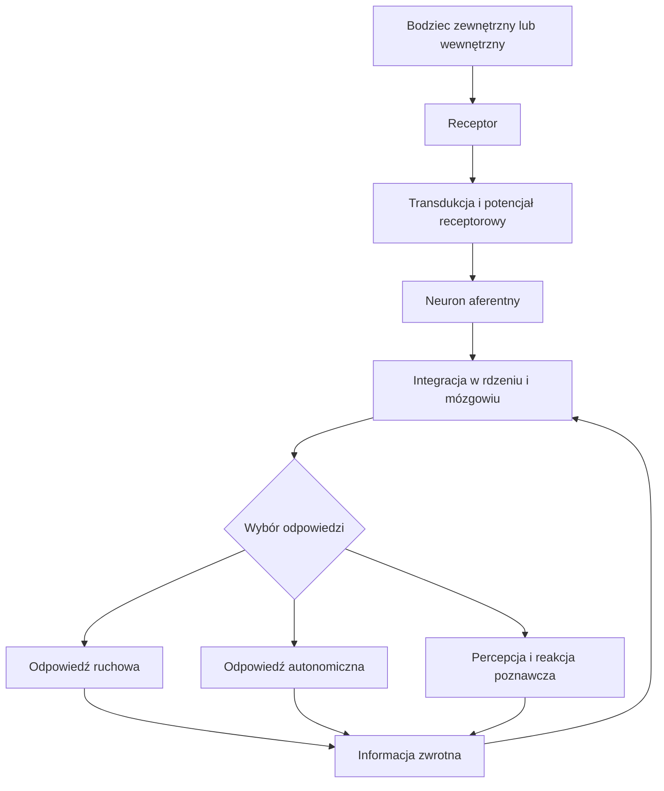
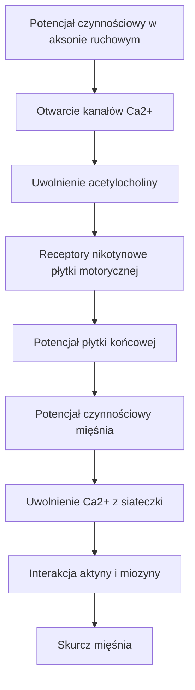
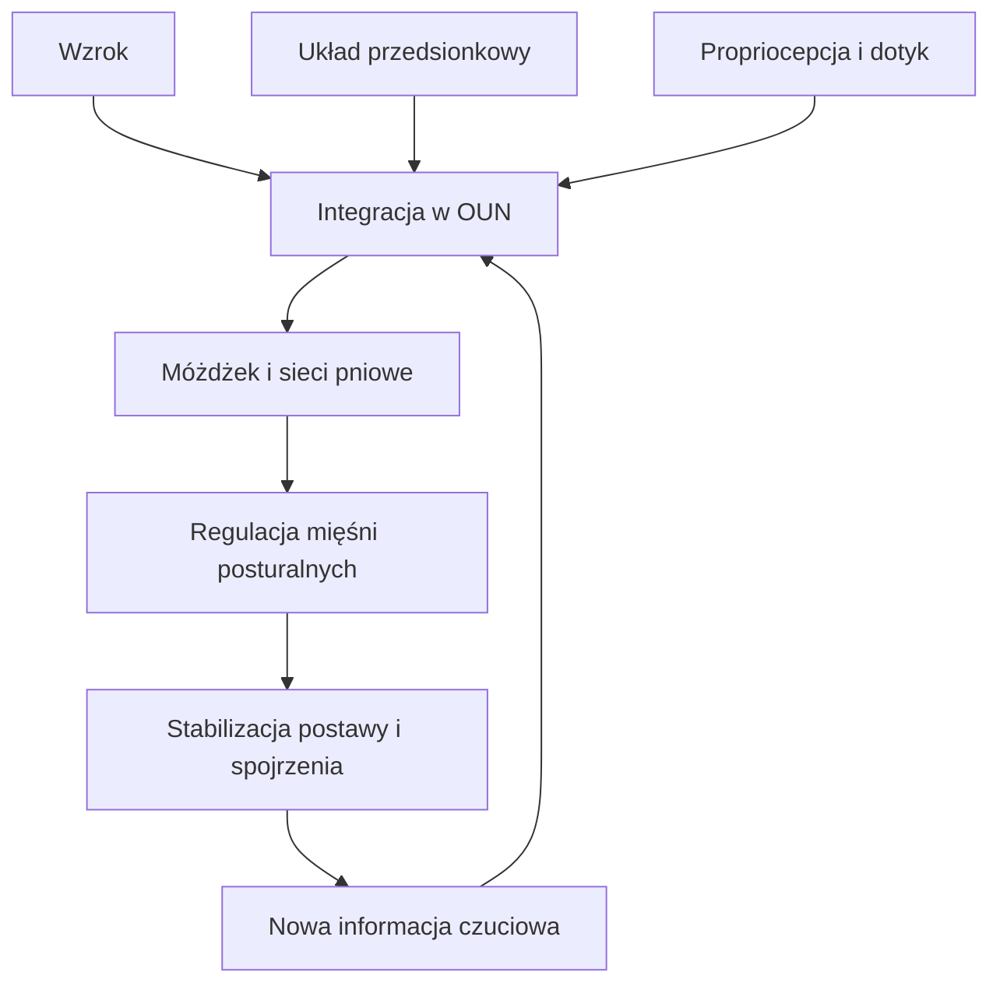
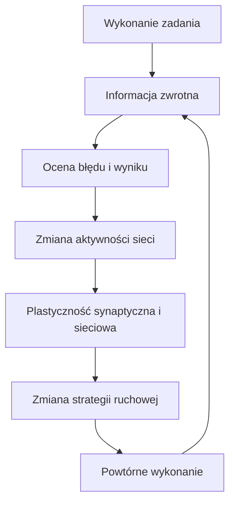

# 1.3. Fizjologia funkcji neurologicznych

> **Moduł 1 – Wprowadzenie do badania neurologicznego**  
> **Zakres:** od pobudliwości błony neuronu i transmisji synaptycznej do złożonych funkcji ruchowych, czuciowych, autonomicznych, poznawczych i adaptacyjnych.  
> **Przeznaczenie:** materiał dydaktyczny dla osób uczących się rozumienia fizjologicznych podstaw badania neurologicznego. Zakres praktycznych czynności i interpretacji zależy od kwalifikacji zawodowych, uprawnień oraz lokalnych procedur.

---

## Wprowadzenie

Fizjologia funkcji neurologicznych opisuje, w jaki sposób układ nerwowy odbiera informacje z organizmu i środowiska, przekształca je w sygnały elektryczne i chemiczne, integruje je w sieciach neuronalnych, a następnie organizuje odpowiedzi ruchowe, autonomiczne, poznawcze i behawioralne. Jest to poziom wiedzy łączący anatomię funkcjonalną z obserwacją kliniczną.

W poprzednim rozdziale przedstawiono rozmieszczenie struktur układu nerwowego. W niniejszym rozdziale punkt ciężkości przesuwa się z pytania **„gdzie znajduje się dana struktura?”** na pytania:

- **jak działa** pojedynczy neuron i połączona z nim sieć;
- **jak powstaje i jest przewodzony** sygnał nerwowy;
- **jak informacja czuciowa** zostaje przekształcona w świadome wrażenie lub odpowiedź odruchową;
- **jak układ ruchowy** planuje, inicjuje, skaluje i koryguje ruch;
- **jak regulowane są** napięcie mięśniowe, postawa, równowaga i chód;
- **jak utrzymywane są** czuwanie, sen, uwaga i funkcje poznawcze;
- **jak układ nerwowy dostosowuje się** do doświadczenia, uczenia się, urazu i rehabilitacji.

Fizjologia nie jest zbiorem izolowanych mechanizmów. Każda obserwowana czynność jest wynikiem współpracy wielu poziomów: receptorów, nerwów obwodowych, rdzenia kręgowego, pnia mózgu, struktur podkorowych, kory mózgu, układu mięśniowo-szkieletowego oraz narządów wewnętrznych. Dlatego pojedynczy objaw nie powinien być automatycznie przypisywany jednemu mechanizmowi bez uwzględnienia całego obrazu klinicznego.

## 1. Cele kształcenia i efekty uczenia się

### 1.1. Cel ogólny

Celem rozdziału jest wyjaśnienie fizjologicznych mechanizmów warunkujących podstawowe funkcje neurologiczne oraz przygotowanie uczestnika do łączenia wiedzy neurofizjologicznej z wynikami wywiadu, badania przedmiotowego i obserwacji funkcjonalnej.

### 1.2. Efekty uczenia się

Po zakończeniu nauki uczestnik powinien umieć:

1. wyjaśnić pojęcie potencjału spoczynkowego, potencjału czynnościowego i przewodzenia skokowego;
2. opisać podstawowe etapy transmisji synaptycznej i przewodnictwa nerwowo-mięśniowego;
3. rozróżnić pobudzające i hamujące wpływy synaptyczne, uwzględniając rolę receptorów i warunków jonowych;
4. przedstawić fizjologię kodowania bodźców czuciowych;
5. wyjaśnić funkcjonalne różnice między głównymi układami przewodzenia czucia;
6. omówić fizjologię dróg ruchowych, jednostki motorycznej i skurczu mięśnia;
7. wyjaśnić mechanizmy odruchów rdzeniowych i ich modulacji zstępującej;
8. rozróżnić fizjologiczne mechanizmy spastyczności, sztywności pozapiramidowej i hipotonii;
9. opisać rolę jąder podstawy i móżdżku w kontroli ruchu i uczeniu motorycznym;
10. wyjaśnić integrację informacji wzrokowej, przedsionkowej i proprioceptywnej w utrzymaniu równowagi;
11. przedstawić podstawowe mechanizmy regulacji autonomicznej;
12. wyjaśnić fizjologiczne podstawy czuwania, snu i świadomości;
13. omówić mechanizmy plastyczności synaptycznej i ich znaczenie dla rehabilitacji;
14. powiązać wybrane zaburzenia fizjologiczne z możliwymi objawami klinicznymi, bez utożsamiania mechanizmu z ostatecznym rozpoznaniem.

### 1.3. Granice kompetencji

Wiedza neurofizjologiczna służy rozumieniu wyników badania, ale sama nie nadaje uprawnień do wykonywania procedur specjalistycznych ani do stawiania rozpoznań zastrzeżonych dla określonych zawodów. Badania elektrofizjologiczne, interpretacja EEG, EMG, elektroneurografii, potencjałów wywołanych oraz decyzje terapeutyczne powinny być prowadzone przez osoby posiadające odpowiednie przygotowanie i uprawnienia.

---

## 2. Podstawowe zasady funkcjonowania neuronu

### 2.1. Neuron jako komórka pobudliwa

Neuron jest komórką zdolną do odbierania, przetwarzania i przekazywania informacji. Jego działanie zależy od właściwości błony komórkowej, rozmieszczenia kanałów jonowych, metabolizmu energetycznego oraz połączeń z innymi komórkami.

Funkcjonalnie wyróżnia się:

- **dendryty** – zwykle odbierają sygnały synaptyczne;
- **ciało komórki** – integruje sygnały i podtrzymuje metabolizm neuronu;
- **wzgórek aksonu i początkowy odcinek aksonu** – obszary o dużym znaczeniu dla inicjacji potencjału czynnościowego;
- **akson** – przewodzi potencjały czynnościowe na odległość;
- **zakończenia presynaptyczne** – przekazują sygnał do kolejnej komórki.

Nie wszystkie neurony mają identyczną budowę. Neurony czuciowe zwojów rdzeniowych są najczęściej pseudojednobiegunowe, a wiele neuronów ruchowych i korowych ma budowę wielobiegunową. Kształt komórki wiąże się z jej funkcją, lecz nie określa jej samodzielnie.

### 2.2. Potencjał błonowy

Błona neuronu oddziela środowisko wewnątrzkomórkowe od zewnątrzkomórkowego. Różnice stężeń jonów oraz selektywna przepuszczalność błony powodują powstanie różnicy potencjałów elektrycznych.

Najważniejsze jony uczestniczące w pobudliwości neuronalnej to:

| Jon | Znaczenie fizjologiczne |
|---|---|
| Na⁺ | szybka depolaryzacja w wielu neuronach |
| K⁺ | repolaryzacja i utrzymanie potencjału spoczynkowego |
| Ca²⁺ | uwalnianie neuroprzekaźników, sygnalizacja wewnątrzkomórkowa i plastyczność |
| Cl⁻ | regulacja pobudliwości, w tym wiele mechanizmów hamowania synaptycznego |

Pompa sodowo-potasowa ATP-azowa utrzymuje gradienty jonowe, transportując Na⁺ na zewnątrz komórki i K⁺ do jej wnętrza. Jest procesem energochłonnym. Jej praca oraz działanie kanałów przeciekowych i zależnych od napięcia umożliwiają utrzymywanie stabilnego środowiska elektrycznego.

**Potencjał spoczynkowy** nie jest jedną stałą wartością dla wszystkich komórek. Zależy od typu neuronu, stanu fizjologicznego, składu środowiska jonowego i aktywności kanałów. W wielu neuronach wynosi orientacyjnie około −60 do −70 mV, ale wartości te nie powinny być traktowane jako uniwersalna norma kliniczna.

### 2.3. Potencjał czynnościowy

Potencjał czynnościowy jest krótkotrwałą, stereotypową zmianą potencjału błonowego, umożliwiającą przewodzenie sygnału wzdłuż aksonu.

Typowy przebieg obejmuje:

1. **Stan wyjściowy** – błona pozostaje w pobliżu potencjału spoczynkowego.
2. **Osiągnięcie progu pobudliwości** – suma wpływów pobudzających i hamujących doprowadza błonę do progu.
3. **Depolaryzacja** – otwierają się napięciozależne kanały sodowe, a Na⁺ napływa do komórki.
4. **Szczyt potencjału** – kanały sodowe ulegają inaktywacji, a rośnie udział kanałów potasowych.
5. **Repolaryzacja** – wypływ K⁺ przywraca bardziej ujemny potencjał błonowy.
6. **Następcza hiperpolaryzacja** – przewodność potasowa może przez krótki czas pozostawać zwiększona.
7. **Powrót do stanu wyjściowego** – kanały i transportery przywracają warunki umożliwiające kolejne pobudzenie.

Zasada „wszystko albo nic” oznacza, że po osiągnięciu progu potencjał czynnościowy ma w danym neuronie względnie stereotypową amplitudę. Siła bodźca jest kodowana przede wszystkim przez częstotliwość wyładowań, ich wzorzec czasowy i rekrutację populacji neuronów, a nie przez dowolne zwiększanie amplitudy pojedynczego potencjału.

### 2.4. Okres refrakcji

Po wygenerowaniu potencjału czynnościowego występuje okres, w którym ponowne pobudzenie jest niemożliwe albo wymaga silniejszego bodźca.

- **Refrakcja bezwzględna** wynika głównie z inaktywacji kanałów sodowych.
- **Refrakcja względna** wiąże się z utrzymującą się zwiększoną przewodnością potasową i hiperpolaryzacją.

Okres refrakcji ogranicza maksymalną częstotliwość wyładowań i sprzyja jednokierunkowemu przewodzeniu w fizjologicznych warunkach.

### 2.5. Przewodzenie w aksonach mielinowych i bezmielinowych

Mielina zwiększa opór elektryczny błony i zmniejsza jej pojemność, co przyspiesza przewodzenie. W aksonach mielinowych potencjał czynnościowy jest odnawiany przede wszystkim w przewężeniach Ranviera. Zjawisko to nazywa się **przewodzeniem skokowym**.

W aksonach bezmielinowych fala depolaryzacji rozprzestrzenia się w sposób ciągły na sąsiednie odcinki błony.

Na szybkość przewodzenia wpływają między innymi:

- średnica aksonu;
- obecność i stan mieliny;
- temperatura kończyny;
- odległość i geometria drogi;
- stan metaboliczny i jonowy;
- ucisk, niedokrwienie, zapalenie lub uszkodzenie aksonu.

**Znaczenie kliniczne:** demielinizacja może prowadzić do zwolnienia przewodzenia, dyspersji czasowej lub bloku przewodzenia, natomiast uszkodzenie aksonalne może powodować zmniejszenie liczby funkcjonujących włókien i obniżenie amplitudy odpowiedzi. Wnioski te wymagają interpretacji w kontekście rodzaju badania i jego ograniczeń.

### 2.6. Transport aksonalny i utrzymanie neuronu

Akson jest strukturą metabolicznie zależną od ciała komórki. Transport aksonalny umożliwia przemieszczanie białek, pęcherzyków, mitochondriów i sygnałów troficznych.

- **Transport anterogradowy** kieruje materiały od ciała komórki ku zakończeniom aksonu.
- **Transport retrogradowy** przenosi sygnały i składniki z zakończeń do ciała komórki.

Zaburzenia transportu, metabolizmu mitochondrialnego i gospodarki białkowej mogą uczestniczyć w patogenezie chorób neurodegeneracyjnych i neuropatii.

---

## 3. Przekaźnictwo synaptyczne

### 3.1. Synapsa jako miejsce integracji informacji

Synapsa jest wyspecjalizowanym połączeniem, za pośrednictwem którego jedna komórka wpływa na aktywność drugiej. Wyróżnia się synapsy chemiczne i elektryczne. W układzie nerwowym człowieka dominują synapsy chemiczne.

W synapsie chemicznej sygnał elektryczny w zakończeniu presynaptycznym zostaje przekształcony w sygnał chemiczny, a następnie ponownie w zmianę właściwości elektrycznych lub biochemicznych komórki postsynaptycznej.

### 3.2. Etapy transmisji chemicznej

1. Potencjał czynnościowy dociera do zakończenia presynaptycznego.
2. Depolaryzacja otwiera napięciozależne kanały Ca²⁺.
3. Napływ Ca²⁺ uruchamia mechanizmy dokowania i fuzji pęcherzyków synaptycznych.
4. Neuroprzekaźnik zostaje uwolniony do szczeliny synaptycznej.
5. Cząsteczki neuroprzekaźnika wiążą się z receptorami postsynaptycznymi lub presynaptycznymi.
6. Aktywacja receptorów zmienia przewodność jonową albo uruchamia kaskady wewnątrzkomórkowe.
7. Sygnał jest wygaszany przez wychwyt zwrotny, rozkład enzymatyczny, dyfuzję lub inne mechanizmy.

### 3.3. Receptory jonotropowe i metabotropowe

| Cecha | Receptor jonotropowy | Receptor metabotropowy |
|---|---|---|
| Mechanizm | kanał jonowy aktywowany ligandem | receptor sprzężony z białkiem G lub innym układem sygnałowym |
| Początek działania | zwykle szybki | zwykle wolniejszy |
| Czas działania | często krótki | może być dłuższy |
| Efekt | bezpośrednia zmiana przepływu jonów | pośrednia regulacja kanałów i procesów komórkowych |
| Przykłady | receptory nikotynowe ACh, AMPA, GABA-A | receptory muskarynowe, dopaminowe, adrenergiczne, GABA-B |

Podział nie oznacza, że receptory jonotropowe zawsze pobudzają, a metabotropowe zawsze hamują. Efekt zależy od typu receptora, rozmieszczenia kanałów, potencjałów równowagi jonowej oraz właściwości komórki docelowej.

### 3.4. Potencjały postsynaptyczne

**Pobudzający potencjał postsynaptyczny (EPSP)** zwiększa prawdopodobieństwo wygenerowania potencjału czynnościowego. Często wynika z otwarcia kanałów przepuszczających kationy i depolaryzacji błony.

**Hamujący potencjał postsynaptyczny (IPSP)** zmniejsza prawdopodobieństwo wyładowania. Może wynikać z otwarcia kanałów chlorkowych lub potasowych, a także z hamowania przez tzw. przewodnictwo bocznikujące (shunting inhibition).

Hamowanie nie zawsze musi powodować widoczną hiperpolaryzację. Zwiększenie przewodności błony może osłabiać wpływ sygnałów pobudzających, nawet jeśli potencjał błonowy nie zmienia się wyraźnie.

### 3.5. Sumowanie przestrzenne i czasowe

Neuron otrzymuje jednocześnie wiele sygnałów. Ich wpływy są integrowane w dendrytach, ciele komórki i początkowym odcinku aksonu.

- **Sumowanie przestrzenne** – łączenie sygnałów pochodzących z różnych synaps.
- **Sumowanie czasowe** – łączenie kolejnych sygnałów docierających w krótkich odstępach czasu.
- **Hamowanie presynaptyczne** – zmniejszenie uwalniania neuroprzekaźnika z zakończenia presynaptycznego.
- **Hamowanie postsynaptyczne** – zmniejszenie pobudliwości komórki odbierającej sygnał.

Wynik integracji zależy nie tylko od liczby pobudzających i hamujących synaps, ale również od ich lokalizacji, czasu aktywacji, siły, rodzaju receptorów oraz wcześniejszego stanu neuronu.

### 3.6. Główne neuroprzekaźniki i neuromodulatory

| Substancja | Najważniejsze role fizjologiczne | Uwagi interpretacyjne |
|---|---|---|
| Glutaminian | główny neuroprzekaźnik pobudzający w OUN; transmisja i plastyczność | nadmierna aktywacja może uczestniczyć w ekscytotoksyczności |
| GABA | główny neuroprzekaźnik hamujący w wielu obwodach OUN | działanie zależy m.in. od gradientu Cl⁻ i etapu rozwoju |
| Glicyna | hamowanie w rdzeniu kręgowym i pniu mózgu | istotna dla kontroli odruchów i ruchu |
| Acetylocholina | złącze nerwowo-mięśniowe, układ autonomiczny, uwaga i pamięć | działa przez receptory nikotynowe i muskarynowe |
| Dopamina | modulacja obwodów jąder podstawy, motywacji, uczenia i zachowania | nie jest prostym „przekaźnikiem przyjemności” |
| Noradrenalina | czuwanie, uwaga, reakcja na stres, modulacja bólu | wpływa na stosunek sygnału do szumu w sieciach |
| Serotonina | regulacja nastroju, snu, bólu i wielu funkcji autonomicznych | działa przez liczne podtypy receptorów |
| Histamina | czuwanie i regulacja pobudzenia | część leków przeciwhistaminowych może powodować senność |
| Neuropeptydy | długotrwała modulacja bólu, stresu, apetytu i innych funkcji | często współuwalniane z klasycznymi neuroprzekaźnikami |
| Endokannabinoidy | modulacja uwalniania neuroprzekaźników i plastyczności | często działają wstecznie na zakończenia presynaptyczne |

**Zasada ostrożności:** nie należy przypisywać jednemu neuroprzekaźnikowi jednej emocji, zachowania ani choroby. Funkcja wynika z działania określonych receptorów w konkretnych sieciach neuronalnych, a nie z prostego poziomu pojedynczej substancji w całym mózgu.

### 3.7. Znaczenie fizjologii synaps dla objawów klinicznych

Zaburzenia transmisji synaptycznej mogą powodować:

- nadmierną pobudliwość i napady;
- osłabienie transmisji i niedowład;
- zaburzenia uwagi i czuwania;
- nieprawidłową kontrolę ruchu;
- zaburzenia pamięci i uczenia;
- nieprawidłową regulację bólu.

W praktyce klinicznej podobny objaw może powstać w wyniku uszkodzenia różnych elementów łańcucha: receptora, kanału jonowego, zakończenia presynaptycznego, receptora postsynaptycznego, neuronu, aksonu, złącza nerwowo-mięśniowego lub mięśnia.

---

## 4. Fizjologia odbioru i kodowania informacji czuciowej

### 4.1. Transdukcja bodźca

Receptor czuciowy przekształca energię bodźca w sygnał elektryczny. Proces ten nazywa się **transdukcją**.

Przykłady:

- mechanoreceptory reagują na odkształcenie tkanek;
- termoreceptory reagują na zmianę temperatury;
- nocyceptory reagują na bodźce potencjalnie uszkadzające tkanki;
- fotoreceptory reagują na światło;
- komórki rzęsate narządu przedsionkowego reagują na ruch i przyspieszenie.

W receptorze powstaje potencjał receptorowy o wielkości zależnej od bodźca. Po osiągnięciu progu w neuronie czuciowym mogą zostać wygenerowane potencjały czynnościowe.

### 4.2. Kodowanie intensywności, czasu i lokalizacji

Informacja czuciowa jest kodowana przez kilka współdziałających mechanizmów:

1. **Częstotliwość wyładowań** – silniejszy bodziec często zwiększa częstość impulsów.
2. **Rekrutacja receptorów** – silniejszy bodziec może aktywować większą liczbę receptorów i włókien.
3. **Wzorzec czasowy** – informacja o początku, trwaniu i zmianach bodźca.
4. **Kodowanie populacyjne** – układ nerwowy porównuje aktywność wielu neuronów.
5. **Pola recepcyjne** – ich wielkość i nakładanie się wpływają na precyzję lokalizacji bodźca.

### 4.3. Adaptacja receptorów

Receptory różnią się szybkością adaptacji.

- Receptory szybko adaptujące się szczególnie dobrze sygnalizują zmianę bodźca, jego początek lub koniec.
- Receptory wolno adaptujące się przekazują informację o utrzymującym się bodźcu.

Adaptacja nie oznacza utraty znaczenia bodźca. Jest sposobem optymalizacji przetwarzania informacji, dzięki któremu układ nerwowy może reagować zarówno na stabilne warunki, jak i na nowe zmiany.

### 4.4. Czucie mechaniczne i propriocepcja

Informacja o dotyku, nacisku, wibracji i położeniu kończyn pochodzi z receptorów skóry, mięśni, ścięgien i stawów.

Najważniejsze receptory proprioceptywne:

- **wrzecionka mięśniowe** – informują o długości mięśnia i szybkości jej zmiany;
- **narządy ścięgniste Golgiego** – reagują na napięcie przenoszone przez ścięgno;
- **receptory stawowe i skórne** – dostarczają informacji uzupełniających o położeniu i ruchu.

Propriocepcja jest niezbędna do precyzyjnego sterowania ruchem, kontroli postawy oraz wykonywania czynności bez stałej kontroli wzrokowej.

### 4.5. Fizjologia czucia bólu

Nocycepcja jest procesem wykrywania i przetwarzania bodźców potencjalnie uszkadzających tkanki. Nie jest tożsama z subiektywnym doświadczeniem bólu.

W uproszczeniu:

1. nocyceptory wykrywają bodziec mechaniczny, termiczny lub chemiczny;
2. sygnał jest przewodzony włóknami Aδ i C;
3. informacja dociera do rdzenia kręgowego i jest modulowana przez interneurony;
4. drogi wstępujące przekazują ją do struktur pnia mózgu, wzgórza i sieci korowych;
5. układy zstępujące mogą wzmacniać lub hamować transmisję bólową;
6. mózg integruje sygnał z uwagą, emocjami, pamięcią, oczekiwaniami i kontekstem.

Włókna Aδ przewodzą zwykle szybciej i wiążą się z ostrzejszym, lepiej lokalizowanym komponentem bólu. Włókna C przewodzą wolniej i częściej uczestniczą w przewodzeniu bólu rozlanego, piekącego lub długotrwałego. Nie jest to jednak sztywny podział wszystkich doświadczeń bólowych.

### 4.6. Modulacja bólu

Przetwarzanie bólu jest dynamiczne. W rdzeniu kręgowym i wyższych piętrach układu nerwowego występują mechanizmy hamujące i ułatwiające transmisję nocyceptywną.

W modulacji bólu uczestniczą m.in.:

- interneurony rdzeniowe;
- istota szara okołowodociągowa;
- struktury rdzenia przedłużonego;
- układy noradrenergiczne i serotoninergiczne;
- endogenne opioidy;
- mechanizmy uwagi, emocji i przewidywania.

**Wniosek kliniczny:** natężenie bólu nie jest prostym miernikiem wielkości uszkodzenia tkanki. Ból jest realnym doświadczeniem biologicznym, którego intensywność i charakter zależą od współdziałania mechanizmów obwodowych, rdzeniowych, mózgowych i psychospołecznych.

### 4.7. Drogi czuciowe – znaczenie fizjologiczne

| Układ | Główna informacja | Charakterystyczna rola |
|---|---|---|
| Sznury tylne – wstęga przyśrodkowa | precyzyjny dotyk, wibracja, świadoma propriocepcja | lokalizacja i różnicowanie bodźców |
| Układ przednio-boczny | ból, temperatura, część czucia dotyku i sygnałów ochronnych | szybkie wykrywanie zagrożeń i modulacja reakcji |
| Drogi rdzeniowo-móżdżkowe | propriocepcja nieświadoma i informacja o stanie aparatu ruchu | bieżąca korekta ruchu |
| Drogi trójdzielno-wzgórzowe | czucie twarzy | przekazywanie informacji czuciowej z obszaru twarzoczaszki |

Dla zrozumienia badania istotne jest nie tylko to, gdzie droga przebiega, ale również to, jaką informację niesie, na jakim poziomie krzyżuje się i jakie funkcje tracą znaczenie po jej uszkodzeniu.

### 4.8. Czucie korowe i integracja

Świadome rozpoznanie bodźca wymaga więcej niż zachowanego przewodzenia obwodowego. Kora czuciowa i sieci asocjacyjne integrują informacje o lokalizacji, intensywności, jakości i znaczeniu bodźca.

Zaburzenia integracji mogą powodować trudności w rozpoznawaniu przedmiotów dotykiem, lokalizacji bodźca, różnicowaniu dwóch punktów lub interpretowaniu bodźców pochodzących z obu stron ciała. Wynik takich prób zależy również od uwagi, języka, pamięci, sprawności ruchowej i zrozumienia polecenia.

---

## 5. Fizjologia układu ruchowego

### 5.1. Ruch jako wynik współpracy wielu poziomów

Ruch dowolny nie jest pojedynczym poleceniem wysłanym z kory do mięśnia. Jest procesem obejmującym:

- określenie celu działania;
- wybór i przygotowanie programu ruchowego;
- przewidywanie wymaganej siły i zakresu;
- aktywację odpowiednich grup mięśniowych;
- stabilizację segmentów ciała;
- odbiór informacji zwrotnej;
- korektę błędów w trakcie i po zakończeniu ruchu.

Kora mózgu, jądra podstawy, móżdżek, pień mózgu i rdzeń kręgowy tworzą współpracujące układy, których zadaniem jest uzyskanie celowego i bezpiecznego ruchu.

### 5.2. Drogi korowo-rdzeniowe

Droga korowo-rdzeniowa jest kluczowa dla kontroli ruchów dowolnych, szczególnie precyzyjnych ruchów dystalnych. Włókna pochodzą z różnych obszarów kory ruchowej i przedruchowej, przechodzą przez głębokie struktury półkul, pień mózgu, a większość krzyżuje się w dolnej części rdzenia przedłużonego.

Jej funkcje obejmują:

- selektywne uruchamianie mięśni;
- precyzyjne sterowanie ruchami palców i dłoni;
- modulowanie aktywności obwodów rdzeniowych;
- dostosowanie siły i kierunku ruchu do zadania.

Uszkodzenie układu korowo-rdzeniowego może powodować osłabienie, utratę selektywności ruchu, wzmożenie odruchów i inne objawy zespołu górnego neuronu ruchowego. Obraz kliniczny zależy jednak od poziomu, rozległości i czasu od uszkodzenia.

### 5.3. Drogi korowo-jądrowe

Drogi korowo-jądrowe przekazują wpływ kory na jądra ruchowe nerwów czaszkowych. Wiele jąder otrzymuje pobudzenie z obu półkul, lecz istnieją istotne wyjątki i różnice w dominacji projekcji.

Dlatego wzorzec osłabienia mięśni twarzy, języka i gardła może dostarczać informacji o poziomie uszkodzenia, ale interpretacja musi uwzględniać anatomię konkretnego układu i możliwe współistniejące zaburzenia.

### 5.4. Układy zstępujące pnia mózgu

Drogi siatkowo-rdzeniowe, przedsionkowo-rdzeniowe i pokrywowo-rdzeniowe uczestniczą w regulacji postawy, napięcia mięśniowego, odruchów orientacyjnych i automatycznych komponentów ruchu.

Ich działanie jest szczególnie ważne dla:

- utrzymania pozycji pionowej;
- stabilizacji głowy i tułowia;
- reakcji na przyspieszenie i zmianę położenia;
- przygotowania posturalnego przed ruchem kończyny;
- automatycznych reakcji równoważnych.

### 5.5. Układ piramidowy i pozapiramidowy – uwagi terminologiczne

Określenia „piramidowy” i „pozapiramidowy” mają znaczenie historyczne i dydaktyczne. Nie należy traktować układu pozapiramidowego jako jednej, anatomicznie zamkniętej drogi. W kontroli ruchu uczestniczy wiele obwodów korowych, podkorowych, pniowych i rdzeniowych.

W praktyce klinicznej ważniejsze od samej etykiety jest opisanie konkretnego zaburzenia: osłabienia, spowolnienia, sztywności, drżenia, dystonii, zaburzeń postawy lub utraty automatyzmów ruchowych.

---

## 6. Jądra podstawy i fizjologia wyboru ruchu

### 6.1. Funkcja obwodów jąder podstawy

Jądra podstawy uczestniczą w selekcji, inicjowaniu, skalowaniu i hamowaniu programów ruchowych. Wpływają również na uczenie nawyków, motywację i wybrane procesy poznawcze.

Nie wysyłają bezpośrednio końcowego polecenia do mięśni. Regulują aktywność pętli korowo-podkorowo-korowych, które wpływają na neurony ruchowe za pośrednictwem kory i pnia mózgu.

### 6.2. Droga bezpośrednia, pośrednia i hiperbezpośrednia

W uproszczonym modelu:

- **droga bezpośrednia** zmniejsza hamujący wpływ wyjścia jąder podstawy na wzgórze, ułatwiając aktywację wybranego programu ruchowego;
- **droga pośrednia** zwiększa hamowanie niepożądanych lub konkurencyjnych programów;
- **droga hiperbezpośrednia** umożliwia szybką regulację i zahamowanie reakcji poprzez projekcje korowe do jądra niskowzgórzowego.

Rzeczywiste obwody są bardziej złożone, równoległe i zależne od zadania. Schemat nie powinien być traktowany jako pełny opis wszystkich funkcji jąder podstawy.

### 6.3. Dopamina i regulacja ruchu

Neurony dopaminergiczne istoty czarnej części zbitej modulują aktywność obwodów prążkowia. W klasycznym modelu pobudzenie receptorów D1 sprzyja aktywności szlaku bezpośredniego, a pobudzenie receptorów D2 ogranicza aktywność szlaku pośredniego. Łączny efekt dopaminergiczny ułatwia wykonywanie wybranych programów ruchowych.

Niedobór dopaminy w chorobie Parkinsona zmienia równowagę aktywności tych obwodów. Może to prowadzić do bradykinezji, zmniejszenia amplitudy ruchów, sztywności, drżenia spoczynkowego i zaburzeń automatyzmów. W innych zaburzeniach jąder podstawy mogą dominować ruchy nadmierne, takie jak pląsawica lub dystonia.

### 6.4. Znaczenie kliniczne

Fizjologia jąder podstawy pomaga zrozumieć, dlaczego pacjent może mieć zachowaną siłę mięśniową, a mimo to poruszać się wolno, mieć trudność z rozpoczęciem ruchu lub wykonywać ruchy o zmniejszonej amplitudzie. W badaniu nie należy utożsamiać bradykinezji z niedowładem.

---

## 7. Móżdżek i fizjologia koordynacji

### 7.1. Móżdżek jako układ porównujący i korygujący

Móżdżek otrzymuje informacje o planowanym ruchu oraz o jego rzeczywistym przebiegu. Porównuje sygnały związane z zamiarem, położeniem ciała, propriocepcją, wzrokiem i układem przedsionkowym. Na tej podstawie wpływa na korektę ruchu w czasie rzeczywistym i na uczenie motoryczne.

Można go opisać jako układ predykcyjno-korekcyjny, który pomaga ograniczać różnicę między ruchem zamierzonym a wykonanym. Nie jest jednak wyłącznie „korektorem błędów”; uczestniczy również w planowaniu, synchronizacji, przewidywaniu i automatyzacji czynności.

### 7.2. Komórki Purkinjego i jądra głębokie

Komórki Purkinjego są głównymi neuronami wyjściowymi kory móżdżku i działają hamująco na jądra głębokie. Jądra głębokie przekazują sygnały dalej do struktur wzgórza i pnia mózgu.

W obwodach móżdżkowych ważne są dwa główne rodzaje wejść:

- włókna kiciaste, przekazujące różnorodne informacje z rdzenia, pnia mózgu i kory;
- włókna pnące, pochodzące z oliwki dolnej i uczestniczące w sygnalizacji błędu oraz plastyczności.

### 7.3. Uczenie motoryczne

Powtarzanie ruchu w zmiennych warunkach pozwala układowi nerwowemu dostosowywać parametry wykonania. Móżdżek uczestniczy w adaptacji odruchu przedsionkowo-ocznego, kalibracji ruchów kończyn, kontroli czasu i precyzji.

Uszkodzenie móżdżku może powodować dysmetrię, drżenie zamiarowe, dysdiadochokinezę, ataksję, zaburzenia mowy i trudności w adaptacji ruchowej. Objawy zależą od uszkodzonej części sieci i nie zawsze ograniczają się do klasycznego obrazu kończynowego.

### 7.4. Móżdżek a objawy kliniczne

| Funkcja fizjologiczna | Możliwy skutek zaburzenia |
|---|---|
| Kalibracja siły i odległości ruchu | dysmetria, hipermetria lub hipometria |
| Synchronizacja składowych ruchu | asynergia i rozpad ruchu złożonego |
| Kontrola ruchów naprzemiennych | dysdiadochokineza |
| Stabilizacja spojrzenia | zaburzenia sakkad i oczopląs |
| Korekta postawy i chodu | ataksja tułowia i chodu |
| Uczenie adaptacyjne | trudność w dostosowaniu ruchu do nowych warunków |

---

## 8. Jednostka motoryczna i fizjologia skurczu mięśnia

### 8.1. Jednostka motoryczna

Jednostka motoryczna składa się z neuronu ruchowego alfa i wszystkich włókien mięśniowych przez niego unerwianych. Liczba włókien w jednostce zależy od funkcji mięśnia. Mięśnie wykonujące precyzyjne ruchy mają zwykle mniejsze jednostki motoryczne niż mięśnie odpowiedzialne za generowanie dużej siły.

Siła mięśnia jest regulowana przede wszystkim przez:

- rekrutację jednostek motorycznych;
- częstotliwość wyładowań neuronów ruchowych;
- synchronizację aktywności jednostek;
- właściwości mechaniczne i metaboliczne włókien mięśniowych;
- długość mięśnia i warunki mechaniczne skurczu.

### 8.2. Zasada wielkości Hennemana

W wielu warunkach fizjologicznych jednostki motoryczne są rekrutowane od mniejszych, o niższym progu pobudliwości, do większych, generujących większą siłę. Zasada ta pozwala zwiększać siłę stopniowo i ekonomicznie.

Nie oznacza to, że każdy skurcz przebiega w identyczny sposób. Wymagania zadania, szybkość ruchu, zmęczenie i wpływ zstępujący mogą modyfikować rekrutację.

### 8.3. Przewodnictwo nerwowo-mięśniowe

W złączu nerwowo-mięśniowym potencjał czynnościowy dociera do zakończenia aksonu neuronu ruchowego, otwiera kanały wapniowe i powoduje uwolnienie acetylocholiny. Acetylocholina wiąże się z nikotynowymi receptorami płytki motorycznej, wywołując potencjał płytki końcowej. Jeżeli osiągnięty zostanie próg, w błonie mięśniowej powstaje potencjał czynnościowy.

Następnie:

1. pobudzenie rozchodzi się po sarkolemie;
2. sygnał dociera do kanalików T;
3. aktywowane zostają białka sprzęgające pobudzenie z uwalnianiem Ca²⁺;
4. Ca²⁺ jest uwalniany z siateczki sarkoplazmatycznej;
5. wapń wiąże się z troponiną;
6. zmienia się położenie tropomiozyny i możliwe staje się tworzenie mostków aktyna–miozyna;
7. cykl mostków poprzecznych, zależny od ATP, prowadzi do skracania sarkomeru;
8. wychwyt Ca²⁺ do siateczki sarkoplazmatycznej umożliwia rozkurcz.

### 8.4. Znaczenie ATP i gospodarki wapniowej

ATP jest niezbędny zarówno do cyklu mostków poprzecznych, jak i do aktywnego transportu Ca²⁺. Niedobory energetyczne, zaburzenia jonowe, niedotlenienie i uszkodzenie komórki mogą zaburzać skurcz oraz rozkurcz mięśnia.

### 8.5. Zmęczenie mięśniowe i męczliwość

Zmęczenie jest zjawiskiem wieloczynnikowym. Może wynikać ze zmian ośrodkowego napędu ruchowego, przewodnictwa nerwowo-mięśniowego, gospodarki jonowej, metabolizmu mięśnia, dostępności substratów energetycznych i warunków mechanicznych.

W badaniu klinicznym należy odróżniać:

- **zmęczenie subiektywne** – odczucie braku energii lub wyczerpania;
- **męczliwość obiektywną** – mierzalne pogarszanie się siły lub wykonania przy powtarzaniu zadania;
- **osłabienie stałe** – obniżenie siły obecne także po odpoczynku;
- **ból ograniczający wysiłek** – zmniejszenie wykonania wynikające z bólu, a niekoniecznie z zaburzenia napędu nerwowego.

---

## 9. Fizjologia odruchów i integracji rdzeniowej

### 9.1. Łuk odruchowy

Łuk odruchowy jest układem umożliwiającym szybką, stereotypową odpowiedź na bodziec. W klasycznym ujęciu obejmuje:

1. receptor;
2. neuron lub włókno aferentne;
3. ośrodek integracyjny;
4. neuron lub włókno eferentne;
5. efektor.

Nie każdy odruch ma tę samą liczbę synaps. Odruch na rozciąganie mięśnia jest klasycznie monosynaptyczny na głównym połączeniu aferentu Ia z neuronem ruchowym alfa, natomiast wiele innych odruchów wymaga interneuronów i obejmuje kilka segmentów.

### 9.2. Odruch na rozciąganie

Wrzecionko mięśniowe reaguje na zmianę długości mięśnia. Włókna aferentne Ia przekazują sygnał do rdzenia kręgowego i pobudzają neurony ruchowe alfa unerwiające rozciągany mięsień. Jednocześnie interneurony hamujące ograniczają aktywność mięśni antagonistycznych.

Odruch ten:

- przeciwdziała nagłej zmianie długości mięśnia;
- uczestniczy w utrzymaniu postawy;
- wspiera stabilność podczas ruchu;
- stanowi podstawę wielu odruchów ścięgnistych badanych klinicznie.

### 9.3. Rola wrzecionek mięśniowych i neuronów gamma

Wrzecionka mięśniowe zawierają włókna intrafuzalne. Neurony gamma regulują napięcie tych włókien i wpływają na czułość receptora na rozciąganie.

Współaktywacja alfa–gamma pozwala utrzymać czułość wrzecionka podczas skracania mięśnia. Dzięki temu układ proprioceptywny może przekazywać informację o zmianach długości mięśnia także w czasie aktywnego ruchu.

### 9.4. Narządy ścięgniste Golgiego

Narządy ścięgniste Golgiego reagują na napięcie przenoszone przez ścięgno. Włókna aferentne Ib przekazują informację do obwodów rdzeniowych, które mogą modulować aktywność neuronów ruchowych. W klasycznym opisie mechanizm ten wiązano z hamowaniem autogennym, jednak rzeczywista funkcja zależy od zadania i kontekstu ruchowego.

Nie należy przedstawiać narządów Golgiego wyłącznie jako prostego „bezpiecznika” wyłączającego mięsień przy nadmiernej sile. Uczestniczą one w precyzyjnej regulacji siły i współpracy mięśni.

### 9.5. Odruch zginania i skrzyżowany odruch wyprostny

Bodziec nocyceptywny może uruchomić wielosynaptyczny odruch zginania, który sprzyja odsunięciu kończyny od bodźca. W kończynie przeciwnej może pojawić się komponent wyprostny pomagający utrzymać podparcie.

Odruchy te pokazują, że rdzeń kręgowy nie jest wyłącznie przewodem dla sygnałów z mózgu. Zawiera lokalne sieci integracyjne, które organizują złożone reakcje ochronne i lokomocyjne.

### 9.6. Centralne generatory wzorców

Centralne generatory wzorców ruchowych to sieci neuronalne zdolne do wytwarzania rytmicznej aktywności, np. związanej z lokomocją, nawet przy ograniczonym dopływie bodźców zewnętrznych. W warunkach naturalnych są modulowane przez informacje czuciowe, układy zstępujące, stan metaboliczny i wymagania zadania.

### 9.7. Modulacja odruchów przez mózg

Odruchy nie są całkowicie niezależne od kory i pnia mózgu. Drogi zstępujące regulują pobudliwość interneuronów i neuronów ruchowych, a także czułość wrzecionek mięśniowych.

Dlatego odruchy mogą zmieniać się zależnie od:

- pozycji ciała;
- stopnia rozluźnienia;
- uwagi i napięcia emocjonalnego;
- bólu;
- temperatury;
- zmęczenia;
- leków działających na OUN;
- uszkodzenia dróg zstępujących lub obwodów segmentarnych.

### 9.8. Interpretacja odruchów w badaniu neurologicznym

Osłabienie odruchu może wynikać z uszkodzenia receptora, włókna aferentnego, segmentu rdzenia, neuronu ruchowego, aksonu eferentnego, złącza nerwowo-mięśniowego lub mięśnia. Wygórowanie odruchów może wskazywać na zaburzenie modulacji zstępującej, ale nie jest samodzielnym rozpoznaniem.

Wynik należy oceniać z uwzględnieniem symetrii, rozkładu, napięcia mięśniowego, siły, czucia, wieku, stanu ogólnego i techniki badania.

---

## 10. Fizjologia napięcia mięśniowego i kontroli postawy

### 10.1. Napięcie mięśniowe – pojęcie funkcjonalne

Napięcie mięśniowe jest oporem odczuwanym podczas biernego poruszania rozluźnioną kończyną. Jest wynikiem współdziałania właściwości mechanicznych tkanek, aktywności odruchowej, pobudliwości neuronów ruchowych i wpływu zstępującego.

Nie jest równoznaczne z siłą mięśniową. Pacjent może mieć znaczne napięcie i małą siłę, albo obniżone napięcie przy względnie zachowanej sile w wybranych grupach.

### 10.2. Spastyczność

Spastyczność jest zaburzeniem kontroli ruchowej związanym z uszkodzeniem górnego neuronu ruchowego. Klasycznie opisuje się ją jako zależny od szybkości rozciągania wzrost oporu mięśniowego, często z wygórowanymi odruchami rozciągowymi.

Mechanizmy obejmują zmienioną modulację obwodów rdzeniowych, nieprawidłową równowagę pobudzenia i hamowania oraz zmiany właściwości mięśni i tkanek w następstwie długotrwałego ograniczenia ruchu.

Spastyczność może współistnieć z osłabieniem, utratą selektywnej kontroli, klonusem, przykurczami i bólem. Nie należy utożsamiać jej z każdym wzrostem oporu podczas ruchu biernego.

### 10.3. Sztywność pozapiramidowa

Sztywność w zespołach parkinsonowskich jest wzrostem oporu podczas ruchu biernego, zwykle mniej zależnym od szybkości niż spastyczność. Może mieć charakter jednostajny lub zjawisko koła zębatego.

Jej mechanizmy wiążą się z zaburzeniami obwodów jąder podstawy i zmianami regulacji aktywności układów ruchowych. Sztywność nie jest tym samym co przykurcz ani ból podczas poruszania stawem.

### 10.4. Hipotonia

Hipotonia oznacza zmniejszony opór podczas biernego ruchu. Może występować m.in. w uszkodzeniach dolnego neuronu ruchowego, zaburzeniach móżdżkowych, niektórych chorobach mięśni i w ostrych fazach wybranych uszkodzeń OUN.

Interpretacja wymaga uwzględnienia siły, odruchów, trofiki, koordynacji i innych objawów.

### 10.5. Postawa i reakcje posturalne

Utrzymanie postawy wymaga ciągłego porównywania informacji o położeniu ciała i środka ciężkości z granicami stabilności. Układ nerwowy uruchamia strategie stawu skokowego, biodra lub kroku, zależnie od wielkości i kierunku zaburzenia równowagi.

Reakcje posturalne obejmują:

- przygotowanie posturalne przed ruchem dowolnym;
- automatyczne korekty po przesunięciu środka ciężkości;
- reakcje ochronne;
- dostosowanie szerokości i długości kroku;
- stabilizację głowy i wzroku.

---

## 11. Fizjologia równowagi i koordynacji

### 11.1. Trzy główne źródła informacji

Utrzymanie równowagi opiera się na integracji trzech podstawowych źródeł informacji:

1. **wzrok** – dostarcza danych o położeniu ciała względem otoczenia i ruchu środowiska;
2. **układ przedsionkowy** – wykrywa ruchy i przyspieszenia głowy oraz wpływa na stabilizację spojrzenia i postawy;
3. **somatosensoryka** – dostarcza informacji o nacisku, położeniu stawów, długości mięśni i kontakcie z podłożem.

Mózg waży wiarygodność tych źródeł zależnie od warunków. Na miękkim lub niestabilnym podłożu informacja z receptorów stóp jest mniej wiarygodna, dlatego większe znaczenie może mieć wzrok i układ przedsionkowy.

### 11.2. Odruch przedsionkowo-oczny

Odruch przedsionkowo-oczny (VOR) stabilizuje obraz na siatkówce podczas ruchu głowy. Gdy głowa obraca się w jedną stronę, oczy wykonują ruch kompensacyjny w stronę przeciwną.

Dzięki temu możliwe jest utrzymanie względnie stabilnego widzenia podczas chodzenia, biegania i obracania głowy. Zaburzenia VOR mogą powodować oscylopsję, trudności w stabilizacji wzroku i zaburzenia równowagi.

### 11.3. Układy przedsionkowo-rdzeniowe

Połączenia przedsionkowe z rdzeniem kręgowym wpływają na aktywność mięśni posturalnych i reakcje stabilizacyjne. Ich działanie jest integrowane z sygnałami wzrokowymi, proprioceptywnymi i korowymi.

### 11.4. Koordynacja ruchu

Koordynacja wymaga odpowiedniego doboru kolejności, czasu, siły i zakresu aktywacji mięśni. Obejmuje:

- synchronizację agonistów i antagonistów;
- odpowiednie wyprzedzanie aktywności stabilizacyjnej;
- płynność przejść między fazami ruchu;
- przewidywanie skutków działania;
- korektę na podstawie informacji zwrotnej.

Dysmetria, drżenie zamiarowe, asynergia i dysdiadochokineza mogą wskazywać na zaburzenie tych mechanizmów, lecz ich interpretacja zależy od pełnego obrazu badania.

### 11.5. Rozróżnienie ataksji

| Rodzaj | Główny mechanizm | Cechy orientacyjne |
|---|---|---|
| Móżdżkowa | zaburzenie planowania i korekty ruchu | dysmetria, dysdiadochokineza, zaburzenia chodu i koordynacji |
| Czuciowa | utrata wiarygodnej informacji proprioceptywnej | pogorszenie kontroli przy zamknięciu oczu, zaburzenia czucia głębokiego |
| Przedsionkowa | asymetria lub niewydolność układu przedsionkowego | zawroty, nudności, oczopląs, niestabilność, zaburzenia VOR |

Powyższe wzorce są orientacyjne. W praktyce mogą współistnieć różne mechanizmy, np. u osoby starszej z polineuropatią, zaburzeniami wzroku i chorobą przedsionkową.

---

## 12. Fizjologia układu autonomicznego

### 12.1. Homeostaza i regulacja autonomiczna

Układ autonomiczny reguluje funkcje narządów wewnętrznych, naczyń, gruczołów i mięśni gładkich. Działa w sposób ciągły, dostosowując czynność organizmu do zmian środowiska i potrzeb metabolicznych.

Regulacja autonomiczna nie jest całkowicie niezależna od świadomości. Emocje, ból, stres, oddychanie, wysiłek i procesy poznawcze mogą wpływać na jej aktywność.

### 12.2. Układ współczulny

Układ współczulny uczestniczy w mobilizacji organizmu podczas wysiłku, stresu i zagrożenia. Może zwiększać częstość pracy serca, wpływać na napięcie naczyń, rozszerzać źrenice, modyfikować potliwość i ograniczać aktywność części procesów trawiennych.

Nie jest jednak wyłącznie układem „walki lub ucieczki”. Uczestniczy także w podstawowej regulacji krążenia, termoregulacji i wielu funkcji trzewnych w spoczynku.

### 12.3. Układ przywspółczulny

Układ przywspółczulny uczestniczy w regulacji czynności serca, przewodu pokarmowego, gruczołów i narządów miednicy. Jego działanie wspiera m.in. trawienie, wydzielanie, mikcję i wybrane funkcje seksualne.

W wielu narządach współczulny i przywspółczulny wpływają na tę samą funkcję w sposób przeciwny lub uzupełniający. Nie wszystkie narządy otrzymują jednak jednakowe unerwienie obu układów.

### 12.4. Neuroprzekaźniki autonomiczne

Włókna przedzwojowe układu współczulnego i przywspółczulnego wykorzystują acetylocholinę działającą na receptory nikotynowe w zwojach. Włókna zazwojowe przywspółczulne uwalniają zwykle acetylocholinę, a większość włókien zazwojowych współczulnych – noradrenalinę. Istnieją wyjątki, np. współczulne unerwienie gruczołów potowych.

### 12.5. Odruch z baroreceptorów

Baroreceptory zatok szyjnych i łuku aorty wykrywają rozciągnięcie ściany tętnicy. Informacja dociera do ośrodków pnia mózgu, które dostosowują aktywność współczulną i przywspółczulną.

Wzrost ciśnienia tętniczego zwykle zwiększa aktywność baroreceptorów, nasila wpływ przywspółczulny i ogranicza współczulny, co sprzyja zmniejszeniu częstości pracy serca i oporu naczyniowego. Spadek ciśnienia wywołuje odpowiedź przeciwną.

### 12.6. Regulacja mikcji

Napełnianie pęcherza pobudza receptory rozciągania, a informacja aferentna jest integrowana w rdzeniu kręgowym, pniu mózgu i korze. Mikcja wymaga skoordynowanej aktywacji mięśnia wypieracza oraz rozluźnienia zwieraczy.

Kontrola korowa umożliwia społeczne i sytuacyjne dostosowanie opróżniania pęcherza. Uszkodzenia rdzenia, dróg zstępujących lub nerwów obwodowych mogą prowadzić do różnych wzorców zaburzeń pęcherzowych.

### 12.7. Regulacja jelitowa

Układ jelitowy zawiera rozbudowane sieci neuronów zdolne do lokalnego sterowania perystaltyką, wydzielaniem i przepływem krwi. Wpływy współczulne i przywspółczulne modulują jego działanie, ale nie zastępują lokalnej integracji jelitowej.

### 12.8. Termoregulacja i potliwość

Podwzgórze integruje informacje o temperaturze centralnej i obwodowej oraz uruchamia reakcje autonomiczne i behawioralne. Pocenie, zmiany przepływu skórnego, drżenie mięśniowe, zachowania związane z poszukiwaniem ciepła lub chłodu tworzą złożony układ regulacyjny.

### 12.9. Znaczenie kliniczne dysautonomii

Dysfunkcja autonomiczna może objawiać się:

- hipotonią ortostatyczną;
- zaburzeniami potliwości;
- nietolerancją temperatury;
- zaburzeniami mikcji i defekacji;
- zaburzeniami funkcji seksualnych;
- zaburzeniami źrenic;
- nieprawidłową regulacją rytmu serca;
- zaburzeniami motoryki przewodu pokarmowego.

Objawy te mogą wynikać z chorób neurodegeneracyjnych, neuropatii autonomicznych, cukrzycy, chorób autoimmunologicznych, działań leków, odwodnienia i innych przyczyn. Nie należy automatycznie przypisywać ich jednej chorobie neurologicznej.

---

## 13. Fizjologia czuwania, snu i świadomości

### 13.1. Czuwanie i świadomość

W praktyce należy odróżniać:

- **czuwanie** – stan pobudzenia umożliwiający reagowanie;
- **świadomość treści** – dostęp do informacji o sobie i otoczeniu;
- **uwagę** – selektywne kierowanie zasobów przetwarzania;
- **orientację** – zdolność określenia m.in. czasu, miejsca i sytuacji.

Stan świadomości wynika z działania rozproszonych sieci pnia mózgu, wzgórza, podwzgórza, przodomózgowia podstawnego i kory. Nie istnieje jeden pojedynczy „ośrodek świadomości”.

### 13.2. Wstępujące układy pobudzające

Układy pobudzające pnia mózgu i podwzgórza wpływają na aktywność wzgórza i kory. Uczestniczą w nich m.in. neurony cholinergiczne, noradrenergiczne, serotoninergiczne, histaminergiczne, dopaminergiczne i oreksynowe.

Uszkodzenie rozległych sieci pobudzających lub obu półkul mózgu może prowadzić do znacznych zaburzeń czuwania i świadomości.

### 13.3. Sen NREM i REM

Sen nie jest jednorodnym stanem. Obejmuje cyklicznie powtarzające się fazy NREM i REM.

- Sen NREM obejmuje stadia o różnej głębokości i charakterystyce aktywności EEG.
- Sen REM wiąże się z szybkimi ruchami gałek ocznych, charakterystyczną aktywnością mózgu i fizjologicznym obniżeniem napięcia większości mięśni szkieletowych.
- Cykl snu zmienia się w ciągu nocy, a jego architektura zależy od wieku, rytmu dobowego, stanu zdrowia, leków i warunków środowiskowych.

### 13.4. Rytm dobowy

Jądro nadskrzyżowaniowe podwzgórza pełni kluczową rolę w synchronizacji rytmów okołodobowych. Światło docierające do siatkówki wpływa na zegar biologiczny i pośrednio na wydzielanie melatoniny przez szyszynkę.

Rytm dobowy reguluje nie tylko sen, ale również temperaturę ciała, wydzielanie hormonów, czujność, metabolizm i wydolność poznawczą.

### 13.5. Zaburzenia snu a badanie neurologiczne

Niewyspanie, bezdech senny, zaburzenia rytmu dobowego i leki sedatywne mogą wpływać na uwagę, pamięć, czas reakcji, równowagę, nastrój i subiektywne odczuwanie bólu.

Dlatego wynik badania poznawczego lub funkcjonalnego należy interpretować z uwzględnieniem jakości snu, zmęczenia i aktualnego stanu pacjenta.

### 13.6. Ograniczenia oceny świadomości

Skale, takie jak Glasgow Coma Scale, porządkują obserwację reakcji, ale nie opisują całej złożoności świadomości. Wynik może być zniekształcony przez sedację, intubację, afazję, głuchotę, urazy twarzy, zaburzenia ruchowe lub barierę językową. Należy opisywać konkretne obserwowane reakcje, a nie ograniczać dokumentacji do jednej liczby.

---

## 14. Fizjologia funkcji poznawczych i emocjonalnych

### 14.1. Uwaga

Uwaga umożliwia selekcję informacji, utrzymanie koncentracji i zmianę celu przetwarzania. Zależy od współpracy sieci czołowo-ciemieniowych, struktur podkorowych, wzgórza i układów pobudzających.

Zaburzenia uwagi mogą powodować błędy w testach pamięci, języka i funkcji wykonawczych. Przed interpretacją nieprawidłowego wyniku należy upewnić się, że pacjent słyszał, rozumiał i utrzymywał uwagę na poleceniu.

### 14.2. Pamięć

Pamięć obejmuje procesy kodowania, konsolidacji, przechowywania i odtwarzania informacji. Różne typy pamięci korzystają z odmiennych, lecz współpracujących sieci.

- pamięć epizodyczna – zdarzenia osadzone w czasie i kontekście;
- pamięć semantyczna – wiedza o świecie i pojęciach;
- pamięć proceduralna – umiejętności i nawyki;
- pamięć robocza – krótkotrwałe utrzymywanie i manipulowanie informacją.

Hipokamp i struktury przyśrodkowego płata skroniowego odgrywają istotną rolę w tworzeniu nowych wspomnień deklaratywnych, ale pamięć nie jest przechowywana w jednym miejscu mózgu.

### 14.3. Język i mowa

Język wymaga współpracy sieci odpowiedzialnych za rozumienie, dobór słów, składnię, planowanie wypowiedzi, artykulację, czytanie i pisanie. Mowa jako czynność ruchowa wymaga koordynacji oddechu, fonacji, rezonansu i artykulacji.

Afazja jest zaburzeniem przetwarzania języka, a dyzartria – zaburzeniem wykonania ruchowego mowy. Nie należy ich utożsamiać. Pacjent może mieć prawidłową artykulację przy zaburzeniu języka albo zachowane rozumienie przy znacznym zaburzeniu wykonania mowy.

### 14.4. Funkcje wykonawcze

Funkcje wykonawcze obejmują planowanie, hamowanie reakcji, przełączanie zadań, monitorowanie błędów i elastyczne dostosowanie zachowania. Ich ocena zależy od współpracy sieci czołowo-podkorowych i połączeń z innymi obszarami mózgu.

### 14.5. Emocje i zachowanie

Emocje powstają w wyniku współdziałania układów limbicznych, kory przedczołowej, struktur podkorowych, układu autonomicznego, pamięci i procesów poznawczych.

Zmiana zachowania może być wczesnym objawem choroby neurologicznej, zaburzenia metabolicznego, działania leku, infekcji lub zaburzenia psychicznego. Sam charakter zachowania nie przesądza o etiologii.

---

## 15. Neuroplastyczność i uczenie się

### 15.1. Definicja neuroplastyczności

Neuroplastyczność to zdolność układu nerwowego do zmiany właściwości funkcjonalnych i strukturalnych pod wpływem doświadczenia, aktywności, uczenia się, rozwoju, starzenia i uszkodzenia.

Plastyczność zachodzi na różnych poziomach:

- molekularnym;
- synaptycznym;
- komórkowym;
- sieci neuronalnych;
- organizacji funkcjonalnej większych obszarów mózgu.

Nie oznacza nieograniczonej zdolności odtworzenia każdej utraconej funkcji. Zakres adaptacji zależy od wieku, lokalizacji i rozległości uszkodzenia, integralności sieci, chorób współistniejących, czasu i jakości rehabilitacji.

### 15.2. Długotrwałe wzmocnienie i osłabienie synaptyczne

**Długotrwałe wzmocnienie synaptyczne (LTP)** oznacza utrzymujące się zwiększenie skuteczności transmisji synaptycznej po określonych wzorcach aktywności.

**Długotrwałe osłabienie synaptyczne (LTD)** oznacza utrzymujące się zmniejszenie skuteczności transmisji.

W wielu dobrze zbadanych synapsach glutaminergicznych ważną rolę odgrywają receptory NMDA, napływ Ca²⁺, szlaki sygnałowe wewnątrz komórki i zmiany liczby lub właściwości receptorów AMPA. Mechanizmy te są zależne od rodzaju synapsy, obszaru mózgu i warunków aktywacji.

LTP i LTD są modelami komórkowymi ważnymi dla rozumienia uczenia i pamięci, ale nie wyjaśniają samodzielnie całej złożoności pamięci człowieka.

### 15.3. Plastyczność strukturalna i funkcjonalna

Plastyczność może obejmować:

- zmianę siły istniejących synaps;
- powstawanie i eliminację kolców dendrytycznych;
- reorganizację połączeń;
- zmianę pobudliwości neuronów;
- modyfikację map funkcjonalnych;
- zmiany mielinizacji zależne od aktywności;
- reorganizację strategii wykonywania zadania.

### 15.4. Uczenie zależne od doświadczenia

Uczenie wymaga powtarzania, informacji zwrotnej, uwagi i odpowiedniego stopniowania trudności. W wielu zadaniach ważne są:

- specyficzność treningu;
- odpowiednia intensywność;
- liczba powtórzeń;
- znaczenie zadania dla pacjenta;
- zmienność i stopniowanie warunków;
- informacja zwrotna;
- odpoczynek i konsolidacja pamięci;
- regularność praktyki.

Nie istnieje jedna uniwersalna dawka treningu odpowiednia dla wszystkich zaburzeń neurologicznych. Obciążenie musi uwzględniać stan pacjenta, ryzyko powikłań, zmęczenie, ból, wydolność i cele funkcjonalne.

### 15.5. Neuroplastyczność w rehabilitacji

Rehabilitacja może wykorzystywać plastyczność poprzez trening zadaniowy, powtarzanie czynności, ćwiczenia równowagi, terapię mowy, trening kończyny, naukę kompensacji i adaptację środowiska.

Ważne zasady:

1. cel powinien mieć znaczenie funkcjonalne dla pacjenta;
2. zadanie należy dostosować do aktualnych możliwości;
3. trudność powinna być wystarczająca, ale bezpieczna;
4. postęp powinien być mierzony w sposób powtarzalny;
5. ćwiczenie powinno uwzględniać jakość ruchu, a nie wyłącznie liczbę powtórzeń;
6. należy unikać utrwalania niekorzystnych strategii kompensacyjnych, jeśli ograniczają funkcję lub zwiększają ryzyko urazu.

### 15.6. Plastyczność adaptacyjna i nieadaptacyjna

Plastyczność może poprawiać funkcję, ale może również utrwalać niekorzystne wzorce. Przykładami są przewlekłe mechanizmy nadwrażliwości bólowej, utrwalone nieprawidłowe strategie ruchowe lub niektóre zjawiska dystonii zadaniowej.

Celem rehabilitacji nie jest samo zwiększanie aktywności neuronalnej, lecz wspieranie takich zmian, które poprawiają funkcjonowanie i bezpieczeństwo.

---

## 16. Fizjologia a interpretacja badania neurologicznego

### 16.1. Od obserwacji do hipotezy fizjologicznej

Wynik badania neurologicznego powinien być rozpatrywany w kilku kolejnych krokach:

1. **Opis zjawiska** – co dokładnie zaobserwowano?
2. **Powtarzalność** – czy wynik występuje w podobnych warunkach?
3. **Wzorzec** – czy objawy dotyczą jednej funkcji, jednej strony, wielu układów czy całego organizmu?
4. **Mechanizm** – jaki proces fizjologiczny może wyjaśniać obserwację?
5. **Lokalizacja** – na jakim poziomie układu nerwowego może znajdować się zaburzenie?
6. **Etiologia** – jakie przyczyny należy rozważyć?
7. **Weryfikacja** – jakie dane z wywiadu, badania i badań dodatkowych mogą potwierdzić lub osłabić hipotezę?

### 16.2. Przykładowe powiązania fizjologii z obserwacją

| Obserwacja | Możliwy mechanizm fizjologiczny | Co należy uwzględnić |
|---|---|---|
| Osłabienie i wygórowane odruchy | zaburzenie dróg zstępujących i modulacji odruchów | czas od uszkodzenia, lokalizacja, współistniejące objawy |
| Osłabienie i zanik mięśni z osłabieniem odruchów | uszkodzenie jednostki motorycznej lub jej składowych | korzeń, nerw, neuron ruchowy, mięsień |
| Męczliwość nasilająca się przy powtarzaniu | możliwe zaburzenie transmisji nerwowo-mięśniowej lub inne przyczyny | oddychanie, połykanie, leki, stan metaboliczny |
| Drżenie spoczynkowe i bradykinezja | zaburzenie obwodów jąder podstawy | leki, choroby wtórne, inne objawy ruchowe |
| Dysmetria i dysdiadochokineza | zaburzenie sieci móżdżkowych | czucie głębokie, wzrok, leki, ostre przyczyny naczyniowe |
| Utrata wibracji i propriocepcji | zaburzenie receptorów lub dróg czucia głębokiego | polineuropatia, rdzeń, niedobory, choroby metaboliczne |
| Hipotonia ortostatyczna | niewystarczająca odpowiedź autonomiczna lub inne przyczyny krążeniowe | nawodnienie, leki, krwawienie, zaburzenia rytmu |
| Zaburzenia uwagi o nagłym początku | zaburzenie sieci poznawczych lub stan ogólnoustrojowy | majaczenie, infekcja, hipoksja, leki, udar |

Tabela wskazuje możliwe mechanizmy, a nie gotowe rozpoznania.

### 16.3. Czynniki zakłócające wynik badania

Na wynik mogą wpływać:

- ból i lęk;
- zmęczenie i brak snu;
- gorączka i infekcja;
- hipoglikemia, zaburzenia elektrolitowe i odwodnienie;
- alkohol i inne substancje psychoaktywne;
- leki uspokajające, przeciwpadaczkowe, przeciwcholinergiczne i inne;
- zaburzenia słuchu, wzroku i komunikacji;
- ograniczenia ortopedyczne;
- niezrozumienie polecenia;
- różnice językowe i kulturowe;
- brak standaryzacji techniki.

### 16.4. Badania neurofizjologiczne – co mierzą?

| Badanie | Główna informacja | Ograniczenie |
|---|---|---|
| EEG | zarejestrowana aktywność bioelektryczna mózgu | prawidłowy zapis nie wyklucza każdej padaczki |
| Elektroneurografia | parametry przewodzenia w badanych nerwach | nie ocenia wszystkich włókien ani całej funkcji nerwu |
| EMG igłowe | aktywność elektryczna wybranych mięśni i cechy jednostek motorycznych | wynik zależy od doboru mięśni, czasu i techniki |
| Potencjały wywołane | przewodzenie odpowiedzi w wybranych drogach | nie zastępują badania klinicznego |
| Powtarzalna stymulacja nerwu | odpowiedź układu nerwowo-mięśniowego na serię bodźców | wymaga właściwych warunków i interpretacji specjalistycznej |

---

## 17. Normy fizjologiczne i ograniczenia interpretacji

### 17.1. Norma jako zakres, a nie pojedyncza liczba

W neurofizjologii wiele parametrów zależy od wieku, temperatury, płci, wzrostu, masy ciała, stanu metabolicznego, leków, metody pomiaru i laboratorium. Nie należy traktować jednej wartości jako uniwersalnej normy dla wszystkich osób.

### 17.2. Zmienność osobnicza

Różnice w sile, napięciu, szybkości ruchu, odruchach i czuciu mogą występować u osób zdrowych. Ważne są:

- symetria i wzorzec;
- zgodność z innymi elementami badania;
- zmiana względem wcześniejszego stanu;
- wpływ wieku i sprawności;
- powtarzalność pomiaru.

### 17.3. Ograniczenia badań elektrofizjologicznych

Wynik badania przewodnictwa nerwowego zależy m.in. od temperatury skóry, odległości pomiaru, położenia elektrod, obrzęku, budowy ciała i norm przyjętych w laboratorium. EMG igłowe obejmuje wybrane mięśnie, a nie całą jednostkę ruchową organizmu. EEG jest zapisem aktywności z ograniczonej liczby elektrod i określonego przedziału czasu.

Prawidłowy wynik badania dodatkowego nie zawsze wyklucza chorobę, a wynik nieprawidłowy nie zawsze wyjaśnia wszystkie dolegliwości pacjenta.

### 17.4. Powtarzalność i rzetelność

Dla porównywania wyników należy stosować możliwie stałe warunki: tę samą pozycję, podobne instrukcje, jednakowe narzędzia, odpowiedni odpoczynek i jednoznaczny sposób zapisu. Jeżeli warunki się różnią, należy to odnotować.

---

## 18. Objawy alarmowe związane z zaburzeniami fizjologii

Poniższe sytuacje wymagają pilnej oceny medycznej. W zależności od stanu pacjenta należy uruchomić właściwą procedurę ratunkową. Materiał dydaktyczny nie zastępuje lokalnych protokołów postępowania.

| Objaw lub sytuacja | Dlaczego jest niebezpieczna |
|---|---|
| Nagły niedowład, asymetria twarzy, zaburzenie mowy lub widzenia | możliwy udar lub inne ostre uszkodzenie OUN |
| Nagły, bardzo silny ból głowy, zwłaszcza z zaburzeniami świadomości | możliwe krwawienie śródczaszkowe lub inna pilna przyczyna |
| Nowy napad drgawkowy, napady powtarzające się bez odzyskania świadomości | ryzyko stanu padaczkowego i wtórnego uszkodzenia |
| Narastające osłabienie z dusznością, słabym kaszlem lub zaburzeniem połykania | możliwa niewydolność mięśni oddechowych lub opuszkowych |
| Ostry ból kręgosłupa z zaburzeniami zwieraczy, czucia siodłowego lub narastającym niedowładem | możliwy zespół ogona końskiego lub ucisk rdzenia |
| Gorączka, sztywność karku, światłowstręt i zaburzenia świadomości | możliwe zakażenie OUN |
| Nagłe zawroty głowy z ataksją, diplopią, dyzartrią lub innymi objawami ogniskowymi | możliwa przyczyna ośrodkowa, w tym udar tylnego krążenia |
| Szybko postępujące zaburzenia świadomości | możliwy stan metaboliczny, toksyczny, infekcyjny lub strukturalny |
| Objawy autonomiczne z omdleniem, bólem w klatce piersiowej lub ciężką hipotonią | możliwe zagrożenie krążeniowe lub zaburzenie autonomiczne o dużym nasileniu |

### 18.1. Szczególne znaczenie osłabienia oddechowego

W chorobach nerwowo-mięśniowych pogorszenie może dotyczyć przepony, mięśni międzyżebrowych, mięśni gardła i krtani. Wczesne objawy mogą obejmować osłabienie kaszlu, trudność w mówieniu dłuższymi zdaniami, krztuszenie, ortopnoë, poranne bóle głowy lub narastającą senność.

Nie należy czekać na sinicę ani skrajne zaburzenia saturacji, aby uznać stan za poważny. W razie podejrzenia niewydolności oddechowej konieczna jest pilna ocena przez zespół medyczny.

### 18.2. Zasada działania

W przypadku nagłego pogorszenia:

1. przerwać próbę lub badanie;
2. zabezpieczyć pacjenta przed upadkiem i urazem;
3. ocenić podstawowe funkcje życiowe w zakresie kompetencji;
4. nie pozostawiać pacjenta bez nadzoru;
5. uruchomić odpowiednią procedurę pilnej pomocy;
6. zanotować czas początku objawów i zaobserwowane zmiany;
7. przekazać informacje w sposób uporządkowany i jednoznaczny.

---

## 19. Dokumentowanie obserwacji neurofizjologicznych

### 19.1. Zasady zapisu

Dokumentacja powinna odróżniać:

- relację pacjenta;
- obserwację osoby badającej;
- wynik pomiaru;
- interpretację;
- hipotezę kliniczną;
- zalecenie lub decyzję podjętą przez uprawnioną osobę.

Należy unikać nieprecyzyjnych sformułowań typu „nerwy słabe”, „układ nie działa” lub „czucie złe”. Zamiast tego trzeba opisywać konkretną funkcję, warunki badania i stwierdzoną nieprawidłowość.

### 19.2. Przykładowy zapis

**Opis obserwacji:** „Podczas powtarzanego unoszenia kończyn górnych pacjent zgłasza narastające zmęczenie. W kolejnych powtórzeniach obserwuje się zmniejszenie amplitudy ruchu po stronie prawej. Po odpoczynku wykonanie częściowo się poprawia. Badanie ograniczone przez ból barku. Wynik wymaga zestawienia z pozostałymi elementami badania i wywiadem.”

Taki zapis jest lepszy niż stwierdzenie „osłabienie przewodnictwa nerwowego”, ponieważ nie przypisuje niezmierzonego mechanizmu.

### 19.3. Minimalne elementy dokumentacji

- data i godzina;
- pozycja pacjenta;
- warunki badania;
- zastosowana próba lub narzędzie;
- instrukcja i sposób wykonania;
- wynik po stronie prawej i lewej;
- objawy towarzyszące;
- ograniczenia i czynniki zakłócające;
- reakcja pacjenta;
- podjęte działania w razie nieprawidłowości;
- osoba wykonująca badanie i zakres jej kompetencji.

---

## 20. Przykłady kliniczne – zastosowanie fizjologii

### 20.1. Przypadek A – osłabienie pochodzenia ośrodkowego

**Sytuacja:** u pacjenta występuje nagłe osłabienie prawej kończyny górnej i zaburzenie mowy.

**Rozumowanie fizjologiczne:**

- ruch dowolny wymaga sprawnej aktywności dróg korowo-rdzeniowych;
- funkcja językowa wymaga współpracy sieci korowych;
- współwystępowanie objawów po tej samej stronie ciała może wskazywać na uszkodzenie struktur lewej półkuli u osoby z typową lateralizacją języka;
- nagły początek wymaga pilnego postępowania w kierunku udaru.

**Wniosek dydaktyczny:** lokalizacja i mechanizm są hipotezami opartymi na wzorcu objawów. Nie wolno opóźniać pilnej diagnostyki przez wykonywanie rozbudowanych prób niepotrzebnych do uruchomienia procedury udarowej.

### 20.2. Przypadek B – zaburzenie czucia głębokiego

**Sytuacja:** pacjent zgłasza niepewność chodu, szczególnie po zmroku. W badaniu stwierdza się osłabione czucie wibracji i ułożenia dystalnie w kończynach dolnych.

**Rozumowanie fizjologiczne:**

- propriocepcja dostarcza informacji o położeniu kończyn;
- ograniczenie informacji proprioceptywnej zwiększa zależność od wzroku;
- w ciemności kompensacja wzrokowa jest ograniczona;
- możliwe jest zaburzenie receptorów, nerwów obwodowych lub dróg czucia głębokiego.

**Wniosek dydaktyczny:** należy rozważyć m.in. polineuropatię, niedobory, choroby metaboliczne i uszkodzenia rdzenia. Sam wzorzec nie określa etiologii.

### 20.3. Przypadek C – męczliwość mięśniowa

**Sytuacja:** pacjent opisuje okresowe opadanie powiek i pogarszanie artykulacji w ciągu dnia. Osłabienie nasila się podczas dłuższej aktywności.

**Rozumowanie fizjologiczne:**

- przewodnictwo nerwowo-mięśniowe zależy od uwalniania acetylocholiny i sprawności receptorów płytki motorycznej;
- zaburzenie transmisji może powodować zmienną wydolność mięśni;
- zajęcie mięśni opuszkowych może wpływać na połykanie i oddychanie.

**Wniosek dydaktyczny:** wymaga to pilnej, odpowiedniej oceny klinicznej i specjalistycznej. Narastające zaburzenia połykania lub oddychania są stanem alarmowym.

### 20.4. Przypadek D – bradykinezja

**Sytuacja:** pacjent wykonuje ruchy o zmniejszonej amplitudzie, ma trudność z rozpoczęciem chodu i ograniczoną gestykulację.

**Rozumowanie fizjologiczne:**

- obwody jąder podstawy uczestniczą w wyborze i skalowaniu programów ruchowych;
- zaburzenie modulacji dopaminergicznej może ograniczać ułatwianie wybranych programów;
- siła mięśniowa może być względnie zachowana, mimo wyraźnego spowolnienia ruchu.

**Wniosek dydaktyczny:** należy odróżnić bradykinezję od niedowładu, apraksji, bólu, depresji, sedacji i innych przyczyn spowolnienia.

### 20.5. Przypadek E – ataksja móżdżkowa

**Sytuacja:** pacjent ma trudności z precyzyjnym sięganiem do celu, wykonuje ruch z nadmiernym wychyleniem i ma zaburzenia chodu.

**Rozumowanie fizjologiczne:**

- móżdżek uczestniczy w przewidywaniu, synchronizacji i korekcie ruchu;
- uszkodzenie jego sieci może prowadzić do dysmetrii i rozpadu ruchu złożonego;
- zaburzenia mogą obejmować również mowę, ruchy gałek ocznych i stabilizację tułowia.

**Wniosek dydaktyczny:** trzeba odróżnić ataksję móżdżkową od czuciowej i przedsionkowej oraz pilnie wykluczyć ostre przyczyny, jeżeli objawy pojawiły się nagle.

### 20.6. Przypadek F – hipotonia ortostatyczna

**Sytuacja:** pacjent zgłasza osłabienie i zawroty głowy po wstaniu z łóżka.

**Rozumowanie fizjologiczne:**

- zmiana pozycji powoduje przemieszczenie krwi do dolnych partii ciała;
- baroreceptory wykrywają spadek rozciągnięcia ściany tętnic;
- odpowiedź autonomiczna powinna zwiększyć aktywność współczulną i ograniczyć przywspółczulną;
- niewystarczająca odpowiedź, odwodnienie, leki lub zaburzenia krążenia mogą prowadzić do objawów ortostatycznych.

**Wniosek dydaktyczny:** należy rozważyć przyczyny neurologiczne i poz neurologiczne, ocenić ryzyko upadku oraz uwzględnić leki i nawodnienie.

---

## 21. Schematy integrujące fizjologię

### 21.1. Od bodźca do odpowiedzi

### 21.2. Łuk odruchowy na rozciąganie

### 21.3. Przewodnictwo nerwowo-mięśniowe

### 21.4. Integracja równowagi

### 21.5. Plastyczność i uczenie ruchowe

---

## 22. Najczęstsze błędy w rozumieniu fizjologii neurologicznej

1. **Utożsamianie depolaryzacji z pobudzeniem w każdej sytuacji.** Efekt zależy od potencjału odwrócenia, progu i właściwości błony.
2. **Traktowanie neuroprzekaźników jako jednoznacznie pobudzających albo hamujących.** Działanie zależy od receptora i komórki docelowej.
3. **Uznawanie amplitudy potencjału czynnościowego za główny nośnik siły bodźca.** Istotne są częstotliwość, czas i kod populacyjny.
4. **Sprowadzanie bólu do wielkości uszkodzenia tkanki.** Nocycepcja i ból są powiązane, ale nie są pojęciami tożsamymi.
5. **Utożsamianie męczliwości z osłabieniem.** Są to odrębne zjawiska wymagające różnicowania.
6. **Traktowanie odruchu jako całkowicie niezależnego od mózgu.** Odruchy są stale modulowane przez drogi zstępujące.
7. **Utożsamianie spastyczności ze sztywnością.** Mają odmienne właściwości i mechanizmy.
8. **Przypisywanie każdej ataksji uszkodzeniu móżdżku.** Ataksja może mieć charakter czuciowy, przedsionkowy lub mieszany.
9. **Uproszczone rozumienie układu pozapiramidowego.** Kontrola ruchu wynika z wielu współpracujących obwodów.
10. **Uznawanie neuroplastyczności za gwarancję pełnego powrotu funkcji.** Możliwości adaptacji są ograniczone i indywidualne.
11. **Interpretowanie pojedynczego testu bez uwzględnienia warunków badania.** Wynik zależy od wielu czynników zakłócających.
12. **Wyciąganie wniosków etiologicznych wyłącznie z objawu.** Objaw może mieć wiele przyczyn i wymaga integracji danych.

---

## 23. Podsumowanie rozdziału

Funkcjonowanie układu nerwowego opiera się na współdziałaniu procesów elektrycznych, chemicznych, metabolicznych i sieciowych. Potencjały błonowe umożliwiają powstawanie sygnałów, synapsy pozwalają je integrować, a wyspecjalizowane obwody organizują czucie, ruch, odruchy, równowagę, regulację autonomiczną i procesy poznawcze.

Najważniejsze wnioski:

- neuron jest komórką pobudliwą, ale jego aktywność zależy od całego środowiska sieciowego;
- transmisja synaptyczna jest dynamiczna i zależna od receptorów oraz warunków jonowych;
- informacja czuciowa jest kodowana i przetwarzana na wielu poziomach;
- ruch wymaga współpracy kory, jąder podstawy, móżdżku, pnia mózgu, rdzenia i mięśni;
- odruchy są automatyczne, lecz podlegają modulacji zstępującej;
- napięcie mięśniowe, postawa i równowaga są wynikiem integracji wielu układów;
- regulacja autonomiczna podtrzymuje homeostazę i dostosowuje pracę narządów;
- czuwanie i świadomość wynikają z aktywności rozproszonych sieci neuronalnych;
- neuroplastyczność umożliwia uczenie i adaptację, ale nie gwarantuje pełnej regeneracji;
- wynik badania należy interpretować w kontekście całego pacjenta, dynamiki objawów i możliwych czynników zakłócających.

---

## 24. Pytania kontrolne i zadania utrwalające

### 24.1. Pytania sprawdzające

1. Jakie mechanizmy odpowiadają za utrzymywanie potencjału spoczynkowego neuronu?
2. Czym różni się potencjał receptorowy od potencjału czynnościowego?
3. Dlaczego potencjał czynnościowy ma charakter „wszystko albo nic”?
4. Jak mielina wpływa na szybkość przewodzenia?
5. Jakie są kolejne etapy transmisji w synapsie chemicznej?
6. Czym różni się receptor jonotropowy od metabotropowego?
7. Na czym polega sumowanie przestrzenne i czasowe?
8. Dlaczego nie można uznać każdego działania GABA za identyczne w każdej komórce?
9. Jakie mechanizmy kodują intensywność bodźca czuciowego?
10. Czym różni się nocycepcja od bólu?
11. Jaką funkcję pełnią wrzecionka mięśniowe?
12. Jaką rolę odgrywają neurony gamma?
13. Jak działa odruch na rozciąganie?
14. Jakie są główne zadania jąder podstawy?
15. W jaki sposób móżdżek uczestniczy w korekcie ruchu?
16. Jak powstaje skurcz mięśnia szkieletowego po pobudzeniu płytki motorycznej?
17. Czym różni się spastyczność od sztywności pozapiramidowej?
18. Jakie trzy główne układy dostarczają informacji dla kontroli równowagi?
19. Jak działa odruch przedsionkowo-oczny?
20. Jak baroreceptory uczestniczą w regulacji ciśnienia tętniczego?
21. Jakie sieci uczestniczą w utrzymaniu czuwania?
22. Czym różnią się sen NREM i REM?
23. Na czym polega LTP i LTD?
24. Dlaczego neuroplastyczność może być zarówno adaptacyjna, jak i nieadaptacyjna?
25. Jakie czynniki mogą zafałszować wynik badania neurologicznego?

### 24.2. Zadania problemowe

**Zadanie 1 – przewodzenie nerwowe**

Wyjaśnij, dlaczego uszkodzenie mieliny może prowadzić do spowolnienia przewodzenia, dyspersji czasowej lub bloku przewodzenia. Wskaż, jakie dane z badania neurofizjologicznego mogą wspierać poszczególne hipotezy.

**Zadanie 2 – odruchy**

Pacjent ma osłabiony odruch kolanowy po jednej stronie. Wymień elementy łuku odruchowego, które należy rozważyć, i wyjaśnij, dlaczego sam wynik odruchu nie wskazuje jednoznacznie miejsca uszkodzenia.

**Zadanie 3 – męczliwość**

Pacjent zgłasza pogarszanie się funkcji mięśni podczas powtarzania czynności. Zaproponuj sposób odróżnienia męczliwości obiektywnej od bólu, ograniczenia mechanicznego, zmęczenia ogólnego i zaburzeń motywacji.

**Zadanie 4 – równowaga**

Wyjaśnij, dlaczego osoba z zaburzeniami propriocepcji może mieć większą trudność z utrzymaniem równowagi przy zamkniętych oczach. Omów rolę wzroku, układu przedsionkowego i czucia głębokiego.

**Zadanie 5 – plastyczność**

Zaprojektuj ogólny plan uczenia funkcjonalnego po uszkodzeniu neurologicznym. Uwzględnij znaczenie celu, powtarzalności, informacji zwrotnej, stopniowania trudności, odpoczynku i pomiaru efektów. Nie dobieraj terapii bez oceny konkretnego pacjenta.

### 24.3. Kryteria samooceny

Uczestnik powinien potrafić:

- wyjaśnić podstawowe mechanizmy pobudliwości neuronu;
- narysować i omówić przebieg potencjału czynnościowego;
- opisać transmisję synaptyczną i złącze nerwowo-mięśniowe;
- porównać główne mechanizmy czuciowe i ruchowe;
- wyjaśnić fizjologię odruchu na rozciąganie;
- wskazać różnice między spastycznością, sztywnością i hipotonią;
- omówić fizjologię równowagi i regulacji autonomicznej;
- wyjaśnić rolę sieci neuronalnych w czuwaniu i śnie;
- opisać znaczenie neuroplastyczności dla uczenia i rehabilitacji;
- wskazać ograniczenia wnioskowania na podstawie pojedynczego testu.

---

## 25. Słownik najważniejszych pojęć

| Pojęcie | Definicja |
|---|---|
| Potencjał spoczynkowy | różnica potencjałów elektrycznych między wnętrzem komórki a środowiskiem zewnętrznym w stanie spoczynku |
| Potencjał czynnościowy | krótkotrwała, stereotypowa zmiana potencjału błonowego umożliwiająca przewodzenie sygnału |
| Depolaryzacja | zmniejszenie ujemności potencjału błonowego względem stanu wyjściowego |
| Repolaryzacja | powrót potencjału błonowego w kierunku wartości spoczynkowej |
| Refrakcja | okres obniżonej lub zniesionej pobudliwości po potencjale czynnościowym |
| Mielina | wielowarstwowa osłonka aksonu przyspieszająca przewodzenie |
| Synapsa | wyspecjalizowane połączenie umożliwiające przekazywanie informacji między komórkami |
| Neuroprzekaźnik | substancja chemiczna przekazująca sygnał w synapsie |
| EPSP | pobudzający potencjał postsynaptyczny |
| IPSP | hamujący potencjał postsynaptyczny |
| Transdukcja | przekształcenie energii bodźca w sygnał biologiczny |
| Propriocepcja | informacja o położeniu i ruchu części ciała |
| Nocycepcja | neuronalne wykrywanie i przetwarzanie bodźców potencjalnie uszkadzających |
| Jednostka motoryczna | neuron ruchowy alfa wraz z unerwianymi przez niego włóknami mięśniowymi |
| Płytka motoryczna | wyspecjalizowana część złącza nerwowo-mięśniowego |
| Odruch na rozciąganie | odpowiedź skurczowa mięśnia na jego rozciągnięcie |
| Spastyczność | zależny od szybkości rozciągania wzrost oporu mięśniowego w zespole górnego neuronu ruchowego |
| Sztywność | wzrost oporu podczas ruchu biernego, typowo związany z zaburzeniami pozapiramidowymi |
| Ataksja | zaburzenie koordynacji ruchowej |
| Dysmetria | nieprawidłowe oszacowanie zakresu lub odległości ruchu |
| Dysdiadochokineza | trudność w wykonywaniu szybkich ruchów naprzemiennych |
| VOR | odruch przedsionkowo-oczny stabilizujący spojrzenie podczas ruchu głowy |
| Dysautonomia | zaburzenie funkcji układu autonomicznego |
| LTP | długotrwałe wzmocnienie skuteczności transmisji synaptycznej |
| LTD | długotrwałe osłabienie skuteczności transmisji synaptycznej |
| Neuroplastyczność | zdolność układu nerwowego do zmiany właściwości funkcjonalnych i strukturalnych |

---

## 26. Bibliografia i źródła uzupełniające

Poniższe pozycje stanowią punkt wyjścia do nauki. W pracy klinicznej należy korzystać z aktualnych wytycznych, podręczników akademickich i źródeł pierwotnych, a datę aktualizacji materiału internetowego sprawdzać przed wykorzystaniem.

1. Purves D, Augustine GJ, Fitzpatrick D, Hall WC, LaMantia AS, Mooney RD, Platt ML, White LE, editors. **Neuroscience. 2nd edition.** Sunderland (MA): Sinauer Associates; 2001. Rozdziały dotyczące właściwości błon, transmisji synaptycznej, układów czuciowych, ruchowych, odruchów, snu i plastyczności. NCBI Bookshelf: https://www.ncbi.nlm.nih.gov/books/NBK10799/
2. **Ion Channels and the Electrical Properties of Membranes.** Neuroscience. NCBI Bookshelf: https://www.ncbi.nlm.nih.gov/books/NBK26910/
3. **Excitatory and Inhibitory Postsynaptic Potentials.** Neuroscience. NCBI Bookshelf: https://www.ncbi.nlm.nih.gov/books/NBK11117/
4. Jimsheleishvili S, Marwaha K, Sherman AL. **Physiology, Neuromuscular Transmission.** StatPearls [Internet]. Updated 2025 Mar 9. NCBI Bookshelf: https://www.ncbi.nlm.nih.gov/books/NBK541133/
5. **The Spinal Cord Circuitry Underlying Muscle Stretch Reflexes.** Neuroscience. NCBI Bookshelf: https://www.ncbi.nlm.nih.gov/books/NBK10809/
6. Chauhan PR, Omole AE. **Neuroanatomy, Spinal Cord Myotatic Reflex.** StatPearls [Internet]. Updated 2026 May 24. NCBI Bookshelf: https://www.ncbi.nlm.nih.gov/books/NBK551629/
7. **The Major Afferent Pathway for Mechanosensory Information: The Dorsal Column-Medial Lemniscus System.** Neuroscience. NCBI Bookshelf: https://www.ncbi.nlm.nih.gov/books/NBK11142/
8. **Central Pain Pathways: The Spinothalamic Tract.** Neuroscience. NCBI Bookshelf: https://www.ncbi.nlm.nih.gov/books/NBK10967/
9. **Physiology, Motor Cortical.** StatPearls [Internet]. NCBI Bookshelf: https://www.ncbi.nlm.nih.gov/books/NBK542188/
10. **Modulation of Movement by the Basal Ganglia.** Neuroscience. NCBI Bookshelf: https://www.ncbi.nlm.nih.gov/books/NBK10868/
11. **Modulation of Movement by the Cerebellum.** Neuroscience. NCBI Bookshelf: https://www.ncbi.nlm.nih.gov/books/NBK11024/
12. LeBouef T, Yaker Z, Whited L. **Physiology, Autonomic Nervous System.** StatPearls [Internet]. Updated 2023 May 1. NCBI Bookshelf: https://www.ncbi.nlm.nih.gov/books/NBK538516/
13. Denault D, Khalil B. **Physiology, Baroreceptors.** StatPearls [Internet]. Updated 2026 Aug 7. NCBI Bookshelf: https://www.ncbi.nlm.nih.gov/books/NBK538172/
14. **Neural Circuits Governing Sleep.** Neuroscience. NCBI Bookshelf: https://www.ncbi.nlm.nih.gov/books/NBK11094/
15. Arguinchona JH, Tadi P. **Neuroanatomy, Reticular Activating System.** StatPearls [Internet]. Updated 2023 Jul 24. NCBI Bookshelf: https://www.ncbi.nlm.nih.gov/books/NBK549835/
16. **Mechanism of Long-Term Synaptic Plasticity in the Mammalian Nervous System.** Neuroscience. NCBI Bookshelf: https://www.ncbi.nlm.nih.gov/books/NBK11136/
17. **Long-Term Potentiation and Depression as Putative Mechanisms for Memory Formation.** Neural Plasticity and Memory: From Genes to Brain Imaging. NCBI Bookshelf: https://www.ncbi.nlm.nih.gov/books/NBK3912/
18. Rodríguez-Moreno A, Paulsen O. **Long-term potentiation in the brain: a synaptic memory mechanism.** Physiological Reviews. 2026;106(4). https://doi.org/10.1152/physrev.00028.2025
19. **Synaptic Transmission in the Central Nervous System.** Neuroscience Online, The University of Texas Health Science Center at Houston: https://nba.uth.tmc.edu/neuroscience/s1/chapter06.html

### 26.1. Zasady korzystania z bibliografii

- Rozdziały podręcznikowe stanowią podstawę do zrozumienia mechanizmów, ale nie zastępują aktualnych wytycznych klinicznych.
- Artykuły przeglądowe należy czytać z uwzględnieniem daty publikacji i jakości cytowanych badań.
- Warto odróżniać wyniki badań na zwierzętach, modele komórkowe, badania obserwacyjne i badania kliniczne u ludzi.
- Parametry liczbowe należy sprawdzać w źródle pierwotnym i odnosić do metody pomiaru.
- W przypadku rozbieżności należy preferować aktualne, dobrze udokumentowane stanowiska towarzystw naukowych i wytyczne właściwe dla danego kraju.

---

## Uwagi redakcyjne i kliniczne

1. Rozdział rozwija fizjologiczne zagadnienia wymienione w module 1.3 spisu treści. Nie zastępuje rozdziału 1.2 poświęconego anatomii funkcjonalnej, lecz odwołuje się do niej w zakresie koniecznym do wyjaśnienia mechanizmów.
2. Techniki wykonywania poszczególnych prób klinicznych będą rozwijane w modułach dotyczących badania motoryki, czucia, odruchów, koordynacji, równowagi i funkcji poznawczych.
3. Wartości liczbowe podane w części o potencjale spoczynkowym są orientacyjne i nie stanowią kryterium rozpoznania.
4. Wszelkie objawy ostre, szybko postępujące lub zagrażające oddychaniu, połykaniu i świadomości wymagają pilnej oceny zgodnie z procedurami medycznymi.
5. W nauczaniu należy podkreślać, że fizjologiczny mechanizm jest narzędziem rozumienia objawów, a nie samodzielnym dowodem etiologii.
6. W całym kursie należy stosować język opisowy, rozróżniać obserwację od interpretacji i szanować godność pacjenta.
