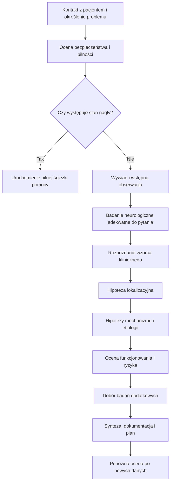
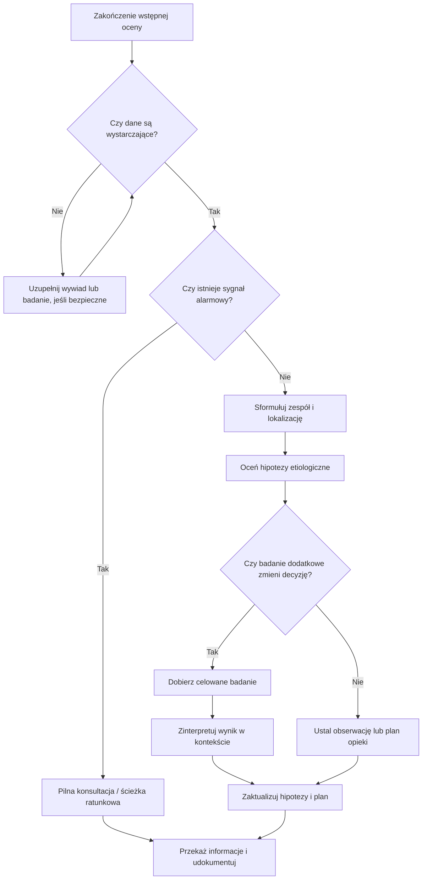

# 1.4. Cele i zasady badania neurologicznego

> **Myśl przewodnia:** badanie neurologiczne nie jest mechanicznym odhaczaniem prób. Jest uporządkowanym procesem klinicznym, w którym obserwacja, wywiad, badanie przedmiotowe, rozumowanie anatomiczne, ocena ryzyka i potrzeby pacjenta prowadzą do uzasadnionych decyzji. Celem nie jest uzyskanie możliwie największej liczby wyników, lecz zebranie danych, które rzeczywiście zmieniają rozpoznanie, pilność postępowania lub plan opieki.

## Wprowadzenie

Rozdział przedstawia cele, logikę i zasady prowadzenia badania neurologicznego. Nie powtarza szczegółowo anatomii i fizjologii opisanych w rozdziałach 1.2 i 1.3 ani techniki poszczególnych prób, które będą rozwijane w kolejnych modułach. Koncentruje się na tym, **po co wykonuje się badanie, jak dobiera się jego zakres, w jaki sposób łączy się wyniki z wywiadem i jak przechodzi się od obserwacji do bezpiecznej decyzji klinicznej**.

Badanie neurologiczne może mieć różny zakres: od krótkiej oceny przesiewowej w sytuacji nagłej, przez badanie ukierunkowane na konkretny objaw, aż po pełne badanie specjalistyczne. Zakres zależy od stanu pacjenta, prawdopodobnych zagrożeń, pytania klinicznego, warunków badania oraz kompetencji osoby badającej. W sytuacji nagłej priorytetem jest rozpoznanie zagrożenia życia lub utraty funkcji i uruchomienie właściwej ścieżki pomocy; kompletność badania nie może opóźniać pilnej interwencji.

Treść ma charakter edukacyjny. Nie zastępuje aktualnych wytycznych, lokalnych procedur, konsultacji specjalistycznej ani oceny osoby uprawnionej do podejmowania decyzji medycznych. Zakres samodzielnych czynności uczestnika kursu wynika z jego kwalifikacji zawodowych, uprawnień, przeszkolenia i odpowiedzialności prawnej.

---

## 1. Cele kształcenia i efekty uczenia się

### 1.1. Cel ogólny

Celem rozdziału jest przygotowanie uczestnika do rozumienia badania neurologicznego jako systematycznego procesu oceny:

1. obecności i charakteru zaburzenia funkcji układu nerwowego;
2. prawdopodobnego poziomu anatomicznej lokalizacji objawów;
3. wzorca klinicznego i możliwych mechanizmów powstania zaburzenia;
4. pilności, ciężkości i dynamiki problemu;
5. wpływu zaburzenia na aktywność, samodzielność i uczestnictwo pacjenta;
6. potrzeby dalszej diagnostyki, konsultacji, monitorowania lub rehabilitacji.

### 1.2. Efekty uczenia się

Po opanowaniu materiału uczestnik powinien umieć:

- wyjaśnić różnicę między badaniem przesiewowym, ukierunkowanym i pełnym;
- sformułować jasne pytanie kliniczne przed rozpoczęciem badania;
- wskazać, które elementy wywiadu i badania są najważniejsze dla danego problemu;
- rozpoznać sytuacje, w których bezpieczeństwo i pilność mają pierwszeństwo przed pełnym badaniem;
- porządkować dane według czasu, rozkładu, charakteru i współwystępowania objawów;
- tworzyć i aktualizować hipotezy lokalizacyjne oraz etiologiczne;
- odróżniać wynik nieprawidłowy od wyniku diagnostycznie rozstrzygającego;
- dobierać badania dodatkowe do konkretnego pytania klinicznego, a nie do samej dostępności metody;
- interpretować wyniki w kontekście prawdopodobieństwa przedtestowego i ograniczeń metody;
- oceniać funkcjonowanie pacjenta z uwzględnieniem jego celów i środowiska;
- dokumentować ustalenia w sposób precyzyjny, odtwarzalny i użyteczny dla kolejnego członka zespołu;
- komunikować niepewność oraz uzasadniać pilność dalszego postępowania.

### 1.3. Zakres kompetencji i odpowiedzialności

Umiejętność wykonania próby nie jest równoznaczna z uprawnieniem do postawienia rozpoznania, zlecenia badania, interpretacji specjalistycznego wyniku lub wdrożenia leczenia. W praktyce należy rozróżnić:

| Poziom działania | Przykładowe czynności | Warunek |
|---|---|---|
| Obserwacja i pomiar | zauważenie asymetrii, pomiar czasu, opis chodu | przeszkolenie, rzetelna technika |
| Badanie w granicach kompetencji | wykonanie wybranych prób funkcjonalnych lub przesiewowych | kwalifikacje i procedura stanowiskowa |
| Interpretacja kliniczna | wnioskowanie o zespole i lokalizacji | odpowiednie przygotowanie zawodowe |
| Decyzja diagnostyczno-terapeutyczna | zlecanie badań, rozpoznanie, leczenie | uprawnienia właściwe dla zawodu i miejsca pracy |
| Postępowanie nagłe | uruchomienie systemu ratunkowego, pierwsza pomoc w zakresie kompetencji | znajomość procedur i niezwłoczne działanie |

W razie wątpliwości należy jasno określić, co zostało zaobserwowane, czego nie udało się ocenić i komu przekazano informację. Nie wolno maskować braku kompetencji pozornie kategorycznym wnioskiem.

---

## 2. Główne cele badania neurologicznego

### 2.1. Ustalenie, czy występuje zaburzenie neurologiczne

Pierwszym celem jest odpowiedź na pytanie, czy zgłaszane dolegliwości i obserwowane odchylenia mogą wynikać z zaburzenia układu nerwowego. Nie każda słabość oznacza niedowład, nie każde drżenie jest chorobą pozapiramidową, a nie każde zawroty głowy mają przyczynę neurologiczną.

W ocenie należy uwzględnić między innymi:

- choroby układu mięśniowo-szkieletowego i ból ograniczający ruch;
- zaburzenia krążenia, rytmu serca i ciśnienia tętniczego;
- zaburzenia metaboliczne, endokrynologiczne i elektrolitowe;
- działania niepożądane leków, zatrucia i odstawienie substancji;
- zaburzenia narządów zmysłów;
- choroby ogólnoustrojowe, zakażenia i stany zapalne;
- zaburzenia snu, nastroju i funkcji poznawczych;
- zaburzenia czynnościowe układu nerwowego, rozpoznawane na podstawie dodatnich cech klinicznych, a nie wyłącznie braku zmian w badaniach.

Prawidłowy wynik pojedynczej próby nie wyklucza choroby. Znaczenie wyniku zależy od czułości metody, czasu wykonania, jakości współpracy, nasilenia objawu i prawdopodobieństwa klinicznego.

### 2.2. Lokalizacja zaburzenia

Drugim celem jest określenie najbardziej prawdopodobnego poziomu układu nerwowego, który wyjaśnia wzorzec objawów. W zależności od danych może to być kora mózgu, struktury podkorowe, pień mózgu, móżdżek, rdzeń kręgowy, korzeń, splot, nerw obwodowy, połączenie nerwowo-mięśniowe lub mięsień.

Lokalizacja jest hipotezą anatomiczną, nie rozpoznaniem etiologicznym. Ten sam poziom może być zajęty przez różne procesy chorobowe, a jedna choroba może obejmować wiele poziomów.

**Zasada zgodności:** hipoteza lokalizacyjna powinna wyjaśniać możliwie największą liczbę istotnych objawów przy jak najmniejszej liczbie dodatkowych założeń. Jeśli wyjaśnia tylko część obrazu, należy rozważyć wielopoziomowe uszkodzenie, chorobę współistniejącą, błąd pomiaru albo niepełny wywiad.

### 2.3. Określenie prawdopodobnego mechanizmu i etiologii

Po określeniu zespołu i lokalizacji rozważa się mechanizm, np. naczyniowy, urazowy, zapalny, infekcyjny, demielinizacyjny, zwyrodnieniowy, nowotworowy, toksyczno-metaboliczny, genetyczny, uciskowy lub czynnościowy.

Nie należy odwracać tej kolejności przez przyjmowanie z góry jednej etiologii i dopasowywanie do niej wszystkich objawów. W praktyce klinicznej kolejność może być iteracyjna: nowa informacja z wywiadu, badania lub diagnostyki dodatkowej może zmienić lokalizację albo listę prawdopodobnych mechanizmów.

### 2.4. Ocena ciężkości, dynamiki i pilności

Należy ustalić:

- czy objawy rozpoczęły się nagle, podostro czy przewlekle;
- czy są stałe, przemijające, napadowe, nawracające czy postępujące;
- czy narastają w ciągu minut, godzin, dni, tygodni lub miesięcy;
- czy pojawiają się nowe deficyty;
- czy występują zaburzenia oddychania, połykania, świadomości lub ochrony dróg oddechowych;
- czy pacjent jest zdolny do bezpiecznego chodzenia, jedzenia, picia i przyjmowania leków;
- czy istnieje ryzyko szybkiego pogorszenia.

Ciężkość nie jest tym samym co rozległość anatomiczna. Niewielki deficyt może być krytyczny dla konkretnej osoby, np. subtelne zaburzenie widzenia u osoby zawodowo prowadzącej pojazdy lub osłabienie dłoni u chirurga. Z kolei rozległy, przewlekły deficyt może być stabilny i wymagać planowej oceny.

### 2.5. Dobór dalszej diagnostyki

Badanie ma pomóc odpowiedzieć, czy potrzebne są badania laboratoryjne, obrazowe, neurofizjologiczne, płynu mózgowo-rdzeniowego, genetyczne, neuropsychologiczne lub inne. Każde badanie powinno mieć określone pytanie, którego odpowiedź może wpłynąć na postępowanie.

### 2.6. Ocena funkcjonowania i potrzeb pacjenta

Ostatnim, lecz nie mniej ważnym celem jest ustalenie, jak zaburzenie wpływa na życie pacjenta. Obejmuje to nie tylko siłę mięśni lub zakres czucia, lecz także samodzielność, mobilność, komunikację, pracę, relacje, bezpieczeństwo, obciążenie opiekuna i możliwość realizacji osobistych celów.

---

## 3. Zasady prowadzenia badania

### 3.1. Zasada bezpieczeństwa przed kompletnością

W sytuacji zagrożenia życia lub szybko postępującego uszkodzenia układu nerwowego należy najpierw ocenić stan ogólny i uruchomić właściwą pomoc. Nie należy kontynuować długiego badania, jeśli pacjent ma zaburzenia oddychania, niestabilność krążeniową, narastające zaburzenia świadomości lub objawy sugerujące ostry udar.

### 3.2. Zasada pytania klinicznego

Przed wykonaniem próby należy wiedzieć, na jakie pytanie ma ona odpowiedzieć. Przykładowo:

- Czy osłabienie ma charakter rzeczywistego ubytku siły, czy wynika z bólu?
- Czy rozkład zaburzeń czucia odpowiada korzeniowi, nerwowi czy polineuropatii?
- Czy chód jest zaburzony z powodu ataksji, niedowładu, parkinsonizmu, bólu czy zaburzeń przedsionkowych?
- Czy epizod utraty przytomności bardziej odpowiada omdleniu, napadowi padaczkowemu czy innej przyczynie?
- Czy objawy sugerują zajęcie ośrodkowego czy obwodowego układu nerwowego?

Próba bez pytania klinicznego łatwo staje się czynnością rutynową, której wynik nie zmienia decyzji.

### 3.3. Zasada systematyczności i powtarzalności

Badanie powinno mieć logiczną kolejność, a technika wykonywania prób powinna być możliwie stała. Umożliwia to porównanie wyników w czasie i między badającymi. Jeśli warunki kolejnego badania różnią się istotnie, trzeba je odnotować.

### 3.4. Zasada adekwatnego zakresu

Nie każdy pacjent wymaga identycznego zestawu prób. Zakres powinien być dostosowany do:

- głównego problemu;
- pilności;
- wieku i stanu ogólnego;
- zdolności rozumienia i komunikowania się;
- bólu, zmęczenia i ograniczeń ruchowych;
- ryzyka upadku lub urazu;
- wyników wstępnej oceny;
- prawdopodobieństwa, że dodatkowa próba zmieni postępowanie.

Badanie ukierunkowane nie oznacza badania powierzchownego. Oznacza świadomy dobór elementów, z zachowaniem kontroli nad tym, czego nie oceniono.

### 3.5. Zasada porównania stron i wzorca

Porównywanie prawej i lewej strony może ujawnić asymetrię, ale nie jest wystarczające w każdej sytuacji. Obustronna neuropatia może dawać symetryczne odchylenia, a obie strony mogą być nieprawidłowe. Należy porównywać również obszary proksymalne i dystalne, różne modalności czucia, poszczególne grupy mięśniowe oraz rozkład zgodny z anatomią.

### 3.6. Zasada kontekstu

Wynik należy interpretować w świetle wieku, wcześniejszego poziomu sprawności, chorób współistniejących, leków, bólu, wzroku, słuchu, języka, wykształcenia, zmęczenia, snu i warunków środowiskowych. Odchylenie od normy populacyjnej nie musi być nowym deficytem, a wynik mieszczący się w normie nie musi oznaczać zachowania funkcji potrzebnej pacjentowi.

### 3.7. Zasada uczciwej niepewności

Jeżeli wynik jest niejednoznaczny, należy to napisać. Nie wolno zamieniać „nie oceniono”, „nie można było wiarygodnie ocenić” ani „wynik niejednoznaczny” na „prawidłowy”. Brak danych nie jest dowodem braku zaburzenia.

---

## 4. Badanie przesiewowe, ukierunkowane i pełne

### 4.1. Badanie przesiewowe

Badanie przesiewowe ma szybko wykryć sygnały wymagające dalszej oceny. Może obejmować obserwację świadomości, mowy, symetrii twarzy, siły kończyn, podstawowej koordynacji, chodu i parametrów życiowych – zależnie od sytuacji i protokołu.

Wynik przesiewowy:

- nie stanowi samodzielnego rozpoznania;
- nie wyklucza choroby przy wyniku ujemnym;
- nie zastępuje pełnego badania, jeśli objawy lub wywiad wskazują na zagrożenie;
- powinien prowadzić do jasno określonej decyzji: obserwacja, dalsze badanie, konsultacja lub pilne skierowanie.

### 4.2. Badanie ukierunkowane

Badanie ukierunkowane jest odpowiedzią na konkretny problem, np. osłabienie ręki, zaburzenia widzenia, ból korzeniowy, zawroty głowy, drżenie lub zaburzenia pamięci. Obejmuje elementy o największej wartości dla różnicowania możliwych przyczyn.

Zakres powinien być rozszerzany, jeśli wynik ujawnia nowe objawy, niespójność anatomiczną albo sygnał alarmowy.

### 4.3. Pełne badanie neurologiczne

Pełne badanie jest wskazane, gdy obraz kliniczny jest złożony, wieloogniskowy, postępujący, niejasny lub wymaga oceny wielu układów. Obejmuje odpowiednio szeroką ocenę świadomości i funkcji poznawczych, nerwów czaszkowych, układu ruchowego, czucia, odruchów, koordynacji, równowagi, chodu i funkcji autonomicznych.

Nie oznacza to, że każdy element musi być wykonany u każdego pacjenta. Próby niewskazane, niebezpieczne lub niewykonalne należy pominąć i odnotować przyczynę.

### 4.4. Porównanie zakresów

| Cecha | Przesiewowe | Ukierunkowane | Pełne |
|---|---|---|---|
| Główne pytanie | Czy jest sygnał alarmowy lub deficyt? | Co wyjaśnia konkretny objaw? | Jaki jest całościowy profil neurologiczny? |
| Czas | krótki | zależny od problemu | zwykle dłuższy |
| Zakres | wybrane elementy | dobrane do hipotezy | szeroki, wieloukładowy |
| Wynik | decyzja o dalszej ocenie | weryfikacja hipotez | synteza zespołu i lokalizacji |
| Ograniczenie | ryzyko przeoczenia subtelnych objawów | ryzyko zbyt wąskiego spojrzenia | zmęczenie, obciążenie i nadmiar danych |

---

## 5. Logika rozumowania klinicznego

### 5.1. Kolejność pytań

Praktyczny tok rozumowania można przedstawić jako sześć kolejnych pytań:

1. **Czy pacjent jest bezpieczny?** Czy istnieje stan wymagający natychmiastowego działania?
2. **Jaki jest problem?** Jakie objawy są główne, kiedy się zaczęły i jak się zmieniają?
3. **Jaki wzorzec kliniczny występuje?** Czy jest to niedowład, zespół czuciowy, ataksja, zaburzenie świadomości, napad, zespół bólowy lub inny wzorzec?
4. **Gdzie można zlokalizować zaburzenie?** Który poziom układu nerwowego wyjaśnia dane?
5. **Jakie mechanizmy są prawdopodobne?** Które przyczyny pasują do czasu, lokalizacji i kontekstu?
6. **Co należy zrobić dalej?** Czy potrzebne jest badanie dodatkowe, konsultacja, leczenie w trybie pilnym, obserwacja lub plan rehabilitacji?

### 5.2. Schemat procesu



Schemat nie jest sztywną procedurą administracyjną. W praktyce rozumowanie jest iteracyjne: nowe dane mogą cofnąć ocenę do wcześniejszego etapu. Jeśli pacjent pogarsza się w trakcie badania, priorytetem staje się ponowna ocena bezpieczeństwa.

### 5.3. Tworzenie listy problemów

Lista problemów powinna zawierać najważniejsze, możliwie precyzyjnie opisane nieprawidłowości, np.:

- nagły początek osłabienia prawej kończyny górnej;
- zaburzenie płynności mowy;
- asymetria odruchów;
- zaburzenie czucia po określonej stronie;
- niestabilność chodu;
- epizody przemijającej utraty kontaktu;
- narastające trudności połykania.

Nie należy zastępować opisu objawu przedwczesnym rozpoznaniem. „Osłabienie prawej ręki” jest informacją; „udar lewej półkuli” jest hipotezą wymagającą weryfikacji.

### 5.4. Hipoteza główna i alternatywna

Dla istotnego problemu należy rozważyć co najmniej jedną alternatywę, zwłaszcza jeśli pomyłka miałaby poważne konsekwencje. Hipotezy warto porządkować według:

- prawdopodobieństwa;
- potencjalnej szkodliwości przeoczenia;
- możliwości odwracalnego leczenia;
- czasu, w którym trzeba podjąć decyzję;
- kosztu i ryzyka badania potwierdzającego.

Nie należy jednak tworzyć długiej listy rzadkich chorób bez związku z danymi. Diagnostyka różnicowa powinna być celowa.

---

## 6. Czas i dynamika jako element lokalizacji oraz etiologii

### 6.1. Początek nagły

Nagły początek deficytu może wskazywać na zdarzenie naczyniowe, krwawienie, napad padaczkowy, migrenę z aurą, uraz lub inne ostre zaburzenie. W przypadku nagłego nowego deficytu ogniskowego należy traktować sytuację jako potencjalny udar do czasu właściwej oceny w odpowiedniej ścieżce.

### 6.2. Przebieg podostry

Narastanie w ciągu dni lub tygodni może występować w chorobach zapalnych, infekcyjnych, demielinizacyjnych, metabolicznych, toksycznych, uciskowych lub nowotworowych. Znaczenie ma nie tylko tempo, ale również to, czy objawy są symetryczne, czy obejmują wiele poziomów i czy pojawiają się zaburzenia ogólnoustrojowe.

### 6.3. Przebieg przewlekły i postępujący

Wielomiesięczne lub wieloletnie narastanie objawów może sugerować proces neurodegeneracyjny, przewlekłą neuropatię, chorobę genetyczną, zmianę strukturalną lub przewlekły wpływ czynników metabolicznych. Postęp nie jest jednak automatycznym dowodem choroby zwyrodnieniowej.

### 6.4. Przebieg napadowy lub nawrotowy

Należy ustalić długość epizodu, stereotypowość, czynniki wyzwalające, objawy przed epizodem, przebieg w jego trakcie, czas powrotu do stanu wyjściowego i relację z pozycją ciała, wysiłkiem, posiłkiem, snem lub lekami.

W epizodach utraty przytomności kluczowe mogą być informacje od świadków. NICE zaleca dokumentowanie okoliczności zdarzenia, wywiadu, badania przedmiotowego i parametrów życiowych; w różnicowaniu należy uwzględnić również przyczyny sercowo-naczyniowe, a nie zakładać z góry etiologii neurologicznej.

### 6.5. Znaczenie osi czasu

Przykładowa karta osi czasu:

| Moment | Pytanie | Co należy zapisać |
|---|---|---|
| Przed objawem | Co pacjent robił? | pozycja, wysiłek, sen, posiłek, ekspozycja |
| Początek | Kiedy i jak szybko? | dokładny czas lub najlepsze oszacowanie |
| Rozwój | Jak objaw się zmieniał? | narastanie, ustępowanie, szerzenie |
| Szczyt | Kiedy było najgorzej? | maksymalny deficyt |
| Ustępowanie | Jak szybko nastąpiła poprawa? | czas i stopień powrotu |
| Stan obecny | Co pozostało? | aktualne objawy i ograniczenia |

---

## 7. Lokalizacja, zespół i etiologia – rozdzielanie poziomów wnioskowania

### 7.1. Trzy różne pytania

| Poziom | Pytanie | Przykładowa odpowiedź |
|---|---|---|
| Zespół | Jaki wzorzec objawów występuje? | zespół piramidowy |
| Lokalizacja | Gdzie znajduje się prawdopodobne uszkodzenie? | droga korowo-rdzeniowa powyżej skrzyżowania |
| Etiologia | Co wywołało uszkodzenie? | niedokrwienie, krwawienie, guz, zapalenie lub inna przyczyna |

Wniosek na jednym poziomie nie przesądza o pozostałych. Można mieć dobrze określoną lokalizację przy nieznanej etiologii. Można też znać chorobę podstawową, ale nadal wymagać oceny, czy nowy objaw wynika z jej progresji, powikłania, leku czy odrębnego procesu.

### 7.2. Lokalizacja pojedyncza i wielopoziomowa

Objawy mogą wynikać z jednej zmiany, kilku zmian lub choroby rozlanej. U osoby starszej możliwe jest współwystępowanie np. neuropatii obwodowej, zmian zwyrodnieniowych kręgosłupa i przebytego uszkodzenia mózgu. Nie należy na siłę sprowadzać całego obrazu do jednej lokalizacji, jeśli dane wskazują na kilka procesów.

### 7.3. Lokalizacja a badanie obrazowe

Obrazowanie powinno odpowiadać na pytanie wynikające z obrazu klinicznego. Znalezisko w badaniu MRI lub TK nie musi być przyczyną objawów. Zmiany przypadkowe, przewlekłe i związane z wiekiem należy zestawić z lokalizacją, stroną, czasem pojawienia się objawów i badaniem przedmiotowym.

### 7.4. Zasada zgodności kliniczno-anatomicznej

Przed uznaniem zmiany za przyczynową należy sprawdzić:

- czy lokalizacja zmiany odpowiada objawom;
- czy strona i poziom są zgodne;
- czy czas wystąpienia zmiany pasuje do czasu objawów;
- czy wielkość i charakter zmiany mogą wyjaśniać nasilenie deficytu;
- czy istnieje lepsze alternatywne wyjaśnienie;
- czy wynik badania dodatkowego jest technicznie wiarygodny.

---

## 8. Dobór badań dodatkowych

### 8.1. Zasada pytania przed zleceniem

Przed badaniem dodatkowym należy określić:

1. Jaką hipotezę chcę sprawdzić?
2. Jakie wyniki są możliwe?
3. Jak każdy z możliwych wyników wpłynie na decyzję?
4. Czy badanie jest dostępne w odpowiednim czasie?
5. Jakie są jego ograniczenia, ryzyka i przeciwwskazania?
6. Czy wynik może być fałszywie dodatni lub fałszywie ujemny?
7. Czy istnieje bezpieczniejsza lub bardziej użyteczna metoda?

Jeśli niezależnie od wyniku postępowanie pozostanie takie samo, warto ponownie rozważyć zasadność badania, chyba że istnieje inny ważny cel, np. ocena rokowania, bezpieczeństwa lub kwalifikacji do procedury.

### 8.2. Badania laboratoryjne

Badania laboratoryjne dobiera się do hipotezy i kontekstu. Mogą obejmować m.in. glikemię, elektrolity, parametry nerkowe i wątrobowe, morfologię, markery zapalne, witaminę B12, hormony tarczycy, badania toksykologiczne, immunologiczne lub infekcyjne.

Nie istnieje uniwersalny panel, który należy wykonywać u każdej osoby z objawami neurologicznymi. Nadmiar nieselektywnych badań zwiększa ryzyko przypadkowych odchyleń i niepotrzebnych dalszych procedur.

### 8.3. Neuroobrazowanie

- **TK** – często używana w sytuacjach nagłych, zwłaszcza do szybkiej oceny krwawienia i wybranych zmian strukturalnych.
- **MRI** – zapewnia szczegółową ocenę wielu struktur i procesów, ale dobór sekwencji, czasu i protokołu zależy od pytania klinicznego.
- **Angio-TK / angio-MR** – ocena naczyń w określonych wskazaniach.
- **USG dopplerowskie** – ocena przepływu w wybranych naczyniach, zgodnie ze wskazaniem.
- **PET / SPECT** – metody funkcjonalne lub molekularne w określonych wskazaniach specjalistycznych.

Ujemny wynik obrazowania nie wyklucza wszystkich chorób neurologicznych. Wartość wyniku zależy od metody, protokołu, czasu od początku objawów i jakości badania.

### 8.4. Badania neurofizjologiczne

- **ENG / NCS** – ocena przewodzenia w nerwach obwodowych.
- **EMG igłowe** – ocena czynności elektrycznej mięśni i cech odnerwienia lub zmian neurogennych.
- **EEG** – ocena czynności bioelektrycznej mózgu w określonych wskazaniach, m.in. przy podejrzeniu napadów padaczkowych.
- **Potencjały wywołane** – ocena przewodzenia w wybranych drogach czuciowych lub wzrokowych.
- **Badania autonomiczne** – ocena wybranych funkcji układu autonomicznego.

Badania te mają własne wskazania, ograniczenia i wymagania interpretacyjne. Wynik prawidłowy nie zawsze wyklucza chorobę, szczególnie jeśli badanie wykonano zbyt wcześnie, zbyt późno, w niewłaściwym zakresie lub przy niewielkim nasileniu zmian.

### 8.5. Płyn mózgowo-rdzeniowy

Badanie płynu mózgowo-rdzeniowego może być przydatne w diagnostyce zakażeń, zapaleń, chorób demielinizacyjnych i innych stanów. Decyzja o punkcji lędźwiowej wymaga oceny wskazań, przeciwwskazań, ryzyka oraz lokalnych procedur. Nie należy traktować punkcji jako rutynowego elementu każdego badania neurologicznego.

### 8.6. Diagnostyka genetyczna i molekularna

Badania genetyczne powinny wynikać z określonej hipotezy klinicznej, fenotypu, wywiadu rodzinnego i zasad poradnictwa. Wynik wariantu o niepewnym znaczeniu nie jest automatycznie potwierdzeniem choroby. Interpretacja wymaga uwzględnienia penetracji, dziedziczenia, segregacji rodzinnej i aktualnej klasyfikacji wariantów.

### 8.7. Badania neuropsychologiczne i funkcjonalne

Pełna ocena funkcji poznawczych może wymagać badania neuropsychologicznego. Kwestionariusze i testy przesiewowe pomagają wskazać obszar trudności, ale nie zastępują kompleksowej oceny. W ocenie funkcjonowania można wykorzystywać narzędzia oparte na ICF, a WHODAS 2.0 obejmuje sześć domen: poznanie, mobilność, samoobsługę, relacje, aktywności życiowe i uczestnictwo.

---

## 9. Interpretacja wyników i prawdopodobieństwo diagnostyczne

### 9.1. Wynik badania nie jest rozpoznaniem

Wynik testu należy interpretować w kontekście prawdopodobieństwa przedtestowego, jakości wykonania, ograniczeń metody i zgodności z pozostałymi danymi.

Test może:
- zwiększać prawdopodobieństwo choroby;
- zmniejszać prawdopodobieństwo choroby;
- nie zmieniać istotnie prawdopodobieństwa;
- ujawniać problem wymagający innego badania;
- być niewiarygodny z powodu warunków wykonania.

### 9.2. Czułość, swoistość i wartości predykcyjne

- **Czułość** opisuje, jak często test jest dodatni u osób rzeczywiście chorych.
- **Swoistość** opisuje, jak często test jest ujemny u osób bez choroby.
- **Wartość predykcyjna dodatnia** zależy m.in. od częstości choroby w badanej populacji.
- **Wartość predykcyjna ujemna** również zależy od prawdopodobieństwa przedtestowego.
- **Iloraz wiarygodności** opisuje, jak wynik zmienia szanse choroby.

Wysoka czułość nie oznacza, że wynik dodatni potwierdza rozpoznanie. Wysoka swoistość nie oznacza, że wynik ujemny wyklucza chorobę. Znaczenie testu zależy od sytuacji, w której jest stosowany.

### 9.3. Przykład bayesowski

Załóżmy wyłącznie dydaktycznie, że przed testem prawdopodobieństwo choroby wynosi 10%, a dany test ma iloraz wiarygodności dodatni równy 5. Szanse przedtestowe wynoszą 0,10 / 0,90 = 0,111. Po dodatnim wyniku: 0,111 × 5 = 0,556. Odpowiada to prawdopodobieństwu około 35,7%, a nie 100%.

Przykład pokazuje, dlaczego nawet wynik testu o dobrych parametrach nie może być interpretowany bez kontekstu. Wartości są hipotetyczne i nie opisują konkretnego testu neurologicznego.

### 9.4. Zgodność wielu danych

Największą wartość ma zgodność niezależnych informacji: czasu wystąpienia, charakteru objawów, lokalizacji, badania przedmiotowego i badań dodatkowych. Nie należy jednak mechanicznie mnożyć wyników testów, jeśli są od siebie zależne lub badają tę samą właściwość.

### 9.5. Wynik ujemny a utrzymujące się podejrzenie

Jeśli podejrzenie kliniczne pozostaje wysokie mimo wyniku ujemnego, należy rozważyć:

- ograniczoną czułość badania;
- nieodpowiedni czas wykonania;
- niewłaściwy protokół;
- zmienność objawów;
- trudności techniczne;
- konieczność powtórzenia lub zastosowania innej metody;
- alternatywną lokalizację lub etiologię.

Nie wolno uspokajać pacjenta wyłącznie na podstawie jednego wyniku, jeżeli obraz kliniczny nadal sugeruje poważny stan.

---

## 10. Ocena ciężkości i monitorowanie zmian

### 10.1. Ciężkość kliniczna

Należy ocenić zarówno nasilenie deficytu, jak i konsekwencje dla pacjenta. Przykładowo niewielkie zaburzenie połykania może wiązać się z istotnym ryzykiem aspiracji, a subtelne zaburzenie pola widzenia może wpływać na bezpieczeństwo poruszania się.

### 10.2. Skale kliniczne

Skale standaryzowane ułatwiają komunikację, porównywanie wyników i monitorowanie zmian. Ich użycie wymaga znajomości instrukcji, zasad punktacji, populacji walidacyjnej i ograniczeń.

| Narzędzie | Główne zastosowanie | Ważne ograniczenie |
|---|---|---|
| GCS | poziom świadomości | nie opisuje całego profilu neurologicznego |
| NIHSS | ilościowa ocena wybranych deficytów w udarze | może nie odzwierciedlać wszystkich deficytów, zwłaszcza niektórych objawów krążenia tylnego |
| MRC / Lovett | siła mięśniowa | zależność od bólu, współpracy i techniki |
| mRS | niepełnosprawność po udarze i ogólna zależność | skala globalna, ograniczona szczegółowość |
| Barthel Index | samodzielność w podstawowych czynnościach | wpływ środowiska i dostępnej pomocy |
| MoCA / MMSE | przesiewowa ocena poznawcza | wpływ języka, edukacji, wzroku, słuchu i stanu ostrego |
| TUG / BBS | mobilność i równowaga | wynik zależy od warunków i sposobu asekuracji |

W ostrym udarze NIHSS jest użytecznym narzędziem standaryzacji, ale wynik nie powinien samodzielnie przesądzać o tym, czy deficyt jest dla pacjenta niepełnosprawny. Niski wynik punktowy nie wyklucza istotnego ograniczenia funkcji.

### 10.3. Ocena dynamiki

Do monitorowania należy wykorzystywać porównywalne warunki, tę samą definicję objawu, podobną technikę i – jeśli to możliwe – to samo narzędzie. W dokumentacji warto podawać datę, godzinę, pozycję, stan bólowy, przyjęte leki i czynniki, które mogły wpłynąć na wynik.

### 10.4. Rokowanie

Rokowanie zależy od etiologii, lokalizacji, rozległości uszkodzenia, czasu do leczenia, rezerwy biologicznej, chorób współistniejących, powikłań, możliwości rehabilitacji i wsparcia środowiskowego. Pojedynczy wynik badania nie powinien być podstawą kategorycznej prognozy.

---

## 11. Ocena funkcjonowania i potrzeb pacjenta

### 11.1. Dlaczego sama ocena deficytu nie wystarcza

Badanie neurologiczne opisuje funkcje organizmu, ale pacjent żyje w określonym środowisku i wykonuje konkretne zadania. Ten sam deficyt może mieć różne konsekwencje u dwóch osób. Dlatego należy pytać nie tylko „co jest osłabione?”, ale również „czego pacjent nie może zrobić, co robi z trudnością i co jest dla niego najważniejsze?”.

### 11.2. Model ICF

Międzynarodowa Klasyfikacja Funkcjonowania, Niepełnosprawności i Zdrowia (ICF) porządkuje ocenę w obszarach:

- funkcje i struktury ciała;
- aktywność;
- uczestnictwo;
- czynniki środowiskowe;
- czynniki osobiste, które wpływają na funkcjonowanie, choć nie są kodowane w ICF tak jak pozostałe komponenty.

ICF nie zastępuje rozpoznania medycznego. Uzupełnia je o opis tego, jak stan zdrowia przekłada się na życie.

### 11.3. WHODAS 2.0

WHODAS 2.0 jest ogólnym narzędziem oceny niepełnosprawności i funkcjonowania, powiązanym pojęciowo z ICF. Obejmuje sześć domen: poznanie, mobilność, samoobsługę, relacje z innymi, aktywności życiowe oraz uczestnictwo. Może wspierać ocenę wpływu choroby na codzienne życie, ale nie jest testem lokalizacyjnym ani narzędziem do samodzielnego rozpoznawania choroby neurologicznej.

### 11.4. Pytania funkcjonalne

Przykładowe pytania:

- Czy pacjent samodzielnie wstaje z łóżka i krzesła?
- Czy może bezpiecznie przejść przez mieszkanie?
- Czy potrafi samodzielnie się umyć, ubrać i zjeść?
- Czy rozumie i wykonuje polecenia?
- Czy może bezpiecznie połykać płyny i pokarmy?
- Czy potrafi korzystać z telefonu, przygotować posiłek i przyjąć leki?
- Czy może wrócić do pracy, nauki lub obowiązków rodzinnych?
- Jakiego wsparcia potrzebuje i kto go udziela?

### 11.5. Cele ustalane z pacjentem

Cele powinny być konkretne, istotne dla pacjenta i możliwe do monitorowania. Zamiast ogólnego „poprawa sprawności” można określić: samodzielne przejście z łóżka do łazienki z użyciem zaleconej pomocy, bezpieczne wykonanie transferu, poprawa zrozumiałości mowy lub możliwość samodzielnego spożywania posiłku po ocenie bezpieczeństwa połykania.

---

## 12. Czerwone flagi i zasady pilnego postępowania

### 12.1. Objawy wymagające natychmiastowej oceny

Do sygnałów alarmowych należą w szczególności:

- nagły niedowład, asymetria twarzy, zaburzenie mowy lub nagła utrata widzenia;
- nagły, bardzo silny ból głowy, zwłaszcza o gwałtownym początku;
- nowe zaburzenia świadomości, śpiączka lub szybko narastające splątanie;
- pierwszy napad drgawkowy, napad przedłużający się lub powtarzające się napady bez odzyskania świadomości;
- gorączka z bólem głowy, sztywnością karku, zaburzeniem świadomości lub objawami ogniskowymi;
- szybko postępujące osłabienie, szczególnie symetryczne, z zaburzeniami połykania, mowy lub oddychania;
- duszność w spoczynku lub nasilająca się w pozycji leżącej u osoby z narastającym osłabieniem nerwowo-mięśniowym;
- silny ból kręgosłupa z nowym zaburzeniem oddawania moczu lub stolca, znieczuleniem okolicy siodłowej albo postępującym osłabieniem kończyn;
- nagłe zawroty głowy z nową niestabilnością, zaburzeniami chodu, podwójnym widzeniem, dysartrią, niedosłuchem lub innym ogniskowym objawem;
- nagła utrata widzenia, bolesne zaburzenie widzenia lub objawy sugerujące ostre uszkodzenie nerwu wzrokowego;
- uraz głowy z pogarszającym się stanem neurologicznym, powtarzającymi się wymiotami, napadem lub zaburzeniami świadomości.

Lista nie jest wyczerpująca. Brak wymienionego objawu nie gwarantuje bezpieczeństwa.

### 12.2. Udar i przemijający atak niedokrwienny

Nagły objaw ogniskowy wymaga pilnego postępowania zgodnego z lokalną ścieżką udarową. Należy ustalić czas, kiedy pacjent był ostatnio widziany w stanie bez nowych objawów (last known well), i przekazać tę informację zespołowi. Nie należy czekać na ustąpienie objawów ani wykonywać długiego badania, które opóźni wezwanie pomocy.

### 12.3. Ostry zespół przedsionkowy

W ostrym zespole przedsionkowym z zawrotami, nudnościami lub wymiotami i niestabilnością chodu ocena HINTS może być użyteczna wyłącznie wtedy, gdy wykonuje ją osoba odpowiednio przeszkolona i doświadczona. Nieprawidłowy wynik lub brak kompetentnego badającego wymaga postępowania zgodnego z pilną ścieżką diagnostyczną. Nie wolno używać HINTS jako samodzielnego testu przesiewowego u każdego pacjenta zgłaszającego zawroty głowy.

### 12.4. Zespół ogona końskiego i ucisk rdzenia

Nowe zaburzenia zwieraczy, znieczulenie siodłowe, obustronne objawy korzeniowe lub postępujące osłabienie kończyn w kontekście bólu kręgosłupa wymagają pilnej oceny. Nie należy opóźniać skierowania z powodu wykonywania wielokrotnych prób funkcjonalnych.

### 12.5. Pogorszenie oddechowe i opuszkowe

Narastająca dysfagia, dyzartria, osłabienie kaszlu, duszność, ortopnoë lub szybko postępujące osłabienie mogą wskazywać na zagrożenie niewydolnością oddechową. Wymagają pilnej oceny medycznej i monitorowania zgodnie z lokalnym protokołem.

### 12.6. Postępowanie organizacyjne

W razie podejrzenia stanu nagłego:

1. przerwij czynności, które mogą opóźnić pomoc;
2. oceń bezpieczeństwo i podstawowe funkcje życiowe w granicach kompetencji;
3. wezwij zespół ratunkowy lub uruchom procedurę wewnętrzną;
4. przekaż czas początku objawów, dynamikę i najważniejsze ustalenia;
5. zabezpiecz pacjenta przed upadkiem i urazem;
6. nie podawaj doustnie pokarmów, płynów ani leków osobie z zaburzeniami świadomości lub podejrzeniem dysfagii bez właściwej oceny;
7. dokumentuj działania i czas ich wykonania.

W Polsce w sytuacji bezpośredniego zagrożenia życia lub zdrowia należy korzystać z numeru alarmowego 112 lub 999, zgodnie z lokalnym systemem ratownictwa.

---

## 13. Szczególne warunki i ograniczenia badania

### 13.1. Ból i ograniczenia narządu ruchu

Ból może ograniczać siłę, zakres ruchu i współpracę. Należy odróżniać rzeczywisty ubytek siły od przerwania próby z powodu bólu, lęku lub mechanicznej blokady. W dokumentacji trzeba podać, co ograniczało ocenę.

### 13.2. Zaburzenia poznawcze i świadomości

Pacjent może nie rozumieć poleceń, zapominać instrukcję lub mieć zmienną uwagę. Należy stosować krótkie komunikaty, demonstrację, proste zadania i – jeśli to uzasadnione – informacje od opiekuna. Nie należy utożsamiać braku wykonania polecenia z niedowładem bez sprawdzenia rozumienia i motywacji.

### 13.3. Bariery językowe i sensoryczne

Należy uwzględnić niedosłuch, zaburzenia widzenia, afazję, dysartrię, różnice językowe i kulturowe. W razie potrzeby korzysta się z profesjonalnego tłumacza, pomocy komunikacyjnych i dostosowanych instrukcji. Członek rodziny nie zawsze jest właściwym tłumaczem, zwłaszcza w rozmowach wymagających poufności.

### 13.4. Osoby starsze i wielochorobowość

U pacjenta geriatrycznego wynik może być modyfikowany przez sarkopenię, artrozę, polifarmakoterapię, zaburzenia wzroku i słuchu, kruchość, niedożywienie, zaburzenia równowagi i wcześniejsze deficyty. Ważne jest ustalenie poziomu funkcjonowania sprzed obecnego epizodu.

### 13.5. Zmęczenie i wahania objawów

Długie badanie może pogarszać jakość odpowiedzi. Warto planować przerwy, wykonywać najważniejsze próby w odpowiednim momencie i zapisywać warunki. W chorobach z męczliwością wynik może zależeć od pory dnia, wysiłku i czasu odpoczynku.

### 13.6. Współpraca i wiarygodność

Niespójność wyników nie powinna prowadzić do automatycznego przypisywania objawów symulacji. Zaburzenia czynnościowe rozpoznaje się na podstawie dodatnich cech klinicznych wykazujących określony wzorzec, w odpowiednim kontekście i przez osobę posiadającą właściwe kompetencje. Równocześnie należy zachować czujność na choroby współistniejące i nowe objawy.

---

## 14. Komunikacja, zgoda i podmiotowość pacjenta

### 14.1. Wyjaśnienie celu

Przed badaniem należy poinformować pacjenta, dlaczego wykonuje się określone próby, co może odczuwać i kiedy powinien zgłosić ból, zawroty, duszność lub zmęczenie. Wyjaśnienie powinno być dostosowane do stanu i możliwości pacjenta.

### 14.2. Zgoda i odmowa

Badanie powinno odbywać się z poszanowaniem autonomii, prywatności i godności pacjenta. Zgoda może być wyrażona w sposób właściwy dla sytuacji i procedury. Jeśli pacjent odmawia, należy wyjaśnić możliwe konsekwencje, uszanować decyzję w granicach prawa i udokumentować istotne okoliczności. W stanie nagłym postępowanie regulują odpowiednie przepisy i procedury.

### 14.3. Wrażliwe obszary badania

Przy badaniu okolic intymnych, czucia w okolicy siodłowej lub funkcji zwieraczy należy szczególnie zadbać o uzasadnienie kliniczne, zgodę, prywatność, obecność osoby towarzyszącej lub asysty zgodnie z procedurą oraz minimalizację dyskomfortu.

### 14.4. Informowanie o niepewności

Należy unikać zarówno fałszywego uspokajania, jak i nieuzasadnionego straszenia. Dobrą praktyką jest wyjaśnienie:

- co zostało ustalone;
- czego jeszcze nie wiadomo;
- jakie rozpoznania są obecnie rozważane;
- dlaczego zaleca się dane badanie lub konsultację;
- jakie objawy wymagają pilnego powrotu lub wezwania pomocy.

---

## 15. Dokumentowanie badania i wnioskowania

### 15.1. Cechy dobrej dokumentacji

Dokumentacja powinna być:

- **konkretna** – opisuje obserwację zamiast niejasnych określeń;
- **czasowa** – zawiera datę, godzinę i dynamikę;
- **odtwarzalna** – pozwala innemu badającemu zrozumieć sposób wykonania próby;
- **proporcjonalna** – zawiera informacje istotne dla problemu;
- **uczciwa** – rozróżnia wynik prawidłowy, nieprawidłowy, niejednoznaczny i nieoceniony;
- **użyteczna** – wskazuje, co z wyniku wynika dla dalszego postępowania.

### 15.2. Co należy odnotować

1. Powód badania i główną skargę.
2. Początek, czas i dynamikę objawów.
3. Stan wyjściowy oraz istotne choroby i leki.
4. Parametry życiowe, jeśli były oceniane.
5. Zakres wykonanych prób i warunki badania.
6. Wyniki dodatnie i najważniejsze wyniki ujemne.
7. Elementy nieocenione oraz przyczynę.
8. Wnioski zespołowe i lokalizacyjne – jeśli mieszczą się w kompetencjach badającego.
9. Ocenę pilności i przekazane zalecenia.
10. Osobę lub zespół, któremu przekazano informację, oraz czas przekazania.

### 15.3. Przykład opisu siły

Nieprecyzyjnie: „Siła kończyn osłabiona”.

Precyzyjniej: „W badaniu siły kończyny górnej prawej stwierdzono osłabienie odwodzenia barku i zginania łokcia w porównaniu ze stroną lewą; próby ograniczone bólem barku. Pozostałe oceniane grupy mięśniowe bez wyraźnej asymetrii. Wynik wymaga interpretacji z uwzględnieniem bólu i zakresu ruchu”.

### 15.4. Przykład opisu czucia

Nieprecyzyjnie: „Czucie zaburzone”.

Precyzyjniej: „Pacjent zgłasza drętwienie palców IV–V ręki lewej. W badaniu porównawczym stwierdzono osłabione odczuwanie lekkiego dotyku w tym obszarze; granice zaburzenia nie zostały jednoznacznie określone. Wynik należy zestawić z siłą mięśni unerwianych przez nerw łokciowy i z rozkładem korzeniowym”.

### 15.5. Przykładowy szablon wpisu

```text
Data i godzina:
Powód badania:
Początek i dynamika objawów:
Stan wyjściowy / wcześniejsza sprawność:
Istotne choroby i leki:
Parametry życiowe (jeśli oceniano):
Świadomość i kontakt:
Mowa i funkcje poznawcze:
Nerwy czaszkowe:
Układ ruchowy – siła, napięcie, trofika:
Czucie:
Odruchy:
Koordynacja i równowaga:
Chód i mobilność:
Funkcje autonomiczne / objawy alarmowe:
Elementy nieocenione i przyczyna:
Podsumowanie problemów:
Hipoteza zespołowa i lokalizacyjna:
Ograniczenia i niepewność:
Plan / pilność / przekazanie informacji:
Podpis i identyfikacja osoby badającej:
```

### 15.6. Dokumentowanie zmian w czasie

W obserwacji seryjnej należy używać porównywalnej techniki i wskazywać, czy zmiana jest rzeczywista, czy może wynikać z innego sposobu badania, zmęczenia, bólu, sedacji lub różnicy w warunkach. W przypadku nagłego pogorszenia nie wolno czekać na planowy pomiar kontrolny.

---

## 16. Praktyczne przykłady rozumowania klinicznego

Poniższe przypadki są dydaktyczne. Nie stanowią indywidualnych zaleceń dla rzeczywistego pacjenta.

### 16.1. Przypadek A – nagłe osłabienie kończyny i zaburzenie mowy

**Sytuacja:** osoba dorosła zgłasza nagłe osłabienie prawej ręki i trudność w wypowiadaniu słów, początek około 40 minut wcześniej.

**Pytanie kliniczne:** czy występuje ostry deficyt ogniskowy wymagający pilnej ścieżki udarowej?

**Priorytety:**
- natychmiastowa ocena bezpieczeństwa;
- ustalenie czasu, kiedy pacjent był ostatnio bez nowych objawów;
- szybkie rozpoznanie deficytu ogniskowego;
- uruchomienie pilnej pomocy zgodnie z lokalnym protokołem;
- przekazanie informacji o lekach przeciwkrzepliwych, chorobach i czasie początku.

**Błąd, którego należy uniknąć:** wykonywanie pełnego, długiego badania przed wezwaniem pomocy lub uznanie, że poprawa objawów oznacza brak zagrożenia.

### 16.2. Przypadek B – przewlekłe drętwienie stóp

**Sytuacja:** pacjent od kilku miesięcy zgłasza symetryczne drętwienie palców i stóp, stopniowo szerzące się ku górze.

**Pytanie kliniczne:** czy rozkład odpowiada polineuropatii, a jeśli tak, jakie są prawdopodobne przyczyny?

**Kolejność rozumowania:**
1. ustalenie czasu i progresji;
2. określenie rozkładu dystalnego i symetrycznego;
3. ocena odruchów, czucia powierzchownego i głębokiego oraz siły;
4. sprawdzenie czynników ryzyka, chorób metabolicznych, alkoholu, leków i niedoborów;
5. dobór badań laboratoryjnych lub neurofizjologicznych do obrazu klinicznego;
6. ocena wpływu na chód, równowagę i bezpieczeństwo stóp.

**Ważne:** szybkie narastanie objawów, osłabienie, zaburzenia połykania lub oddychania zmieniają pilność i wymagają pilnej oceny.

### 16.3. Przypadek C – zawroty głowy i niestabilność

**Sytuacja:** pacjent zgłasza nagłe, utrzymujące się zawroty głowy, nudności i trudność w samodzielnym chodzeniu.

**Pytanie kliniczne:** czy występuje ostry zespół przedsionkowy i czy trzeba pilnie wykluczyć przyczynę ośrodkową?

Należy ocenić początek, ciągłość objawów, chód, oczopląs, słuch, objawy ogniskowe i czynniki naczyniowe. HINTS wykonuje wyłącznie osoba odpowiednio przeszkolona i doświadczona, u pacjenta spełniającego kryteria ostrego zespołu przedsionkowego. Brak takiej osoby nie powinien prowadzić do pozornego uspokojenia – należy skorzystać z właściwej pilnej ścieżki diagnostycznej.

### 16.4. Przypadek D – osłabienie ręki z bólem barku

**Sytuacja:** pacjent nie wykonuje pełnego odwiedzenia barku z powodu bólu po urazie.

**Pytanie kliniczne:** czy ograniczenie wynika z deficytu neurologicznego, bólu, uszkodzenia struktur mięśniowo-szkieletowych czy współistnienia tych przyczyn?

Należy ocenić zakres ruchu czynnego i biernego, ból, siłę w bezpiecznych pozycjach, czucie, odruchy i inne grupy mięśniowe. Nie należy automatycznie opisywać wyniku jako niedowładu, jeśli próba była ograniczona bólem.

### 16.5. Przypadek E – zaburzenia pamięci u osoby starszej

**Sytuacja:** rodzina zgłasza narastające zapominanie i trudności w zarządzaniu lekami.

**Pytanie kliniczne:** czy występuje zaburzenie poznawcze i jaki jest jego wpływ na samodzielność?

Należy ustalić tempo zmian, początek, wahania, leki, nastrój, sen, słuch, wzrok, choroby współistniejące i poziom wcześniejszego funkcjonowania. Nagłe lub falujące zaburzenia uwagi i świadomości wymagają rozważenia majaczenia i przyczyn ostrych. Test przesiewowy nie zastępuje pełnej diagnostyki.

### 16.6. Przypadek F – postępujące osłabienie i zaburzenia połykania

**Sytuacja:** pacjent od kilku dni zgłasza narastające osłabienie kończyn, trudność połykania i słabszy kaszel.

**Pytanie kliniczne:** czy istnieje zagrożenie zajęciem mięśni oddechowych lub opuszkowych?

Priorytetem jest pilna ocena medyczna i bezpieczeństwa oddychania oraz połykania. Nie należy ograniczać się do pomiaru siły kończyn ani planować wyłącznie rehabilitacji. Szybka progresja i objawy opuszkowe są sygnałami alarmowymi.

---

## 17. Najczęstsze błędy w badaniu i rozumowaniu

| Błąd | Dlaczego jest niebezpieczny? | Jak mu zapobiegać? |
|---|---|---|
| Rozpoczynanie od testów bez pytania klinicznego | zbieranie danych bez celu | sformułować problem i hipotezy |
| Przedwczesne zamknięcie diagnostyczne | pomijanie alternatyw | aktywnie szukać danych niezgodnych z hipotezą |
| Utożsamianie objawu z etiologią | mylenie poziomów rozpoznania | oddzielać zespół, lokalizację i przyczynę |
| Nadmierne zaufanie do jednego testu | fałszywe wykluczenie lub potwierdzenie | łączyć wywiad, badanie i dane dodatkowe |
| Niewłaściwa interpretacja skali | wynik liczbowy bez kontekstu | stosować instrukcję i znać ograniczenia |
| Pomijanie funkcjonowania | brak informacji o rzeczywistych potrzebach | pytać o aktywność i uczestnictwo |
| Ignorowanie czasu początku | opóźnienie leczenia stanów nagłych | zapisywać dokładny czas i dynamikę |
| Uznanie nieocenionego elementu za prawidłowy | fałszywa kompletność dokumentacji | oznaczać „nie oceniono” i podać przyczynę |
| Brak porównania ze stanem wyjściowym | błędne przypisanie dawnych deficytów nowemu zdarzeniu | ustalić wcześniejszą sprawność |
| Przypisywanie objawów wyłącznie psychice | ryzyko przeoczenia choroby organicznej | rozpoznawać FND na podstawie dodatnich cech i oceniać nowe objawy |
| Wykonywanie ryzykownych prób bez asekuracji | upadek lub uraz | ocenić ryzyko i zabezpieczyć pacjenta |
| Opóźnianie pomocy przez pełne badanie | utrata czasu w stanie nagłym | najpierw bezpieczeństwo i ścieżka pilna |

### 17.1. Błąd zakotwiczenia

Polega na nadmiernym przywiązaniu do pierwszej hipotezy. Przykład: uznanie każdego drżenia za chorobę Parkinsona bez oceny leków, tarczycy, rodzaju drżenia i innych objawów.

### 17.2. Błąd dostępności

Polega na przecenianiu rozpoznania, które ostatnio często występowało w praktyce lub mediach. Przeciwdziała mu systematyczne uwzględnianie częstych, groźnych i odwracalnych przyczyn.

### 17.3. Błąd potwierdzenia

Polega na wybieraniu tylko tych danych, które wspierają hipotezę. Pomocne pytanie kontrolne brzmi: „Jaki wynik badania najbardziej podważyłby moje obecne przypuszczenie?”.

### 17.4. Nadmierne badanie

Większa liczba testów nie zawsze oznacza większą jakość. Nieselektywne badania mogą ujawniać przypadkowe zmiany, prowadzić do niepotrzebnych procedur i zwiększać niepokój. Każdy test powinien mieć uzasadnienie.

---

## 18. Algorytm podsumowania badania

### 18.1. Minimalny zestaw pytań przed zakończeniem

- Czy rozpoznano lub wykluczono na tym etapie stan wymagający natychmiastowego działania?
- Czy główna skarga została opisana w czasie i w kontekście?
- Czy zakres badania był adekwatny do problemu?
- Czy wiadomo, które elementy były nieprawidłowe, prawidłowe i nieocenione?
- Czy hipoteza lokalizacyjna wyjaśnia najważniejsze objawy?
- Czy rozważono groźne i odwracalne przyczyny?
- Czy badania dodatkowe odpowiadają na określone pytanie?
- Czy oceniono funkcjonowanie i cele pacjenta?
- Czy pacjent wie, co dalej i jakie objawy wymagają pilnej pomocy?
- Czy dokumentacja umożliwia bezpieczne przekazanie opieki?

### 18.2. Schemat decyzyjny



---

## 19. Kryteria jakości badania neurologicznego

Dobre badanie powinno spełniać następujące kryteria:

1. **Celowość:** każdy element ma określony cel.
2. **Bezpieczeństwo:** próby nie narażają pacjenta na nieuzasadnione ryzyko.
3. **Adekwatność:** zakres odpowiada stanowi i pytaniu klinicznemu.
4. **Rzetelność:** technika jest poprawna, a ograniczenia jawne.
5. **Spójność:** wnioski są zgodne z danymi.
6. **Otwarta diagnostyka różnicowa:** rozważono alternatywy istotne dla bezpieczeństwa.
7. **Proporcjonalność:** nie wykonuje się zbędnych badań.
8. **Pacjentocentryczność:** uwzględnia się cele, wartości i funkcjonowanie osoby.
9. **Komunikatywność:** wyniki są zrozumiałe dla pacjenta i zespołu.
10. **Ciągłość:** dokumentacja umożliwia porównanie w czasie i przekazanie opieki.

### 19.1. Samoocena uczestnika

| Pytanie | Tak | Częściowo | Nie |
|---|:---:|:---:|:---:|
| Potrafię określić cel badania przed jego rozpoczęciem | ☐ | ☐ | ☐ |
| Rozpoznaję sygnały wymagające pilnego działania | ☐ | ☐ | ☐ |
| Odróżniam zespół, lokalizację i etiologię | ☐ | ☐ | ☐ |
| Dobieram próby do pytania klinicznego | ☐ | ☐ | ☐ |
| Znam ograniczenia skal i testów | ☐ | ☐ | ☐ |
| Uwzględniam funkcjonowanie pacjenta | ☐ | ☐ | ☐ |
| Dokumentuję elementy nieocenione | ☐ | ☐ | ☐ |
| Potrafię przekazać zwięzłe podsumowanie | ☐ | ☐ | ☐ |

---

## 20. Pytania kontrolne i zadania praktyczne

### 20.1. Pytania kontrolne

1. Jakie są główne cele badania neurologicznego?
2. Czym różni się badanie przesiewowe od ukierunkowanego i pełnego?
3. Dlaczego bezpieczeństwo ma pierwszeństwo przed kompletnością?
4. Czym różni się rozpoznanie zespołowe od lokalizacyjnego i etiologicznego?
5. Dlaczego czas początku objawów ma znaczenie diagnostyczne?
6. Jakie pytania należy zadać przed zleceniem badania dodatkowego?
7. Dlaczego wynik ujemny nie zawsze wyklucza chorobę?
8. Jak prawdopodobieństwo przedtestowe wpływa na wartość wyniku?
9. Jakie są ograniczenia NIHSS?
10. Dlaczego należy oceniać funkcjonowanie, a nie tylko deficyt?
11. Jak odróżnić wynik prawidłowy od nieocenionego?
12. Jakie objawy mogą wskazywać na zagrożenie niewydolnością oddechową?
13. Kiedy HINTS może być użyteczny i kto powinien go wykonywać?
14. Jakie informacje powinny znaleźć się w dokumentacji?
15. Jak przeciwdziałać błędowi zakotwiczenia?

### 20.2. Zadanie praktyczne 1 – sformułowanie pytania klinicznego

Dla każdego z poniższych problemów zapisz jedno pytanie kliniczne i trzy elementy badania, które mogą pomóc na nie odpowiedzieć:

- nagłe osłabienie jednej kończyny;
- przewlekłe drętwienie obu stóp;
- napadowe zaburzenia świadomości;
- narastająca niestabilność chodu;
- postępujące trudności w połykaniu.

### 20.3. Zadanie praktyczne 2 – lokalizacja i alternatywy

Na podstawie krótkiego opisu pacjenta przygotuj:

1. listę obiektywnych i subiektywnych danych;
2. opis wzorca klinicznego;
3. hipotezę lokalizacyjną;
4. co najmniej dwie hipotezy etiologiczne;
5. jeden groźny stan, którego nie wolno przeoczyć;
6. badanie dodatkowe, które może zmienić postępowanie;
7. ograniczenia dostępnych danych.

### 20.4. Zadanie praktyczne 3 – dokumentacja

Napisz wpis do dokumentacji na podstawie symulowanego badania. Nie używaj określeń „neurologicznie bez zmian” bez wskazania, co rzeczywiście zbadano. Zaznacz elementy nieocenione i przyczynę.

### 20.5. Zadanie praktyczne 4 – komunikacja

Przygotuj krótkie wyjaśnienie dla pacjenta, które obejmuje:
- co wykazało badanie;
- czego nie można jeszcze rozstrzygnąć;
- dlaczego proponowane jest dalsze postępowanie;
- jakie objawy wymagają pilnego wezwania pomocy.

---

## 21. Najważniejsze zasady do zapamiętania

- Badanie neurologiczne zaczyna się od oceny bezpieczeństwa i określenia problemu.
- Wywiad i badanie przedmiotowe są wzajemnie zależne.
- Czas i dynamika objawów mogą być równie ważne jak ich lokalizacja.
- Zespół, lokalizacja i etiologia to odrębne poziomy wnioskowania.
- Każda próba powinna odpowiadać na pytanie kliniczne.
- Wynik testu nie jest samodzielnym rozpoznaniem.
- Prawidłowy wynik pojedynczej próby nie wyklucza choroby.
- Skale ułatwiają komunikację, ale nie zastępują oceny klinicznej.
- Badanie dodatkowe ma sens wtedy, gdy odpowiada na określone pytanie.
- Należy oceniać nie tylko deficyt, ale również aktywność, uczestnictwo i potrzeby pacjenta.
- Nieocenionej funkcji nie wolno opisywać jako prawidłowej.
- Nowe objawy alarmowe wymagają ponownej oceny pilności.
- Dobra dokumentacja chroni pacjenta i zapewnia ciągłość opieki.
- Szacunek, prawdomówność, uważność i pokora wobec niepewności są elementami rzetelnej praktyki klinicznej.

---

## 22. Bibliografia i źródła uzupełniające

Poniższe źródła służą do dalszego pogłębiania wiedzy. Wytyczne należy sprawdzać w aktualnej wersji, a zalecenia dostosowywać do polskich przepisów, lokalnych procedur i kompetencji zawodowych.

1. National Institute for Health and Care Excellence (NICE). **Suspected neurological conditions: recognition and referral (NG127)**. Opublikowano 1 maja 2019 r.; aktualizacja 2 października 2023 r.  
   https://www.nice.org.uk/guidance/ng127

2. National Institute for Health and Care Excellence (NICE). **Transient loss of consciousness ('blackouts') in over 16s (CG109)**. Wytyczna opublikowana 25 sierpnia 2010 r.; aktualizacja 21 listopada 2023 r.  
   https://www.nice.org.uk/guidance/cg109

3. National Institute for Health and Care Excellence (NICE). **Recommendations for adults aged over 16 – NG127**.  
   https://www.nice.org.uk/guidance/ng127/chapter/recommendations-for-adults-aged-over-16

4. World Health Organization. **International Classification of Functioning, Disability and Health (ICF)**.  
   https://www.who.int/standards/classifications/international-classification-of-functioning-disability-and-health

5. World Health Organization. **WHO Disability Assessment Schedule 2.0 (WHODAS 2.0)**.  
   https://www.who.int/classifications/international-classification-of-functioning-disability-and-health/who-disability-assessment-schedule

6. World Health Organization. **ICF Checklist, Version 2.1a**.  
   https://www.who.int/publications/m/item/icf-checklist

7. World Health Organization. **Clinician Documentation Hub** – informacje o dokumentowaniu z wykorzystaniem klasyfikacji WHO.  
   https://www.who.int/standards/classifications/clinician-documentation-hub

8. American Heart Association / American Stroke Association. **2026 Guideline for the Early Management of Patients With Acute Ischemic Stroke**.  
   https://www.ahajournals.org/doi/10.1161/STR.0000000000000513

9. **Systematic Localisation Based on History and Clinical Examination**. *Malaysian Journal of Medical Sciences*. 2024;31(6):217–256.  
   https://pmc.ncbi.nlm.nih.gov/articles/PMC11740810/

10. NICE. **Meningitis (bacterial) and meningococcal disease: recognition, diagnosis and management (NG240)**.  
    https://www.nice.org.uk/guidance/ng240

11. NICE. **Rationale: recommendations for adults aged over 16 – NG127**.  
    https://www.nice.org.uk/guidance/ng127/chapter/rationale-recommendations-for-adults-aged-over-16

### Uwagi do korzystania ze źródeł

- Wytyczne NICE są użytecznym źródłem zaleceń dotyczących rozpoznawania i kierowania pacjentów z podejrzeniem chorób neurologicznych; nie zastępują lokalnych ścieżek postępowania.
- Wytyczne AHA/ASA dotyczące ostrego udaru należy czytać w całości, zwracając uwagę na populację, warunki kwalifikacji i poziom dowodów.
- ICF i WHODAS 2.0 służą do opisu funkcjonowania i niepełnosprawności, a nie do lokalizacji uszkodzenia neurologicznego.
- Artykuł o lokalizacji neurologicznej stanowi materiał uzupełniający; pojedyncza publikacja nie powinna zastępować podręczników neurologii i aktualnych wytycznych.
- W przypadku rozbieżności między materiałem edukacyjnym a aktualnymi zaleceniami należy kierować się aktualnymi wytycznymi, przepisami i procedurami właściwymi dla miejsca udzielania świadczeń.

---

## Podsumowanie rozdziału

Cele badania neurologicznego można ująć w jednym ciągu: **rozpoznać zagrożenie → opisać problem → określić wzorzec → zlokalizować zaburzenie → rozważyć mechanizm i etiologię → ocenić ciężkość i funkcjonowanie → dobrać dalsze postępowanie → udokumentować i przekazać wnioski**.

Najwyższą jakość osiąga się nie przez maksymalną liczbę prób, lecz przez właściwy dobór metod, rzetelną interpretację i umiejętność rozpoznania granic własnej wiedzy. Badanie powinno służyć pacjentowi: chronić go przed przeoczeniem stanu nagłego, ograniczać zbędne procedury, wspierać trafną diagnostykę i pomagać w odzyskiwaniu możliwie największej samodzielności.

Rzetelność kliniczna wymaga prawdy o tym, co wiemy, uczciwości wobec tego, czego jeszcze nie wiemy, i odpowiedzialnego działania tam, gdzie zwłoka może zaszkodzić.
