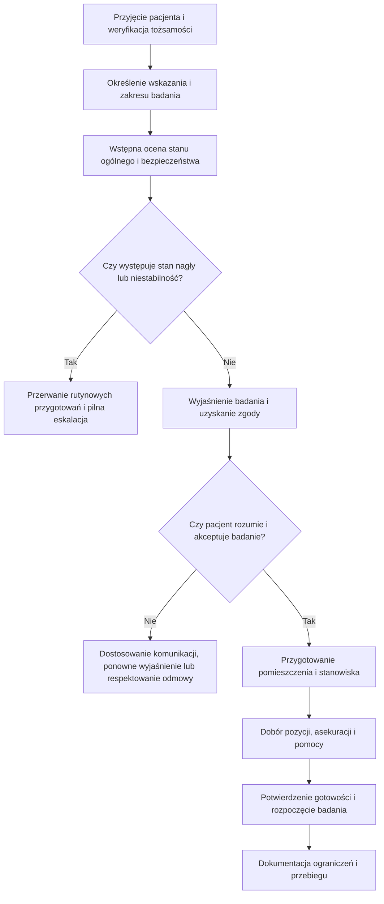

# 1.5. Przygotowanie do badania

> **Myśl przewodnia:** dobre badanie neurologiczne zaczyna się przed pierwszą próbą. Bezpieczne i wiarygodne wyniki wymagają właściwego rozpoznania pacjenta, jasnego celu, zrozumiałej komunikacji, poszanowania zgody, oceny ryzyka, odpowiednich warunków oraz dostosowania sposobu badania do możliwości konkretnej osoby.

## Wprowadzenie

Przygotowanie do badania neurologicznego jest uporządkowanym etapem postępowania klinicznego, którego zadaniem jest stworzenie warunków do bezpiecznego, godnego i możliwie wiarygodnego zebrania danych. Obejmuje ono zarówno czynności organizacyjne, jak i ocenę stanu pacjenta, jego potrzeb komunikacyjnych, ograniczeń funkcjonalnych, ryzyka pogorszenia oraz gotowości do wykonania poszczególnych prób.

W neurologii znaczenie przygotowania jest szczególnie duże. Zaburzenia świadomości, afazja, niedosłuch, ubytek pola widzenia, zaniedbywanie stronne, ból, zawroty głowy, osłabienie mięśni, zaburzenia równowagi, męczliwość i zaburzenia poznawcze mogą wpływać na przebieg badania oraz na interpretację uzyskanych wyników. Nieprawidłowa odpowiedź nie zawsze oznacza uszkodzenie określonej struktury układu nerwowego: może wynikać z niezrozumienia polecenia, bariery językowej, nieodpowiedniego oświetlenia, bólu, lęku, zmęczenia lub braku bezpiecznej pozycji.

Przygotowanie nie powinno jednak opóźniać pilnej pomocy. Jeżeli występują objawy sugerujące stan nagły, w szczególności nagły deficyt ogniskowy, zaburzenia oddychania lub połykania, szybko narastające zaburzenia świadomości, stan padaczkowy albo objawy ostrego ucisku struktur nerwowych, należy uruchomić właściwą ścieżkę pomocy zgodnie z kompetencjami i procedurami. Czynności przygotowawcze ogranicza się wtedy do tych, które są niezbędne dla bezpieczeństwa i sprawnego przekazania pacjenta.

Rozdział rozwija pozycję 1.5 spisu treści. Nie zastępuje szczegółowego omówienia sprzętu diagnostycznego ani zasad kontroli zakażeń, które są przedmiotem kolejnych rozdziałów. Wskazuje natomiast, jak przygotować pacjenta, pomieszczenie i proces badania, aby kolejne czynności można było wykonać prawidłowo.

**Uwaga dotycząca kompetencji:** materiał ma charakter dydaktyczny. Zakres badania, sposób uzyskiwania zgody, wykonywanie pomiarów i podejmowanie decyzji zależą od kwalifikacji zawodowych, uprawnień, aktualnych przepisów, procedur podmiotu leczniczego i sytuacji klinicznej. Opisane zasady nie upoważniają do wykonywania czynności wykraczających poza kompetencje osoby badającej.

---

## 1. Cele kształcenia i efekty uczenia się

### 1.1. Cel ogólny

Celem rozdziału jest przygotowanie uczestnika do zaplanowania i przeprowadzenia etapu poprzedzającego badanie neurologiczne w sposób:

- bezpieczny dla pacjenta i personelu;
- zgodny z prawami pacjenta i zasadami etyki;
- dostosowany do celu klinicznego;
- uwzględniający wiek, stan ogólny, sprawność, ból i możliwości komunikacyjne;
- ograniczający czynniki zakłócające wynik;
- możliwy do odtworzenia i udokumentowania.

### 1.2. Efekty uczenia się

Po opanowaniu materiału uczestnik powinien umieć:

1. zweryfikować tożsamość pacjenta z zastosowaniem przyjętej procedury;
2. określić cel i zakres planowanego badania;
3. zebrać informacje niezbędne do bezpiecznego rozpoczęcia badania;
4. wyjaśnić pacjentowi przebieg, cel i możliwe niedogodności poszczególnych czynności;
5. respektować zgodę, odmowę, prawo do przerwania badania i potrzebę ponownego wyjaśnienia;
6. rozpoznać sytuacje, w których konieczne jest dostosowanie komunikacji;
7. ocenić podstawowe ryzyko związane z pozycjonowaniem, pionizacją, chodem i próbami równoważnymi;
8. przygotować pomieszczenie, oświetlenie, przestrzeń i warunki prywatności;
9. dobrać pozycję pacjenta do rodzaju badania i jego możliwości;
10. rozpoznać objawy wymagające przerwania przygotowań i pilnej eskalacji;
11. odróżnić wynik nieoceniony od wyniku prawidłowego;
12. udokumentować istotne ograniczenia, zastosowane dostosowania i odstępstwa od planu.

### 1.3. Znaczenie przygotowania dla jakości danych

Wynik badania jest zależny nie tylko od stanu układu nerwowego, ale również od warunków wykonania próby. Przykładowo:

- niewystarczające oświetlenie może utrudnić ocenę źrenic, mimiki i ruchów gałek ocznych;
- hałas może zakłócać ocenę słuchu, rozumienia poleceń i mowy;
- brak okularów lub aparatu słuchowego może pogorszyć wykonanie prób poznawczych;
- ból barku może pozornie obniżać ocenę siły kończyny górnej;
- niepewna pozycja może powodować asekuracyjne napięcie mięśni i utrudniać ocenę koordynacji;
- zmęczenie może obniżać szybkość i precyzję kolejnych prób;
- niezrozumiałe polecenie może prowadzić do błędnego wniosku o apraksji, niedowładzie lub zaburzeniu poznawczym.

Przygotowanie jest zatem częścią standaryzacji badania, a nie dodatkiem administracyjnym.

---

## 2. Ramowy model przygotowania

Przygotowanie można uporządkować w siedmiu następujących po sobie obszarach:

1. **Tożsamość i wskazanie** – kogo badamy i dlaczego?
2. **Bezpieczeństwo** – czy stan pacjenta pozwala rozpocząć planowane czynności?
3. **Informacja i zgoda** – czy pacjent rozumie, co będzie wykonywane, i akceptuje badanie?
4. **Komunikacja i dostępność** – czy pacjent może usłyszeć, zrozumieć i przekazać odpowiedź?
5. **Warunki i stanowisko** – czy otoczenie umożliwia bezpieczne badanie?
6. **Pozycjonowanie i gotowość funkcjonalna** – czy pacjent może przyjąć wymaganą pozycję bez nadmiernego ryzyka?
7. **Plan i dokumentacja** – co zostanie zbadane, czego nie wolno pominąć i jakie ograniczenia trzeba odnotować?

### 2.1. Schemat postępowania

Schemat przedstawia logikę postępowania, a nie niezmienną kolejność wszystkich czynności. W sytuacji nagłej nie należy czekać na zakończenie pełnego przygotowania ani wykonywać czynności, które opóźniają niezbędną pomoc.

---

## 3. Weryfikacja tożsamości pacjenta i wskazania

### 3.1. Dlaczego identyfikacja jest niezbędna?

Pomyłka w identyfikacji może prowadzić do przypisania wyników niewłaściwej osobie, błędnej interpretacji wcześniejszej dokumentacji, niewłaściwego planu diagnostycznego lub naruszenia poufności. Tożsamość należy zweryfikować przed rozpoczęciem czynności zgodnie z procedurą obowiązującą w danym miejscu.

W praktyce wykorzystuje się co najmniej dwa identyfikatory określone w procedurze placówki, np. imię i nazwisko oraz datę urodzenia albo inny zatwierdzony identyfikator. Numer sali, łóżka lub samo wskazanie przez osobę trzecią nie powinny być traktowane jako samodzielny dowód tożsamości.

Jeżeli pacjent nie może odpowiedzieć, należy zastosować bezpieczny sposób identyfikacji przewidziany w placówce, z uwzględnieniem opaski identyfikacyjnej, dokumentacji i dostępnych źródeł potwierdzenia. Nie wolno wpisywać danych na podstawie przypuszczenia.

### 3.2. Potwierdzenie celu badania

Przed rozpoczęciem należy ustalić:

- kto skierował pacjenta lub zlecił ocenę;
- jaki problem ma zostać oceniony;
- czy badanie jest pierwszorazowe, kontrolne, przesiewowe czy ukierunkowane;
- czy wystąpiła zmiana stanu od poprzedniego badania;
- czy istnieją szczególne zalecenia, ograniczenia lub środki ostrożności;
- jaki zakres mieści się w kompetencjach osoby badającej.

Sformułowanie celu powinno być konkretne. Przykład: „Ocena asymetrii siły kończyn po zgłoszonym nagłym osłabieniu” jest bardziej użyteczne niż ogólne „badanie neurologiczne”, ponieważ wskazuje, na co zwrócić szczególną uwagę i jakie ryzyko należy rozważyć.

### 3.3. Weryfikacja dokumentacji i informacji wstępnych

Jeśli są dostępne i można z nich korzystać zgodnie z prawem oraz procedurą, należy zapoznać się z informacjami, które mogą zmienić bezpieczeństwo lub interpretację badania:

- rozpoznania i istotne choroby współistniejące;
- wcześniejsze deficyty neurologiczne i poziom sprawności;
- przebyte urazy, zabiegi i hospitalizacje;
- aktualne leki oraz ostatnie zmiany dawkowania;
- alergie i wcześniejsze reakcje niepożądane;
- stosowane pomoce ortopedyczne i sprzęt wspomagający;
- wcześniejsze wyniki istotnych badań;
- ograniczenia ruchowe, zalecenia pooperacyjne lub przeciwwskazania;
- informacje o ryzyku upadku, napadach, zaburzeniach połykania lub zachowania.

Dokumentacja nie zastępuje rozmowy z pacjentem. Dane mogą być nieaktualne, niepełne lub nie odzwierciedlać obecnego stanu.

### 3.4. Porównanie ze stanem wyjściowym

U pacjenta z przewlekłą chorobą neurologiczną trzeba odróżnić deficyt utrwalony od nowej zmiany. Warto ustalić:

- jak pacjent funkcjonował przed aktualnym pogorszeniem;
- czy poruszał się samodzielnie, z pomocą osoby czy z użyciem sprzętu;
- czy występowały wcześniejsze zaburzenia mowy, widzenia, czucia lub siły;
- czy asymetria była obecna wcześniej;
- czy pacjent używa dominującej ręki i czy występują ograniczenia ortopedyczne;
- czy opiekun może wiarygodnie opisać zmianę, jeśli pacjent nie jest w stanie jej przedstawić.

W przypadku nagłego pogorszenia nie wolno uznać nowego deficytu za „typowy dla choroby przewlekłej” bez odpowiedniej oceny.

---

## 4. Wstępna ocena bezpieczeństwa przed badaniem

### 4.1. Ocena ogólna

Przed rozpoczęciem prób należy zwrócić uwagę na stan ogólny i zachowanie pacjenta. Obserwacja obejmuje m.in.:

- poziom czuwania i możliwość nawiązania kontaktu;
- spontaniczną aktywność ruchową;
- sposób oddychania i widoczny wysiłek oddechowy;
- kolor skóry i oznaki ostrego pogorszenia;
- pozycję ciała i zdolność utrzymania stabilnego siedzenia;
- widoczne urazy, ból lub dyskomfort;
- nudności, wymioty, zawroty głowy i potliwość;
- zdolność do wykonywania prostych poleceń;
- zachowanie sugerujące splątanie, pobudzenie lub senność.

Jeżeli zakres badania tego wymaga, należy ocenić parametry życiowe zgodnie z kompetencjami i procedurą: ciśnienie tętnicze, tętno, częstość oddechów, saturację, temperaturę lub glikemię. Nie każdy element jest konieczny u każdej osoby. Pomiar powinien odpowiadać pytaniu klinicznemu i nie może opóźniać pilnej interwencji.

### 4.2. Sygnały wymagające przerwania rutynowego przygotowania

Szczególnej uwagi wymagają:

- nagły niedowład, asymetria twarzy, nowe zaburzenie mowy lub widzenia;
- szybko narastające zaburzenia świadomości;
- duszność, sinica, niemożność ochrony dróg oddechowych;
- nowe lub nasilające się zaburzenia połykania z ryzykiem aspiracji;
- napad drgawkowy trwający długo, napady powtarzające się bez odzyskania świadomości lub utrzymujące się zaburzenia świadomości po napadzie;
- nagły, bardzo silny ból głowy, zwłaszcza z objawami neurologicznymi;
- gorączka z zaburzeniami świadomości i objawami oponowymi;
- szybko postępujące osłabienie, zwłaszcza z zaburzeniami oddychania;
- silny ból kręgosłupa z nowym osłabieniem kończyn, zaburzeniami czucia w okolicy siodłowej lub zaburzeniami zwieraczy;
- omdlenie z niestabilnością krążeniową, bólem w klatce piersiowej lub ciężką dusznością;
- objawy urazu głowy lub kręgosłupa wymagające pilnej oceny.

W takich okolicznościach należy postępować według lokalnej ścieżki ratunkowej. Nie należy kontynuować prób równoważnych, chodu, forsownego ruchu ani innych czynności, które zwiększają ryzyko.

### 4.3. Ocena ryzyka upadku

Przed pionizacją i próbami chodu należy ustalić, czy pacjent może bezpiecznie zmienić pozycję. Warto uwzględnić:

- wcześniejsze upadki i urazy;
- aktualną niestabilność, ataksję lub zawroty głowy;
- niedowład, zaburzenia czucia i osłabienie kończyn dolnych;
- hipotonię ortostatyczną lub objawy po zmianie pozycji;
- zaburzenia widzenia;
- splątanie, impulsywność lub trudności w rozumieniu poleceń;
- leki mogące powodować senność, hipotonię lub zaburzenia równowagi;
- obuwie, powierzchnię podłogi i dostępność pomocy;
- potrzebę asekuracji jednej lub większej liczby osób zgodnie z procedurą.

Nie należy zakładać, że pacjent może chodzić samodzielnie tylko dlatego, że przyszedł do gabinetu. Stan może zmieniać się w ciągu dnia, a choroba, leki i zmęczenie mogą zwiększać ryzyko.

### 4.4. Zmiana pozycji i ryzyko hipotensji ortostatycznej

U pacjentów z zawrotami głowy, omdleniami, neuropatią autonomiczną, odwodnieniem, chorobą Parkinsona lub stosowaniem leków hipotensyjnych zmiana pozycji może wywołać objawy. Przed pionizacją należy zapytać o zawroty głowy, mroczki przed oczami, osłabienie, nudności i wcześniejsze omdlenia.

Jeśli pomiar ortostatyczny jest wskazany, wykonuje się go według przyjętego protokołu, z odpowiednim czasem odpoczynku i pomiarami w określonych pozycjach. Nie należy wykonywać próby u osoby niestabilnej, zagrożonej upadkiem lub z przeciwwskazaniem bez właściwej asekuracji i decyzji osoby uprawnionej.

### 4.5. Ocena bólu i innych dolegliwości

Ból może ograniczać zakres ruchu, zmieniać napięcie mięśniowe i wpływać na wynik prób siłowych. Przed badaniem należy ustalić:

- lokalizację bólu;
- jego charakter i nasilenie;
- czynniki nasilające;
- czy ból pojawia się w spoczynku, podczas ruchu czy przy ucisku;
- czy występuje świeży uraz;
- czy pacjent może przyjąć pozycję wymaganą do badania.

Nie należy forsować ruchu przez ból ani interpretować ograniczenia bólowego jako niedowładu bez rozważenia alternatywnych wyjaśnień. Jeżeli próba jest bolesna, należy ją zmodyfikować, przerwać lub opisać jako niewiarygodną.

### 4.6. Ocena męczliwości i wydolności

Badanie neurologiczne może być obciążające, zwłaszcza u osób starszych, z chorobami układu oddechowego i krążenia, miastenią, chorobami nerwowo-mięśniowymi lub znaczną niesprawnością. Należy zaplanować przerwy, kolejność prób i pozycje tak, aby nie doprowadzić do niepotrzebnego wyczerpania.

Nowa duszność, narastająca słabość, zaburzenia mowy, trudności w połykaniu lub wyraźne pogorszenie w trakcie badania wymagają natychmiastowej ponownej oceny.

---

## 5. Informowanie pacjenta i uzyskiwanie zgody

### 5.1. Zasada poszanowania autonomii

Pacjent powinien otrzymać informację w sposób zrozumiały, adekwatny do jego stanu i zakresu planowanych czynności. Należy wyjaśnić, co będzie wykonywane, w jakim celu, czy może pojawić się dyskomfort oraz że pacjent może zadawać pytania, odmówić określonej próby lub poprosić o przerwę.

Zgoda nie powinna być traktowana jako jednorazowa formalność. W badaniu neurologicznym może być potrzebne ponowne uzyskanie akceptacji przed odsłonięciem kolejnej okolicy ciała, wykonaniem próby potencjalnie nieprzyjemnej lub zmianą zakresu badania.

### 5.2. Elementy dobrej informacji

Przed rozpoczęciem należy przekazać w szczególności:

1. **Cel:** dlaczego badanie jest wykonywane.
2. **Zakres:** jakie części ciała i funkcje będą oceniane.
3. **Przebieg:** jakie polecenia i ruchy może wykonywać pacjent.
4. **Kontakt fizyczny:** gdzie i w jaki sposób badający może dotykać pacjenta.
5. **Możliwy dyskomfort:** np. chwilowy ucisk, zmęczenie, zawrót głowy podczas zmiany pozycji lub dyskomfort przy określonej próbie.
6. **Możliwość przerwania:** pacjent może zgłosić ból, zmęczenie, lęk lub brak zgody.
7. **Pytania:** pacjent powinien mieć możliwość uzyskania wyjaśnień.

W badaniu rutynowym wiele prób jest nieinwazyjnych, ale nie oznacza to, że można je wykonywać bez komunikacji i poszanowania granic pacjenta.

### 5.3. Zgoda ustna, niewerbalna i dokumentowanie

Sposób uzyskania i dokumentowania zgody zależy od rodzaju świadczenia, sytuacji pacjenta, przepisów i procedur. W przypadku zwykłego badania nieinwazyjnego może być wystarczająca zgoda wyrażona w sposób przyjęty dla danej czynności, ale należy upewnić się, że pacjent otrzymał informację i rzeczywiście akceptuje badanie. W przypadku czynności o odmiennym ryzyku lub charakterze obowiązują szczególne wymagania.

Brak sprzeciwu nie zawsze oznacza zgodę. Milczenie, bezruch, dezorientacja lub brak reakcji mogą wynikać z zaburzeń świadomości, afazji, lęku albo niezrozumienia sytuacji.

### 5.4. Prawo do odmowy i przerwania badania

Jeżeli pacjent odmawia, należy:

- spokojnie ustalić, czego dotyczy odmowa;
- wyjaśnić cel i znaczenie proponowanej czynności;
- zapytać, czy można zmienić sposób badania lub wykonać inną, mniej obciążającą próbę;
- nie wywierać presji ani nie zawstydzać pacjenta;
- ocenić, czy istnieje pilne zagrożenie wymagające działania na podstawie odrębnych przepisów;
- udokumentować odmowę, przekazane informacje, zakres niewykonanego badania i podjęte dalsze kroki.

Pacjent może zgodzić się na część badania, a odmówić innej części. Nie należy automatycznie traktować odmowy pojedynczej próby jako odmowy całego świadczenia.

### 5.5. Zdolność do podejmowania decyzji i trudności komunikacyjne

Nie wolno zakładać, że pacjent nie może podjąć decyzji wyłącznie z powodu wieku, niepełnosprawności, afazji, zaburzeń mowy, choroby psychicznej, wyglądu lub nietypowego zachowania. Najpierw należy zapewnić odpowiednie warunki komunikacji i sprawdzić, czy pacjent rozumie przekazaną informację.

W ocenie trzeba rozróżnić:
- niemożność wypowiedzenia odpowiedzi;
- niemożność zrozumienia informacji;
- niemożność utrzymania uwagi;
- brak możliwości wykonania ruchu;
- brak zgody;
- zaburzenia świadomości.

To różne sytuacje, które wymagają odmiennych działań. W razie wątpliwości należy postępować zgodnie z obowiązującymi przepisami i procedurą, konsultować się z osobą uprawnioną oraz dokumentować podstawę decyzji. Nie należy samodzielnie tworzyć zastępczej zgody ani utożsamiać obecności rodziny z automatycznym prawem do podejmowania decyzji za dorosłego pacjenta.

### 5.6. Podstawowe odniesienia do prawa polskiego

W Polsce istotne znaczenie mają w szczególności:
- ustawa z 6 listopada 2008 r. o prawach pacjenta i Rzeczniku Praw Pacjenta, w tym przepisy dotyczące prawa do informacji oraz zgody lub odmowy;
- ustawa z 5 grudnia 1996 r. o zawodach lekarza i lekarza dentysty, w tym przepisy o zgodzie na badanie i świadczenia zdrowotne;
- przepisy właściwe dla innych zawodów medycznych oraz regulacje dotyczące dokumentacji, tajemnicy zawodowej i ochrony danych.

Nie należy przenosić zasad prawnych obowiązujących w innych państwach bez sprawdzenia polskiego stanu prawnego. Szczegółowy sposób uzyskiwania zgody zależy od rodzaju czynności, wieku pacjenta, jego sytuacji prawnej i możliwości świadomego wyrażenia woli. W razie wątpliwości należy korzystać z aktualnego tekstu ustawy i procedur placówki, a nie z nieformalnych skrótów.

---

## 6. Komunikacja dostosowana do możliwości pacjenta

### 6.1. Zasady ogólne

Dobra komunikacja jest warunkiem wiarygodnego badania. Polecenia powinny być krótkie, jednoznaczne i przekazywane w tempie dostosowanym do pacjenta. Warto:

- zwrócić się bezpośrednio do pacjenta;
- przedstawić się i określić swoją rolę;
- ograniczyć hałas i rozpraszające bodźce;
- mówić wyraźnie, bez krzyku;
- przekazywać jedno polecenie naraz;
- pozostawić czas na odpowiedź;
- sprawdzić, czy pacjent zrozumiał polecenie;
- pokazać ruch, jeśli demonstracja ułatwia wykonanie;
- nie sugerować odpowiedzi mimiką ani tonem głosu;
- używać tych samych sformułowań przy powtarzaniu prób, jeśli wymaga tego standaryzacja.

### 6.2. Pacjent z afazją

Afazja może utrudniać rozumienie, nazywanie, powtarzanie lub spontaniczne wypowiadanie się. Nie oznacza automatycznie braku świadomości ani braku zdolności do wyrażenia zgody.

Pomocne może być:
- używanie krótkich zdań;
- zadawanie pytań wymagających odpowiedzi „tak/nie”, z kontrolą wiarygodności tych odpowiedzi;
- wskazywanie przedmiotów lub obrazów;
- stosowanie gestów i demonstracji;
- pozostawienie czasu na odpowiedź;
- używanie tablic komunikacyjnych lub urządzeń wspomagających;
- sprawdzanie rozumienia poprzez proste polecenia, a nie wyłącznie rozmowę.

Należy unikać infantylizowania pacjenta, kończenia za niego zdań i automatycznego kierowania wszystkich pytań do opiekuna.

### 6.3. Pacjent z dyzartrią lub innymi zaburzeniami mowy

Dyzartria może ograniczać zrozumiałość wypowiedzi przy zachowanym rozumieniu i zdolności myślenia. Należy dać pacjentowi czas, umożliwić odpowiedź pisemną lub wskazywanie, jeśli jest to możliwe, i nie utożsamiać niewyraźnej mowy z zaburzeniem poznawczym.

### 6.4. Pacjent z niedosłuchem

Należy:
- ograniczyć hałas;
- upewnić się, że pacjent widzi twarz osoby mówiącej;
- mówić naturalnie i wyraźnie;
- nie zasłaniać ust;
- sprawdzić, czy aparat słuchowy jest dostępny i działa;
- w razie potrzeby użyć pisemnych poleceń lub tłumacza języka migowego;
- upewnić się, że pacjent zrozumiał, a nie tylko potakuje.

Podnoszenie głosu nie zawsze poprawia rozumienie i może zniekształcać komunikację.

### 6.5. Pacjent z zaburzeniami widzenia

Należy przedstawić się głosem, poinformować o obecności innych osób i opisać położenie przedmiotów. Nie należy niespodziewanie chwytać pacjenta ani przestawiać jego pomocy. Jeśli pacjent korzysta z okularów, trzeba ustalić, kiedy są potrzebne do wykonania danej próby.

W badaniu pola widzenia lub ruchów gałek ocznych okulary mogą być zdejmowane zgodnie z celem próby, ale należy wyjaśnić powód i zapewnić bezpieczne miejsce ich odłożenia.

### 6.6. Pacjent z zaburzeniami poznawczymi

Warto:
- ograniczyć liczbę osób w pomieszczeniu;
- stosować spokojne, przewidywalne komunikaty;
- utrzymywać kontakt wzrokowy, jeśli jest to komfortowe;
- podzielić badanie na krótsze etapy;
- powtarzać polecenia bez irytacji;
- uwzględnić zmienność uwagi i możliwe wahania stanu;
- zaplanować przerwy;
- wykorzystać znane pacjentowi przedmioty i rutyny, jeśli to pomaga.

Jeśli pacjent nie może wykonać próby, należy ustalić, czy przyczyną jest zaburzenie rozumienia, uwagi, motywacji, sprawności ruchowej, lęk czy ból.

### 6.7. Bariera językowa

W razie bariery językowej należy zapewnić profesjonalne tłumaczenie, jeśli jest dostępne i potrzebne do bezpiecznej komunikacji. Nie należy polegać wyłącznie na przypadkowym tłumaczeniu przez osobę towarzyszącą, zwłaszcza w sprawach zgody, objawów alarmowych, intymnych dolegliwości i danych wrażliwych.

Dziecko nie powinno pełnić roli tłumacza w rozmowie dotyczącej istotnych decyzji medycznych. Jeżeli w sytuacji nagłej nie ma możliwości natychmiastowego zapewnienia tłumacza, należy użyć dostępnych bezpiecznych metod komunikacji i postępować zgodnie z procedurą, a ograniczenie odnotować.

### 6.8. Pacjent z niepełnosprawnością intelektualną lub neuroróżnorodnością

Warto wcześniej ustalić:
- preferowany sposób komunikacji;
- potrzebę prostego języka lub materiału obrazkowego;
- wrażliwość na dotyk, światło, dźwięk i tłok;
- potrzebę dłuższego czasu;
- możliwość wykonania badania etapami;
- znaczenie rutyny i zapowiedzi kolejnych czynności;
- obecność osoby wspierającej, jeśli pacjent tego chce i jest to zgodne z prawem.

Dostosowanie nie oznacza obniżenia standardu merytorycznego. Ma umożliwić ocenę tej samej funkcji w warunkach odpowiadających możliwościom pacjenta.

---

## 7. Przygotowanie pacjenta do badania – procedura krok po kroku

### 7.1. Etap pierwszy: kontakt i przedstawienie się

1. Przywitaj pacjenta i przedstaw imię, nazwisko oraz rolę zawodową.
2. Ustal, w jaki sposób pacjent chce być adresowany.
3. Sprawdź tożsamość według procedury.
4. Zwracaj się bezpośrednio do pacjenta, nawet jeśli obecny jest opiekun.
5. Zapytaj, czy pacjent jest gotowy do rozmowy i badania.

### 7.2. Etap drugi: określenie celu

1. Wyjaśnij, jaki problem będzie oceniany.
2. Ustal, czy pacjent ma aktualnie nowe lub nasilające się objawy.
3. Zapytaj o ból, zawroty głowy, nudności, zmęczenie i potrzebę odpoczynku.
4. Sprawdź, czy od ostatniej oceny nie wystąpiło pogorszenie.
5. Określ zakres badania adekwatny do celu.

### 7.3. Etap trzeci: ocena bezpieczeństwa

1. Oceń stan ogólny, czuwanie i możliwość współpracy.
2. Zwróć uwagę na oddychanie, krążenie i objawy ostrego pogorszenia.
3. Ustal, czy pacjent może bezpiecznie siedzieć, wstawać i chodzić.
4. Zapytaj o upadki, omdlenia, zawroty głowy i wcześniejsze urazy.
5. Sprawdź, czy występują ograniczenia pooperacyjne, ortopedyczne lub inne przeciwwskazania.
6. W razie wskazań wykonaj pomiary w granicach kompetencji i procedur.
7. Jeśli występuje sygnał alarmowy, przerwij rutynowy tok przygotowania i uruchom właściwą pomoc.

### 7.4. Etap czwarty: informacja i zgoda

1. Opisz badanie prostym, zrozumiałym językiem.
2. Zapowiedz możliwy kontakt fizyczny i odsłonięcie wybranych okolic ciała.
3. Wyjaśnij, że niektóre próby mogą wymagać ruchu, zmiany pozycji lub krótkiego utrzymania kończyny.
4. Zapytaj, czy pacjent ma pytania.
5. Uzyskaj zgodę zgodnie z charakterem czynności i obowiązującymi zasadami.
6. Ustal sygnał, którym pacjent może zgłosić ból, dyskomfort lub potrzebę przerwy.
7. Uszanuj odmowę i ustal możliwy alternatywny zakres.

### 7.5. Etap piąty: dostosowanie komunikacji

1. Sprawdź, czy pacjent słyszy i widzi osobę badającą.
2. Ustal, czy potrzebuje okularów, aparatu słuchowego, tłumacza lub pomocy komunikacyjnej.
3. Ogranicz hałas i zbędne bodźce.
4. Przekazuj krótkie polecenia.
5. Daj pacjentowi czas na odpowiedź.
6. W razie potrzeby zademonstruj ruch.
7. Sprawdź rozumienie bez podpowiadania oczekiwanej odpowiedzi.

### 7.6. Etap szósty: przygotowanie pomieszczenia

1. Zapewnij odpowiednią temperaturę i wentylację.
2. Ustaw oświetlenie odpowiednie do planowanych prób.
3. Usuń przeszkody z przestrzeni wokół łóżka, krzesła i miejsca do chodu.
4. Sprawdź stabilność krzesła, łóżka i podparcia.
5. Zadbaj o dostęp do pomocy technicznych i sprzętu używanego przez pacjenta.
6. Zapewnij możliwość bezpiecznego odłożenia okularów, aparatu słuchowego, laski lub innych przedmiotów.
7. Przygotuj miejsce do odpoczynku.
8. Zadbaj o prywatność i ograniczenie dostępu osób postronnych.

### 7.7. Etap siódmy: pozycjonowanie

Pozycja zależy od badanej funkcji i stanu pacjenta. Należy:
- wybrać pozycję stabilną i możliwie wygodną;
- zapewnić podparcie tułowia i kończyn, jeśli jest potrzebne;
- nie wymuszać pozycji, której pacjent nie może utrzymać;
- uwzględnić ból, przykurcze, spastyczność i ograniczenia stawowe;
- unikać gwałtownych zmian pozycji;
- zabezpieczyć pacjenta przed zsunięciem się z łóżka lub krzesła;
- pozostawić dostęp do badanych okolic ciała bez niepotrzebnego odsłaniania.

### 7.8. Etap ósmy: potwierdzenie gotowości

Przed rozpoczęciem należy upewnić się, że:
- tożsamość i cel są potwierdzone;
- pacjent rozumie plan;
- zgoda została uzyskana w odpowiedni sposób;
- nie występuje niezaadresowany sygnał alarmowy;
- warunki pomieszczenia są bezpieczne;
- pozycja pacjenta jest stabilna;
- potrzebna pomoc i asekuracja są dostępne;
- osoba badająca ma przygotowany plan oraz wie, których prób nie należy wykonywać.

---

## 8. Przygotowanie pomieszczenia, oświetlenia i stanowiska

### 8.1. Przestrzeń i ergonomia

Pomieszczenie powinno umożliwiać swobodne podejście do pacjenta z różnych stron, bez plątaniny przewodów i przeszkód. Należy zapewnić przestrzeń do bezpiecznego transferu oraz – jeśli jest to wskazane – do krótkiej oceny chodu.

Krzesło powinno być stabilne, najlepiej z podłokietnikami, o wysokości ułatwiającej siadanie i wstawanie. Łóżko lub kozetka powinny być ustawione tak, aby ograniczyć ryzyko upadku i umożliwić dostęp do pacjenta. Hamulce łóżka i wózka powinny być używane zgodnie z procedurą.

### 8.2. Oświetlenie

Oświetlenie powinno być:
- wystarczające do oceny twarzy, źrenic, ruchów gałek ocznych i skóry;
- możliwe do regulacji, jeśli potrzebna jest ocena reakcji źrenic;
- pozbawione silnego olśnienia;
- ustawione tak, aby nie powodować cienia zasłaniającego badane okolice.

Nie należy wykonywać oceny źrenic w warunkach, w których natężenie światła zmienia się przypadkowo. Jeśli warunki były nietypowe, warto to odnotować.

### 8.3. Hałas i rozproszenie

Telewizor, rozmowy osób postronnych, dźwięki urządzeń i częste wejścia do pomieszczenia mogą utrudniać ocenę uwagi, pamięci, rozumienia poleceń i słuchu. W miarę możliwości należy ograniczyć zakłócenia, szczególnie w badaniu funkcji poznawczych i językowych.

### 8.4. Temperatura i komfort

Zimno może nasilać drżenie, zwiększać napięcie mięśniowe i pogarszać komfort. Zbyt wysoka temperatura może nasilać zmęczenie i dyskomfort. Należy umożliwić pacjentowi odpoczynek, zapewnić okrycie i odsłaniać tylko tę okolicę, która jest aktualnie badana.

### 8.5. Prywatność i intymność

Przed badaniem należy:
- zamknąć drzwi lub zastosować parawan;
- ograniczyć obecność osób do niezbędnego personelu;
- zapytać pacjenta o obecność osoby towarzyszącej;
- uzgodnić obecność dodatkowego pracownika, jeśli jest wskazana;
- informować przed dotknięciem i odsłonięciem kolejnej okolicy;
- zakrywać części ciała, które nie są aktualnie badane.

W przypadku badania okolic intymnych lub czynności o szczególnie wrażliwym charakterze obowiązują odrębne zasady, procedury i wymagania dotyczące zgody oraz obecności osoby towarzyszącej.

---

## 9. Dostosowanie przygotowania do rodzaju badania neurologicznego

### 9.1. Badanie świadomości i funkcji poznawczych

Należy zapewnić:
- możliwie ciche pomieszczenie;
- odpowiednie oświetlenie;
- dostęp do okularów i aparatu słuchowego, jeśli są potrzebne;
- brak niepotrzebnych przerw;
- czas na odpowiedź;
- możliwość odpoczynku;
- znajomość języka, którym pacjent posługuje się najlepiej.

Nie należy przeprowadzać testów przesiewowych w warunkach, które uniemożliwiają ich wiarygodną interpretację, np. podczas silnego bólu, ostrego splątania, znacznej duszności lub bez możliwości komunikacji w zrozumiałym języku. Jeżeli badanie jest mimo to konieczne, ograniczenia muszą być wyraźnie opisane.

### 9.2. Badanie nerwów czaszkowych

Przed badaniem warto:
- zapewnić dobre, stabilne oświetlenie;
- ustawić pacjenta w wygodnej pozycji siedzącej;
- sprawdzić dostępność okularów i pomocy wzrokowych;
- ograniczyć hałas;
- przygotować miejsce do bezpiecznego odłożenia protez lub innych pomocy, jeśli ich czasowe zdjęcie jest potrzebne;
- wyjaśnić, że niektóre próby mogą wymagać dotykania twarzy, wykonywania ruchów oczu lub krótkiej zmiany ustawienia głowy.

Nie należy wykonywać gwałtownych ruchów głową ani prowokować objawów u pacjenta z podejrzeniem urazu szyjnego lub niestabilności kręgosłupa.

### 9.3. Badanie siły i napięcia mięśniowego

Należy:
- ustalić, czy ból lub ograniczenie stawowe może wpływać na ruch;
- zapewnić stabilne podparcie kończyny;
- odsłonić odpowiednią grupę mięśniową z poszanowaniem intymności;
- wyjaśnić różnicę między ruchem samodzielnym a ruchem przeciw oporowi;
- unikać nadmiernego oporu, zwłaszcza u osób z bólem, osteoporozą, świeżym urazem lub ograniczeniami pooperacyjnymi;
- porównywać strony w możliwie podobnych warunkach.

### 9.4. Badanie czucia

Pacjent powinien wiedzieć, że będzie proszony o określanie rodzaju lub miejsca bodźca. Należy zapewnić prywatność, komfort termiczny i możliwość zamknięcia oczu podczas odpowiednich prób. Narzędzia muszą być przygotowane zgodnie z zasadami higieny i bezpieczeństwa; szczegółowe wymagania dotyczące sprzętu oraz kontroli zakażeń omawiają kolejne rozdziały.

### 9.5. Badanie odruchów

Kończyna powinna być rozluźniona i odpowiednio podparta. Pacjent powinien znać cel próby i wiedzieć, że uderzenie młotkiem jest krótkie, ale nie powinno być bolesne. W razie bólu, obrzęku, urazu lub znacznej tkliwości należy dobrać bezpieczną pozycję lub zrezygnować z próby.

### 9.6. Badanie koordynacji, równowagi i chodu

Przed próbami stojącymi należy:
- sprawdzić, czy pacjent może bezpiecznie siedzieć i wstawać;
- usunąć przeszkody;
- zapewnić odpowiednie obuwie lub bezpieczne warunki dla stóp;
- ustalić, czy pacjent zwykle używa laski, balkonika lub innej pomocy;
- zapewnić asekurację zgodną z oceną ryzyka;
- nie wykonywać próby Romberga ani chodu tandemowego bez możliwości natychmiastowego zabezpieczenia pacjenta;
- przerwać próbę w razie narastającego zawrotu głowy, utraty równowagi, duszności lub osłabienia.

Pomoc ortopedyczna nie powinna być automatycznie odstawiana w celu „uzyskania czystego wyniku”. Należy ocenić funkcjonowanie w warunkach bezpiecznych i odnotować, czy próba była wykonana z użyciem pomocy.

### 9.7. Ocena funkcji autonomicznych

Przed pomiarem ortostatycznym, oceną potliwości lub wywiadem dotyczącym mikcji i defekacji należy wyjaśnić cel oraz zapewnić prywatność. Pomiar ortostatyczny wymaga szczególnej uwagi wobec ryzyka omdlenia. Ocena funkcji zwieraczy i okolic intymnych wymaga odpowiedniego uzasadnienia, zgody, kompetencji i poszanowania godności.

---

## 10. Przygotowanie osób starszych i pacjentów geriatrycznych

### 10.1. Wielochorobowość i kruchość

U osób starszych wynik badania może być modyfikowany przez choroby współistniejące, polifarmakoterapię, zaburzenia wzroku i słuchu, ból, niedożywienie, odwodnienie, osłabienie mięśni i ograniczoną rezerwę fizjologiczną.

Przed rozpoczęciem warto ustalić:
- typowy poziom samodzielności;
- zwykły sposób poruszania się;
- stosowane pomoce;
- wcześniejsze upadki;
- ryzyko majaczenia;
- aktualne zmiany zachowania i świadomości;
- przyjmowane leki, zwłaszcza wpływające na ciśnienie, czuwanie i równowagę;
- obecność bólu i zmęczenia.

### 10.2. Zapobieganie dezorientacji

Pomocne są:
- przedstawienie się przy każdym nowym kontakcie;
- krótkie wyjaśnianie kolejnych etapów;
- widoczny zegar i kalendarz, jeśli pacjent z nich korzysta;
- zachowanie znanych przedmiotów i pomocy;
- ograniczenie liczby osób i zmian otoczenia;
- zapewnienie okularów i aparatów słuchowych;
- unikanie niepotrzebnego wybudzania lub pośpiechu.

Nagła zmiana zachowania u osoby starszej nie powinna być uznawana za „naturalny element starzenia”. Może oznaczać majaczenie, zakażenie, zaburzenie metaboliczne, działanie leku lub ostre zdarzenie neurologiczne.

### 10.3. Ochrona przed upadkiem

Nie należy oceniać chodu bez wcześniejszego ustalenia poziomu asekuracji. W razie potrzeby badanie można rozpocząć w pozycji siedzącej lub leżącej, a próbę pionizacji odroczyć do czasu zapewnienia właściwych warunków.

---

## 11. Przygotowanie pacjenta z ograniczoną mobilnością

### 11.1. Pacjent korzystający z wózka

Należy:
- zapytać, czy pacjent potrafi samodzielnie wykonywać transfer;
- ustalić, czy potrzebna jest pomoc jednej czy większej liczby osób;
- zablokować hamulce zgodnie z zasadami bezpiecznego transferu;
- ustawić podnóżki i podłokietniki w odpowiednim położeniu;
- nie ciągnąć pacjenta za kończyny górne;
- uwzględnić ryzyko bólu, przykurczów i odleżyn;
- przeprowadzić badanie w wózku, jeśli transfer nie jest konieczny lub jest niebezpieczny.

### 11.2. Pacjent leżący

U pacjenta leżącego należy zapewnić stabilne podparcie, odpowiednią wysokość łóżka, dostęp do badanych kończyn i ochronę przed zsunięciem. Zmiany pozycji powinny być wykonywane z uwzględnieniem zaleceń dotyczących kręgosłupa, stawów, świeżych zabiegów i ryzyka urazu.

### 11.3. Przykurcze, spastyczność i ból

Nie należy wymuszać pełnego zakresu ruchu. Warto ustalić pozycję, w której pacjent może rozluźnić kończynę, i odróżnić ograniczenie bierne od czynnego. Jeżeli próba nie jest możliwa, trzeba opisać przyczynę zamiast wpisywać wynik prawidłowy lub nieprawidłowy bez podstaw.

---

## 12. Przygotowanie pacjenta z zaburzeniami świadomości lub zachowania

### 12.1. Ograniczona współpraca

Brak współpracy może wynikać z wielu przyczyn: zaburzeń świadomości, afazji, bólu, lęku, majaczenia, intoksykacji, zaburzeń poznawczych lub trudności sensorycznych. Przed oceną należy ustalić, czy pacjent rozumie sytuację i czy istnieje możliwość bezpiecznego kontaktu.

### 12.2. Pobudzenie i ryzyko zachowań niebezpiecznych

W przypadku pobudzenia należy:
- ograniczyć bodźce i liczbę osób;
- zachować spokojny ton i odpowiedni dystans;
- nie wykonywać nagłych ruchów;
- zapewnić bezpieczeństwo pacjentowi i personelowi;
- nie stosować przymusu jako sposobu ułatwienia rutynowego badania;
- postępować według procedur placówki;
- wezwać wsparcie, jeśli ryzyko wzrasta.

Badanie neurologiczne nie może być pretekstem do nieuzasadnionego ograniczania wolności pacjenta.

### 12.3. Ograniczenia badania

Jeżeli pacjent nie może wykonać poleceń, należy zapisać, które funkcje były możliwe do oceny na podstawie obserwacji, a które pozostały nieocenione. Nie należy przypisywać prawidłowej siły, czucia lub funkcji poznawczych na podstawie samego braku widocznej reakcji.

---

## 13. Przygotowanie do badania pacjenta z napadem, urazem lub ostrym pogorszeniem

### 13.1. Po napadzie padaczkowym

Należy ustalić, czy pacjent odzyskał stan wyjściowy, czy oddycha prawidłowo i czy nie występują urazy. Trzeba uwzględnić możliwość stanu ponapadowego, splątania, senności, bólu mięśni i przemijającego deficytu ogniskowego. Nowy lub utrzymujący się deficyt wymaga właściwej oceny, a nie automatycznego przypisania go napadowi.

### 13.2. Po urazie głowy lub kręgosłupa

Należy postępować zgodnie z protokołem urazowym. Nie wolno wykonywać nieuzasadnionych ruchów szyi ani prób obciążających kręgosłup przy podejrzeniu niestabilności. Badanie powinno być ograniczone do bezpiecznych czynności wykonywanych przez uprawniony personel.

### 13.3. Przy podejrzeniu udaru

Nowy, nagły deficyt ogniskowy wymaga pilnego uruchomienia ścieżki udarowej. Należy ustalić czas, kiedy pacjent był ostatnio widziany w stanie bez objawów, jeśli jest to możliwe, oraz przekazać informację zgodnie z protokołem. Nie należy opóźniać transportu lub pilnej diagnostyki w celu wykonania pełnego badania.

### 13.4. Przy szybko postępującym osłabieniu

Osłabienie narastające, zwłaszcza z zaburzeniami połykania, mowy lub oddychania, wymaga pilnej oceny. Nie należy wykonywać prób wysiłkowych, które mogłyby zwiększyć zmęczenie lub opóźnić monitorowanie funkcji życiowych.

---

## 14. Prywatność, godność i obecność osoby towarzyszącej

### 14.1. Poszanowanie granic pacjenta

Badanie neurologiczne często wymaga dotykania twarzy, kończyn, tułowia i odsłaniania części ciała. Każda czynność powinna być zapowiedziana. Należy ograniczać kontakt do niezbędnego zakresu i unikać komentarzy oceniających wygląd, sprawność lub zachowanie pacjenta.

### 14.2. Osoba towarzysząca

Obecność rodziny lub opiekuna może ułatwić komunikację i dostarczyć informacji o stanie wyjściowym. Nie powinna jednak zastępować rozmowy z pacjentem, jeśli ten może się komunikować.

Należy:
- zapytać pacjenta, czy chce obecności osoby towarzyszącej;
- ustalić, czy pacjent zgadza się na przekazywanie tej osobie informacji;
- umożliwić pacjentowi rozmowę bez osoby towarzyszącej, jeśli jest to właściwe;
- zachować poufność;
- odnotować udział osoby dostarczającej wywiad, jeśli ma to znaczenie dla interpretacji.

### 14.3. Osoba wspierająca i pomoc komunikacyjna

Osoba wspierająca może pomagać w orientacji, uspokojeniu i komunikacji. Należy jednak zachować rozróżnienie między wsparciem a podejmowaniem decyzji za pacjenta. Zakres udziału osoby trzeciej powinien być zgodny z wolą pacjenta, przepisami i procedurą.

---

## 15. Czynności, których nie należy wykonywać rutynowo przed każdym badaniem

Przygotowanie powinno być proporcjonalne do celu. Nie ma uzasadnienia, aby każdemu pacjentowi zlecać identyczny zestaw czynności przygotowawczych.

W szczególności:

- nie należy wymagać pozostawania na czczo przed zwykłym, nieinwazyjnym badaniem neurologicznym, jeśli nie ma odrębnego wskazania;
- nie należy odstawiać leków bez decyzji osoby uprawnionej;
- nie należy rutynowo odstawiać okularów lub aparatów słuchowych na cały czas badania;
- nie należy wymuszać pionizacji u pacjenta z niestabilnością;
- nie należy wykonywać prób prowokacyjnych bez wskazania i oceny ryzyka;
- nie należy zakładać, że każdy pacjent musi wykonać pełny zestaw prób;
- nie należy wykonywać badania w pośpiechu kosztem wyjaśnienia i bezpieczeństwa;
- nie należy zastępować badania klinicznego samym kwestionariuszem lub urządzeniem pomiarowym;
- nie należy wpisywać „badanie prawidłowe”, jeśli części badania nie wykonano.

Jeśli planowane jest dodatkowe badanie diagnostyczne, procedura przygotowania może być inna. Należy wtedy stosować odrębne zalecenia dotyczące konkretnej metody.

---

## 16. Dokumentowanie przygotowania

### 16.1. Minimalny zakres informacji

Dokumentacja powinna umożliwiać odtworzenie, w jakich warunkach przeprowadzono badanie. W zależności od sytuacji należy odnotować:

- datę i godzinę;
- potwierdzenie tożsamości zgodnie z procedurą;
- cel i zakres badania;
- istotne informacje wstępne;
- stan ogólny i czynniki wpływające na bezpieczeństwo;
- sposób komunikacji i zastosowane dostosowania;
- uzyskanie zgody lub zakres odmowy, jeśli jest to istotne;
- pozycję pacjenta i użyte pomoce;
- obecność asekuracji lub osoby wspierającej;
- ograniczenia, przerwy i przyczyny niewykonania prób;
- objawy, które wymagały przerwania przygotowania lub eskalacji;
- osobę, której przekazano informację o pogorszeniu.

### 16.2. Język dokumentacji

Opis powinien być rzeczowy, konkretny i wolny od ocen moralnych. Zamiast „pacjent nie współpracuje” lepiej napisać: „pacjent nie wykonał polecenia uniesienia kończyny; rozumienie polecenia było niepewne z powodu afazji; zastosowano demonstrację i polecenie jednoczłonowe; wynik próby siłowej nie został wiarygodnie oceniony”.

Zamiast „pacjent nie chciał chodzić” lepiej: „pacjent odmówił próby chodu po wyjaśnieniu celu; zgłosił silne zawroty głowy podczas siedzenia; próby stojącej nie wykonano ze względu na ryzyko upadku”.

### 16.3. Przykładowy zapis przygotowania

> Tożsamość pacjenta potwierdzono zgodnie z procedurą placówki. Wyjaśniono cel i przebieg planowanego badania neurologicznego; pacjent zaakceptował badanie nieinwazyjne i uzgodniono możliwość przerwania próby na jego prośbę. Pacjent korzysta z aparatu słuchowego i laski. Badanie rozpoczęto w pozycji siedzącej, z podparciem tułowia. Ze względu na zgłaszane zawroty głowy i niepewność podczas wstawania nie wykonano samodzielnej próby chodu; zaplanowano dalszą ocenę po ponownej ocenie bezpieczeństwa. Wyników niewykonanych prób nie uznano za prawidłowe.

Zapis jest przykładem dydaktycznym. Należy dostosować go do rzeczywistego przebiegu i lokalnego wzoru dokumentacji.

---

## 17. Lista kontrolna przed rozpoczęciem badania

### 17.1. Lista dla osoby badającej

- [ ] Potwierdzono tożsamość pacjenta zgodnie z procedurą.
- [ ] Ustalono wskazanie i cel badania.
- [ ] Sprawdzono, czy nie wystąpiło nagłe pogorszenie.
- [ ] Oceniono podstawowe ryzyko związane z oddychaniem, świadomością, bólem i mobilnością.
- [ ] Zapoznano się z istotnymi ograniczeniami i informacjami z dokumentacji.
- [ ] Wyjaśniono pacjentowi przebieg i cel badania.
- [ ] Uzyskano zgodę w sposób właściwy dla danej czynności.
- [ ] Ustalono sposób komunikacji i potrzebne dostosowania.
- [ ] Zapewniono prywatność i odpowiednie warunki pomieszczenia.
- [ ] Przygotowano stabilną pozycję i potrzebne podparcie.
- [ ] Ustalono potrzebę asekuracji i pomocy drugiej osoby.
- [ ] Określono, które próby należy pominąć lub zmodyfikować.
- [ ] Zapewniono możliwość przerwy i zgłoszenia dyskomfortu.
- [ ] Przygotowano dokumentację.

### 17.2. Lista dla pacjenta – wersja prostym językiem

Przed badaniem możesz:
- powiedzieć, co Cię boli lub czego się obawiasz;
- zapytać, po co wykonywana jest dana próba;
- poprosić o powtórzenie lub pokazanie polecenia;
- poprosić o przerwę;
- powiedzieć, że nie chcesz wykonywać określonej czynności;
- poinformować o okularach, aparacie słuchowym, lasce lub innych pomocach;
- poprosić o obecność osoby wspierającej, jeśli jest to możliwe i zgodne z zasadami placówki.

Nie musisz udawać, że rozumiesz polecenie ani wykonywać ruchu, który powoduje silny ból lub wydaje się niebezpieczny. Ważne jest przekazanie personelowi informacji o swoich ograniczeniach.

---

## 18. Najczęstsze błędy przygotowania i ich konsekwencje

| Błąd | Możliwa konsekwencja | Działanie zapobiegawcze |
|---|---|---|
| Pominięcie weryfikacji tożsamości | przypisanie wyniku niewłaściwej osobie | stosowanie procedury identyfikacji |
| Brak określenia celu | niepotrzebne lub nieadekwatne próby | sformułowanie pytania klinicznego |
| Brak oceny stanu ogólnego | przeoczenie pogorszenia | krótka ocena bezpieczeństwa przed badaniem |
| Założenie, że pacjent rozumie polecenie | fałszywy wynik próby | sprawdzenie rozumienia i demonstracja |
| Pominięcie bólu | błędna ocena siły lub zakresu ruchu | ocena bólu i modyfikacja próby |
| Brak asekuracji | upadek i uraz | ocena mobilności oraz plan asekuracji |
| Nieodpowiednie oświetlenie | niewiarygodna ocena źrenic i twarzy | przygotowanie oświetlenia |
| Hałas | błędna ocena słuchu i funkcji poznawczych | ograniczenie zakłóceń |
| Brak poszanowania prywatności | utrata zaufania i naruszenie godności | osłanianie i informowanie przed dotykiem |
| Traktowanie zgody jako formalności | naruszenie autonomii | informacja i zgoda odnosząca się do czynności |
| Uznanie afazji za brak zdolności decyzyjnej | pozbawienie pacjenta możliwości wyrażenia woli | alternatywne metody komunikacji |
| Wpisanie „prawidłowo” przy niewykonanej próbie | błędna dokumentacja i decyzje | rozróżnianie: prawidłowo, nieprawidłowo, nieocenione |
| Kontynuowanie badania mimo objawów alarmowych | opóźnienie pomocy | natychmiastowa eskalacja |
| Zbyt długie badanie bez przerw | zmęczenie i pogorszenie jakości danych | planowanie kolejności i odpoczynku |

---

## 19. Przykłady kliniczne

### 19.1. Pacjent z nagłym osłabieniem kończyny i zaburzeniem mowy

**Sytuacja:** osoba dorosła zgłasza nagłe osłabienie prawej ręki i trudność w wypowiadaniu słów.

**Przygotowanie:**
1. Potwierdzić tożsamość w zakresie możliwym bez opóźniania pomocy.
2. Zauważyć, że nagły deficyt ogniskowy jest sygnałem alarmowym.
3. Ustalić czas, kiedy pacjent był ostatnio w stanie bez objawów, jeśli jest to możliwe.
4. Nie prowadzić długiej rozmowy ani pełnego badania w gabinecie.
5. Uruchomić właściwą ścieżkę udarową zgodnie z procedurą.
6. Zapewnić bezpieczną pozycję i monitorowanie w granicach kompetencji.
7. Przekazać zwięzłe informacje zespołowi przejmującemu pacjenta.

**Wniosek:** kompletność rutynowego przygotowania jest mniej ważna niż szybkie rozpoznanie zagrożenia i niezwłoczne działanie.

### 19.2. Pacjent z afazją po przebytym udarze

**Sytuacja:** pacjent rozumie część poleceń, ale ma trudność z wypowiadaniem odpowiedzi.

**Przygotowanie:**
- zwracać się bezpośrednio do pacjenta;
- używać krótkich poleceń i gestów;
- pozwolić na wskazywanie lub odpowiedź niewerbalną;
- sprawdzić, czy pacjent rozumie cel badania;
- nie utożsamiać trudności mówienia z brakiem świadomości;
- uzyskać zgodę w sposób możliwy do zrozumienia i wyrażenia;
- zapisać zastosowane metody komunikacji.

**Wniosek:** ograniczenie ekspresji językowej nie jest równoznaczne z brakiem możliwości wyrażenia woli.

### 19.3. Osoba starsza z nawracającymi upadkami

**Sytuacja:** pacjent przychodzi na ocenę chodu, korzysta z laski i zgłasza zawroty głowy przy wstawaniu.

**Przygotowanie:**
- ustalić wcześniejsze upadki, urazy i poziom samodzielności;
- sprawdzić, czy pacjent ma właściwe obuwie i laskę;
- ocenić możliwość bezpiecznego siedzenia i wstawania;
- przygotować asekurację;
- rozważyć ocenę ciśnienia w zmianie pozycji, jeśli jest wskazana i bezpieczna;
- rozpocząć od prób w pozycji siedzącej;
- nie wykonywać próby chodu bez zabezpieczenia.

**Wniosek:** badanie chodu powinno odzwierciedlać funkcjonowanie, ale nie może stwarzać niepotrzebnego ryzyka upadku.

### 19.4. Pacjent z niedosłuchem i podejrzeniem zaburzeń poznawczych

**Sytuacja:** pacjent nie odpowiada na pytania, a rodzina zgłasza problemy z pamięcią.

**Przygotowanie:**
- sprawdzić działanie aparatu słuchowego;
- ograniczyć hałas;
- mówić twarzą do pacjenta;
- upewnić się, że pytania są słyszane i rozumiane;
- nie przeprowadzać testu poznawczego bez zapewnienia warunków słyszenia;
- w razie potrzeby użyć odpowiednio dostosowanej metody;
- odnotować ograniczenia sensoryczne.

**Wniosek:** wynik testu poznawczego może być zaniżony przez niedosłuch i nie powinien być interpretowany bez uwzględnienia tej bariery.

### 19.5. Pacjent z bólem barku i pozornym osłabieniem ręki

**Sytuacja:** pacjent zgłasza osłabienie kończyny górnej, ale każdy ruch odwodzenia barku wywołuje ból.

**Przygotowanie:**
- ustalić charakter i lokalizację bólu;
- zapytać o uraz i ograniczenia ortopedyczne;
- dobrać pozycję odciążającą;
- nie stosować nadmiernego oporu;
- odróżnić ograniczenie bólowe od utraty siły;
- opisać, których grup mięśniowych nie można wiarygodnie ocenić.

**Wniosek:** ból jest czynnikiem zakłócającym ocenę motoryczną i musi zostać uwzględniony w interpretacji.

### 19.6. Pacjent z zaburzeniami świadomości i pobudzeniem

**Sytuacja:** pacjent jest splątany, próbuje wstawać i nie rozumie wyjaśnień.

**Przygotowanie:**
- ocenić pilność i możliwe przyczyny ostrego splątania;
- zabezpieczyć otoczenie przed upadkiem;
- ograniczyć liczbę osób i bodźców;
- używać krótkich komunikatów;
- nie wykonywać prób stojących;
- nie stosować przymusu w celu uzyskania wyniku rutynowego badania;
- uruchomić ocenę medyczną zgodnie z procedurą.

**Wniosek:** pobudzenie i zaburzenia świadomości wymagają oceny bezpieczeństwa i przyczyny, a nie mechanicznego dążenia do wykonania wszystkich prób.

---

## 20. Kontrola jakości przygotowania

Przygotowanie można oceniać według pięciu wymiarów:

| Wymiar | Pytanie kontrolne | Przykład dowodu |
|---|---|---|
| Bezpieczeństwo | Czy rozpoznano ryzyko i zaplanowano asekurację? | ocena mobilności, opis ograniczeń |
| Autonomia | Czy pacjent otrzymał informację i mógł wyrazić wolę? | odnotowana zgoda, odmowa lub ograniczenie |
| Dostępność | Czy komunikacja była dostosowana? | tłumacz, aparat słuchowy, tablica komunikacyjna |
| Wiarygodność | Czy warunki pozwalały ocenić badaną funkcję? | opis pozycji, oświetlenia i czynników zakłócających |
| Ciągłość opieki | Czy ograniczenia i ważne informacje przekazano dalej? | dokumentacja i raport zespołowy |

### 20.1. Kryteria prawidłowo przeprowadzonego przygotowania

Przygotowanie można uznać za wystarczające, gdy:
- pacjent został prawidłowo zidentyfikowany;
- cel badania jest określony;
- nie przeoczono oczywistego stanu nagłego;
- pacjent otrzymał zrozumiałą informację;
- jego zgoda lub odmowa została uszanowana;
- uwzględniono potrzeby komunikacyjne;
- warunki pomieszczenia są odpowiednie;
- pozycja i plan asekuracji są bezpieczne;
- wiadomo, które próby mogą być niewiarygodne lub niewskazane;
- istotne ograniczenia są udokumentowane.

Nie należy oceniać jakości przygotowania wyłącznie na podstawie liczby wykonanych czynności. Kluczowa jest adekwatność do sytuacji pacjenta.

---

## 21. Zadania praktyczne i pytania kontrolne

### 21.1. Pytania sprawdzające

1. Dlaczego przygotowanie jest częścią jakości badania neurologicznego?
2. Jakie informacje należy zweryfikować przed rozpoczęciem badania?
3. Dlaczego numer łóżka nie powinien być jedynym identyfikatorem pacjenta?
4. Jakie objawy powinny przerwać rutynowy tok przygotowania?
5. Jak ból może wpłynąć na ocenę siły mięśniowej?
6. Dlaczego brak odpowiedzi pacjenta nie oznacza automatycznie braku rozumienia?
7. Jak należy postąpić, gdy pacjent odmawia jednej z prób?
8. Jak przygotować pacjenta z niedosłuchem do oceny funkcji poznawczych?
9. Dlaczego próby chodu wymagają wcześniejszej oceny ryzyka upadku?
10. Jakie informacje o ograniczeniach badania powinny znaleźć się w dokumentacji?
11. Dlaczego nie wolno wpisywać wyniku prawidłowego, jeśli próby nie wykonano?
12. Kiedy należy zrezygnować z pełnego badania na rzecz pilnej pomocy?

### 21.2. Zadanie praktyczne A – przygotowanie stanowiska

Uczestnik otrzymuje scenariusz pacjenta z osłabieniem kończyn dolnych, zawrotami głowy i ryzykiem upadku. Ma:
- wskazać przeszkody w pomieszczeniu;
- przygotować stabilne krzesło i przestrzeń;
- określić potrzebną asekurację;
- wybrać bezpieczną pozycję początkową;
- uzasadnić, których prób nie należy wykonywać bez ponownej oceny.

**Kryterium zaliczenia:** uczestnik rozpoznaje ryzyko, nie rozpoczyna niebezpiecznej pionizacji i potrafi uzasadnić dobór warunków.

### 21.3. Zadanie praktyczne B – komunikacja z pacjentem z afazją

Uczestnik ma wyjaśnić cel badania osobie, która rozumie krótkie polecenia, ale nie może swobodnie mówić. Powinien użyć prostego języka, gestów lub tablicy komunikacyjnej, zapewnić czas na odpowiedź i uzyskać możliwą do zweryfikowania zgodę.

**Kryterium zaliczenia:** uczestnik nie utożsamia afazji z brakiem świadomości i nie kieruje całej komunikacji do opiekuna.

### 21.4. Zadanie praktyczne C – dokumentacja ograniczeń

Uczestnik otrzymuje sytuację, w której badanie chodu nie zostało wykonane z powodu zawrotów głowy i niestabilności. Ma sporządzić krótki zapis obejmujący:
- przyczynę niewykonania próby;
- zaobserwowane objawy;
- ocenę ryzyka;
- zastosowane zabezpieczenia;
- osobę, której przekazano informację.

**Kryterium zaliczenia:** zapis jest obiektywny, nie sugeruje prawidłowego wyniku niewykonanej próby i wskazuje dalsze postępowanie.

### 21.5. Zadanie praktyczne D – rozpoznanie sytuacji nagłej

Uczestnik otrzymuje opis pacjenta z nagłym zaburzeniem mowy i osłabieniem jednej kończyny. Ma określić, które czynności przygotowawcze należy pominąć, jak uruchomić właściwą ścieżkę pomocy i jakie informacje przekazać zespołowi.

**Kryterium zaliczenia:** uczestnik nie opóźnia pilnej pomocy przez wykonywanie pełnego badania.

---

## 22. Podsumowanie

Przygotowanie do badania neurologicznego jest procesem klinicznym, organizacyjnym i etycznym. Jego jakość wpływa na bezpieczeństwo pacjenta, wiarygodność wyników, możliwość ich porównania w czasie oraz użyteczność dokumentacji.

Najważniejsze zasady można ująć w ośmiu punktach:

1. **Najpierw bezpieczeństwo:** przed rutynowymi próbami oceń stan ogólny i sygnały alarmowe.
2. **Potwierdź tożsamość i cel:** wiedz, kogo i w jakim celu badasz.
3. **Wyjaśnij i uzyskaj zgodę:** pacjent ma prawo rozumieć, pytać, odmówić i poprosić o przerwę.
4. **Dostosuj komunikację:** afazja, niedosłuch, niedowidzenie i zaburzenia poznawcze nie mogą być traktowane jako automatyczny brak współpracy.
5. **Przygotuj warunki:** oświetlenie, cisza, prywatność, stabilne stanowisko i dostęp do pomocy wpływają na wynik.
6. **Zaplanuj pozycję i asekurację:** szczególnie przed próbami pionizacji, równowagi i chodu.
7. **Nie wymuszaj wyniku:** jeśli próba jest niebezpieczna, bolesna lub niewiarygodna, należy ją zmodyfikować, odroczyć albo pominąć.
8. **Dokumentuj ograniczenia:** „nie oceniono” nie oznacza „prawidłowo”.

Rzetelne przygotowanie jest wyrazem szacunku dla pacjenta. Łączy dokładność naukową z odpowiedzialnością, empatią i poszanowaniem godności człowieka.

---

## Bibliografia i źródła uzupełniające

1. Rzecznik Praw Pacjenta. **Prawo pacjenta do informacji – fundament świadomego leczenia.** Gov.pl, 6 listopada 2025. [https://www.gov.pl/web/rpp/prawo-pacjenta-do-informacji--fundament-swiadomego-leczenia](https://www.gov.pl/web/rpp/prawo-pacjenta-do-informacji--fundament-swiadomego-leczenia)
2. Rzecznik Praw Pacjenta. **Poznaj prawa pacjenta – prawo do informacji.** Gov.pl. [https://www.gov.pl/web/rpp/poznaj-prawa-pacjenta--prawo-do-informacji](https://www.gov.pl/web/rpp/poznaj-prawa-pacjenta--prawo-do-informacji)
3. Narodowy Fundusz Zdrowia. **Prawa pacjenta.** [https://www.nfz.gov.pl/dla-pacjenta/prawa-pacjenta/](https://www.nfz.gov.pl/dla-pacjenta/prawa-pacjenta/)
4. Sejm Rzeczypospolitej Polskiej. **Ustawa z dnia 6 listopada 2008 r. o prawach pacjenta i Rzeczniku Praw Pacjenta.** Aktualny tekst należy sprawdzać w Internetowym Systemie Aktów Prawnych oraz w Dzienniku Ustaw. [https://isap.sejm.gov.pl/](https://isap.sejm.gov.pl/)
5. Sejm Rzeczypospolitej Polskiej. **Ustawa o zawodach lekarza i lekarza dentysty – tekst jednolity ogłoszony w Dz.U. 2024 poz. 1287.** [https://eli.gov.pl/api/acts/DU/2024/1287/text.pdf](https://eli.gov.pl/api/acts/DU/2024/1287/text.pdf)
6. General Medical Council. **Decision making and consent – Taking a proportionate approach.** Materiał porównawczy dotyczący komunikacji, zgody i dokumentowania; nie zastępuje prawa polskiego. [https://www.gmc-uk.org/professional-standards/the-professional-standards/decision-making-and-consent/taking-a-proportionate-approach](https://www.gmc-uk.org/professional-standards/the-professional-standards/decision-making-and-consent/taking-a-proportionate-approach)
7. World Health Organization. **Standard precautions in health care.** [https://www.who.int/publications/m/item/standard-precautions-in-health-care](https://www.who.int/publications/m/item/standard-precautions-in-health-care)
8. World Health Organization. **Standard precautions for the prevention and control of infections: aide-memoire.** 2022. [https://iris.who.int/bitstream/handle/10665/356855/WHO-UHL-IHS-IPC-2022.1-eng.pdf](https://iris.who.int/bitstream/handle/10665/356855/WHO-UHL-IHS-IPC-2022.1-eng.pdf)
9. NHS England. **Chapter 1: Standard infection control precautions.** [https://www.england.nhs.uk/infection-prevention-and-control/nipcm-for-england/chapter-1-standard-infection-control-precautions-sicps/](https://www.england.nhs.uk/infection-prevention-and-control/nipcm-for-england/chapter-1-standard-infection-control-precautions-sicps/)
10. Agency for Healthcare Research and Quality. **Fall TIPS: A Patient-Centered Fall Prevention Toolkit.** [https://www.ahrq.gov/patient-safety/settings/hospital/fall-tips/index.html](https://www.ahrq.gov/patient-safety/settings/hospital/fall-tips/index.html)
11. Agency for Healthcare Research and Quality. **Mobility and Transfer Assessment.** [https://www.ahrq.gov/patient-safety/settings/long-term-care/resource/injuries/fallspx/mobility.html](https://www.ahrq.gov/patient-safety/settings/long-term-care/resource/injuries/fallspx/mobility.html)
12. NHS England. **Reasonable adjustments.** Materiał dotyczący dostępności świadczeń i dostosowań komunikacyjnych; przykłady odnoszą się do systemu brytyjskiego i wymagają dostosowania do polskich przepisów. [https://www.england.nhs.uk/learning-disabilities/improving-health/reasonable-adjustments/](https://www.england.nhs.uk/learning-disabilities/improving-health/reasonable-adjustments/)

**Zasada aktualizacji:** przed wykorzystaniem materiału w praktyce należy sprawdzić aktualne brzmienie polskich przepisów, lokalne procedury identyfikacji, zgody, ochrony danych, kontroli zakażeń, zapobiegania upadkom i postępowania w stanach nagłych. Źródła zagraniczne służą jako materiały porównawcze i edukacyjne, a nie jako podstawa do pomijania krajowych regulacji.
