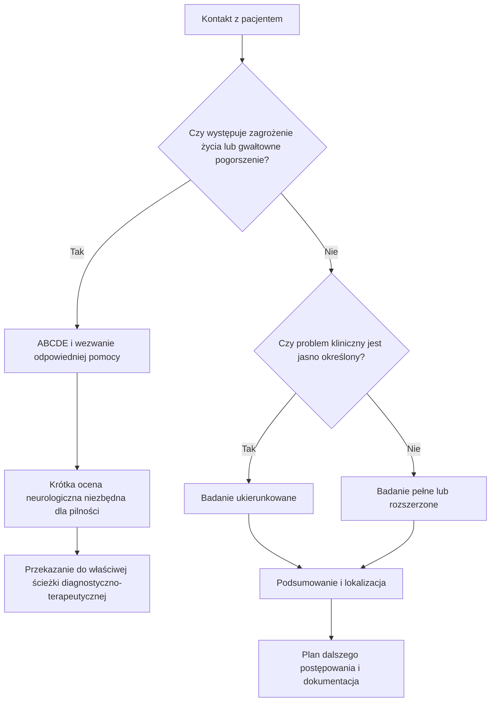
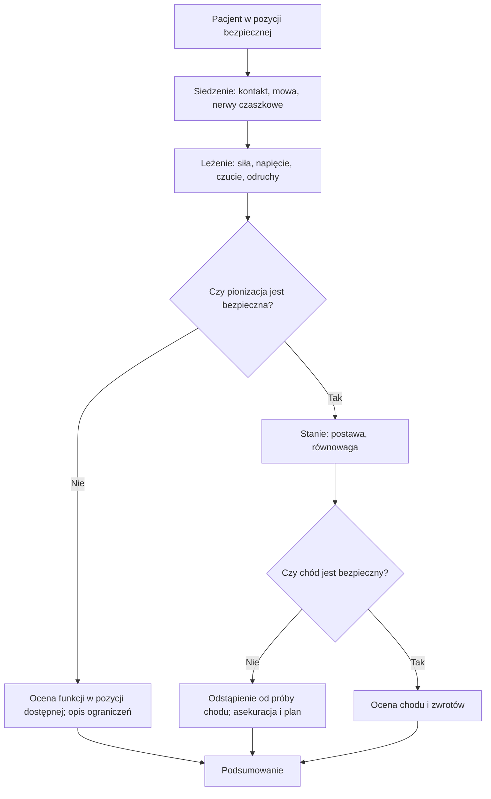
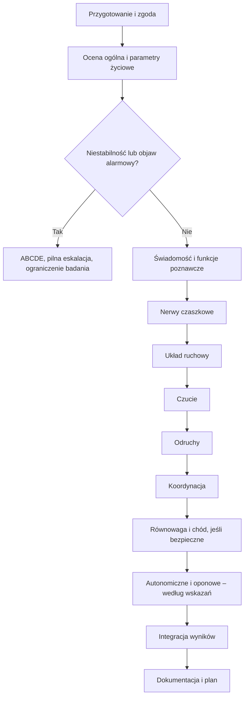

# 1.8. Schemat i kolejność badania

## Wprowadzenie

Badanie neurologiczne jest uporządkowanym procesem zbierania, weryfikowania i integrowania danych o czynności układu nerwowego. Jego wartość nie wynika z mechanicznego wykonania możliwie największej liczby prób, lecz z właściwego doboru kolejnych czynności, bezpieczeństwa pacjenta, standaryzacji techniki oraz umiejętności przełożenia obserwacji na wnioski kliniczne. Kolejność badania ma ograniczać pominięcia, ułatwiać porównywanie wyników w czasie i pozwalać rozpoznać sytuację, w której dalsze badanie rutynowe powinno ustąpić miejsca pilnemu postępowaniu.

Niniejszy rozdział przedstawia praktyczny schemat badania osoby dorosłej, z uwzględnieniem pacjenta geriatrycznego. Obejmuje ocenę ogólną i parametrów życiowych, świadomości i funkcji poznawczych, nerwów czaszkowych, układu ruchowego, czucia, odruchów, koordynacji, równowagi i chodu, a także wybranych funkcji autonomicznych i objawów oponowych. Omawia również badanie skrócone, ukierunkowane i pełne, podsumowanie lokalizacyjne oraz sposób dokumentowania.

Schemat jest ramą, a nie niezmiennym rytuałem. U pacjenta niestabilnego pierwszeństwo ma ocena i zabezpieczenie funkcji życiowych według zasad ABCDE. W podejrzeniu udaru nie wolno opóźniać uruchomienia właściwej ścieżki pomocy przez wykonywanie pełnego badania. U pacjenta stabilnego można przeprowadzić badanie systematycznie, dostosowując kolejność do objawów, możliwości współpracy i ryzyka związanego z poszczególnymi próbami.

**Zakres kompetencji:** dobór i wykonywanie czynności, interpretacja wyników, zlecanie badań i podejmowanie decyzji terapeutycznych zależą od kwalifikacji zawodowych, uprawnień, stanu pacjenta oraz lokalnych procedur. Materiał ma charakter dydaktyczny i nie zastępuje aktualnych wytycznych ani decyzji osoby odpowiedzialnej za leczenie.

---

## 1. Cele kształcenia i efekty uczenia się

### 1.1. Cel ogólny

Celem rozdziału jest przygotowanie uczestnika do przeprowadzenia uporządkowanego badania neurologicznego, którego kolejność jest uzasadniona klinicznie, bezpieczna i możliwa do odtworzenia przez innego członka zespołu.

### 1.2. Szczegółowe efekty uczenia się

Po ukończeniu rozdziału uczestnik powinien umieć:

1. odróżnić ocenę stanu nagłego od planowego badania neurologicznego;
2. zastosować schemat ABCDE u pacjenta niestabilnego w granicach swoich kompetencji;
3. wskazać, które elementy badania należy wykonać natychmiast, a które można odroczyć;
4. przeprowadzić uporządkowaną ocenę świadomości, orientacji, uwagi, mowy i funkcji poznawczych;
5. zaplanować badanie nerwów czaszkowych;
6. ocenić układ ruchowy, siłę, napięcie i trofikę mięśni;
7. dobrać odpowiednie modalności badania czucia;
8. zbadać odruchy i prawidłowo opisać ich symetrię oraz nasilenie;
9. przeprowadzić próby koordynacyjne, równowagi i chodu z uwzględnieniem asekuracji;
10. rozpoznać wskazania do oceny funkcji autonomicznych i objawów oponowych;
11. wybrać badanie skrócone, ukierunkowane albo pełne;
12. zintegrować wyniki w opis zespołu i prawdopodobnej lokalizacji;
13. rozpoznać czerwone flagi wymagające natychmiastowej eskalacji;
14. udokumentować wyniki w sposób zwięzły, jednoznaczny i porównywalny.

### 1.3. Kompetencje praktyczne

Uczestnik powinien umieć wyjaśnić pacjentowi cel i przebieg prób, uzyskać zgodę, ocenić ryzyko upadku, przerwać czynność w razie pogorszenia oraz przekazać istotne informacje w uporządkowany sposób. W przypadku braku możliwości bezpiecznego wykonania próby powinien opisać ograniczenie zamiast wymuszać jej przeprowadzenie.

### 1.4. Kryterium jakości

Dobre badanie odpowiada na określone pytanie kliniczne, obejmuje istotne dla niego funkcje, jest wykonane w porównywalnych warunkach, a jego wynik pozwala odtworzyć zarówno obserwację, jak i sposób jej uzyskania. Nie należy utożsamiać kompletności z jakością: nadmiernie rozbudowane badanie może być niecelowe, męczące, niebezpieczne i opóźniać pilne postępowanie.

---

## 2. Zasady nadrzędne organizujące kolejność badania

### 2.1. Bezpieczeństwo przed kompletnością

Pierwszym pytaniem nie jest „od którego nerwu zacząć?”, lecz „czy pacjent jest stabilny i czy można bezpiecznie kontynuować badanie?”. Zaburzenia drożności dróg oddechowych, niewydolność oddechowa, wstrząs, aktywne drgawki, gwałtowne pogorszenie świadomości lub podejrzenie ostrego udaru wymagają odpowiedniego pilnego postępowania. W takich sytuacjach badanie neurologiczne jest ograniczane do elementów, które wspierają rozpoznanie i monitorowanie, nie opóźniając pomocy.

### 2.2. Najpierw obserwacja, następnie próby

Wiele informacji można uzyskać jeszcze przed rozpoczęciem formalnych testów: z wyglądu pacjenta, spontanicznej aktywności, kontaktu, sposobu mówienia, ustawienia kończyn, mimiki, ruchów gałek ocznych, sposobu wstawania i chodu. Obserwacja powinna być opisana bez przedwczesnego przypisywania jej przyczyny.

### 2.3. Od funkcji globalnych do szczegółowych

W badaniu planowym praktyczna kolejność prowadzi zwykle od oceny ogólnej i świadomości, przez funkcje poznawcze i nerwy czaszkowe, do układu ruchowego, czucia i odruchów, a następnie koordynacji, równowagi i chodu. Wybrane próby autonomiczne i objawy oponowe wykonuje się według wskazań. Kolejność może być modyfikowana, jeżeli wymaga tego stan pacjenta lub pytanie kliniczne.

### 2.4. Porównanie stron i badanie wzorca

W miarę możliwości należy porównywać strony ciała, obszary proksymalne i dystalne oraz funkcje zależne od różnych poziomów układu nerwowego. Samo stwierdzenie „osłabienie” jest niewystarczające bez wskazania, które ruchy są zaburzone, po której stronie, w jakim stopniu i w jakich warunkach.

### 2.5. Powtarzalność i kontrola warunków

Wynik może zależeć od bólu, zmęczenia, temperatury, leków, poziomu uwagi, rozumienia poleceń, słuchu, wzroku, pozycji ciała i sposobu badania. Należy utrzymywać możliwie stałe warunki, zwłaszcza podczas monitorowania zmian.

### 2.6. Zasada minimalnego niezbędnego obciążenia

Należy wykonywać tylko te próby, które są potrzebne i bezpieczne. U pacjenta z silnym bólem, niestabilnością, świeżym urazem, zaburzeniami świadomości lub dużym ryzykiem upadku część badania może wymagać modyfikacji albo odroczenia.

### 2.7. Jawne oznaczanie ograniczeń

Jeżeli element badania jest niewykonalny, niewiarygodny albo nie został przeprowadzony, należy odnotować przyczynę. „Nie zbadano z powodu bólu” nie oznacza wyniku prawidłowego. Nie wolno uzupełniać brakujących danych domysłem.

---

## 3. Dwa podstawowe tryby postępowania: nagły i planowy

### 3.1. Tryb nagły

W trybie nagłym najważniejsze są: szybkie rozpoznanie zagrożenia życia, ocena funkcji życiowych, określenie czasu początku objawów, wykrycie istotnego deficytu ogniskowego i uruchomienie właściwej ścieżki pomocy. Nie wykonuje się rutynowo pełnego badania od początku do końca, jeżeli mogłoby to opóźnić diagnostykę lub leczenie.

### 3.2. Tryb planowy

U pacjenta stabilnego badanie może przebiegać w uporządkowanej sekwencji. Zakres zależy od problemu klinicznego, wcześniejszych rozpoznań, wieku, funkcjonowania i wyników poprzednich badań. Pełne badanie jest szczególnie przydatne przy niejasnych, wieloogniskowych, postępujących lub wieloukładowych objawach.

### 3.3. Tryb ukierunkowany

Badanie ukierunkowane jest celowo zawężone do określonego problemu, np. podejrzenia radikulopatii, neuropatii nerwu obwodowego, zespołu móżdżkowego lub zaburzeń nerwów czaszkowych. Powinno jednak obejmować krótką ocenę bezpieczeństwa i poszukiwanie objawów, które mogłyby wskazywać na inną, pilniejszą lokalizację.

### 3.4. Schemat wyboru trybu

---

## 4. Ogólny schemat pełnego badania neurologicznego

### 4.1. Kolejność orientacyjna

Poniższa tabela przedstawia praktyczny porządek badania planowego. Nie jest to nakaz wykonywania każdego elementu u każdej osoby.

| Etap | Zakres | Główne pytanie kliniczne |
|---|---|---|
| 0 | Dokumentacja, cel, zgoda, przygotowanie | Co należy zbadać i czy można to zrobić bezpiecznie? |
| 1 | Obserwacja ogólna i parametry życiowe | Czy pacjent jest stabilny? |
| 2 | Świadomość i reaktywność | Jaki jest poziom przytomności i odpowiedzi? |
| 3 | Funkcje poznawcze i język | Czy zaburzone są uwaga, pamięć, orientacja lub komunikacja? |
| 4 | Nerwy czaszkowe | Czy występuje wzorzec uszkodzenia struktur mózgowia lub nerwów czaszkowych? |
| 5 | Układ ruchowy | Czy występują niedowład, zaburzenia napięcia, trofiki lub ruchy mimowolne? |
| 6 | Czucie | Jaka modalność i jaki obszar czucia są zaburzone? |
| 7 | Odruchy | Czy występuje asymetria lub wzorzec uszkodzenia drogi odruchowej? |
| 8 | Koordynacja | Czy ruch jest precyzyjny, płynny i właściwie skalibrowany? |
| 9 | Równowaga i chód | Czy pacjent bezpiecznie utrzymuje postawę i przemieszcza się? |
| 10 | Funkcje autonomiczne i objawy oponowe | Czy są wskazania do oceny tych układów? |
| 11 | Integracja i podsumowanie | Jaki zespół i lokalizacja najlepiej wyjaśniają wyniki? |
| 12 | Plan i dokumentacja | Co należy zrobić dalej i co przekazać zespołowi? |

### 4.2. Kolejność zależna od pozycji pacjenta

W praktyce można wykorzystać naturalne zmiany pozycji:

- **Pacjent siedzący:** świadomość, mowa, większość nerwów czaszkowych, oglądanie kończyn, siła kończyn górnych, czucie i część prób koordynacyjnych.
- **Pacjent leżący:** ocena siły i napięcia, odruchy, czucie, próby kończyn dolnych, wybrane próby nerwów czaszkowych oraz badanie wymagające pozycji leżącej.
- **Pacjent stojący:** postawa, równowaga i chód, wyłącznie jeśli jest to bezpieczne.

Nie należy zmieniać pozycji pacjenta tylko po to, aby zachować sztywny schemat. Jeżeli transfer wiąże się z ryzykiem, badanie należy wykonać w pozycji dostępnej, opisać ograniczenie i rozważyć odpowiednie wsparcie.

### 4.3. Schemat pozycyjny

---

## 5. Etap 0 – weryfikacja, przygotowanie i określenie pytania klinicznego

### 5.1. Identyfikacja i cel

Przed rozpoczęciem należy potwierdzić tożsamość zgodnie z procedurą placówki, określić wskazanie, sprawdzić dostępne informacje i ustalić, czy badanie jest pierwszorazowe, kontrolne, przesiewowe czy wykonywane z powodu ostrej zmiany stanu.

### 5.2. Ustalenie osi czasu

W przypadku nowego objawu trzeba ustalić możliwie dokładny czas początku, czas ostatniego stanu bez objawów, sposób narastania i ewentualne wahania. W podejrzeniu udaru szczególnie ważne jest ustalenie czasu, kiedy pacjent był ostatnio widziany bez nowych objawów. Nie należy zastępować tej informacji przybliżeniem bez zaznaczenia niepewności.

### 5.3. Krótka lista pytań przed badaniem

1. Jaki problem jest głównym powodem badania?
2. Czy objawy są nowe, nagłe, narastające lub nawracające?
3. Czy wystąpiły zaburzenia mowy, widzenia, siły, czucia, równowagi lub świadomości?
4. Czy doszło do urazu, napadu, gorączki lub silnego bólu głowy?
5. Czy pacjent przyjmuje leki przeciwkrzepliwe, uspokajające lub inne leki istotne dla oceny?
6. Czy istnieją ograniczenia ruchowe, ból, bariery komunikacyjne lub ryzyko upadku?
7. Jakie czynności są niezbędne, a które można pominąć?

### 5.4. Zgoda i wyjaśnienie

Należy przedstawić cel i przebieg badania w języku zrozumiałym dla pacjenta, uzyskać zgodę i poinformować o możliwości przerwania próby. Przy badaniu obszarów intymnych lub szczególnie wrażliwych trzeba dodatkowo uzasadnić potrzebę, zapewnić prywatność i postępować zgodnie z prawem oraz procedurą placówki.

---

## 6. Etap 1 – obserwacja ogólna i parametry życiowe

### 6.1. Pierwsze wrażenie kliniczne

Już podczas pierwszego kontaktu należy ocenić:

- czy pacjent jest przytomny i reaguje na otoczenie;
- czy mówi pełnymi zdaniami i czy jego mowa jest zrozumiała;
- czy oddycha swobodnie;
- czy występuje sinica, nasilona duszność, potliwość lub bladość;
- czy pozycja ciała jest wymuszona przez ból, duszność lub osłabienie;
- czy widoczna jest asymetria twarzy lub kończyn;
- czy występują drżenia, mioklonie, ruchy mimowolne lub napad;
- czy pacjent potrafi samodzielnie utrzymać pozycję.

Obserwacja nie zastępuje pomiarów. Powinna jednak szybko wskazać, czy potrzebna jest pilna pomoc.

### 6.2. Parametry życiowe

W zależności od stanu i wskazań należy rozważyć pomiar:

- ciśnienia tętniczego;
- częstości i rytmu serca;
- częstości oddechów;
- saturacji;
- temperatury;
- glikemii przyłóżkowej, zwłaszcza w ostrych zaburzeniach świadomości lub nagłych objawach neurologicznych.

Wyniki należy interpretować w kontekście stanu klinicznego, chorób współistniejących, leków i wiarygodności urządzenia. Pojedynczy pomiar nie powinien być traktowany jako pełny opis stanu pacjenta.

### 6.3. Kiedy uruchomić ABCDE?

U pacjenta z zaburzeniami świadomości, dusznością, sinicą, wstrząsem, aktywnymi drgawkami lub gwałtownym pogorszeniem należy zastosować zasady ABCDE i wezwać odpowiednią pomoc. Kolejne elementy oceny powinny być prowadzone równolegle przez członków zespołu, jeżeli są dostępni.

### 6.4. Znaczenie glikemii

Hipoglikemia może naśladować udar, powodować splątanie, zaburzenia zachowania, drgawki i utratę przytomności. W nagłych objawach neurologicznych należy ją uwzględnić i sprawdzić zgodnie z lokalnym protokołem. Stwierdzenie hipoglikemii nie zwalnia z ponownej oceny, jeśli deficyt ogniskowy utrzymuje się po wyrównaniu glikemii.

### 6.5. Dokumentowanie etapu ogólnego

Należy zapisać czas pomiaru, pozycję pacjenta, wartości parametrów, objawy towarzyszące oraz podjęte działania. Warto odnotować, czy pacjent był w spoczynku, po wysiłku, po zmianie pozycji lub po przyjęciu leków.

---

## 7. Etap 2 – ocena świadomości i reaktywności

### 7.1. Co oceniamy?

Ocena obejmuje czuwanie, otwieranie oczu, reakcję na głos, wykonywanie poleceń, odpowiedź słowną i ruchową, a także zdolność do utrzymania kontaktu. Trzeba odróżnić zaburzenia poziomu świadomości od afazji, niedosłuchu, zaburzeń ruchowych, intubacji, sedacji i barier językowych.

### 7.2. Szybka ocena AVPU

W warunkach pilnych można zastosować prostą skalę AVPU:

| Litera | Znaczenie | Interpretacja |
|---|---|---|
| A | Alert | Pacjent przytomny, reagujący spontanicznie |
| V | Voice | Reaguje na głos |
| P | Pain | Reaguje dopiero na bodziec bólowy lub uciskowy |
| U | Unresponsive | Brak obserwowalnej reakcji |

AVPU jest narzędziem szybkiej orientacji, nie zastępuje szczegółowej oceny neurologicznej ani Glasgow Coma Scale. Bodźce powinny być stosowane zgodnie ze szkoleniem i procedurą, z unikaniem niepotrzebnego urazu.

### 7.3. Glasgow Coma Scale

GCS ocenia trzy składowe: reakcję otwierania oczu (E), odpowiedź słowną (V) i odpowiedź ruchową (M). Każdą składową należy ocenić i zapisać oddzielnie, np. E3 V4 M6. Suma wynosi od 3 do 15, ale sam wynik łączny nie pokazuje, która funkcja jest zaburzona.

| Składowa | Zakres | Przykładowe kategorie |
|---|---:|---|
| Oczy (E) | 1–4 | brak, na ucisk, na głos, spontanicznie |
| Słowa (V) | 1–5 | brak, dźwięki, słowa, splątanie, orientacja |
| Ruch (M) | 1–6 | brak, wyprost, nieprawidłowe zgięcie, cofanie, lokalizacja, wykonywanie poleceń |

Jeżeli elementu nie można ocenić, należy oznaczyć go jako niemożliwy do zbadania i podać przyczynę, np. intubację, obrzęk powiek lub barierę językową. Nie należy przypisywać wartości 1 elementowi, którego ocena jest niewykonalna, ani obliczać pozornie wiarygodnej sumy, jeżeli składowa jest nieocenialna.

### 7.4. Ocena źrenic i reakcji

W zależności od sytuacji ocenia się wielkość, symetrię i reakcję źrenic na światło. Nowa anizokoria, zwłaszcza z pogorszeniem świadomości, silnym bólem głowy lub objawami ogniskowymi, wymaga pilnej oceny. Trzeba uwzględnić wcześniejsze różnice źrenic, urazy oka, leki i zabiegi okulistyczne.

### 7.5. Monitorowanie w czasie

Wynik powinien być porównywany z poprzednim, a zmiana w poziomie reaktywności traktowana jako istotna klinicznie. Należy zapisywać godzinę, składowe skali, rodzaj bodźca i czynniki utrudniające ocenę.

---

## 8. Etap 3 – funkcje poznawcze, język i zachowanie

### 8.1. Orientacja i kontakt

Ocenia się orientację co do własnej osoby, miejsca, czasu i sytuacji. Pytania powinny być dostosowane do wieku, języka i warunków kulturowych. Nie należy interpretować pojedynczej błędnej odpowiedzi bez uwzględnienia słuchu, wzroku, wykształcenia, stresu, bólu i wcześniejszego poziomu funkcjonowania.

### 8.2. Uwaga i wykonywanie poleceń

Można zastosować krótkie polecenia jedno- i wieloetapowe, powtarzanie cyfr, miesiące od tyłu lub inne standaryzowane próby, jeżeli są odpowiednie dla pacjenta. Niepowodzenie może wynikać z afazji, niedosłuchu, zaburzeń uwagi, sedacji lub niezrozumienia instrukcji.

### 8.3. Pamięć

W zależności od wskazania ocenia się zapamiętywanie, odtwarzanie po odroczeniu i pamięć odległą. Krótkie badanie przyłóżkowe nie jest równoznaczne z pełną oceną neuropsychologiczną. Wynik należy interpretować z uwzględnieniem wykształcenia, języka i stanu emocjonalnego.

### 8.4. Mowa i język

Należy rozdzielić:

- **płynność wypowiedzi** – tempo, długość i organizację wypowiedzi;
- **rozumienie** – wykonywanie poleceń i rozumienie pytań;
- **nazywanie** – zdolność wskazania nazwy przedmiotu lub czynności;
- **powtarzanie** – odtwarzanie słów i zdań;
- **czytanie i pisanie** – jeśli stan pacjenta pozwala;
- **artykulację** – precyzję realizacji dźwięków mowy.

Afazja dotyczy języka, a dyzartria wykonania ruchowego mowy. Nie należy utożsamiać ich z zaburzeniem świadomości.

### 8.5. Zachowanie i nastrój

Obserwuje się pobudzenie, spowolnienie, apatię, lęk, chwiejność emocjonalną, nieadekwatność reakcji i zachowania sugerujące majaczenie. Nagła zmiana zachowania, szczególnie u osoby starszej, może być objawem ostrego stanu somatycznego lub neurologicznego.

### 8.6. Narzędzia przesiewowe

MMSE, MoCA, 4AT i inne narzędzia mają określone populacje, warunki stosowania i ograniczenia. Nie wolno stosować ich zamiennie ani traktować wyniku jako samodzielnego rozpoznania. Dobór testu powinien uwzględniać kompetencje osoby badającej, walidację językową i lokalne standardy.

---

## 9. Etap 4 – badanie nerwów czaszkowych

### 9.1. Zasada organizacji

Badanie nerwów czaszkowych najlepiej prowadzić w stałej kolejności, od I do XII, z możliwością łączenia prób, które oceniają wspólną funkcję. Nie każdy nerw wymaga pełnego badania u każdego pacjenta; zakres powinien wynikać z objawów i celu badania.

### 9.2. Nerw I – węchowy

Wywiad dotyczący utraty lub zniekształcenia węchu, a następnie – gdy istnieją wskazania – badanie rozpoznawania znanych, nie drażniących zapachów osobno dla każdego nozdrza. Należy unikać amoniaku i substancji drażniących, które pobudzają inne drogi czuciowe.

### 9.3. Nerw II – wzrokowy

Ocenia się ostrość wzroku każdego oka osobno, pola widzenia metodą konfrontacyjną, reakcje źrenic z uwzględnieniem drogi dośrodkowej oraz – jeśli są wskazania i kompetencje – dno oka. Nagła utrata widzenia, ubytek pola widzenia lub zaburzenia widzenia z innymi objawami ogniskowymi wymagają pilnej oceny.

### 9.4. Nerwy III, IV i VI – ruchy gałek ocznych

Obserwuje się ustawienie oczu, symetrię ruchów, zakres spojrzenia, diplopię, opadanie powieki, wielkość źrenic i oczopląs. Ruchy oczu bada się systematycznie, bez wymuszania skrajnych pozycji. Nowe podwójne widzenie, opadnięcie powieki z poszerzoną źrenicą lub nagłe zaburzenie ruchomości oka wymaga pilnej oceny.

### 9.5. Nerw V – trójdzielny

Ocenia się czucie w obszarach V1, V2 i V3 oraz funkcję mięśni żucia. Odruch rogówkowy wykonuje się tylko wtedy, gdy istnieje wskazanie, osoba badająca ma odpowiednie przeszkolenie, a próba jest bezpieczna. Nie należy dotykać rogówki nieprzygotowanym narzędziem.

### 9.6. Nerw VII – twarzowy

Ocenia się symetrię twarzy w spoczynku i podczas unoszenia brwi, zamykania oczu, uśmiechu, pokazywania zębów i nadymania policzków. Trzeba odróżnić osłabienie dolnej części twarzy od pełnego porażenia połowiczego, uwzględniając zmienność indywidualną i wcześniejsze uszkodzenia.

### 9.7. Nerw VIII – przedsionkowo-ślimakowy

Ocenia się słuch prostymi próbami przesiewowymi, a w razie wskazań próbami stroikowymi. Objawy przedsionkowe wymagają oceny charakteru zawrotów, oczopląsu, chodu, koordynacji i objawów ogniskowych. Próby specjalistyczne, takie jak HINTS, powinny być wykonywane wyłącznie u właściwie dobranych pacjentów przez osoby przeszkolone.

### 9.8. Nerwy IX i X – językowo-gardłowy i błędny

Ocenia się głos, fonację, symetrię podniebienia, połykanie i zgłaszane krztuszenie. Odruch gardłowy ma ograniczoną wartość jako samodzielny test; jego brak u zdrowej osoby nie musi oznaczać patologii. W razie podejrzenia dysfagii nie należy podawać wody ani pokarmu bez odpowiedniej oceny bezpieczeństwa połykania.

### 9.9. Nerw XI – dodatkowy

Ocenia się unoszenie barków i obracanie głowy przeciw oporowi, porównując strony i uwzględniając ból szyi, barku oraz ograniczenia ortopedyczne.

### 9.10. Nerw XII – podjęzykowy

Ocenia się ułożenie, wysuwanie i ruchy boczne języka, zanik, fascykulacje oraz odchylenie. Należy powiązać wynik z artykulacją, połykaniem i innymi objawami opuszkowymi.

### 9.11. Wnioski z badania nerwów czaszkowych

Wyniki należy rozpatrywać łącznie. Współwystępowanie objawów kilku nerwów czaszkowych po tej samej stronie może sugerować lokalizację w pniu mózgu, podstawie czaszki lub zatoce jamistej, ale rozpoznanie wymaga korelacji z anatomią i pozostałym badaniem.

---

## 10. Etap 5 – badanie układu ruchowego

### 10.1. Oglądanie

Przed badaniem siły należy obejrzeć ułożenie kończyn, symetrię mięśni, zanik, przerost, fascykulacje, drżenie, przykurcze, deformacje i ruchy mimowolne. Ocenę prowadzi się w spoczynku i podczas spontanicznej aktywności.

### 10.2. Napięcie mięśniowe

Napięcie ocenia się podczas kontrolowanego ruchu biernego, w odpowiednim zakresie i z uwzględnieniem bólu. Należy opisać, czy opór jest zwiększony, zmniejszony, zależny od szybkości ruchu lub zmienny. Spastyczność, sztywność pozapiramidowa i ograniczenie mechaniczne nie są pojęciami równoważnymi.

### 10.3. Siła mięśniowa

Siłę bada się w wybranych grupach mięśniowych, porównując strony. Można posługiwać się skalą MRC/Lovetta 0–5, ale należy pamiętać, że wynik zależy od bólu, zakresu ruchu, stabilizacji, motywacji i zrozumienia polecenia.

| Stopień | Opis funkcjonalny |
|---:|---|
| 0 | Brak widocznego lub wyczuwalnego skurczu |
| 1 | Ślad skurczu bez ruchu w stawie |
| 2 | Ruch możliwy po wyeliminowaniu grawitacji |
| 3 | Ruch przeciw grawitacji, bez dodatkowego oporu |
| 4 | Ruch przeciw grawitacji i częściowemu oporowi |
| 5 | Siła uznana za prawidłową w warunkach badania |

Stopień 4 jest szeroki i zależny od badającego; w dokumentacji warto dopisać szczegóły, np. „4/5, osłabienie zginaczy grzbietowych stopy po prawej”. Nie należy interpretować stopnia 5 jako dowodu braku choroby.

### 10.4. Próby utrzymywania kończyn

Próby utrzymywania kończyn górnych i dolnych mogą ujawnić subtelny niedowład. Należy zapewnić właściwą pozycję, wyjaśnić polecenie i obserwować opadanie, pronację, asymetrię oraz utratę utrzymania pozycji. Wynik może być zakłócony przez ból, ograniczenie stawowe, apraksję, zaburzenia czucia i nieuwagę.

### 10.5. Ruchy mimowolne

Drżenie, mioklonie, dystonia, pląsawica i tiki należy opisywać według lokalizacji, rytmu, warunków występowania, wpływu na czynność i możliwości hamowania. Jeżeli ruch występuje okresowo, przydatna może być obserwacja podczas różnych zadań lub nagranie wykonane za zgodą pacjenta zgodnie z zasadami ochrony danych.

### 10.6. Ocena zmęczliwości

W razie podejrzenia zaburzeń przewodnictwa nerwowo-mięśniowego ocenia się zmienność siły w czasie, opadanie powiek, diplopię, męczliwość mięśni opuszkowych i oddechowych. Próby prowokujące zmęczenie powinny być dobierane ostrożnie i nie mogą opóźniać pilnej oceny przy podejrzeniu niewydolności oddechowej.

---

## 11. Etap 6 – badanie czucia

### 11.1. Zasada doboru modalności

Badanie powinno obejmować te modalności, które pozwalają odpowiedzieć na pytanie o lokalizację. W podstawowej ocenie wykorzystuje się zwykle dotyk lekki, ból, temperaturę – jeżeli wskazana – wibrację i czucie ułożenia. Czucie korowe bada się w określonych sytuacjach, po upewnieniu się, że podstawowa percepcja bodźca jest zachowana.

### 11.2. Przygotowanie pacjenta

Należy wyjaśnić różnicę między bodźcami, pokazać próbę na obszarze bez objawów i poprosić o zamknięcie oczu, jeśli wymaga tego test. Bodźce podaje się w zmiennej kolejności, porównując strony i obszary. Nie wolno używać narzędzi powodujących uszkodzenie skóry.

### 11.3. Mapowanie

Wynik można opisywać według:

- dermatomów;
- obszarów unerwienia pojedynczych nerwów;
- układu dystalnego i proksymalnego;
- poziomu czuciowego na tułowiu;
- połowiczego lub skrzyżowanego rozkładu;
- wzorca skarpetkowego lub rękawiczkowego.

Granice zaburzenia mogą być nieostre. Należy zaznaczyć, czy wynik jest powtarzalny i zgodny z anatomią.

### 11.4. Czucie powierzchowne

Dotyk lekki i bodziec ostry bada się osobno, z zachowaniem higieny i bezpieczeństwa. Pacjent powinien rozróżniać bodźce, a osoba badająca unikać podpowiadania. W razie rozbieżności warto powtórzyć próbę, zmienić kolejność i sprawdzić rozumienie instrukcji.

### 11.5. Czucie głębokie

Wibrację ocenia się kamertonem, a czucie ułożenia – niewielkimi ruchami palca w górę i w dół, chwytając go po bokach. Najpierw demonstruje się próbę z otwartymi oczami, następnie wykonuje ją bez kontroli wzrokowej. W razie nieprawidłowości bada się bardziej proksymalnie.

### 11.6. Czucie korowe

Stereognozja, grafestezja, lokalizacja bodźca i wygaszanie czuciowe wymagają zachowanej podstawowej percepcji oraz współpracy. Nieprawidłowy wynik może wynikać z afazji, zaburzeń uwagi, zaniedbywania stronnego, zaburzeń poznawczych lub problemów z rozumieniem.

### 11.7. Badanie okolicy siodłowej

Ocena czucia w okolicy siodłowej jest badaniem wrażliwym i wykonuje się ją tylko przy uzasadnionym podejrzeniu określonego zespołu, np. ucisku ogona końskiego. Wymaga wyjaśnienia, zgody, poszanowania intymności i odpowiednich kompetencji. Nowe zaburzenia czucia siodłowego w połączeniu z zaburzeniami mikcji, defekacji lub osłabieniem kończyn dolnych wymagają pilnej oceny.

---

## 12. Etap 7 – badanie odruchów

### 12.1. Odruchy ścięgniste

Badanie powinno obejmować odpowiednie rozluźnienie kończyny, właściwe ułożenie, dobór miejsca uderzenia i porównanie stron. Ocenia się m.in. odruchy z kończyn górnych i dolnych, dobierając je do pytania klinicznego.

### 12.2. Skala nasilenia

Można stosować lokalną, jasno zdefiniowaną skalę, np.:

| Ocena | Opis |
|---:|---|
| 0 | Odruch niewywoływalny |
| 1+ | Odruch osłabiony |
| 2+ | Odruch typowy |
| 3+ | Odruch żywy |
| 4+ | Odruch bardzo żywy, czasem z klonusem |

Skale mogą różnić się między ośrodkami. Należy podać przyjętą konwencję i nie wyciągać wniosków z pojedynczej wartości bez porównania stron oraz kontekstu.

### 12.3. Manewry wzmacniające

Jeżeli odruch jest trudny do wywołania, można zastosować odpowiedni manewr wzmacniający, o ile pacjent rozumie polecenie i nie występują przeciwwskazania. Warto odnotować, czy odruch uzyskano spontanicznie, czy po wzmocnieniu.

### 12.4. Odruchy powierzchowne i patologiczne

W zależności od wskazań ocenia się odruchy brzuszne, podeszwowy i inne odruchy patologiczne. Odpowiedź podeszwowa powinna być opisana jako zgięciowa, prostująca lub niejednoznaczna. U osób starszych, z uszkodzeniem stopy lub po urazie interpretacja może być utrudniona.

### 12.5. Klonus

Klonus ocenia się przy podejrzeniu wzmożonej pobudliwości odruchowej. Należy opisać, czy jest nieobecny, wywoływalny, przemijający czy utrwalony. Wynik trzeba interpretować razem z napięciem, siłą i innymi objawami drogi piramidowej.

### 12.6. Wnioskowanie

Odruch osłabiony może wskazywać na zaburzenie łuku odruchowego, ale może też wynikać z wieku, techniki, rozluźnienia lub neuropatii. Odruchy wzmożone mogą występować w uszkodzeniu ośrodkowym, lecz ich znaczenie zależy od symetrii, napięcia, klonusu i objawów towarzyszących.

---

## 13. Etap 8 – ocena koordynacji

### 13.1. Warunki wstępne

Próby koordynacyjne wymagają zrozumienia polecenia, odpowiedniego zakresu ruchu i dostatecznej siły. Przed interpretacją dysmetrii trzeba uwzględnić ból, niedowład, zaburzenia czucia głębokiego, ograniczenia stawowe i zaburzenia widzenia.

### 13.2. Kończyny górne

W zależności od wskazania stosuje się próbę palec–nos, palec–palec, szybkie ruchy naprzemienne i próby sekwencyjne. Obserwuje się dokładność, rytm, płynność, drżenie zamiarowe i zdolność do korekty toru ruchu.

### 13.3. Kończyny dolne

Próba pięta–kolano i przesuwanie pięty po goleni pozwalają ocenić płynność i precyzję ruchu. Należy wykonać próbę po obu stronach, a w razie ograniczeń ruchowych opisać ich wpływ na wynik.

### 13.4. Różnicowanie nieprawidłowości

- Dysmetria i drżenie zamiarowe mogą sugerować zaburzenie móżdżkowe.
- Pogorszenie po zamknięciu oczu przy zaburzeniu czucia głębokiego może wskazywać na ataksję czuciową.
- Nieprecyzyjność spowodowana niedowładem nie powinna być automatycznie określana jako ataksja.
- Zaburzenia rozumienia polecenia mogą uniemożliwić wiarygodną ocenę.

---

## 14. Etap 9 – równowaga, postawa i chód

### 14.1. Ocena bezpieczeństwa przed pionizacją

Przed próbami stojącymi należy ocenić przytomność, zdolność do utrzymania pozycji siedzącej, siłę kończyn dolnych, zawroty głowy, ciśnienie, ryzyko omdlenia i upadku. Należy zapewnić asekurację, stabilne obuwie lub odpowiednie zabezpieczenie stóp oraz wolną przestrzeń.

### 14.2. Wstawanie i stanie

Obserwuje się sposób wstawania, potrzebę podparcia, symetrię obciążania kończyn, szerokość podstawy, ustawienie tułowia i zdolność do utrzymania pozycji. Jeżeli pacjent nie potrafi bezpiecznie wstać, nie należy powtarzać prób na siłę.

### 14.3. Próba Romberga

Próba ocenia wpływ ograniczenia kontroli wzrokowej na stabilność postawy. Wykonuje się ją wyłącznie z asekuracją i tylko wtedy, gdy pacjent potrafi bezpiecznie stać przy otwartych oczach. Znaczne pogorszenie po zamknięciu oczu może wskazywać na zaburzenie propriocepcji lub układu przedsionkowego, ale nie jest samodzielnym testem rozpoznającym przyczynę zawrotów głowy.

### 14.4. Ocena chodu

Należy obserwować:

- inicjację chodu;
- szerokość podstawy;
- długość, wysokość i symetrię kroku;
- tempo i rytm;
- ruchy kończyn górnych;
- pochylenie tułowia;
- zdolność do zatrzymania i zmiany kierunku;
- stabilność podczas zwrotów;
- potrzebę pomocy lub sprzętu.

W zależności od bezpieczeństwa można dodać chód na piętach, palcach lub w tandemie. Nie należy wykonywać tych prób, jeśli istnieje duże ryzyko upadku.

### 14.5. Testy funkcjonalne

Timed Up and Go, test 10-metrowego chodu, pięciokrotne wstawanie z krzesła i skale równowagi mogą uzupełniać ocenę. Wynik zależy od protokołu, pomocy ortopedycznych, obuwia, instrukcji i populacji odniesienia. Należy zapisać warunki testu, a nie tylko liczbę sekund.

### 14.6. Wzorce chodu

Warto opisać wzorzec, a nie jedynie użyć etykiety. Przykładowo:

- chód hemiparetyczny – asymetryczne przenoszenie kończyny i ograniczenie zgięcia;
- chód parkinsonowski – skrócenie kroku, zmniejszenie ruchów kończyn górnych, trudności inicjacji i zwrotu;
- chód ataktyczny – poszerzona podstawa i nieregularność kroków;
- chód brodzący – unoszenie kończyny z powodu opadania stopy;
- chód apraktyczny – trudności inicjacji i organizacji sekwencji kroków;
- chód antalgiczny – skrócenie fazy obciążania z powodu bólu.

Wzorce mogą się nakładać, szczególnie u pacjentów geriatrycznych.

---

## 15. Etap 10 – ocena funkcji autonomicznych i objawów oponowych

### 15.1. Kiedy oceniać układ autonomiczny?

Ocena jest wskazana przy omdleniach, zawrotach przy pionizacji, zaburzeniach potliwości, termoregulacji, mikcji, defekacji, funkcji seksualnych lub podejrzeniu neuropatii autonomicznej. Wywiad powinien poprzedzać badanie, a zakres czynności zależy od kompetencji i wskazań.

### 15.2. Pomiar ortostatyczny

Jeżeli stan pacjenta pozwala na bezpieczne wstawanie, można zastosować standaryzowany pomiar ciśnienia i tętna:

1. zapewnić odpoczynek w pozycji leżącej przez co najmniej 5 minut;
2. zmierzyć ciśnienie i częstość serca w pozycji leżącej;
3. pomóc pacjentowi wstać, z asekuracją;
4. powtórzyć pomiar po 1 i 3 minutach stania;
5. zapisać objawy, wartości i czas pomiaru.

Za klasyczne kryterium niedociśnienia ortostatycznego przyjmuje się utrzymujący się spadek ciśnienia skurczowego o co najmniej 20 mmHg lub rozkurczowego o co najmniej 10 mmHg w ciągu 3 minut od pionizacji. Interpretacja wymaga uwzględnienia wartości wyjściowych, leków, nawodnienia, rytmu serca i chorób współistniejących. U pacjenta z ryzykiem upadku, omdleniem lub niestabilnością próby nie wolno wykonywać bez odpowiedniej asekuracji; może być konieczne jej odroczenie.

### 15.3. Funkcje pęcherza i jelit

Należy pytać o zatrzymanie moczu, nietrzymanie, zmianę czucia parcia, zaparcia, nietrzymanie stolca i zaburzenia funkcji seksualnych. Nowe zaburzenia zwieraczy, szczególnie z bólem kręgosłupa, osłabieniem kończyn dolnych lub zaburzeniami czucia siodłowego, wymagają pilnej oceny w kierunku ucisku struktur nerwowych.

### 15.4. Objawy oponowe

Przy podejrzeniu zapalenia opon mózgowo-rdzeniowych lub krwawienia podpajęczynówkowego ocenia się objawy w kontekście gorączki, bólu głowy, światłowstrętu, wymiotów, zaburzeń świadomości i innych cech klinicznych. Sztywność karku, objaw Kerniga i Brudzińskiego mogą wspierać ocenę, ale ich brak nie wyklucza zapalenia opon. Próby należy wykonywać ostrożnie, bez gwałtownego ruchu i bez forsowania szyi, zwłaszcza po urazie lub przy podejrzeniu niestabilności kręgosłupa szyjnego.

### 15.5. Zasada ograniczonej wartości pojedynczego objawu

Żaden pojedynczy objaw oponowy nie może być traktowany jako test wykluczający ciężkie zakażenie. Przy istotnym podejrzeniu konieczna jest pilna ocena lekarska i diagnostyka zgodna z aktualnym protokołem, bez opóźniania postępowania z powodu nieobecności klasycznych objawów.

---

## 16. Badanie skrócone – kiedy i jak je wykonać?

### 16.1. Wskazania

Badanie skrócone jest przydatne w przesiewowej ocenie, monitorowaniu pacjenta, kontroli po interwencji lub podczas przekazywania informacji. Nie zastępuje pełnego badania, jeśli objawy są złożone, niejasne, postępujące lub wskazują na wielopoziomowe uszkodzenie.

### 16.2. Minimalny zakres

W zależności od sytuacji można uwzględnić:

1. poziom świadomości i kontakt;
2. mowę i rozumienie prostego polecenia;
3. symetrię twarzy;
4. utrzymywanie kończyn górnych i dolnych;
5. orientacyjną ocenę siły po obu stronach;
6. porównanie czucia w wybranych obszarach;
7. źrenice i ruchy oczu, jeśli są istotne;
8. koordynację i chód, jeśli bezpieczne;
9. parametry życiowe i glikemię, jeżeli wskazane.

Zakres powinien być jawnie opisany. Nie należy zapisywać „badanie neurologiczne prawidłowe”, jeśli wykonano tylko kilka elementów przesiewowych.

### 16.3. Przykład skróconego badania przy podejrzeniu udaru

Wstępna ocena może obejmować narzędzie przesiewowe FAST lub inne zwalidowane narzędzie właściwe dla danego systemu, ocenę czasu ostatniego stanu bez objawów, glikemię, parametry życiowe i podstawowe elementy badania ogniskowego. NIHSS wykonuje osoba przeszkolona, zgodnie z instrukcją, w ramach odpowiedniej ścieżki. Wynik skali nie powinien opóźniać wezwania pomocy ani być utożsamiany z pełnym rozpoznaniem.

### 16.4. Przykład skróconego monitorowania

W oddziale lub podczas rehabilitacji można powtarzać wybrane elementy, np. poziom świadomości, źrenice, mowę, siłę kończyn, czucie i parametry życiowe. Trzeba zachować ten sam sposób badania i zapisywać godzinę, pozycję oraz różnice względem poprzedniego pomiaru.

---

## 17. Badanie ukierunkowane – dobór kolejności do hipotezy

### 17.1. Podejrzenie udaru lub TIA

Priorytetem jest rozpoznanie nagłego deficytu, ustalenie czasu początku lub ostatniego stanu bez objawów, sprawdzenie glikemii, ocena podstawowych funkcji życiowych i pilne uruchomienie ścieżki udarowej. Należy zbadać twarz, mowę, siłę, czucie, pola widzenia, ruchy oczu, koordynację i chód, o ile nie opóźnia to diagnostyki i jest bezpieczne. Objawy krążenia tylnego mogą nie być dobrze uchwycone przez proste skale przesiewowe.

### 17.2. Podejrzenie radikulopatii

Kolejność może obejmować: wywiad bólu i promieniowania, ocenę postawy i ruchomości, siłę w miotomach, czucie w dermatomach, odruchy odpowiadające segmentom oraz wybrane próby napięciowe, jeżeli są wskazane i bezpieczne. Należy poszukiwać objawów alarmowych, w tym zaburzeń zwieraczy, czucia siodłowego i szybko narastającego niedowładu.

### 17.3. Podejrzenie polineuropatii

Ważne są: rozkład objawów dystalnych, siła mięśni stóp i dłoni, odruchy skokowe i kolanowe, czucie dotyku, bólu i wibracji, propriocepcja, trofika oraz chód. Wzorzec skarpetkowo-rękawiczkowy może wspierać hipotezę, ale nie określa samodzielnie etiologii.

### 17.4. Podejrzenie zespołu móżdżkowego

Należy ocenić mowę, oczopląs, ruchy gałek ocznych, koordynację kończyn, dysmetrię, szybkie ruchy naprzemienne, postawę, chód i zdolność do wykonywania zwrotów. Nagły początek ataksji, zwłaszcza z zawrotami, podwójnym widzeniem, zaburzeniami mowy lub nowym bólem głowy, wymaga pilnego wykluczenia przyczyny ośrodkowej.

### 17.5. Podejrzenie parkinsonizmu

Ocenia się bradykinezję, amplitudę i szybkość ruchów powtarzalnych, sztywność, drżenie spoczynkowe, postawę, chód, zwroty i automatyzmy ruchowe. Warto obserwować zmniejszanie amplitudy podczas kolejnych powtórzeń. Wynik należy interpretować w kontekście leków i innych chorób.

### 17.6. Podejrzenie zaburzeń nerwowo-mięśniowych

Należy zwrócić uwagę na siłę proksymalną i dystalną, męczliwość, opadanie powiek, diplopię, mowę, połykanie, kaszel i oddychanie. Objawy opuszkowe, osłabienie kaszlu, duszność, ortopnoe lub szybko narastające osłabienie wymagają pilnej oceny. Nie należy wykonywać długich, męczących prób, jeżeli mogą pogorszyć stan pacjenta.

### 17.7. Podejrzenie zaburzeń poznawczych

Najpierw należy wykluczyć majaczenie i ostre przyczyny somatyczne. Następnie ocenia się orientację, uwagę, pamięć, język, funkcje wykonawcze, zachowanie i wpływ objawów na codzienne funkcjonowanie. Informacje od bliskich mogą być niezbędne do ustalenia zmian względem wcześniejszego poziomu.

---

## 18. Badanie pełne – propozycja protokołu krok po kroku

### 18.1. Przed badaniem

- potwierdź tożsamość;
- ustal wskazanie i pytanie kliniczne;
- przejrzyj dokumentację, leki i wcześniejsze wyniki;
- zapytaj o objawy alarmowe i czas ich początku;
- oceń bezpieczeństwo, ból, mobilność i ryzyko upadku;
- wyjaśnij przebieg i uzyskaj zgodę;
- przygotuj sprzęt i warunki badania.

### 18.2. W trakcie badania

1. Obserwuj stan ogólny i zachowanie.
2. Zmierz parametry życiowe zgodnie ze wskazaniem.
3. Oceń świadomość i reaktywność.
4. Zbadaj orientację, uwagę, pamięć i język w zakresie odpowiednim do celu.
5. Oceń nerwy czaszkowe.
6. Obejrzyj mięśnie i kończyny.
7. Oceń napięcie i siłę mięśniową.
8. Zbadaj czucie powierzchowne i głębokie.
9. Zbadaj odruchy ścięgniste, powierzchowne i patologiczne według wskazań.
10. Wykonaj próby koordynacyjne.
11. Oceń postawę, równowagę i chód, jeśli jest bezpieczny.
12. Zbadaj funkcje autonomiczne i objawy oponowe, jeśli istnieją wskazania.

### 18.3. Po badaniu

- oceń, czy stan pacjenta nie uległ zmianie;
- zabezpiecz pacjenta i przywróć wygodną pozycję;
- omów najważniejsze wyniki w zrozumiały sposób, w granicach kompetencji;
- przekaż pilne nieprawidłowości odpowiedniej osobie;
- sporządź dokumentację;
- ustal dalsze kroki zgodnie z rolą zawodową i planem opieki.

### 18.4. Algorytm pełnego badania

---

## 19. Czerwone flagi – kiedy przerwać rutynowe badanie?

### 19.1. Nagły deficyt ogniskowy

Nagłe osłabienie twarzy lub kończyny, zaburzenia mowy, widzenia, czucia, koordynacji albo nagła utrata równowagi mogą wskazywać na udar lub TIA. Należy uruchomić pilną ścieżkę pomocy, ustalić czas ostatniego stanu bez objawów i nie opóźniać transportu ani obrazowania przez pełne badanie planowe.

### 19.2. Nagły bardzo silny ból głowy

Ból osiągający maksymalne nasilenie w krótkim czasie, szczególnie z wymiotami, sztywnością karku, utratą przytomności lub objawami ogniskowymi, wymaga pilnej oceny przyczyn wtórnych, w tym krwawienia podpajęczynówkowego.

### 19.3. Gorączka i zaburzenia neurologiczne

Gorączka z bólem głowy, sztywnością karku, światłowstrętem, zaburzeniami świadomości, wysypką lub drgawkami wymaga pilnej oceny w kierunku zakażenia ośrodkowego układu nerwowego. Brak klasycznej sztywności karku nie wyklucza zapalenia opon.

### 19.4. Zaburzenia świadomości i napady

Nowa utrata przytomności, przedłużający się napad, powtarzające się napady bez odzyskania świadomości, niepełny powrót do stanu wyjściowego lub pogarszająca się reaktywność wymagają pilnego postępowania.

### 19.5. Postępujące osłabienie i niewydolność oddechowa

Szybko narastające osłabienie, dysfagia, dyzartria, osłabiony kaszel, duszność, ortopnoe lub trudności w utrzymaniu głowy mogą wskazywać na zagrożenie funkcji opuszkowych i oddechowych. Nie należy czekać na pełne badanie siły wszystkich mięśni.

### 19.6. Zespół ogona końskiego lub ucisk rdzenia

Nowe zaburzenia mikcji lub defekacji, zatrzymanie moczu, znieczulenie siodłowe, obustronne objawy korzeniowe, narastający niedowład lub poziom czuciowy wymagają pilnej oceny. Nie wolno uspokajać pacjenta wyłącznie na podstawie braku jednego objawu.

### 19.7. Nagłe zaburzenia widzenia lub równowagi

Nagła utrata widzenia, diplopia, pionowy lub zmieniający kierunek oczopląs, ciężka ataksja tułowia albo niemożność samodzielnego stania mogą wskazywać na przyczynę ośrodkową i wymagają pilnej oceny.

### 19.8. Zasada eskalacji

W razie czerwonej flagi należy:
1. przerwać próbę, która może zwiększać ryzyko;
2. zabezpieczyć pacjenta;
3. wezwać odpowiednią pomoc zgodnie z procedurą;
4. przekazać czas początku objawów i kluczowe wyniki;
5. udokumentować zmianę i działania;
6. nie opóźniać diagnostyki pilnej przez kontynuowanie planowego protokołu.

---

## 20. Interpretacja wyników i lokalizacja neurologiczna

### 20.1. Trzy poziomy wnioskowania

Po badaniu należy rozdzielić:

- **opis objawów i oznak** – co dokładnie stwierdzono;
- **lokalizację** – na jakim poziomie układu nerwowego wyniki mogą powstawać;
- **etiologię** – jaka choroba lub mechanizm może odpowiadać za lokalizację i przebieg.

Nie należy przechodzić bezpośrednio od pojedynczego objawu do pewnego rozpoznania etiologicznego.

### 20.2. Wzorce lokalizacyjne

| Wzorzec | Możliwy poziom | Dane wspierające |
|---|---|---|
| Niedowład połowiczy z objawami korowymi | Półkula mózgu | Afazja, zaniedbywanie, ubytek pola widzenia, napad |
| Objawy skrzyżowane | Pień mózgu | Objawy nerwu czaszkowego po jednej stronie i kończyn po przeciwnej |
| Poziom czuciowy, obustronne objawy | Rdzeń kręgowy | Zaburzenia poniżej poziomu, objawy piramidowe, zwieracze |
| Rozkład dermatomalny | Korzeń nerwowy | Ból promieniujący, osłabienie miotomalne, zmiana odruchu |
| Rozkład w zakresie nerwu | Nerw obwodowy | Ubytek czucia i siły zgodny z unerwieniem konkretnego nerwu |
| Symetryczny wzorzec dystalny | Nerwy obwodowe | Zaburzenia czucia i odruchów dystalnie |
| Dysmetria i ataksja | Móżdżek lub jego połączenia | Zaburzenia koordynacji, oczopląs, dyzartria |
| Zaburzenia uwagi i świadomości | Sieci rozlane, pień, metabolizm lub toksyny | Fluktuacje, zaburzenia reaktywności, objawy ogólne |

Tabela jest pomocą dydaktyczną. Żaden wzorzec nie zastępuje pełnej korelacji klinicznej.

### 20.3. Zgodność anatomiczna

Należy sprawdzić, czy siła, czucie, odruchy, napięcie, nerwy czaszkowe i funkcje poznawcze dają się wyjaśnić jednym poziomem uszkodzenia. Jeżeli nie, trzeba rozważyć lokalizację wieloogniskową, współistniejące choroby, błąd pomiaru lub zaburzenia niewynikające z jednego uszkodzenia strukturalnego.

### 20.4. Rozbieżność między badaniem a obrazowaniem

Wynik obrazowania powinien być interpretowany w kontekście objawów, czasu ich wystąpienia i jakości badania. Zmiana przypadkowa nie musi wyjaśniać objawów, a wczesne lub małe uszkodzenie może nie być widoczne w określonym badaniu. Rozbieżność wymaga ponownej analizy, nie automatycznego odrzucenia objawów pacjenta.

### 20.5. Przykładowa synteza

Zamiast zapisu „badanie nieprawidłowe” lepiej opisać: „Stwierdzono osłabienie zginania grzbietowego stopy prawej, osłabienie odruchu skokowego po prawej i zaburzenie czucia na bocznej powierzchni stopy. Wzorzec wymaga różnicowania zajęcia korzenia, nerwu obwodowego i polineuropatii; wskazana korelacja z wywiadem i dalszą oceną kliniczną”. Taki opis oddziela obserwację od hipotezy.

---

## 21. Skale i narzędzia – miejsce w kolejności badania

### 21.1. Zasada doboru

Skalę należy stosować, gdy odpowiada na określone pytanie, jest zwalidowana dla danej populacji, a osoba badająca zna instrukcję i zasady punktacji. Nie należy wykonywać wszystkich skal tylko dlatego, że są dostępne.

### 21.2. Przykładowe narzędzia

| Narzędzie | Główne zastosowanie | Ważne ograniczenie |
|---|---|---|
| AVPU | Szybka ocena reaktywności | Nie zastępuje szczegółowej skali |
| GCS | Poziom reaktywności | Zapisuj E, V i M osobno; uwzględnij elementy nieocenialne |
| NIHSS | Ocena wybranych deficytów w udarze | Wymaga przeszkolenia; nie obejmuje wszystkich funkcji i może słabiej odzwierciedlać część objawów krążenia tylnego |
| MRC/Lovett | Siła mięśniowa | Wynik zależy od techniki, bólu i współpracy |
| MoCA/MMSE | Przesiew funkcji poznawczych | Nie stanowi samodzielnego rozpoznania |
| 4AT | Przesiew majaczenia | Wynik wymaga interpretacji klinicznej |
| TUG | Mobilność i ryzyko upadku | Wymaga standaryzacji i bezpiecznej asekuracji |
| Berg Balance Scale | Równowaga funkcjonalna | Nie zastępuje pełnej oceny chodu i przyczyn upadków |
| mRS/Barthel | Niesprawność i samodzielność | Ocena funkcjonalna, nie lokalizacyjna |

### 21.3. Dokumentowanie skali

Należy podać nazwę i wersję narzędzia, wynik, datę i godzinę, warunki badania, osobę badającą oraz elementy niemożliwe do oceny. W przypadku skal z instrukcją standaryzowaną nie należy modyfikować kolejności lub sposobu punktowania bez zaznaczenia odstępstwa.

---

## 22. Dokumentowanie kolejności i wyniku badania

### 22.1. Minimalny zakres wpisu

Dokumentacja powinna zawierać:

- datę i godzinę;
- wskazanie oraz rodzaj badania;
- stan ogólny i istotne parametry życiowe;
- poziom świadomości i kontakt;
- najważniejsze wyniki funkcji poznawczych i nerwów czaszkowych;
- siłę, napięcie i trofikę;
- czucie i odruchy;
- koordynację, równowagę i chód;
- elementy autonomiczne i oponowe, jeżeli oceniano;
- ograniczenia, brakujące elementy i przyczyny;
- najważniejsze wnioski, lokalizację roboczą i plan;
- osobę badającą i przekazanie informacji.

### 22.2. Język opisu

Należy stosować terminy jednoznaczne, opisywać stronę, poziom, nasilenie, warunki i porównanie. Unikać określeń „w normie” bez wskazania, co zbadano, oraz „pacjent nie współpracuje” bez opisu przyczyny.

### 22.3. Przykład zwięzłego zapisu

**Badanie neurologiczne, godz. 10:15.** Pacjent przytomny, w logicznym kontakcie, zorientowany co do osoby i miejsca, wypowiedzi zrozumiałe. Źrenice równe, reagujące na światło. Ruchy gałek ocznych bez uchwytnego ograniczenia. Twarz symetryczna. Siła kończyn górnych i dolnych symetryczna w ocenianych grupach, bez opadania kończyn w próbach utrzymywania. Napięcie bez uchwytnej asymetrii. Czucie dotyku lekkiego zachowane w badanych obszarach. Odruchy ścięgniste symetryczne. Próby palec–nos i pięta–kolano wykonane płynnie. Chód samodzielny, bez widocznej niestabilności. Zakres badania ograniczony do elementów wskazanych w protokole; nie wykonywano pełnej oceny neuropsychologicznej ani specjalistycznych prób przedsionkowych.

Przykład pokazuje sposób formułowania wpisu, nie jest uniwersalnym wzorcem „prawidłowego badania”. W rzeczywistej dokumentacji należy zapisać wyłącznie wyniki faktycznie uzyskane.

### 22.4. Przykład opisu badania ograniczonego

„Badanie w pozycji leżącej. Pionizacji i oceny chodu nie wykonano z powodu niestabilności hemodynamicznej i ryzyka upadku. Oceniono świadomość, źrenice, ruchy kończyn w łóżku, orientacyjną siłę i czucie. Wynik ograniczony przez ból i senność po lekach. O ograniczeniach poinformowano lekarza prowadzącego.”

### 22.5. Porównywanie badań seryjnych

W badaniach kontrolnych należy używać tej samej skali i możliwie podobnej techniki. Trzeba odnotować zmianę leków, sedację, ból, zmęczenie, pozycję i inne czynniki, które mogą wpływać na wynik.

---

## 23. Przypadki kliniczne – zastosowanie kolejności badania

### 23.1. Przypadek A – nagłe osłabienie kończyny i zaburzenie mowy

**Sytuacja:** osoba dorosła zgłasza nagłe osłabienie prawej ręki i trudność wypowiadania słów.

**Priorytet:** nie wykonywać pełnego badania planowego. Należy ocenić ABCDE, parametry życiowe, glikemię, czas ostatniego stanu bez objawów, podstawowe funkcje neurologiczne i natychmiast uruchomić właściwą ścieżkę udarową.

**Badanie ukierunkowane:** symetria twarzy, utrzymywanie kończyn, mowa i rozumienie, pola widzenia, ruchy oczu, czucie, koordynacja w zakresie możliwym bez opóźnienia.

**Wniosek:** nagły deficyt ogniskowy wymaga pilnej diagnostyki, nawet jeżeli część objawów ustąpiła. Skala przesiewowa nie może zastąpić oceny specjalistycznej.

### 23.2. Przypadek B – przewlekłe drętwienie stóp

**Sytuacja:** pacjent zgłasza symetryczne drętwienie stóp narastające od kilku miesięcy.

**Kolejność:** wywiad i leki, ocena chodu i stóp, siła dystalna, odruchy skokowe i kolanowe, czucie dotyku, bólu i wibracji, propriocepcja, próby równowagi.

**Wniosek:** wzorzec może sugerować polineuropatię, ale należy rozważyć przyczyny metaboliczne, toksyczne, niedoborowe, zapalne i inne. Badanie powinno wskazać, czy występuje osłabienie, utrata czucia ochronnego i ryzyko urazu stóp.

### 23.3. Przypadek C – zawroty głowy i niestabilność

**Sytuacja:** pacjent zgłasza utrzymujące się zawroty głowy, nudności i trudność w chodzeniu.

**Kolejność:** ocena parametrów i stanu ogólnego, czas i charakter objawów, oczopląs, ruchy oczu, nerwy czaszkowe, słuch, koordynacja kończyn, postawa i chód, ocena objawów ogniskowych.

**Ostrożność:** HINTS jest przeznaczony dla określonego obrazu ostrego zespołu przedsionkowego i powinien być wykonywany przez przeszkolone osoby. Nie należy używać go jako uniwersalnego testu w każdym rodzaju zawrotów.

**Wniosek:** nagła ciężka niestabilność, objawy ogniskowe, nowa utrata słuchu lub centralne cechy oczopląsu wymagają pilnej oceny przyczyny ośrodkowej.

### 23.4. Przypadek D – ból kręgosłupa i zaburzenia mikcji

**Sytuacja:** pacjent zgłasza silny ból dolnego odcinka kręgosłupa, nowe trudności w oddawaniu moczu i drętwienie okolicy krocza.

**Priorytet:** podejrzenie zespołu ogona końskiego. Należy pilnie przekazać pacjenta do odpowiedniej diagnostyki. Nie wolno opóźniać postępowania przez wielokrotne prowokowanie bólu lub rozbudowane próby ruchowe.

**Badanie ukierunkowane:** ocena siły i czucia kończyn dolnych, objawów korzeniowych, czucia siodłowego i funkcji zwieraczy zgodnie z kompetencjami, zgodą i procedurą.

### 23.5. Przypadek E – zaburzenia świadomości u osoby starszej

**Sytuacja:** pacjent geriatryczny jest nagle splątany i seny.

**Kolejność:** ABCDE, parametry życiowe, glikemia, ocena świadomości, źrenice, ogniskowe objawy neurologiczne, przegląd leków i danych od opiekuna, ocena możliwych przyczyn metabolicznych, zakaźnych, toksycznych i naczyniowych.

**Wniosek:** nagłej zmiany stanu poznawczego nie należy automatycznie uznawać za otępienie. Trzeba rozważyć majaczenie i pilne przyczyny somatyczne.

### 23.6. Przypadek F – narastające osłabienie i zaburzenia połykania

**Sytuacja:** pacjent zgłasza postępujące osłabienie kończyn, zmianę głosu i krztuszenie.

**Priorytet:** ocena drożności dróg oddechowych, oddychania, kaszlu, połykania i szybkości progresji. Przy podejrzeniu zagrożenia oddechowego należy natychmiast uruchomić pilną ocenę.

**Badanie:** krótka ocena nerwów czaszkowych, siły, męczliwości i funkcji oddechowych w zakresie dostępnych kompetencji. Nie należy prowadzić długiego, męczącego badania.

---

## 24. Najczęstsze błędy w organizacji badania

### 24.1. Sztywne trzymanie się kolejności mimo pogorszenia

Błąd polega na kontynuowaniu planowego badania mimo wystąpienia czerwonej flagi. Rozwiązaniem jest nadrzędność oceny bezpieczeństwa i natychmiastowa eskalacja.

### 24.2. Wykonywanie wszystkich prób bez pytania klinicznego

Nadmierna liczba prób może zwiększać zmęczenie i liczbę wyników przypadkowych. Należy dobierać zakres do objawów i hipotezy.

### 24.3. Pomijanie czasu początku objawów

W ostrych zespołach naczyniowych brak tej informacji może utrudnić pilną kwalifikację. Należy zapisać czas początku albo ostatniego znanego stanu bez objawów i zaznaczyć źródło informacji.

### 24.4. Utożsamianie wyniku skali z rozpoznaniem

Skale porządkują obserwacje, ale nie zastępują rozumowania klinicznego. Wynik NIHSS, GCS, MoCA czy TUG należy interpretować w odpowiednim kontekście.

### 24.5. Nieprawidłowa interpretacja „niezbadano”

Brak możliwości wykonania próby nie jest wynikiem prawidłowym ani nieprawidłowym. Należy zapisać „nie oceniono” i przyczynę.

### 24.6. Brak asekuracji podczas pionizacji

Próba Romberga, chodu tandemowego lub szybkiego zwrotu bez oceny ryzyka może doprowadzić do upadku. Należy zapewnić asekurację i odstąpić od próby, jeśli bezpieczeństwo jest wątpliwe.

### 24.7. Uznawanie braku objawu oponowego za wykluczenie zakażenia

Objawy oponowe mają ograniczoną czułość. Przy wysokim podejrzeniu klinicznym potrzebna jest pilna diagnostyka niezależnie od wyniku pojedynczej próby.

### 24.8. Nieprawidłowe użycie HINTS

HINTS wykonany u niewłaściwego pacjenta lub przez osobę bez przeszkolenia może prowadzić do fałszywego uspokojenia albo błędnego rozpoznania. Należy stosować go tylko w odpowiednim obrazie klinicznym i zgodnie z aktualnymi zaleceniami.

### 24.9. Brak opisu warunków badania

Wyniki bez informacji o pozycji, bólu, współpracy, lekach i pomocy technicznej są trudne do porównania.

### 24.10. Używanie nieprecyzyjnych określeń

Zamiast „osłabienie lewej strony” należy wskazać oceniane grupy, stopień siły, napięcie, odruchy i czucie. Zamiast „chód zły” należy opisać konkretne cechy.

---

## 25. Lista kontrolna – badanie planowe

### 25.1. Przed badaniem

- [ ] Potwierdzono tożsamość i wskazanie.
- [ ] Ustalono główny problem i cel badania.
- [ ] Sprawdzono dokumentację, leki i wcześniejsze wyniki.
- [ ] Ustalono czas początku i dynamikę objawów, jeśli są nowe.
- [ ] Oceniono bezpieczeństwo i ryzyko upadku.
- [ ] Wyjaśniono przebieg i uzyskano zgodę.
- [ ] Przygotowano sprzęt i warunki.

### 25.2. W trakcie badania

- [ ] Oceniono stan ogólny i parametry według wskazań.
- [ ] Oceniono świadomość i kontakt.
- [ ] Oceniono funkcje poznawcze i mowę w potrzebnym zakresie.
- [ ] Zbadano nerwy czaszkowe odpowiednio do wskazania.
- [ ] Oceniono trofikę, napięcie i siłę.
- [ ] Zbadano czucie.
- [ ] Zbadano odruchy.
- [ ] Oceniono koordynację.
- [ ] Oceniono równowagę i chód, jeśli bezpieczne.
- [ ] Oceniono funkcje autonomiczne i objawy oponowe, jeżeli wskazane.
- [ ] Zareagowano na każdą zmianę stanu.

### 25.3. Po badaniu

- [ ] Przywrócono bezpieczną i wygodną pozycję.
- [ ] Sprawdzono, czy stan pacjenta nie uległ pogorszeniu.
- [ ] Zapisano wyniki i ograniczenia.
- [ ] Przekazano istotne nieprawidłowości.
- [ ] Określono dalszy plan zgodnie z kompetencjami.
- [ ] Zabezpieczono dokumentację.

---

## 26. Lista kontrolna – badanie nagłe

W sytuacji nagłej należy kierować się lokalnym systemem ratunkowym i zakresem kompetencji. Poniższa lista ma charakter dydaktyczny.

1. Zadbaj o bezpieczeństwo miejsca i zespołu.
2. Oceń reakcję pacjenta i wezwij pomoc.
3. Zastosuj ABCDE, lecząc lub zabezpieczając bezpośrednie zagrożenia zgodnie z kompetencjami.
4. Ustal czas początku objawów albo ostatniego stanu bez objawów.
5. Oceń podstawowe objawy ogniskowe.
6. Sprawdź glikemię, jeżeli jest to wskazane i dostępne.
7. Oceń źrenice, świadomość, mowę i ruch kończyn.
8. Rozpoznaj możliwe objawy udaru, zapalenia opon, stanu padaczkowego, ucisku rdzenia lub niewydolności nerwowo-mięśniowej.
9. Nie wykonuj prób ryzykownych ani niepotrzebnie opóźniających.
10. Przekaż informacje w sposób uporządkowany i udokumentuj działania.

### 26.1. Przekazanie SBAR

| Element | Treść |
|---|---|
| S – Situation | Co dzieje się teraz i dlaczego potrzebna jest pomoc? |
| B – Background | Istotna historia, leki, choroby i czas początku |
| A – Assessment | Parametry, świadomość, objawy ogniskowe, wyniki badania |
| R – Recommendation | Jakiej pilnej oceny lub działania potrzeba? |

---

## 27. Pytania kontrolne i zadania praktyczne

### 27.1. Pytania sprawdzające

1. Dlaczego bezpieczeństwo ma pierwszeństwo przed kompletnością badania?
2. Kiedy należy rozpocząć od ABCDE zamiast od standardowego badania neurologicznego?
3. Jakie informacje trzeba ustalić przy podejrzeniu udaru?
4. Dlaczego GCS należy zapisywać z podaniem składowych?
5. Czym różni się afazja od dyzartrii?
6. Jakie elementy obejmuje badanie nerwów czaszkowych?
7. Dlaczego badanie siły wymaga porównania stron i grup mięśniowych?
8. Jak dobiera się modalności badania czucia?
9. Co może oznaczać asymetria odruchów?
10. Jak odróżniać ataksję móżdżkową od czuciowej?
11. Kiedy próba Romberga jest niebezpieczna?
12. Jakie warunki muszą być spełnione przed oceną chodu?
13. Jak prawidłowo przeprowadzić pomiar ortostatyczny?
14. Dlaczego brak sztywności karku nie wyklucza zapalenia opon?
15. Kiedy HINTS może być przydatny, a kiedy nie powinien być stosowany?
16. Jakie objawy mogą wskazywać na zespół ogona końskiego?
17. Dlaczego badanie skrócone nie może być opisane jako pełne badanie prawidłowe?
18. Jak dokumentować element, którego nie udało się zbadać?
19. Jak oddzielić opis objawów od hipotezy lokalizacyjnej?
20. Jakie informacje powinny znaleźć się w przekazaniu SBAR?

### 27.2. Zadanie praktyczne – pełne badanie planowe

Przygotuj stanowisko, wyjaśnij pacjentowi przebieg, uzyskaj zgodę i przeprowadź badanie w kolejności odpowiedniej do stabilnego stanu pacjenta. Zapisz wszystkie wyniki, a następnie sformułuj krótkie podsumowanie lokalizacyjne i listę problemów.

### 27.3. Zadanie praktyczne – badanie nagłe

Na podstawie scenariusza pacjenta z nagłym niedowładem i zaburzeniem mowy określ:
- pierwsze czynności;
- informacje o czasie początku;
- elementy badania niezbędne do pilnej kwalifikacji;
- czynności, których nie należy wykonywać, jeżeli opóźniają pomoc;
- sposób przekazania pacjenta i dokumentowania.

### 27.4. Zadanie praktyczne – pacjent geriatryczny

Opracuj plan badania osoby starszej z upadkami, polifarmakoterapią i pogorszeniem pamięci. Uwzględnij ocenę świadomości, funkcji poznawczych, ortostatyki, siły, czucia, chodu, ryzyka upadku i informacji od opiekuna.

### 27.5. Kryteria oceny umiejętności

| Obszar | Kryterium |
|---|---|
| Przygotowanie | Identyfikacja, zgoda, cel, bezpieczeństwo |
| Organizacja | Właściwy dobór kolejności do stanu pacjenta |
| Technika | Prawidłowe i powtarzalne wykonanie prób |
| Interpretacja | Rozróżnienie obserwacji, lokalizacji i etiologii |
| Bezpieczeństwo | Asekuracja, rozpoznanie czerwonych flag, przerwanie próby |
| Komunikacja | Jasne instrukcje i przekazanie informacji |
| Dokumentacja | Strona, zakres, wynik, warunki i ograniczenia |

### 27.6. Samoocena

Uczestnik powinien ocenić, czy potrafi:
- samodzielnie zaplanować kolejność badania w stabilnym stanie;
- rozpoznać sytuację wymagającą pilnego ABCDE;
- wybrać badanie skrócone lub ukierunkowane;
- wykonać próby w sposób bezpieczny;
- rozpoznać ograniczenia narzędzi i skal;
- sformułować czytelny opis i przekazać pilne informacje.

---

## 28. Najważniejsze zasady do zapamiętania

1. Kolejność badania wynika ze stanu pacjenta i pytania klinicznego.
2. U pacjenta niestabilnego pierwszeństwo ma ABCDE i pilna pomoc.
3. W podejrzeniu udaru należy ustalić czas ostatniego stanu bez objawów i nie opóźniać ścieżki udarowej.
4. Pełne badanie planowe zwykle obejmuje świadomość, funkcje poznawcze, nerwy czaszkowe, układ ruchowy, czucie, odruchy, koordynację, równowagę i chód.
5. Funkcje autonomiczne i objawy oponowe ocenia się według wskazań.
6. Próby stojące i chód wymagają oceny ryzyka upadku oraz asekuracji.
7. HINTS jest testem specjalistycznym, a nie uniwersalną próbą dla wszystkich zawrotów głowy.
8. Brak klasycznych objawów oponowych nie wyklucza zapalenia opon.
9. Skale porządkują ocenę, ale nie zastępują rozpoznania.
10. Wynik nieocenialny należy oznaczyć jako nieocenialny, a nie jako prawidłowy.
11. Należy oddzielać obserwację od lokalizacji i etiologii.
12. Dokumentacja ma umożliwiać odtworzenie badania i porównanie zmian w czasie.
13. Godność, autonomia i bezpieczeństwo pacjenta są częścią prawidłowej techniki badania.

---

## Bibliografia i źródła do dalszej nauki

1. Bickley LS, Szilagyi PG, Hoffman RM, Soriano RP. *Bates' Guide to Physical Examination and History Taking*. 13th ed. Philadelphia: Wolters Kluwer; 2021. Informacje o badaniu neurologicznym i organizacji badania: https://shop.lww.com/Bates--Guide-to-Physical-Examination-and-History-Taking/p/9781975149821

2. Walker HK, Hall WD, Hurst JW, editors. *Clinical Methods: The History, Physical, and Laboratory Examinations*. 3rd ed. Boston: Butterworths; 1990. Rozdziały dotyczące badania neurologicznego, świadomości, nerwów czaszkowych, odruchów i chodu. Dostęp otwarty: https://www.ncbi.nlm.nih.gov/books/NBK201/

3. National Institute for Health and Care Excellence. *Stroke and transient ischaemic attack in over 16s: diagnosis and initial management*. NICE guideline NG128. https://www.nice.org.uk/guidance/ng128

4. National Institute for Health and Care Excellence. *Suspected neurological conditions: recognition and referral*. NICE guideline NG127. https://www.nice.org.uk/guidance/ng127

5. National Institute for Health and Care Excellence. *Meningitis (bacterial) and meningococcal disease: recognition, diagnosis and management*. NICE guideline NG240. https://www.nice.org.uk/guidance/ng240

6. Resuscitation Council UK. *The ABCDE Approach*. Aktualizowana strona edukacyjna, przeglądana 25.11.2026. https://www.resus.org.uk/library/abcde-approach

7. Glasgow Coma Scale. *The Glasgow Structured Approach to Assessment of the Glasgow Coma Scale*. Oficjalne materiały edukacyjne. https://www.glasgowcomascale.org/

8. National Institute of Neurological Disorders and Stroke. *NIH Stroke Scale*. Materiały szkoleniowe i formularz oceny. https://www.ninds.nih.gov/health-information/stroke/assess-and-treat/nih-stroke-scale

9. Edlow JA, Carpenter C, Akhter M, Khoujah D, Marcolini E, Meurer WJ, et al. GRACE-3: Acute dizziness and vertigo in the emergency department. *Acad Emerg Med*. 2023;30(5):442–486. doi:10.1111/acem.14728. https://doi.org/10.1111/acem.14728

10. Aldridge S, Krishnan K. Using HINTS in acute vestibular syndrome: a practical guide for the acute care physician. *J Laryngol Otol*. 2025. https://doi.org/10.1177/14782715251325585

11. The recommendations of a consensus panel for the screening, diagnosis, and treatment of neurogenic orthostatic hypotension and associated supine hypertension. *J Neurol*. 2017. Dostęp otwarty: https://pmc.ncbi.nlm.nih.gov/articles/PMC5533816/

12. Thomas KE, Hasbun R, Jekel J, Quagliarello VJ. Sensitivity and specificity of meningeal signs in patients with meningitis. *J Gen Fam Med*. 2019;20(5):193–198. https://doi.org/10.1002/jgf2.268

13. MSD Manual Professional Edition. *Neurologic Examination*. Aktualizowane opracowanie dotyczące badania stanu psychicznego, nerwów czaszkowych, funkcji ruchowych i czuciowych, odruchów, koordynacji i chodu. https://www.msdmanuals.com/professional/neurologic-disorders/neurologic-examination/neurologic-examination

14. World Health Organization. *International Classification of Functioning, Disability and Health (ICF)*. https://www.who.int/standards/classifications/international-classification-of-functioning-disability-and-health

15. World Health Organization. *WHO Disability Assessment Schedule 2.0 (WHODAS 2.0)*. https://www.who.int/standards/classifications/international-classification-of-functioning-disability-and-health/who-disability-assessment-schedule

### Uwagi do korzystania ze źródeł

- Wytyczne należy sprawdzać w aktualnej wersji przed wykorzystaniem ich w praktyce.
- NICE i Resuscitation Council UK są źródłami porównawczymi; nie zastępują polskich przepisów, lokalnych procedur ani krajowych zaleceń.
- Skale i testy wymagają szkolenia oraz stosowania zgodnie z instrukcją.
- Materiały edukacyjne nie uprawniają do wykonywania czynności poza zakresem kwalifikacji zawodowych.
- W przypadku rozbieżności między opracowaniem dydaktycznym a aktualnym zaleceniem klinicznym należy kierować się aktualnym, właściwym dla miejsca udzielania świadczenia standardem.

---

## Metryka rozdziału

**Numer:** 1.8  
**Tytuł:** Schemat i kolejność badania  
**Moduł:** 1. Wprowadzenie do badania neurologicznego  
**Plik:** 1_8_schemat_i_kolejnosc_badania.md  
**Zakres:** dorośli i pacjenci geriatryczni  
**Charakter:** materiał dydaktyczny; badanie kliniczne, przesiewowe i ukierunkowane  
**Wymóg aktualizacji:** weryfikacja wytycznych, skal i lokalnych procedur przed wykorzystaniem praktycznym.

