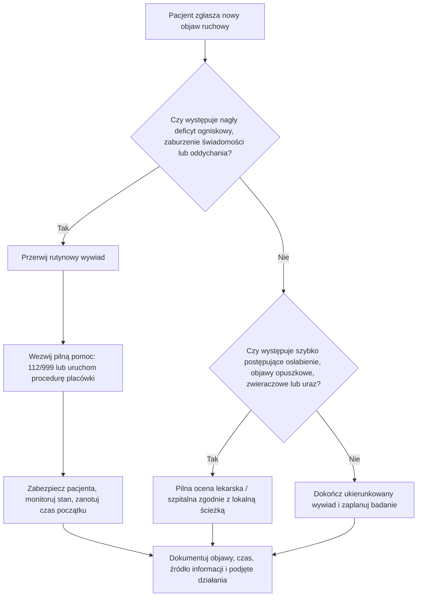

# 2.5. Wywiad dotyczący objawów ruchowych

## Wprowadzenie

Wywiad dotyczący objawów ruchowych służy uporządkowanemu opisaniu trudności związanych z wytwarzaniem, inicjowaniem, podtrzymywaniem, hamowaniem i koordynowaniem ruchu. Pacjent może zgłaszać, że „brakuje mu siły”, ręka drży, noga „ucieka”, mięśnie sztywnieją, ruchy stały się wolniejsze, pojawiają się mimowolne skurcze albo coraz trudniej wstać z krzesła. Takie sformułowania są ważnymi punktami wyjścia, lecz nie stanowią jeszcze rozpoznania. Zadaniem osoby prowadzącej wywiad jest zachowanie języka pacjenta, doprecyzowanie zjawiska i zbudowanie opisu, który można następnie skonfrontować z badaniem przedmiotowym.

W neurologii określenie „objaw ruchowy” obejmuje zjawiska o odmiennych mechanizmach. Niedowład może wynikać z uszkodzenia dróg korowo-rdzeniowych, komórek ruchowych rdzenia, korzeni, splotów, nerwów obwodowych, złącza nerwowo-mięśniowego lub samych mięśni. Drżenie jest rytmicznym, oscylacyjnym ruchem mimowolnym, ale nie każde drganie mięśnia jest drżeniem. Bradykinezja oznacza spowolnienie ruchu połączone z ubytkiem jego amplitudy lub szybkości w trakcie powtarzania, a nie tylko subiektywne poczucie powolności. Męczliwość może oznaczać nieswoiste zmęczenie, ograniczenie wydolności albo charakterystyczne osłabienie nasilające się podczas powtarzanej aktywności, jak w zaburzeniach transmisji nerwowo-mięśniowej.

Wywiad powinien zatem rozstrzygać przede wszystkim: **co dokładnie się porusza lub nie porusza, w jakich warunkach, od kiedy, w jakim rozkładzie, jak zmienia się z czasem, co temu towarzyszy i jakie ma konsekwencje funkcjonalne**. Dopiero po zebraniu tych informacji można formułować hipotezy lokalizacyjne i etiologiczne. Nie wolno utożsamiać pojedynczego objawu z konkretną chorobą ani odkładać pilnej oceny, gdy opis wskazuje na stan nagły.

Rozdział dotyczy wywiadu i wstępnej charakterystyki objawów. Szczegółowe techniki oceny siły, napięcia, odruchów, ruchów mimowolnych, koordynacji i chodu należą do odpowiednich modułów badania przedmiotowego. W wywiadzie należy jednak już teraz zebrać dane, które pozwolą dobrać właściwe próby i uniknąć niebezpiecznych lub nieadekwatnych działań.

> **Zasada kliniczna:** najpierw opisz zjawisko, potem rozważ mechanizm, a dopiero na końcu nazwij możliwą jednostkę chorobową. Nie zastępuj relacji pacjenta etykietą diagnostyczną.

---

## 1. Cele kształcenia

Po opanowaniu materiału uczestnik powinien umieć:

1. Rozróżniać subiektywne osłabienie, obiektywny niedowład, męczliwość, ograniczenie ruchu z powodu bólu oraz ogólne zmęczenie.
2. Zebrać ukierunkowany wywiad dotyczący początku, dynamiki, rozmieszczenia i zmienności objawów ruchowych.
3. Scharakteryzować drżenie według warunków jego występowania, rozmieszczenia, wpływu czynności i objawów towarzyszących.
4. Ustalić, czy zgłaszane spowolnienie dotyczy inicjowania ruchu, jego szybkości, amplitudy, automatyzmów czy ogólnej sprawności.
5. Rozpoznać w relacji pacjenta cechy sztywności, dystonii, pląsawicy, atetozy, mioklonii, tików, fascykulacji i kurczów, nie utożsamiając tych pojęć.
6. Zebrać dane o zaburzeniach chodu, równowagi, transferów i upadkach, w tym o okolicznościach urazów.
7. Ustalić wpływ objawów na samoobsługę, mobilność, pracę, role rodzinne i bezpieczeństwo.
8. Uwzględnić choroby współistniejące, leki, używki, ekspozycje, wywiad rodzinny i czynniki wyzwalające.
9. Wskazać objawy alarmowe wymagające pilnej oceny lekarskiej lub wezwania zespołu ratownictwa medycznego.
10. Udokumentować relację w sposób precyzyjny, neutralny, chronologiczny i możliwy do porównania w kolejnych wizytach.
11. Oddzielić dane zgłaszane przez pacjenta od obserwacji świadka i wyników badania przedmiotowego.
12. Sformułować wstępne hipotezy bez przekraczania kompetencji zawodowych.

## 2. Definicje i język opisu objawów ruchowych

### 2.1. Objaw ruchowy

Objaw ruchowy to zgłaszana lub obserwowana zmiana dotycząca siły, szybkości, zakresu, płynności, precyzji, automatyzacji albo kontroli ruchu. Może mieć charakter ubytkowy, gdy jakaś funkcja jest osłabiona lub utracona, albo dodatni, gdy pojawia się nadmierna aktywność, której pacjent nie zamierzał wykonać.

W praktyce należy odróżniać trzy poziomy informacji:

- **relacja subiektywna:** „ręka jest słaba”, „nogi są ciężkie”, „ciało drży”;
- **obserwacja:** widoczne drżenie, opadanie kończyny, ograniczenie spontanicznych ruchów, mimowolne skręcanie stopy;
- **wynik badania:** określony deficyt siły, wzorzec napięcia, nieprawidłowość koordynacji lub odruchów.

Nie są to informacje zamienne. Pacjent może odczuwać znaczną niesprawność mimo prawidłowej siły w krótkiej próbie oporowej, na przykład z powodu bólu, zaburzeń koordynacji, męczliwości lub zaburzeń planowania ruchu. Z kolei obiektywny deficyt może być słabo uświadamiany, zwłaszcza gdy rozwija się stopniowo.

### 2.2. Niedowład i porażenie

**Niedowład** oznacza zmniejszenie zdolności do generowania dowolnej siły mięśniowej. **Porażenie** oznacza skrajne lub całkowite zniesienie dowolnego ruchu w danym zakresie, jednak w dokumentacji należy precyzować, czy chodzi o brak ruchu czynnego, czy o wynik konkretnej próby siłowej.

Pacjent nie musi posługiwać się tymi terminami. Pytania powinny dotyczyć czynności: czy może unieść rękę, utrzymać kubek, odkręcić słoik, wejść po schodach, podnieść stopę podczas chodzenia, wstać z niskiego krzesła. Takie przykłady pozwalają określić wzorzec ograniczenia bez sugerowania odpowiedzi.

### 2.3. Osłabienie subiektywne, męczliwość i zmęczenie

Pojęcia te bywają używane zamiennie, ale mają różne znaczenie kliniczne:

- **osłabienie subiektywne** – poczucie utraty siły lub sprawności, którego nie należy automatycznie utożsamiać z niedowładem;
- **obiektywny ubytek siły** – stwierdzane w badaniu ograniczenie zdolności do wykonania ruchu przeciw grawitacji lub oporowi;
- **męczliwość mięśniowa** – narastające pogorszenie zdolności do utrzymania lub powtarzania skurczu podczas aktywności;
- **zmęczenie** – szersze, nieswoiste poczucie wyczerpania fizycznego lub psychicznego, które może występować bez uchwytnego niedowładu;
- **nietolerancja wysiłku** – ograniczenie aktywności z powodu duszności, bólu, zaburzeń krążenia, chorób płuc, niewydolności serca lub innych przyczyn ogólnoustrojowych.

Warto zapytać, czy sprawność pogarsza się w trakcie konkretnej czynności, czy pacjent odczuwa zmęczenie całego organizmu, czy też kończyna od początku nie wykonuje określonego ruchu. Istotne jest także ustalenie, czy odpoczynek przynosi poprawę i jak szybko ona następuje.

### 2.4. Drżenie

Drżenie jest mimowolnym, rytmicznym lub względnie rytmicznym ruchem oscylacyjnym części ciała. W opisie klinicznym kluczowe jest określenie warunku aktywacji:

- spoczynek – gdy część ciała jest podparta i rozluźniona;
- utrzymywanie postawy – gdy pacjent przeciwdziała grawitacji;
- ruch – podczas wykonywania czynności;
- ruch celowy – podczas zbliżania się do celu;
- określone zadanie lub pozycja – na przykład pisanie, używanie narzędzia albo stanie.

Pacjent może mówić „trzęsą mi się ręce”, lecz nie rozróżniać drżenia od szarpnięć, mioklonii, drżenia wewnętrznego lub uczucia wibracji. Dlatego należy prosić o opis i przykłady, a nie wyłącznie o wybór nazwy.

### 2.5. Bradykinezja i hipokinezja

**Bradykinezja** oznacza spowolnienie ruchu, któremu w klasycznym ujęciu parkinsonowskim towarzyszy zmniejszanie amplitudy lub szybkości podczas powtarzanych ruchów. **Hipokinezja** oznacza zmniejszenie zakresu lub ilości ruchu, a **akinezja** – trudność lub niemożność jego zainicjowania. W języku pacjenta mogą się one ujawniać jako trudność rozpoczęcia chodzenia, zapinania guzików, obracania się w łóżku, pisania coraz mniejszych liter lub wykonywania kilku czynności w krótkim czasie.

Samo wolne tempo nie wystarcza do rozpoznania bradykinezji. Może wynikać z bólu, osłabienia, depresji, zaburzeń poznawczych, lęku, sedacji, choroby stawów albo świadomego ograniczania ruchu.

### 2.6. Sztywność

Sztywność w języku potocznym może oznaczać ból, ograniczenie ruchomości stawu, wzmożone napięcie mięśniowe, spastyczność lub sztywność pozapiramidową. Należy doprecyzować, czy pacjent opisuje opór przy poruszaniu kończyną przez inną osobę, uczucie „zastania” po bezruchu, bolesność, skurcz, czy ograniczenie ruchu w konkretnym stawie.

Sztywność pozapiramidowa jest zjawiskiem badanym przede wszystkim w badaniu przedmiotowym. Nie można jej potwierdzić wyłącznie na podstawie deklaracji pacjenta.

### 2.7. Ruchy mimowolne

Ruchy mimowolne to ruchy pojawiające się bez świadomego zamiaru lub trudne do zahamowania. Do głównych zjawisk należą:

- **dystonia** – utrwalone lub okresowe skurcze powodujące skręcanie, powtarzalne ruchy albo nieprawidłowe postawy;
- **pląsawica** – nieregularne, krótkie, zmienne i pozornie płynące ruchy, przechodzące z jednej części ciała na inną;
- **atetoza** – wolniejsze, wijące się ruchy, zwłaszcza dystalnych części kończyn;
- **mioklonie** – nagłe, krótkie, przypominające wyładowanie szarpnięcia mięśnia lub grupy mięśni;
- **tiki** – powtarzalne ruchy lub wokalizacje, często poprzedzone narastającym przymusem i możliwe do krótkotrwałego powstrzymania;
- **stereotypie** – powtarzalne, względnie stałe wzorce ruchowe;
- **akatyzja** – subiektywny niepokój ruchowy i przymus poruszania się, często związany z lekami blokującymi receptory dopaminowe;
- **dyskinezy** – szerokie określenie nieprawidłowych ruchów mimowolnych, w tym ruchów polekowych.

Nie należy wymagać od pacjenta rozpoznawania tych nazw. Wywiad powinien opisywać wygląd, czas trwania, rytmiczność, możliwość zahamowania, świadomość ruchu i wpływ na czynności.

### 2.8. Fascykulacje i kurcze

**Fascykulacja** to widoczne lub odczuwane, krótkie skurcze niewielkich grup włókien mięśniowych, zwykle bez istotnego ruchu całej kończyny. **Kurcz mięśniowy** to nagły, mimowolny i często bolesny skurcz utrzymujący się przez pewien czas. **Miokimia** oznacza falujące, robaczkowate ruchy mięśnia wynikające z powtarzalnej aktywności jednostek motorycznych.

Fascykulacje mogą występować u osób zdrowych, na przykład po wysiłku, przy niedoborze snu, stresie lub zwiększonym spożyciu kofeiny. Ich znaczenie kliniczne zależy od współwystępowania postępującego osłabienia, zaniku mięśni, zaburzeń mowy, połykania lub oddychania. Samo zgłoszenie drgania mięśnia nie pozwala rozpoznać choroby neuronu ruchowego.

---

## 3. Podstawy neuroanatomiczne i neurofizjologiczne istotne dla wywiadu

### 3.1. Układ korowo-rdzeniowy i górny neuron ruchowy

Dowolne ruchy kończyn są w znacznej mierze kontrolowane przez sieci korowe, których sygnały docierają do rdzenia kręgowego drogami zstępującymi. Uszkodzenie górnego neuronu ruchowego może powodować osłabienie, utratę precyzji ruchów, wzmożenie odruchów, spastyczność i objawy patologiczne. W wywiadzie znaczenie mają: nagłe lub stopniowe pojawienie się trudności, jednostronność, sztywność, potykanie się, utrata sprawności ręki i zmiany w chodzie.

Opis pacjenta nie lokalizuje samodzielnie uszkodzenia. Wzorzec musi zostać zestawiony z badaniem siły, napięcia, odruchów, czucia i funkcji nerwów czaszkowych.

### 3.2. Dolny neuron ruchowy, korzenie i nerwy obwodowe

Dolny neuron ruchowy obejmuje komórkę ruchową rogu przedniego rdzenia lub jądra ruchowego nerwu czaszkowego, jej akson oraz połączenie z włóknem mięśniowym. Uszkodzenie na tym poziomie może prowadzić do osłabienia, zaniku mięśni, obniżenia napięcia i odruchów, a niekiedy do fascykulacji.

Wzorzec zgłaszanych trudności może sugerować:
- **radikulopatię** – ból promieniujący i osłabienie w układzie odpowiadającym korzeniowi, niekiedy z zaburzeniami czucia;
- **mononeuropatię** – deficyt w obszarze konkretnego nerwu;
- **pleksopatię** – objawy obejmujące kilka nerwów obwodowych w obrębie splotu;
- **polineuropatię** – zwykle bardziej symetryczne, dystalne trudności, często z zaburzeniami czucia;
- **chorobę neuronu ruchowego** – postępujące objawy ruchowe, czasem obejmujące kilka regionów, z możliwymi cechami uszkodzenia górnego i dolnego neuronu ruchowego.

Wywiad powinien obejmować dokładny rozkład trudności, ból, zaburzenia czucia, asymetrię, tempo narastania oraz wpływ na codzienne czynności.

### 3.3. Złącze nerwowo-mięśniowe i mięśnie

Przekazywanie sygnału z nerwu na mięsień odbywa się w złączu nerwowo-mięśniowym. Zaburzenia transmisji mogą powodować zmienną, zależną od aktywności słabość, szczególnie mięśni gałkoruchowych, twarzy, gardła, szyi i kończyn. W miastenii typowe jest nasilanie się osłabienia podczas powtarzanej aktywności oraz poprawa po odpoczynku, ale obraz kliniczny jest zróżnicowany.

Choroby mięśni często powodują osłabienie proksymalne, trudności we wstawaniu, wchodzeniu po schodach i unoszeniu rąk. Mogą występować bóle mięśni, kurcze, ciemne zabarwienie moczu po uszkodzeniu mięśni lub objawy ogólnoustrojowe. Sam rozkład proksymalny nie przesądza jednak o miopatii.

### 3.4. Jądra podstawy i sieci pozapiramidowe

Jądra podstawy uczestniczą w wyborze, inicjowaniu, skalowaniu i hamowaniu programów ruchowych. Zaburzenia tych sieci mogą powodować bradykinezję, sztywność, drżenie spoczynkowe, dystonię, pląsawicę, tiki lub dyskinezy. W wywiadzie należy ustalić, czy problem dotyczy rozpoczęcia ruchu, jego amplitudy, automatyzmów, mimiki, pisma, głosu, połykania, czy pojawiania się ruchów niezamierzonych.

Parkinsonizm jest zespołem klinicznym, a nie synonimem choroby Parkinsona. Według kryteriów Movement Disorder Society jego rdzeniem jest bradykinezja współistniejąca z drżeniem spoczynkowym lub sztywnością. Rozpoznanie etiologiczne wymaga dalszej oceny.

### 3.5. Móżdżek i układy koordynacji

Móżdżek uczestniczy w przewidywaniu skutków ruchu, korygowaniu błędów, synchronizacji i uczeniu motorycznym. Zaburzenia mogą objawiać się niezgrabnością, rozkładaniem ruchu na etapy, chwiejnym chodem, trudnością w precyzyjnym sięganiu i drżeniem nasilającym się podczas zbliżania do celu. Pacjent może opisywać „brak celności”, „rozlewanie napoju”, „uciekanie ręki” albo trudność w szybkim wykonywaniu naprzemiennych czynności.

Ataksja nie jest równoznaczna z osłabieniem. W wywiadzie trzeba oddzielić brak siły od braku precyzji, zaburzeń równowagi i niepewności ruchu.

### 3.6. Układy czuciowe i kontrola ruchu

Ruch zależy od informacji wzrokowej, przedsionkowej i proprioceptywnej. Utrata czucia ułożenia może powodować niepewność ruchu, konieczność patrzenia na kończynę i pogorszenie sprawności w ciemności. Pacjent może mówić, że „noga nie słucha”, choć zasadniczym problemem jest zaburzone czucie głębokie lub integracja sensoryczna.

Dlatego w wywiadzie ruchowym należy pytać o drętwienie, mrowienie, ból, zaburzenia czucia, zawroty głowy i pogorszenie przy zamkniętych oczach. Szczegółowe pytania dotyczące czucia omawia rozdział 2.6.

### 3.7. Sieci chodu i postawy

Chód jest wynikiem współdziałania kory, jąder podstawy, pnia mózgu, móżdżku, rdzenia, układów czuciowych, narządu wzroku, układu przedsionkowego oraz układu mięśniowo-szkieletowego. Nieprawidłowy chód może mieć przyczynę neurologiczną, ortopedyczną, krążeniową, oddechową, polekową lub wieloczynnikową.

W opisie należy uwzględnić inicjowanie, długość i symetrię kroku, unoszenie stóp, szerokość podstawy, skręcanie, zatrzymywanie, pokonywanie przeszkód, schody i zmianę kierunku. Pacjent może nie umieć opisać wzorca, dlatego istotna bywa relacja opiekuna lub nagranie wykonane za zgodą pacjenta.

---

## 4. Struktura wywiadu ruchowego

Wywiad można prowadzić według stałej sekwencji. Nie jest to sztywny kwestionariusz; kolejność należy dostosować do pilności sytuacji, możliwości komunikacyjnych i dominującego problemu.

1. **Nazwanie głównej trudności:** „Co w ruchu stało się inne niż wcześniej?”
2. **Przykład czynności:** „Przy jakiej konkretnej czynności zauważa Pan/Pani problem?”
3. **Początek:** „Kiedy po raz pierwszy wystąpiła ta zmiana? Co działo się wtedy?”
4. **Dynamika:** „Czy objaw narasta, pojawia się napadami, czy pozostaje podobny?”
5. **Rozkład:** „Która część ciała jest zajęta? Czy problem jest po jednej, czy po obu stronach?”
6. **Warunki występowania:** „Czy pojawia się w spoczynku, podczas utrzymywania pozycji, ruchu, wysiłku czy określonego zadania?”
7. **Czynniki modyfikujące:** „Co nasila lub zmniejsza objaw? Czy odpoczynek pomaga?”
8. **Objawy towarzyszące:** ból, zaburzenia czucia, widzenia, mowy, połykania, oddychania, równowagi lub świadomości.
9. **Leki i ekspozycje:** zmiany dawkowania, nowe preparaty, pominięcie dawki, używki i substancje toksyczne.
10. **Funkcjonowanie:** upadki, samoobsługa, praca, prowadzenie pojazdów i bezpieczeństwo.
11. **Informacje od świadka:** opis widocznego zdarzenia, jego czas trwania i reakcja pacjenta.
12. **Podsumowanie:** powtórzenie najważniejszych danych i sprawdzenie, czy pacjent rozpoznaje w nich swój problem.

### 4.1. Pytania otwarte

Na początku warto użyć pytań nieukierunkowujących:
- „Proszę opowiedzieć, co się zmieniło w poruszaniu się”.
- „Jak wyglądał zwykły dzień przed wystąpieniem problemu, a jak wygląda teraz?”
- „Co jest obecnie najtrudniejsze?”
- „Jak opisałaby to osoba, która obserwuje Pana/Panią na co dzień?”

Pytania zamknięte są przydatne do doprecyzowania, lecz nie powinny zastępować swobodnego opisu. Pytanie „Czy drży Panu ręka?” może zasugerować zjawisko, którego pacjent wcześniej nie rozpoznawał. Lepsze jest: „Czy pojawiają się ruchy, których Pan/Pani nie zamierza wykonać? Jak wyglądają?”

### 4.2. Ustalanie punktu odniesienia

Należy poznać sprawność sprzed zachorowania. U osób starszych, przewlekle chorych lub z niepełnosprawnością ważne jest rozróżnienie stanu wyjściowego od nowej zmiany. Pytania:
- „Czy przed tym epizodem chodził/a Pan/Pani bez pomocy?”
- „Czy korzystał/a Pan/Pani z laski, balkonika lub wózka?”
- „Czy trudności z zapinaniem guzików występowały wcześniej?”
- „Czy opiekun zauważył zmianę w porównaniu z poprzednimi tygodniami?”

Należy dokumentować zarówno nowy deficyt, jak i wcześniejsze ograniczenia. Nie wolno przypisywać nowego objawu chorobie przewlekłej bez weryfikacji.

---

## 5. Wywiad dotyczący niedowładu i osłabienia mięśni

### 5.1. Lokalizacja zgłaszanego osłabienia

Ustalenie rozmieszczenia jest jednym z najważniejszych elementów. Należy zapytać, czy problem dotyczy:
- twarzy;
- jednej kończyny;
- jednej połowy ciała;
- obu kończyn górnych;
- obu kończyn dolnych;
- obręczy barkowej lub biodrowej;
- dłoni, palców, stóp albo innych części dystalnych;
- wielu regionów w sposób asymetryczny lub symetryczny.

Warto poprosić o wskazanie miejsca na własnym ciele. Nie należy jednak traktować gestu pacjenta jako mapy anatomicznej bez dalszego doprecyzowania.

### 5.2. Pytania o czynności

| Obszar | Przykładowe pytania | Możliwa wskazówka kliniczna |
|---|---|---|
| Obręcz barkowa | Czy trudno sięgnąć na wysoką półkę, uczesać włosy, założyć ubranie przez głowę? | Osłabienie proksymalne, ból barku lub ograniczenie stawu |
| Dłoń | Czy trudniej odkręcić klucz, utrzymać kubek, zapiąć guzik, pisać? | Osłabienie dystalne, zaburzenie czucia, ból lub apraksja |
| Obręcz biodrowa | Czy trudno wstać z niskiego krzesła lub wejść po schodach? | Osłabienie proksymalne, choroba mięśni, ból lub zaburzenia równowagi |
| Stopa | Czy stopa zahacza o podłoże, klapie, trudno chodzić na piętach? | Opadanie stopy, neuropatia, radikulopatia lub inne przyczyny |
| Twarz i gardło | Czy zmienia się mimika, mowa, żucie lub połykanie? | Zaburzenia nerwów czaszkowych, transmisji nerwowo-mięśniowej lub układu opuszkowego |
| Szyja | Czy trudno utrzymać głowę, zwłaszcza pod koniec dnia? | Osłabienie mięśni szyi, męczliwość lub choroba mięśni |

Powyższe powiązania są wskazówkami do dalszej oceny, nie regułami diagnostycznymi. Każda czynność angażuje wiele struktur, a ból, ograniczenie stawowe i zaburzenia równowagi mogą naśladować osłabienie.

### 5.3. Nagły niedowład

Nagłe osłabienie jednej strony ciała, opadnięcie kącika ust, zaburzenie mowy, nagła utrata widzenia, zaburzenie równowagi lub nagły niedowład kończyny mogą oznaczać udar mózgu albo TIA. Objawy przemijające także wymagają pilnej oceny. Należy ustalić dokładny czas, kiedy pacjent był ostatnio w swoim zwykłym stanie, oraz moment zauważenia objawów. Nie należy opóźniać wezwania pomocy w celu zebrania pełnego wywiadu.

W Polsce przy podejrzeniu udaru należy natychmiast wezwać pomoc pod numerem 112 lub 999, zgodnie z lokalną procedurą. Nie należy pozwalać pacjentowi samodzielnie prowadzić pojazdu ani podawać jedzenia, płynów czy leków doustnych osobie z zaburzeniami połykania lub świadomości.

### 5.4. Osłabienie narastające

Stopniowo postępujące osłabienie wymaga ustalenia:
- czy obejmuje kolejne grupy mięśni;
- czy zaczęło się dystalnie, proksymalnie, jednostronnie czy symetrycznie;
- czy występuje z zanikiem, fascykulacjami lub kurczami;
- czy towarzyszą mu zaburzenia mowy, połykania, kaszlu lub oddychania;
- czy pojawia się ból, drętwienie lub zaburzenia zwieraczy;
- czy doszło do utraty masy ciała, gorączki lub objawów ogólnych.

Postępujące osłabienie z zanikiem mięśni, fascykulacjami, zaburzeniami opuszkowymi lub oddechowymi wymaga pilnej, ukierunkowanej oceny neurologicznej. Nie należy rozpoznawać choroby neuronu ruchowego na podstawie samej obecności fascykulacji.

### 5.5. Osłabienie proksymalne i dystalne

**Osłabienie proksymalne** utrudnia czynności angażujące obręcz barkową i biodrową: wstawanie z krzesła, wchodzenie po schodach, unoszenie rąk, podnoszenie przedmiotów nad głowę. Może występować w miopatiach, zaburzeniach transmisji nerwowo-mięśniowej, chorobach ogólnoustrojowych i w wielu innych stanach.

**Osłabienie dystalne** dotyczy dłoni, palców, stóp i mięśni drobnych. Może powodować trudności w manipulacji, zapinaniu guzików, utrzymywaniu przedmiotów, unoszeniu przodostopia lub chodzeniu na piętach. Występuje między innymi w neuropatiach, radikulopatiach i niektórych chorobach mięśni.

Wzorce te nie są absolutne. Należy opisać stronę, symetrię, kolejność zajmowania regionów i towarzyszące objawy czuciowe.

### 5.6. Ból a osłabienie

Pacjent może określać jako „brak siły” sytuację, w której przerywa ruch z powodu bólu. Pytania rozróżniające:
- „Czy mięsień nie jest w stanie wykonać ruchu, czy ruch jest możliwy, ale boli?”
- „Czy po zmianie pozycji lub odciążeniu ruch staje się łatwiejszy?”
- „Czy ograniczenie występuje również wtedy, gdy kończyna jest podparta?”
- „Czy występuje uczucie, że kończyna opada, czy raczej obawa przed bólem?”

Nie należy zakładać, że ból wyklucza niedowład. Oba zjawiska mogą współistnieć.

---

## 6. Wywiad dotyczący męczliwości i zmienności siły

### 6.1. Charakterystyczny wzorzec męczliwości

Należy ustalić:
- po jakim czasie aktywności pojawia się osłabienie;
- czy dotyczy określonej grupy mięśni;
- czy nasila się w ciągu dnia;
- czy poprawia się po krótkim odpoczynku;
- czy powtarzanie ruchu powoduje pogorszenie;
- czy występują opadanie powiek, podwójne widzenie, zmiana głosu, trudności w żuciu, połykaniu lub utrzymaniu głowy;
- czy infekcja, gorączka, stres, brak snu lub nowy lek poprzedziły pogorszenie.

W miastenii osłabienie jest często zmienne i nasilane przez aktywność, a po odpoczynku może się poprawiać. Objawy oczne i opuszkowe są istotne, ale ich brak nie wyklucza choroby.

### 6.2. Męczliwość a zmęczenie

Zmęczenie może towarzyszyć niedokrwistości, infekcji, zaburzeniom snu, depresji, niewydolności krążenia, chorobom metabolicznym, nowotworowym i wielu innym stanom. Męczliwość mięśniowa oznacza bardziej swoiste pogarszanie zdolności do wykonania skurczu podczas aktywności. W praktyce oba zjawiska mogą współistnieć.

Należy zapytać o sen, nastrój, odżywienie, utratę masy ciała, gorączkę, duszność, kołatanie serca, leki i obciążenia dnia codziennego.

### 6.3. Objawy opuszkowe i oddechowe

Pytania alarmowe:
- „Czy podczas jedzenia krztusi się Pan/Pani częściej niż wcześniej?”
- „Czy płyny przedostają się do nosa?”
- „Czy głos staje się cichszy, nosowy lub niewyraźny w trakcie rozmowy?”
- „Czy trudno przeżuć posiłek do końca?”
- „Czy kaszel jest słabszy i trudniej odkrztusić wydzielinę?”
- „Czy pojawia się duszność podczas leżenia, mówienia lub w spoczynku?”
- „Czy rano występują bóle głowy lub senność większa niż zwykle?”

Nowe lub narastające zaburzenia połykania, niewydolny kaszel, trudność w utrzymaniu wydzieliny, osłabienie mięśni szyi i duszność mogą zapowiadać kryzys miasteniczny lub inną niewydolność nerwowo-mięśniową. Wymagają pilnej oceny medycznej. Prawidłowa saturacja nie wyklucza wczesnego pogorszenia wentylacji.

---

## 7. Wywiad dotyczący drżenia

### 7.1. Pierwsze pytania

- „Która część ciała drży: ręce, głowa, głos, nogi czy całe ciało?”
- „Czy drżenie występuje, gdy ręce leżą swobodnie, czy dopiero po ich uniesieniu?”
- „Czy pojawia się podczas pisania, jedzenia, nalewania płynu lub sięgania po przedmiot?”
- „Czy nasila się, gdy zbliża się Pan/Pani do celu?”
- „Czy występuje podczas stania lub chodzenia?”
- „Czy jest stałe, czy pojawia się w określonych sytuacjach?”
- „Czy ktoś w rodzinie ma podobne drżenie?”

### 7.2. Warunek aktywacji

| Rodzaj opisywany w wywiadzie | Pytania pomocnicze | Uwagi interpretacyjne |
|---|---|---|
| Drżenie spoczynkowe | Czy pojawia się, gdy kończyna jest podparta i rozluźniona? Czy zmniejsza się przy celowym ruchu? | Może występować w parkinsonizmie, ale nie jest swoiste |
| Drżenie posturalne | Czy pojawia się po wyciągnięciu rąk przed siebie lub utrzymywaniu przedmiotu? | Może być fizjologiczne, nasilone, samoistne, polekowe lub metaboliczne |
| Drżenie kinetyczne | Czy występuje podczas wykonywania ruchu, np. jedzenia lub pisania? | Wymaga określenia zadania i regularności |
| Drżenie zamiarowe | Czy nasila się w miarę zbliżania ręki do celu? | Może sugerować zaburzenia układów móżdżkowych |
| Drżenie zadaniowe | Czy występuje tylko przy pisaniu, grze na instrumencie lub innej czynności? | Wymaga różnicowania drżenia swoistego dla zadania i dystonii |
| Drżenie ortostatyczne | Czy pojawia się głównie podczas stania i zmniejsza po siadaniu lub chodzeniu? | Rzadki zespół; opis wymaga specjalistycznej weryfikacji |

Klasyfikacja Movement Disorder Society rozróżnia między innymi drżenie spoczynkowe, posturalne, kinetyczne i zamiarowe. W praktyce opis aktywacji jest ważniejszy niż potoczne przypisanie drżenia do konkretnej choroby.

### 7.3. Rozmieszczenie i symetria

Należy ustalić, czy drżenie:
- zaczęło się w jednej ręce czy w obu;
- obejmuje głowę, żuchwę, język, głos lub kończyny dolne;
- jest symetryczne;
- zmienia się przy określonej pozycji;
- występuje tylko w jednej części ciała;
- rozprzestrzeniło się na kolejne okolice.

Drżenie jednostronne nie oznacza automatycznie choroby Parkinsona, a drżenie obustronne nie oznacza automatycznie drżenia samoistnego. Znaczenie mają wiek początku, dynamika, inne objawy neurologiczne, leki i choroby ogólnoustrojowe.

### 7.4. Czynniki nasilające i łagodzące

Pytania:
- Czy drżenie nasila stres, lęk, pośpiech lub zmęczenie?
- Czy zmienia się po kawie, napojach energetycznych, nikotynie lub alkoholu?
- Czy pojawiło się po włączeniu albo zwiększeniu dawki leku?
- Czy zmniejsza się po odpoczynku?
- Czy pacjent zauważa związek z głodem, pominięciem posiłku lub objawami hipoglikemii?
- Czy występuje w określonych porach dnia?

Alkohol może przejściowo zmniejszać niektóre rodzaje drżenia, lecz nie jest metodą diagnostyczną ani zalecanym sposobem leczenia. Należy pytać o spożycie bez oceniania pacjenta, z uwzględnieniem ryzyka zespołu abstynencyjnego.

### 7.5. Drżenie polekowe i metaboliczne

W wywiadzie należy uwzględnić:
- leki beta-adrenergiczne, w tym niektóre leki wziewne;
- lit;
- walproinian;
- niektóre leki przeciwdepresyjne;
- lewotyroksynę przy nadmiernej ekspozycji;
- leki przeciwpsychotyczne i przeciwwymiotne blokujące receptory dopaminowe;
- kofeinę, nikotynę i inne stymulanty;
- nadczynność tarczycy, hipoglikemię, zaburzenia elektrolitowe i niewydolność narządową.

Nie należy samodzielnie odstawiać leków. Związek czasowy między zmianą leczenia a objawem jest ważną wskazówką, ale nie dowodzi przyczynowości. Decyzję o modyfikacji farmakoterapii podejmuje uprawniony klinicysta.

### 7.6. Drżenie a inne ruchy

Pacjent może nazywać drżeniem:
- krótkie szarpnięcia (mioklonie);
- rytmiczne skurcze w klonusie;
- nieregularne ruchy pląsawicze;
- ruchy dystoniczne;
- drgania pęczków mięśniowych;
- uczucie wewnętrznego drżenia bez widocznego ruchu.

Warto poprosić o demonstrację, o ile jest bezpieczna, i zanotować, czy zjawisko jest rytmiczne, ciągłe, nagłe, krótkie, powtarzalne, zależne od pozycji lub zadania. Nagranie wykonane przez pacjenta może być pomocne, jeśli przedstawia typowy epizod i zostało uzyskane z poszanowaniem prywatności.

---

## 8. Wywiad dotyczący spowolnienia, sztywności i trudności inicjowania ruchu

### 8.1. Codzienne przykłady

Zamiast pytać wyłącznie o „spowolnienie”, należy zapytać:
- Czy rozpoczęcie chodzenia wymaga kilku prób?
- Czy stopy czasem sprawiają wrażenie przyklejonych do podłoża?
- Czy trudniej odwrócić się w łóżku?
- Czy pisanie stało się wolniejsze lub litery coraz mniejsze?
- Czy trudniej zapiąć guziki, używać sztućców lub wykonywać szybkie ruchy palcami?
- Czy podczas chodzenia jedna ręka porusza się mniej niż druga?
- Czy twarz wydaje się mniej ruchliwa, a głos cichszy?
- Czy obracanie się wymaga wielu drobnych kroków?
- Czy pojawiają się epizody nagłego „zablokowania” podczas przechodzenia przez drzwi lub skręcania?

### 8.2. Zjawisko zamrożenia chodu

Zamrożenie chodu (freezing of gait) to krótkotrwała niemożność lub znaczne ograniczenie rozpoczęcia albo kontynuowania kroków, mimo zamiaru chodzenia. Pacjent może opisywać je jako „przyklejenie stóp”, drobne dreptanie w miejscu lub utratę płynności. Należy ustalić:
- czy epizod pojawia się przy ruszaniu;
- czy występuje podczas skręcania;
- czy nasila się w wąskich przejściach, przy drzwiach lub w tłumie;
- czy występuje podczas dzielenia uwagi;
- czy pomaga rytm, liczenie lub wskazówka wzrokowa;
- czy wiąże się z upadkami.

Zamrożenie chodu jest częste w chorobie Parkinsona, ale nie jest dla niej wyłączne. W wywiadzie należy też rozważyć zaburzenia naczyniowe, poznawcze, czołowe, przedsionkowe i inne przyczyny zaburzeń chodu.

### 8.3. Sztywność a spastyczność

Pacjent może używać słowa „sztywność” dla różnych doznań. Należy ustalić:
- czy występuje ból;
- czy sztywność jest obecna po przebudzeniu i zmniejsza się po rozruszaniu;
- czy dotyczy mięśni, czy konkretnego stawu;
- czy kończyna jest trudna do poruszenia przez inną osobę;
- czy objaw zmienia się przy szybkich ruchach;
- czy towarzyszą mu skurcze, drżenie lub spowolnienie.

Spastyczność i sztywność pozapiramidowa są rozróżniane w badaniu przedmiotowym. Wywiad może wskazać kierunek, ale nie zastępuje oceny napięcia.

### 8.4. Różnicowanie z bólem, artropatią i depresją

Spowolnienie może wynikać z choroby stawów, bólu, ograniczenia zakresu ruchu, osłabienia, depresji, zaburzeń snu, sedacji lub lęku. Należy zapytać o nastrój, inicjatywę, przyjemność z aktywności, sen, ból i zmiany w codziennym funkcjonowaniu. Nie wolno przypisywać objawów psychice bez rzetelnej oceny neurologicznej i somatycznej.

---

## 9. Wywiad dotyczący dystonii i innych ruchów mimowolnych

### 9.1. Dystonia

Pytania pomocnicze:
- Czy jakaś część ciała skręca się lub przyjmuje nienaturalną pozycję?
- Czy skurcz powtarza się w podobny sposób?
- Czy pojawia się podczas konkretnego zadania, np. pisania lub chodzenia?
- Czy dotyczy szyi, powiek, żuchwy, dłoni lub stopy?
- Czy pacjent potrafi chwilowo zmniejszyć objaw lekkim dotknięciem określonego miejsca?
- Czy występuje ból?
- Czy objaw rozpoczął się po leku lub zmianie jego dawki?

Niektóre dystonie są zadaniowe, inne uogólnione lub segmentalne. Zjawisko „gestu antagonistycznego” może chwilowo zmniejszać dystonię, ale nie jest samo w sobie testem rozstrzygającym.

### 9.2. Pląsawica i atetoza

Należy ustalić, czy ruchy:
- są nieregularne i zmieniają miejsce;
- wyglądają jak krótkie, płynne przejścia między gestami;
- obejmują twarz, tułów lub kończyny;
- nasilają się przy emocjach i aktywności;
- zanikają podczas snu według obserwacji opiekuna;
- utrudniają utrzymanie przedmiotu lub stabilną pozycję.

Warto zapytać o leki, choroby metaboliczne, rodzinne występowanie podobnych objawów, zaburzenia poznawcze i zmiany zachowania. Nowe, szybko narastające ruchy mimowolne z zaburzeniami świadomości lub objawami ogniskowymi wymagają pilnej oceny.

### 9.3. Mioklonie

Mioklonie są nagłymi, krótkimi szarpnięciami. Mogą występować podczas zasypiania, w padaczce, chorobach metabolicznych, neurodegeneracyjnych, po lekach lub w innych stanach. Pytania:
- Czy szarpnięcie jest pojedyncze czy seriami?
- Czy dotyczy jednej kończyny, obu kończyn czy całego ciała?
- Czy pojawia się przy zasypianiu, po bodźcu, przy ruchu lub w spoczynku?
- Czy pacjent zachowuje świadomość?
- Czy występuje utrata kontaktu, upadek, przygryzienie języka lub splątanie po epizodzie?
- Czy objaw pojawił się po nowym leku lub w przebiegu infekcji?

Nagłe, powtarzające się szarpnięcia z zaburzeniem świadomości, urazem lub podejrzeniem napadu padaczkowego wymagają pilnej oceny. Nie należy prowokować epizodów.

### 9.4. Tiki i stereotypie

W wywiadzie dotyczącym tików należy zapytać o:
- możliwość krótkotrwałego powstrzymania ruchu;
- narastające napięcie lub przymus przed tikiem;
- ulgę po wykonaniu ruchu;
- występowanie dźwięków lub wokalizacji;
- wiek początku i zmienność objawów;
- wpływ stresu, uwagi i zmęczenia.

Stereotypie są zwykle bardziej stałe i powtarzalne, często występują w określonych sytuacjach. Rozróżnienie wymaga kontekstu rozwojowego, poznawczego i klinicznego.

### 9.5. Akatyzja i niepokój ruchowy

Akatyzja może być opisywana jako niemożność spokojnego siedzenia, przymus chodzenia, kołysania się lub poruszania nogami. Należy ustalić, czy objaw pojawił się po rozpoczęciu albo zwiększeniu dawki leku przeciwpsychotycznego, przeciwwymiotnego lub innego preparatu wpływającego na układ dopaminowy. Warto odróżnić go od lęku, zespołu niespokojnych nóg, bólu, pobudzenia maniakalnego i dyskomfortu wynikającego z bezruchu.

---

## 10. Kurcze, fascykulacje i inne doznania mięśniowe

### 10.1. Kurcze mięśniowe

Pytania:
- Który mięsień lub okolica ulega skurczowi?
- Czy skurcz jest bolesny?
- Jak długo trwa?
- Czy pojawia się w nocy, po wysiłku, w spoczynku czy podczas konkretnego ruchu?
- Czy pomaga rozciągnięcie lub zmiana pozycji?
- Czy występuje obrzęk, osłabienie, ciemny mocz, gorączka lub odwodnienie?
- Czy pacjent przyjmuje leki moczopędne, statyny lub inne leki mogące wiązać się z dolegliwościami mięśniowymi?

Kurcze mogą mieć wiele przyczyn, w tym przeciążenie, odwodnienie, zaburzenia elektrolitowe, neuropatię, choroby mięśni, zaburzenia krążenia i działania niepożądane leków. Nie należy z góry przypisywać ich niedoborowi magnezu.

### 10.2. Fascykulacje

Należy zapytać:
- Czy widoczne są drobne drgania pod skórą?
- Czy występują w jednym miejscu, czy w wielu mięśniach?
- Czy towarzyszy im utrata siły lub masy mięśniowej?
- Czy pacjent ma trudności z mową, połykaniem, oddychaniem lub utrzymaniem głowy?
- Czy drgania nasilają się po wysiłku, stresie lub braku snu?
- Czy pojawiły się po zmianie leku lub ekspozycji?

Izolowane fascykulacje bez postępującego deficytu nie są równoznaczne z chorobą neuronu ruchowego. Natomiast fascykulacje połączone z narastającym osłabieniem, zanikiem mięśni lub objawami opuszkowymi wymagają szybkiej oceny specjalistycznej.

### 10.3. Ból mięśni i ciemne zabarwienie moczu

Silny ból mięśni, znaczne osłabienie i ciemny mocz po intensywnym wysiłku, urazie, przegrzaniu lub w związku z lekiem mogą wskazywać na rabdomiolizę. Jest to stan wymagający pilnej oceny medycznej ze względu na ryzyko ostrego uszkodzenia nerek i zaburzeń elektrolitowych.

---

## 11. Wywiad dotyczący chodu, równowagi i upadków

### 11.1. Opis chodu w języku pacjenta

Pytania:
- Czy trudniej rozpocząć chodzenie?
- Czy jedna stopa zahacza o podłoże?
- Czy kolano ugina się podczas obciążania?
- Czy kroki stały się krótsze?
- Czy pacjent chodzi szerzej rozstawionymi stopami?
- Czy trudniej skręcać, przechodzić przez drzwi lub omijać przeszkody?
- Czy występuje chwianie, uczucie wirowania, ciemnienie przed oczami lub osłabienie po wstaniu?
- Czy potrzebna jest laska, balkonik, podtrzymywanie przez drugą osobę?
- Czy zdarza się zatrzymywanie bez możliwości ruszenia?

Warto poprosić o opis trasy i sytuacji, w której trudność występuje najczęściej. Chód po mieszkaniu, schodach i nierównym terenie może ujawniać różne ograniczenia.

### 11.2. Upadki

Każdy upadek należy omówić osobno, zwłaszcza jeśli był nagły, powtarzalny lub spowodował uraz. Ustalić:
- datę i miejsce;
- pozycję wyjściową;
- kierunek upadku;
- obecność potknięcia, poślizgnięcia lub nagłego osłabienia;
- objawy poprzedzające: zawroty, kołatanie serca, ciemnienie przed oczami, ból w klatce piersiowej;
- utratę świadomości lub pamięci zdarzenia;
- możliwość samodzielnego wstania;
- uraz głowy i przyjmowanie leków przeciwkrzepliwych;
- liczbę upadków i zmianę ich częstości;
- obawę przed kolejnym upadkiem i ograniczenie aktywności.

Upadek nie zawsze wynika z zaburzeń neurologicznych. Przyczyną mogą być omdlenie, arytmia, hipotonia ortostatyczna, zaburzenia widzenia, leki, infekcja, odwodnienie, choroby stawów, przeszkody środowiskowe lub połączenie wielu czynników.

### 11.3. Wzorce chodu jako wskazówki

| Opis pacjenta lub opiekuna | Możliwy wzorzec do dalszej oceny | Ważne różnicowanie |
|---|---|---|
| „Stopa opada i zahacza o dywan” | Chód z opadaniem stopy, steppage | Neuropatia, radikulopatia, uszkodzenie ośrodkowe, ból |
| „Noga jest sztywna i zatacza łuk” | Chód spastyczny lub hemiparetyczny | Udar, mielopatia, inne uszkodzenia dróg zstępujących |
| „Chodzę na szeroko rozstawionych nogach” | Chód ataktyczny | Móżdżek, układ przedsionkowy, czucie głębokie, alkohol lub leki |
| „Robię coraz krótsze kroki” | Chód drobnymi krokami | Parkinsonizm, zaburzenia czołowe, ból, osłabienie |
| „Trudno mi oderwać stopy od podłogi” | Zamrożenie chodu lub apraksja chodu | Parkinsonizm, zaburzenia naczyniowe lub czołowe, lęk |
| „Biodra kołyszą się na boki” | Chód kaczkowaty lub kompensacyjny | Osłabienie obręczy biodrowej, choroby mięśni, dysplazja lub ból |
| „Utykam, bo boli” | Chód przeciwbólowy | Choroby stawów, kości, mięśni, nerwów lub naczyń |
| „Po wstaniu robi mi się ciemno przed oczami” | Możliwa hipotonia ortostatyczna lub presynkopa | Leki, odwodnienie, zaburzenia autonomiczne, arytmia |

Tabela nie służy do samodzielnego rozpoznawania. Jest narzędziem do formułowania pytań i planowania badania.

### 11.4. Bezpieczeństwo i środowisko

Należy zapytać o:
- schody, progi, dywany i oświetlenie;
- obuwie i stan podeszew;
- poręcze, uchwyty i możliwość podparcia;
- używanie pomocy do chodzenia;
- obecność opiekuna;
- nocne wstawanie do toalety;
- zawroty po zmianie pozycji;
- przeszkody w miejscu pracy;
- możliwość bezpiecznego opuszczenia mieszkania.

Jeśli pacjent jest niestabilny, nie należy prosić go o demonstrację chodu bez asekuracji i oceny ryzyka. Szczegółowe próby równowagi należą do badania przedmiotowego i powinny być wykonywane przez odpowiednio przygotowaną osobę.

---

## 12. Dynamika czasowa objawów ruchowych

Szczegółowe zasady analizy czasu omówiono w rozdziale 2.3. W wywiadzie ruchowym należy jednak doprecyzować specyficzne wzorce:

- **nagły początek:** minuty lub godziny, szczególnie przy jednostronnym osłabieniu, zaburzeniu mowy, widzenia lub równowagi;
- **epizodyczny:** objaw pojawia się i ustępuje, np. w napadach, zaburzeniach metabolicznych lub przy określonych czynnikach;
- **fluktuujący:** sprawność zmienia się w ciągu dnia lub zależnie od aktywności;
- **zależny od dawki leku:** objaw nasila się przed kolejną dawką lub po jej przyjęciu;
- **postępujący:** stopniowe zajmowanie kolejnych czynności lub regionów ciała;
- **zadaniowy:** objaw występuje tylko przy określonej czynności;
- **zależny od pozycji:** objaw pojawia się przy staniu, siedzeniu, leżeniu lub określonym ustawieniu kończyny.

Należy odnotować, czy pacjent ma okresy pełnego powrotu do sprawności, czy też objaw pozostaje między epizodami. Przy napadach ruchowych warto ustalić czas trwania, częstość, stereotypowość, świadomość i stan po epizodzie.

### 12.1. Dzienniczek objawów

Dzienniczek może obejmować:

| Data i godzina | Objaw | Czynność lub pozycja | Czas trwania | Nasilenie / wpływ | Leki i czynniki |
|---|---|---|---|---|---|
|  | Drżenie dłoni | Pisanie |  |  |  |
|  | Osłabienie nóg | Wchodzenie po schodach |  |  |  |
|  | Zamrożenie chodu | Skręt w korytarzu |  |  |  |
|  | Opadanie powieki | Dłuższe czytanie |  |  |  |

Dzienniczek nie powinien opóźniać pilnej diagnostyki. Jest przydatny w objawach nawracających i zmiennych, jeśli pacjent potrafi go prowadzić bez nadmiernego obciążenia.

---

## 13. Leki, używki i ekspozycje mogące wpływać na ruch

### 13.1. Systematyczny przegląd lekowy

Należy zebrać:
- nazwę leku i dawkę;
- porę przyjmowania;
- datę rozpoczęcia;
- ostatnie zmiany dawki;
- pominięte lub dodatkowe dawki;
- leki przyjmowane doraźnie;
- preparaty bez recepty;
- suplementy i zioła;
- leki odstawione w ostatnim czasie;
- możliwe interakcje i działania niepożądane.

Pacjent może nie pamiętać nazw. Warto poprosić o listę, opakowania, dokumentację z apteki lub pomoc opiekuna, z poszanowaniem prywatności.

### 13.2. Grupy leków istotne w wywiadzie

| Grupa lub przykład | Możliwy wpływ na objawy ruchowe | Pytanie w wywiadzie |
|---|---|---|
| Leki przeciwpsychotyczne | Parkinsonizm polekowy, dystonia, akatyzja, dyskinezy | Czy objaw pojawił się po rozpoczęciu lub zwiększeniu dawki? |
| Niektóre leki przeciwwymiotne blokujące receptory dopaminowe | Parkinsonizm, dystonia, akatyzja | Czy preparat jest stosowany regularnie lub doraźnie? |
| Lit | Drżenie, zaburzenia koordynacji przy toksyczności | Czy wystąpiły zmiany dawki, odwodnienie lub interakcje? |
| Walproinian | Drżenie, rzadziej inne zaburzenia ruchowe | Czy drżenie pojawiło się po rozpoczęciu leczenia? |
| Leki beta-adrenergiczne | Nasilenie drżenia fizjologicznego | Czy objaw wiąże się z inhalatorem lub zmianą leczenia? |
| Niektóre leki przeciwdepresyjne | Drżenie, niepokój ruchowy lub inne objawy | Czy objaw rozpoczął się po zmianie preparatu? |
| Statyny | Bóle mięśniowe, osłabienie w wybranych sytuacjach | Czy wystąpił ból, tkliwość lub osłabienie po rozpoczęciu leczenia? |
| Glikokortykosteroidy | Miopatia steroidowa przy określonej ekspozycji | Jak długo i w jakiej dawce lek był stosowany? |
| Leki uspokajające i nasenne | Senność, zaburzenia równowagi, spowolnienie reakcji | Czy upadki lub chwiejność pojawiają się po przyjęciu leku? |

Tabela nie jest listą wszystkich możliwych działań niepożądanych. Nie stanowi podstawy do samodzielnego odstawienia preparatu.

### 13.3. Substancje i ekspozycje

Należy zapytać o alkohol, kofeinę, nikotynę, substancje psychoaktywne, środki pobudzające, rozpuszczalniki, metale ciężkie i ekspozycje zawodowe. Pytania powinny być neutralne i konkretne. W razie podejrzenia zatrucia, zespołu abstynencyjnego lub ostrego zaburzenia świadomości konieczna jest pilna pomoc.

### 13.4. Związek czasowy a związek przyczynowy

Jeśli objaw pojawił się po rozpoczęciu leku, należy zapisać ten fakt jako związek czasowy, a nie automatycznie jako przyczynę. Trzeba uwzględnić:
- chorobę podstawową;
- inne nowe leki;
- infekcję i zaburzenia metaboliczne;
- zmianę aktywności;
- wcześniejsze objawy;
- czas między dawką a objawem;
- poprawę lub pogorszenie po zmianie leczenia, jeśli taka zmiana była zalecona przez lekarza.

---

## 14. Wywiad rodzinny, choroby współistniejące i czynniki ryzyka

### 14.1. Wywiad rodzinny

Warto zapytać o:
- drżenie u krewnych;
- chorobę Parkinsona lub inne zespoły parkinsonowskie;
- choroby neuronu ruchowego;
- dystonie, pląsawicę i tiki;
- miopatie i dystrofie mięśniowe;
- neuropatie dziedziczne;
- ataksje;
- wczesne upadki, zaburzenia chodu lub niepełnosprawność o niejasnej przyczynie.

Należy zapisać stopień pokrewieństwa, wiek początku i – jeśli jest znany – rozpoznanie. Nie należy traktować rodzinnej relacji „miał podobne drżenie” jako potwierdzenia dziedzicznej choroby.

### 14.2. Choroby współistniejące

Istotne mogą być:
- cukrzyca;
- choroby tarczycy;
- niewydolność nerek i wątroby;
- choroby naczyniowe;
- nowotwory;
- choroby autoimmunologiczne;
- infekcje;
- niedobory żywieniowe;
- choroby stawów i kręgosłupa;
- zaburzenia snu;
- depresja i zaburzenia lękowe;
- wcześniejsze udary, urazy i operacje.

### 14.3. Czynniki ryzyka i kontekst

Ustalić palenie tytoniu, nadciśnienie, dyslipidemię, migotanie przedsionków, cukrzycę, unieruchomienie, niedawne zabiegi, urazy, ciążę i połóg, infekcje oraz ekspozycje toksyczne – zależnie od sytuacji klinicznej. W przypadku nagłego deficytu ogniskowego czynniki ryzyka nie mogą opóźniać wezwania pomocy.

---

## 15. Objawy towarzyszące i diagnostyka różnicowa

### 15.1. Pytania o układ czuciowy

- Czy występuje drętwienie lub mrowienie?
- Czy pacjent czuje dotyk tak samo po obu stronach?
- Czy ból promieniuje wzdłuż kończyny?
- Czy stopa lub dłoń są mniej czułe?
- Czy trudniej rozpoznać położenie palców bez patrzenia?

Objawy czuciowe mogą wskazywać na neuropatię, radikulopatię, uszkodzenie rdzenia lub mózgu, ale ich brak nie wyklucza tych rozpoznań.

### 15.2. Objawy pniowe i móżdżkowe

Należy zapytać o podwójne widzenie, zawroty głowy, zaburzenia mowy, połykania, oczopląs, chwiejność i nagłą niezborność. Nagłe połączenie takich objawów z niedowładem może wskazywać na udar tylnego krążenia i wymaga natychmiastowej pomocy.

### 15.3. Objawy autonomiczne

Ważne są: omdlenia lub presynkopa przy wstawaniu, zaburzenia potliwości, zaparcia, zatrzymanie moczu, nietrzymanie moczu, zaburzenia erekcji, zaburzenia termoregulacji i zmiany ciśnienia. Mogą towarzyszyć chorobom autonomicznym, neuropatiom, parkinsonizmom lub chorobom ogólnoustrojowym.

### 15.4. Różnicowanie głównych wzorców

| Dominujący opis | Możliwe grupy przyczyn | Dane, które pomagają różnicować |
|---|---|---|
| Nagłe jednostronne osłabienie | Udar, TIA, krwawienie, napad z niedowładem ponapadowym, migrena z aurą | Czas początku, objawy twarzowo-językowe, widzenie, ból głowy, świadomość, czynniki naczyniowe |
| Stopniowe osłabienie z zaburzeniami czucia | Radikulopatia, neuropatia, mielopatia, choroba rdzenia | Rozkład, ból, poziom czuciowy, odruchy, zwieracze |
| Osłabienie proksymalne | Miopatia, miastenia, choroby ogólnoustrojowe, ból stawów | Męczliwość, objawy oczne i opuszkowe, ból mięśni, leki, objawy ogólne |
| Zmienna męczliwość | Miastenia i inne zaburzenia transmisji, zmęczenie ogólnoustrojowe | Pogorszenie przy powtarzaniu, poprawa po odpoczynku, opadanie powiek, połykanie i oddychanie |
| Postępujące osłabienie z zanikiem i fascykulacjami | Choroby neuronu ruchowego, neuropatie, radikulopatie, miopatie | Rozkład, odruchy, czucie, objawy opuszkowe, tempo progresji |
| Drżenie posturalne lub kinetyczne | Drżenie samoistne, nasilone fizjologiczne, polekowe, metaboliczne | Kofeina, stres, leki, tarczyca, alkohol, objawy towarzyszące |
| Drżenie spoczynkowe z bradykinezją | Parkinsonizm | Spowolnienie z ubytkiem amplitudy, sztywność, asymetria, leki dopaminolityczne |
| Nieregularne ruchy mimowolne | Pląsawica, dystonia, mioklonie, tiki, dyskinezy polekowe | Rytmiczność, stereotypowość, możliwość zahamowania, leki, świadomość |
| Kurcze i bóle mięśni | Przeciążenie, zaburzenia elektrolitowe, neuropatia, miopatia, rabdomioliza | Wysiłek, odwodnienie, leki, ciemny mocz, osłabienie |
| Zaburzenia chodu i upadki | Parkinsonizm, ataksja, mielopatia, neuropatia, omdlenie, choroba ortopedyczna, leki | Okoliczności upadku, zawroty, utrata świadomości, czucie, ból, leki |

Tabela ma charakter dydaktyczny. Nie zastępuje oceny klinicznej, badań dodatkowych ani konsultacji specjalistycznej.

---

## 16. Czerwone flagi i sytuacje wymagające pilnej reakcji

### 16.1. Podejrzenie udaru lub TIA

**Natychmiastowej pomocy wymagają:**
- nagłe osłabienie lub drętwienie twarzy, ręki albo nogi, zwłaszcza po jednej stronie;
- nagła trudność w mówieniu lub rozumieniu;
- nagła utrata widzenia lub podwójne widzenie;
- nagła niezborność, zawroty głowy z niemożnością chodzenia lub utrata równowagi;
- nagły, nietypowy silny ból głowy, zwłaszcza z wymiotami lub zaburzeniami świadomości.

Objawy mogą ustąpić. Nie zmniejsza to pilności oceny. Należy zanotować czas, kiedy pacjent był ostatnio bez objawów, i wezwać 112 lub 999. Nie wolno czekać na rozwój objawów ani organizować samodzielnego transportu przez pacjenta.

### 16.2. Podejrzenie ucisku rdzenia lub zespołu ogona końskiego

Alarmujące są:
- nowy lub szybko narastający niedowład obu kończyn dolnych;
- zaburzenia czucia w okolicy krocza lub siodłowej;
- zatrzymanie moczu, nowe nietrzymanie moczu lub stolca;
- nowa dysfunkcja seksualna w połączeniu z objawami neurologicznymi;
- silny ból pleców z postępującym deficytem;
- objawy rdzeniowe z poziomem czuciowym;
- osłabienie kończyn z gorączką, immunosupresją, nowotworem lub niedawnym zakażeniem.

Podejrzenie zespołu ogona końskiego lub ostrego ucisku rdzenia wymaga pilnej oceny szpitalnej. Nie należy wykonywać prób obciążających ani odkładać skierowania w celu dokończenia rutynowego wywiadu.

### 16.3. Podejrzenie zespołu Guillaina–Barrégo lub innej ostrej polineuropatii

Pilnej oceny wymagają:
- szybko narastające, często symetryczne osłabienie kończyn;
- trudność w chodzeniu lub wstawaniu narastająca w ciągu godzin lub dni;
- osłabienie mięśni twarzy, połykania lub oddychania;
- zaburzenia autonomiczne, np. wahania ciśnienia i rytmu serca;
- objawy po infekcji, zwłaszcza z postępującym deficytem.

Nie należy czekać na klasyczny obraz „wstępującego porażenia”. Tempo i ciężkość mogą być różne. Podejrzenie wymaga pilnej pomocy medycznej.

### 16.4. Kryzys miasteniczny

Objawy alarmowe:
- narastająca duszność lub trudność w mówieniu pełnymi zdaniami;
- osłabienie kaszlu i trudność w odkrztuszaniu;
- krztuszenie się, zachłyśnięcia lub niemożność połykania śliny;
- szybko pogarszająca się mowa nosowa lub niewyraźna;
- narastające osłabienie mięśni szyi i trudność w utrzymaniu głowy;
- szybkie pogarszanie się siły, szczególnie po infekcji lub zmianie leczenia.

To stan potencjalnie zagrażający życiu. Wymaga natychmiastowej oceny szpitalnej i monitorowania oddychania. Nie należy uspokajać się prawidłową saturacją ani samodzielnie zmieniać dawki leków.

### 16.5. Objawy sugerujące chorobę neuronu ruchowego

Postępujące, niewyjaśnione osłabienie z utratą sprawności, zanikami mięśni, fascykulacjami, kurczami, zaburzeniami mowy, połykania lub oddychania wymaga szybkiej diagnostyki neurologicznej. Nie jest to zwykle powód do wezwania zespołu ratownictwa w każdym przypadku, ale objawy oddechowe, krztuszenie, niewydolny kaszel lub gwałtowne pogorszenie wymagają pilnej pomocy.

### 16.6. Uraz po upadku

Pilnej oceny wymagają:
- uraz głowy z utratą świadomości, wymiotami, narastającym bólem głowy lub zaburzeniami neurologicznymi;
- uraz głowy u osoby przyjmującej leki przeciwkrzepliwe;
- podejrzenie złamania lub niemożność obciążenia kończyny;
- ból kręgosłupa z nowym niedowładem lub zaburzeniami zwieraczy;
- powtarzające się upadki z omdleniem lub bólem w klatce piersiowej.

### 16.7. Inne stany nagłe

Pilnej pomocy mogą wymagać:
- napad drgawkowy trwający około 5 minut lub dłużej, napady powtarzające się bez odzyskania świadomości albo pierwszy napad z urazem lub zaburzeniami oddychania;
- nagłe, szybko narastające ruchy mimowolne z gorączką, splątaniem lub zaburzeniem świadomości;
- silny ból mięśni, osłabienie i ciemny mocz po wysiłku, przegrzaniu lub ekspozycji na lek;
- objawy zatrucia, zespołu serotoninowego, złośliwego zespołu neuroleptycznego lub ciężkiego zespołu abstynencyjnego;
- nagłe zaburzenia chodu z bólem w klatce piersiowej, kołataniem serca lub omdleniem.

### 16.8. Schemat postępowania przy czerwonych flagach

Schemat jest narzędziem edukacyjnym, a nie algorytmem zastępującym lokalne procedury ratunkowe. W razie wątpliwości co do bezpieczeństwa należy eskalować ocenę.

---

## 17. Bezpieczeństwo, komunikacja i etyka

### 17.1. Nie prowokuj niebezpiecznego objawu

Nie należy celowo wywoływać upadku, przeciążenia, długotrwałego wysiłku ani zaburzeń oddychania. Jeśli pacjent zgłasza duszność, krztuszenie, ból w klatce piersiowej, nagły niedowład lub zaburzenie świadomości, priorytetem jest bezpieczeństwo, a nie kompletność formularza.

### 17.2. Demonstracja i nagranie

Pacjent może pokazać ruch, który opisuje. Demonstracja powinna odbywać się w bezpiecznej pozycji, bez oporu i bez wymuszania ruchu. Nagranie wideo może ułatwić ocenę epizodycznych objawów, lecz wymaga:
- świadomej zgody;
- wyjaśnienia celu i sposobu przechowywania;
- ograniczenia nagrania do niezbędnego zakresu;
- ochrony prywatności osób postronnych;
- stosowania zasad dokumentacji obowiązujących w placówce.

Nie należy prosić o publikowanie nagrań w publicznych serwisach ani przesyłanie danych w niebezpieczny sposób.

### 17.3. Pacjent z afazją, dyzartrią lub zaburzeniami poznawczymi

Należy:
- używać krótkich zdań i jednego pytania naraz;
- zapewnić czas na odpowiedź;
- stosować gesty, wskazywanie lub tablice komunikacyjne;
- sprawdzać rozumienie poleceń;
- oddzielać trudność w wypowiedzi od trudności w myśleniu;
- korzystać z relacji opiekuna, wyraźnie oznaczając jej źródło;
- nie traktować braku odpowiedzi jako dowodu braku objawu.

W przypadku nagłego zaburzenia mowy nie należy zakładać, że pacjent „nie rozumie z powodu stresu”. Trzeba pilnie rozważyć udar.

### 17.4. Autonomia i godność

Wywiad powinien być prowadzony z poszanowaniem autonomii, intymności i prawa pacjenta do informacji. Pytania o upadki, nietrzymanie moczu, sprawność seksualną, używki i zależność od opiekuna wymagają taktu. Należy wyjaśnić, dlaczego dana informacja jest potrzebna, i nie oceniać odpowiedzi.

---

## 18. Dokumentowanie wywiadu dotyczącego objawów ruchowych

### 18.1. Minimalny zestaw danych

W zapisie powinny znaleźć się:
1. główna skarga w miarę możliwości słowami pacjenta;
2. początek i dynamika;
3. lokalizacja i strona;
4. czynności, których dotyczy problem;
5. warunki występowania;
6. czynniki nasilające i łagodzące;
7. objawy towarzyszące;
8. upadki i urazy;
9. leki, zmiany dawek i ekspozycje;
10. wywiad rodzinny i choroby współistniejące;
11. wpływ na funkcjonowanie;
12. źródło informacji i stopień jej pewności;
13. czerwone flagi oraz podjęte działania.

### 18.2. Przykład dobrego zapisu

„Pacjent zgłasza od około 6 tygodni stopniowo narastającą trudność w zapinaniu guzików prawą ręką i pisaniu. Początkowo problem występował pod koniec dnia, obecnie również rano. Opisuje wolniejsze wykonywanie ruchów i zmniejszanie wielkości pisma; nie zgłasza bólu ani drętwienia. Żona obserwuje mniejszą spontaniczną ruchliwość prawej ręki podczas chodzenia. Bez nagłego początku. Nie zgłasza upadków, zaburzeń połykania ani duszności. W ostatnich 3 miesiącach nie zmieniano leków. Informacje pochodzą od pacjenta i żony; wymagają konfrontacji z badaniem neurologicznym.”

Taki zapis nie przesądza rozpoznania, ale zawiera chronologię, czynności, stronę, objawy towarzyszące i źródło informacji.

### 18.3. Przykład niewystarczającego zapisu

„Drżenie i osłabienie, prawdopodobnie Parkinson.”

Zapis jest nieprecyzyjny, ponieważ nie określa:
- warunku występowania drżenia;
- lokalizacji i strony;
- czasu początku;
- wpływu na funkcjonowanie;
- obecności lub braku bradykinezji i sztywności;
- źródła informacji;
- podstawy hipotezy diagnostycznej.

### 18.4. Szablon dokumentacji

| Pole | Dane do uzupełnienia |
|---|---|
| Główna trudność |  |
| Oryginalne określenie pacjenta |  |
| Początek i ostatni stan bez objawów |  |
| Dynamika |  |
| Lokalizacja i strona |  |
| Czynności ograniczone |  |
| Rodzaj zjawiska | Niedowład / męczliwość / drżenie / spowolnienie / sztywność / ruch mimowolny / kurcz / fascykulacje / chód / inne |
| Warunek występowania | Spoczynek / postawa / ruch / wysiłek / zadanie / pozycja / sen |
| Czynniki nasilające |  |
| Czynniki łagodzące |  |
| Objawy czuciowe i ból |  |
| Mowa, połykanie, oddychanie |  |
| Równowaga i upadki |  |
| Leki i zmiany leczenia |  |
| Choroby współistniejące i wywiad rodzinny |  |
| Wpływ na IADL/ADL i role społeczne |  |
| Źródło informacji | Pacjent / świadek / dokumentacja / inne |
| Czerwone flagi |  |
| Podjęte działania i pilność |  |
| Plan dalszej oceny |  |

### 18.5. Język neutralny

Należy unikać określeń oceniających, takich jak „pacjent przesadza”, „nie współpracuje” lub „objawy są dziwne”. Jeśli relacja jest niespójna, należy opisać, na czym polega rozbieżność, jakie informacje są niepewne i czy ograniczeniem jest afazja, pamięć, ból, zmęczenie, bariera językowa czy inna okoliczność.

---

## 19. Praktyczna procedura krok po kroku

### Krok 1. Ocena pilności

Przed rutynowym wywiadem sprawdź, czy objaw jest nagły, postępuje szybko, obejmuje oddychanie lub połykanie, wiąże się z zaburzeniem świadomości, urazem albo objawami zwieraczowymi. W razie czerwonej flagi przerwij standardową procedurę i uruchom właściwą ścieżkę pomocy.

### Krok 2. Ustalenie głównej trudności

Poproś pacjenta o opis własnymi słowami. Nie sugeruj od razu rozpoznania ani rodzaju objawu. Zapisz kluczowe sformułowanie.

### Krok 3. Przełożenie skargi na czynności

Ustal, co konkretnie pacjent przestał wykonywać lub wykonuje inaczej. Wybierz 2–3 reprezentatywne czynności i określ, czy ograniczenie dotyczy siły, precyzji, szybkości, koordynacji, bólu czy wytrzymałości.

### Krok 4. Określenie czasu

Ustal początek, ostatni stan bez objawów, tempo narastania, epizodyczność, fluktuacje i okresy poprawy. W nagłym deficycie nie opóźniaj pomocy w celu uzupełnienia wszystkich szczegółów.

### Krok 5. Określenie rozmieszczenia

Zapisz stronę, region, symetrię, zajęcie proksymalne lub dystalne oraz ewentualne rozszerzanie się objawu.

### Krok 6. Określenie warunków aktywacji

W przypadku drżenia i ruchów mimowolnych ustal spoczynek, postawę, ruch, zadanie, pozycję i możliwość zahamowania. W przypadku osłabienia ustal wpływ wysiłku, powtarzania i odpoczynku.

### Krok 7. Objawy towarzyszące

Zapytaj o czucie, ból, mowę, widzenie, połykanie, oddychanie, zawroty, równowagę, świadomość, zwieracze i objawy ogólne.

### Krok 8. Leki i ekspozycje

Zbierz pełną listę leków, zmian dawkowania, suplementów, używek i ekspozycji. Nie zalecaj samodzielnego odstawienia preparatów.

### Krok 9. Funkcjonowanie i bezpieczeństwo

Ustal upadki, urazy, samodzielność, korzystanie z pomocy, prowadzenie pojazdów, pracę i warunki domowe. W razie potrzeby zalecaj ocenę funkcjonalną przez odpowiednio wykwalifikowany personel.

### Krok 10. Informacje od świadka

Jeśli epizod jest napadowy lub pacjent ma trudności z odtworzeniem zdarzenia, uzyskaj relację świadka, odróżniając ją od relacji pacjenta.

### Krok 11. Podsumowanie i weryfikacja

Powtórz zebrane informacje. Zapytaj, czy opis jest zgodny z doświadczeniem pacjenta i czy nie pominięto ważnej trudności.

### Krok 12. Plan dalszego postępowania

Zdecyduj o pilności badania przedmiotowego, konsultacji lub skierowania zgodnie z kompetencjami i procedurami placówki. Zapisz uzasadnienie i przekazane zalecenia.

---

## 20. Przykłady kliniczne

Przypadki są fikcyjne i służą nauce zbierania wywiadu. Nie zastępują rzeczywistych decyzji klinicznych.

### Przypadek 1. Nagłe osłabienie jednej ręki

**Opis:** 68-letni pacjent podczas śniadania zauważył nagłą trudność w utrzymaniu kubka w prawej dłoni. Żona zauważyła opadnięcie prawego kącika ust i niewyraźną mowę. Objawy utrzymują się od około 20 minut.

**Pytania kluczowe:** dokładny czas ostatniego stanu bez objawów, moment zauważenia deficytu, zaburzenia widzenia, równowagi, czucia i świadomości, leki przeciwkrzepliwe, wcześniejsze epizody.

**Interpretacja:** nagły ogniskowy deficyt z objawami twarzowo-językowymi oznacza podejrzenie udaru. Nie należy kontynuować długiego wywiadu ani wykonywać prób wysiłkowych. Należy natychmiast wezwać pomoc i przekazać czas początku objawów.

**Punkt dydaktyczny:** czas jest krytyczny; objawy przemijające również wymagają pilnej oceny.

### Przypadek 2. Stopniowe osłabienie obręczy biodrowej

**Opis:** 54-letnia pacjentka od kilku miesięcy ma trudności ze wstawaniem z niskiego krzesła i wchodzeniem po schodach. Nie zgłasza drętwienia. Ostatnio zaczęła podpierać się rękami podczas wstawania.

**Pytania kluczowe:** ból mięśni, osłabienie obręczy barkowej, trudności w unoszeniu rąk, zmiana leków, choroby tarczycy, infekcje, wysiłek, ciemny mocz, tempo progresji.

**Interpretacja:** wzorzec może sugerować osłabienie proksymalne, ale wymaga różnicowania miopatii, chorób ogólnoustrojowych, zaburzeń transmisji, bólu i przyczyn ortopedycznych. Potrzebne jest badanie przedmiotowe i diagnostyka według oceny klinicznej.

**Punkt dydaktyczny:** czynności funkcjonalne często lepiej ujawniają wzorzec osłabienia niż samo pytanie o „siłę”.

### Przypadek 3. Zmienna słabość i opadanie powiek

**Opis:** 42-letni pacjent zgłasza, że wieczorem powieka opada, a podczas dłuższego posiłku żucie staje się trudniejsze. Rano objawy są mniejsze. Ostatnio pojawiło się krztuszenie przy piciu.

**Pytania kluczowe:** duszność, kaszel, połykanie śliny, zmiana głosu, osłabienie szyi, infekcja, leki, tempo pogorszenia.

**Interpretacja:** zmienna męczliwość z objawami ocznymi i opuszkowymi wymaga pilnej oceny pod kątem zaburzeń transmisji nerwowo-mięśniowej. Krztuszenie i pogorszenie połykania zwiększają ryzyko aspiracji i kryzysu.

**Punkt dydaktyczny:** objawy opuszkowe i oddechowe mają pierwszeństwo przed planowym opisem sprawności kończyn.

### Przypadek 4. Drżenie dłoni podczas czynności

**Opis:** 61-letnia pacjentka od kilku lat zauważa drżenie obu dłoni podczas nalewania herbaty i pisania. Nasila się przy pośpiechu i stresie. Matka miała podobne dolegliwości.

**Pytania kluczowe:** drżenie spoczynkowe czy czynnościowe, wpływ alkoholu i kofeiny, leki, objawy tarczycowe, zaburzenia chodu, sztywność, spowolnienie, wpływ na funkcjonowanie.

**Interpretacja:** obraz może odpowiadać drżeniu czynnościowemu, ale wymaga klasyfikacji fenomenologicznej i wykluczenia przyczyn polekowych, metabolicznych i innych zespołów drżenia.

**Punkt dydaktyczny:** wywiad rodzinny i wieloletni przebieg są ważne, lecz nie wystarczają do rozpoznania drżenia samoistnego.

### Przypadek 5. Spowolnienie i zamrożenie chodu

**Opis:** 72-letni pacjent od roku chodzi krótszymi krokami. Trudno mu rozpocząć chód po wstaniu i skręcać w wąskim korytarzu. Żona zauważa mniejszy wymach prawej ręki.

**Pytania kluczowe:** drżenie spoczynkowe, sztywność, zmiany pisma, mimiki, głosu, węchu, zaparcia, zaburzenia snu, upadki, leki blokujące receptory dopaminowe.

**Interpretacja:** opis uzasadnia ocenę pod kątem parkinsonizmu, ale wymaga badania neurologicznego i różnicowania innych przyczyn chodu drobnymi krokami oraz zamrożenia.

**Punkt dydaktyczny:** nie utożsamiaj każdego spowolnienia z chorobą Parkinsona.

### Przypadek 6. Fascykulacje i postępująca utrata sprawności dłoni

**Opis:** 59-letni pacjent od kilku miesięcy traci sprawność prawej dłoni, upuszcza narzędzia i zauważa drobne drgania mięśni przedramienia. W ostatnich tygodniach pojawiły się trudności z wyraźnym wypowiadaniem niektórych słów.

**Pytania kluczowe:** tempo progresji, zanik mięśni, osłabienie innych regionów, zaburzenia połykania, kaszlu i oddychania, zaburzenia czucia, ból, wywiad rodzinny.

**Interpretacja:** postępujący deficyt ruchowy z fascykulacjami i objawami opuszkowymi wymaga pilnej konsultacji neurologicznej. Nie można na podstawie wywiadu rozpoznać choroby neuronu ruchowego; należy uwzględnić inne przyczyny.

**Punkt dydaktyczny:** fascykulacje nabierają znaczenia w kontekście progresji i współistniejących deficytów.

### Przypadek 7. Upadki i „uciekająca” stopa

**Opis:** 66-letnia pacjentka od kilku tygodni potyka się prawą stopą. Zauważa, że czubek buta zahacza o dywan. Dwa razy upadła na nierównym chodniku. Występuje także ból promieniujący od okolicy lędźwiowej do podudzia.

**Pytania kluczowe:** początek osłabienia, ból, drętwienie, zaburzenia zwieraczy, czucie w okolicy krocza, urazy, progresja, choroby kręgosłupa.

**Interpretacja:** możliwe jest opadanie stopy związane z uszkodzeniem nerwu obwodowego lub korzenia, ale wymaga to badania i różnicowania. Nowe zaburzenia zwieraczy, czucie siodłowe lub szybko narastający niedowład są alarmowe.

**Punkt dydaktyczny:** upadek może być skutkiem konkretnego deficytu, a nie wyłącznie „nieostrożności”.

### Przypadek 8. Ruchy szyi po zmianie leku

**Opis:** 34-letni pacjent zgłasza mimowolne skręcanie szyi i napięcie żuchwy, które pojawiły się dzień po rozpoczęciu leku przeciwwymiotnego. Objawy są bolesne i utrudniają jedzenie.

**Pytania kluczowe:** nazwa i dawka leku, czas przyjęcia, inne leki, trudności w oddychaniu i połykaniu, ruchy oczu, gorączka, sztywność uogólniona, zaburzenia świadomości.

**Interpretacja:** możliwa jest ostra reakcja dystoniczna polekowa. Wymaga pilnej oceny medycznej, szczególnie przy zajęciu mięśni gardła, krtani lub oddychania.

**Punkt dydaktyczny:** nagły ruch mimowolny po ekspozycji na lek wymaga przeglądu farmakoterapii i oceny bezpieczeństwa.

---

## 21. Najczęstsze błędy w wywiadzie ruchowym

1. **Utożsamianie osłabienia z niedowładem.** Pacjent może odczuwać zmęczenie, ból lub brak pewności ruchu bez obiektywnego ubytku siły.
2. **Pytanie wyłącznie o „drżenie”.** Nie ustala się wtedy, czy ruch jest rytmiczny, spoczynkowy, posturalny, kinetyczny czy zadaniowy.
3. **Rozpoznawanie choroby Parkinsona na podstawie drżenia.** Rozpoznanie parkinsonizmu wymaga oceny bradykinezji i innych cech klinicznych.
4. **Utożsamianie męczliwości ze zmęczeniem.** Pomija to możliwe zaburzenia transmisji nerwowo-mięśniowej.
5. **Pomijanie czynności funkcjonalnych.** Sam opis „słaba ręka” nie wskazuje, które zadania są ograniczone.
6. **Nieustalanie strony i rozkładu.** Bez lokalizacji trudno planować badanie i różnicowanie.
7. **Ignorowanie leków.** Parkinsonizm, dystonia, akatyzja i drżenie mogą być polekowe.
8. **Pomijanie objawów opuszkowych i oddechowych.** Może to opóźnić rozpoznanie zagrożenia życia.
9. **Niedocenianie upadków.** Powtarzające się upadki mogą prowadzić do poważnych urazów i wskazywać na progresję choroby.
10. **Przypisywanie wszystkich zaburzeń chodu neurologii.** Przyczyny ortopedyczne, krążeniowe, wzrokowe i środowiskowe są częste.
11. **Brak rozróżnienia źródeł informacji.** Relacja pacjenta, opiekuna i obserwacja kliniczna powinny być oddzielone.
12. **Nadmierne sugerowanie odpowiedzi.** Pytania powinny umożliwiać pacjentowi własny opis.
13. **Przedwczesne etykietowanie objawów jako czynnościowych.** Rozpoznanie zaburzenia neurologicznego czynnościowego opiera się na dodatnich cechach klinicznych, a nie wyłącznie na braku zmian w badaniach.
14. **Odkładanie pomocy w stanie nagłym.** Pełny wywiad nie może mieć pierwszeństwa przed ratowaniem życia i zdrowia.

---

## 22. Integracja z oceną funkcjonowania według ICF

Objawy ruchowe wpływają na funkcjonowanie na kilku poziomach. W modelu ICF należy oddzielić:
- **funkcje i struktury ciała:** siła, napięcie, koordynacja, ruchy mimowolne, struktury układu nerwowego i mięśniowo-szkieletowego;
- **aktywność:** chodzenie, wstawanie, chwytanie, pisanie, ubieranie, jedzenie;
- **uczestniczenie:** praca, nauka, życie rodzinne, aktywność społeczna i rekreacja;
- **czynniki środowiskowe:** schody, oświetlenie, pomoce, wsparcie bliskich, organizacja pracy;
- **czynniki osobowe:** wiek, doświadczenie, cele, strategie radzenia sobie i preferencje.

Przykład: osoba z drżeniem dłoni może mieć niewielkie ograniczenie w badaniu siły, ale znaczne trudności w pracy wymagającej precyzyjnego pisania. Inna osoba z podobnym nasileniem drżenia może zachować samodzielność dzięki zmianie sposobu wykonywania czynności. Dlatego nasilenie objawu nie jest równoznaczne z poziomem niepełnosprawności.

### 22.1. Pytania funkcjonalne

- Jak długo pacjent może chodzić bez odpoczynku?
- Czy samodzielnie wstaje z łóżka i krzesła?
- Czy potrzebuje pomocy przy ubieraniu i higienie?
- Czy może bezpiecznie przygotować posiłek?
- Czy upuszcza przedmioty lub rozlewa napoje?
- Czy potrafi korzystać z telefonu, kluczy i pieniędzy?
- Czy ograniczył pracę, hobby lub opiekę nad bliskimi?
- Jakie dostosowanie najbardziej poprawiłoby samodzielność?

### 22.2. Cel pacjenta

Warto zapytać: „Co chciał(a)by Pan/Pani odzyskać lub wykonywać bezpieczniej?”. Cel może dotyczyć przejścia do łazienki, samodzielnego jedzenia, pracy, spaceru lub ograniczenia upadków. Cel funkcjonalny nie zastępuje rozpoznania, lecz pomaga ukierunkować ocenę i plan rehabilitacji.

---

## 23. Lista kontrolna dla osoby prowadzącej wywiad

Przed zakończeniem rozmowy sprawdź:

- [ ] Czy zapisałem/am główną skargę słowami pacjenta?
- [ ] Czy rozróżniłem/am osłabienie, zmęczenie, męczliwość i ból?
- [ ] Czy ustaliłem/am początek i dynamikę?
- [ ] Czy określiłem/am stronę, lokalizację i symetrię?
- [ ] Czy ustaliłem/am, czy objaw występuje w spoczynku, podczas postawy, ruchu lub zadania?
- [ ] Czy zapytałem/am o czynności, które stały się trudne?
- [ ] Czy zapytałem/am o zaburzenia mowy, połykania i oddychania?
- [ ] Czy ustaliłem/am obecność upadków i urazów?
- [ ] Czy zebrałem/am informacje o lekach i zmianach dawkowania?
- [ ] Czy zapytałem/am o czynniki wyzwalające i łagodzące?
- [ ] Czy uwzględniłem/am choroby współistniejące i wywiad rodzinny?
- [ ] Czy oddzieliłem/am relację pacjenta od informacji świadka?
- [ ] Czy oceniłem/am czerwone flagi i podjąłem/am odpowiednie działania?
- [ ] Czy opisałem/am wpływ objawu na funkcjonowanie?
- [ ] Czy podsumowałem/am wywiad i wskazałem/am dalszy plan?

## 24. Zadania praktyczne i scenariusze OSCE

### Stacja 1. Wywiad dotyczący osłabienia

**Zadanie:** przeprowadź 5-minutowy wywiad z pacjentem zgłaszającym „słabą prawą rękę”.

**Oceniane elementy:**
- otwarte pytanie rozpoczynające;
- określenie czynności ograniczonych;
- początek, dynamika i lokalizacja;
- pytania o mowę, twarz, czucie i widzenie;
- rozpoznanie nagłego początku jako czerwonej flagi;
- jasne podsumowanie.

### Stacja 2. Wywiad dotyczący drżenia

**Zadanie:** pacjent zgłasza drżenie obu rąk podczas jedzenia.

**Oceniane elementy:**
- ustalenie warunku aktywacji;
- rozmieszczenie i symetria;
- wpływ stresu, kofeiny i leków;
- objawy parkinsonowskie i móżdżkowe;
- wpływ na funkcjonowanie;
- neutralne, nieprzesądzające podsumowanie.

### Stacja 3. Zmienna męczliwość

**Zadanie:** pacjent opisuje opadanie powiek i trudności z żuciem pod koniec dnia.

**Oceniane elementy:**
- odróżnienie męczliwości od zmęczenia;
- pytania o połykanie, kaszel i oddychanie;
- ustalenie dynamiki;
- rozpoznanie pilności objawów opuszkowych;
- bezpieczna eskalacja.

### Stacja 4. Upadki

**Zadanie:** pacjent zgłasza trzy upadki w ostatnim miesiącu.

**Oceniane elementy:**
- odtworzenie okoliczności każdego upadku;
- pytania o utratę świadomości, zawroty, kołatanie i uraz głowy;
- leki, w tym przeciwkrzepliwe i uspokajające;
- chód, pomoc ortopedyczna i środowisko;
- ocena bezpieczeństwa.

### Stacja 5. Ruch mimowolny po leku

**Zadanie:** pacjent zgłasza skręcanie szyi po rozpoczęciu leku przeciwwymiotnego.

**Oceniane elementy:**
- ustalenie czasu ekspozycji;
- przegląd leków;
- pytania o połykanie i oddychanie;
- rozpoznanie możliwej reakcji dystonicznej;
- pilne skierowanie zgodnie z procedurą.

### Kryteria ogólne oceny OSCE

| Kryterium | 0 punktów | 1 punkt | 2 punkty |
|---|---|---|---|
| Kontakt i komunikacja | Brak struktury, pytania oceniające | Częściowo uporządkowane | Jasne, empatyczne i neutralne |
| Charakterystyka objawu | Nieprecyzyjna | Częściowa | Lokalizacja, dynamika i warunki |
| Funkcjonowanie | Pominięte | Wybrane czynności | Konkretne aktywności i bezpieczeństwo |
| Objawy alarmowe | Nierozpoznane | Częściowo rozpoznane | Prawidłowa eskalacja |
| Leki i czynniki | Pominięte | Niepełny przegląd | Uporządkowany przegląd |
| Dokumentacja | Nieczytelna | Częściowa | Obiektywna, chronologiczna, ze źródłem danych |

W stacjach dotyczących nagłego niedowładu lub zagrożenia oddychania nierozpoznanie czerwonej flagi powinno skutkować niezaliczeniem elementu bezpieczeństwa niezależnie od sumy punktów.

---

## 25. Pytania kontrolne

1. Dlaczego subiektywne osłabienie nie jest równoznaczne z niedowładem?
2. Jak odróżnić męczliwość mięśniową od ogólnego zmęczenia?
3. Jakie pytania pozwalają określić, czy drżenie występuje w spoczynku, podczas postawy czy ruchu?
4. Dlaczego samo drżenie nie wystarcza do rozpoznania choroby Parkinsona?
5. Jakie codzienne czynności pomagają ujawnić osłabienie proksymalne?
6. Jakie objawy w wywiadzie mogą wskazywać na zaburzenia transmisji nerwowo-mięśniowej?
7. Dlaczego fascykulacje należy interpretować w kontekście innych objawów?
8. Jakie pytania zadać pacjentowi z podejrzeniem zamrożenia chodu?
9. Jakie informacje należy zebrać po upadku?
10. Jakie objawy mogą wskazywać na udar i wymagają natychmiastowego wezwania pomocy?
11. Jakie objawy sugerują ucisk rdzenia lub zespół ogona końskiego?
12. Dlaczego należy pytać o leki przeciwpsychotyczne i przeciwwymiotne?
13. Jak odróżnić opis pacjenta od relacji świadka w dokumentacji?
14. Jak wykorzystać ICF do oceny konsekwencji objawów ruchowych?
15. Dlaczego nie należy prowokować objawów ruchowych w niebezpiecznych warunkach?

### Zadanie integracyjne

Na podstawie dowolnego przypadku klinicznego opracuj:
- główną skargę w słowach pacjenta;
- chronologię;
- lokalizację i rozkład;
- charakter zjawiska;
- czynności ograniczone;
- objawy towarzyszące;
- możliwe hipotezy lokalizacyjne;
- czerwone flagi;
- zakres dalszego badania i konsultacji;
- przykładowy zapis w dokumentacji.

W odpowiedzi należy wyraźnie oddzielić dane potwierdzone od hipotez.

---

## 26. Podsumowanie

Wywiad dotyczący objawów ruchowych wymaga precyzyjnego rozróżniania zjawisk, które w języku potocznym bywają opisywane podobnie. „Słabość” może oznaczać niedowład, męczliwość, ból, zaburzenie koordynacji lub ogólne zmęczenie. „Drżenie” może być drżeniem właściwym, mioklonią, fascykulacją albo innym ruchem mimowolnym. „Sztywność” może odnosić się do bólu stawu, spastyczności lub sztywności pozapiramidowej. Dopiero pytania o warunki występowania, czynności, czas, rozkład i objawy towarzyszące pozwalają stworzyć użyteczny opis kliniczny.

Największą wartość ma wywiad, który:
- zachowuje własne słowa pacjenta;
- przekłada skargę na konkretne czynności;
- opisuje dynamikę i lokalizację;
- uwzględnia leki i choroby współistniejące;
- rozpoznaje zagrożenia dla oddychania, połykania, chodu i świadomości;
- dokumentuje źródło informacji;
- prowadzi do adekwatnego badania i dalszej diagnostyki.

Rzetelny wywiad nie polega na szybkim przypisaniu nazwy choroby. Polega na uważnym rozpoznaniu tego, co pacjent rzeczywiście przeżywa, na oddzieleniu obserwacji od interpretacji i na podjęciu bezpiecznych działań. Wymaga wiedzy, pokory wobec niepewności, szacunku dla godności człowieka i odpowiedzialności za każde słowo zapisane w dokumentacji.

---

## 27. Bibliografia i materiały źródłowe

Poniższe źródła stanowią podstawę do dalszej nauki. Zalecenia należy każdorazowo sprawdzać w aktualnej wersji i odnosić do lokalnych procedur oraz kompetencji zawodowych.

1. **Postuma R.B., Berg D., Stern M., Poewe W., Olanow C.W., Oertel W. i wsp.** MDS clinical diagnostic criteria for Parkinson's disease. *Movement Disorders*. 2015;30(12):1591–1601. DOI: [10.1002/mds.26424](https://doi.org/10.1002/mds.26424). Kryteria kliniczne rozpoznawania parkinsonizmu i choroby Parkinsona.
2. **Bhatia K.P., Bain P., Bajaj N., Elble R.J., Hallett M., Louis E.D. i wsp.** Consensus Statement on the classification of tremors. From the task force on tremor of the International Parkinson and Movement Disorder Society. *Movement Disorders*. 2018;33(1):75–87. DOI: [10.1002/mds.27121](https://doi.org/10.1002/mds.27121). Klasyfikacja drżeń według osi klinicznej i etiologicznej.
3. **Deuschl G., Bain P., Brin M.** Consensus statement of the Movement Disorder Society on Tremor. *Movement Disorders*. 1998;13(Suppl 3):2–23. DOI: [10.1002/mds.870131303](https://doi.org/10.1002/mds.870131303). Klasyczne rozróżnienie warunków aktywacji drżenia.
4. **National Institute for Health and Care Excellence (NICE).** Parkinson’s disease in adults: diagnosis and management. Guideline NG71. [https://www.nice.org.uk/guidance/ng71](https://www.nice.org.uk/guidance/ng71). Rozpoznawanie, diagnostyka i postępowanie w chorobie Parkinsona.
5. **NICE.** Motor neurone disease: assessment and management. Guideline NG42. [https://www.nice.org.uk/guidance/ng42](https://www.nice.org.uk/guidance/ng42). Rozpoznawanie postępującego osłabienia, objawów opuszkowych i oddechowych.
6. **NICE.** Suspected neurological conditions: recognition and referral. Guideline NG127. [https://www.nice.org.uk/guidance/ng127](https://www.nice.org.uk/guidance/ng127). Objawy neurologiczne wymagające rozpoznania i odpowiedniego kierowania.
7. **NICE.** Myasthenia gravis: clinical knowledge and related guidance should be interpreted with specialist recommendations. [https://www.nice.org.uk/](https://www.nice.org.uk/). Źródło do wyszukiwania aktualnych zaleceń i ocen technologii.
8. **Narayanaswami P., Sanders D.B., Wolfe G., Benatar M., Cea G., Evoli A. i wsp.** International Consensus Guidance for Management of Myasthenia Gravis: 2020 Update. *Neurology*. 2021;96(3):114–122. DOI: [10.1212/WNL.0000000000011124](https://doi.org/10.1212/WNL.0000000000011124). Zalecenia dotyczące rozpoznawania i postępowania w miastenii.
9. **Van den Bergh P.Y.K., van Doorn P.A., Hadden R.D.M., Avau B., Vankrunkelsven P., Allen J.A. i wsp.** European Academy of Neurology/Peripheral Nerve Society Guideline on diagnosis and treatment of Guillain–Barré syndrome. *European Journal of Neurology*. 2023. DOI: [10.1111/ene.16073](https://doi.org/10.1111/ene.16073). Rozpoznawanie i pilność oceny ostrej poliradikuloneuropatii.
10. **World Health Organization.** International Classification of Functioning, Disability and Health (ICF). [https://www.who.int/standards/classifications/international-classification-of-functioning-disability-and-health](https://www.who.int/standards/classifications/international-classification-of-functioning-disability-and-health). Model opisu funkcjonowania, aktywności i uczestniczenia.
11. **pacjent.gov.pl.** Niespodziewany udar. [https://pacjent.gov.pl/zapobiegaj/niespodziewany-udar](https://pacjent.gov.pl/zapobiegaj/niespodziewany-udar). Polskie informacje dla pacjentów dotyczące objawów udaru i wezwania pomocy.
12. **NHS.** Symptoms of a stroke. [https://www.nhs.uk/conditions/stroke/symptoms/](https://www.nhs.uk/conditions/stroke/symptoms/). Objawy udaru i konieczność pilnej reakcji.
13. **National Institute of Neurological Disorders and Stroke (NINDS).** Parkinson’s Disease. [https://www.ninds.nih.gov/health-information/disorders/parkinsons-disease](https://www.ninds.nih.gov/health-information/disorders/parkinsons-disease). Informacje o mechanizmach i objawach choroby Parkinsona.
14. **National Institute of Neurological Disorders and Stroke (NINDS).** Amyotrophic Lateral Sclerosis (ALS). [https://www.ninds.nih.gov/health-information/disorders/amyotrophic-lateral-sclerosis-als](https://www.ninds.nih.gov/health-information/disorders/amyotrophic-lateral-sclerosis-als). Informacje o chorobie neuronu ruchowego.
15. **Myasthenia Gravis Foundation of America.** Myasthenia Gravis. [https://myasthenia.org/](https://myasthenia.org/). Materiały edukacyjne dla pacjentów i personelu, w tym informacje o kryzysie miastenicznym.
16. **International Parkinson and Movement Disorder Society.** Clinical resources and educational materials. [https://www.movementdisorders.org/](https://www.movementdisorders.org/). Materiały dotyczące fenomenologii zaburzeń ruchowych.

### Uwagi do korzystania z bibliografii

- Kryteria i klasyfikacje są narzędziami porządkującymi, nie zastępują oceny klinicznej.
- Wytyczne mogą być aktualizowane; przed wykorzystaniem w praktyce należy sprawdzić datę i zakres obowiązywania.
- Informacje internetowe dla pacjentów są użyteczne w edukacji, lecz nie stanowią samodzielnej podstawy decyzji klinicznej.
- W razie rozbieżności należy preferować aktualne wytyczne właściwych towarzystw naukowych, zalecenia krajowe i procedury placówki.
- Zakres czynności wykonywanych samodzielnie zależy od kwalifikacji, uprawnień i przepisów obowiązujących w danym miejscu.

---

**Koniec rozdziału 2.5.**
