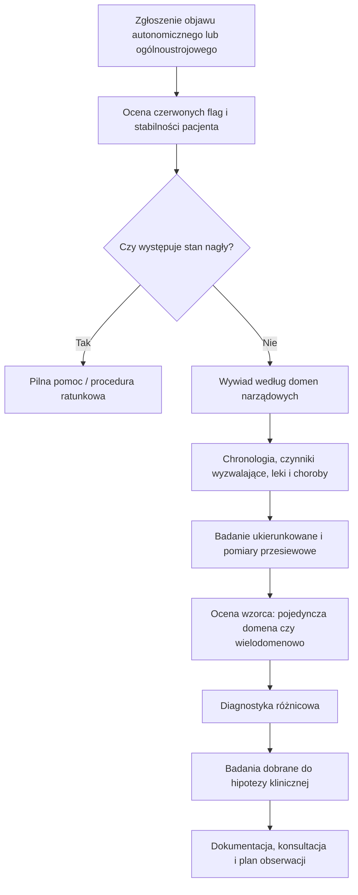

# 2.9. Objawy autonomiczne i ogólnoustrojowe

## Wprowadzenie

Objawy autonomiczne i ogólnoustrojowe są ważnym elementem wywiadu neurologicznego, ponieważ zaburzenia układu autonomicznego mogą poprzedzać objawy ruchowe, czuciowe lub poznawcze, współistnieć z nimi albo stanowić dominującą manifestację choroby. Mogą dotyczyć regulacji ciśnienia tętniczego i częstości rytmu serca, termoregulacji, potliwości, funkcji przewodu pokarmowego, pęcherza moczowego, jelit, funkcji seksualnych, wydzielania śliny, połykania, oddychania oraz rytmu snu i czuwania.

Wywiad nie powinien ograniczać się do pytania, czy pacjent „ma problemy z ciśnieniem”, „z żołądkiem” lub „z pęcherzem”. Należy ustalić charakter objawu, jego początek, dynamikę, związek z pozycją ciała, posiłkiem, wysiłkiem, temperaturą, snem, mikcją, defekacją i przyjmowanymi lekami. Ważne jest także określenie, czy objawy występują w kilku domenach jednocześnie. Wielodomenowy wzorzec zaburzeń autonomicznych może sugerować uogólnioną dysautonomię, neuropatię autonomiczną lub chorobę neurodegeneracyjną, ale sam w sobie nie przesądza o rozpoznaniu.

Rozdział koncentruje się na badaniu podmiotowym. Nie zastępuje szczegółowego badania układu krążenia, przewodu pokarmowego, układu moczowo-płciowego, układu oddechowego ani badania neurologicznego opisanego w innych modułach. Celem jest rozpoznanie wzorców wymagających dalszej oceny, wychwycenie stanów nagłych oraz sporządzenie użytecznej klinicznie dokumentacji.

> **Zasada bezpieczeństwa:** nowa utrata kontroli nad oddawaniem moczu lub stolca, zatrzymanie moczu, znieczulenie okolicy siodłowej, szybko narastające osłabienie, zaburzenia połykania z krztuszeniem, duszność spoczynkowa, stridor, omdlenie z bólem w klatce piersiowej lub nagły silny ból głowy u osoby z wysokim uszkodzeniem rdzenia wymagają pilnej oceny. Nie należy przypisywać ich automatycznie „dysautonomii”.

## 1. Cele kształcenia i efekty uczenia się

### 1.1. Cel ogólny

Celem jest przygotowanie uczestnika do systematycznego zbierania wywiadu dotyczącego objawów autonomicznych i ogólnoustrojowych, rozpoznawania ich możliwych mechanizmów, identyfikowania czerwonych flag oraz właściwego kierowania pacjenta do dalszej diagnostyki.

### 1.2. Szczegółowe efekty uczenia się

Po ukończeniu rozdziału uczestnik powinien umieć:

1. wyjaśnić, czym jest autonomiczny układ nerwowy i jakie funkcje reguluje;
2. odróżnić objaw autonomiczny od objawu nieswoistego, który może mieć przyczynę neurologiczną, internistyczną, polekową lub środowiskową;
3. zebrać wywiad dotyczący nietolerancji ortostatycznej, omdleń, kołatania serca i zmian ciśnienia;
4. zapytać o potliwość, suchość skóry, nietolerancję ciepła i zaburzenia termoregulacji;
5. scharakteryzować zaburzenia motoryki przewodu pokarmowego, mikcji, defekacji i funkcji seksualnych;
6. rozpoznać objawy sugerujące dysfagię, aspirację, zaburzenia oddychania podczas snu i hipowentylację;
7. ustalić związek objawów z chorobami współistniejącymi, lekami, nawodnieniem i sytuacją życiową;
8. przeprowadzić bezpieczną, podstawową ocenę ortostatyczną w granicach własnych kompetencji i lokalnych procedur;
9. rozpoznać sytuacje wymagające pilnego wezwania pomocy lub konsultacji specjalistycznej;
10. udokumentować objawy w sposób umożliwiający ocenę ich dynamiki i odpowiedź na leczenie.

### 1.3. Granice kompetencji

Wywiad i podstawowe pomiary przesiewowe nie uprawniają do samodzielnego rozpoznawania wszystkich chorób autonomicznych ani do modyfikowania farmakoterapii. Interpretacja testów autonomicznych, badań urodynamicznych, testów opróżniania żołądka, badań snu i zaawansowanej diagnostyki oddechowej wymaga odpowiednich kwalifikacji. W razie niepewności należy opisać obserwacje, wskazać ryzyko i skierować pacjenta do osoby uprawnionej.

## 2. Podstawowe pojęcia i definicje

### 2.1. Autonomiczny układ nerwowy

Autonomiczny układ nerwowy (AUN) reguluje czynności narządów wewnętrznych, naczyń, gruczołów i mięśni gładkich. Jego działanie jest w dużej mierze niezależne od świadomej kontroli, choć pozostaje powiązane z emocjami, zachowaniem, oddychaniem, aktywnością fizyczną i regulacją homeostazy.

Wyróżnia się przede wszystkim część współczulną, przywspółczulną oraz jelitowy układ nerwowy. Nie należy jednak traktować ich jako prostych przeciwstawnych „włączników”. W wielu narządach obie składowe współdziałają, a odpowiedź zależy od kontekstu fizjologicznego.

### 2.2. Dysautonomia

Dysautonomia to określenie zaburzenia funkcji autonomicznej. Może mieć charakter uogólniony albo ograniczony do wybranych domen. Nie jest jedną jednostką chorobową i nie wskazuje automatycznie na konkretną etiologię.

### 2.3. Objawy autonomiczne

Do objawów autonomicznych zalicza się między innymi:
- nietolerancję pionizacji, zawroty głowy i stan przedomdleniowy;
- nieprawidłową regulację ciśnienia i rytmu serca;
- nadmierną, zmniejszoną lub nieobecną potliwość;
- zaburzenia reakcji naczynioruchowych i termoregulacji;
- zaburzenia motoryki przewodu pokarmowego;
- zaburzenia magazynowania i opróżniania pęcherza;
- zaburzenia funkcji jelit;
- zaburzenia erekcji, ejakulacji, lubrykacji, pobudzenia i orgazmu;
- zaburzenia źreniczne i wydzielnicze;
- niektóre zaburzenia snu i oddychania związane z chorobami układu nerwowego.

### 2.4. Objawy ogólnoustrojowe

Objawy ogólnoustrojowe to dolegliwości, które mogą odzwierciedlać zaburzenia wielu narządów lub ogólny stan organizmu, na przykład osłabienie, męczliwość, utrata masy ciała, gorączka, zaburzenia apetytu, odwodnienie, nietolerancja wysiłku czy zaburzenia snu. Nie są one swoiste dla dysautonomii. Wymagają równoległego rozważenia przyczyn internistycznych, endokrynologicznych, zakaźnych, hematologicznych, onkologicznych, psychicznych i polekowych.

### 2.5. Nietolerancja ortostatyczna

Nietolerancja ortostatyczna oznacza występowanie objawów podczas przyjmowania pozycji stojącej lub długotrwałego utrzymywania pionizacji, zwykle ustępujących albo zmniejszających się po położeniu. Może obejmować osłabienie, zawroty głowy, zamglenie lub ściemnienie widzenia, kołatanie serca, nudności, trudności z koncentracją, ból karku lub okolicy potylicznej i stan przedomdleniowy. Objawy mogą występować bez spełnienia kryteriów hipotensji ortostatycznej w pojedynczym pomiarze.

### 2.6. Hipotonia ortostatyczna

Klasyczna hipotonia ortostatyczna to utrwalony spadek ciśnienia skurczowego o co najmniej 20 mmHg lub rozkurczowego o co najmniej 10 mmHg w ciągu 3 minut od przyjęcia pozycji stojącej albo podczas odpowiednio przeprowadzonego testu pochyleniowego. U osób z nadciśnieniem w pozycji leżącej w niektórych kryteriach rozważa się większy spadek, na przykład 30/15 mmHg; interpretacja zależy od kontekstu i przyjętych standardów. Przejściowa hipotonia początkowa pojawia się w pierwszych około 15 sekundach pionizacji i zwykle wymaga ciągłego, uderzenie po uderzeniu pomiaru ciśnienia; standardowy mankiet może jej nie uchwycić. Hipotonia opóźniona ujawnia się po upływie 3 minut stania i może wymagać dłuższej, nadzorowanej obserwacji.

Hipotonia ortostatyczna jest objawem lub znakiem klinicznym, a nie samodzielnym rozpoznaniem etiologicznym. Może wynikać z odwodnienia, krwawienia, leków, niewydolności serca, zaburzeń hormonalnych, odtrenowania lub niewydolności autonomicznej.

### 2.7. Hipotonia ortostatyczna neurogenna

Hipotonia ortostatyczna neurogenna wynika z niewystarczającej odpowiedzi autonomicznej, zwłaszcza współczulnej, na pionizację. Często obserwuje się nieadekwatny wzrost częstości rytmu serca w stosunku do spadku ciśnienia. Wskaźnik zmiany częstości serca do zmiany ciśnienia skurczowego poniżej około 0,5 uderzenia/min na mmHg może wspierać podejrzenie mechanizmu neurogennego, ale nie powinien być interpretowany bez uwzględnienia leków, rytmu serca, rozrusznika, wieku i chorób współistniejących.

### 2.8. Zaburzenia mikcji i neurogenna dysfunkcja dolnych dróg moczowych

Neurogenna dysfunkcja dolnych dróg moczowych oznacza nieprawidłową czynność pęcherza, szyi pęcherza lub zwieraczy związaną z chorobą albo uszkodzeniem układu nerwowego. Może powodować objawy gromadzenia moczu, opróżniania pęcherza lub mieszane. Samo częste oddawanie moczu nie dowodzi neurogennego pochodzenia dolegliwości.

### 2.9. Dysfagia i zaburzenia ślinienia

Dysfagia oznacza trudność w połykaniu. Może dotyczyć fazy ustno-gardłowej lub przełykowej i wynikać z wielu przyczyn neurologicznych, strukturalnych, mięśniowych oraz polekowych. Ślinienie może być następstwem nadmiernego wydzielania śliny, ale często wynika z ograniczonego połykania i niewystarczającego oczyszczania jamy ustnej.

### 2.10. Hipowentylacja związana ze snem

Hipowentylacja podczas snu to niewystarczająca wentylacja pęcherzykowa w czasie snu, mogąca prowadzić do wzrostu stężenia dwutlenku węgla i zaburzeń utlenowania. W chorobach nerwowo-mięśniowych może poprzedzać wyraźną niewydolność oddechową w ciągu dnia.

## 3. Podstawy neuroanatomiczne i neurofizjologiczne

### 3.1. Organizacja ośrodkowej kontroli autonomicznej

Regulacja autonomiczna jest rozproszona i obejmuje:
- korę wyspy, korę przedczołową i zakręt obręczy, uczestniczące w integracji sygnałów trzewnych, emocji i zachowania;
- ciało migdałowate i inne struktury układu limbicznego, modulujące reakcje autonomiczne związane z emocjami;
- podwzgórze, integrujące regulację temperatury, gospodarki wodnej, łaknienia, reakcji hormonalnych i autonomicznych;
- istotę szarą okołowodociągową, uczestniczącą w koordynacji reakcji obronnych, bólowych i trzewnych;
- jądro pasma samotnego, odbierające informacje z baroreceptorów i receptorów trzewnych;
- brzuszno-boczną część rdzenia przedłużonego, uczestniczącą w regulacji napięcia współczulnego;
- jądra pnia mózgu, w tym jądro dwuznaczne i jądro grzbietowe nerwu błędnego, związane z regulacją przywspółczulną.

Uszkodzenia lub dysfunkcje tych sieci mogą powodować objawy sercowo-naczyniowe, pokarmowe, oddechowe, termoregulacyjne i urogenitalne.

### 3.2. Drogi współczulne

Neurony przedzwojowe układu współczulnego znajdują się w segmentach piersiowych i górnych lędźwiowych rdzenia kręgowego. Ich aksony przełączają się w zwojach współczulnych lub zwojach przedkręgowych. Włókna zazwojowe unerwiają między innymi naczynia, gruczoły potowe, serce i narządy trzewne.

Włókna współczulne są ważne dla:
- skurczu naczyń i utrzymania ciśnienia podczas pionizacji;
- przyspieszania rytmu serca i zwiększania kurczliwości;
- termoregulacji i potliwości;
- regulacji źrenicy;
- funkcji pęcherza, jelit i narządów płciowych.

### 3.3. Drogi przywspółczulne

Część przywspółczulna obejmuje włókna czaszkowe związane z nerwami III, VII, IX i X oraz włókna krzyżowe z segmentów S2–S4. Nerw błędny ma szczególne znaczenie dla regulacji serca i znacznej części przewodu pokarmowego. Ośrodki krzyżowe uczestniczą w kontroli pęcherza, dystalnej części jelita grubego i funkcji seksualnych.

### 3.4. Jelitowy układ nerwowy i kontrola trzewna

Jelitowy układ nerwowy obejmuje sploty śródmięśniowy i podśluzówkowy. Koordynuje motorykę, wydzielanie i miejscowy przepływ krwi, pozostając pod wpływem układu współczulnego, przywspółczulnego, hormonów i bodźców miejscowych. Zaburzenia motoryki przewodu pokarmowego nie muszą zatem wynikać wyłącznie z uszkodzenia nerwów autonomicznych.

### 3.5. Odruch z baroreceptorów

Baroreceptory zatoki szyjnej i łuku aorty wykrywają rozciągnięcie ściany naczynia. Przy pionizacji zmniejsza się powrót żylny i przejściowo spada ciśnienie, co uruchamia odruchową odpowiedź współczulną i ogranicza aktywność przywspółczulną. Dochodzi do zwiększenia częstości rytmu serca i skurczu naczyń. Niewydolność tego mechanizmu może powodować hipotonię ortostatyczną.

### 3.6. Termoregulacja i potliwość

Podwzgórze integruje informacje o temperaturze centralnej i obwodowej. W odpowiedzi na przegrzanie aktywowane są mechanizmy oddawania ciepła, w tym pocenie i rozszerzenie naczyń skórnych. Uszkodzenie włókien autonomicznych, zaburzenia ośrodkowe, leki i choroby skóry mogą prowadzić do nadmiernego pocenia albo jego ograniczenia.

### 3.7. Kontrola mikcji i defekacji

Mikcja wymaga skoordynowanej aktywności mięśnia wypieracza pęcherza i zwieraczy. W fazie gromadzenia moczu dominuje utrzymanie relaksacji wypieracza i zamknięcia odpływu; podczas opróżniania potrzebna jest skoordynowana aktywacja wypieracza i rozluźnienie zwieraczy. Kontrola obejmuje ośrodki korowe, mostowe i krzyżowe oraz drogi obwodowe.

Defekacja wymaga współpracy motoryki jelita grubego, czucia odbytniczego, mięśni dna miednicy i zwieraczy. Uszkodzenie dróg rdzeniowych lub obwodowych może zaburzać czucie parcia, kontrolę zwieraczy i koordynację wypróżnienia.

### 3.8. Funkcje seksualne

Funkcje seksualne są wynikiem współdziałania układu autonomicznego, somatycznego, hormonalnego, naczyniowego, czuciowego i psychicznego. Odpowiedź seksualna nie jest prostym testem sprawności pojedynczej drogi nerwowej. W wywiadzie należy unikać redukowania problemu do jednej przyczyny.

## 4. Ogólna struktura wywiadu autonomicznego

### 4.1. Zasada domen

Wywiad należy prowadzić według domen narządowych, a nie wyłącznie według listy rozpoznań. Ułatwia to wykrycie współwystępowania objawów i pozwala uniknąć przedwczesnego przypisania ich jednej chorobie.

| Domena | Przykładowe objawy |
|---|---|
| Sercowo-naczyniowa | zawroty przy wstawaniu, omdlenia, kołatanie, nietolerancja wysiłku |
| Naczynioruchowa | zmiany koloru i temperatury kończyn, napadowe zaczerwienienie |
| Potliwość | nadmierne pocenie, brak potu, asymetria pocenia |
| Termoregulacja | nietolerancja gorąca lub zimna, przegrzewanie |
| Pokarmowa | wczesna sytość, nudności, wymioty, zaparcie, biegunka |
| Moczowa | parcie, częstomocz, trudność rozpoczęcia mikcji, zatrzymanie moczu |
| Jelitowa | zaparcie, nietrzymanie stolca, utrata czucia parcia |
| Seksualna | zaburzenia erekcji, lubrykacji, orgazmu, ejakulacji |
| Połykanie i ślina | krztuszenie, kaszel podczas posiłku, ślinienie, zmiana głosu |
| Sen i oddychanie | bezdechy, stridor, poranne bóle głowy, ortopnoe, senność dzienna |

### 4.2. Schemat pytań dla każdej dolegliwości

Dla każdego objawu ustal:
1. kiedy wystąpił po raz pierwszy;
2. czy początek był nagły, podostry czy stopniowy;
3. czy objaw jest stały, napadowy, zależny od sytuacji czy postępujący;
4. jak często występuje i jak długo trwa;
5. co go wyzwala, nasila lub łagodzi;
6. czy towarzyszą mu inne objawy;
7. czy wpływa na samodzielność, bezpieczeństwo, sen, odżywienie lub pracę;
8. czy występował przed rozpoczęciem nowego leku albo po zmianie dawki;
9. czy podobne dolegliwości występują u członków rodziny;
10. jakie badania i leczenie były dotychczas przeprowadzone.

### 4.3. Ustalenie stanu wyjściowego

Należy ustalić typowy dla pacjenta poziom ciśnienia, tętna, masy ciała, częstość mikcji i wypróżnień, zwyczajowy sposób odżywiania, ilość przyjmowanych płynów, jakość snu i sprawność przed początkiem dolegliwości. U pacjentów z urazem rdzenia, chorobą Parkinsona, stwardnieniem rozsianym lub neuropatią cukrzycową zmiana względem indywidualnego stanu wyjściowego może być ważniejsza niż pojedyncza wartość bez kontekstu.

## 5. Wywiad dotyczący zawrotów głowy i nietolerancji ortostatycznej

### 5.1. Rozróżnienie rodzaju zawrotów

Słowo „zawroty głowy” jest niejednoznaczne. Należy poprosić pacjenta o opis własnymi słowami:
- wirowanie otoczenia lub własnego ciała;
- uczucie omdlewania, ciemnienia przed oczami lub „odpływania”;
- niestabilność podczas stania lub chodzenia;
- uczucie oszołomienia, zaburzenia koncentracji albo „mgły”;
- napadowe kołatanie serca lub duszność.

Wrażenie wirowania może wskazywać na zaburzenia przedsionkowe, ale nie wyklucza innych przyczyn. Uczucie zbliżającego się omdlenia przy pionizacji sugeruje nietolerancję ortostatyczną, lecz wymaga różnicowania z arytmią, niedokrwieniem serca, hipoglikemią, krwawieniem, odwodnieniem i działaniem leków.

### 5.2. Pytania ukierunkowane

- Czy objaw pojawia się bezpośrednio po wstaniu z łóżka lub krzesła?
- Czy występuje po dłuższym staniu, gorącym prysznicu albo wysiłku?
- Czy nasila się po obfitym posiłku?
- Czy ustępuje po siadaniu lub położeniu się?
- Czy towarzyszy mu zamglenie widzenia, osłabienie, nudności, kołatanie albo ból karku?
- Czy doszło do utraty przytomności lub upadku?
- Czy objawy występują rano, po lekach lub po długim unieruchomieniu?
- Czy pacjent odczuwa podobne dolegliwości podczas oddawania moczu, kaszlu lub defekacji?

### 5.3. Hipotonia ortostatyczna – podstawowe kryterium

Klasyczne kryterium wynosi: spadek ciśnienia skurczowego o co najmniej 20 mmHg lub rozkurczowego o co najmniej 10 mmHg w ciągu 3 minut pionizacji. Wynik należy zestawić z objawami i tętnem. Brak objawów nie wyklucza obiektywnej hipotonii, a brak spadku w pojedynczym badaniu nie wyklucza epizodycznej lub opóźnionej hipotonii.

U osoby z wysokim ciśnieniem w pozycji leżącej interpretacja wymaga uwzględnienia wartości wyjściowej i standardu stosowanego przez zespół kliniczny. Nie należy rozpoznawać neurogennej hipotonii wyłącznie na podstawie wartości ciśnienia.

### 5.4. Bezpieczna procedura pomiaru ortostatycznego

Poniższy schemat dotyczy przesiewowej oceny wykonywanej przez osobę przeszkoloną, z użyciem odpowiedniego sprzętu i asekuracji.

1. Wyjaśnij cel badania, zapytaj o aktualne zawroty głowy, ból w klatce piersiowej, duszność, niedawne omdlenie i zdolność bezpiecznego stania.
2. Zapewnij łóżko lub leżankę, krzesło, możliwość natychmiastowego położenia pacjenta oraz pomoc drugiej osoby, jeśli jest potrzebna.
3. Połóż pacjenta na plecach i zapewnij odpoczynek przez około 5–10 minut.
4. Zmierz ciśnienie tętnicze i częstość rytmu serca w pozycji leżącej; zapisz pozycję, czas i objawy.
5. Pomóż pacjentowi wstać. Nie pozwalaj na gwałtowne samodzielne podrywanie się.
6. Zmierz ciśnienie i tętno po około 1 minucie oraz po 3 minutach stania. Jeśli objawy pojawiają się później, a stan pacjenta pozwala na bezpieczną obserwację, dalszy pomiar może być wykonany zgodnie z procedurą kliniczną.
7. Zapisz objawy występujące podczas każdej fazy, nie tylko wartości liczbowe.
8. Przerwij próbę, jeśli pojawia się stan przedomdleniowy, nasilone zawroty, ból w klatce piersiowej, duszność, zaburzenia neurologiczne lub niestabilność postawy. Ułóż pacjenta bezpiecznie i oceń stan.
9. Po badaniu sprawdź, czy pacjent wrócił do stanu wyjściowego i czy może bezpiecznie zmienić pozycję.

W sytuacji, gdy pacjent nie może bezpiecznie stać, nie należy wymuszać próby. Pomiar z pozycji siedzącej może być alternatywą przesiewową, ale ma mniejszą czułość. Test pochyleniowy i ciągłe monitorowanie ciśnienia należą do diagnostyki specjalistycznej.

### 5.5. Interpretacja odpowiedzi tętna

Przy spadku ciśnienia prawidłowa odpowiedź obejmuje zwykle wzrost częstości rytmu serca. Niewielka lub nieobecna odpowiedź może wspierać podejrzenie niewydolności autonomicznej, ale beta-adrenolityki, niektóre blokery kanału wapniowego, zaburzenia przewodzenia, migotanie przedsionków, rozrusznik i inne czynniki mogą zaburzać interpretację.

Wzrost tętna bez istotnego spadku ciśnienia może występować w różnych stanach, w tym w hipowolemii, odtrenowaniu, gorączce, niedokrwistości, nadczynności tarczycy, lęku lub zespole posturalnej tachykardii ortostatycznej (POTS). W często stosowanych kryteriach u dorosłych uwzględnia się utrwalony wzrost częstości rytmu serca o co najmniej 30/min w ciągu 10 minut pionizacji (u osób w wieku 12–19 lat co najmniej 40/min), bez spełnienia kryterium hipotonii ortostatycznej, przy przewlekłych objawach nietolerancji ortostatycznej i po wykluczeniu innych przyczyn tachykardii. Szczegółowe kryteria zależą od wytycznych i populacji. POTS nie wolno rozpoznawać na podstawie samego przyrostu tętna.

### 5.6. Hipotonia poposiłkowa

Zapytaj, czy osłabienie, senność, zawroty lub stan przedomdleniowy pojawiają się po posiłkach, zwłaszcza obfitych. U części pacjentów po jedzeniu dochodzi do spadku ciśnienia związanego z przekierowaniem przepływu krwi do przewodu pokarmowego i niewystarczającą kompensacją krążeniową. Należy uwzględnić porę posiłku, wielkość porcji, leki, nawodnienie i choroby współistniejące.

### 5.7. Omdlenie i objawy sercowe

Utrata przytomności podczas wysiłku, w pozycji leżącej, bez ostrzeżenia, z kołataniem serca lub bólem w klatce piersiowej wymaga pilnej oceny przyczyn sercowych. Wywiad dotyczący omdleń został szerzej omówiony w rozdziale 2.7; w tym miejscu należy zwrócić uwagę na ich możliwy związek z dysfunkcją autonomiczną, odwodnieniem, lekami i zaburzeniami rytmu.

## 6. Wywiad dotyczący potliwości i termoregulacji

### 6.1. Rodzaje zaburzeń potliwości

- **Hiperhydroza** – nadmierna potliwość, miejscowa lub uogólniona.
- **Hipohydroza** – zmniejszona potliwość.
- **Anhydroza** – brak lub niemal całkowity brak pocenia w określonym obszarze.
- **Potliwość asymetryczna** – wyraźna różnica między stronami ciała lub obszarami.
- **Potliwość smakowa** – pocenie wyzwalane jedzeniem, niekiedy szczególnie kwaśnym lub pikantnym.

### 6.2. Pytania do pacjenta

- Czy poci się Pan/Pani bardziej, mniej czy inaczej niż dawniej?
- Czy problem dotyczy całego ciała, twarzy, tułowia, dłoni, stóp czy jednej strony?
- Czy pocenie występuje w spoczynku, podczas snu, wysiłku, jedzenia lub stresu?
- Czy występują napady nocnych potów, gorączka, utrata masy ciała lub kołatanie serca?
- Czy skóra jest sucha, pęka, łatwo ulega przegrzaniu albo pojawiają się zawroty w upale?
- Czy pacjent odczuwa nietolerancję gorąca lub zimna?
- Czy objaw rozpoczął się po wprowadzeniu leku, zmianie dawki lub zabiegu?

### 6.3. Interpretacja wzorca

Ograniczone pocenie w kończynach dolnych może współwystępować z neuropatią małych włókien lub neuropatią autonomiczną. Nadmierne pocenie może być pierwotne, polekowe, hormonalne, infekcyjne, metaboliczne lub związane z bólem i stresem. Nocne poty z gorączką, utratą masy ciała lub powiększeniem węzłów chłonnych wymagają szerszej diagnostyki ogólnoustrojowej.

### 6.4. Bezpieczeństwo termiczne

Pacjent z anhydrozą lub znacznym ograniczeniem pocenia może nie być w stanie skutecznie oddawać ciepła. Należy zapytać o epizody przegrzania, osłabienia, nudności, splątania i omdleń podczas upału lub wysiłku. Splątanie, drgawki, utrata przytomności lub bardzo wysoka temperatura ciała w kontekście przegrzania są stanem nagłym.

## 7. Objawy naczynioruchowe i zmiany obwodowego ukrwienia

### 7.1. Charakterystyka objawów

Zapytaj o napadowe zblednięcie, sinienie, zaczerwienienie, uczucie zimna, pieczenie, obrzęk lub zmianę temperatury dłoni i stóp. Ustal, czy objawy są symetryczne, czy wywołuje je zimno, stres, pozycja kończyny lub wysiłek.

### 7.2. Różnicowanie

Zmiany naczynioruchowe mogą występować w zaburzeniach autonomicznych, ale także w chorobach naczyń, zespole Raynauda, zakrzepicy, zapaleniu naczyń, neuropatii obwodowej i chorobach tkanki łącznej. Nagły, bolesny, blady lub siny i zimny końcowy odcinek kończyny, zwłaszcza z osłabieniem czucia lub ruchu, wymaga pilnej oceny niedokrwienia.

### 7.3. Pytania praktyczne

- Czy zmiana koloru dotyczy jednego palca, całej dłoni czy obu kończyn?
- Czy występuje ból, drętwienie lub osłabienie?
- Czy po ogrzaniu kolor i czucie wracają do normy?
- Czy pojawiły się rany, owrzodzenia lub martwica?
- Czy pacjent pali tytoń lub używa substancji obkurczających naczynia?

## 8. Wywiad dotyczący przewodu pokarmowego

### 8.1. Zasada lokalizacji objawów

Należy odróżnić dolegliwości z górnego odcinka przewodu pokarmowego, zaburzenia pasażu jelitowego i objawy związane z defekacją. Ważne jest ustalenie relacji z posiłkiem, pozycją ciała, lekami, bólem i wypróżnieniem.

### 8.2. Objawy przełykowe i żołądkowe

Pytaj o:
- trudności w połykaniu pokarmów stałych lub płynów;
- uczucie zatrzymywania pokarmu za mostkiem;
- zgagę, odbijanie i cofanie treści;
- nudności, wymioty i wczesną sytość;
- uczucie pełności po małym posiłku;
- wzdęcia, ból nadbrzusza i zmienność apetytu;
- wymioty treścią zalegającą wiele godzin po jedzeniu.

Gastropareza oznacza opóźnione opróżnianie żołądka bez mechanicznej przeszkody. Objawy takie jak nudności, wczesna sytość, pełność poposiłkowa i wymioty mogą ją sugerować, ale nie są swoiste. Należy uwzględnić cukrzycę, leki opioidowe, leki o działaniu antycholinergicznym, analogi GLP-1 i inne przyczyny zaburzeń motoryki. Rozpoznanie wymaga odpowiedniej diagnostyki, a nie samego wywiadu.

### 8.3. Zaparcie

Ustal:
- częstość wypróżnień;
- konsystencję stolca, najlepiej z użyciem skali Bristol;
- konieczność silnego parcia;
- uczucie niepełnego wypróżnienia;
- potrzebę ręcznych manewrów lub ucisku;
- czas trwania problemu i zmianę względem wcześniejszego rytmu;
- stosowanie środków przeczyszczających;
- ilość płynów, błonnika, aktywność i możliwość korzystania z toalety.

Zaparcie może wynikać z zaburzeń autonomicznych, ale także z diety, odwodnienia, ograniczonej mobilności, niedoczynności tarczycy, hiperkalcemii, chorób jelit i leków, zwłaszcza opioidów oraz preparatów o działaniu antycholinergicznym.

### 8.4. Biegunka i nietrzymanie stolca

Zapytaj o liczbę stolców, ich konsystencję, nagłość parcia, wybudzanie w nocy, ból, gorączkę, krew, śluz, utratę masy ciała i epizody nietrzymania. Ustal, czy pacjent odczuwa parcie i potrafi odroczyć wypróżnienie. Biegunka może być zakaźna, zapalna, polekowa, osmotyczna, wydzielnicza lub związana z zaburzeniami motoryki. Nietrzymanie stolca może wynikać z uszkodzenia zwieraczy, zaburzeń czucia, chorób rdzenia, neuropatii, biegunki lub ograniczeń funkcjonalnych.

### 8.5. Objawy alarmowe przewodu pokarmowego

Pilnej oceny wymagają między innymi:
- krwawienie z przewodu pokarmowego, smoliste stolce lub krwawe wymioty;
- silny, nagły albo narastający ból brzucha z objawami otrzewnowymi;
- uporczywe wymioty, odwodnienie i niemożność przyjmowania płynów;
- zatrzymanie gazów i stolca z wzdęciem i wymiotami;
- niewyjaśniona utrata masy ciała, niedokrwistość lub postępujące trudności w połykaniu;
- gorączka i biegunka z cechami ciężkiego odwodnienia lub zaburzeniami świadomości.

## 9. Wywiad dotyczący mikcji i funkcji pęcherza

### 9.1. Dwie główne grupy objawów

**Objawy magazynowania moczu:**
- częstomocz;
- parcia naglące;
- nietrzymanie moczu związane z parciem;
- nykturia;
- zmniejszona tolerancja wypełnienia pęcherza.

**Objawy opróżniania pęcherza:**
- trudność rozpoczęcia mikcji;
- słaby lub przerywany strumień;
- konieczność parcia tłocznią brzuszną;
- wydłużony czas oddawania moczu;
- uczucie niepełnego opróżnienia;
- zatrzymanie moczu i przepełnieniowe nietrzymanie.

Objawy mogą współistnieć. Ich opis nie pozwala samodzielnie ustalić rodzaju zaburzenia urodynamicznego.

### 9.2. Pytania ukierunkowane

1. Ile razy pacjent oddaje mocz w dzień i w nocy?
2. Czy parcie pojawia się nagle i trudno je odroczyć?
3. Czy dochodzi do wycieku przed dotarciem do toalety?
4. Czy rozpoczęcie mikcji jest opóźnione?
5. Czy strumień jest słaby, przerywany lub wymaga parcia?
6. Czy po oddaniu moczu pozostaje uczucie pełnego pęcherza?
7. Czy pacjent ma nawracające zakażenia dróg moczowych?
8. Czy występuje ból, pieczenie, krwiomocz lub gorączka?
9. Czy pacjent stosuje cewnik albo wykonuje samocewnikowanie?
10. Czy objawy pojawiły się wraz z bólem kręgosłupa, osłabieniem nóg lub zaburzeniem czucia krocza?

### 9.3. Dzienniczek mikcji

Przydatny może być dzienniczek obejmujący przez uzgodniony okres:
- godzinę i orientacyjną objętość przyjętych płynów;
- godzinę i objętość mikcji;
- epizody parcia i nietrzymania;
- liczbę wybudzeń nocnych;
- okoliczności wyzwalające;
- przyjęte leki i objawy towarzyszące.

Dzienniczek nie zastępuje badania ani oceny zalegania moczu po mikcji.

### 9.4. Badania uzupełniające

W zależności od obrazu klinicznego lekarz może zlecić badanie ogólne moczu, posiew, ocenę czynności nerek, ultrasonograficzny pomiar zalegania moczu po mikcji, ocenę przepływu cewkowego lub badanie urodynamiczne. Pomiar objętości zalegającej powinien być interpretowany w kontekście objawów, powtarzalności pomiaru, nawodnienia i anatomii układu moczowego.

### 9.5. Czerwone flagi urologiczne i neurologiczne

Nowe zatrzymanie moczu, utrata czucia w okolicy krocza, znieczulenie siodłowe, nowa dysfunkcja zwieraczy, obustronne objawy korzeniowe lub szybko narastające osłabienie kończyn dolnych mogą wskazywać na zespół ogona końskiego albo ucisk struktur nerwowych. Wymagają pilnej oceny w trybie ratunkowym.

Krwiomocz, nawracające zakażenia, ból okolicy lędźwiowej, nawracające blokowanie cewnika i pogorszenie funkcji nerek wymagają pilnej diagnostyki urologicznej lub nefrologicznej zgodnie z nasileniem i stanem pacjenta.

## 10. Wywiad dotyczący defekacji i funkcji jelit

### 10.1. Zakres pytań

- Jaka jest zwyczajowa częstość wypróżnień?
- Czy pacjent odczuwa parcie na stolec?
- Czy rozpoznaje wypełnienie odbytnicy?
- Czy może świadomie odroczyć defekację?
- Czy występuje zaparcie, biegunka, nietrzymanie lub naprzemienność objawów?
- Czy potrzebne są czopki, wlewki lub ręczne usuwanie stolca?
- Czy defekacja wywołuje ból, omdlenie lub silne zawroty?
- Czy występują krwawienia, utrata masy ciała lub gorączka?

### 10.2. Znaczenie neurologiczne

Zaburzenia kontroli jelit mogą występować w uszkodzeniu rdzenia, stwardnieniu rozsianym, neuropatiach autonomicznych, chorobach neurodegeneracyjnych i po urazach. Należy jednak pamiętać o częstych przyczynach poz neurologicznych: chorobach jelit, zaburzeniach dna miednicy, lekach, ograniczonej mobilności i niewłaściwej podaży płynów.

### 10.3. Wywiad w chorobach rdzenia

U pacjenta z uszkodzeniem rdzenia należy określić:
- czy czucie parcia jest zachowane;
- czy wypróżnienie odbywa się spontanicznie, odruchowo czy z pomocą;
- czy występują epizody nietrzymania;
- czy manipulacje w obrębie odbytnicy wywołują ból głowy, poty lub wzrost ciśnienia;
- czy istnieje ustalony program jelitowy;
- czy zmiana rytmu wypróżnień może wskazywać na zaleganie stolca, niedrożność lub zakażenie.

## 11. Wywiad dotyczący funkcji seksualnych

### 11.1. Zasady prowadzenia rozmowy

Wywiad seksualny należy prowadzić w warunkach prywatności, z poszanowaniem autonomii, godności, tożsamości, orientacji, granic i preferencji pacjenta. Przed zadaniem pytań należy wyjaśnić, dlaczego mogą mieć znaczenie kliniczne, i uzyskać zgodę na rozmowę. Pacjent ma prawo nie odpowiadać.

Nie należy zakładać aktywności seksualnej, płci partnera, modelu relacji ani oczekiwań dotyczących funkcji seksualnych. Pytania powinny być neutralne i dostosowane do wieku, sytuacji zdrowotnej oraz kultury pacjenta.

### 11.2. Obszary wywiadu

- libido i zainteresowanie aktywnością seksualną;
- pobudzenie i reakcje fizjologiczne;
- erekcja, lubrykacja i nawilżenie;
- ejakulacja, emisja nasienia i orgazm;
- ból, dyskomfort lub zaburzenia czucia;
- zmiana funkcji po urazie, zabiegu lub rozpoczęciu leczenia;
- wpływ objawów pęcherza, jelit, spastyczności i bólu;
- wpływ nastroju, zmęczenia, relacji i poczucia bezpieczeństwa.

### 11.3. Mechanizmy neurologiczne

Funkcje seksualne zależą od współdziałania ośrodków mózgowych, dróg rdzeniowych, układu współczulnego i przywspółczulnego, nerwów somatycznych, naczyń oraz gospodarki hormonalnej. Uszkodzenie rdzenia, neuropatia cukrzycowa, choroby neurodegeneracyjne, stwardnienie rozsiane i niektóre neuropatie mogą wpływać na czucie, reakcje naczyniowe, kontrolę mięśni dna miednicy i funkcję autonomiczną.

### 11.4. Różnicowanie

Należy uwzględnić choroby naczyniowe, cukrzycę, zaburzenia hormonalne, depresję, lęk, ból, zaburzenia snu, działania niepożądane leków, używki, problemy urologiczne i ginekologiczne oraz czynniki relacyjne. Zaburzenie seksualne nie powinno być automatycznie przypisywane chorobie neurologicznej.

## 12. Wywiad dotyczący połykania, ślinienia i funkcji opuszkowych

### 12.1. Pytania o dysfagię

- Czy pacjent ma trudność z rozpoczęciem połykania?
- Czy krztusi się wodą, śliną lub pokarmem?
- Czy pokarm wraca do nosa?
- Czy po połknięciu pozostaje uczucie zalegania?
- Czy po posiłku pojawia się kaszel, chrypka lub „mokry” głos?
- Czy posiłki trwają dłużej niż dawniej?
- Czy pacjent unika określonych konsystencji?
- Czy wystąpiło zapalenie płuc, gorączka lub spadek masy ciała?
- Czy trudność dotyczy także połykania tabletek?

### 12.2. Dysfagia ustno-gardłowa i przełykowa

Dysfagia ustno-gardłowa może objawiać się trudnością rozpoczęcia połykania, krztuszeniem, kaszlem, wyciekiem pokarmu przez nos i zmianą głosu. Dysfagia przełykowa częściej wiąże się z uczuciem zatrzymania pokarmu za mostkiem po rozpoczęciu połykania. Rozróżnienie na podstawie samego opisu bywa niedoskonałe; postępująca dysfagia wymaga diagnostyki.

### 12.3. Aspiracja i ciche zachłyśnięcie

Aspiracja oznacza przedostanie się treści do dróg oddechowych. Nie zawsze wywołuje kaszel. Brak kaszlu nie wyklucza cichej aspiracji. Nawracające infekcje dolnych dróg oddechowych, niewyjaśniona gorączka, spadek masy ciała, długi czas posiłków i zmiana głosu mogą być wskazówkami.

Nie należy wykonywać prób połykania wody lub pokarmu u pacjenta z podejrzeniem istotnej dysfagii bez odpowiedniego przeszkolenia, wskazań i procedury przesiewowej. Pulsoksymetria nie jest samodzielnym testem wykluczającym aspirację.

### 12.4. Ślinienie

Należy zapytać, czy ślina wypływa z ust, czy pacjent ma trudność z jej połykaniem, czy problem nasila się w pozycji siedzącej, podczas mówienia lub snu. Ślinienie w chorobie Parkinsona często wiąże się z ograniczoną automatyczną częstotliwością połykania, a niekoniecznie z nadmierną produkcją śliny.

### 12.5. Czerwone flagi

Nagła dysfagia z objawami ogniskowymi może wskazywać na udar. Niemożność przełykania śliny, duszność, sinica, zaklinowanie pokarmu, nawracające zachłyśnięcia lub szybko narastające osłabienie opuszkowe wymagają pilnej oceny. W razie podejrzenia aspiracji nie należy kontynuować doustnego podawania pokarmów i płynów do czasu oceny zgodnej z lokalnym protokołem.

## 13. Wywiad dotyczący snu, oddychania i rytmu dobowego

### 13.1. Objawy nocne

Pytaj o:
- głośne chrapanie i obserwowane przerwy w oddychaniu;
- nagłe wybudzenia z uczuciem duszności;
- poranne bóle głowy;
- suchość w ustach po przebudzeniu;
- nadmierną senność w ciągu dnia;
- częste wybudzenia i nykturię;
- niespokojny sen, koszmary i odgrywanie snów ruchem;
- bezsenność, odwrócenie rytmu snu i czuwania;
- nietypowe dźwięki wdechowe, świst lub stridor.

### 13.2. Objawy niewydolności mięśni oddechowych

W chorobach nerwowo-mięśniowych szczególnie ważne są:
- duszność w pozycji leżącej;
- konieczność spania na kilku poduszkach;
- osłabienie kaszlu;
- trudność w odkrztuszaniu wydzieliny;
- poranne bóle głowy i niewyspanie;
- senność, zaburzenia koncentracji i koszmary;
- częste infekcje dróg oddechowych;
- duszność podczas mówienia lub jedzenia;
- szybkie męczenie się podczas niewielkiego wysiłku.

Prawidłowa saturacja w spoczynku nie wyklucza wczesnej hipowentylacji nocnej. W razie podejrzenia potrzebna jest specjalistyczna ocena funkcji oddechowej i snu.

### 13.3. Stridor

Stridor jest wysokim, zwykle słyszalnym podczas wdechu dźwiękiem wskazującym na zwężenie górnych dróg oddechowych. Może występować w wybranych chorobach neurodegeneracyjnych, w tym w zaniku wieloukładowym, ale wymaga różnicowania z innymi przyczynami zwężenia krtani i dróg oddechowych. Nowy stridor, zwłaszcza z dusznością, sinicą lub zaburzeniem świadomości, jest stanem nagłym.

### 13.4. Zaburzenia zachowania w czasie snu REM

Zapytaj, czy pacjent podczas snu krzyczy, wykonuje gwałtowne ruchy, uderza, kopie lub spada z łóżka, jak również czy doszło do urazów jego lub partnera. Zachowania sugerujące zaburzenie zachowania w czasie snu REM mogą poprzedzać niektóre synukleinopatie, ale rozpoznanie wymaga właściwej oceny, często z badaniem polisomnograficznym.

## 14. Objawy autonomiczne w wybranych chorobach neurologicznych

### 14.1. Neuropatia cukrzycowa autonomiczna

Może obejmować:
- hipotonię ortostatyczną, spoczynkową tachykardię i zaburzenia odpowiedzi serca;
- gastroparezę, nudności, wczesną sytość i wymioty;
- zaparcia, biegunkę i nietrzymanie stolca;
- zaburzenia mikcji i zaleganie moczu;
- zaburzenia erekcji i innych funkcji seksualnych;
- anhydrozę, hipohydrozę lub potliwość smakową;
- zaburzenia odczuwania hipoglikemii.

U osób z cukrzycą typu 1 po co najmniej 5 latach choroby i u wszystkich osób z cukrzycą typu 2 zaleca się ocenę objawów neuropatii autonomicznej zgodnie ze standardami opieki diabetologicznej. Objawy należy interpretować w kontekście czasu trwania cukrzycy, kontroli metabolicznej, powikłań mikronaczyniowych i alternatywnych przyczyn.

### 14.2. Choroba Parkinsona i inne synukleinopatie

W chorobie Parkinsona mogą występować zaparcia, hipotonia ortostatyczna, zaburzenia mikcji, potliwości, ślinienia, węchu, snu i funkcji seksualnych. W zaniku wieloukładowym objawy autonomiczne mogą być wczesne i nasilone, w tym hipotonia ortostatyczna, zaburzenia opróżniania pęcherza, nietrzymanie moczu, zaburzenia erekcji i stridor. W otępieniu z ciałami Lewy’ego mogą współistnieć zaburzenia autonomiczne, poznawcze, ruchowe i snu.

Pojedynczy objaw, taki jak zaparcie lub zaburzenie erekcji, nie wystarcza do rozpoznania synukleinopatii. Istotny jest wzorzec wielodomenowy, dynamika i współwystępowanie objawów ruchowych oraz poznawczych.

### 14.3. Uszkodzenie rdzenia kręgowego

Po urazie rdzenia mogą występować zaburzenia pęcherza, jelit, funkcji seksualnych, potliwości i regulacji ciśnienia. U osób z uszkodzeniem na poziomie T6 lub wyżej istnieje ryzyko autonomicznej dysrefleksji – potencjalnie zagrażającego życiu epizodu gwałtownego wzrostu ciśnienia tętniczego.

### 14.4. Zespół Guillaina–Barrégo i ostre neuropatie

W ostrych neuropatiach, zwłaszcza w zespole Guillaina–Barrégo, mogą występować wahania ciśnienia, tachykardia, bradykardia, zaburzenia rytmu, potliwości i motoryki przewodu pokarmowego. Objawy autonomiczne w połączeniu z szybko narastającym osłabieniem, zaburzeniami połykania lub oddychania wymagają pilnego leczenia szpitalnego.

### 14.5. Neuropatia małych włókien

Cienkie włókna czuciowe i autonomiczne uczestniczą w przewodzeniu bólu, temperatury oraz regulacji potliwości i naczyń. Pacjent może zgłaszać pieczenie, zaburzenia czucia temperatury, nietolerancję ciepła, zmiany potliwości, kołatania i objawy ortostatyczne, mimo że standardowe badanie siły i odruchów może być prawidłowe. Prawidłowe badanie przewodnictwa nerwowego nie wyklucza neuropatii małych włókien.

### 14.6. Amyloidoza i inne neuropatie układowe

Neuropatia autonomiczna może być manifestacją amyloidozy, chorób autoimmunologicznych, paraneoplastycznych, zakaźnych i toksycznych. Należy pytać o utratę masy ciała, niewyjaśnioną kardiomiopatię, obrzęki, zespół cieśni nadgarstka, białkomocz, przewlekłą biegunkę, zaburzenia czucia i obciążenia rodzinne.

## 15. Leki, substancje i czynniki środowiskowe

### 15.1. Przegląd lekowy

Objawy autonomiczne mogą być wywoływane lub nasilane przez:
- leki przeciwnadciśnieniowe, azotany i leki rozszerzające naczynia;
- leki moczopędne i preparaty sprzyjające odwodnieniu;
- alfa-adrenolityki;
- beta-adrenolityki i leki ograniczające odpowiedź chronotropową;
- leki antycholinergiczne;
- opioidy;
- leki przeciwdepresyjne i przeciwpsychotyczne;
- leki dopaminergiczne;
- niektóre leki przeciwpadaczkowe;
- leki przeciwnowotworowe i inne neurotoksyczne preparaty.

Należy zapisać nazwę, dawkę, porę przyjmowania, czas rozpoczęcia i ostatnią zmianę dawki. Nie wolno zalecać samodzielnego odstawienia leków. Modyfikacja leczenia należy do osoby uprawnionej.

### 15.2. Substancje i nawyki

Uwzględnij alkohol, nikotynę, kofeinę, substancje psychoaktywne, preparaty ziołowe, suplementy, środki przeczyszczające i leki dostępne bez recepty. Zapytaj o ilość i częstotliwość, a nie tylko o odpowiedź „tak/nie”.

### 15.3. Czynniki środowiskowe

Objawy mogą nasilać:
- upał i wysoka wilgotność;
- długotrwałe stanie;
- gorąca kąpiel;
- odwodnienie i niedostateczna podaż soli lub płynów;
- obfite posiłki;
- długotrwałe unieruchomienie;
- intensywny wysiłek;
- brak snu i infekcja.

## 16. Diagnostyka różnicowa

Objawy autonomiczne są często wieloczynnikowe. Poniższa tabela porządkuje najważniejsze grupy przyczyn, ale nie zastępuje pełnej oceny klinicznej.

| Wzorzec objawów | Możliwe przyczyny | Co należy sprawdzić |
|---|---|---|
| Zawroty po wstaniu | hipotonia neurogenna, odwodnienie, leki, krwawienie, niewydolność serca | pozycja, BP, HR, leki, nawodnienie, morfologia według wskazań |
| Kołatanie po pionizacji | hipowolemia, POTS, arytmia, anemia, gorączka, nadczynność tarczycy | EKG, pomiary ortostatyczne, badania ukierunkowane |
| Nadmierne pocenie | infekcja, menopauza, hipoglikemia, nadczynność tarczycy, leki, dysautonomia | gorączka, glikemia, leki, objawy ogólne |
| Brak pocenia i przegrzewanie | neuropatia autonomiczna, choroba skóry, leki, uszkodzenie ośrodkowe | rozkład potliwości, skóra, ekspozycja na ciepło |
| Wczesna sytość i wymioty | gastropareza, niedrożność, leki, choroba wrzodowa, zaburzenia metaboliczne | objawy alarmowe, leki, badania przewodu pokarmowego |
| Zaparcie | dysautonomia, opioidy, niedoczynność tarczycy, zaburzenia dna miednicy, mała mobilność | rytm wypróżnień, leki, dieta, objawy alarmowe |
| Zatrzymanie moczu | przeszkoda podpęcherzowa, leki, neuropatia, uszkodzenie rdzenia/ogon koński | badanie, zaleganie po mikcji, objawy neurologiczne |
| Nietrzymanie moczu | nadreaktywność pęcherza, zakażenie, wysiłkowe nietrzymanie, ograniczenia funkcjonalne | charakter wycieku, badanie moczu, mobilność |
| Zaburzenia seksualne | neuropatia, choroba naczyniowa, hormonalna, psychiczna, leki | czas początku, leki, choroby współistniejące |
| Dysfagia | udar, choroba neuronu ruchowego, Parkinson, miopatia, przeszkoda strukturalna | początek, kaszel, głos, masa ciała, ocena połykania |
| Duszność nocna | hipowentylacja nerwowo-mięśniowa, bezdech senny, niewydolność serca, choroba płuc | pozycja, senność, kaszel, saturacja i badania specjalistyczne |
| Omdlenia | odruchowe, ortostatyczne, arytmiczne, strukturalna choroba serca, napad padaczkowy | wywiad świadka, EKG, pomiary ortostatyczne, badanie neurologiczne |

### 16.1. Najważniejsze grupy etiologiczne

1. **Neurologiczne:** neuropatie autonomiczne, uszkodzenie rdzenia, choroby neurodegeneracyjne, neuropatie małych włókien, ostre polineuropatie.
2. **Metaboliczne i endokrynologiczne:** cukrzyca, zaburzenia elektrolitowe, niedoczynność lub nadczynność tarczycy, niewydolność nadnerczy, zaburzenia glikemii.
3. **Sercowo-naczyniowe:** arytmie, niewydolność serca, zwężenia zastawek, zaburzenia objętości krwi krążącej.
4. **Urologiczne i gastroenterologiczne:** przeszkoda podpęcherzowa, zakażenia, choroby zapalne, niedrożność, choroby dna miednicy.
5. **Polekowe i toksyczne:** leki hipotensyjne, antycholinergiczne, opioidy, alkohol, toksyny i chemioterapia.
6. **Zakaźne, zapalne i nowotworowe:** zakażenia układowe, choroby autoimmunologiczne, amyloidoza, zespoły paranowotworowe.

## 17. Czerwone flagi i stany nagłe

### 17.1. Podejrzenie zespołu ogona końskiego lub ostrego ucisku rdzenia

Alarmujące są:
- nowe zatrzymanie moczu lub utrata czucia wypełnienia pęcherza;
- nowe nietrzymanie moczu lub stolca;
- znieczulenie lub parestezje w okolicy siodłowej;
- nowe zaburzenia funkcji seksualnych współwystępujące z bólem kręgosłupa i objawami neurologicznymi;
- obustronny ból korzeniowy lub szybko narastające osłabienie kończyn dolnych;
- zaburzenia chodu i czucia o nowym początku.

**Postępowanie:** pilna ocena w szpitalnym oddziale ratunkowym. Nie należy odkładać skierowania w oczekiwaniu na planową konsultację ani próbować wyjaśniać objawów wyłącznie przewlekłą dysfunkcją pęcherza.

### 17.2. Autonomiczna dysrefleksja po uszkodzeniu rdzenia

Szczególne ryzyko dotyczy osób z uszkodzeniem rdzenia na poziomie T6 lub wyżej. Objawy mogą obejmować:
- nagły, silny, pulsujący ból głowy;
- wzrost ciśnienia skurczowego o co najmniej około 20 mmHg względem indywidualnej wartości wyjściowej;
- zaczerwienienie i poty powyżej poziomu uszkodzenia;
- zblednięcie, ochłodzenie skóry i piloerekcję poniżej poziomu uszkodzenia;
- niepokój, zatkanie nosa, zaburzenia widzenia, nudności;
- bradykardię lub tachykardię.

Częstymi bodźcami są przepełniony pęcherz, zablokowany cewnik, zakażenie dróg moczowych, zaleganie stolca, ucisk skóry, rana, wrastający paznokieć lub bolesny zabieg.

**Postępowanie natychmiastowe:** traktuj epizod jako stan nagły. Posadź pacjenta w pozycji możliwie pionowej, jeśli jest to bezpieczne, poluzuj uciskającą odzież, nie pozostawiaj go samego, zmierz ciśnienie i tętno oraz uruchom lokalny protokół postępowania. Należy pilnie zidentyfikować i usunąć przyczynę przez przeszkolony personel. Utrzymujące się lub znaczne nadciśnienie wymaga natychmiastowego leczenia zgodnego z protokołem i oceny ratunkowej. Nie wolno bagatelizować epizodu tylko dlatego, że pacjent nie zgłasza bólu.

### 17.3. Omdlenie o możliwej przyczynie sercowej

Pilnej oceny wymagają omdlenie:
- podczas wysiłku lub w pozycji leżącej;
- poprzedzone nagłym kołataniem serca;
- z bólem w klatce piersiowej lub dusznością;
- u osoby z rozpoznaną chorobą serca;
- przy obciążającym wywiadzie rodzinnym nagłego zgonu sercowego;
- z nieprawidłowym EKG lub utrzymującą się niestabilnością krążeniową.

### 17.4. Ostra niewydolność oddechowa lub opuszkowa

Pilnej pomocy wymagają:
- duszność spoczynkowa, sinica lub zaburzenia świadomości;
- niemożność odkrztuszenia wydzieliny;
- szybko narastająca dysfagia i osłabienie kaszlu;
- stridor z dusznością;
- niemożność połykania śliny;
- podejrzenie aspiracji z zaburzeniami oddychania;
- szybko postępujące osłabienie z objawami autonomicznej niestabilności.

### 17.5. Inne alarmujące sytuacje

- nagły silny ból brzucha, krwawienie lub objawy niedrożności;
- ciężkie odwodnienie, wstrząs lub sepsa;
- gorączka z zaburzeniami świadomości i niestabilnością parametrów życiowych;
- ostre zatrzymanie moczu z bólem i objawami neurologicznymi;
- ciężkie przegrzanie z zaburzeniami świadomości;
- nagły objaw ogniskowy sugerujący udar.

## 18. Badanie przedmiotowe i pomiary przesiewowe powiązane z wywiadem

### 18.1. Ocena ogólna

Zależnie od wskazań oceń:
- stan świadomości i kontakt;
- wygląd skóry, jej temperaturę, wilgotność i zabarwienie;
- cechy odwodnienia;
- masę ciała i jej zmianę;
- częstość oddechów, saturację i wysiłek oddechowy;
- ciśnienie tętnicze i częstość rytmu serca;
- obrzęki i cechy zaburzeń krążenia obwodowego;
- stan odżywienia i możliwość bezpiecznego przyjmowania płynów.

### 18.2. Pomiary ortostatyczne

Stosuj procedurę z punktu 5.4. Wynik musi zawierać pozycję ciała, czas pomiaru, ciśnienie, tętno i objawy. Pojedynczy pomiar nie wyklucza opóźnionej hipotonii ani epizodów zależnych od pory dnia.

### 18.3. Ocena układu oddechowego

W zależności od kompetencji i wskazań można ocenić częstość oddechów, tor oddychania, skuteczność kaszlu, zdolność mówienia pełnymi zdaniami i saturację. Prawidłowa saturacja spoczynkowa nie wyklucza nocnej hipowentylacji. Badania spirometryczne, pojemność życiowa, SNIP, MIP/MEP, gazometria i monitorowanie nocne wymagają odpowiedniego sprzętu oraz przeszkolenia.

### 18.4. Ocena pęcherza i jelit

W razie wskazań lekarz może zlecić pomiar zalegania moczu po mikcji, badanie moczu, posiew, USG, ocenę przepływu moczu lub badanie urodynamiczne. Badanie per rectum, ocena napięcia zwieraczy i inne badania intymne wymagają uzasadnienia, zgody, odpowiednich kwalifikacji i zachowania intymności.

## 19. Diagnostyka dodatkowa – dobór do hipotezy klinicznej

### 19.1. Badania sercowo-naczyniowe

- EKG spoczynkowe;
- monitorowanie rytmu serca, jeśli podejrzewa się arytmię;
- pomiary ciśnienia w pozycji leżącej i stojącej;
- całodobowe monitorowanie ciśnienia, gdy podejrzewa się zmienność dobową lub nadciśnienie w pozycji leżącej;
- test pochyleniowy w wybranych przypadkach.

### 19.2. Testy autonomiczne

W specjalistycznych ośrodkach mogą być wykonywane:
- próba głębokiego oddychania z analizą zmienności rytmu serca;
- próba Valsalvy z ciągłym pomiarem ciśnienia i rytmu serca;
- test pochyleniowy z monitorowaniem hemodynamicznym;
- ilościowy test odruchu aksonalnego gruczołów potowych (QSART);
- termoregulacyjny test potowy;
- ocena odruchów autonomicznych w standaryzowanym zestawie.

Wyniki zależą od wieku, temperatury, nawodnienia, leków, współistniejących chorób i protokołu laboratorium. Pojedynczy test może nie ujawnić wszystkich domen niewydolności autonomicznej.

### 19.3. Badania laboratoryjne

W zależności od obrazu klinicznego rozważa się między innymi:
- morfologię krwi;
- elektrolity, kreatyninę i parametry funkcji nerek;
- glukozę i HbA1c;
- TSH;
- witaminę B12 i inne badania niedoborowe;
- parametry zapalne;
- badania w kierunku przyczyn autoimmunologicznych, zakaźnych, paraproteinemii lub amyloidozy.

Nie należy zlecać szerokich paneli bez hipotezy klinicznej. Zakres badań powinien wynikać z wywiadu, badania i prawdopodobieństwa przedtestowego.

### 19.4. Diagnostyka przewodu pokarmowego i układu moczowego

Może obejmować badania endoskopowe, obrazowe, ocenę opróżniania żołądka, badania motoryki, pomiar zalegania moczu, przepływ cewkowy i urodynamikę. Wybór zależy od objawu dominującego i konieczności wykluczenia przyczyny strukturalnej.

### 19.5. Diagnostyka snu i oddychania

Polisomnografia, poligrafia oddechowa, nocna oksymetria, monitorowanie dwutlenku węgla oraz badania czynności mięśni oddechowych są dobierane do podejrzenia bezdechu, hipowentylacji, zaburzeń zachowania w czasie snu REM lub niewydolności nerwowo-mięśniowej.

## 20. Kwestionariusze i narzędzia oceny

### 20.1. COMPASS-31

Composite Autonomic Symptom Score 31 jest 31-punktowym kwestionariuszem samooceny objawów autonomicznych. Obejmuje sześć domen:
1. nietolerancję ortostatyczną;
2. objawy naczynioruchowe;
3. funkcje wydzielnicze i potliwość;
4. objawy żołądkowo-jelitowe;
5. funkcje pęcherza;
6. funkcje źreniczne.

Wynik całkowity jest ważony i mieści się w zakresie 0–100. Narzędzie może porządkować wywiad i pomagać w obserwacji zmian objawów, ale nie jest testem diagnostycznym ani zamiennikiem badania autonomicznego. Należy stosować wersję językową o potwierdzonej jakości psychometrycznej; nie należy samodzielnie tłumaczyć lub modyfikować pytań i interpretować wyniku według niezweryfikowanych progów.

### 20.2. Inne narzędzia

- SCOPA-AUT – ocena objawów autonomicznych, szczególnie wykorzystywana w chorobach parkinsonowskich;
- Orthostatic Hypotension Questionnaire – ocena objawów i wpływu hipotonii ortostatycznej;
- dzienniczek ciśnienia i tętna;
- dzienniczek mikcji;
- skala Bristol – opis konsystencji stolca;
- kwestionariusze objawów żołądkowo-jelitowych;
- skale senności i przesiewu zaburzeń oddychania podczas snu, stosowane zgodnie z przeznaczeniem;
- standaryzowane kwestionariusze funkcji seksualnych, dobierane z poszanowaniem prywatności i populacji, dla której zostały zwalidowane.

### 20.3. Ograniczenia narzędzi

Kwestionariusz opisuje doświadczenie pacjenta, a nie mechanizm choroby. Wynik może być modyfikowany przez pamięć, nastrój, zdolność rozumienia pytań, język, kulturę, choroby współistniejące i działania leków. W przypadku ograniczeń poznawczych można zebrać dodatkową relację opiekuna, ale należy odróżnić ją od samoopisu pacjenta.

## 21. Procedura prowadzenia wywiadu – krok po kroku

### Krok 1. Bezpieczeństwo i zgoda

Sprawdź, czy pacjent nie ma objawów alarmowych. Wyjaśnij cel rozmowy, zapewnij prywatność i uzyskaj zgodę na pytania dotyczące funkcji intymnych.

### Krok 2. Główny problem

Poproś o opis dolegliwości własnymi słowami. Nie sugeruj od razu rozpoznania „dysautonomii”.

### Krok 3. Chronologia

Ustal początek, tempo narastania, częstość, czas trwania, zmienność i ewentualne czynniki wyzwalające.

### Krok 4. Przegląd domen

Zapytaj kolejno o:
- pionizację, ciśnienie, tętno i omdlenia;
- potliwość, temperaturę i reakcje naczynioruchowe;
- połykanie, apetyt, nudności, wymioty i wypróżnienia;
- mikcję i kontrolę pęcherza;
- funkcje seksualne;
- sen, oddychanie i kaszel.

### Krok 5. Związek z czynnikami zewnętrznymi

Ustal wpływ posiłków, nawodnienia, wysiłku, temperatury, snu, pozycji ciała i leków.

### Krok 6. Choroby współistniejące

Zapytaj o cukrzycę, choroby neurodegeneracyjne, urazy rdzenia, neuropatie, choroby serca, nerek, tarczycy, przewodu pokarmowego i układu moczowego.

### Krok 7. Przegląd leków i substancji

Zapisz pełną listę preparatów, dawki, pory stosowania i niedawne zmiany. Uwzględnij suplementy, alkohol i leki bez recepty.

### Krok 8. Wpływ funkcjonalny

Ustal, czy objawy ograniczają chodzenie, kąpiel, przygotowanie posiłków, pracę, sen, aktywność seksualną, korzystanie z toalety lub samodzielne przyjmowanie leków.

### Krok 9. Ocena obiektywna

W granicach kompetencji wykonaj odpowiednie pomiary, na przykład ciśnienia i tętna w pozycji leżącej i stojącej. Zapisz warunki i objawy.

### Krok 10. Podsumowanie i plan

Powtórz pacjentowi najważniejsze ustalenia, wyjaśnij dalsze kroki, określ pilność konsultacji i udokumentuj, które objawy wymagają natychmiastowej reakcji.

## 22. Interpretacja wzorców klinicznych

### 22.1. Wzorzec wielodomenowy

Współwystępowanie nietolerancji ortostatycznej, zaburzeń potliwości, zaparć, dysfunkcji pęcherza i zaburzeń seksualnych zwiększa podejrzenie uogólnionej niewydolności autonomicznej. Należy jednak wykluczyć polifarmakoterapię, odwodnienie, cukrzycę, choroby endokrynologiczne i wielochorobowość.

### 22.2. Wzorzec ortostatyczno-urogenitalny

Wczesna hipotonia ortostatyczna wraz z zaburzeniami opróżniania pęcherza, nietrzymaniem moczu i zaburzeniami seksualnymi może występować w zaniku wieloukładowym. Jest to wskazówka do konsultacji neurologicznej, a nie samodzielne kryterium rozpoznania.

### 22.3. Wzorzec czuciowo-autonomiczny

Pieczenie stóp, zaburzenia czucia temperatury, zmniejszona potliwość i nietolerancja ortostatyczna mogą sugerować zajęcie małych włókien. Standardowe badanie siły i rutynowe badanie przewodnictwa nerwowego mogą być prawidłowe.

### 22.4. Wzorzec rdzeniowy

Nowe zaburzenia pęcherza lub jelit w połączeniu z poziomem czuciowym, osłabieniem kończyn, bólem kręgosłupa albo zaburzeniem czucia siodłowego wymagają pilnej oceny struktur rdzenia i ogona końskiego.

### 22.5. Wzorzec metaboliczno-polekowy

Objawy, które rozpoczęły się po zmianie dawki leku, w okresie odwodnienia, infekcji lub pogorszenia kontroli cukrzycy, wymagają oceny odwracalnych czynników. Związek czasowy jest ważną wskazówką, lecz nie dowodzi przyczynowości.

## 23. Dokumentacja wywiadu

### 23.1. Minimalny zakres zapisu

Dokumentacja powinna zawierać:
- datę i godzinę;
- źródło informacji i ocenę jej wiarygodności;
- główną dolegliwość;
- początek, dynamikę i częstość objawów;
- domeny autonomiczne, których dotyczą objawy;
- objawy towarzyszące i czynniki wyzwalające;
- wpływ na funkcjonowanie;
- choroby współistniejące;
- leki i substancje;
- wyniki pomiarów wraz z pozycją i czasem;
- obecność lub brak czerwonych flag;
- podjęte działania, skierowania i zalecenia;
- informację o przekazaniu pacjentowi zasad bezpieczeństwa.

### 23.2. Przykładowy zapis

„Pacjent zgłasza od około 4 miesięcy narastające osłabienie i zamglenie widzenia po wstaniu z łóżka, ustępujące po kilku minutach siedzenia. Dolegliwości nasilają się rano i po obfitym posiłku. Nie zgłasza utraty przytomności, bólu w klatce piersiowej ani duszności. Współistnieją zaparcia i nykturia. Przyjmuje lek moczopędny oraz lek przeciwnadciśnieniowy; dawka jednego preparatu została zwiększona 3 tygodnie temu. Wykonano pomiary ortostatyczne zgodnie z procedurą; wyniki, tętno, czas i objawy zapisano w karcie. Zalecono ocenę lekarską i dalszą diagnostykę przyczyny. Nie rozpoznano etiologii wyłącznie na podstawie wywiadu.”

### 23.3. Język dokumentacji

Stosuj określenia opisowe: „pacjent zgłasza”, „zaobserwowano”, „pomiar wykazał”, „wymaga weryfikacji”. Unikaj stwierdzeń „ma dysautonomię”, jeśli nie zostało to rozpoznane. Rozdzielaj dane zgłaszane przez pacjenta od obserwacji i interpretacji klinicznej.

## 24. Praktyczny formularz wywiadu autonomicznego

| Domena | Pytanie / dane do zebrania | Odpowiedź |
|---|---|---|
| Ortostatyczna | zawroty, ciemnienie przed oczami, osłabienie po wstaniu | |
| Sercowo-naczyniowa | omdlenie, kołatanie, ból w klatce piersiowej | |
| Posiłki | pogorszenie po jedzeniu, wczesna sytość | |
| Potliwość | nadmierna, zmniejszona, brak, asymetryczna | |
| Termoregulacja | nietolerancja ciepła/zimna, przegrzanie | |
| Przewód pokarmowy | nudności, wymioty, zaparcie, biegunka | |
| Mikcja | parcie, częstomocz, słaby strumień, zaleganie | |
| Defekacja | parcie, czucie, nietrzymanie, potrzeba pomocy | |
| Funkcje seksualne | zmiana funkcji, ból, początek objawów | |
| Połykanie | krztuszenie, kaszel, zmiana głosu, spadek masy ciała | |
| Oddychanie | duszność, słaby kaszel, stridor, bezdechy | |
| Sen | wybudzenia, poranne bóle głowy, senność dzienna | |
| Leki | nowe preparaty, zmiana dawek, leki bez recepty | |
| Funkcjonowanie | upadki, ograniczenia ADL, potrzeba pomocy | |
| Czerwone flagi | zatrzymanie moczu, znieczulenie siodłowe, duszność, krwawienie | |

## 25. Przykłady kliniczne

### Przypadek 1. Zawroty głowy po pionizacji u osoby z cukrzycą

**Opis:** 68-letni pacjent z wieloletnią cukrzycą zgłasza zamglenie widzenia i osłabienie po wstaniu, szczególnie rano. Dodatkowo występują zaparcia i zaburzenia erekcji.

**Pytania kluczowe:** czas trwania cukrzycy, kontrola glikemii, leki moczopędne i hipotensyjne, nawodnienie, omdlenia, objawy sercowe, neuropatia obwodowa.

**Interpretacja:** możliwa neuropatia autonomiczna, ale należy wykluczyć odwodnienie, działanie leków, arytmię, niedokrwistość i inne przyczyny hipotonii.

**Plan:** bezpieczne pomiary ortostatyczne, przegląd lekowy przez osobę uprawnioną, ocena metaboliczna i sercowo-naczyniowa według wskazań.

### Przypadek 2. Zaparcia, zaburzenia mikcji i parkinsonizm

**Opis:** 72-letnia pacjentka z narastającą sztywnością i spowolnieniem zgłasza zaparcia, częstomocz, nykturię i zawroty przy wstawaniu.

**Pytania kluczowe:** czas pojawienia się objawów autonomicznych względem ruchowych, zaleganie moczu, nietrzymanie, upadki, omdlenia, odpowiedź na leczenie dopaminergiczne.

**Interpretacja:** objawy mogą towarzyszyć chorobie Parkinsona, ale wczesna i nasilona niewydolność autonomiczna wymaga rozważenia innych synukleinopatii, w tym zaniku wieloukładowego.

**Plan:** konsultacja neurologiczna, pomiary ortostatyczne, ocena układu moczowego i przegląd leków.

### Przypadek 3. Poty i przegrzewanie

**Opis:** 45-letni pacjent po leczeniu neuropatii zgłasza, że podczas wysiłku niemal nie poci się na tułowiu, a stopy są suche i piekące.

**Pytania kluczowe:** rozkład pocenia, tolerancja ciepła, epizody przegrzania, leki, objawy czuciowe i czas początku.

**Interpretacja:** możliwe zajęcie włókien autonomicznych małych, ale należy rozważyć choroby skóry, leki i przyczyny metaboliczne.

**Plan:** ocena neurologiczna, bezpieczeństwo termiczne, rozważenie specjalistycznych testów potowych.

### Przypadek 4. Zaburzenia opróżniania pęcherza i ból kręgosłupa

**Opis:** 51-letni pacjent z nowym bólem lędźwiowym zgłasza trudność rozpoczęcia mikcji, osłabienie obu nóg i drętwienie krocza.

**Pytania kluczowe:** czas początku, retencja moczu, utrata czucia siodłowego, zaburzenia defekacji, osłabienie i ból korzeniowy.

**Interpretacja:** podejrzenie zespołu ogona końskiego.

**Plan:** natychmiastowa ocena w trybie ratunkowym; nie prowadzić planowej rehabilitacji ani nie odkładać diagnostyki.

### Przypadek 5. Gwałtowny ból głowy u osoby po urazie rdzenia

**Opis:** 34-letni pacjent z przewlekłym uszkodzeniem rdzenia na poziomie T4 zgłasza nagły pulsujący ból głowy i niepokój. Widoczne są poty na twarzy i szyi.

**Pytania kluczowe:** wartość ciśnienia względem typowej, stan cewnika, pełność pęcherza, zaparcie, ucisk skóry, rana.

**Interpretacja:** podejrzenie autonomicznej dysrefleksji.

**Plan:** natychmiastowe uruchomienie protokołu ratunkowego, pozycja pionowa, pomiar ciśnienia, identyfikacja bodźca i pilna pomoc. Nie wolno czekać na samoistne ustąpienie.

### Przypadek 6. Wczesna sytość i wymioty u osoby z cukrzycą

**Opis:** 59-letnia pacjentka z cukrzycą zgłasza wczesną sytość, nudności i okresowe wymioty treścią pokarmową. Glikemia jest zmienna.

**Pytania kluczowe:** czas od posiłku do wymiotów, leki, ból brzucha, utrata masy ciała, objawy odwodnienia, objawy alarmowe.

**Interpretacja:** gastropareza jest jedną z hipotez, ale trzeba wykluczyć przeszkodę mechaniczną, działania leków i inne choroby przewodu pokarmowego.

**Plan:** ocena lekarska, badania ukierunkowane, ewentualna diagnostyka opróżniania żołądka.

### Przypadek 7. Stridor i zaburzenia snu

**Opis:** 66-letni pacjent z zaburzeniami chodu i sztywnością małżonka opisuje głośny, wysoki dźwięk podczas wdechu w nocy. Pacjent zgłasza senność dzienną i poranne bóle głowy.

**Pytania kluczowe:** stridor także na jawie, duszność, bezdechy, zaburzenia zachowania w czasie snu REM, dysfagia, hipotonia ortostatyczna.

**Interpretacja:** konieczne jest pilne różnicowanie zwężenia górnych dróg oddechowych, zaburzeń snu i możliwej choroby neurodegeneracyjnej.

**Plan:** ocena drożności dróg oddechowych i pilna konsultacja odpowiednia do nasilenia objawów; przy duszności lub stridorze w spoczynku – pomoc ratunkowa.

### Przypadek 8. Ślinienie i krztuszenie podczas posiłków

**Opis:** 74-letni pacjent z chorobą Parkinsona coraz częściej kaszle podczas picia, ma mokry głos po posiłku i schudł 4 kg.

**Pytania kluczowe:** konsystencje wywołujące kaszel, czas posiłków, infekcje płuc, trudności z połykaniem tabletek, nawodnienie i masa ciała.

**Interpretacja:** podejrzenie dysfagii z ryzykiem aspiracji. Ślinienie może wynikać z ograniczonej częstości połykania.

**Plan:** pilna ocena połykania przez odpowiednio przygotowany zespół; do czasu oceny stosować lokalne zasady bezpieczeństwa żywienia.

## 26. Scenariusze OSCE

### Stacja 1. Wywiad ortostatyczny

**Zadanie:** przeprowadź wywiad z pacjentem zgłaszającym zawroty po wstaniu.

**Oceniane elementy:** charakter objawu, pozycja ciała, czas, omdlenia, leki, nawodnienie, objawy sercowe, plan bezpiecznego pomiaru.

### Stacja 2. Wywiad potliwości

**Zadanie:** oceń pacjenta z nietolerancją ciepła i ograniczoną potliwością.

**Oceniane elementy:** rozkład, dynamika, leki, objawy przegrzania, bezpieczeństwo środowiskowe i diagnostyka różnicowa.

### Stacja 3. Wywiad pęcherzowo-jelitowy

**Zadanie:** zbierz wywiad u osoby z chorobą neurologiczną i nowymi zaburzeniami mikcji.

**Oceniane elementy:** objawy magazynowania i opróżniania, zaleganie, infekcja, objawy ogona końskiego, prywatność i dokumentacja.

### Stacja 4. Dysfagia i oddychanie

**Zadanie:** oceń pacjenta z krztuszeniem i słabym kaszlem.

**Oceniane elementy:** objawy aspiracji, zmiana głosu, infekcje, masa ciała, duszność, rozpoznanie pilności i unikanie niebezpiecznych prób.

### Stacja 5. Autonomiczna dysrefleksja

**Zadanie:** rozpoznaj zagrożenie u pacjenta z uszkodzeniem rdzenia i nagłym bólem głowy.

**Oceniane elementy:** poziom uszkodzenia, pomiar ciśnienia, rozpoznanie wzrostu względem wartości wyjściowej, pozycja, poszukiwanie bodźca i uruchomienie protokołu ratunkowego.

## 27. Najczęstsze błędy w wywiadzie

1. Uznawanie każdego zawrotu głowy za objaw hipotensji.
2. Rozpoznawanie dysautonomii na podstawie jednego objawu.
3. Pomijanie odwodnienia, krwawienia, infekcji i leków.
4. Wykonywanie pomiaru ortostatycznego bez asekuracji.
5. Nieuwzględnianie opóźnionej hipotonii i zmienności dobowej.
6. Traktowanie prawidłowej saturacji jako wykluczenia hipowentylacji nocnej.
7. Uznawanie braku kaszlu za dowód braku aspiracji.
8. Przypisywanie wszystkich zaburzeń mikcji chorobie neurologicznej.
9. Pomijanie objawów zespołu ogona końskiego.
10. Niezadawanie pytań o funkcje seksualne z powodu skrępowania.
11. Pomijanie autonomicznej dysrefleksji u osoby z wysokim uszkodzeniem rdzenia.
12. Modyfikowanie leków bez uprawnień i bez uzgodnienia z lekarzem.
13. Traktowanie kwestionariusza jako rozpoznania.
14. Brak zapisu pozycji ciała, czasu i warunków pomiaru.

## 28. Lista kontrolna jakości wywiadu

Przed zakończeniem wywiadu sprawdź:

- [ ] Czy ustalono początek i dynamikę każdego istotnego objawu?
- [ ] Czy oceniono zależność od pionizacji, posiłków, wysiłku, temperatury i snu?
- [ ] Czy zebrano dane o lekach, suplementach i używkach?
- [ ] Czy zapytano o potliwość i termoregulację?
- [ ] Czy oceniono objawy żołądkowo-jelitowe?
- [ ] Czy rozdzielono objawy magazynowania i opróżniania pęcherza?
- [ ] Czy zapytano o kontrolę defekacji?
- [ ] Czy zebrano wywiad seksualny z poszanowaniem prywatności?
- [ ] Czy oceniono połykanie, ślinienie i ryzyko aspiracji?
- [ ] Czy zapytano o sen, stridor, kaszel i duszność?
- [ ] Czy wykluczono lub rozpoznano czerwone flagi?
- [ ] Czy pomiary wykonano bezpiecznie i opisano ich warunki?
- [ ] Czy ustalono wpływ objawów na samodzielność?
- [ ] Czy pacjent otrzymał jasną informację o dalszym postępowaniu?

## 29. Podsumowanie kliniczne

Wywiad dotyczący objawów autonomicznych i ogólnoustrojowych wymaga myślenia wieloukładowego. Objawy z pozoru odległe – zawroty po pionizacji, zaparcia, zaburzenia potliwości, zaleganie moczu, zaburzenia seksualne i zaburzenia snu – mogą mieć wspólny mechanizm autonomiczny. Mogą też wynikać z kilku niezależnych chorób lub działań leków.

Najważniejsze jest ustalenie wzorca, chronologii, związku z czynnikami wyzwalającymi i wpływu na funkcjonowanie. Objawy autonomiczne mogą być wczesnym sygnałem choroby neurologicznej, ale równie często wymagają diagnostyki internistycznej, kardiologicznej, urologicznej, gastroenterologicznej lub pulmonologicznej.

Dobre badanie podmiotowe nie polega na przypisaniu pacjentowi etykiety diagnostycznej. Polega na uważnym zebraniu danych, rozpoznaniu zagrożeń, uczciwym określeniu niepewności i skierowaniu do właściwego postępowania. Szacunek dla pacjenta obejmuje również poszanowanie jego intymności, autonomii i prawa do zrozumiałej informacji.

## 30. Pytania sprawdzające

1. Jakie są podstawowe części autonomicznego układu nerwowego?
2. Jakie objawy sugerują nietolerancję ortostatyczną?
3. Jak definiuje się klasyczną hipotonię ortostatyczną?
4. Dlaczego pomiar tętna należy interpretować razem z ciśnieniem?
5. Jakie czynniki mogą fałszować wynik pomiaru ortostatycznego?
6. Czym różni się objaw magazynowania moczu od objawu opróżniania pęcherza?
7. Jakie objawy sugerują gastroparezę i dlaczego nie wystarczają do jej rozpoznania?
8. Jakie objawy mogą wskazywać na aspirację?
9. Dlaczego prawidłowa saturacja spoczynkowa nie wyklucza hipowentylacji nocnej?
10. Jakie objawy wskazują na autonomiczną dysrefleksję?
11. Jakie symptomy sugerują zespół ogona końskiego?
12. Jakie domeny ocenia COMPASS-31?
13. Dlaczego kwestionariusz autonomiczny nie jest testem diagnostycznym?
14. Jakie leki mogą nasilać hipotonię ortostatyczną?
15. Jak należy dokumentować pomiary ortostatyczne?

## 31. Bibliografia i źródła

1. American Diabetes Association Professional Practice Committee. 12. Retinopathy, Neuropathy, and Foot Care: Standards of Care in Diabetes—2026. *Diabetes Care*. 2026. [https://doi.org/10.2337/dc26-S012](https://doi.org/10.2337/dc26-S012)
2. American Autonomic Society, American Association of Neuromuscular & Electrodiagnostic Medicine. Utility and best practices for clinical diagnostic testing of the autonomic nervous system: A Consensus Statement. *Clinical Autonomic Research*. 2026. [https://doi.org/10.1007/s10286-026-01238-9](https://doi.org/10.1007/s10286-026-01238-9)
3. Gibbons CH, Schmidt P, Biaggioni I, et al. The recommendations of a consensus panel for the screening, diagnosis, and treatment of neurogenic orthostatic hypotension and associated supine hypertension. *Journal of Neurology*. 2017. [https://pmc.ncbi.nlm.nih.gov/articles/PMC5533816/](https://pmc.ncbi.nlm.nih.gov/articles/PMC5533816/)
4. Juraschek SP, Biaggioni I, Cohen DL, et al. Orthostatic Hypotension in Adults With Hypertension: A Scientific Statement From the American Heart Association. *Hypertension*. 2024. [https://pmc.ncbi.nlm.nih.gov/articles/PMC11067441/](https://pmc.ncbi.nlm.nih.gov/articles/PMC11067441/)
5. The Consensus Committee of the American Autonomic Society and the American Academy of Neurology. Consensus statement on the definition of orthostatic hypotension, pure autonomic failure, and multiple system atrophy. *Neurology*. 1996;46(5):1470. [https://doi.org/10.1212/WNL.46.5.1470](https://doi.org/10.1212/WNL.46.5.1470)
6. Hilz MJ, Wang R, Singer W. Validation of the Composite Autonomic Symptom Score 31 in the German language. *Neurological Sciences*. 2022;43:365–371. [https://doi.org/10.1007/s10072-021-05764-4](https://doi.org/10.1007/s10072-021-05764-4)
7. Sletten DM, Suarez GA, Low PA, Mandrekar J, Singer W. COMPASS 31: A Refined and Abbreviated Composite Autonomic Symptom Score. *Mayo Clinic Proceedings*. 2012;87(12):1196–1201. [https://pmc.ncbi.nlm.nih.gov/articles/PMC3541923/](https://pmc.ncbi.nlm.nih.gov/articles/PMC3541923/)
8. Gibbons CH, Illigens BM, Centi J, Freeman R. Validation of the Composite Autonomic Symptom Scale 31 (COMPASS-31) in patients with and without small-fiber polyneuropathy. *Journal of the Peripheral Nervous System*. 2015. [https://pmc.ncbi.nlm.nih.gov/articles/PMC4464987/](https://pmc.ncbi.nlm.nih.gov/articles/PMC4464987/)
9. American Urological Association / Society of Urodynamics, Female Pelvic Medicine & Urogenital Reconstruction. Adult Neurogenic Lower Urinary Tract Dysfunction: Diagnosis and Evaluation. [https://www.auanet.org/guidelines-and-quality/guidelines/neurogenic-lower-urinary-tract-dysfunction-guideline](https://www.auanet.org/guidelines-and-quality/guidelines/neurogenic-lower-urinary-tract-dysfunction-guideline)
10. National Institute for Health and Care Excellence. Urinary incontinence in neurological disease: assessment and management (CG148). [https://www.nice.org.uk/guidance/cg148](https://www.nice.org.uk/guidance/cg148)
11. National Institute for Health and Care Excellence. Motor neurone disease: assessment and management (NG42). [https://www.nice.org.uk/guidance/ng42](https://www.nice.org.uk/guidance/ng42)
12. Dziewas R, Allescher HD, Aroyo I, et al. Diagnosis and treatment of neurogenic dysphagia – S1 guideline of the German Society of Neurology. *Neurological Research and Practice*. 2021;3:23. [https://doi.org/10.1186/s42466-021-00122-3](https://doi.org/10.1186/s42466-021-00122-3)
13. Campese N, Leys F, et al. Bedside Assessment of Autonomic Dysfunction in Multiple System Atrophy. *Journal of Parkinson's Disease*. 2022. [https://doi.org/10.3233/JPD-223357](https://doi.org/10.3233/JPD-223357)
14. Wenning GK, Stankovic I, Vignatelli L, et al. The Movement Disorder Society Criteria for the Diagnosis of Multiple System Atrophy. *Movement Disorders*. 2022. [https://doi.org/10.1002/mds.29005](https://doi.org/10.1002/mds.29005)
15. NSW Agency for Clinical Innovation. Treatment of autonomic dysreflexia for adults and adolescents with spinal cord injuries: A guide for clinicians in non-specialist units. 2025. [https://aci.health.nsw.gov.au/__data/assets/pdf_file/0007/155149/ACI-Treatment-of-autonomic-dysreflexia-for-adults-and-adolescents-with-spinal-cord-injuries.pdf](https://aci.health.nsw.gov.au/__data/assets/pdf_file/0007/155149/ACI-Treatment-of-autonomic-dysreflexia-for-adults-and-adolescents-with-spinal-cord-injuries.pdf)
16. American Spinal Injury Association. Resources for autonomic dysreflexia and spinal cord injury. [https://asia-spinalinjury.org/](https://asia-spinalinjury.org/)
17. National Institute for Health and Care Excellence. Suspected neurological conditions: recognition and referral (NG127). [https://www.nice.org.uk/guidance/ng127](https://www.nice.org.uk/guidance/ng127)

### Materiały edukacyjne

- NIH – opis narzędzia COMPASS-31: [https://www.nih.gov/node/20436](https://www.nih.gov/node/20436)
- NICE – zalecenia dotyczące zaburzeń mikcji w chorobach neurologicznych: [https://www.nice.org.uk/guidance/cg148/chapter/Recommendations](https://www.nice.org.uk/guidance/cg148/chapter/Recommendations)
- NICE – ocena funkcji oddechowej w chorobie neuronu ruchowego: [https://www.nice.org.uk/guidance/ng42/chapter/Recommendations](https://www.nice.org.uk/guidance/ng42/chapter/Recommendations)
- NSW Agency for Clinical Innovation – materiały o autonomicznej dysrefleksji: [https://aci.health.nsw.gov.au/](https://aci.health.nsw.gov.au/)

---

## Schemat syntetyczny – od objawu do decyzji klinicznej



## Schemat domen autonomicznych

```text
                    OŚRODKOWA REGULACJA AUTONOMICZNA
                                  |
              +-------------------+-------------------+
              |                   |                   |
        UKŁAD KRĄŻENIA       TERMOREGULACJA       PRZEWÓD POKARMOWY
              |                   |                   |
        BP / HR / omdlenia   potliwość / ciepło   motoryka / pasaż
              |                   |                   |
              +-------------------+-------------------+
                                  |
                       UKŁAD MOCZOWO-PŁCIOWY
                                  |
                     mikcja / defekacja / seksualność
                                  |
                       SEN / ODDYCHANIE / POŁYKANIE
```

**Uwaga końcowa:** schemat porządkuje wywiad, a nie stanowi modelu diagnostycznego. Objawy z wielu domen mogą mieć wspólną przyczynę, ale mogą też wynikać z niezależnych chorób. Każdy wynik należy interpretować w kontekście pacjenta, badania przedmiotowego i aktualnych standardów postępowania.
