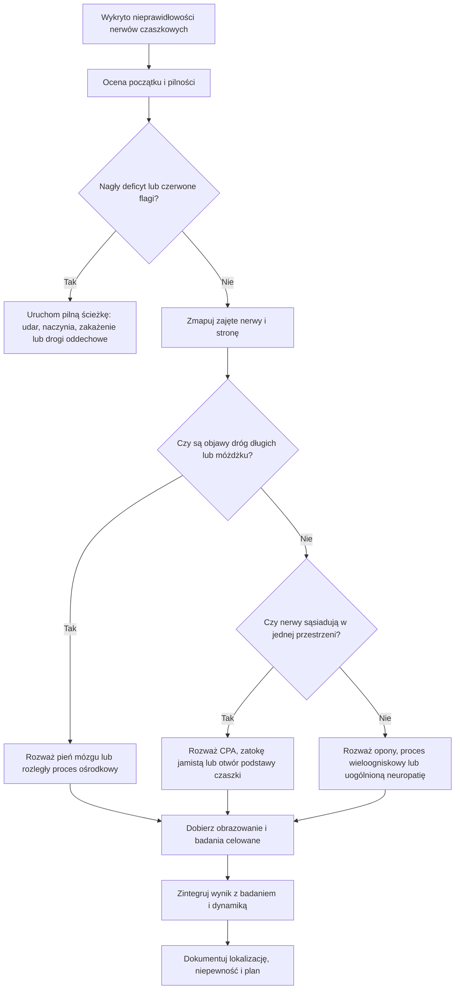
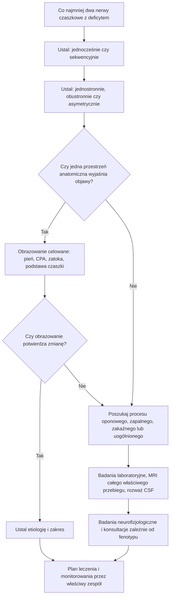
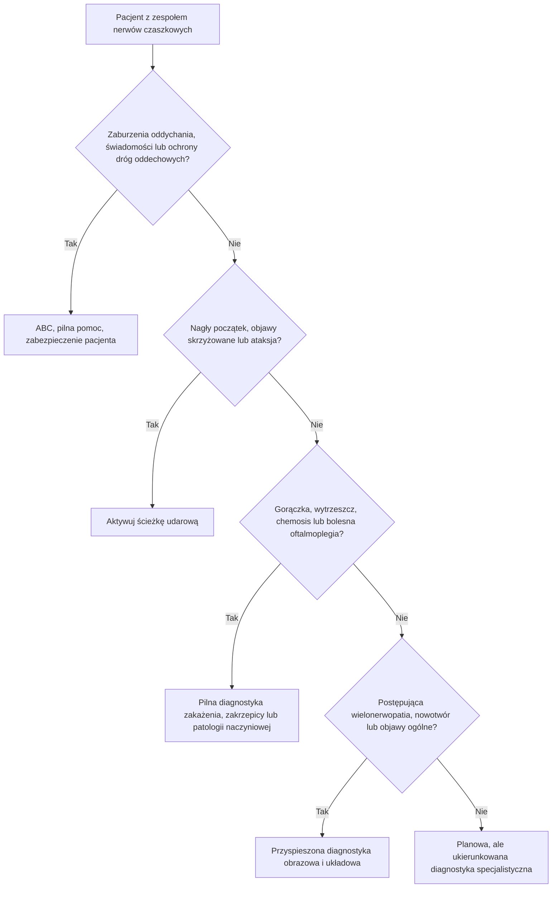

# 3.11. Zespoły kliniczne nerwów czaszkowych

## Wprowadzenie

Zespoły kliniczne nerwów czaszkowych są układami objawów, których wspólna analiza pozwala określić prawdopodobny poziom uszkodzenia układu nerwowego. Nie stanowią one wyłącznie sumy porażeń poszczególnych nerwów. Ich znaczenie wynika z przestrzennego sąsiedztwa jąder, pęczków wewnątrz pnia mózgu, korzeni nerwów, opon, naczyń i struktur podstawy czaszki. Jedna zmiana może zatem jednocześnie zaburzać funkcję kilku nerwów czaszkowych, dróg długich, móżdżku, układu współczulnego lub struktur odpowiedzialnych za świadomość i oddychanie.

W praktyce klinicznej szczególnie użyteczne są trzy wzorce lokalizacyjne:

1. **Zespół pniowy** – współwystępowanie objawów uszkodzenia jąder lub pęczków nerwów czaszkowych z objawami zajęcia przebiegających przez pień mózgu dróg długich, połączeń móżdżkowych, dróg współczulnych albo tworu siatkowatego.
2. **Zespół kąta mostowo-móżdżkowego** – najczęściej postępujące zaburzenia słuchu i równowagi, a w miarę zajmowania sąsiednich struktur także zaburzenia czucia twarzy, odruchu rogówkowego, mimiki, koordynacji i funkcji pnia mózgu.
3. **Zespół zatoki jamistej** – charakterystyczne połączenie zaburzeń ruchomości gałki ocznej i czucia w obszarze V1/V2, niekiedy z objawami zastoju żylnego oczodołu, bólem i zajęciem włókien współczulnych.

Wielonerwopatie czaszkowe mogą natomiast wynikać zarówno z jednej zmiany anatomicznej obejmującej kilka sąsiadujących nerwów, jak i z procesu rozsianego w oponach, podstawie czaszki, nerwach obwodowych, złączu nerwowo-mięśniowym lub w przebiegu choroby układowej. Dlatego najważniejsze jest rozstrzygnięcie, czy obserwowany wzorzec można wyjaśnić jednym ogniskiem anatomicznym, czy też wymaga on hipotezy procesu wieloogniskowego lub uogólnionego.

**Rozdział ma charakter integracyjny.** Nie zastępuje szczegółowych procedur badania poszczególnych nerwów opisanych w rozdziałach 3.1–3.10. Uczy łączenia wyników tych badań w spójny wzorzec lokalizacyjny, rozpoznawania stanów nagłych, formułowania diagnostyki różnicowej i przekazywania informacji zespołowi medycznemu.

> **Zasada bezpieczeństwa:** nagły zespół pniowy, szybko narastająca wielonerwopatia czaszkowa, bolesna oftalmoplegia z gorączką lub wytrzeszczem, zaburzenia świadomości, niewydolność opuszkowa albo zagrożenie drożności dróg oddechowych wymagają pilnej oceny lekarskiej. Nie należy opóźniać uruchomienia właściwej ścieżki ratunkowej w celu wykonania pełnego badania dydaktycznego.

---

## 1. Cele kształcenia

Po ukończeniu rozdziału uczestnik powinien:

1. wyjaśnić, dlaczego współwystępowanie określonych ubytków nerwów czaszkowych może wskazywać na wspólną lokalizację anatomiczną;
2. opisać funkcjonalną organizację śródmózgowia, mostu i rdzenia przedłużonego w kontekście lokalizacji zespołów pniowych;
3. rozpoznawać znaczenie objawów skrzyżowanych, nie traktując ich jako warunku koniecznego rozpoznania uszkodzenia pnia mózgu;
4. odróżniać uszkodzenie jądra, pęczka wewnątrz pnia, odcinka zbiornikowego, przestrzeni kąta mostowo-móżdżkowego, otworu podstawy czaszki i odcinka pozaczaszkowego nerwu;
5. opisać najważniejsze wzorce kliniczne zespołów śródmózgowia, mostu i rdzenia przedłużonego;
6. wskazać nerwy i struktury sąsiadujące w kącie mostowo-móżdżkowym;
7. rozpoznać typowy układ objawów zespołu zatoki jamistej oraz odróżnić go od zespołu szczeliny oczodołowej górnej i szczytu oczodołu;
8. interpretować zespoły otworu szyjnego, kanału nerwu podjęzykowego i inne zespoły podstawy czaszki;
9. odróżniać wielonerwopatię czaszkową o prawdopodobnej przyczynie miejscowej od procesu oponowego, zapalnego, zakaźnego, naczyniowego, nowotworowego lub uogólnionego;
10. zebrać ukierunkowany wywiad i przeprowadzić badanie integracyjne, obejmujące wszystkie nerwy czaszkowe oraz odpowiednie elementy badania ruchowego, czuciowego, móżdżkowego i autonomicznego;
11. wskazać badania obrazowe i laboratoryjne dobierane do hipotezy lokalizacyjnej, z uwzględnieniem ograniczeń poszczególnych metod;
12. rozpoznać czerwone flagi wymagające pilnej diagnostyki udaru, zakażenia zatoki jamistej, tętniaka, ucisku pnia mózgu, wzrostu ciśnienia śródczaszkowego lub procesu nowotworowego;
13. opisać wynik badania w sposób topograficzny, precyzyjny i możliwy do porównania w czasie;
14. przedstawić uzasadnioną hipotezę kliniczną, wyraźnie oddzielając obserwacje od rozpoznania etiologicznego.

### Efekty praktyczne

Uczestnik potrafi sporządzić krótką mapę zajętych nerwów, przyporządkować je do wspólnej okolicy anatomicznej, wskazać objawy przemawiające za zajęciem dróg długich lub struktur sąsiednich oraz określić pilność dalszego postępowania. Potrafi również powiedzieć, czego na podstawie samego badania przyłóżkowego nie można rozstrzygnąć.

---

## 2. Definicje i terminologia

### 2.1. Zespół kliniczny nerwów czaszkowych

Zespół kliniczny nerwów czaszkowych to powtarzalny lub rozpoznawalny układ zaburzeń funkcji jednego albo kilku nerwów czaszkowych, często połączony z objawami pochodzącymi z sąsiednich struktur ośrodkowego lub obwodowego układu nerwowego. Nazwa zespołu może odnosić się do lokalizacji anatomicznej, mechanizmu albo historycznego opisu objawów.

### 2.2. Neuropatia czaszkowa

Neuropatia czaszkowa oznacza zaburzenie funkcji nerwu czaszkowego na dowolnym odcinku jego przebiegu. Może być ruchowa, czuciowa, autonomiczna lub mieszana. W praktyce termin ten bywa stosowany także wobec uszkodzeń włókien nerwowych poza pniem mózgu. Należy jednak odróżnić neuropatię nerwu od uszkodzenia jego jądra w pniu mózgu.

### 2.3. Uszkodzenie jądrowe, pęczkowe i obwodowe

- **Uszkodzenie jądrowe** – obejmuje skupisko neuronów ruchowych lub czuciowych w pniu mózgu.
- **Uszkodzenie pęczkowe** – obejmuje włókna nerwu biegnące wewnątrz pnia od jądra do miejsca wyjścia z powierzchni pnia.
- **Uszkodzenie korzeniowe lub zbiornikowe** – dotyczy włókien po opuszczeniu pnia, przed wejściem do odpowiedniego otworu kostnego.
- **Uszkodzenie w obrębie podstawy czaszki** – dotyczy nerwu w kanale, szczelinie, otworze lub sąsiadującej przestrzeni anatomicznej.
- **Uszkodzenie pozaczaszkowe** – obejmuje dalszy przebieg nerwu w obrębie twarzy, szyi lub narządów docelowych.

To rozróżnienie ma znaczenie, ponieważ ten sam objaw, na przykład opadanie powieki, może wynikać z uszkodzenia jądra, pęczka nerwu III, samego nerwu w zatoce jamistej, złącza nerwowo-mięśniowego lub mięśnia.

### 2.4. Objawy skrzyżowane

Objawy skrzyżowane to współwystępowanie zaburzeń funkcji nerwu czaszkowego po stronie ogniska oraz zaburzeń ruchowych lub czuciowych kończyn po stronie przeciwnej. Klasyczny przykład stanowi ipsilateralne porażenie nerwu czaszkowego i kontralateralny niedowład połowiczy. Wzorzec ten silnie sugeruje uszkodzenie pnia mózgu, ale nie jest obligatoryjny.

### 2.5. Wielonerwopatia czaszkowa

Wielonerwopatia czaszkowa oznacza zajęcie co najmniej dwóch nerwów czaszkowych. Może przebiegać:
- jednocześnie lub sekwencyjnie;
- jednostronnie, obustronnie albo asymetrycznie;
- ostro, podostro, przewlekle lub nawrotowo;
- w sposób ograniczony do jednej przestrzeni anatomicznej albo w ramach procesu wieloogniskowego.

Samo stwierdzenie zajęcia kilku nerwów nie rozstrzyga, czy przyczyna jest miejscowa, oponowa, naczyniowa, zapalna, zakaźna, nowotworowa czy uogólniona.

### 2.6. Zespół topograficzny a rozpoznanie etiologiczne

Zespół topograficzny wskazuje, gdzie prawdopodobnie znajduje się proces chorobowy. Rozpoznanie etiologiczne określa, co go wywołało. Na przykład zespół zatoki jamistej jest rozpoznaniem lokalizacyjnym, a zakrzepica zatoki jamistej, guz, przetoka tętniczo-żylna lub zapalenie ziarniniakowe są możliwymi rozpoznaniami etiologicznymi. Nie wolno utożsamiać nazwy zespołu z jedną przyczyną.

### 2.7. Objaw lokalizujący i objaw alarmowy

- **Objaw lokalizujący** zawęża prawdopodobne miejsce uszkodzenia, na przykład porażenie nerwu VI wraz z zaburzeniem czucia V1 i V2 może wskazywać na okolicę zatoki jamistej.
- **Objaw alarmowy** wskazuje na możliwość zagrożenia życia, wzroku, oddychania lub trwałego uszkodzenia neurologicznego, na przykład nagła oftalmoplegia z bólem głowy, gorączka z wytrzeszczem albo szybko narastająca dysfagia.

Objaw może być jednocześnie lokalizujący i alarmowy.

---

## 3. Podstawy neuroanatomiczne zespołów

### 3.1. Pień mózgu jako wspólny obszar jąder i dróg długich

Pień mózgu obejmuje śródmózgowie, most i rdzeń przedłużony. Zawiera jądra części nerwów czaszkowych, twór siatkowaty, ośrodki i sieci regulujące ruchy oczu, napięcie mięśniowe, oddychanie i funkcje autonomiczne, a także drogi przewodzące informacje pomiędzy mózgowiem, móżdżkiem i rdzeniem kręgowym.

W jednym przekroju pnia mogą sąsiadować:
- jądra i pęczki nerwów czaszkowych;
- droga korowo-rdzeniowa;
- wstęga przyśrodkowa;
- droga rdzeniowo-wzgórzowa;
- pęczek podłużny przyśrodkowy;
- połączenia móżdżkowe;
- zstępujące włókna współczulne;
- struktury tworu siatkowatego.

Zajęcie niewielkiego obszaru może więc wywołać połączenie objawów z pozornie odległych układów. Właśnie ta współobecność ma większą wartość lokalizacyjną niż pojedynczy ubytek nerwu.

### 3.2. Orientacyjna mapa poziomów pnia mózgu

| Poziom | Nerwy i struktury szczególnie istotne klinicznie | Przykładowe objawy |
|---|---|---|
| Śródmózgowie | III, IV, jądra czerwienne, istota czarna, konary mózgu, pęczek podłużny przyśrodkowy | Ptoza, zaburzenia ruchów gałki ocznej, zaburzenia źrenicy, przeciwstronny niedowład, ataksja lub drżenie |
| Most | V, VI, VII, VIII, ośrodki spojrzenia poziomego, włókna korowo-rdzeniowe i połączenia móżdżkowe | Zaburzenia czucia twarzy, porażenie twarzy, zaburzenia odwodzenia oka, poziome zaburzenia spojrzenia, niedosłuch, zawroty głowy, niedowład |
| Rdzeń przedłużony | IX, X, XII, jądra przedsionkowe, jądra sznurów tylnych, drogi piramidowe i rdzeniowo-wzgórzowe | Dysfagia, dysfonia, osłabienie języka, objawy skrzyżowane, ataksja, zaburzenia czucia, zespół Hornera |

Mapa ma charakter orientacyjny. Granice jąder i dróg nie są prostymi liniami, a niektóre struktury rozciągają się przez więcej niż jeden poziom. Nerw IV jest wyjątkiem wśród nerwów czaszkowych: jego włókna krzyżują się przed wyjściem z grzbietowej powierzchni pnia, dlatego strona objawu nie zawsze odpowiada stronie położenia jądra. Podobnie złożone przebiegi pęczków mogą modyfikować klasyczne reguły lokalizacji.

### 3.3. Drogi długie i ich znaczenie

| Struktura | Funkcja | Typowe następstwo uszkodzenia w pniu |
|---|---|---|
| Droga korowo-rdzeniowa | Ruch dowolny kończyn i tułowia | Przeciwstronny niedowład spastyczny, objawy piramidowe |
| Wstęga przyśrodkowa | Czucie wibracji, ułożenia i precyzyjnego dotyku z ciała | Przeciwstronne zaburzenia czucia głębokiego powyżej skrzyżowania |
| Droga rdzeniowo-wzgórzowa | Ból i temperatura z ciała | Przeciwstronne zaburzenia bólu i temperatury |
| Jądro i droga rdzeniowa nerwu V | Ból i temperatura z twarzy | Zwykle ipsilateralne zaburzenia czucia twarzy |
| Pęczek podłużny przyśrodkowy | Koordynacja sprzężonych ruchów oczu | Oftalmoplegia międzyjądrowa |
| Połączenia móżdżkowe | Koordynacja, równowaga i precyzja ruchu | Zwykle ipsilateralna ataksja kończyn lub tułowia zależnie od poziomu i drogi |
| Włókna współczulne zstępujące | Unerwienie współczulne oka i twarzy | Ipsilateralny zespół Hornera |
| Twór siatkowaty i sieci pobudzenia | Czuwanie i integracja funkcji życiowych | Zaburzenia świadomości, nieprawidłowe wzorce oddychania i reaktywności |

### 3.4. Zasada objawów skrzyżowanych – i jej ograniczenia

W klasycznym uszkodzeniu pnia mózgu:
- objaw wynikający z zajęcia jądra lub pęczka nerwu czaszkowego może występować po stronie ogniska;
- objaw kończynowy może występować po stronie przeciwnej, ponieważ droga korowo-rdzeniowa nie skrzyżowała się jeszcze na poziomie wyższego odcinka pnia albo droga czuciowa uległa skrzyżowaniu na innym poziomie;
- objawy móżdżkowe i czuciowe twarzy często mają własną, odmienną lateralizację.

Brak objawów skrzyżowanych nie wyklucza uszkodzenia pnia. Małe ognisko może obejmować wyłącznie jądro, pęczek albo strukturę pośrodkową. Z kolei obustronne ogniska, rozległe zmiany naczyniowe, procesy zapalne lub uciskowe mogą dawać obraz niesymetryczny albo nietypowy.

### 3.5. Unaczynienie pnia mózgu

Pień mózgu jest zaopatrywany przez układ kręgowo-podstawny oraz gałęzie tętnic móżdżkowych. W uproszczeniu:
- śródmózgowie otrzymuje unaczynienie między innymi z gałęzi tętnicy tylnej mózgu i tętnic łączących tylnej;
- most zaopatrują gałęzie tętnicy podstawnej, w tym gałęzie paramedialne i okalające, oraz obszary związane z AICA i SCA;
- rdzeń przedłużony otrzymuje krew z tętnic kręgowych, PICA i tętnicy rdzeniowej przedniej.

Układ ten jest anatomicznie zmienny. Nie należy przypisywać każdego zespołu jednemu naczyniu wyłącznie na podstawie objawów. Lokalizacja kliniczna, obrazowanie dyfuzyjne, angiografia i kontekst naczyniowy muszą być interpretowane łącznie.

---

## 4. Zasady klinicznego lokalizowania zespołu

### 4.1. Najpierw wzorzec, potem nazwa zespołu

W badaniu należy najpierw opisać konkretne nieprawidłowości, a dopiero później rozważyć nazwę zespołu. Przykładowo zamiast od razu zapisywać „zespół Wallenberga”, należy udokumentować:
- dysfagię i dysfonię;
- osłabienie unoszenia podniebienia po określonej stronie;
- ipsilateralne zaburzenia czucia bólu i temperatury na twarzy;
- kontralateralne zaburzenia bólu i temperatury na tułowiu lub kończynach;
- ipsilateralną ataksję;
- zespół Hornera;
- oczopląs lub zawroty głowy.

Dopiero taki zestaw pozwala uzasadnić hipotezę bocznego uszkodzenia rdzenia przedłużonego.

### 4.2. Pięć pytań lokalizacyjnych

1. **Które nerwy są zajęte?** Należy sporządzić listę nerwów i opisać ich funkcje, a nie tylko nazwy.
2. **Czy objawy dotyczą tej samej strony?** Jednostronne, ipsilateralne objawy kilku nerwów mogą wskazywać na wspólną przestrzeń anatomiczną.
3. **Czy występują objawy dróg długich?** Niedowład, zaburzenia czucia połowiczego, ataksja, zaburzenia spojrzenia lub Horner zwiększają prawdopodobieństwo lokalizacji ośrodkowej albo zajęcia sąsiednich struktur.
4. **Jaki jest przebieg czasowy?** Nagły początek przemawia za przyczyną naczyniową lub urazową; progresja przez tygodnie i miesiące zwiększa podejrzenie procesu rozrostowego, zapalnego, naciekowego lub przewlekłej neuropatii.
5. **Czy jedna zmiana anatomiczna wyjaśnia wszystkie objawy?** Jeżeli nie, należy rozważyć proces oponowy, wieloogniskowy, uogólniony, współistnienie kilku chorób albo błędną interpretację jednego z objawów.

### 4.3. Znaczenie bólu i dynamiki

Ból nie jest wyłącznie objawem towarzyszącym. Może wskazywać na proces zapalny, zakaźny, naczyniowy, urazowy lub naciekowy. Bolesna oftalmoplegia wymaga innego podejścia niż powoli narastający, bezbolesny niedowład jednego nerwu.

| Dynamika | Możliwe mechanizmy wymagające rozważenia | Przykładowe sytuacje alarmowe |
|---|---|---|
| Nagła, sekundy–minuty | Niedokrwienie, krwotok, tętniak, uraz, napad naczyniowy | Udar pnia, tętniak, krwawienie, rozwarstwienie |
| Ostra, godziny–dni | Zakażenie, zakrzepica, zapalenie, ucisk, neuropatia zapalna | Zakrzepica zatoki jamistej, zapalenie opon, zespół Guillaina–Barrégo |
| Podostra, dni–tygodnie | Proces zapalny, zakaźny, naciekowy lub rozrostowy | Neurosarkoidoza, chłoniak, przerzut, proces oponowy |
| Przewlekła, tygodnie–miesiące | Guz, przewlekła neuropatia, choroba neurodegeneracyjna, ucisk | Guz kąta mostowo-móżdżkowego, guz podstawy czaszki |
| Nawrotowa lub zmienna | Choroba demielinizacyjna, miastenia, migrena, zapalenie, mechanizm naczyniowy | Nowe objawy pniowe lub narastająca dysfagia wymagają ponownej pilnej oceny |

Czas trwania nie rozstrzyga samodzielnie o etiologii. Udar może mieć przebieg narastający lub stuttering, a proces zapalny może rozpoczynać się ostro.

---

## 5. Metodyka badania integracyjnego – krok po kroku

Badanie integracyjne wykonuje się po ocenie bezpieczeństwa pacjenta. W stanie nagłym pełne badanie nerwów czaszkowych nie może opóźniać zabezpieczenia podstawowych funkcji życiowych, aktywacji zespołu ratunkowego ani diagnostyki udaru.

### Krok 1. Ocena stanu ogólnego i pilności

1. Oceń świadomość, kontakt i zdolność wykonywania poleceń.
2. Sprawdź, czy pacjent oddycha swobodnie, czy występuje stridor, sinica, duszność, zaburzenie ochrony wydzieliny lub osłabienie kaszlu.
3. Oceń parametry życiowe zgodnie z lokalną procedurą.
4. Ustal, czy objawy pojawiły się nagle, narastają, nawracają czy są stabilne.
5. W razie podejrzenia udaru, zakrzepicy zatoki jamistej, krwawienia, tętniaka, sepsy lub zagrożenia dróg oddechowych uruchom właściwą ścieżkę pilną.

### Krok 2. Ukierunkowany wywiad

Należy ustalić:
- dokładny czas początku i ostatni moment, w którym pacjent był bez objawów;
- kolejność pojawiania się zaburzeń;
- ból głowy, twarzy, oczodołu, ucha lub szyi;
- gorączkę, infekcję zatok, ucha, zębów albo skóry twarzy;
- niedosłuch, szumy uszne, zawroty głowy i zaburzenia równowagi;
- diplopię, ptozę, utratę widzenia, światłowstręt lub ból przy ruchach oka;
- zaburzenia czucia twarzy, osłabienie mimiki, dysfagię, dysfonię i osłabienie języka;
- urazy, zabiegi, intubację, radioterapię i przebyte nowotwory;
- immunosupresję, cukrzycę, choroby autoimmunologiczne, zakażenia i czynniki naczyniowe;
- utratę masy ciała, nocne poty, ból kostny i objawy ogólne.

### Krok 3. Oglądanie i badanie funkcji nerwów czaszkowych

Badanie przeprowadź systematycznie, od I do XII, z dostosowaniem zakresu do objawów i możliwości pacjenta. Szczegółowe techniki znajdują się w rozdziałach 3.2–3.10. W badaniu integracyjnym szczególnie ważne jest porównanie stron oraz ustalenie, czy kilka nieprawidłowości tworzy spójny układ topograficzny.

Zwróć uwagę na:
- ostrość i pola widzenia, źrenice oraz dno oka, jeśli jest to możliwe i wskazane;
- pozycję gałek ocznych, ruchy, ptozę, oczopląs i diplopię;
- czucie V1, V2, V3, odruch rogówkowy, żucie;
- symetrię mimiki i zamykanie oka;
- słuch i równowagę;
- podniebienie, głos, kaszel, połykanie i ochronę wydzieliny;
- siłę SCM i trapeziusa;
- ułożenie, ruchy, trofikę i siłę języka.

Nie należy rutynowo drażnić rogówki ani wywoływać odruchu gardłowego bez wskazania. Próby te wymagają uzasadnienia, właściwej techniki i uwzględnienia ryzyka urazu lub dyskomfortu.

### Krok 4. Badanie dróg długich i móżdżku

1. Oceń siłę mięśniową kończyn i obecność pronator drift.
2. Zbadaj napięcie, odruchy ścięgniste i objawy patologiczne, jeśli są wskazane.
3. Porównaj czucie bólu, temperatury, wibracji i ułożenia po obu stronach.
4. Wykonaj próby koordynacyjne kończyn, jeżeli pacjent jest w stanie je bezpiecznie wykonać.
5. Oceń stabilność tułowia, siad, stanie i chód tylko wtedy, gdy ryzyko upadku jest kontrolowane.
6. Zbadaj ruchy gałek ocznych i sprzężone spojrzenie, pamiętając o ograniczeniach prób przedsionkowych.

### Krok 5. Ocena układu współczulnego i objawów autonomicznych

Sprawdź wielkość i reaktywność źrenic, położenie powiek, obecność anhydrozy, zmiany potliwości, ortostatyczne objawy krążeniowe i inne zaburzenia autonomiczne. Zespół Hornera może towarzyszyć uszkodzeniu pnia, zatoki jamistej, tętnicy szyjnej lub drogi współczulnej na szyi i w klatce piersiowej. Jego obecność nie określa samodzielnie etiologii.

### Krok 6. Badanie struktur sąsiednich

W zależności od obrazu klinicznego oceń:
- skórę twarzy i okolicę oczodołu;
- spojówki, wytrzeszcz, obrzęk i chemosis;
- jamę ustną, uzębienie, gardło i śluzówki;
- uszy i okolicę wyrostka sutkowatego;
- zatoki przynosowe w badaniu klinicznym;
- szyję, węzły chłonne i bolesność;
- blizny pooperacyjne, ślady urazu i zmiany skórne półpaścowe.

### Krok 7. Zbudowanie mapy lokalizacyjnej

Zapisz po stronie prawej i lewej:
- nerwy z obiektywnym deficytem;
- rodzaj deficytu;
- objawy dróg długich;
- objawy móżdżkowe;
- objawy autonomiczne;
- objawy ogólne i ból.

Następnie przyporządkuj obserwacje do jednej z kategorii: pień mózgu, kąt mostowo-móżdżkowy, zatoka jamista, szczyt oczodołu, szczelina oczodołowa górna, otwór podstawy czaszki, opony, przestrzeń pozaczaszkowa lub proces uogólniony.

### Krok 8. Sformułowanie hipotezy i planu

W dokumentacji należy rozdzielić:
- ustalone objawy;
- prawdopodobną lokalizację;
- możliwe mechanizmy;
- rozpoznania różnicowe;
- wskazania do pilnej diagnostyki;
- ograniczenia badania.

Nie należy wpisywać pewnego rozpoznania etiologicznego, jeśli dostępne dane uzasadniają jedynie lokalizację.

---

## 6. Zespoły pniowe

### 6.1. Ogólne cechy zespołów pniowych

Zespół pniowy może obejmować kombinację:
- porażenia lub niedowładu nerwu czaszkowego;
- przeciwstronnego albo obustronnego niedowładu kończyn;
- zaburzeń czucia twarzy i ciała;
- ataksji;
- zaburzeń ruchów gałek ocznych;
- oczopląsu;
- zespołu Hornera;
- zaburzeń świadomości;
- nieprawidłowego oddychania lub niestabilności autonomicznej.

Nie wszystkie elementy muszą wystąpić. Małe ognisko może powodować bardzo wybiórczy deficyt. Z kolei rozległe uszkodzenie może prowadzić do śpiączki, niewydolności oddechowej lub zespołu zamknięcia.

### 6.2. Zespoły śródmózgowia

#### 6.2.1. Zespół Webera

Klasycznie obejmuje:
- ipsilateralne porażenie nerwu III, często z ptozą, ustawieniem oka ku dołowi i na zewnątrz oraz możliwym zajęciem źrenicy;
- kontralateralny niedowład połowiczy wynikający z zajęcia włókien korowo-rdzeniowych w konarze mózgu.

Wzorzec sugeruje brzuszną część śródmózgowia. Współczesne obrazowanie może wykazać zmiany o różnej rozległości, a nie każdy pacjent spełnia klasyczny zestaw objawów.

#### 6.2.2. Zespół Benedikta i zespół Claude’a

Oba zespoły wiążą się z uszkodzeniem śródmózgowia i ipsilateralnym porażeniem nerwu III, któremu towarzyszą objawy przeciwstronne związane z zajęciem struktur czerwiennych lub połączeń móżdżkowych. W zależności od lokalizacji i rozległości mogą występować ataksja, drżenie, ruchy mimowolne i niedowład. Granica między historycznymi opisami Benedikta i Claude’a nie jest w praktyce absolutna; nie należy przypisywać nazwy eponimicznej bez opisania rzeczywistych objawów.

#### 6.2.3. Zespół Parinauda – grzbietowy zespół śródmózgowia

Może obejmować:
- ograniczenie spojrzenia ku górze;
- zaburzenia reakcji źrenic na światło przy względnie zachowanej reakcji na zbieżność;
- oczopląs zbieżno-retrakcyjny przy próbie spojrzenia ku górze;
- retrakcję powiek;
- zaburzenia konwergencji.

Należy uwzględnić guzy okolicy szyszynki, wodogłowie, zmiany naczyniowe, zapalne i inne procesy obejmujące grzbietowe śródmózgowie. Nowe zaburzenia spojrzenia pionowego z bólem głowy, wymiotami lub zaburzeniami świadomości wymagają pilnej oceny.

### 6.3. Zespoły mostu

#### 6.3.1. Zespół Millarda–Gublera

Klasyczny obraz obejmuje:
- ipsilateralne porażenie obwodowe nerwu VII;
- niekiedy ipsilateralne zaburzenie odwodzenia oka wskutek zajęcia VI;
- kontralateralny niedowład połowiczy związany z zajęciem drogi korowo-rdzeniowej.

Wskazuje na brzuszną część mostu. Objawy mogą być niepełne i zależą od położenia ogniska.

#### 6.3.2. Zespół Foville’a

W historycznym opisie wiąże się z uszkodzeniem grzbietowej części mostu, obejmującym ośrodek poziomego spojrzenia lub jądro VI, włókna VII i sąsiednie drogi. Może powodować:
- niemożność spojrzenia w stronę ogniska;
- ipsilateralne porażenie nerwu VII;
- przeciwstronny niedowład, jeśli zajęta jest droga korowo-rdzeniowa.

Zakres objawów zależy od dokładnej lokalizacji. Eponim nie powinien zastępować opisu ruchomości oczu, mimiki i siły kończyn.

#### 6.3.3. Zespół Raymonda i inne zespoły brzusznego mostu

Wzorce obejmujące ipsilateralne porażenie VI i przeciwstronny niedowład mogą wynikać z zajęcia brzusznego mostu. W praktyce klinicznej częściej należy opisać konkretny deficyt VI, VII i dróg długich niż opierać się na jednej historycznej nazwie.

#### 6.3.4. Zespół „jeden i pół” (one-and-a-half syndrome)

Wynika z uszkodzenia ośrodka poziomego spojrzenia lub jądra VI oraz ipsilateralnego pęczka podłużnego przyśrodkowego. Typowy obraz obejmuje:
- brak poziomego spojrzenia obu oczu w stronę ogniska;
- zaburzenie przywodzenia oka po stronie ogniska przy spojrzeniu w stronę przeciwną;
- zachowane odwodzenie drugiego oka, często z oczopląsem.

Może współistnieć porażenie nerwu VII, jeśli uszkodzenie obejmuje sąsiednie włókna. Zespół ten lokalizuje się zwykle w grzbietowym moście i może być spowodowany udarem, demielinizacją, guzem lub inną zmianą strukturalną.

### 6.4. Zespoły rdzenia przedłużonego

#### 6.4.1. Zespół boczny rdzenia przedłużonego – Wallenberga

Typowy układ objawów może obejmować:
- dysfagię, dysfonię i osłabienie odruchów gardłowych wskutek zajęcia jądra dwuznacznego lub jego połączeń;
- ipsilateralne zaburzenia czucia bólu i temperatury na twarzy;
- kontralateralne zaburzenia czucia bólu i temperatury na tułowiu oraz kończynach;
- ipsilateralną ataksję;
- oczopląs, zawroty głowy i nudności;
- ipsilateralny zespół Hornera.

Zespół najczęściej wiąże się z niedokrwieniem bocznej części rdzenia przedłużonego, w obszarze unaczynienia zależnym od tętnicy kręgowej lub PICA, ale mechanizmy naczyniowe są zróżnicowane. Dysfagia i zaburzenia ochrony dróg oddechowych wymagają szczególnej uwagi.

#### 6.4.2. Zespół przyśrodkowy rdzenia przedłużonego – Dejerine’a

Klasyczna triada obejmuje:
- ipsilateralne osłabienie języka wskutek zajęcia jądra lub włókien XII;
- kontralateralny niedowład połowiczy wskutek zajęcia drogi korowo-rdzeniowej;
- kontralateralne zaburzenia czucia wibracji i ułożenia wskutek zajęcia wstęgi przyśrodkowej.

Wzorzec może być niepełny, a obraz zależy od rozległości ogniska i wariantów unaczynienia.

#### 6.4.3. Inne wzorce opuszkowe

Uszkodzenie jądra dwuznacznego, jąder XII lub ich włókien może powodować dysfagię, dysfonię, osłabienie kaszlu, asymetrię podniebienia, zanik i fascykulacje języka. Objawy te nie są swoiste dla jednego zespołu. Należy różnicować udar, guz, zapalenie, chorobę neuronu ruchowego, miastenię, neuropatię zapalną, toksyczne uszkodzenie złącza nerwowo-mięśniowego i inne przyczyny.

### 6.5. Zespół zamknięcia (locked-in syndrome)

Zespół zamknięcia najczęściej wynika z obustronnego uszkodzenia brzusznej części mostu i dróg korowo-rdzeniowych oraz korowo-jądrowych. Pacjent może zachować świadomość, rozumienie i możliwość komunikacji za pomocą pionowych ruchów gałek ocznych lub mrugania, mimo ciężkiego porażenia kończyn i mięśni opuszkowych. Należy odróżnić go od śpiączki, stanu minimalnej świadomości i ciężkiej afazji.

**Znaczenie praktyczne:** brak mowy i brak ruchów kończyn nie oznaczają braku świadomości. Należy aktywnie poszukiwać wiarygodnego kanału komunikacji, zapewnić możliwość sygnalizowania odpowiedzi i nie pomijać pacjenta w rozmowie.

### 6.6. Tabela orientacyjna zespołów pniowych

| Poziom | Zespół lub wzorzec | Nerw / funkcja lokalizująca | Objaw towarzyszący |
|---|---|---|---|
| Śródmózgowie | Weber | III | Przeciwstronny niedowład |
| Śródmózgowie | Benedikt / Claude | III | Ataksja, drżenie lub inne objawy móżdżkowe po stronie przeciwnej |
| Grzbietowe śródmózgowie | Parinaud | Ośrodki spojrzenia pionowego | Ograniczenie spojrzenia ku górze, zaburzenia źrenic |
| Most | Millard–Gubler | VII, czasem VI | Przeciwstronny niedowład |
| Grzbietowy most | Foville | VI / ośrodek spojrzenia, VII | Zaburzenie spojrzenia poziomego, przeciwstronne objawy długich dróg |
| Grzbietowy most | „Jeden i pół” | VI / PPRF oraz MLF | Charakterystyczne zaburzenie spojrzenia poziomego |
| Boczny rdzeń przedłużony | Wallenberg | IX–X i drogi czuciowe | Skrzyżowane zaburzenia bólu i temperatury, ataksja, Horner |
| Przyśrodkowy rdzeń przedłużony | Dejerine | XII | Przeciwstronny niedowład i utrata czucia głębokiego |
| Most obustronnie | Zespół zamknięcia | Drogi korowo-jądrowe i korowo-rdzeniowe | Zachowana świadomość, ciężki paraliż ruchowy |

**Ograniczenie:** zespoły eponimiczne są modelami dydaktycznymi. Współczesne rozpoznanie powinno opierać się na rzeczywistym rozkładzie objawów i obrazowaniu, a nie na wymuszaniu pełnej zgodności z historycznym opisem.

---

## 7. Zespół kąta mostowo-móżdżkowego

### 7.1. Anatomia okolicy

Kąt mostowo-móżdżkowy jest przestrzenią podpajęczynówkową położoną bocznie od mostu, pomiędzy mostem, półkulą móżdżku i częścią skalistą kości skroniowej. W jego sąsiedztwie przebiegają przede wszystkim:
- nerw V – w części przednio-górnej okolicy;
- nerwy VII i VIII – w pobliżu przewodu słuchowego wewnętrznego i kąta mostowo-móżdżkowego;
- naczynia, w tym gałęzie AICA;
- powierzchnia boczna mostu i połączenia móżdżkowe.

W miarę wzrostu zmiany mogą być uciskane także struktury móżdżku, pnia mózgu i komora IV. Dlatego zespół może przechodzić od izolowanych objawów audiologicznych do wielonerwopatii, ataksji, objawów piramidowych i cech wzrostu ciśnienia śródczaszkowego.

### 7.2. Typowy wzorzec kliniczny

Najczęstszy wczesny wzorzec obejmuje:
- jednostronny niedosłuch odbiorczy;
- jednostronne szumy uszne;
- zaburzenia równowagi lub niepewność chodu;
- czasem zawroty głowy, choć w powoli rosnących zmianach może dominować niestabilność, a nie gwałtowne wirowanie.

W większych zmianach mogą pojawić się:
- zaburzenia czucia twarzy w zakresie V;
- osłabienie odruchu rogówkowego;
- niedowład lub skurcze połowicze twarzy;
- ataksja kończyn po stronie zmiany;
- oczopląs;
- objawy ucisku pnia mózgu;
- wodogłowie i objawy wzrostu ciśnienia śródczaszkowego.

### 7.3. Najważniejsze przyczyny

| Przyczyna | Typowe wskazówki kliniczne | Uwagi |
|---|---|---|
| Schwannoma przedsionkowy | Postępujący jednostronny niedosłuch odbiorczy, szum uszny, zaburzenia równowagi | Najczęstsza masa tej okolicy; zwykle łagodna histologicznie, lecz może uciskać pień |
| Oponiak | Postępujące objawy uciskowe, czasem ból głowy i objawy kilku nerwów | Może mieć szeroką podstawę oponową; różnicowanie wymaga MRI |
| Torbiel naskórkowa (epidermoid) | Powoli narastające objawy ucisku nerwów, czasem neuralgia | Charakterystyczne ograniczenie dyfuzji w DWI |
| Schwannoma nerwu twarzowego | Postępujące lub nawrotowe osłabienie mimiki, czasem niedosłuch | Może naśladować schwannoma przedsionkowego |
| Przerzut lub chłoniak | Szybka progresja, ból, objawy ogólne, znana choroba nowotworowa | Wymaga oceny całego układu nerwowego i poszukiwania choroby układowej |
| Inne zmiany | Torbiele, zmiany zapalne, naczyniowe i wrodzone | Obraz kliniczny zależy od położenia i tempa wzrostu |

Nie każdy zespół kąta mostowo-móżdżkowego oznacza guz. W diagnostyce różnicowej należy uwzględnić udar, migrenę, choroby przedsionkowe, procesy zapalne i inne przyczyny neurologiczne.

### 7.4. Metodyka oceny przy podejrzeniu zespołu kąta mostowo-móżdżkowego

1. Ustal, czy niedosłuch jest jednostronny, postępujący, nagły czy zmienny.
2. Zbierz wywiad o szumach usznych, zawrotach głowy, niestabilności, upadkach i bólu głowy.
3. Oceń słuch orientacyjnie, ale nie traktuj prób przyłóżkowych jako substytutu audiometrii.
4. Zbadaj V – czucie twarzy i odruch rogówkowy, jeżeli istnieją wskazania.
5. Zbadaj VII – symetrię mimiki i siłę zamykania powiek.
6. Zbadaj VIII – słuch, oczopląs i funkcję przedsionkową, uwzględniając ograniczenia prób.
7. Oceń koordynację kończyn, chód i objawy długich dróg.
8. Przy podejrzeniu zmiany strukturalnej skieruj na odpowiednio dobrane MRI mózgowia z uwidocznieniem przewodów słuchowych wewnętrznych i kąta mostowo-móżdżkowego.

### 7.5. Badania dodatkowe

- Audiometria tonalna i mowy – potwierdzenie rodzaju i asymetrii niedosłuchu.
- Tympanometria – gdy istnieje potrzeba oceny ucha środkowego.
- MRI z kontrastem i cienkimi warstwami przez przewody słuchowe wewnętrzne – ocena nerwów, kąta i pnia.
- Sekwencje wysokiej rozdzielczości T2 – ocena przebiegu nerwów i przestrzeni płynowych.
- DWI – pomoc w różnicowaniu zmian o ograniczonej dyfuzji, w tym epidermoidu.
- CT kości skroniowej – w wybranych sytuacjach oceny struktur kostnych.

### 7.6. Objawy alarmowe

Pilnej oceny wymagają:
- nagłe objawy pniowe lub móżdżkowe;
- szybko narastający niedowład twarzy lub zaburzenia czucia;
- silny ból głowy z wymiotami i zaburzeniami świadomości;
- objawy wodogłowia lub ucisku pnia;
- nowy niedowład kończyn, zaburzenia połykania albo oddychania.

---

## 8. Zespół zatoki jamistej

### 8.1. Anatomia kliniczna zatoki jamistej

Zatoka jamista jest parzystą przestrzenią żylną oponową położoną po obu stronach siodła tureckiego. W jej obrębie lub ścianie przebiegają:
- nerw III;
- nerw IV;
- gałąź oczna V1;
- gałąź szczękowa V2;
- nerw VI;
- tętnica szyjna wewnętrzna wraz ze splotem współczulnym.

Nerw VI przebiega blisko tętnicy szyjnej wewnętrznej w obrębie zatoki i może być szczególnie podatny na zajęcie. Nerw V3 nie przechodzi przez zatokę jamistą; opuszcza czaszkę przez otwór owalny. Nerw wzrokowy II również nie przebiega w zatoce jamistej. Zaburzenia widzenia mogą jednak wskazywać na rozszerzenie procesu ku szczytowi oczodołu, kanałowi wzrokowemu, nerwowi wzrokowemu lub na współistniejącą patologię.

### 8.2. Typowy obraz kliniczny

Możliwe objawy obejmują:
- bolesną lub niebolesną oftalmoplegię;
- diplopię;
- ptozę;
- zaburzenia źrenicy;
- osłabienie czucia w obszarze V1 i/lub V2;
- osłabienie odruchu rogówkowego;
- ból oczodołu, czoła lub skroni;
- chemosis, przekrwienie spojówek i wytrzeszcz;
- szmer oczodołowy lub pulsowanie gałki ocznej w przetoce szyjno-jamistej;
- objawy współczulne, w tym zespół Hornera.

Zespół może być jednostronny, ale procesy zapalne, zakrzepowe lub naciekowe mogą szerzyć się na drugą stronę.

### 8.3. Główne przyczyny

| Kategoria | Przykłady | Wskazówki kliniczne |
|---|---|---|
| Zakaźna | Zakrzepica septyczna zatoki jamistej, szerzenie zakażenia z zatok, twarzy lub oczodołu, zakażenia grzybicze | Gorączka, ból, obrzęk, chemosis, wytrzeszcz, stan zapalny |
| Naczyniowa | Przetoka szyjno-jamista, tętniak tętnicy szyjnej wewnętrznej, zakrzepica aseptyczna | Pulsowanie, szmer, przekrwienie, nagły ból, objawy zakrzepowe |
| Nowotworowa | Meningioma, chłoniak, przerzuty, guz przysadki z szerzeniem bocznym | Progresja, ból, objawy kilku nerwów, wywiad nowotworowy |
| Zapalna / ziarniniakowa | Zespół Tolosa–Hunta, sarkoidoza, IgG4-RD, zapalenia naczyń | Bolesna oftalmoplegia, objawy układowe, zmiany w MRI |
| Urazowa / jatrogennna | Uraz podstawy czaszki, powikłania zabiegowe | Związek czasowy z urazem lub procedurą |

### 8.4. Różnicowanie zatoki jamistej, szczeliny oczodołowej górnej i szczytu oczodołu

| Cecha | Zatoka jamista | Szczelina oczodołowa górna | Szczyt oczodołu |
|---|---|---|---|
| Nerwy III, IV, VI | Często | Często | Często |
| V1 | Często | Możliwe | Możliwe |
| V2 | Może być zajęty | Zwykle oszczędzony | Zwykle oszczędzony |
| II – nerw wzrokowy | Nie przebiega w zatoce; zajęcie sugeruje szerzenie lub inną lokalizację | Zwykle oszczędzony | Typowo może być zajęty |
| Objawy żylnego zastoju oczodołu | Mogą występować | Zależnie od przyczyny i szerzenia | Mogą występować |
| Wskazówka lokalizacyjna | III, IV, V1/V2, VI, współczulne włókna okołotętnicze | III, IV, V1, VI bez typowego zajęcia II | Zajęcie II wraz z innymi nerwami oczodołowymi |

Tabela ma charakter orientacyjny. Procesy zapalne, nowotworowe, naczyniowe i urazowe mogą przekraczać granice przestrzeni anatomicznych. Rozstrzygnięcie wymaga korelacji badania z obrazowaniem.

### 8.5. Zespół Tolosa–Hunta – ważne ograniczenie diagnostyczne

Zespół Tolosa–Hunta jest rzadką przyczyną bolesnej oftalmoplegii związaną z ziarniniakowym zapaleniem w obrębie zatoki jamistej, szczeliny oczodołowej górnej lub oczodołu. Rozpoznanie wymaga spełnienia kryteriów klinicznych i obrazowych oraz wykluczenia innych przyczyn, zwłaszcza zakaźnych, naczyniowych i nowotworowych. Sama poprawa po glikokortykosteroidach nie jest wystarczającym dowodem rozpoznania.

### 8.6. Pilne zagrożenia

**Podejrzenie zakrzepicy septycznej zatoki jamistej** wymaga pilnej oceny szpitalnej, szczególnie przy gorączce, silnym bólu głowy lub oczodołu, wytrzeszczu, chemosis i szybko narastającej oftalmoplegii. Należy uwzględnić zakażenie zatok przynosowych, skóry twarzy, oczodołu i struktur zębowych.

**Podejrzenie przetoki szyjno-jamistej** jest szczególnie istotne przy pulsującym wytrzeszczu, szmerze oczodołowym, przekrwieniu spojówek i podwyższonym ciśnieniu wewnątrzgałkowym. Wymaga pilnej diagnostyki naczyniowej i okulistycznej.

**Nagła bolesna oftalmoplegia z zaburzeniem źrenicy** wymaga wykluczenia tętniaka, krwawienia, udaru i innych przyczyn wymagających pilnego leczenia.

---

## 9. Inne zespoły topograficzne podstawy czaszki – różnicowanie

Choć spis treści wymienia przede wszystkim kąt mostowo-móżdżkowy i zatokę jamistą, w praktyce wielonerwopatii czaszkowych należy uwzględnić także inne przestrzenie. Ich znajomość pomaga uniknąć błędnego przypisania objawów do jednego nerwu.

### 9.1. Szczyt oczodołu

Zajęcie szczytu oczodołu może obejmować nerw II oraz nerwy III, IV, VI i V1. Charakterystyczne jest połączenie utraty lub pogorszenia widzenia z oftalmoplegią i zaburzeniami czucia czoła lub rogówki. Przyczyny obejmują zakażenia, zapalenia, nowotwory, urazy i procesy naczyniowe.

**Różnicowanie:** obecność obiektywnej neuropatii wzrokowej przemawia za szczytem oczodołu lub kanałem wzrokowym bardziej niż za izolowanym zespołem zatoki jamistej czy szczeliny oczodołowej górnej.

### 9.2. Szczelina oczodołowa górna

Przez szczelinę przechodzą nerwy III, IV, V1 i VI oraz struktury żylne. Zespół może powodować oftalmoplegię, ptozę, zaburzenia czucia czoła i rogówki. W odróżnieniu od zespołu szczytu oczodołu nerw wzrokowy zwykle nie jest bezpośrednio zajęty.

### 9.3. Otwór szyjny – zespół Verneta

Otwór szyjny przewodzi nerwy IX, X i XI oraz ważne struktury żylne. Zespół może obejmować:
- zaburzenia smaku i czucia tylnej części języka oraz gardła;
- osłabienie podniebienia, gardła i krtani;
- dysfagię i dysfonię;
- osłabienie SCM i trapeziusa.

Przyczyny obejmują guzy podstawy czaszki, paraganglioma, schwannoma, meningioma, przerzuty, zapalenie kości i uraz.

### 9.4. Zespół Colleta–Sicarda i Villareta

Zespół Colleta–Sicarda obejmuje klasycznie IX, X, XI i XII po jednej stronie, co może wskazywać na rozległą zmianę w okolicy otworu szyjnego i kanału nerwu podjęzykowego. Zespół Villareta opisuje podobny układ z dodatkowym zajęciem włókien współczulnych szyi, dającym zespół Hornera. Nazewnictwo historyczne bywa stosowane niejednolicie, dlatego należy opisywać konkretne nerwy i objawy.

### 9.5. Meckel cave i okolica zwoju trójdzielnego

Jama Meckela zawiera zwój trójdzielny. Zmiany w tej okolicy mogą powodować:
- ból i zaburzenia czucia w obszarze V1–V3;
- osłabienie odruchu rogówkowego;
- neuropatię trójdzielną;
- w zależności od szerzenia – zajęcie sąsiednich struktur zatoki jamistej, szczytu skalistego lub kąta mostowo-móżdżkowego.

### 9.6. Przewód słuchowy wewnętrzny

W przewodzie słuchowym wewnętrznym przebiegają nerwy VII i VIII oraz naczynia błędnikowe. Zmiany mogą dawać jednostronny niedosłuch, szumy uszne, zaburzenia przedsionkowe, osłabienie mimiki i zaburzenia smaku lub wydzielania łez zależnie od poziomu zajęcia nerwu VII.

### 9.7. Kanał nerwu podjęzykowego

Zmiany w kanale nerwu XII mogą powodować ipsilateralny zanik i osłabienie języka, dysartrię i zaburzenia przygotowania kęsa. Jeśli współistnieją objawy IX–XI, należy poszukiwać procesu rozleglejszego, obejmującego podstawę czaszki lub przestrzeń szyjną.

### 9.8. Tabela przestrzeni anatomicznych

| Lokalizacja | Nerwy / struktury typowo narażone | Wskazówki kliniczne |
|---|---|---|
| Szczyt oczodołu | II, III, IV, V1, VI | Utrata widzenia plus oftalmoplegia |
| Szczelina oczodołowa górna | III, IV, V1, VI | Oftalmoplegia i zaburzenia czucia V1, zwykle bez pierwotnej neuropatii II |
| Zatoka jamista | III, IV, V1, V2, VI, włókna współczulne | Bolesna oftalmoplegia, zaburzenia czucia twarzy, chemosis lub wytrzeszcz |
| Kąt mostowo-móżdżkowy | V, VII, VIII, pień i móżdżek | Jednostronny niedosłuch, szum uszny, zaburzenia równowagi, później V/VII i objawy uciskowe |
| Otwór szyjny | IX, X, XI | Dysfagia, dysfonia, osłabienie SCM i trapeziusa |
| Otwór szyjny i kanał XII | IX–XII | Wielonerwopatia dolnych nerwów czaszkowych, zanik języka |
| Meckel cave | Zwój i korzenie V | Ból lub niedoczulica twarzy, osłabienie odruchu rogówkowego |
| Przewód słuchowy wewnętrzny | VII, VIII | Objawy słuchowe i przedsionkowe z możliwą neuropatią twarzową |
| Opony podstawy mózgu | Różne nerwy, często kilka po obu stronach | Wieloogniskowe, sekwencyjne lub obustronne neuropatie |

---

## 10. Wielonerwopatie czaszkowe – podejście etiologiczne

### 10.1. Dlaczego wielonerwopatia wymaga szerszego myślenia

Jeżeli kilka nerwów jest zajętych w jednej okolicy anatomicznej, należy najpierw rozważyć wspólną zmianę miejscową. Jeżeli nerwy są zajęte na różnych poziomach, po obu stronach lub w różnym czasie, rośnie prawdopodobieństwo procesu oponowego, zapalnego, zakaźnego, nowotworowego, naczyniowego albo uogólnionej neuropatii.

Ważne jest również odróżnienie prawdziwej neuropatii nerwu czaszkowego od zaburzenia narządu docelowego. Przykładowo diplopia może wynikać z zaburzeń mięśnia, złącza nerwowo-mięśniowego, oczodołu lub ośrodków spojrzenia, a dysfagia może mieć przyczynę ustno-gardłową, przełykową, mięśniową albo korową.

### 10.2. Przyczyny zakaźne

Należy rozważyć, zależnie od obrazu klinicznego i ekspozycji:
- boreliozę z neuroboreliozą;
- kiłę układu nerwowego;
- gruźlicze zapalenie opon;
- zakażenia grzybicze, zwłaszcza u osób z immunosupresją;
- zakażenia wirusowe, w tym VZV, HSV, HIV i CMV;
- bakteryjne zapalenie opon i podstawy czaszki;
- zakażenia zatok, ucha, oczodołu i struktur twarzy z szerzeniem do przestrzeni wewnątrzczaszkowych.

Gorączka, sztywność karku, ból głowy, zaburzenia świadomości, immunosupresja, zmiany skórne lub objawy sepsy zwiększają pilność diagnostyki.

### 10.3. Przyczyny zapalne i autoimmunologiczne

Do możliwych przyczyn należą:
- neurosarkoidoza;
- zapalenie opon i nerwów czaszkowych w przebiegu chorób układowych;
- zapalenie naczyń;
- choroba związana z IgG4;
- choroby demielinizacyjne;
- zespół Guillaina–Barrégo i jego warianty, w tym zespół Millera Fishera;
- przewlekła zapalna demielinizacyjna poliradikuloneuropatia;
- zapalenia ziarniniakowe i pachymeningitis.

Nie należy rozpoznawać choroby autoimmunologicznej na podstawie pojedynczego dodatniego przeciwciała bez zgodności klinicznej i oceny prawdopodobieństwa przedtestowego.

### 10.4. Przyczyny nowotworowe i naciekowe

W diagnostyce różnicowej uwzględnia się:
- przerzuty do podstawy czaszki;
- chłoniaki i białaczki;
- oponowe szerzenie nowotworu;
- naciekanie nerwów przez nowotwory głowy i szyi;
- guzy pierwotne podstawy czaszki;
- schwannoma, meningioma i paraganglioma;
- neurolymphomatosis i neuropatie paranowotworowe.

Szczególnie niepokojące są postępujące, bolesne, wieloogniskowe neuropatie, utrata masy ciała, nocne poty, znana choroba nowotworowa, obustronne objawy albo zajęcie wielu nerwów w różnych przestrzeniach anatomicznych.

### 10.5. Przyczyny naczyniowe

- Udar niedokrwienny lub krwotoczny pnia mózgu.
- Zakrzepica zatoki jamistej.
- Przetoka szyjno-jamista.
- Tętniak tętnicy szyjnej wewnętrznej lub innych naczyń.
- Rozwarstwienie tętnicy szyjnej lub kręgowej.
- Niedokrwienie nerwów czaszkowych.
- Malformacje naczyniowe i krwawienia do struktur podstawy czaszki.

Nagły początek, ból głowy lub szyi, zaburzenia świadomości, objawy oponowe, szmer oczodołowy albo szybko narastające zaburzenia ruchów oczu wymagają pilnego postępowania.

### 10.6. Przyczyny metaboliczne, toksyczne i żywieniowe

Możliwe czynniki obejmują:
- cukrzycę i mikroangiopatię;
- niedobór witaminy B12, tiaminy lub miedzi;
- niewydolność narządową i zaburzenia metaboliczne;
- toksyczne działanie leków;
- alkohol i inne substancje neurotoksyczne;
- zatrucia powodujące zaburzenia transmisji nerwowo-mięśniowej.

Przyczyny metaboliczne częściej powodują neuropatie obwodowe lub wielonerwowe niż klasyczny, ściśle topograficzny zespół kilku sąsiadujących nerwów czaszkowych, ale nie wolno ich pomijać.

### 10.7. Choroby złącza nerwowo-mięśniowego i mięśni

Miastenia może powodować zmienne osłabienie mięśni gałkoruchowych, twarzy, gardła i krtani. Objawy bywają męczliwe, zmienne w ciągu dnia i nie odpowiadają pojedynczemu obszarowi anatomicznemu nerwu. W miastenii czucie pozostaje zwykle zachowane, a odruchy ścięgniste są na ogół prawidłowe.

Miopatie mogą powodować dysfagię, dysfonię i osłabienie mięśni twarzy, ale rozkład objawów, badanie mięśni kończyn, CK, EMG i inne badania pomagają odróżnić je od neuropatii czaszkowej.

### 10.8. Przyczyny jatrogennne i pourazowe

W wywiadzie należy uwzględnić:
- operacje podstawy czaszki, ucha, tarczycy, ślinianek, szyi i oczodołu;
- intubację i zabiegi w obrębie krtani;
- radioterapię;
- urazy głowy i szyi;
- złamania podstawy czaszki;
- zabiegi naczyniowe i neurochirurgiczne.

Związek czasowy z procedurą jest ważną wskazówką, ale nie dowodzi automatycznie uszkodzenia jatrogennego. Należy rozważyć również obrzęk, ucisk, krwiak, infekcję, progresję choroby podstawowej i inne powikłania.

### 10.9. Tabela różnicowania wielonerwopatii

| Wzorzec | Co zwiększa prawdopodobieństwo | Co należy aktywnie wykluczyć |
|---|---|---|
| Kilka sąsiadujących nerwów po jednej stronie | Zmiana w kącie, zatoce, otworze lub kanale podstawy czaszki | Guz, zapalenie, uraz, tętniak, zakrzepica |
| Wiele nerwów obustronnie | Proces oponowy, zapalny, zakaźny lub uogólniony | Zapalenie opon, chłoniak, neurosarkoidoza, GBS/CIDP |
| Sekwencyjne zajmowanie kolejnych nerwów | Proces naciekowy, zapalny, zakaźny lub nowotworowy | Meningitis, pachymeningitis, perineural spread |
| Zmienna męczliwość bez spójnej lokalizacji | Złącze nerwowo-mięśniowe lub mięśnie | Miastenia, miopatia, zaburzenia metaboliczne |
| Nagłe objawy skrzyżowane | Pień mózgu, układ kręgowo-podstawny | Udar, krwotok, rozwarstwienie |
| Bolesna oftalmoplegia z objawami zapalenia | Zatoka jamista, oczodół, szczyt oczodołu | Zakrzepica septyczna, grzybica, tętniak, zapalenie |
| Postępująca neuropatia z chudnięciem | Proces nowotworowy lub naciekowy | Przerzuty, chłoniak, rak głowy i szyi |

---

## 11. Diagnostyka różnicowa – uporządkowany tok rozumowania

### 11.1. Lokalizacja przed etiologią

Prawidłowy tok rozumowania przebiega następująco:

1. Potwierdź, że występuje rzeczywisty deficyt neurologiczny.
2. Określ, które funkcje i nerwy są zajęte.
3. Ustal stronę i wzorzec czasowy.
4. Sprawdź, czy objawy układają się w jedną lokalizację anatomiczną.
5. Oceń, czy występują objawy dróg długich, móżdżku, opon lub układu autonomicznego.
6. Sformułuj kilka najbardziej prawdopodobnych mechanizmów.
7. Dobierz badania, które rozróżnią hipotezy i zmienią postępowanie.

### 11.2. Najczęstsze pułapki diagnostyczne

- Utożsamianie nazwy zespołu z jedną etiologią.
- Rozpoznawanie udaru wyłącznie na podstawie obecności niedowładu połowiczego.
- Wykluczanie udaru pnia mózgu z powodu braku klasycznych objawów skrzyżowanych.
- Uznawanie każdego niedosłuchu jednostronnego za schwannoma przedsionkowego.
- Rozpoznawanie zespołu Tolosa–Hunta bez wykluczenia zakażenia, tętniaka i nowotworu.
- Uznawanie braku odruchu rogówkowego za dowód uszkodzenia wyłącznie V1 bez oceny VII.
- Przypisywanie dysfagii wyłącznie nerwom IX i X bez oceny kory, pnia, mięśni i przełyku.
- Przypisywanie zmiennych objawów miastenii bez obiektywnej oceny i badań potwierdzających.
- Pomijanie dwóch współistniejących chorób, gdy jedna lokalizacja nie wyjaśnia wszystkich objawów.
- Traktowanie prawidłowego wczesnego CT jako wykluczenia niedokrwienia tylnego dołu czaszki.

### 11.3. Znaczenie wieku i kontekstu

Wiek nie jest samodzielnym testem etiologicznym. U młodszej osoby z ostrym zespołem pniowym należy uwzględnić rozwarstwienie tętnicy, choroby zapalne, demielinizację i wady naczyniowe. U osoby starszej należy uwzględnić chorobę naczyniową, nowotwory, neuropatie metaboliczne i działania niepożądane leków. U osoby z immunosupresją należy obniżyć próg podejrzenia zakażeń oportunistycznych i chłoniaka.

---

## 12. Badania dodatkowe i ich dobór

### 12.1. Rezonans magnetyczny

MRI mózgowia i podstawy czaszki, często z kontrastem, jest podstawowym badaniem w wielu przewlekłych lub podostrych neuropatiach czaszkowych. Zakres powinien odpowiadać hipotezie klinicznej. Należy uwzględnić możliwie pełny przebieg zajętego nerwu – od jądra lub pęczka w pniu, przez odcinek zbiornikowy, otwór podstawy czaszki i przestrzenie sąsiednie, aż do obszaru docelowego.

W zależności od pytania klinicznego protokół może obejmować:
- T1 przed i po kontraście;
- T2 i FLAIR;
- DWI/ADC;
- SWI lub GRE;
- cienkie warstwy w wysokiej rozdzielczości przez kąty mostowo-móżdżkowe, przewody słuchowe, zatokę jamistą lub oczodoły;
- sekwencje z supresją tłuszczu po kontraście dla nerwów i podstawy czaszki;
- MRA lub MRV, gdy potrzebna jest ocena naczyń lub zatok żylnych.

Dobór protokołu i podanie kontrastu zależą od wskazań, przeciwwskazań, funkcji nerek, ryzyka i decyzji zespołu radiologicznego.

### 12.2. Tomografia komputerowa

CT jest szczególnie przydatna do oceny:
- kości podstawy czaszki;
- złamań i zmian pourazowych;
- kanałów i otworów kostnych;
- zatok przynosowych i struktur ucha;
- zwapnień i przebudowy kości;
- krwawienia w ostrym stanie, zgodnie z procedurą.

CT nie zastępuje MRI w ocenie wszystkich nerwów i tkanek miękkich. W podejrzeniu udaru tylnego krążenia prawidłowe wczesne CT bez kontrastu nie wyklucza niedokrwienia pnia mózgu.

### 12.3. Angiografia CT i MR

CTA lub MRA może być potrzebna w przypadku podejrzenia:
- niedrożności tętnicy podstawnej;
- rozwarstwienia tętnicy kręgowej lub szyjnej;
- tętniaka;
- przetoki szyjno-jamistej;
- malformacji naczyniowej.

CTV lub MRV może być wskazana przy podejrzeniu zakrzepicy zatoki jamistej lub innych zatok żylnych. W wybranych sytuacjach angiografia subtrakcyjna pozostaje metodą referencyjną do oceny niektórych przetok i zmian naczyniowych.

### 12.4. Badania laboratoryjne

Nie istnieje jeden uniwersalny panel dla każdej wielonerwopatii czaszkowej. Badania należy dobierać do wywiadu i obrazu klinicznego. Mogą obejmować:
- morfologię, CRP i OB;
- glikemię, HbA1c, elektrolity, funkcję nerek i wątroby;
- witaminę B12, foliany, tiaminę lub miedź, jeżeli istnieją wskazania;
- badania w kierunku kiły, boreliozy, HIV, gruźlicy i zakażeń wirusowych zależnie od ryzyka;
- badania autoimmunologiczne i zapalne przy podejrzeniu choroby układowej;
- badania białek monoklonalnych, gdy podejrzewa się proces hematologiczny;
- diagnostykę nowotworową zależną od objawów, wieku i wywiadu.

Wyniki dodatnie należy interpretować w kontekście klinicznym. Nieuzasadnione szerokie panele mogą generować wyniki fałszywie dodatnie i prowadzić do niepotrzebnych procedur.

### 12.5. Badanie płynu mózgowo-rdzeniowego

Punkcja lędźwiowa może być przydatna przy podejrzeniu:
- zapalenia opon;
- procesu zapalnego lub ziarniniakowego;
- rozsiewu nowotworowego do opon;
- niektórych neuropatii zapalnych;
- zakażenia układu nerwowego.

Zakres badania zależy od hipotezy i może obejmować ciśnienie otwarcia, liczbę i rodzaj komórek, białko, glukozę, posiewy, testy molekularne, badania serologiczne, cytologię i cytometrię przepływową.

**Bezpieczeństwo:** przed punkcją należy ocenić wskazania i przeciwwskazania, w tym ryzyko efektu masy, zaburzeń krzepnięcia i niestabilności pacjenta. W przypadku objawów sugerujących wzrost ciśnienia śródczaszkowego lub zmianę ogniskową decyzja o kolejności obrazowania i punkcji należy do zespołu lekarskiego. Nie wolno wykonywać punkcji lędźwiowej automatycznie u każdego pacjenta z wielonerwopatią.

### 12.6. Badania neurofizjologiczne i specjalistyczne

Zależnie od obrazu można rozważyć:
- EMG i badania przewodnictwa nerwowego;
- powtarzalną stymulację nerwów i elektromiografię pojedynczego włókna przy podejrzeniu zaburzeń transmisji nerwowo-mięśniowej;
- audiometrię i potencjały słuchowe pnia mózgu;
- FEES lub VFSS przy dysfagii;
- laryngoskopię przy dysfonii i podejrzeniu porażenia fałdu głosowego;
- badanie okulistyczne, ocenę ciśnienia wewnątrzgałkowego i pola widzenia przy objawach oczodołowych;
- USG nerwów lub tkanek miękkich w wybranych neuropatiach pozaczaszkowych.

### 12.7. Dobór badania do pytania klinicznego

| Pytanie kliniczne | Badanie rozważane w pierwszej kolejności | Ograniczenie |
|---|---|---|
| Czy występuje udar pnia lub krążenia tylnego? | Pilna ścieżka udarowa: CT/CTA, MRI DWI według protokołu | Wczesne CT może nie uwidocznić małego zawału tylnego dołu |
| Czy występuje guz kąta mostowo-móżdżkowego? | MRI mózgowia i przewodów słuchowych wewnętrznych z kontrastem | Badanie wymaga właściwego protokołu i interpretacji specjalistycznej |
| Czy występuje proces zatoki jamistej? | MRI z kontrastem oraz CTA/MRA lub CTV/MRV według podejrzenia | Sam obraz kliniczny nie rozróżnia pewnie zakrzepicy, zapalenia i guza |
| Czy występuje złamanie podstawy czaszki? | CT kości podstawy czaszki / odpowiedni protokół urazowy | Nie ocenia wszystkich nerwów i tkanek miękkich tak dobrze jak MRI |
| Czy proces obejmuje opony? | MRI z kontrastem; w odpowiednich warunkach CSF | Ujemny pojedynczy wynik CSF nie zawsze wyklucza proces |
| Czy występuje miastenia? | Badania przeciwciał, RNS/SFEMG i ocena specjalistyczna | Ujemny pojedynczy test nie wyklucza wszystkich postaci |
| Czy występuje aspiracja? | FEES lub VFSS, zgodnie ze wskazaniem | Badanie przyłóżkowe nie określa w pełni fizjologii połykania |

---

## 13. Czerwone flagi i stany wymagające pilnej reakcji

### 13.1. Podejrzenie udaru pnia mózgu lub krążenia tylnego

Pilnej ścieżki udarowej wymagają między innymi:
- nagłe podwójne widzenie;
- nowa dysartria lub dysfagia;
- nagła ataksja, niemożność samodzielnego stania lub chodzenia;
- oczopląs lub zaburzenia spojrzenia z innymi objawami neurologicznymi;
- objawy skrzyżowane;
- nagły niedowład, zaburzenia czucia lub osłabienie twarzy;
- obniżenie świadomości;
- nagłe zaburzenia oddychania lub funkcji opuszkowych.

Udar pnia może występować bez typowego niedowładu połowiczego. Zawroty głowy i zaburzenia równowagi nie powinny być automatycznie uznawane za łagodne, jeżeli współistnieją objawy ogniskowe, niemożność chodzenia, diplopia, dysartria, dysfagia lub zaburzenia ruchów oczu.

### 13.2. Podejrzenie zakrzepicy zatoki jamistej

Szczególnie alarmujące są:
- gorączka i silny ból głowy;
- ból oczodołu;
- szybko narastająca oftalmoplegia;
- wytrzeszcz, chemosis i obrzęk powiek;
- objawy zakażenia zatok, twarzy lub oczodołu;
- obustronne narastanie objawów.

Jest to stan wymagający pilnej diagnostyki i leczenia szpitalnego. Nie należy opóźniać skierowania w oczekiwaniu na pełny zestaw badań przyłóżkowych.

### 13.3. Podejrzenie tętniaka lub przetoki naczyniowej

Pilnej oceny wymagają:
- nagły, bardzo silny ból głowy;
- bolesne porażenie nerwu III, szczególnie z zajęciem źrenicy;
- pulsujący wytrzeszcz;
- szmer oczodołowy;
- nagłe zaburzenia widzenia lub ruchów gałki ocznej.

### 13.4. Zagrożenie drożności dróg oddechowych i aspiracją

Alarmujące są:
- stridor;
- narastająca duszność;
- niemożność połykania śliny;
- słaby lub nieskuteczny kaszel;
- krztuszenie i zmiana głosu po połknięciu;
- szybko narastająca dysfagia;
- objawy niewydolności opuszkowej;
- osłabienie mięśni oddechowych.

Nie należy wykonywać prób z wodą ani podawać pokarmów, płynów lub leków doustnie, jeżeli pacjent nie przeszedł wymaganego przesiewu połykania zgodnie z lokalną procedurą. Prawidłowy odruch gardłowy nie wyklucza aspiracji.

### 13.5. Podejrzenie procesu nowotworowego lub naciekowego

Pilnej diagnostyki wymagają:
- postępujące zajmowanie kolejnych nerwów;
- ból neuropatyczny, zwłaszcza nocny lub narastający;
- znana choroba nowotworowa;
- niezamierzona utrata masy ciała;
- nowe objawy obustronne;
- zespół podstawy czaszki;
- postępujące zaburzenia słuchu, czucia twarzy, mimiki, połykania lub ruchomości języka.

### 13.6. Podejrzenie zakażenia ośrodkowego układu nerwowego

Gorączka, ból głowy, sztywność karku, światłowstręt, zaburzenia świadomości, napady drgawkowe i nowe neuropatie czaszkowe wymagają pilnej oceny. U pacjentów z immunosupresją objawy mogą być nietypowe lub słabiej wyrażone.

### 13.7. Zasada postępowania

W razie wystąpienia czerwonej flagi:
1. przerwij badanie, które nie jest konieczne do natychmiastowej oceny;
2. oceń ABC i stan świadomości;
3. wezwij pomoc zgodnie z lokalną procedurą;
4. zanotuj czas początku lub ostatni moment bez objawów;
5. zabezpiecz pacjenta przed upadkiem i aspiracją;
6. nie podawaj niczego doustnie przy podejrzeniu dysfagii bez wymaganej oceny;
7. przekaż zespołowi dokładny opis objawów, czasu i dynamiki;
8. nie opóźniaj transportu lub diagnostyki w celu wykonania pełnego badania dydaktycznego.

---

## 14. Bezpieczeństwo pacjenta i granice badania

### 14.1. Bezpieczne warunki

- Uzyskaj zgodę pacjenta i wyjaśnij cel badania.
- Zadbaj o odpowiednie oświetlenie, dostęp do sprzętu i prywatność.
- Używaj środków ochrony i higieny zgodnie z procedurą.
- Asekuruj pacjenta z ataksją, zawrotami głowy lub osłabieniem.
- Nie wykonuj prób prowokujących upadek bez zabezpieczenia.
- Nie wywołuj odruchów w sposób urazowy.
- Przy zaburzeniach połykania unikaj nieuzasadnionych prób doustnych.
- W razie bólu oczodołu, nagłej utraty widzenia lub podejrzenia zakrzepicy nie wykonuj zbędnych manipulacji.

### 14.2. Ograniczenia badania przyłóżkowego

Badanie kliniczne:
- nie zawsze rozróżnia ucisk, zapalenie, niedokrwienie i naciek;
- może być ograniczone przez ból, zmęczenie, zaburzenia świadomości, sedację lub barierę komunikacyjną;
- może nie wykryć małych deficytów czuciowych lub subtelnych zaburzeń ruchów oczu;
- nie zastępuje audiometrii, laryngoskopii, FEES, VFSS ani MRI;
- nie wyklucza udaru na podstawie jednego prawidłowego testu;
- nie daje pewności etiologicznej na podstawie eponimu.

### 14.3. Ograniczenia obrazowania

- Wczesne CT może nie wykazać małego zawału pnia mózgu.
- MRI może wymagać specjalnego protokołu i cienkich warstw przez podstawę czaszki.
- Artefakty ruchowe i metaliczne mogą ograniczać ocenę.
- Prawidłowy wynik badania wykonanego poza właściwym obszarem nie wyklucza zmiany.
- Niektóre procesy zapalne i naciekowe wymagają korelacji z CSF, badaniami laboratoryjnymi lub kontrolnym obrazowaniem.
- Obrazowanie nie zastępuje oceny klinicznej i nie powinno być interpretowane bez znajomości objawów.

---

## 15. Normy, interpretacja i ocena pewności lokalizacji

### 15.1. Czy istnieją uniwersalne normy dla zespołów topograficznych?

Nie istnieje jedna skala liczbowa, która potwierdzałaby zespół pniowy, kąt mostowo-móżdżkowy lub zatoki jamistej. Ocena opiera się na:
- obecności i rodzaju deficytów;
- symetrii;
- spójności anatomicznej;
- dynamice;
- objawach towarzyszących;
- zgodności badania z obrazowaniem i badaniami dodatkowymi.

### 15.2. Stopnie pewności lokalizacji

W dokumentacji można używać następującego uporządkowania:

| Poziom pewności | Znaczenie | Przykładowy zapis |
|---|---|---|
| Wysokie prawdopodobieństwo | Kilka niezależnych objawów układa się w spójny wzorzec | „Obraz kliniczny silnie sugeruje lokalizację w bocznej części rdzenia przedłużonego” |
| Umiarkowane prawdopodobieństwo | Część objawów pasuje, ale brak pełnego zestawu lub występują alternatywy | „Lokalizacja w obrębie zatoki jamistej jest prawdopodobna; wymaga potwierdzenia obrazowego” |
| Niskie prawdopodobieństwo | Pojedyncze objawy są nieswoiste | „Na podstawie badania nie można wiarygodnie określić lokalizacji” |
| Niejednoznaczne | Badanie jest ograniczone lub wyniki są sprzeczne | „Ocena lokalizacyjna ograniczona z powodu zaburzeń świadomości i współpracy” |

### 15.3. Spójność anatomiczna

Hipoteza lokalizacyjna jest silniejsza, gdy:
- wszystkie zajęte nerwy przebiegają przez jedną przestrzeń;
- objawy występują po stronie zgodnej z anatomią;
- współistnieją objawy struktur sąsiednich;
- dynamika jest zgodna z prawdopodobnym mechanizmem;
- obrazowanie potwierdza zmianę w odpowiednim miejscu.

Hipoteza jest słabsza, gdy wymaga nieuwzględnionych skrzyżowań, niemożliwego przebiegu włókien albo nie tłumaczy ważnych objawów.

### 15.4. Przykład analizy topograficznej

Pacjent ma postępujący jednostronny niedosłuch odbiorczy, szum uszny, osłabienie czucia twarzy i ataksję kończyny po tej samej stronie. Wzorzec może wskazywać na proces w kącie mostowo-móżdżkowym, ponieważ w tej okolicy sąsiadują nerwy VIII, VII i V oraz struktury móżdżku. Samo badanie nie rozstrzyga, czy przyczyną jest schwannoma, oponiak, epidermoid czy inna zmiana. Konieczne jest obrazowanie i ocena audiologiczna.

---

## 16. Dokumentacja badania integracyjnego

### 16.1. Minimalny zakres dokumentacji

Dokument powinien zawierać:
1. datę, godzinę i warunki badania;
2. powód badania oraz czas początku objawów;
3. stan świadomości, kontakt i współpracę;
4. listę nerwów czaszkowych z obiektywnymi deficytami;
5. stronę i charakter każdego deficytu;
6. wynik oceny dróg długich, móżdżku i układu autonomicznego;
7. objawy bólowe, zakaźne, naczyniowe i ogólne;
8. hipotezę lokalizacyjną;
9. rozpoznania różnicowe;
10. czerwone flagi i podjęte działania;
11. ograniczenia badania;
12. plan dalszej diagnostyki i konsultacji.

### 16.2. Przykładowy formularz

| Obszar | Strona prawa | Strona lewa | Uwagi |
|---|---|---|---|
| I – węch |  |  |  |
| II – wzrok |  |  |  |
| III, IV, VI – ruchy oczu i źrenice |  |  |  |
| V – czucie twarzy i żucie |  |  |  |
| VII – mimika |  |  |  |
| VIII – słuch i funkcja przedsionkowa |  |  |  |
| IX, X – podniebienie, głos, połykanie |  |  |  |
| XI – SCM i trapezius |  |  |  |
| XII – język |  |  |  |
| Drogi piramidowe |  |  |  |
| Czucie kończyn i tułowia |  |  |  |
| Koordynacja i chód |  |  |  |
| Układ współczulny |  |  |  |

### 16.3. Przykładowy opis

„W badaniu stwierdza się lewostronne osłabienie czucia bólu i temperatury w obszarze twarzy, dysfonię, osłabienie unoszenia lewego podniebienia, ipsilateralną ataksję kończyny górnej oraz prawostronne osłabienie czucia bólu i temperatury na tułowiu i kończynie dolnej. Obraz tworzy wzorzec skrzyżowanych objawów czuciowych i opuszkowych, sugerujący lokalizację w lewej bocznej części rdzenia przedłużonego. Ze względu na nagły początek wymaga pilnego wykluczenia udaru krążenia tylnego. Rozpoznanie etiologiczne nie zostało ustalone na podstawie samego badania.”

### 16.4. Sformułowania, których należy unikać

Nieprecyzyjne: „Nerwy czaszkowe uszkodzone”.

Lepsze: „Stwierdzono ograniczenie odwodzenia prawej gałki ocznej, osłabienie czucia w zakresie V1 po stronie prawej i prawostronny zespół Hornera; obraz sugeruje zajęcie struktur prawej zatoki jamistej lub sąsiedniej okolicy”.

Nieprecyzyjne: „Pacjent ma guz kąta mostowo-móżdżkowego”.

Lepsze: „Postępujący jednostronny niedosłuch odbiorczy z objawami zajęcia V i VII sugeruje proces w obrębie kąta mostowo-móżdżkowego; etiologia wymaga potwierdzenia w MRI”.

---

## 17. Schematy diagnostyczne

### 17.1. Algorytm lokalizacji

### 17.2. Algorytm oceny wielonerwopatii

### 17.3. Rozpoznawanie zagrożeń

---

## 18. Przypadki kliniczne

Przypadki są modelami dydaktycznymi. Nie stanowią gotowych reguł rozpoznawania ani nie zastępują oceny pacjenta.

### Przypadek 1. Nagła dysfagia, dysfonia i skrzyżowane zaburzenia czucia

Pacjent zgłasza nagły początek zawrotów głowy, chrypki i trudności w połykaniu. W badaniu stwierdza się osłabienie unoszenia podniebienia po lewej stronie, lewostronną ataksję, osłabienie czucia bólu i temperatury na lewej połowie twarzy oraz na prawej połowie tułowia.

**Interpretacja:** wzorzec sugeruje lewostronną lokalizację w bocznej części rdzenia przedłużonego. Należy pilnie wykluczyć udar krążenia tylnego, w tym związek z tętnicą kręgową lub PICA.

**Postępowanie:** aktywacja ścieżki udarowej, ocena ABC, zabezpieczenie przed aspiracją, wstrzymanie podaży doustnej do wymaganego przesiewu połykania, pilne obrazowanie naczyniowe i mózgowia zgodnie z protokołem.

### Przypadek 2. Ptoza, zaburzenia źrenicy i przeciwstronny niedowład

Pacjent ma nagłą ptozę prawej powieki, oko ustawione ku dołowi i na zewnątrz, poszerzoną słabo reagującą źrenicę oraz lewostronny niedowład kończyn.

**Interpretacja:** należy pilnie rozważyć zmianę obejmującą prawy nerw III i drogę korowo-rdzeniową w śródmózgowiu, ale przede wszystkim wykluczyć tętniaka, krwawienie i udar.

**Postępowanie:** natychmiastowa ocena szpitalna i pilna diagnostyka naczyniowa oraz obrazowa. Nie wolno uznawać objawu za izolowane porażenie nerwu III.

### Przypadek 3. Postępujący jednostronny niedosłuch i zaburzenia czucia twarzy

Pacjent od kilkunastu miesięcy zauważa pogorszenie słuchu po prawej stronie, szum uszny i narastającą niepewność chodu. Ostatnio pojawiło się osłabienie czucia prawej połowy twarzy i osłabienie odruchu rogówkowego.

**Interpretacja:** możliwy proces w prawym kącie mostowo-móżdżkowym, z zajęciem VIII i V oraz struktur równowagi. W diagnostyce różnicowej należy uwzględnić schwannoma przedsionkowego, oponiaka, epidermoid i inne zmiany.

**Postępowanie:** audiometria i MRI mózgowia z cienkimi warstwami przez przewody słuchowe wewnętrzne i kąt mostowo-móżdżkowy, z protokołem dobranym przez radiologa.

### Przypadek 4. Bolesna oftalmoplegia, gorączka i wytrzeszcz

Pacjent z infekcją zatok przynosowych rozwija silny ból oczodołu, gorączkę, obrzęk powiek, chemosis, wytrzeszcz i ograniczenie ruchów gałki ocznej.

**Interpretacja:** należy podejrzewać zakaźny proces oczodołu lub zatoki jamistej, w tym zakrzepicę septyczną. Jest to stan nagły.

**Postępowanie:** pilna ocena szpitalna, konsultacje właściwych specjalistów, diagnostyka obrazowa zatok, oczodołów i zatok żylnych oraz leczenie przyczynowe zgodnie z decyzją zespołu.

### Przypadek 5. Oftalmoplegia i zaburzenia czucia V1 bez utraty widzenia

Pacjent zgłasza jednostronną diplopię, ptozę, ból czoła i osłabienie czucia rogówki. Ostrość wzroku jest zachowana, a badanie nie wykazuje jednoznacznej neuropatii II.

**Interpretacja:** możliwy proces w obrębie zatoki jamistej lub szczeliny oczodołowej górnej. Należy uwzględnić także przyczyny naczyniowe, zapalne i nowotworowe.

**Postępowanie:** pilna ocena okulistyczna i neurologiczna zależnie od dynamiki, MRI z kontrastem oraz badania naczyniowe według podejrzenia. Zachowane widzenie nie wyklucza poważnej patologii.

### Przypadek 6. Wielonerwopatia dolnych nerwów czaszkowych

Pacjent ma postępującą dysfagię, dysfonię, osłabienie barku i zanik połowy języka. W badaniu stwierdza się zaburzenia funkcji IX, X, XI i XII po tej samej stronie.

**Interpretacja:** należy rozważyć rozległą zmianę podstawy czaszki obejmującą otwór szyjny i kanał nerwu XII, w tym guz, paraganglioma, schwannoma, przerzut lub proces zapalny. Możliwe są również inne przyczyny wieloogniskowe.

**Postępowanie:** pilna diagnostyka obrazowa podstawy czaszki i szyi, ocena połykania, laryngoskopia oraz diagnostyka etiologiczna. Przy narastających zaburzeniach oddychania lub aspiracji konieczna jest natychmiastowa ocena szpitalna.

### Przypadek 7. Obustronne, sekwencyjne neuropatie czaszkowe

Pacjent w ciągu kilku tygodni rozwija porażenie nerwu VII, następnie zaburzenia czucia twarzy, niedosłuch i dysfagię. Objawy pojawiają się po obu stronach, choć niejednocześnie. Występuje także ból głowy i utrata masy ciała.

**Interpretacja:** pojedyncza zmiana miejscowa może nie wyjaśniać obrazu. Należy rozważyć proces oponowy, naciekowy, zapalny, zakaźny lub nowotworowy.

**Postępowanie:** MRI mózgowia i podstawy czaszki z kontrastem, ukierunkowane badania laboratoryjne, a po ocenie bezpieczeństwa – rozważenie badania CSF z cytologią i cytometrią przepływową. Zakres badań zależy od wywiadu i obrazu klinicznego.

### Przypadek 8. Ciężki paraliż z zachowaną świadomością

Pacjent po nagłym zdarzeniu naczyniowym nie porusza kończynami, nie mówi i nie wykonuje większości poleceń. Zachowuje jednak możliwość pionowego ruchu gałek ocznych i mrugania na polecenie.

**Interpretacja:** należy podejrzewać zespół zamknięcia wskutek obustronnego uszkodzenia brzusznego mostu. Nie wolno utożsamiać braku mowy i ruchu z brakiem świadomości.

**Postępowanie:** pilna ocena neurologiczna i obrazowa, zabezpieczenie oddychania i innych funkcji życiowych, ustalenie niezawodnego kanału komunikacji oraz pełne poszanowanie podmiotowości pacjenta.

---

## 19. Stacje OSCE

### Stacja 1. Lokalizacja zespołu skrzyżowanego

**Polecenie:** pacjent ma ipsilateralne zaburzenie funkcji nerwu czaszkowego oraz kontralateralny niedowład i zaburzenia czucia. Przedstaw tok lokalizacji.

**Oceniane elementy:**
- określenie strony i rodzaju deficytu;
- rozróżnienie objawu nerwu czaszkowego i drogi długiej;
- wskazanie prawdopodobnego poziomu pnia;
- uwzględnienie skrzyżowania dróg;
- rozpoznanie stanu nagłego, jeśli początek jest ostry;
- sformułowanie hipotezy, a nie pewnego rozpoznania etiologicznego.

**Błąd krytyczny:** uznanie, że brak pełnej triady eponimicznej wyklucza zespół pniowy.

### Stacja 2. Podejrzenie zespołu kąta mostowo-móżdżkowego

**Polecenie:** pacjent zgłasza postępujący jednostronny niedosłuch i zaburzenia równowagi. Przeprowadź ukierunkowaną ocenę neurologiczną.

**Oceniane elementy:**
- zebranie wywiadu słuchowego i przedsionkowego;
- ocena V, VII i VIII;
- ocena odruchu rogówkowego, jeśli wskazana;
- ocena koordynacji i chodu z asekuracją;
- wskazanie audiometrii i MRI właściwego obszaru;
- rozpoznanie czerwonych flag.

**Błąd krytyczny:** stwierdzenie, że każda asymetria słuchu jest dowodem guza, bez potwierdzenia audiologicznego i obrazowego.

### Stacja 3. Bolesna oftalmoplegia i podejrzenie zatoki jamistej

**Polecenie:** pacjent ma ból oczodołu, diplopię, ptozę, gorączkę i obrzęk spojówki. Określ priorytety.

**Oceniane elementy:**
- rozpoznanie stanu pilnego;
- ocena widzenia i źrenic w granicach kompetencji;
- rozpoznanie możliwego zajęcia III, IV, V1/V2 i VI;
- uwzględnienie zakrzepicy septycznej i patologii naczyniowej;
- pilne skierowanie do szpitala;
- brak opóźnienia z powodu rozbudowanego badania dydaktycznego.

**Błąd krytyczny:** rozpoznanie łagodnego zapalenia nerwu bez wykluczenia zakażenia, tętniaka i zakrzepicy.

### Stacja 4. Wielonerwopatia czaszkowa – plan diagnostyczny

**Polecenie:** pacjent ma sekwencyjne zajęcie kilku nerwów czaszkowych po obu stronach. Zbuduj plan lokalizacyjny i diagnostyczny.

**Oceniane elementy:**
- określenie kolejności i dynamiki;
- analiza, czy jedna lokalizacja wyjaśnia wszystkie objawy;
- uwzględnienie opon, podstawy czaszki i procesów uogólnionych;
- dobór MRI i badań laboratoryjnych;
- rozważenie CSF po ocenie bezpieczeństwa;
- uwzględnienie nowotworów, zakażeń i chorób zapalnych;
- jasne określenie niepewności i pilności.

**Błąd krytyczny:** zlecanie szerokiego, nieukierunkowanego panelu badań bez hipotezy klinicznej lub wykonywanie punkcji lędźwiowej bez oceny przeciwwskazań.

---

## 20. Lista kontrolna – integracyjna ocena nerwów czaszkowych

- [ ] Ustalono czas początku, dynamikę i kolejność objawów.
- [ ] Oceniono stan świadomości, oddychanie i ochronę dróg oddechowych.
- [ ] Rozpoznano lub wykluczono oczywiste czerwone flagi wstępne.
- [ ] Sporządzono listę zajętych nerwów czaszkowych.
- [ ] Dla każdego deficytu zapisano stronę i rodzaj zaburzenia.
- [ ] Oceniono źrenice, ruchy gałek ocznych i widzenie.
- [ ] Oceniono czucie twarzy i funkcję nerwu V.
- [ ] Oceniono mimikę i funkcję nerwu VII.
- [ ] Oceniono słuch i funkcję przedsionkową.
- [ ] Oceniono podniebienie, głos, kaszel i połykanie.
- [ ] Oceniono SCM, trapezius i język.
- [ ] Zbadano siłę, czucie i odruchy kończyn.
- [ ] Oceniono koordynację i chód z właściwą asekuracją.
- [ ] Sprawdzono objawy Hornera i inne objawy autonomiczne.
- [ ] Rozważono pień mózgu, CPA, zatokę jamistą i podstawę czaszki.
- [ ] Oceniono, czy jedna lokalizacja wyjaśnia cały obraz.
- [ ] Rozważono proces oponowy lub uogólniony przy objawach obustronnych albo sekwencyjnych.
- [ ] Dobór badań dodatkowych powiązano z hipotezą.
- [ ] W dokumentacji oddzielono obserwacje, lokalizację i etiologię.
- [ ] Zapisano ograniczenia badania i plan dalszego postępowania.

---

## 21. Pytania sprawdzające

### Pytanie 1
Co najbardziej przemawia za lokalizacją uszkodzenia w pniu mózgu?

A. Izolowany ból twarzy bez deficytu neurologicznego  
B. Ipsilateralny objaw nerwu czaszkowego z kontralateralnym niedowładem kończyn  
C. Obustronny niedosłuch przewodzeniowy  
D. Izolowana utrata węchu

**Prawidłowa odpowiedź: B.** Jest to klasyczny wzorzec objawów skrzyżowanych, choć nie jest obecny we wszystkich uszkodzeniach pnia.

### Pytanie 2
Który nerw nie przebiega przez zatokę jamistą?

A. III  
B. IV  
C. V1  
D. V3

**Prawidłowa odpowiedź: D.** Nerw V3 opuszcza czaszkę przez otwór owalny.

### Pytanie 3
Która kombinacja najbardziej sugeruje zespół kąta mostowo-móżdżkowego?

A. Anosmia i zaburzenia pamięci  
B. Jednostronny niedosłuch odbiorczy, szum uszny i zaburzenia równowagi  
C. Izolowana ptoza i anizokoria  
D. Obustronne osłabienie mięśni proksymalnych

**Prawidłowa odpowiedź: B.** To typowy wczesny wzorzec audiowestibularny, który wymaga diagnostyki różnicowej.

### Pytanie 4
Który objaw szczególnie sugeruje zajęcie szczytu oczodołu w porównaniu z izolowanym zespołem szczeliny oczodołowej górnej?

A. Ptoza  
B. Diplopia  
C. Neuropatia nerwu wzrokowego  
D. Zaburzenie czucia V1

**Prawidłowa odpowiedź: C.** Nerw II przechodzi przez kanał wzrokowy i może być zajęty w zespole szczytu oczodołu.

### Pytanie 5
Jaki zestaw objawów jest typowy dla zespołu Wallenberga?

A. Porażenie III i przeciwstronny niedowład  
B. Dysfagia, ipsilateralne zaburzenia czucia twarzy, kontralateralne zaburzenia bólu i temperatury ciała, ataksja i Horner  
C. Izolowany niedosłuch jednostronny  
D. Izolowane porażenie XII

**Prawidłowa odpowiedź: B.**

### Pytanie 6
Co jest kluczowe w różnicowaniu wielonerwopatii miejscowej i rozsianej?

A. Wyłącznie wiek pacjenta  
B. Liczba dni od początku objawów  
C. Zgodność zajętych nerwów z jedną przestrzenią anatomiczną, stroną i dynamiką  
D. Wyłącznie wynik OB

**Prawidłowa odpowiedź: C.**

### Pytanie 7
Które badanie jest często preferowane w ocenie wielu neuropatii czaszkowych i podstawy czaszki?

A. RTG klatki piersiowej  
B. MRI z odpowiednim protokołem, często z kontrastem  
C. USG jamy brzusznej  
D. Spirometria

**Prawidłowa odpowiedź: B.** Protokół musi uwzględniać przebieg zajętego nerwu i podejrzaną przestrzeń.

### Pytanie 8
Czy prawidłowe wczesne CT wyklucza mały zawał pnia mózgu?

A. Tak  
B. Nie

**Prawidłowa odpowiedź: B.** Wczesne CT może nie uwidocznić małego niedokrwienia tylnego dołu czaszki.

### Pytanie 9
Która sytuacja najbardziej sugeruje zakrzepicę septyczną zatoki jamistej?

A. Przewlekły niedosłuch bez bólu  
B. Gorączka, silny ból oczodołu, wytrzeszcz, chemosis i oftalmoplegia  
C. Izolowana anosmia po infekcji  
D. Drżenie spoczynkowe

**Prawidłowa odpowiedź: B.** Jest to stan nagły wymagający diagnostyki i leczenia szpitalnego.

### Pytanie 10
Co należy zrobić przed punkcją lędźwiową u pacjenta z wielonerwopatią czaszkową?

A. Zawsze wykonać ją bez dodatkowej oceny  
B. Ocenić wskazania, przeciwwskazania i ryzyko efektu masy lub zaburzeń krzepnięcia  
C. Zrezygnować z badania neurologicznego  
D. Podać doustnie płyn

**Prawidłowa odpowiedź: B.**

### Pytanie 11
Co jest typowe dla zespołu zamknięcia?

A. Brak świadomości w każdym przypadku  
B. Zachowana świadomość z ciężkim porażeniem ruchowym i możliwą komunikacją przez pionowe ruchy oczu  
C. Izolowana utrata słuchu  
D. Wyłącznie porażenie nerwu twarzowego

**Prawidłowa odpowiedź: B.**

### Pytanie 12
Które stwierdzenie o zespołach eponimicznych jest prawidłowe?

A. Każdy pacjent musi spełniać pełną klasyczną triadę  
B. Nazwa zespołu automatycznie określa etiologię  
C. Eponimy są modelami lokalizacyjnymi, a dokumentacja powinna opisywać rzeczywiste objawy  
D. Eponimy zastępują obrazowanie

**Prawidłowa odpowiedź: C.**

### Pytanie 13
Która kombinacja najbardziej sugeruje zajęcie otworu szyjnego?

A. II i III  
B. IX, X i XI  
C. I i II  
D. V1 i VI

**Prawidłowa odpowiedź: B.**

### Pytanie 14
Co powinno skłonić do rozważenia procesu oponowego lub uogólnionego?

A. Jeden stabilny objaw jednego nerwu po urazie  
B. Sekwencyjne, obustronne zajmowanie nerwów czaszkowych w różnych lokalizacjach  
C. Izolowana krótkotrwała parestezja  
D. Prawidłowe badanie neurologiczne

**Prawidłowa odpowiedź: B.**

### Pytanie 15
Jaka jest podstawowa zasada dokumentacji zespołu klinicznego?

A. Wpisać wyłącznie nazwę eponimiczną  
B. Oddzielić obserwacje, lokalizację, etiologię, niepewność i plan  
C. Pominąć stronę objawów  
D. Zastąpić opis wyniku listą badań

**Prawidłowa odpowiedź: B.**

---

## 22. Najważniejsze zasady kliniczne – podsumowanie

1. Zespół kliniczny nerwów czaszkowych jest narzędziem lokalizacyjnym, a nie automatycznym rozpoznaniem etiologicznym.
2. Współwystępowanie objawu nerwu czaszkowego i objawu drogi długiej po stronie przeciwnej silnie sugeruje pień mózgu.
3. Brak klasycznych objawów skrzyżowanych nie wyklucza uszkodzenia pnia.
4. Śródmózgowie, most i rdzeń przedłużony mają charakterystyczne, ale nakładające się wzorce zajęcia nerwów i dróg.
5. Eponimy, takie jak Weber, Benedikt, Claude, Millard–Gubler, Foville, Wallenberg i Dejerine, są modelami dydaktycznymi; zawsze należy opisać rzeczywisty deficyt.
6. W kącie mostowo-móżdżkowym szczególne znaczenie mają V, VII i VIII oraz sąsiednie struktury móżdżku i pnia.
7. W zatoce jamistej istotne są III, IV, V1, V2 i VI oraz włókna współczulne wokół tętnicy szyjnej wewnętrznej.
8. Neuropatia nerwu II wskazuje na potrzebę rozważenia szczytu oczodołu, kanału wzrokowego lub szerzenia procesu poza samą zatokę jamistą.
9. Wielonerwopatia może być miejscowa, oponowa, wieloogniskowa lub uogólniona.
10. Obustronne i sekwencyjne zajmowanie nerwów powinno zwiększać czujność wobec procesów zapalnych, zakaźnych, naciekowych i nowotworowych.
11. MRI z odpowiednim protokołem jest często podstawową metodą oceny neuropatii czaszkowej; CT ma szczególne znaczenie dla kości, urazów i wybranych struktur.
12. Badania laboratoryjne i CSF należy dobierać do hipotezy klinicznej, a nie wykonywać jako nieukierunkowany zestaw.
13. Nagłe objawy pniowe, bolesna oftalmoplegia z gorączką, wytrzeszcz, zagrożenie oddychania i szybko narastająca dysfagia wymagają pilnej reakcji.
14. Prawidłowe wczesne CT nie wyklucza niedokrwienia tylnego dołu czaszki.
15. Najlepsza dokumentacja oddziela objawy, lokalizację, etiologię, stopień pewności i ograniczenia badania.

---

## 23. Bibliografia i materiały edukacyjne

Źródła dobrano z uwzględnieniem anatomii klinicznej, neuroradiologii, wytycznych obrazowania, neurologii naczyniowej i diagnostyki wielonerwopatii. Poniższe opracowanie jest syntezą i parafrazą wiedzy; nie reprodukuje obszernych fragmentów cudzych materiałów.

1. **Sciacca S, Lynch J, Davagnanam I, Barker R.** Midbrain, Pons, and Medulla: Anatomy and Syndromes. *RadioGraphics*. 2019;39(4).  
   https://doi.org/10.1148/rg.2019180126  
   Materiał neuroradiologiczny dotyczący anatomii pnia mózgu i zespołów śródmózgowia, mostu oraz rdzenia przedłużonego.

2. **Expert Panel on Neurological Imaging; Rath TJ, Policeni B, Juliano AF, et al.** ACR Appropriateness Criteria® Cranial Neuropathy: 2022 Update. *Journal of the American College of Radiology*. 2022;19(11 Suppl):S266–S303.  
   https://doi.org/10.1016/j.jacr.2022.09.021  
   Wytyczne doboru obrazowania w neuropatiach czaszkowych. Podkreślają potrzebę oceny całego przebiegu nerwu od jądra do narządu docelowego.

3. **Kuybu O, Dossani RH.** Cavernous Sinus Syndromes. *StatPearls* [Internet]. NCBI Bookshelf. Aktualizacja 2023.  
   https://www.ncbi.nlm.nih.gov/books/NBK532976/  
   Anatomia, objawy, etiologie i diagnostyka zespołu zatoki jamistej.

4. **Cerebellopontine Angle Cancer.** *StatPearls* [Internet]. NCBI Bookshelf.  
   https://www.ncbi.nlm.nih.gov/books/NBK559116/  
   Anatomia kąta mostowo-móżdżkowego, typy zmian i objawy ucisku nerwów.

5. **Mayo Clinic Staff.** What is a cerebellopontine angle tumor? Mayo Clinic. 24 czerwca 2026.  
   https://www.mayoclinic.org/diseases-conditions/skull-base-tumors/in-depth/cerebellopontine-angle-tumor/art-80011179  
   Materiał edukacyjny dotyczący guzów kąta mostowo-móżdżkowego i ich objawów.

6. **Salerno A, Strambo D, Nannoni S, Dunet V, Michel P.** Patterns of ischemic posterior circulation strokes: A clinical, anatomical, and radiological review. *International Journal of Stroke*. 2022;17(7).  
   https://doi.org/10.1177/17474930211046758  
   Przegląd klinicznej i radiologicznej anatomii udarów krążenia tylnego.

7. **American Stroke Association.** Brain Stem Stroke.  
   https://www.stroke.org/en/about-stroke/types-of-stroke/brain-stem-stroke  
   Materiał edukacyjny o objawach udaru pnia mózgu, w tym zawrotach głowy, zaburzeniach równowagi, diplopii i świadomości.

8. **Clinical Reasoning: A 64-Year-Old Man With Multiple Cranial Neuropathies.** *Neurology*. 2021.  
   https://doi.org/10.1212/WNL.0000000000012081  
   Przykład uporządkowanego różnicowania wielonerwopatii czaszkowych, z uwzględnieniem lokalizacji w pniu, oponach, podstawie czaszki i nerwach obwodowych.

9. **Ratti A, Bosco L, Laurini C, et al.** Cranial Neuropathies—Easy to See, Hard to Diagnose: Toward an Integrated Diagnostic Framework for Rare Conditions. *Neurology: Clinical Practice*. Publikacja internetowa 28 września 2026; numer 16(6), grudzień 2026.  
   https://doi.org/10.1212/CPJ.0000000000200661  
   Aktualny przegląd podejścia mechanistycznego i lokalizacyjnego do neuropatii czaszkowych.

10. **Surgical Approaches to the Jugular Foramen: A Comprehensive Review.** *Journal of Neurological Surgery B: Skull Base*. 2016.  
    https://pmc.ncbi.nlm.nih.gov/articles/PMC4862834/  
    Anatomia otworu szyjnego i zespoły Verneta, Colleta–Sicarda, Villareta oraz pokrewne zespoły podstawy czaszki.

11. **Goyal P, Lee S, Gupta N, et al.** Orbital apex disorders: Imaging findings and management. *The Neuroradiology Journal*. 2018;31(2).  
    https://doi.org/10.1177/1971400917740361  
    Różnicowanie zespołu szczytu oczodołu, szczeliny oczodołowej górnej i zatoki jamistej.

12. **Orbital Apex Syndrome – EyeWiki.** American Academy of Ophthalmology.  
    https://eyewiki.org/Orbital_Apex_Syndrome  
    Zestawienie klinicznych cech zespołu szczytu oczodołu i różnicowania z innymi zespołami oczodołowymi.

13. **Cerebellopontine Angle Syndrome.** Stroke Manual. Aktualizacja 26 maja 2026.  
    https://www.stroke-manual.com/cerebellopontine-angle-syndrome/  
    Praktyczny opis lokalizacji, objawów i różnicowania zmian kąta mostowo-móżdżkowego.

14. **Brainstem Syndromes.** Stroke Manual. Aktualizacja 17 maja 2026.  
    https://www.stroke-manual.com/brainstem-syndromes/  
    Praktyczne zestawienie zespołów pniowych i zasady lokalizacji objawów skrzyżowanych.

15. **Cavernous Sinus Syndrome: Analysis of 151 Cases.** Keane JR. *Archives of Neurology*. 1996;53(10):967–971.  
    https://doi.org/10.1001/archneur.1996.00550100033012  
    Klasyczna seria kliniczna dotycząca etiologii zespołu zatoki jamistej.

16. **Nonvestibular Schwannoma Tumors in the Cerebellopontine Angle: A Structured Approach and Management Guidelines.** *Skull Base*. 2008.  
    https://pmc.ncbi.nlm.nih.gov/articles/PMC2467479/  
    Różnicowanie guzów kąta mostowo-móżdżkowego innych niż schwannoma przedsionkowy.

17. **Vestibular Schwannoma Management Guidelines.** Congress of Neurological Surgeons.  
    https://www.cns.org/guidelines/guidelines-on-management-of-patients-with-vestibul/  
    Zalecenia dotyczące diagnostyki obrazowej schwannoma przedsionkowego.

18. **The Neuroimaging Spectrum of Neurosarcoidosis.** *Neuro-Oncology Advances*.  
    https://doi.org/10.1002/neo2.70030  
    Różnicowanie zmian oponowych, neuropatii czaszkowych i zmian zatoki jamistej w neurosarkoidozie.

19. **Patterns of posterior circulation ischemia and brainstem syndromes.** Materiał przeglądowy w *BMJ*.  
    https://www.bmj.com/content/348/bmj.g3175  
    Kliniczne rozpoznawanie udaru krążenia tylnego, w tym objawów pniowych.

20. **Cranial Nerve Examination.** NCBI Bookshelf – Clinical Methods.  
    https://www.ncbi.nlm.nih.gov/books/NBK396/  
    Podstawy badania klinicznego nerwów czaszkowych i interpretacji objawów.

**Data dostępu do źródeł internetowych:** 26 listopada 2026 r.

---

## 24. Uwagi dydaktyczne i granice zastosowania

Rozdział przeznaczony jest do nauczania neurologicznego myślenia lokalizacyjnego. Jego zadaniem jest przeprowadzenie uczestnika od obserwacji pojedynczego objawu do rozpoznania wzorca, który może wskazywać na wspólną lokalizację anatomiczną lub proces uogólniony.

W praktyce należy rozdzielać cztery poziomy wnioskowania:

1. **Opis funkcji** – co dokładnie pacjent potrafi lub czego nie potrafi wykonać.
2. **Opis deficytu** – jaki nerw, droga lub funkcja może być zaburzona.
3. **Lokalizacja** – w której strukturze anatomicznej najbardziej prawdopodobnie znajduje się proces.
4. **Etiologia** – jaka choroba lub mechanizm wywołały zmianę.

Przejście od jednego poziomu do kolejnego wymaga dowodów. Nazwa zespołu nie jest dowodem etiologii, a obrazowanie bez zgodności klinicznej nie powinno być interpretowane w oderwaniu od pacjenta.

Szczególnie ważne jest, aby nie opóźniać pilnej pomocy w udarze pnia mózgu, zakrzepicy zatoki jamistej, tętniaku, zakażeniu podstawy czaszki i niewydolności opuszkowej. Właściwa praktyka wymaga nie tylko znajomości anatomii, ale także umiejętności rozpoznania granic własnych kompetencji, przekazania informacji zespołowi i ochrony pacjenta przed aspiracją, upadkiem, utratą wzroku lub pogorszeniem oddychania.

Dobre badanie jest dokładne, ale nie nadmierne; szerokie, ale ukierunkowane; stanowcze w sytuacji zagrożenia i ostrożne w rozpoznaniu etiologii. Szacunek dla prawdy klinicznej oznacza opisywanie tego, co rzeczywiście stwierdzono, wskazywanie tego, czego jeszcze nie wiadomo, i podejmowanie działań proporcjonalnych do ryzyka.
