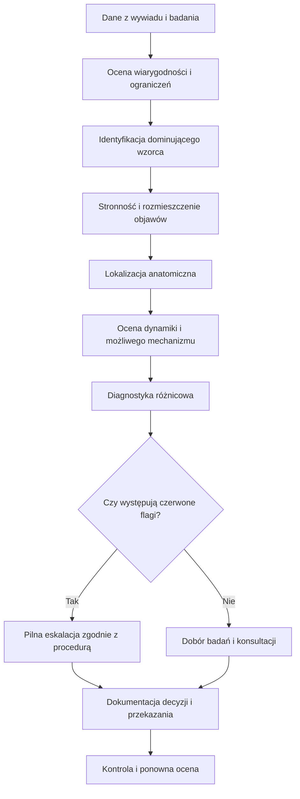
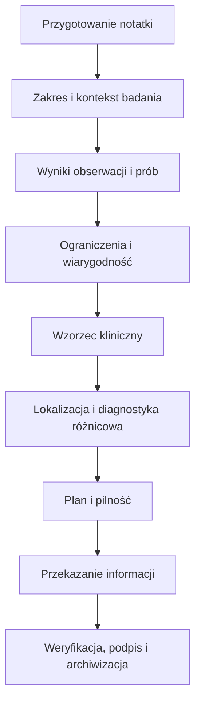
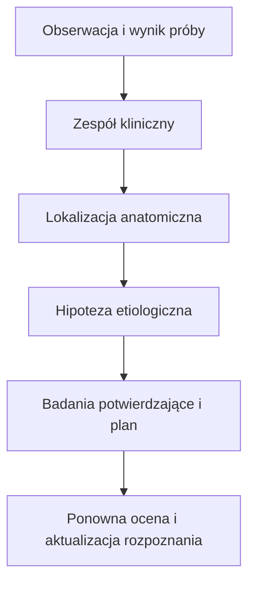
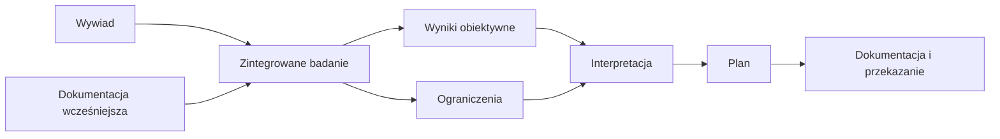
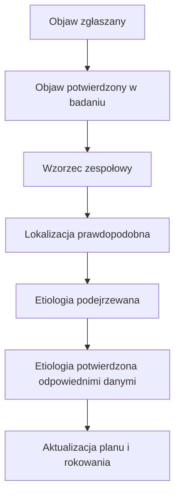

# 3.12. Dokumentowanie i interpretacja badania

## Wprowadzenie

Dokumentowanie i interpretacja badania neurologicznego są dwiema nierozłącznymi, ale odrębnymi czynnościami klinicznymi. Dokumentowanie polega na wiernym utrwaleniu informacji uzyskanych z wywiadu, obserwacji, badania przedmiotowego i dostępnych wyników dodatkowych. Interpretacja polega na uporządkowaniu tych danych, rozpoznaniu wzorca zaburzeń, sformułowaniu hipotezy lokalizacyjnej oraz określeniu, jakie rozpoznania etiologiczne i dalsze działania należy rozważyć. Dobra dokumentacja umożliwia innemu uprawnionemu członkowi zespołu odtworzenie toku rozumowania, ocenę dynamiki choroby i bezpieczne kontynuowanie opieki.

Badanie neurologiczne nie jest zbiorem niezależnych prób. Wynik próby ruchowej nabiera znaczenia w zestawieniu z napięciem mięśniowym, odruchami, czuciem, koordynacją, funkcjami nerwów czaszkowych i sposobem poruszania się. Podobnie pojedyncza nieprawidłowość nerwu czaszkowego może wynikać z uszkodzenia samego nerwu, jego jądra, pęczka wewnątrz pnia mózgu, połączenia nerwowo-mięśniowego, mięśnia lub struktur sąsiednich. Wniosek kliniczny powinien zatem wynikać z układu objawów, ich stronności, dynamiki i zgodności anatomicznej, a nie z automatycznego przypisania jednego objawu do jednej choroby.

Niniejszy rozdział ma charakter integracyjny i zamyka moduł poświęcony badaniu nerwów czaszkowych. Nie powtarza szczegółowych technik opisanych w rozdziałach 3.1–3.10 ani pełnej charakterystyki zespołów z rozdziału 3.11. Pokazuje, jak zapisać wyniki tych badań, jak oddzielać obserwację od interpretacji, jak oceniać stopień pewności wniosków oraz jak przygotować użyteczne podsumowanie dla pacjenta i zespołu medycznego.

> **Zasada nadrzędna:** dokumentacja ma odzwierciedlać to, co rzeczywiście zebrano i zbadano. Nie wolno wpisywać wyniku prawidłowego dla elementu, którego nie wykonano, ani przedstawiać hipotezy lokalizacyjnej jako potwierdzonego rozpoznania etiologicznego.

Zakres samodzielnego badania, interpretowania wyników, zlecania badań i podejmowania decyzji zależy od kwalifikacji zawodowych, uprawnień, miejsca udzielania świadczeń oraz obowiązujących procedur. Materiał nie zastępuje konsultacji specjalistycznej, aktualnych wytycznych ani oceny osoby odpowiedzialnej za leczenie.

---

## 1. Cele kształcenia i efekty uczenia się

### 1.1. Cel ogólny

Celem rozdziału jest przygotowanie uczestnika do sporządzania rzetelnego, czytelnego i użytecznego opisu badania neurologicznego oraz do formułowania wniosków, które są proporcjonalne do jakości i zakresu zebranych danych.

### 1.2. Szczegółowe efekty uczenia się

Po ukończeniu rozdziału uczestnik powinien umieć:

1. wyjaśnić różnicę między obserwacją kliniczną, objawem, zespołem, lokalizacją anatomiczną i rozpoznaniem etiologicznym;
2. opisać prawidłową funkcję nerwów czaszkowych w sposób zwięzły, jednoznaczny i możliwy do zweryfikowania;
3. dokumentować stronność, nasilenie, zakres i warunki wykonania próby;
4. odróżniać wynik prawidłowy, nieprawidłowy, niejednoznaczny, niewiarygodny i nieocenialny;
5. opisać wynik badania ruchowego, czuciowego, odruchowego, koordynacyjnego, poznawczego i autonomicznego;
6. integrować objawy w spójny wzorzec neuroanatomiczny;
7. rozpoznawać, kiedy dane wskazują na uszkodzenie ośrodkowe, jądrowe, pęczkowe, korzeniowe, nerwowe, złącza nerwowo-mięśniowego lub mięśniowe;
8. uwzględniać możliwe czynniki zakłócające wynik badania;
9. odróżniać rozpoznanie robocze od rozpoznania potwierdzonego;
10. sporządzić podsumowanie kliniczne zawierające najważniejsze odchylenia, hipotezę lokalizacyjną, diagnostykę różnicową i plan;
11. rozpoznać czerwone flagi wymagające pilnej eskalacji;
12. przygotować zwięzłe przekazanie pacjenta innemu członkowi zespołu;
13. stosować zasady ochrony danych, poufności, integralności i chronologii dokumentacji;
14. wykorzystywać skale i klasyfikacje jako narzędzia uzupełniające, a nie zamiennik badania klinicznego.

### 1.3. Oczekiwany standard kompetencji

Uczestnik powinien umieć odpowiedzieć na pięć pytań:

- **Co stwierdzono?** – opis obserwacji i wyników prób.
- **Gdzie może znajdować się uszkodzenie?** – lokalizacja anatomiczna.
- **Jaki wzorzec kliniczny tworzą objawy?** – zespół neurologiczny.
- **Co może być przyczyną?** – uporządkowana diagnostyka różnicowa.
- **Co należy zrobić dalej i jak pilnie?** – plan diagnostyczny, konsultacyjny, terapeutyczny lub obserwacyjny w granicach kompetencji.

### 1.4. Kryteria jakości opracowania

Dobra notatka neurologiczna jest:

- **prawdziwa** – nie zawiera wyników domniemanych ani dopisanych po fakcie bez oznaczenia;
- **precyzyjna** – wskazuje stronę, zakres, nasilenie i warunki badania;
- **proporcjonalna** – zawiera szczegóły istotne dla problemu klinicznego;
- **chronologiczna** – pozwala ustalić, kiedy wystąpiły objawy, kiedy przeprowadzono badanie i kiedy podjęto decyzję;
- **czytelna** – jest zrozumiała dla kolejnego członka zespołu;
- **odtwarzalna** – umożliwia porównanie kolejnych badań;
- **bezpieczna** – uwzględnia objawy alarmowe, ograniczenia i podjęte działania;
- **etyczna** – respektuje godność, autonomię, prywatność i prawo pacjenta do informacji.

---

## 2. Podstawowe definicje i poziomy wnioskowania

### 2.1. Obserwacja

Obserwacja jest bezpośrednim opisem tego, co osoba badająca widzi, słyszy lub mierzy. Przykład: „podczas wysuwania języka koniec języka odchyla się w prawo”. Jest to opis zachowania, a nie jeszcze rozpoznanie uszkodzenia nerwu XII.

### 2.2. Wynik próby

Wynik próby jest zapisem odpowiedzi pacjenta na określoną czynność badawczą. Powinien obejmować nazwę lub cel próby, sposób jej wykonania, stronę, wynik i ewentualne ograniczenia. Przykład: „przy próbie unoszenia barków przeciw oporowi siła po stronie lewej mniejsza niż po prawej; ruch ograniczony bólem barku”.

### 2.3. Objaw neurologiczny

Objaw jest klinicznie istotną nieprawidłowością lub dolegliwością. Może być subiektywny, zgłaszany przez pacjenta, albo obiektywny, stwierdzany w badaniu. Należy odróżniać parestezję zgłaszaną przez pacjenta od niedoczulicy wykazanej w badaniu czucia.

### 2.4. Zespół neurologiczny

Zespół to układ objawów, które współwystępują i mogą wynikać z określonego mechanizmu lub lokalizacji. Przykładem jest zespół opuszkowy, zespół móżdżkowy, zespół piramidowy lub zespół zatoki jamistej. Rozpoznanie zespołu nie musi oznaczać znajomości jego przyczyny.

### 2.5. Lokalizacja anatomiczna

Lokalizacja określa prawdopodobny poziom układu nerwowego lub strukturę, której uszkodzenie najlepiej wyjaśnia wzorzec objawów. Może dotyczyć kory, struktur podkorowych, pnia mózgu, rdzenia, korzenia, splotu, nerwu obwodowego, złącza nerwowo-mięśniowego lub mięśnia.

### 2.6. Rozpoznanie etiologiczne

Rozpoznanie etiologiczne określa przyczynę procesu chorobowego, np. niedokrwienie, krwotok, zapalenie, zakażenie, ucisk, uraz, proces nowotworowy, toksyczny lub metaboliczny. Wymaga zwykle połączenia badania klinicznego z badaniami dodatkowymi i przebiegiem choroby.

### 2.7. Rozpoznanie robocze i stopień pewności

Rozpoznanie robocze jest aktualnie najbardziej prawdopodobną hipotezą, która kieruje dalszym postępowaniem. Powinno być oznaczone jako podejrzenie, jeśli nie zostało potwierdzone. Stopień pewności należy wyrażać słowami, a nie pozornie precyzyjnymi procentami, jeżeli nie ma podstaw do ich wyliczenia.

Przykładowe sformułowania:

- „obraz kliniczny przemawia za…”;
- „najbardziej prawdopodobna lokalizacja to…”;
- „wymaga wykluczenia…”;
- „na podstawie badania przyłóżkowego nie można rozstrzygnąć…”;
- „rozpoznanie etiologiczne pozostaje nieustalone”;
- „wynik wymaga korelacji z obrazowaniem/neurofizjologią/badaniem laboratoryjnym”.

### 2.8. Wynik nieocenialny

Wynik nieocenialny oznacza, że nie można wiarygodnie określić funkcji z powodu ograniczeń technicznych, klinicznych lub komunikacyjnych. Nie jest równoważny wynikowi prawidłowemu. Przykłady: brak współpracy z powodu zaburzeń świadomości, niemożność oceny siły z powodu złamania, niewykonalność próby z powodu silnego bólu albo brak możliwości oceny ostrości wzroku z powodu niewłaściwych okularów.

---

## 3. Podstawy neuroanatomiczne i neurofizjologiczne interpretacji

### 3.1. Dlaczego lokalizacja poprzedza etiologię

Układ nerwowy ma uporządkowaną budowę, a określone funkcje są prowadzone przez konkretne drogi i struktury. Wzorzec objawów pozwala zatem wnioskować o miejscu uszkodzenia. Dopiero po określeniu prawdopodobnej lokalizacji można racjonalnie zawężać przyczyny i dobierać badania dodatkowe.

Przykładowo osłabienie mięśni twarzy może wynikać z uszkodzenia:
- kory lub dróg korowo-jądrowych;
- jądra nerwu VII albo jego pęczka w moście;
- nerwu VII po opuszczeniu pnia;
- złącza nerwowo-mięśniowego;
- mięśni twarzy.

Samo określenie „porażenie twarzy” jest więc niewystarczające do lokalizacji.

### 3.2. Droga korowo-jądrowa i jądra ruchowe

Drogi korowo-jądrowe przewodzą impulsy z kory ruchowej do jąder ruchowych nerwów czaszkowych. Ich organizacja jest zróżnicowana: część jąder otrzymuje istotne unerwienie z obu półkul, a część ma przewagę unerwienia przeciwstronnego. Dlatego wzorzec osłabienia mięśni twarzy, języka lub podniebienia może różnić się w uszkodzeniu ośrodkowym i obwodowym.

W dokumentacji należy opisywać konkretne funkcje, a nie wpisywać automatycznie nazwę nerwu na podstawie jednego testu. Przy podejrzeniu uszkodzenia ośrodkowego należy zestawić wynik badania twarzy lub języka z siłą kończyn, mową, czuciem, koordynacją, polem widzenia i innymi objawami.

### 3.3. Pęczki nerwów czaszkowych i drogi długie

W pniu mózgu jądra i pęczki nerwów czaszkowych sąsiadują z drogami korowo-rdzeniowymi, wstęgą przyśrodkową, drogą rdzeniowo-wzgórzową, pęczkiem podłużnym przyśrodkowym i połączeniami móżdżkowymi. Współwystępowanie objawu nerwu czaszkowego z przeciwstronnym niedowładem lub zaburzeniem czucia może wskazywać na zespół pniowy.

Nieobecność klasycznych objawów skrzyżowanych nie wyklucza uszkodzenia pnia. Małe ognisko, nietypowy przebieg włókien, obustronne połączenia lub niepełne badanie mogą zmieniać obraz kliniczny.

### 3.4. Odcinki obwodowe nerwów czaszkowych

Po opuszczeniu pnia nerwy biegną przez przestrzenie podpajęczynówkowe, kanały i otwory podstawy czaszki, a następnie przez struktury szyi i twarzy. Sąsiedztwo anatomiczne sprawia, że pojedynczy proces może obejmować kilka nerwów. W dokumentacji należy zatem zapisywać nie tylko numer nerwu, ale również konkretne funkcje i obszary, których dotyczy deficyt.

### 3.5. Złącze nerwowo-mięśniowe i mięśnie

Zaburzenia ruchów gałek ocznych, mimiki, połykania lub ruchów języka nie zawsze oznaczają neuropatię czaszkową. Męczliwość, zmienność objawów, obustronne osłabienie albo rozkład niezgodny z przebiegiem pojedynczego nerwu mogą kierować uwagę na złącze nerwowo-mięśniowe lub mięśnie. W opisie należy uwzględnić powtarzalność, zależność od wysiłku, ból, zakres ruchu i ewentualne objawy ogólnoustrojowe.

### 3.6. Drogi czuciowe i poziom uszkodzenia

Czucie twarzy, tułowia i kończyn jest przewodzone przez różne drogi. Zaburzenia czucia w obrębie twarzy mogą współistnieć z zaburzeniami czucia ciała po przeciwnej stronie w uszkodzeniu pnia. Z kolei rozkład dermatomalny, nerwowy, rękawiczkowo-skarpetkowy lub połowiczy może sugerować różne poziomy uszkodzenia.

W dokumentacji należy podawać modalność czucia, stronę i obszar. Sam zapis „czucie osłabione” nie pozwala ocenić, czy dotyczy dotyku, bólu, temperatury, wibracji czy propriocepcji.

### 3.7. Odruchy jako element lokalizacji

Odruchy głębokie zależą od integralności łuku odruchowego i modulacji zstępującej. Wzmożenie odruchów może przemawiać za uszkodzeniem górnego neuronu ruchowego, a osłabienie lub zniesienie – za zaburzeniem łuku odruchowego, korzenia lub nerwu obwodowego. Interpretacja wymaga porównania stron, uwzględnienia wieku, napięcia, techniki badania i stanu pacjenta.

### 3.8. Czas i dynamika jako część lokalizacji

Nagły początek, napadowość, postęp w ciągu godzin lub dni, przebieg nawrotowy oraz powolna progresja mogą wskazywać na różne mechanizmy. Lokalizacja anatomiczna nie może być interpretowana bez osi czasu. W opisie należy odnotować czas ostatniego stanu bez objawów, czas zauważenia deficytu, dynamikę oraz źródło informacji o początku.

---

## 4. Zasady rzetelnego dokumentowania

### 4.1. Zapisuj to, co rzeczywiście wykonano

Wpis powinien odzwierciedlać wykonane czynności. Jeśli oceniono tylko ruchomość gałek ocznych, nie należy wpisywać pełnego, prawidłowego badania nerwów III, IV i VI. Jeżeli nie zbadano odruchu rogówkowego, nie należy sugerować, że był prawidłowy.

### 4.2. Oddzielaj dane zgłaszane od stwierdzonych

Należy rozróżniać:
- „pacjent zgłasza podwójne widzenie” – informacja z wywiadu;
- „w badaniu stwierdzono ograniczenie odwodzenia prawego oka” – wynik badania;
- „obraz może odpowiadać neuropatii nerwu VI” – hipoteza lokalizacyjna.

Jeśli informacja pochodzi od opiekuna, świadka lub z wcześniejszej dokumentacji, należy to wskazać.

### 4.3. Używaj jednoznacznych określeń stronności

Preferowane są pełne określenia: prawa, lewa, obustronnie, po stronie prawej, po stronie lewej, po stronie przeciwnej. Skróty L/P mogą być stosowane wyłącznie wtedy, gdy są jednoznaczne w danym systemie i nie stwarzają ryzyka pomyłki.

Przy opisie odchylenia języka, ustawienia gałek ocznych, asymetrii twarzy, niedowładu lub zaburzeń czucia należy wskazać stronę oraz kierunek obserwacji.

### 4.4. Opisuj stopień i zakres zaburzenia

Zamiast określenia „osłabione” warto wskazać:
- które ruchy są osłabione;
- czy ruch jest możliwy przeciw grawitacji;
- czy pacjent pokonuje opór;
- czy ograniczenie jest pełne, częściowe czy zmienne;
- czy występuje ból lub męczliwość;
- czy wynik jest symetryczny.

### 4.5. Podawaj warunki badania

Istotne mogą być: pozycja pacjenta, zastosowany przyrząd, rodzaj bodźca, poziom współpracy, obecność bólu, użycie okularów lub aparatu słuchowego, zastosowanie pomocy ortopedycznej, czas od podania leku oraz to, czy próba była wykonywana przed czy po wysiłku.

### 4.6. Nie zastępuj opisu etykietą

Określenia takie jak „objaw piramidowy”, „ataksja”, „porażenie opuszkowe” lub „neuropatia” są użyteczne dopiero wtedy, gdy zapisano dane, które je uzasadniają. Sama etykieta bez wyników prób utrudnia weryfikację.

### 4.7. Zapisuj również wyniki ujemne, jeżeli mają znaczenie

Nie ma potrzeby wymieniania wszystkich prawidłowych elementów każdego badania. Należy jednak zapisać istotne wyniki ujemne, które wpływają na decyzję kliniczną. Przykładowo przy podejrzeniu zespołu pniowego znaczenie może mieć brak zaburzeń czucia, brak niedowładu kończyn lub brak zaburzeń ruchomości gałek ocznych – o ile rzeczywiście zostały ocenione.

### 4.8. Oznaczaj ograniczenia

Przyczyny ograniczenia mogą obejmować:
- zaburzenia świadomości;
- afazję lub barierę językową;
- niedosłuch albo niedowidzenie;
- ból;
- uraz lub unieruchomienie;
- zmęczenie;
- zaburzenia poznawcze;
- brak odpowiedniego sprzętu;
- brak możliwości bezpiecznego wykonania próby.

Ograniczenie powinno być opisane konkretnie, np. „ocena siły prawej kończyny górnej ograniczona bólem po urazie barku; wynik nie pozwala na wiarygodne określenie siły mięśniowej”.

### 4.9. Unikaj języka oceniającego pacjenta

Nie należy stosować sformułowań stygmatyzujących, takich jak „pacjent nie współpracuje” bez wyjaśnienia okoliczności. Lepszy zapis: „pacjent nie wykonał poleceń dwustopniowych; przyczyna nieustalona, możliwy wpływ zaburzeń rozumienia, uwagi lub słuchu”. Opis ma przedstawiać zachowanie i warunki, a nie oceniać osobę.

### 4.10. Zachowuj chronologię

W dokumentacji powinno być jasne, kiedy rozpoczęły się objawy, kiedy przeprowadzono badanie, kiedy uzyskano wyniki, kiedy podjęto decyzję i komu przekazano informację. Jeżeli wpis jest sporządzany z opóźnieniem, należy postępować zgodnie z regułami systemu i procedurą placówki, bez antydatowania.

---

## 5. Ramy prawne i organizacyjne dokumentacji w Polsce

### 5.1. Zasada aktualności przepisów

Dokumentacja medyczna jest prowadzona zgodnie z ustawą o prawach pacjenta i Rzeczniku Praw Pacjenta, rozporządzeniami wykonawczymi oraz innymi przepisami właściwymi dla rodzaju świadczenia. Przed wdrożeniem wzoru dokumentu lub procedury należy sprawdzić aktualne brzmienie przepisów w Dzienniku Ustaw i Elektronicznym Dzienniku Ustaw.

Na dzień 26 listopada 2026 r. punktem odniesienia dla rodzajów, zakresu i sposobu przetwarzania dokumentacji jest tekst jednolity rozporządzenia Ministra Zdrowia ogłoszony w Dz.U. z 2026 r. poz. 1391, obowiązujący od 23 października 2026 r. W szczególności należy zwrócić uwagę na zasady prowadzenia dokumentacji, dokonywania wpisów, oznaczania osób udzielających świadczeń, zakres informacji o stanie zdrowia i funkcjonowania oraz zabezpieczenia danych.

### 5.2. Podstawowe obowiązki dotyczące wpisu

Zgodnie z aktualnym tekstem rozporządzenia:
- wpisu dokonuje się niezwłocznie po udzieleniu świadczenia;
- należy zapewnić integralność i niezaprzeczalność danych;
- wpisy i zmiany muszą być powiązane z osobą, która ich dokonała;
- dokumentacja elektroniczna wymaga właściwego sposobu podpisania lub potwierdzenia zgodnie z przepisami;
- wpisu papierowego nie usuwa się; błąd koryguje się w sposób pozostawiający ślad korekty;
- dokumentacja indywidualna zawiera m.in. oznaczenie podmiotu, pacjenta i osoby udzielającej świadczeń, informacje o stanie zdrowia lub funkcjonowania, opis świadczeń, rozpoznanie lub problem zdrowotny oraz zalecenia.

Szczegółowe wymogi zależą od rodzaju dokumentacji i rodzaju podmiotu. Powyższe zestawienie ma charakter dydaktyczny i nie zastępuje analizy pełnego aktu prawnego.

### 5.3. Prawo pacjenta do dokumentacji

Pacjent ma prawo do dostępu do dokumentacji dotyczącej jego stanu zdrowia i udzielonych świadczeń. Dokumentacja powinna być prowadzona i przechowywana w sposób zapewniający jej ochronę, integralność, poufność i dostępność dla osób uprawnionych. Zasady udostępniania, zakres uprawnionych osób i tryb postępowania określają przepisy prawa.

### 5.4. Ochrona danych i poufność

W dokumentacji należy umieszczać tylko informacje potrzebne do realizacji celu zdrowotnego i obowiązków prawnych. Dostęp powinien być ograniczony do osób uprawnionych. Nie wolno przesyłać danych pacjenta przez prywatne konta, komunikatory lub niezabezpieczone nośniki, jeśli nie jest to dopuszczone przez procedury i przepisy. Materiały dydaktyczne, prezentacje i przypadki kliniczne muszą być odpowiednio zanonimizowane.

### 5.5. Korekta błędnego wpisu

Korekta nie może zacierać historii dokumentacji. Należy korzystać z mechanizmu korekty dostępnego w systemie lub procedury przewidzianej dla dokumentacji papierowej. Wpis korygujący powinien umożliwiać ustalenie, co zmieniono, kiedy, przez kogo i z jakiej przyczyny. Nie należy usuwać niekorzystnych wyników ani zastępować ich nowym wpisem bez zachowania śladu.

### 5.6. Dokumentacja dydaktyczna a dokumentacja medyczna

Karta ćwiczeniowa, formularz OSCE, notatka własna uczestnika kursu i rzeczywista dokumentacja medyczna nie są automatycznie tym samym rodzajem dokumentu. Wzory szkoleniowe powinny być wyraźnie oznaczone jako materiały dydaktyczne i nie mogą zawierać prawdziwych danych identyfikujących pacjentów. Wpis do dokumentacji medycznej wykonuje osoba uprawniona, zgodnie z procedurą podmiotu i zakresem swoich kompetencji.

---

## 6. Minimalna struktura opisu badania neurologicznego

### 6.1. Dane kontekstowe

Opis powinien pozwalać ustalić:
- datę i godzinę badania;
- miejsce lub kontekst udzielenia świadczenia;
- osobę badającą i jej rolę;
- powód badania;
- źródło informacji;
- istotne ograniczenia badania.

Nie należy powielać zbędnych danych identyfikacyjnych w dodatkowych notatkach lub materiałach dydaktycznych.

### 6.2. Wywiad i oś czasu

Należy zapisać:
- główną dolegliwość;
- początek i dynamikę objawów;
- czas ostatniego stanu bez objawów, jeśli ma znaczenie;
- przebieg napadowy, nawrotowy lub postępujący;
- objawy towarzyszące;
- istotne choroby, leki i czynniki ryzyka;
- informacje od świadków, jeśli pacjent nie może wiarygodnie przedstawić przebiegu zdarzenia.

### 6.3. Badanie ogólne i bezpieczeństwo

W zależności od sytuacji należy odnotować stan ogólny, parametry życiowe, poziom świadomości, ból, ryzyko upadku, zdolność do współpracy, potrzebę asekuracji oraz występowanie objawów alarmowych.

### 6.4. Badanie neurologiczne

Opis powinien obejmować odpowiednie dla problemu klinicznego elementy:
- świadomość i funkcje poznawcze;
- mowę i komunikację;
- nerwy czaszkowe;
- siłę i napięcie mięśniowe;
- trofikę i ruchy mimowolne;
- czucie;
- odruchy;
- koordynację;
- równowagę i chód;
- funkcje autonomiczne;
- objawy oponowe lub rdzeniowe, jeśli istnieją wskazania.

### 6.5. Podsumowanie

Podsumowanie powinno zawierać:
1. najważniejsze odchylenia;
2. najważniejsze wyniki ujemne, jeśli wpływają na wniosek;
3. rozpoznany zespół lub dominujący wzorzec;
4. prawdopodobną lokalizację;
5. główne hipotezy etiologiczne i rozpoznania wymagające wykluczenia;
6. stopień pewności i ograniczenia;
7. plan dalszego postępowania oraz termin ponownej oceny.

---

## 7. Dokumentowanie badania nerwów czaszkowych I–XII

Poniższa tabela jest przewodnikiem redakcyjnym. Nie zastępuje szczegółowych procedur z rozdziałów 3.1–3.10. Wpis powinien obejmować wyłącznie elementy rzeczywiście ocenione.

| Nerw | Co należy opisać | Przykładowy zapis |
|---|---|---|
| I – węchowy | drożność nosa, użyty zapach, rozpoznanie, stronność, ograniczenia | „Rozpoznawanie zapachu obustronnie zachowane w przeprowadzonej próbie; ocena ograniczona przez niedrożność lewego przewodu nosowego” |
| II – wzrokowy | ostrość wzroku, pola widzenia, źrenice, widzenie barw, dno oka, warunki | „Ostrość wzroku oceniona oddzielnie dla każdego oka z korekcją; ubytek pola widzenia w prawym górnym kwadrancie w próbie konfrontacyjnej, wymaga weryfikacji” |
| III, IV, VI | ustawienie oczu, ruchy w poszczególnych kierunkach, diplopia, źrenice, opadanie powieki | „Ograniczenie odwodzenia prawego oka, nasilające się przy spojrzeniu w prawo; pacjent zgłasza diplopię poziomą” |
| V | czucie V1–V3, żwacze, odruchy, ból, strony | „Czucie dotyku i bodźca ostrego symetryczne w V1–V3; siła żwaczy bez wyraźnej asymetrii” |
| VII | czoło, zamykanie oczu, uśmiech, policzki, synkinezy, smak jeśli oceniany | „Osłabienie prawej połowy twarzy obejmujące czoło i dolną część twarzy; niepełne domknięcie prawej szpary powiekowej” |
| VIII | słuch, próby stroikowe, objawy przedsionkowe, oczopląs, stabilność | „W próbie szeptu słabsze rozpoznawanie po stronie lewej; wynik wymaga korelacji z audiometrią” |
| IX, X | głos, połykanie, podniebienie, języczek, kaszel, objawy aspiracji | „Głos ochrypły; unoszenie podniebienia asymetryczne, języczek odchyla się w lewo; zgłaszane krztuszenie przy płynach” |
| XI | obrót głowy, unoszenie barków, opór, zanik, ból | „Unoszenie lewego barku przeciw oporowi osłabione; obrót głowy w prawo zachowany, w lewo ograniczony bólem” |
| XII | pozycja języka, wysuwanie, ruchy boczne, siła, zanik, fascykulacje, artykulacja | „Język w spoczynku bez widocznego zaniku; przy wysuwaniu odchyla się w prawo, bez uchwytnych fascykulacji” |

### 7.1. Zapis prawidłowy

Sformułowanie „nerwy czaszkowe prawidłowe” może być niewystarczające, jeżeli nie wiadomo, jakie elementy oceniono. W skróconym badaniu można zastosować zapis zbiorczy, ale należy określić zakres, np. „w badaniu przesiewowym: źrenice równe i reagujące, ruchy gałek ocznych pełne, twarz symetryczna w spoczynku i przy ruchach mimicznych, mowa wyraźna, język pośrodkowo”. Nie należy rozszerzać takiego wpisu na funkcje, których nie badano.

### 7.2. Zapis nieprawidłowy

Wynik nieprawidłowy powinien wskazywać konkretną funkcję, stronę, nasilenie, warunki i ewentualne objawy towarzyszące. Należy unikać nieprecyzyjnych określeń „nerw uszkodzony” bez wskazania danych klinicznych.

### 7.3. Zapis przy braku możliwości oceny

Przykład: „Ocena nerwu VIII ograniczona z powodu znacznego niedosłuchu i braku aparatu słuchowego; próba szeptu niewiarygodna. Zalecana ocena audiologiczna według wskazań”. Takie sformułowanie jest bardziej rzetelne niż wpis „słuch prawidłowy”.

---

## 8. Dokumentowanie pozostałych elementów badania

### 8.1. Świadomość i funkcje poznawcze

Należy odnotować poziom czuwania, kontakt, orientację, uwagę, rozumienie poleceń, pamięć, mowę i zachowanie w zakresie istotnym klinicznie. Jeśli zastosowano skalę, trzeba podać jej nazwę, wynik, czas wykonania i ograniczenia. Wynik testu przesiewowego nie jest samodzielnym rozpoznaniem otępienia ani majaczenia.

### 8.2. Siła mięśniowa

Warto wskazać badane grupy mięśniowe, stronę i zastosowaną skalę. Jeżeli używa się skali MRC/Lovetta 0–5, należy zachować jej definicje i odróżniać wynik 3 od 4 oraz 4 od 5. Stopień 4 obejmuje szeroki zakres siły i może wymagać dodatkowego opisu. Ból, ograniczenie stawu, zaburzenia rozumienia lub niewystarczający wysiłek mogą obniżać wynik niezależnie od uszkodzenia neurologicznego.

### 8.3. Napięcie mięśniowe

Należy określić, czy napięcie jest prawidłowe, obniżone czy wzmożone, oraz opisać charakter oporu, zależność od szybkości ruchu i ewentualne zjawisko koła zębatego. Jeżeli stosuje się skalę Ashwortha lub jej modyfikację, trzeba wskazać, której wersji użyto. Nie należy porównywać wyników uzyskanych różnymi skalami tak, jakby były równoważne.

### 8.4. Trofika i ruchy mimowolne

Opis powinien wskazywać lokalizację zaniku lub przerostu, symetrię, fascykulacje, drżenie, dystonię, mioklonie, pląsawicę albo inne obserwowane ruchy. Jeżeli ruch jest okresowy, należy podać okoliczności jego występowania i czas obserwacji.

### 8.5. Czucie

Należy zapisać modalność, obszar i stronę. Przydatne jest określenie, czy zaburzenie ma rozkład dermatomalny, odpowiada obszarowi nerwu obwodowego, obejmuje dystalne części kończyn, połowę ciała czy poziom na tułowiu. W razie potrzeby warto dołączyć mapę czucia.

### 8.6. Odruchy

Wpis powinien wskazywać badany odruch, stronę, nasilenie i symetrię. W wielu praktykach stosuje się skalę 0–4+, ale sposób jej użycia może różnić się między ośrodkami. Należy podać przyjętą skalę i opisać klonus lub odruchy patologiczne. Nie wolno traktować pojedynczego odruchu jako samodzielnego dowodu lokalizacji.

### 8.7. Koordynacja

Należy wymienić wykonane próby i opisać rodzaj zaburzenia: dysmetrię, drżenie zamiarowe, dysdiadochokinezę, rozpad ruchu, asynergię lub nieprawidłowość rytmu. Warto odróżnić błąd wynikający z osłabienia, ograniczenia ruchu, bólu lub zaburzeń czucia od zaburzenia koordynacji.

### 8.8. Równowaga i chód

Opis powinien obejmować pozycję wyjściową, używane pomoce, asekurację, szerokość podstawy, długość kroku, symetrię, inicjację, zwroty, zatrzymywanie i reakcje posturalne. Należy zapisać, czy pacjent wymagał podparcia, czy próbę przerwano i z jakiej przyczyny.

### 8.9. Funkcje autonomiczne

W zależności od problemu klinicznego należy dokumentować objawy ortostatyczne, zaburzenia potliwości, mikcji, defekacji, funkcji seksualnych, termoregulacji i rytmu serca. Jeżeli wykonano pomiar ortostatyczny, należy podać pozycję, czas od zmiany pozycji oraz konkretne wartości ciśnienia i tętna.

### 8.10. Funkcjonowanie

Opis neurologiczny powinien być uzupełniony informacją o wpływie objawów na aktywność i uczestnictwo. Należy uwzględnić samodzielność, transfery, chód, komunikację, samoobsługę, pracę, naukę, role rodzinne, bariery środowiskowe i wsparcie opiekunów. W tym obszarze pomocna jest koncepcja ICF.

---

## 9. Metodyka interpretacji: od danych do wniosku

### 9.1. Etap pierwszy – sprawdzenie jakości danych

Przed lokalizacją należy ustalić:
- czy wywiad jest wiarygodny;
- czy badanie wykonano prawidłową techniką;
- czy pacjent rozumiał polecenia;
- czy ból, zmęczenie, leki lub zaburzenia sensoryczne mogły wpłynąć na wynik;
- czy wszystkie istotne elementy oceniono;
- czy wyniki są powtarzalne;
- czy różnice między stronami są rzeczywiste i istotne.

### 9.2. Etap drugi – określenie dominującego wzorca

Należy ustalić, czy przeważają:
- objawy ruchowe;
- objawy czuciowe;
- zaburzenia nerwów czaszkowych;
- zaburzenia koordynacji i równowagi;
- zaburzenia poznawcze lub świadomości;
- objawy autonomiczne;
- objawy wieloukładowe.

W praktyce często występują wzorce mieszane.

### 9.3. Etap trzeci – określenie stronności i rozmieszczenia

Ważne jest, czy objawy są:
- jednostronne;
- obustronne i symetryczne;
- obustronne, ale asymetryczne;
- skrzyżowane;
- dystalne lub proksymalne;
- segmentarne;
- wieloogniskowe;
- uogólnione.

Rozmieszczenie bywa bardziej lokalizujące niż samo nasilenie.

### 9.4. Etap czwarty – rozważenie poziomu anatomicznego

W zależności od wzorca należy rozważyć:
1. korę mózgu;
2. struktury podkorowe i torebkę wewnętrzną;
3. pień mózgu;
4. móżdżek i jego połączenia;
5. rdzeń kręgowy;
6. korzeń nerwowy;
7. splot;
8. nerw obwodowy lub czaszkowy;
9. złącze nerwowo-mięśniowe;
10. mięsień;
11. zaburzenia wielopoziomowe lub układowe.

### 9.5. Etap piąty – powiązanie z czasem i mechanizmem

Nagły początek może wskazywać na proces naczyniowy, napadowy lub urazowy. Przebieg podostry może wymagać rozważenia zapalenia, zakażenia, procesu naciekowego lub metabolicznego. Powolna progresja może przemawiać za procesem zwyrodnieniowym, przewlekłym uciskiem, guzem lub neuropatią. Są to wskazówki, a nie reguły rozstrzygające.

### 9.6. Etap szósty – sformułowanie diagnostyki różnicowej

Lista różnicowa powinna być uporządkowana według:
- pilności wykluczenia;
- zgodności z lokalizacją;
- zgodności z dynamiką;
- prawdopodobieństwa na podstawie wywiadu i badania;
- dostępności i wartości badań potwierdzających.

Nie należy tworzyć długiej listy wszystkich teoretycznie możliwych chorób bez wskazania, które z nich wymagają pilnego wykluczenia i dlaczego.

### 9.7. Etap siódmy – plan dalszego postępowania

Plan powinien wynikać z pytania klinicznego. Może obejmować pilną konsultację, obrazowanie, badania neurofizjologiczne, laboratoryjne, ocenę audiologiczną, okulistyczną, laryngologiczną, logopedyczną lub rehabilitacyjną. Wpis powinien wskazywać cel badania lub konsultacji, a nie tylko jego nazwę.

### 9.8. Schemat interpretacji

---

## 10. Wzorce lokalizacyjne przydatne w interpretacji

Poniższe zestawienie ma charakter orientacyjny. Rozpoznanie wymaga korelacji z pełnym badaniem i odpowiednimi badaniami dodatkowymi.

| Wzorzec | Cechy wspierające lokalizację | Ważne ograniczenia |
|---|---|---|
| Ośrodkowy niedowład twarzy | przewaga osłabienia dolnej części twarzy, możliwe objawy kończyn lub mowy | unerwienie czoła nie jest absolutną regułą; obraz zależy od lokalizacji i rozległości |
| Obwodowe porażenie VII | osłabienie górnej i dolnej części połowy twarzy | należy różnicować uszkodzenie nerwu, pęczka, mięśnia i złącza |
| Zespół pniowy | objaw nerwu czaszkowego z objawami dróg długich, móżdżku lub układu współczulnego | klasyczne objawy skrzyżowane mogą być niepełne lub nieobecne |
| Zespół zatoki jamistej | kombinacja III, IV, VI i V1/V2, możliwe objawy współczulne i żylne | podobny obraz może występować w szczycie oczodołu lub szczelinie oczodołowej górnej |
| Kąt mostowo-móżdżkowy | zaburzenia VIII z możliwym zajęciem V i VII, objawami móżdżkowymi | początek i tempo zależą od etiologii; izolowany niedosłuch nie przesądza o lokalizacji |
| Otwór szyjny | zajęcie IX, X i XI | możliwe są inne kombinacje w zależności od rozległości procesu |
| Kanał nerwu XII | izolowane lub dominujące objawy XII, możliwe współistnienie innych nerwów w zmianach podstawy czaszki | odchylenie języka nie wystarcza do ustalenia etiologii |
| Złącze nerwowo-mięśniowe | zmienność i męczliwość, możliwe zajęcie mięśni gałkoruchowych i opuszkowych | objawy mogą być subtelne; wymagają specjalistycznej oceny |
| Miopatia | wzorzec osłabienia mięśni, często proksymalny lub osiowy | niektóre miopatie mogą obejmować mięśnie twarzy, połykania lub gałkoruchowe |

### 10.1. Objawy skrzyżowane

Przy podejrzeniu uszkodzenia pnia należy zestawić:
- stronę objawu nerwu czaszkowego;
- stronę niedowładu kończyn;
- stronę zaburzeń czucia twarzy i ciała;
- obecność ataksji;
- zaburzenia spojrzenia i oczopląs;
- objawy autonomiczne;
- zaburzenia świadomości i oddychania.

Nie należy wymagać obecności wszystkich elementów klasycznego zespołu.

### 10.2. Wielonerwopatia czaszkowa

W przypadku zajęcia kilku nerwów należy zadać pytania:
1. Czy nerwy sąsiadują w jednej przestrzeni anatomicznej?
2. Czy ich objawy pojawiły się równocześnie?
3. Czy proces jest jednostronny, obustronny lub asymetryczny?
4. Czy występują objawy oponowe, bólowe, ogólnoustrojowe lub nowotworowe?
5. Czy obraz można wyjaśnić jedną zmianą, czy bardziej prawdopodobny jest proces wieloogniskowy?
6. Czy istnieją objawy uszkodzenia pnia, rdzenia, nerwów obwodowych lub złącza?

### 10.3. Interpretacja niezgodności

Jeżeli objawy nie układają się w spójny wzorzec, nie należy na siłę przypisywać ich jednej lokalizacji. Możliwe wyjaśnienia obejmują:
- więcej niż jedno ognisko;
- współistnienie chorób;
- zmienność objawów w czasie;
- wpływ bólu lub zaburzeń ortopedycznych;
- ograniczoną wiarygodność badania;
- błędną technikę lub nieprawidłowo zrozumiane polecenie;
- zaburzenie czynnościowe, które wymaga rozpoznawania na podstawie dodatnich cech klinicznych, a nie wyłącznie po wykluczeniu innych chorób.

---

## 11. Normy, skale i ograniczenia interpretacji

### 11.1. Brak jednej normy dla całego badania

Nie istnieje jeden uniwersalny wynik liczbowy określający prawidłowość wszystkich nerwów czaszkowych. Część elementów jest oceniana jakościowo, część za pomocą prób porównawczych, a część przy użyciu narzędzi standaryzowanych. Normy mogą zależeć od wieku, wzroku, słuchu, sprawności ruchowej, języka, wykształcenia, chorób współistniejących i zastosowanej metody.

### 11.2. Siła mięśniowa

Skala MRC/Lovetta 0–5 jest powszechnie używana, ale jej stopnie nie są równomiernie rozłożoną miarą siły. Wynik 4 obejmuje szeroki zakres możliwości. W badaniu seryjnym należy zachować tę samą pozycję, instrukcję, grupę mięśniową i sposób oporu.

### 11.3. Odruchy

Skala 0–4+ jest rozpowszechniona, ale nie wszystkie ośrodki stosują identyczne definicje. Znaczenie ma porównanie stron, obecność klonusu i kontekst kliniczny. Niewielka asymetria bez innych objawów nie musi oznaczać choroby.

### 11.4. Funkcje poznawcze

Wyniki MMSE, MoCA, Mini-Cog i innych narzędzi przesiewowych zależą m.in. od wieku, wykształcenia, języka, słuchu, wzroku, stanu emocjonalnego, zmęczenia i warunków badania. Nie są samodzielnym rozpoznaniem etiologicznym. Należy podać wersję narzędzia, wynik, warunki i czynniki ograniczające.

### 11.5. Skale udarowe

NIHSS służy do standaryzowanej oceny wybranych deficytów w ostrym udarze i do monitorowania ich nasilenia. Nie obejmuje wszystkich funkcji neurologicznych, nie zastępuje pełnego badania ani obrazowania i może nie odzwierciedlać w pełni niektórych zespołów, np. zaburzeń tylnego krążenia. Wynik należy interpretować w kontekście czasu, badania klinicznego i ścieżki udarowej.

### 11.6. Glasgow Coma Scale

GCS opisuje reakcję otwierania oczu, odpowiedź słowną i ruchową. Należy zapisywać składowe, a nie tylko sumę, oraz uwzględnić ograniczenia, np. intubację, afazję, sedację, uraz twarzy lub niedosłuch. GCS nie zastępuje pełnej oceny świadomości i przyczyn jej zaburzeń.

### 11.7. ICF i WHODAS 2.0

ICF opisuje funkcjonowanie poprzez funkcje i struktury ciała, aktywność, uczestnictwo oraz czynniki środowiskowe. WHODAS 2.0 jest standaryzowanym narzędziem oceny niepełnosprawności i ograniczeń funkcjonowania w sześciu domenach. Narzędzia te uzupełniają opis neurologiczny o wymiar codziennego życia, ale nie służą do lokalizacji uszkodzenia.

### 11.8. Ograniczenia badania przyłóżkowego

Wynik może być ograniczony przez:
- niewystarczającą współpracę;
- zaburzenia świadomości;
- afazję lub apraksję;
- ból i ograniczenia ortopedyczne;
- niedowidzenie lub niedosłuch;
- zmęczenie i fluktuację objawów;
- leki uspokajające, przeciwbólowe lub wpływające na napięcie;
- warunki środowiskowe;
- doświadczenie badającego;
- brak standaryzacji techniki.

### 11.9. Wiarygodność i powtarzalność

Jeżeli wynik jest nieoczekiwany, warto powtórzyć próbę po ponownym wyjaśnieniu polecenia, zmianie pozycji lub odpoczynku, o ile jest to bezpieczne. Powtarzanie nie może jednak opóźniać pilnej diagnostyki. Należy opisać, czy wynik był stały, zmienny, zależny od wysiłku czy niepowtarzalny.

---

## 12. Diagnostyka różnicowa i błędy interpretacyjne

### 12.1. Czynniki pozaneurologiczne

Nieprawidłowy wynik może wynikać z:
- bólu mięśni, stawów lub kręgosłupa;
- ograniczenia zakresu ruchu;
- urazu;
- deformacji;
- osłabienia ogólnego;
- zaburzeń krążeniowo-oddechowych;
- zmęczenia;
- niedożywienia;
- zaburzeń metabolicznych;
- działania leków;
- zaburzeń widzenia i słuchu.

Należy je uwzględnić przed przypisaniem deficytu konkretnej strukturze nerwowej.

### 12.2. Zaburzenia rozumienia i komunikacji

Brak wykonania polecenia nie musi oznaczać niedowładu. Możliwe przyczyny obejmują afazję, apraksję, zaburzenia uwagi, niedosłuch, barierę językową, lęk, zaburzenia świadomości lub niewłaściwie sformułowaną instrukcję. W razie potrzeby należy zastosować demonstrację ruchu, krótkie polecenia, komunikację alternatywną lub pomoc tłumacza.

### 12.3. Zaburzenia czynnościowe

Rozpoznanie zaburzenia neurologicznego czynnościowego wymaga dodatnich cech klinicznych wykazujących niespójność z typowym wzorcem uszkodzenia strukturalnego lub określone zjawiska specyficzne dla danego objawu. Nie należy rozpoznawać go wyłącznie na podstawie prawidłowego obrazowania, zmienności objawów lub trudności diagnostycznych. W dokumentacji należy opisać konkretne dodatnie cechy i unikać określeń sugerujących symulowanie.

### 12.4. Choroby współistniejące

U osób starszych i pacjentów z wielochorobowością mogą współistnieć neuropatia cukrzycowa, choroba zwyrodnieniowa kręgosłupa, udar przebyty w przeszłości, zaburzenia widzenia, niedosłuch i ograniczenia ortopedyczne. Nie każdy objaw musi wynikać z jednego procesu. Należy oddzielić przewlekłe deficyty od nowych zmian.

### 12.5. Błędy lokalizacyjne

Częste błędy obejmują:
- utożsamianie objawu z konkretnym nerwem bez oceny alternatywnych struktur;
- pomijanie pnia mózgu i dróg długich;
- nieuwzględnianie objawów skrzyżowanych;
- uznawanie braku jednego klasycznego objawu za wykluczenie zespołu;
- pomijanie wieloogniskowości;
- nieuwzględnianie przebiegu czasowego;
- wyciąganie wniosku etiologicznego z samego obrazu klinicznego;
- traktowanie wyniku skali jako pełnego opisu neurologicznego.

### 12.6. Błędy dokumentacyjne

Najczęstsze problemy:
- wpis „neurologicznie bez zmian” bez wskazania zakresu badania;
- brak stronności;
- brak czasu początku objawów;
- używanie niejednoznacznych skrótów;
- brak informacji o ograniczeniach;
- wpisywanie wyników prób niewykonanych;
- mieszanie danych z wywiadu z obserwacją;
- przedstawianie podejrzenia jako pewnego rozpoznania;
- kopiowanie poprzedniej notatki bez ponownej weryfikacji;
- brak zapisu o przekazaniu informacji i podjętych działaniach.

---

## 13. Czerwone flagi i pilność postępowania

Dokumentacja powinna jasno pokazywać, czy wykryto objawy wymagające pilnej pomocy, jakie działania podjęto, kiedy je podjęto i komu przekazano informację. Wpis nie może zastępować uruchomienia właściwej ścieżki ratunkowej.

### 13.1. Objawy wymagające pilnej oceny

| Objaw lub sytuacja | Dlaczego jest alarmująca | Znaczenie dokumentacyjne |
|---|---|---|
| Nagły niedowład, zaburzenie mowy, widzenia lub koordynacji | możliwy udar lub TIA | czas ostatniego stanu bez objawów, czas zauważenia, deficyt, pomiar glikemii według procedury, eskalacja |
| Nagły, bardzo silny ból głowy | możliwy krwotok lub inna przyczyna wtórna | dokładny czas, dynamika, objawy towarzyszące, stan świadomości |
| Ból głowy z gorączką, sztywnością karku lub zaburzeniami świadomości | możliwe zakażenie OUN lub inny stan nagły | temperatura, stan ogólny, objawy oponowe, pilne przekazanie |
| Nowa bolesna oftalmoplegia lub nagła utrata widzenia | możliwe zagrożenie wzroku, tętniak, proces naczyniowy lub zapalny | ostrość i pola widzenia, źrenice, ruchy oczu, ból, czas początku |
| Szybko narastająca dysfagia, dysartria lub osłabienie opuszkowe | ryzyko aspiracji i niewydolności oddechowej | głos, połykanie, kaszel, wydzielina, oddychanie, pilna eskalacja |
| Postępujące symetryczne osłabienie kończyn w krótkim czasie | możliwa ostra polineuropatia lub choroba nerwowo-mięśniowa | dynamika, siła, odruchy, funkcja opuszkowa i oddechowa, pilna konsultacja |
| Nowe zaburzenia zwieraczy, czucie siodłowe i silny ból kręgosłupa | możliwy zespół ogona końskiego lub ucisk struktur nerwowych | czas początku, czucie krocza, funkcja pęcherza i jelit, pilne skierowanie |
| Utrata przytomności, napad przedłużony lub nawracające napady bez odzyskania świadomości | możliwy stan padaczkowy lub przyczyna metaboliczna/naczyniowa | czas trwania, przebieg, odzyskiwanie świadomości, działania ratunkowe |
| Nowy deficyt po urazie głowy lub kręgosłupa | możliwe krwawienie, uszkodzenie rdzenia lub nerwów | mechanizm, czas urazu, leki przeciwkrzepliwe, badanie i eskalacja |

### 13.2. Dokumentowanie eskalacji

Należy zapisać:
- godzinę rozpoznania zagrożenia;
- objaw lub zmianę, która wywołała eskalację;
- osobę lub zespół powiadomiony;
- godzinę przekazania informacji;
- otrzymane zalecenia;
- podjęte działania;
- reakcję pacjenta;
- dalszy plan i miejsce przekazania.

Nie należy wpisywać „powiadomiono lekarza” bez wskazania, kiedy i w jakiej sprawie, jeśli procedura wymaga dokładniejszego zapisu.

### 13.3. Zasada braku opóźnienia

Pełna dokumentacja i kompletne badanie nie mogą opóźniać pilnej pomocy. W sytuacji nagłej należy utrwalić najważniejsze dane w zakresie możliwym do wykonania, a pozostałe informacje uzupełnić zgodnie z procedurą po zabezpieczeniu pacjenta.

---

## 14. Bezpieczeństwo pacjenta podczas badania i dokumentowania

### 14.1. Zgoda i komunikacja

Przed badaniem należy wyjaśnić jego cel, zakres i możliwe niedogodności, uzyskać zgodę oraz umożliwić pacjentowi zadawanie pytań. Zgoda może być ograniczona lub cofnięta. Odmowę należy odnotować, bez wywierania presji.

### 14.2. Prywatność i godność

Badanie należy przeprowadzać w warunkach zapewniających intymność i poszanowanie pacjenta. Należy ograniczać obecność osób postronnych, odsłaniać tylko niezbędną część ciała i wyjaśniać każdą czynność. W razie potrzeby należy uwzględnić obecność osoby wspierającej zgodnie z życzeniem pacjenta i zasadami placówki.

### 14.3. Asekuracja i przerwanie próby

Próby równowagi i chodu wymagają oceny ryzyka upadku, odpowiedniego obuwia, pomocy i asekuracji. Należy przerwać próbę w przypadku bólu, duszności, zawrotów, presyncope, nagłego osłabienia lub innego pogorszenia. Powód przerwania należy odnotować.

### 14.4. Ochrona wzroku, słuchu i połykania

Przy zaburzeniach widzenia należy uwzględnić ryzyko urazu i upadku. Przy dysfagii nie wolno wykonywać prób z płynami lub pokarmem poza zakresem kompetencji i bez odpowiednich wskazań. Podejrzenie aspiracji wymaga postępowania zgodnego z lokalną ścieżką dysfagii.

### 14.5. Ochrona danych w systemach cyfrowych

Należy korzystać z indywidualnych kont, nie udostępniać haseł, blokować stanowisko po odejściu, weryfikować odbiorcę przed wysłaniem dokumentacji i stosować zatwierdzone kanały komunikacji. Nie należy wprowadzać danych identyfikujących pacjenta do publicznych narzędzi lub usług, które nie są zatwierdzone do przetwarzania takich danych.

### 14.6. Wsparcie systemów automatycznych i sztucznej inteligencji

System automatycznego rozpoznawania mowy, podsumowywania wizyty lub sugerowania kodów może wspierać pracę, ale nie zwalnia osoby uprawnionej z weryfikacji treści. Należy sprawdzić:
- zgodność transkrypcji z rzeczywistą wypowiedzią;
- poprawność stronności;
- prawidłowe rozpoznanie nazw anatomicznych i leków;
- brak dopisanych wyników;
- zgodność wniosków z danymi;
- bezpieczeństwo przetwarzania i podstawę prawną użycia narzędzia.

Nie wolno zatwierdzać automatycznie wygenerowanej notatki bez sprawdzenia jej zgodności z przebiegiem świadczenia.

---

## 15. Standaryzowany proces sporządzania wpisu – krok po kroku

### Krok 1. Ustal kontekst

Określ powód badania, tryb (nagły, planowy, kontrolny), źródło informacji i czas wystąpienia objawów.

### Krok 2. Zapisz zakres

Wskaż, czy przeprowadzono badanie pełne, ukierunkowane czy przesiewowe. Jeżeli zakres był ograniczony, podaj przyczynę.

### Krok 3. Utrwal wyniki surowe

Najpierw zapisuj obserwacje i wyniki prób, bez dopisywania etiologii. Używaj stronności, wartości pomiarów i nazw zastosowanych skal.

### Krok 4. Oznacz ograniczenia

Wskaż ból, brak współpracy, zaburzenia świadomości, niedosłuch, niedowidzenie, zmęczenie lub inne czynniki mogące zmienić interpretację.

### Krok 5. Zbuduj wzorzec

Zestaw wyniki nerwów czaszkowych z badaniem kończyn, czucia, odruchów, koordynacji, chodu i funkcji poznawczych.

### Krok 6. Sformułuj lokalizację

Podaj najbardziej prawdopodobny poziom anatomiczny oraz argumenty za i przeciw. Jeśli lokalizacja nie jest pewna, napisz to wprost.

### Krok 7. Uporządkuj przyczyny

Wymień najważniejsze rozpoznania różnicowe, zaczynając od stanów wymagających pilnego wykluczenia. Nie należy mnożyć mało prawdopodobnych hipotez bez uzasadnienia.

### Krok 8. Określ plan

Wskaż badania, konsultacje, monitorowanie, zalecenia i termin ponownej oceny. Każde badanie powinno odpowiadać na konkretne pytanie kliniczne.

### Krok 9. Przekaż informację

W sytuacji wymagającej pilnej konsultacji przekaż dane bezpośrednio odpowiedniej osobie lub zespołowi, zgodnie z procedurą. Sam wpis w systemie nie zawsze stanowi skuteczne przekazanie informacji.

### Krok 10. Zweryfikuj i zatwierdź

Sprawdź tożsamość pacjenta, stronność, datę, godzinę, wyniki, ograniczenia, wnioski, plan i oznaczenie osoby sporządzającej wpis.

---

## 16. Wzory zapisów klinicznych

Poniższe przykłady są fikcyjne i służą wyłącznie do nauki redagowania. Nie stanowią gotowych wpisów do skopiowania do rzeczywistej dokumentacji.

### 16.1. Krótki opis badania przesiewowego

**Cel:** szybka ocena wybranych funkcji u stabilnego pacjenta bez zgłaszanych objawów ogniskowych.

Przykład:

„Pacjent przytomny, w logicznym kontakcie, wykonuje proste polecenia. Mowa zrozumiała. Źrenice równe, reakcje na światło obecne. Ruchy gałek ocznych w ocenianych kierunkach bez widocznego ograniczenia. Twarz symetryczna w spoczynku i podczas podstawowych ruchów mimicznych. Język wysuwany w linii pośrodkowej. Siła kończyn w badanych grupach symetryczna, bez widocznego opadania w próbach utrzymywania. Czucie dotyku w ocenianych obszarach symetryczne. Chód samodzielny, bez uchwytnej niestabilności w krótkiej obserwacji. Zakres badania przesiewowy; nie przeprowadzono pełnej oceny wszystkich modalności czucia, odruchów i funkcji nerwów czaszkowych.”

Taki zapis wskazuje zakres i nie sugeruje, że wykonano pełne badanie.

### 16.2. Pełniejszy opis nieprawidłowości nerwu VII

„W spoczynku widoczne spłycenie prawego fałdu nosowo-wargowego. Przy unoszeniu brwi ruch po stronie prawej słabszy. Zamykanie prawej powieki niepełne; przy próbie przeciw oporowi szczelina powiekowa po stronie prawej łatwiej się otwiera. Uśmiech asymetryczny, prawy kąt ust unosi się słabiej. Obraz wskazuje na prawostronne osłabienie górnej i dolnej części mięśni mimicznych. Lokalizacja i etiologia wymagają korelacji z czasem początku, pozostałymi elementami badania i diagnostyką.”

### 16.3. Opis badania z ograniczeniem bólowym

„Ocena siły odwodzenia prawego ramienia ograniczona bólem barku, który pojawia się przed osiągnięciem pełnego zakresu ruchu. Nie można wiarygodnie określić stopnia osłabienia neurologicznego w tej grupie mięśniowej. Pozostałe oceniane ruchy kończyny górnej wykonuje przeciw grawitacji. Zalecana ponowna ocena po uwzględnieniu przyczyny bólu i w warunkach umożliwiających bezpieczne badanie.”

### 16.4. Opis zaburzeń czucia

„Pacjent zgłasza mrowienie palców I–III prawej ręki. W badaniu czucie dotyku i bodźca ostrego osłabione w obrębie opuszek palców I–III po stronie prawej w porównaniu z lewą. Czucie w obszarze palca V zachowane. Wynik wymaga zestawienia z siłą mięśniową, odruchami, objawami prowokacyjnymi i rozkładem anatomicznym; na podstawie samego badania przesiewowego nie rozstrzyga poziomu uszkodzenia.”

### 16.5. Opis zespołu pniowego – przykład dydaktyczny

„W badaniu stwierdzono ograniczenie ruchu prawej gałki ocznej w określonym kierunku oraz osłabienie lewej kończyny górnej i dolnej. Dodatkowo obecna dysmetria po stronie prawej. Wzorzec objawów może wskazywać na zajęcie struktur pnia mózgu z udziałem dróg długich i połączeń móżdżkowych. Wymaga pilnej oceny w kierunku ostrego procesu naczyniowego; rozpoznanie anatomiczne i etiologiczne wymaga dalszej diagnostyki.”

### 16.6. Opis kontroli w czasie

„W porównaniu z badaniem z dnia … pacjent wykonuje unoszenie prawej kończyny górnej z większą amplitudą; nadal obecne osłabienie prostowania nadgarstka. Siła oceniona tą samą metodą i w tej samej pozycji. Czucie w obszarze uprzednio zaburzonym bez wyraźnej zmiany. Zmniejszenie bólu może częściowo wpływać na poprawę wyniku. Kontynuować ocenę porównawczą.”

---

## 17. Praktyczne przypadki kliniczne

### Przypadek 1. Nagły niedowład i zaburzenie mowy

**Dane:** osoba dorosła, nagłe pojawienie się osłabienia prawej kończyny górnej i dolnej oraz trudności w wypowiadaniu słów. Świadek podaje dokładny czas, kiedy pacjent był ostatnio bez objawów.

**Dokumentowanie:**
- źródło informacji i czas ostatniego stanu bez objawów;
- czas zauważenia deficytu;
- świadomość, mowa, twarz, siła i czucie;
- wynik zastosowanej skali, jeśli osoba badająca jest przeszkolona;
- parametry i pomiary wymagane lokalną procedurą;
- godzina wezwania zespołu lub powiadomienia ścieżki udarowej.

**Interpretacja:** nagły, ogniskowy deficyt wymaga traktowania jako możliwy udar do czasu przeprowadzenia właściwej diagnostyki. Lokalizacja może być ośrodkowa, ale badanie przyłóżkowe nie określa samodzielnie rodzaju udaru.

**Błąd do uniknięcia:** opóźnianie przekazania pacjenta w celu ukończenia pełnego badania nerwów czaszkowych.

### Przypadek 2. Postępujące zaburzenia słuchu i czucia twarzy

**Dane:** pacjent zgłasza narastający jednostronny niedosłuch, szumy uszne i okresowe zaburzenia czucia policzka.

**Dokumentowanie:**
- tempo narastania objawów;
- stronność niedosłuchu;
- wyniki prób przesiewowych słuchu;
- czucie w obszarach V1–V3;
- funkcja mięśni mimicznych;
- równowaga, oczopląs i koordynacja;
- wyniki audiometrii, jeżeli są dostępne.

**Interpretacja:** połączenie objawów VIII i V może kierować uwagę na okolicę kąta mostowo-móżdżkowego, ale wymaga różnicowania z innymi zmianami ucha, podstawy czaszki i nerwów. Wskazane jest dobranie diagnostyki obrazowej i audiologicznej do hipotezy klinicznej.

**Błąd do uniknięcia:** wpisanie rozpoznania konkretnego guza bez potwierdzenia obrazowego.

### Przypadek 3. Bolesna oftalmoplegia

**Dane:** nagły ból głowy i okolicy oczodołu, opadanie powieki oraz ograniczenie ruchów gałki ocznej.

**Dokumentowanie:**
- dokładny czas początku;
- natężenie i lokalizacja bólu;
- ustawienie gałek ocznych;
- zakres ruchów;
- wielkość i reakcje źrenic;
- ostrość i pola widzenia w zakresie możliwym do oceny;
- obecność wytrzeszczu, gorączki i objawów ogólnych;
- pilność konsultacji i przekazania.

**Interpretacja:** nowa bolesna oftalmoplegia może mieć przyczynę naczyniową, zapalną, zakaźną lub uciskową. Wymaga pilnej oceny i odpowiedniego obrazowania; nie należy zakładać łagodnego porażenia nerwu bez wykluczenia przyczyn zagrażających.

### Przypadek 4. Asymetria twarzy o nieustalonym początku

**Dane:** pacjent zgłasza „opadnięcie kącika ust”, ale nie potrafi określić czasu początku.

**Dokumentowanie:**
- ustalenie informacji od rodziny lub świadka;
- ocena czoła, domykania oczu i dolnej części twarzy;
- mowa, połykanie, siła kończyn i czucie;
- wcześniejsze zdjęcia lub dokumentacja, jeżeli są dostępne i ich wykorzystanie jest uzasadnione;
- czas i charakter ewentualnej progresji.

**Interpretacja:** należy różnicować uszkodzenie ośrodkowe, obwodowe, wcześniejszą asymetrię, problem mięśniowy i inne przyczyny. Jeżeli początek mógł być nagły, trzeba pilnie rozważyć ścieżkę udarową.

### Przypadek 5. Dysfagia i osłabienie języka

**Dane:** pacjent zgłasza narastające trudności w połykaniu, niewyraźną mowę i męczliwość podczas jedzenia.

**Dokumentowanie:**
- czas i tempo narastania;
- charakter dysfagii;
- krztuszenie, kaszel, zmiana głosu i zaleganie śliny;
- ruchomość podniebienia i języka w zakresie bezpiecznym;
- siła i męczliwość;
- objawy oddechowe;
- masa ciała i nawodnienie, jeśli są dostępne;
- pilna konsultacja i ocena połykania.

**Interpretacja:** możliwe są przyczyny opuszkowe, nerwowo-mięśniowe, mięśniowe, strukturalne lub ośrodkowe. Narastające zaburzenia połykania i oddychania wymagają pilnej oceny. Nie należy wykonywać prób połykania pokarmów lub płynów bez wskazań i odpowiednich kompetencji.

### Przypadek 6. Zmienność osłabienia mięśni gałkoruchowych

**Dane:** pacjent opisuje okresowe podwójne widzenie i opadanie powieki, nasilające się wieczorem.

**Dokumentowanie:**
- pora występowania objawów;
- zależność od wysiłku i odpoczynku;
- obecność męczliwości;
- ruchy gałek ocznych w różnych momentach badania;
- źrenice;
- funkcja połykania, mowy i oddychania;
- leki i choroby współistniejące.

**Interpretacja:** zmienność i męczliwość mogą wskazywać na zaburzenie złącza nerwowo-mięśniowego, ale nie są same w sobie rozpoznaniem. Wymagana jest ocena specjalistyczna i odpowiednie badania. Objawy opuszkowe lub oddechowe zwiększają pilność.

### Przypadek 7. Pacjent geriatryczny z wieloma deficytami

**Dane:** osoba starsza z przebytym udarem, polineuropatią, niedosłuchem, zaburzeniami wzroku i bólem stawów.

**Dokumentowanie:**
- oddzielenie deficytów przewlekłych od nowych;
- informacja od opiekuna;
- wcześniejszy poziom samodzielności;
- pomoce słuchowe, wzrokowe i ortopedyczne;
- warunki wykonania prób;
- funkcjonowanie w czynnościach dnia codziennego;
- ryzyko upadku i potrzeby opiekuńcze.

**Interpretacja:** nie należy wymuszać jednej lokalizacji dla wszystkich objawów. Mogą współistnieć różne choroby. Porównanie z wcześniejszym stanem funkcjonalnym jest kluczowe.

### Przypadek 8. Pozorna poprawa w badaniu kontrolnym

**Dane:** wynik siły kończyny poprawił się o jeden stopień skali MRC, ale badanie wykonano w innej pozycji, przy mniejszym bólu i z inną instrukcją.

**Dokumentowanie:** należy odnotować różnice warunków i ostrożnie interpretować zmianę. Warto powtórzyć ocenę w porównywalnych warunkach, jeżeli jest to bezpieczne.

**Interpretacja:** zmiana wyniku nie musi oznaczać rzeczywistej poprawy funkcji nerwowo-mięśniowej. Może wynikać z bólu, techniki, wysiłku lub zmienności pomiaru.

---

## 18. Przekazywanie wyników innemu członkowi zespołu

### 18.1. Zasada krótkiego, uporządkowanego przekazania

Przekazanie powinno umożliwiać odbiorcy szybkie zrozumienie sytuacji. Przydatny jest schemat SBAR:

- **S – Situation:** aktualny problem i pilność;
- **B – Background:** istotne tło i czas objawów;
- **A – Assessment:** wyniki badania i wstępna interpretacja;
- **R – Recommendation:** oczekiwane działanie lub dalszy krok.

### 18.2. Przykład przekazania

„Pacjent z nagłym początkiem osłabienia prawej kończyny górnej i zaburzeniami mowy. Ostatni raz bez objawów o godzinie …, informacja od świadka. W badaniu stwierdzono … . Obraz budzi podejrzenie ostrego deficytu ośrodkowego. Uruchomiono ścieżkę udarową o godzinie … . Proszę o pilną ocenę i dalsze postępowanie zgodnie z procedurą.”

### 18.3. Potwierdzenie odbioru informacji

W sytuacjach pilnych należy upewnić się, że informacja dotarła do właściwej osoby. Jeżeli placówka stosuje odczyt zwrotny lub potwierdzenie przyjęcia zlecenia, należy go użyć. Samo pozostawienie wpisu w systemie nie gwarantuje, że odbiorca zapoznał się z informacją.

---

## 19. Skale, klasyfikacje i narzędzia wspomagające dokumentowanie

| Narzędzie | Główny zakres | Co należy zapisać | Czego nie zastępuje |
|---|---|---|---|
| MRC/Lovett | siła mięśniowa | grupa mięśniowa, strona, stopień, warunki | pełnej oceny ruchu i przyczyny osłabienia |
| GCS | reakcja oczu, mowy i ruchu | każdą składową, sumę i ograniczenia | pełnej oceny świadomości i etiologii |
| NIHSS | wybrane deficyty w udarze | wynik całkowity i istotne składowe, czas | pełnego badania neurologicznego i obrazowania |
| MMSE/MoCA | funkcje poznawcze | wersję, wynik, warunki i ograniczenia | rozpoznania etiologicznego otępienia |
| MDS-UPDRS | objawy choroby Parkinsona | część skali, wynik i warunki | pełnej oceny wszystkich zaburzeń ruchowych |
| EDSS | niepełnosprawność w stwardnieniu rozsianym | wynik i sposób oceny | opisu wszystkich objawów i funkcjonowania |
| Barthel | samodzielność w podstawowych czynnościach | wynik i oceniane czynności | lokalizacji neurologicznej |
| mRS | stopień niesprawności po udarze i w innych kontekstach | stopień i kontekst oceny | szczegółowego badania funkcji |
| Berg Balance Scale | równowaga | wynik poszczególnych zadań i suma | pełnej oceny przyczyn zaburzeń równowagi |
| TUG | mobilność funkcjonalna | czas, warunki, pomoc i sposób wykonania | pełnej analizy chodu |
| ICF | funkcjonowanie, aktywność, uczestnictwo i środowisko | domeny i kwalifikatory zgodnie z metodą | rozpoznania choroby |
| WHODAS 2.0 | niepełnosprawność w sześciu domenach | wersję, sposób obliczenia i wynik | badania neurologicznego i lokalizacji |

### 19.1. Zasada standaryzacji

Jeśli wynik ma służyć porównaniu w czasie, należy stosować tę samą wersję skali, instrukcję, warunki i sposób obliczania. Zmiana narzędzia powinna być jawnie odnotowana.

### 19.2. Zasada interpretacji klinicznej

Skale ułatwiają komunikację i monitorowanie, ale wynik liczbowy nie jest samodzielnym rozpoznaniem. Wynik trzeba zestawić z wywiadem, badaniem, funkcjonowaniem i celem pomiaru.

---

## 20. Kontrola jakości dokumentacji

### 20.1. Lista kontrolna przed zatwierdzeniem wpisu

- [ ] Czy właściwie zidentyfikowano pacjenta?
- [ ] Czy data i godzina są prawidłowe?
- [ ] Czy wskazano powód i zakres badania?
- [ ] Czy podano źródło informacji, jeśli nie pochodzi bezpośrednio od pacjenta?
- [ ] Czy zapisano czas początku i dynamikę objawów?
- [ ] Czy wskazano stronność wszystkich istotnych odchyleń?
- [ ] Czy odróżniono objawy zgłaszane od wyników badania?
- [ ] Czy podano użyte skale i warunki pomiaru?
- [ ] Czy zaznaczono elementy niebadane lub nieocenialne?
- [ ] Czy wnioski wynikają z opisanych danych?
- [ ] Czy lokalizacja jest oddzielona od etiologii?
- [ ] Czy rozpoznania niepotwierdzone oznaczono jako podejrzenia?
- [ ] Czy uwzględniono czerwone flagi?
- [ ] Czy zapisano podjęte działania i przekazanie informacji?
- [ ] Czy plan jest jasny i możliwy do wykonania?
- [ ] Czy dokumentację podpisała właściwa osoba?

### 20.2. Audyt jakości na poziomie zespołu

W ramach poprawy jakości można okresowo analizować:
- kompletność zapisu stronności;
- obecność czasu początku objawów w stanach nagłych;
- odsetek wpisów z określonym zakresem badania;
- poprawność oznaczania wyników nieocenialnych;
- zgodność rozpoznania z opisanymi wynikami;
- kompletność dokumentowania eskalacji;
- jakość przekazania pacjenta;
- powtarzalność pomiarów w obserwacji.

Audyt powinien służyć poprawie procesu i bezpieczeństwa, a nie tworzeniu presji na pozorne wypełnianie pól.

### 20.3. Błędy systemowe

Przyczyną słabej dokumentacji mogą być:
- nieczytelne formularze;
- nadmierna liczba pól obowiązkowych;
- automatyczne kopiowanie wcześniejszych wpisów;
- brak miejsca na opis ograniczeń;
- niejednoznaczne skróty;
- brak szkoleń;
- niewystarczający czas;
- niedostępność systemu;
- nieprawidłowa konfiguracja szablonów.

Rozwiązaniem powinno być usprawnienie formularza, jasne słowniki, szkolenia i okresowy przegląd jakości, a nie wyłącznie zwiększanie liczby obowiązkowych pól.

---

## 21. Błędy poznawcze w interpretacji badania

### 21.1. Zakotwiczenie

Polega na zbyt wczesnym przyjęciu pierwszej hipotezy i ignorowaniu danych, które do niej nie pasują. Przeciwdziałanie: zapisać co najmniej jedną alternatywną lokalizację lub przyczynę, jeśli istnieją przesłanki.

### 21.2. Przedwczesne zamknięcie diagnostyczne

Polega na zakończeniu poszukiwań po znalezieniu pozornie wystarczającego wyjaśnienia. Przeciwdziałanie: sprawdzić, czy wszystkie istotne objawy są wyjaśnione przez proponowaną lokalizację.

### 21.3. Błąd potwierdzenia

Polega na poszukiwaniu głównie danych potwierdzających rozpoznanie. Przeciwdziałanie: aktywnie poszukiwać wyników, które mogłyby hipotezę osłabić.

### 21.4. Nadmierne zaufanie do skali

Wynik liczbowy może sprawiać wrażenie obiektywności, ale zależy od techniki i warunków. Przeciwdziałanie: zapisywać składowe, warunki i istotne ograniczenia.

### 21.5. Błąd atrybucji

Polega na przypisywaniu objawu jednej chorobie mimo współistnienia innych przyczyn. Przeciwdziałanie: odróżniać deficyt przewlekły od nowego, a każdy objaw analizować w kontekście.

### 21.6. Kopiowanie wcześniejszej notatki

Może prowadzić do utrwalenia nieaktualnych lub nieprawdziwych danych. Przeciwdziałanie: ponownie weryfikować każdy element i usuwać z bieżącego wpisu informacje, które nie opisują aktualnego badania.

---

## 22. Schematy podsumowujące

### 22.1. Trzy warstwy opisu klinicznego

### 22.2. Od badania do dokumentacji

### 22.3. Hierarchia pewności

**Uwaga:** schemat przedstawia typowy tok rozumowania, a nie obowiązkową liniową kolejność. W praktyce nowe dane mogą wymagać powrotu do wcześniejszego etapu i zmiany hipotezy.

---

## 23. Przykładowy formularz badania neurologicznego

Poniższy formularz jest wzorem dydaktycznym do adaptacji przez uprawniony podmiot. Nie zastępuje wymogów dokumentacji określonych przepisami i procedurami placówki.

### A. Kontekst

- Data i godzina:
- Tryb badania: nagły / planowy / kontrolny / przesiewowy
- Powód badania:
- Źródło informacji: pacjent / opiekun / świadek / dokumentacja / inne
- Czas początku objawów:
- Ostatni znany stan bez objawów:
- Zakres badania: pełny / ukierunkowany / skrócony
- Ograniczenia:

### B. Stan ogólny i świadomość

- Stan ogólny:
- Parametry życiowe:
- Świadomość i kontakt:
- Orientacja:
- Uwaga i wykonywanie poleceń:
- Mowa i rozumienie:
- Zastosowana skala i wynik:
- Ograniczenia oceny:

### C. Nerwy czaszkowe

- I:
- II:
- III, IV, VI:
- V:
- VII:
- VIII:
- IX, X:
- XI:
- XII:
- Stronność i istotne objawy:
- Elementy nieocenialne:

### D. Układ ruchowy

- Trofika:
- Ruchy mimowolne:
- Siła – grupa mięśniowa, strona, wynik:
- Napięcie:
- Zakres ruchu:
- Męczliwość:
- Ograniczenia bólowe lub ortopedyczne:

### E. Czucie

- Dotyk:
- Ból:
- Temperatura:
- Wibracja:
- Propriocepcja:
- Czucie korowe:
- Mapa i rozkład zaburzeń:

### F. Odruchy

- Odruchy kończyn górnych:
- Odruchy kończyn dolnych:
- Odruchy patologiczne:
- Klonus:
- Symetria i skala:

### G. Koordynacja, równowaga i chód

- Próby koordynacyjne:
- Równowaga statyczna:
- Równowaga dynamiczna:
- Chód:
- Pomoce i asekuracja:
- Przyczyna przerwania próby:

### H. Funkcje autonomiczne i inne

- Objawy ortostatyczne:
- Mikcja i defekacja:
- Potliwość i termoregulacja:
- Połykanie i oddychanie:
- Objawy oponowe/rdzeniowe, jeśli oceniano:
- Czerwone flagi:

### I. Interpretacja

- Najważniejsze nieprawidłowości:
- Wyniki ujemne istotne dla wniosku:
- Zespół kliniczny:
- Prawdopodobna lokalizacja:
- Rozpoznania różnicowe:
- Stopień pewności:
- Ograniczenia interpretacji:

### J. Plan

- Pilność:
- Badania dodatkowe:
- Konsultacje:
- Monitorowanie:
- Zalecenia i edukacja:
- Termin ponownej oceny:
- Osoba lub zespół powiadomiony:
- Godzina przekazania:
- Oznaczenie osoby sporządzającej wpis i podpis:

---

## 24. Najczęstsze nieprecyzyjne zapisy i ich poprawa

| Zapis niewystarczający | Dlaczego jest problematyczny | Lepszy sposób zapisu |
|---|---|---|
| „Neurologicznie bez zmian” | nie wiadomo, jaki zakres zbadano | „W badaniu przesiewowym oceniono …; nie stwierdzono …; nie oceniano …” |
| „Nerwy czaszkowe prawidłowe” | brak informacji o wykonanych próbach | wymienić ocenione funkcje i istotne wyniki |
| „Siła 4” | brak grupy mięśniowej, strony i warunków | „Prostowanie nadgarstka: prawa 4/5, lewa 5/5 w skali MRC; bez ograniczenia bólowego” |
| „Czucie osłabione” | brak modalności i obszaru | „Osłabione czucie dotyku na bocznej powierzchni prawego przedramienia” |
| „Odruchy żywe” | brak stronności i skali | „Odruchy kolanowe obustronnie wzmożone, symetryczne; bez klonusu” |
| „Chód nieprawidłowy” | brak charakterystyki | opisać podstawę, długość kroku, inicjację, zwroty, stabilność i pomoc |
| „Podejrzenie udaru” | brak czasu, objawów i działań | opisać deficyt, czas początku, ocenę, eskalację i przekazanie |
| „Pacjent niewspółpracujący” | sformułowanie oceniające i nieprecyzyjne | opisać, których poleceń nie wykonał i możliwe ograniczenia |
| „Porażenie nerwu XII” | wniosek bez opisu danych | opisać pozycję języka, ruch, siłę, zanik, fascykulacje i inne objawy |
| „Stan stabilny” | nie wiadomo, na jakiej podstawie | podać ocenione parametry, objawy i okres obserwacji |

---

## 25. Pytania kontrolne i odpowiedzi

### Pytanie 1
Dlaczego należy oddzielać obserwację od rozpoznania etiologicznego?

**Odpowiedź:** ponieważ ten sam objaw może wynikać z różnych poziomów uszkodzenia i różnych chorób. Oddzielenie danych od hipotezy umożliwia weryfikację i aktualizację rozpoznania.

### Pytanie 2
Czy brak wpisu o odruchu oznacza, że odruch był prawidłowy?

**Odpowiedź:** nie. Brak informacji nie jest wynikiem prawidłowym. Należy odróżnić wynik niebadany od prawidłowego i nieocenialnego.

### Pytanie 3
Jakie elementy powinien zawierać opis osłabienia mięśni?

**Odpowiedź:** grupę mięśniową, stronę, stopień siły, zastosowaną skalę, pozycję, rodzaj oporu oraz ograniczenia, np. ból lub brak współpracy.

### Pytanie 4
Czy NIHSS zastępuje pełne badanie neurologiczne?

**Odpowiedź:** nie. Jest standaryzowaną skalą wybranych deficytów udarowych i nie obejmuje wszystkich funkcji układu nerwowego.

### Pytanie 5
Co należy zrobić, gdy kilka objawów nie układa się w jedną lokalizację?

**Odpowiedź:** sprawdzić jakość badania, czynniki zakłócające, możliwość współistnienia kilku chorób, procesu wieloogniskowego lub błędnej hipotezy. Nie należy wymuszać jednej lokalizacji.

### Pytanie 6
Czy wynik testu poznawczego samodzielnie rozpoznaje otępienie?

**Odpowiedź:** nie. Wymaga interpretacji w kontekście wywiadu, funkcjonowania, wykształcenia, języka, stanu sensorycznego i oceny klinicznej.

### Pytanie 7
Jak dokumentować ograniczenie badania z powodu bólu?

**Odpowiedź:** wskazać konkretną próbę, lokalizację bólu, moment jego wystąpienia i wpływ na możliwość oceny. Nie wpisywać wyniku prawidłowego ani automatycznie przypisywać osłabienia uszkodzeniu neurologicznemu.

### Pytanie 8
Co powinno znaleźć się w zapisie pilnej eskalacji?

**Odpowiedź:** objaw alarmowy, czas jego rozpoznania, osobę lub zespół powiadomiony, czas przekazania, otrzymane zalecenia, podjęte działania i dalszy plan.

### Pytanie 9
Dlaczego w badaniu kontrolnym należy zachować tę samą metodę?

**Odpowiedź:** aby ograniczyć wpływ różnic technicznych i ocenić, czy zmiana wyniku odzwierciedla rzeczywistą zmianę kliniczną.

### Pytanie 10
Jak odróżnić zespół lokalizacyjny od etiologii?

**Odpowiedź:** zespół lokalizacyjny określa wzorzec i prawdopodobne miejsce uszkodzenia, natomiast etiologia wskazuje przyczynę, np. niedokrwienie, zapalenie, ucisk lub nowotwór.

### Pytanie 11
Czy można wpisać wynik automatycznie wygenerowany przez system bez weryfikacji?

**Odpowiedź:** nie. Osoba zatwierdzająca musi sprawdzić zgodność treści z rzeczywistym przebiegiem świadczenia, szczególnie stronność, wyniki prób, leki i wnioski.

### Pytanie 12
Jak dokumentować brak możliwości wykonania próby chodu?

**Odpowiedź:** wskazać przyczynę, np. niestabilność, ból, ryzyko upadku, ograniczenie ruchowe lub brak asekuracji. Nie należy opisywać chodu jako prawidłowego ani nieprawidłowego, jeżeli nie został oceniony.

---

## 26. Zadania praktyczne i stacje OSCE

### Stacja 1. Dokumentowanie badania nerwów czaszkowych

**Zadanie:** na podstawie opisu badania przygotować zapis obejmujący ocenione nerwy, stronność i ograniczenia.

**Kryteria oceny:**
- prawidłowe rozdzielenie obserwacji i interpretacji;
- wskazanie konkretnych funkcji;
- precyzyjna stronność;
- brak wpisów dotyczących niebadanych elementów;
- zwięzłość i czytelność.

### Stacja 2. Lokalizacja na podstawie objawów skrzyżowanych

**Zadanie:** otrzymując opis objawu nerwu czaszkowego i przeciwstronnego deficytu kończyn, wskazać możliwą lokalizację oraz argumenty za i przeciw.

**Kryteria oceny:**
- rozpoznanie wzorca;
- uwzględnienie pnia mózgu;
- wskazanie ograniczeń;
- rozważenie pilności;
- sformułowanie hipotezy bez nadmiernej pewności.

### Stacja 3. Korekta nieprecyzyjnej notatki

**Zadanie:** poprawić wpis „neurologicznie bez zmian, pacjent chodzi źle, siła 4”.

**Kryteria oceny:**
- wskazanie brakujących danych;
- doprecyzowanie badanych funkcji;
- określenie stronności;
- podanie skali i grup mięśniowych;
- opis chodu;
- oznaczenie elementów nieocenionych.

### Stacja 4. Przekazanie pacjenta z objawami alarmowymi

**Zadanie:** przygotować krótkie przekazanie SBAR na podstawie przypadku nagłego deficytu ogniskowego.

**Kryteria oceny:**
- wskazanie czasu początku;
- zwięzłe przedstawienie deficytu;
- opis najważniejszych wyników;
- podanie wykonanych działań;
- jasne określenie pilności i oczekiwanego następnego kroku.

---

## 27. Zintegrowany algorytm interpretacji badania nerwów czaszkowych

1. Potwierdź, które nerwy i funkcje rzeczywiście oceniono.
2. Zapisz wyniki oddzielnie dla każdej strony.
3. Ustal, czy zaburzenie ma charakter czuciowy, ruchowy, autonomiczny czy mieszany.
4. Sprawdź, czy objawy dotyczą jednego nerwu, kilku sąsiadujących nerwów czy wielu odległych struktur.
5. Zestaw objawy nerwów czaszkowych z siłą, czuciem, odruchami, koordynacją, chodem i funkcjami poznawczymi.
6. Rozważ uszkodzenie jądrowe, pęczkowe, zbiornikowe, podstawy czaszki, obwodowe, złącza lub mięśni.
7. Uwzględnij czas początku, dynamikę i czynniki ryzyka.
8. Wskaż najważniejsze alternatywne lokalizacje i przyczyny.
9. Sprawdź czerwone flagi i określ pilność.
10. Dobierz badania do konkretnego pytania.
11. Zapisz poziom pewności i ograniczenia.
12. Zaplanuj kontrolę i porównywalne badanie ponowne.

### 27.1. Zasada aktualizacji

Każdy nowy wynik może zmienić wcześniejszą hipotezę. Jeżeli obrazowanie, badanie neurofizjologiczne lub obserwacja przebiegu nie potwierdzają pierwotnej lokalizacji, należy zaktualizować wniosek. Nie należy bronić wcześniejszej hipotezy tylko dlatego, że została już wpisana.

---

## 28. Podsumowanie rozdziału

Rzetelne dokumentowanie badania neurologicznego wymaga jednoczesnej precyzji klinicznej, świadomości neuroanatomicznej, umiejętności oceny ograniczeń i znajomości zasad ochrony dokumentacji. Najważniejszą umiejętnością nie jest stosowanie możliwie dużej liczby nazw zespołów, lecz przejście od rzeczywistych danych do wniosku o właściwym stopniu pewności.

W praktyce należy:
- opisać, co rzeczywiście zbadano;
- wskazać stronę, zakres i nasilenie nieprawidłowości;
- odróżnić wynik prawidłowy od niebadanej lub nieocenialnej funkcji;
- połączyć objawy w spójny wzorzec;
- wskazać najbardziej prawdopodobną lokalizację;
- oddzielić lokalizację od etiologii;
- uwzględnić alternatywne wyjaśnienia i czynniki zakłócające;
- rozpoznać objawy alarmowe;
- zapisać podjęte działania, przekazanie i plan kontroli;
- zachować poufność, integralność i chronologię dokumentacji.

Dokumentacja jest częścią opieki nad pacjentem, a nie wyłącznie obowiązkiem administracyjnym. Umożliwia ciągłość leczenia, porównanie zmian, komunikację w zespole i kontrolę jakości. Powinna być sporządzana z należytą starannością, uczciwością i szacunkiem dla godności osoby badanej.

---

## Bibliografia i źródła

### A. Podręczniki i opracowania neurologiczne

1. Campbell WW, Barohn RJ, red. **DeJong's The Neurologic Examination.** 8th ed. Wolters Kluwer; 2020.
2. Blumenfeld H. **Neuroanatomy Through Clinical Cases.** 3rd ed. Oxford University Press; 2021. https://global.oup.com/academic/product/neuroanatomy-through-clinical-cases-9780190880243
3. Bickley LS, Szilagyi PG, Hoffman RM. **Bates' Guide to Physical Examination and History Taking.** Wolters Kluwer. Informacje wydawnicze: https://shop.lww.com/
4. Walker HK. **The Neurologic Examination.** In: Walker HK, Hall WD, Hurst JW, eds. Clinical Methods: The History, Physical, and Laboratory Examinations. 3rd ed. Butterworths; 1990. NCBI Bookshelf: https://www.ncbi.nlm.nih.gov/books/NBK376/
5. Ropper AH, Samuels MA, Klein JP, Prasad S. **Adams and Victor's Principles of Neurology.** 12th ed. McGraw Hill; 2023. https://accessmedicine.mhmedical.com/

### B. Dokumentacja, klasyfikacje i funkcjonowanie

6. Minister Zdrowia. **Rozporządzenie z dnia 6 kwietnia 2020 r. w sprawie rodzajów, zakresu i wzorów dokumentacji medycznej oraz sposobu jej przetwarzania – tekst jednolity.** Dz.U. 2026 poz. 1391. https://eli.gov.pl/eli/DU/2026/1391/ogl
7. Minister Zdrowia. **Tekst rozporządzenia – Dz.U. 2026 poz. 1391, PDF.** https://eli.gov.pl/api/acts/DU/2026/1391/text/O/D20261391.pdf
8. Ustawa z dnia 6 listopada 2008 r. **O prawach pacjenta i Rzeczniku Praw Pacjenta.** Tekst jednolity Dz.U. 2024 poz. 581 z późniejszymi zmianami. https://www.dziennikustaw.gov.pl/DU/2024/581
9. Rzecznik Praw Pacjenta. **Prawo do dokumentacji medycznej.** https://www.gov.pl/web/rpp/prawo-do-dokumentacji-medycznej
10. World Health Organization. **International Classification of Functioning, Disability and Health (ICF).** https://www.who.int/classifications/international-classification-of-functioning-disability-and-health
11. World Health Organization. **ICF Checklist, Version 2.1a – Clinician Form.** https://www.who.int/publications/m/item/icf-checklist
12. World Health Organization. **WHO Disability Assessment Schedule 2.0 (WHODAS 2.0).** https://www.who.int/standards/classifications/international-classification-of-functioning-disability-and-health/who-disability-assessment-schedule
13. World Health Organization. **Clinician Documentation Hub – ICD-11, ICF and ICHI in clinical documentation.** https://www.who.int/standards/classifications/clinician-documentation-hub
14. General Medical Council. **Good medical practice 2024 – recording work clearly, accurately and legibly.** https://www.gmc-uk.org/professional-standards/the-professional-standards/good-medical-practice/domain-3-colleagues-culture-and-safety

### C. Stany nagłe i narzędzia kliniczne

15. National Institute for Health and Care Excellence. **Stroke and transient ischaemic attack in over 16s: diagnosis and initial management (NG128).** https://www.nice.org.uk/guidance/ng128
16. National Institute for Health and Care Excellence. **Suspected neurological conditions: recognition and referral (NG127).** https://www.nice.org.uk/guidance/ng127
17. National Institute of Neurological Disorders and Stroke. **Know Stroke: Assessment & Treatment.** https://www.ninds.nih.gov/publications/know-stroke-assessment-treatment
18. National Institutes of Health. **NIH Stroke Scale – materiały szkoleniowe i informacje o ocenie udaru.** https://www.ninds.nih.gov/health-information/disorders/stroke
19. Glasgow Coma Scale. **Official GCS resources and assessment guidance.** https://www.glasgowcomascale.org/

### D. Uwagi dotyczące korzystania ze źródeł

- Akty prawne należy sprawdzać w aktualnym brzmieniu w oficjalnych publikatorach. Materiał dydaktyczny nie jest poradą prawną.
- Wytyczne NICE i materiały NINDS stanowią źródła pomocnicze; w Polsce należy stosować aktualne krajowe i lokalne ścieżki postępowania.
- Skale należy stosować zgodnie z instrukcją, wersją językową, szkoleniem i celem klinicznym.
- Podręczniki służą do pogłębienia neuroanatomii i badania, ale w przypadku rozbieżności należy uwzględniać aktualne wytyczne i dane naukowe.
- Nie należy przenosić danych identyfikujących pacjenta do dokumentów szkoleniowych ani publicznych narzędzi cyfrowych.

---

## Materiały do dalszej nauki

- [WHO – ICF i opis funkcjonowania](https://www.who.int/classifications/international-classification-of-functioning-disability-and-health)
- [WHO – WHODAS 2.0](https://www.who.int/standards/classifications/international-classification-of-functioning-disability-and-health/who-disability-assessment-schedule)
- [Rzecznik Praw Pacjenta – dokumentacja medyczna](https://www.gov.pl/web/rpp/prawo-do-dokumentacji-medycznej)
- [NICE NG128 – udar i TIA](https://www.nice.org.uk/guidance/ng128)
- [NICE NG127 – rozpoznawanie i kierowanie w podejrzeniu chorób neurologicznych](https://www.nice.org.uk/guidance/ng127)
- [NINDS – materiały o udarze i ocenie neurologicznej](https://www.ninds.nih.gov/health-information/disorders/stroke)

**Koniec rozdziału 3.12.**