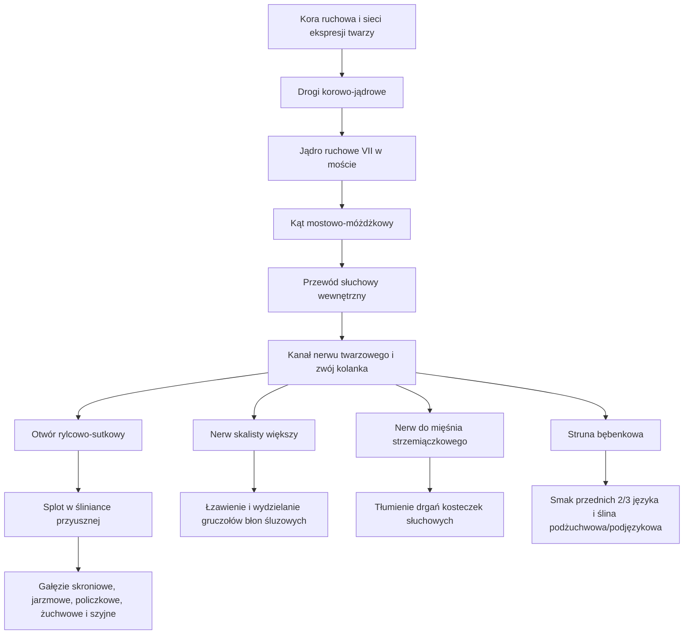
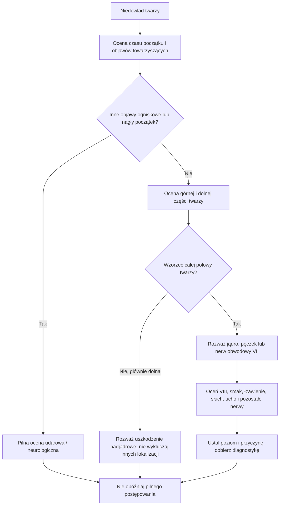

# 3.6. Nerw VII – twarzowy

## Wprowadzenie

Nerw twarzowy (nervus facialis, VII nerw czaszkowy) jest nerwem mieszanym, którego najbardziej widoczną funkcją jest ruchowe unerwienie mięśni mimicznych. Odpowiada za zamykanie powiek, unoszenie brwi, marszczenie czoła, uśmiech, artykulacyjne ruchy warg i wiele innych skoordynowanych ekspresji twarzy. Przewodzi także włókna smakowe z przednich dwóch trzecich języka, włókna przywspółczulne do gruczołu łzowego, podżuchwowego i podjęzykowego oraz niewielką składową czucia somatycznego z części małżowiny usznej i przewodu słuchowego zewnętrznego.

Badanie nerwu VII jest jednocześnie badaniem funkcji ruchowej, wybranych funkcji czuciowych i autonomicznych oraz ważnym elementem lokalizacji uszkodzenia w obrębie półkul mózgu, pnia mózgu, kąta mostowo-móżdżkowego, kości skroniowej, ślinianki przyusznej i obwodowych gałęzi nerwu. Osłabienie mięśni twarzy może być objawem izolowanej neuropatii nerwu twarzowego, ale może również stanowić pierwszy zauważalny znak udaru, procesu zapalnego, zakażenia, urazu, guza lub choroby układowej.

Najważniejsza zasada kliniczna brzmi: **nowo powstałego niedowładu twarzy nie wolno automatycznie utożsamiać z porażeniem Bella**. Najpierw należy określić czas początku, rozkład osłabienia, obecność innych objawów neurologicznych, stan oka, ucha i okolicy przyusznej, a następnie ocenić, czy obraz rzeczywiście odpowiada ostrej idiopatycznej neuropatii obwodowej.

Materiał jest przeznaczony do kształcenia w zakresie badania neurologicznego. Nie zastępuje badania lekarskiego, lokalnych ścieżek udarowych, konsultacji okulistycznej, laryngologicznej ani decyzji terapeutycznej osoby uprawnionej. W razie podejrzenia udaru lub innego stanu nagłego należy uruchomić właściwą ścieżkę pomocy, a nie kontynuować rutynowe badanie.

---

## 1. Cele kształcenia

Po ukończeniu rozdziału uczestnik powinien:

1. Wyjaśnić funkcje ruchowe, smakowe, przywspółczulne i czuciowe nerwu VII.
2. Opisać jądro ruchowe nerwu twarzowego, jądro ślinowe górne, jądro pasma samotnego i połączenia z układem trójdzielnym.
3. Przedstawić przebieg nerwu od mostu, przez kąt mostowo-móżdżkowy i przewód słuchowy wewnętrzny, do kanału nerwu twarzowego i otworu rylcowo-sutkowego.
4. Wymienić główne gałęzie wewnątrzskroniowe i pozaczaszkowe oraz przyporządkować im funkcje.
5. Przeprowadzić systematyczną ocenę symetrii twarzy w spoczynku, podczas spontanicznej ekspresji i w odpowiedzi na polecenia.
6. Zbadać funkcję mięśnia czołowego, okrężnego oka, mięśni policzka i ust oraz mięśnia szerokiego szyi.
7. Opisać stopień niedomykalności powieki, osłabienie mrugania, opadanie kącika ust, spłycenie bruzdy nosowo-wargowej i zaburzenia artykulacji.
8. Rozróżniać wzorzec uszkodzenia nadjądrowego, jądrowego, pęczkowego i obwodowego, z uwzględnieniem wyjątków lokalizacyjnych.
9. Ocenić, kiedy badanie smaku, słuchu, łzawienia i wydzielania śliny może dostarczyć informacji o poziomie uszkodzenia.
10. Rozpoznać typowy obraz porażenia Bella, zespół Ramsaya Hunta i cechy sugerujące inną przyczynę.
11. Znać zasady oceny stopnia dysfunkcji, w tym skalę House’a–Brackmanna i Sunnybrook, oraz ograniczenia tych narzędzi.
12. Rozpoznać czerwone flagi wymagające pilnej oceny, w szczególności objawy udaru, zajęcie wielu nerwów czaszkowych, uszkodzenie rogówki i postępujący niedowład.
13. Sporządzić zwięzłą, odtwarzalną dokumentację badania i wskazać ograniczenia przeprowadzonej oceny.

### Efekty praktyczne

Uczestnik powinien umieć wykonać badanie obustronne w tej samej kolejności, używać jasnych poleceń, nie wywoływać niepotrzebnego bólu, porównywać ruch w spoczynku i podczas czynności, a wynik opisać bez pochopnego przypisywania etiologii. Powinien także wiedzieć, kiedy przerwać badanie i wezwać pomoc.

---

## 2. Definicje i terminologia kliniczna

### 2.1. Nerw twarzowy

Nerw twarzowy jest VII nerwem czaszkowym. Zawiera włókna:

- specjalne trzewne ruchowe (SVE, branchiomotoryczne), zaopatrujące mięśnie pochodzące z drugiego łuku gardłowego;
- ogólne trzewne przywspółczulne (GVE), kierujące wydzielaniem łez i części śliny;
- specjalne trzewne czuciowe (SVA), przewodzące smak przede wszystkim z przednich dwóch trzecich języka;
- ogólne somatyczne czuciowe (GSA), przewodzące ograniczone czucie z części małżowiny usznej i okolicy przewodu słuchowego zewnętrznego.

W praktyce klinicznej należy odróżniać główny pień ruchowy od nerwu pośredniego (nervus intermedius), który przenosi znaczną część włókien smakowych, przywspółczulnych i czuciowych. W obrębie przewodu słuchowego wewnętrznego oba komponenty przebiegają blisko siebie i łączą się w strukturę nerwu VII.

### 2.2. Niedowład i porażenie mięśni twarzy

Niedowład twarzy oznacza zmniejszenie siły lub zakresu ruchu mięśni mimicznych. Porażenie oznacza skrajne lub całkowite zniesienie ruchu w badanym obszarze. W dokumentacji warto opisywać konkretną funkcję i stronę, zamiast ograniczać się do ogólnego określenia „porażenie twarzy”.

### 2.3. Porażenie ośrodkowe i obwodowe

- **Uszkodzenie nadjądrowe** dotyczy dróg korowo-jądrowych przed dotarciem do jądra ruchowego nerwu VII. Typowo osłabia głównie dolną część twarzy po stronie przeciwnej do uszkodzenia, ponieważ górna część jądra otrzymuje w znacznej mierze obustronne pobudzenie korowe.
- **Uszkodzenie jądra lub pęczka nerwu VII w moście** może dawać obwodowy wzorzec osłabienia całej połowy twarzy po stronie uszkodzenia, mimo że zmiana znajduje się w ośrodkowym układzie nerwowym.
- **Uszkodzenie nerwu po wyjściu z pnia mózgu** powoduje ipsilateralny niedowład mięśni unerwianych przez zajęty odcinek lub gałęzie.

Określenia „ośrodkowe” i „obwodowe” bywają używane w dwóch znaczeniach: anatomicznym (OUN wobec obwodowego układu nerwowego) oraz klinicznym (wzorzec nadjądrowy wobec wzorca dolnego neuronu ruchowego). W opisie należy wskazać, o które znaczenie chodzi.

### 2.4. Porażenie Bella

Porażenie Bella jest rozpoznaniem klinicznym ostrego, zwykle jednostronnego, obwodowego niedowładu lub porażenia nerwu twarzowego o nieustalonej przyczynie, po wykluczeniu rozpoznawalnych etiologii. Typowo rozwija się szybko, osiągając największe nasilenie w ciągu około 72 godzin. Nie jest synonimem każdego niedowładu obwodowego twarzy.

### 2.5. Synkineza, przykurcz i hemispazm twarzy

- **Synkineza** – mimowolny skurcz jednych mięśni towarzyszący dowolnemu ruchowi innych mięśni, np. zwężenie szpary powiekowej podczas uśmiechu.
- **Przykurcz** – utrwalone zwiększenie napięcia lub skrócenie tkanek, powodujące asymetrię w spoczynku.
- **Hemispazm twarzy** – napadowe lub utrwalone mimowolne skurcze mięśni jednej połowy twarzy; nie jest tym samym co osłabienie nerwu VII, choć może występować po jego uszkodzeniu.

### 2.6. Lagophthalmos i inne terminy dotyczące oka

Lagophthalmos (niedomykalność powieki) oznacza niemożność pełnego zamknięcia szpary powiekowej. Może prowadzić do ekspozycji rogówki, wysychania nabłonka, nadżerki i owrzodzenia. Bell phenomenon to fizjologiczny, zwykle ku górze i na zewnątrz skierowany ruch gałki ocznej podczas próby zamknięcia powiek; jego obecność nie gwarantuje ochrony rogówki, jeśli powieka pozostaje niedomknięta.

### 2.7. Dysgeuzja i ageuzja

Dysgeuzja oznacza zniekształcone odczuwanie smaku, a ageuzja – jego zniesienie. Hipogeuzja oznacza osłabienie smaku. Objawy te mogą towarzyszyć uszkodzeniu włókien smakowych nerwu pośredniego, ale ich brak nie wyklucza neuropatii VII.

---

## 3. Podstawy neuroanatomiczne

### 3.1. Jądra i ośrodki związane z nerwem VII

Główne struktury to:

1. **Jądro ruchowe nerwu twarzowego** – położone w dolnej części mostu. Jego aksony biegną grzbietowo i przyśrodkowo, zawijają się wokół jądra nerwu VI, tworząc wewnętrzne kolano nerwu twarzowego, a następnie kierują się brzusznie i bocznie ku powierzchni pnia.
2. **Jądro ślinowe górne** – źródło włókien przywspółczulnych kierowanych m.in. do zwoju skrzydłowo-podniebiennego i podżuchwowego.
3. **Jądro pasma samotnego** – odbiera włókna smakowe, w tym z przednich dwóch trzecich języka.
4. **Jądro rdzeniowe nerwu trójdzielnego** – uczestniczy w odbiorze niewielkiej składowej czucia somatycznego z okolicy ucha.
5. **Kora ruchowa i drogi korowo-jądrowe** – sterują dowolnymi ruchami mięśni mimicznych. Górna część jądra ruchowego otrzymuje zasadniczo obustronne pobudzenie, dolna – przewagę pobudzenia z przeciwnej półkuli.
6. **Sieci limbiczne i pniowe** – uczestniczą w spontanicznej, emocjonalnej ekspresji twarzy, która nie jest w pełni tożsama z ruchem wywoływanym poleceniem.

Włókna ruchowe nerwu VII tworzą w moście pętlę wokół jądra nerwu VI. Z tego powodu małe uszkodzenie w okolicy kolanka wewnętrznego może jednocześnie zajmować struktury odpowiedzialne za ruchy gałki ocznej w poziomie i mięśnie mimiczne.

### 3.2. Przebieg wewnątrzczaszkowy i w kości skroniowej

Po wyjściu z pnia mózgu nerw VII i nerw pośredni biegną w kierunku kąta mostowo-móżdżkowego, a następnie wchodzą do przewodu słuchowego wewnętrznego razem z nerwem VIII. Dalej nerw twarzowy przebiega w kanale nerwu twarzowego w części skalistej kości skroniowej.

Wyróżnia się następujące odcinki:

- odcinek przewodowy (meatalny) w przewodzie słuchowym wewnętrznym;
- odcinek błędnikowy – krótki, biegnący do zwoju kolanka;
- okolica zwoju kolanka;
- odcinek bębenkowy – przebiegający w ścianie jamy bębenkowej;
- odcinek sutkowy – zstępujący ku otworowi rylcowo-sutkowemu;
- odcinek pozaczaszkowy – po wyjściu z otworu i wejściu w obręb ślinianki przyusznej.

Wąski kanał kostny ma znaczenie kliniczne: obrzęk nerwu, uraz lub proces zapalny może zwiększać ucisk w ograniczonej przestrzeni. Zmiany ucha środkowego, wyrostka sutkowatego i złamania kości skroniowej mogą uszkadzać nerw na jego przebiegu.

### 3.3. Zwój kolanka

Zwój kolanka (ganglion geniculi) zawiera ciała komórek czuciowych włókien nerwu pośredniego. W jego okolicy odchodzi nerw skalisty większy, przewodzący włókna przywspółczulne przedzwojowe do zwoju skrzydłowo-podniebiennego. Zwojowi nie należy przypisywać funkcji zwoju ruchowego – ciała neuronów ruchowych znajdują się w jądrze mostu.

### 3.4. Główne gałęzie wewnątrzskroniowe

| Gałąź | Główna funkcja | Możliwe objawy zajęcia |
|---|---|---|
| Nerw skalisty większy | Włókna przywspółczulne do zwoju skrzydłowo-podniebiennego; droga do gruczołu łzowego i gruczołów błon śluzowych | Zmniejszone łzawienie po stronie uszkodzenia, suchość |
| Nerw do mięśnia strzemiączkowego | Ruchowe unerwienie mięśnia strzemiączkowego | Nadwrażliwość na dźwięki (hyperacusis) |
| Struna bębenkowa | Smak z przednich 2/3 języka oraz włókna przywspółczulne do zwoju podżuchwowego | Zaburzenia smaku i wydzielania śliny podżuchwowej/podjęzykowej |

Struna bębenkowa łączy się w dole podskroniowym z nerwem językowym, gałęzią V3. Włókna smakowe biegną dalej do jądra pasma samotnego, a włókna przywspółczulne do zwoju podżuchwowego.

### 3.5. Gałęzie pozaczaszkowe

Po przejściu przez otwór rylcowo-sutkowy nerw oddaje m.in. gałąź uszną tylną oraz gałęzie do mięśnia dwubrzuścowego (brzuśca tylnego) i rylcowo-gnykowego. Następnie wnika do ślinianki przyusznej, gdzie tworzy splot przyuszniczy i dzieli się na gałęzie końcowe.

Pięć klasycznie opisywanych grup gałęzi końcowych:

1. skroniowe;
2. jarzmowe;
3. policzkowe;
4. brzeżna żuchwy;
5. szyjna.

Gałęzie te zaopatrują mięśnie mimiczne czoła, okolicy oczodołu, nosa, policzka, ust, brody i szyi. Ich przebieg jest zmienny, występują połączenia międzygałęziowe, dlatego pojedynczy objaw nie zawsze pozwala dokładnie wskazać uszkodzoną gałąź.

**Ważne:** nerw VII przebiega przez śliniankę przyuszną, ale nie zapewnia jej wydzielniczego unerwienia przywspółczulnego. Wydzielanie ślinianki przyusznej zależy przede wszystkim od nerwu IX i zwoju usznego.

### 3.6. Mięśnie mimiczne i ich funkcje

| Mięsień lub grupa | Czynność oceniana w badaniu | Przykładowy objaw osłabienia |
|---|---|---|
| Czołowy | Unoszenie brwi, marszczenie czoła | Wygładzenie zmarszczek czołowych |
| Okrężny oka | Delikatne i silne zamknięcie powiek | Niepełne zamknięcie oka, słaby odruch mrugania |
| Marszczący brwi | Zbliżanie brwi | Ograniczone marszczenie okolicy międzybrwiowej |
| Nosowy i mięśnie poruszające nozdrzami | Marszczenie nosa, ruch skrzydełek nosa | Asymetria nozdrzy |
| Jarzmowe | Unoszenie kącika ust podczas uśmiechu | Spłycenie uśmiechu po stronie zajętej |
| Policzkowy | Utrzymywanie napięcia policzka | Uciekanie powietrza, zaleganie pokarmu w przedsionku jamy ustnej |
| Okrężny ust | Zamykanie i wysuwanie warg | Trudności w gwizdaniu, piciu i artykulacji |
| Obniżacze kąta ust i wargi dolnej | Obniżanie dolnej wargi i kącika ust | Asymetria dolnej części twarzy |
| Bródkowy | Wysuwanie i marszczenie skóry brody | Ograniczona ekspresja brody |
| Szeroki szyi | Napinanie skóry szyi | Osłabiona widoczność pasm mięśnia |

### 3.7. Schemat przebiegu i funkcji nerwu VII

### 3.8. Droga korowo-jądrowa i znaczenie unerwienia obustronnego

Dowolne ruchy twarzy są kontrolowane przez sieci korowe. Włókna z dolnej części kory ruchowej biegną przez wieniec promienisty i kolano torebki wewnętrznej, następnie przez śródmózgowie i most do jądra ruchowego nerwu VII. Część unerwiająca mięśnie górnej części twarzy otrzymuje w znacznej mierze projekcje z obu półkul, natomiast część związana z dolną połową twarzy ma przewagę projekcji przeciwstronnej.

Z tego wynika typowy, ale nie absolutny wzorzec:
- uszkodzenie nadjądrowe jednej półkuli – większe osłabienie przeciwstronnej dolnej części twarzy, przy względnie zachowanym unoszeniu brwi i zamykaniu oka;
- uszkodzenie jądra lub pęczka VII – ipsilateralne osłabienie górnej i dolnej połowy twarzy;
- uszkodzenie obwodowego pnia VII – ipsilateralne osłabienie mięśni unerwianych przez gałęzie położone dystalnie od miejsca uszkodzenia.

Nie wolno jednak traktować zachowania ruchu czoła jako samodzielnego testu wykluczającego udar. Zmienność anatomiczna, rozległość i lokalizacja uszkodzenia, a zwłaszcza uszkodzenia mostu, mogą powodować obrazy nietypowe.

---

## 4. Podstawy neurofizjologiczne

### 4.1. Sterowanie dowolne i emocjonalne

Uśmiech na polecenie i spontaniczny uśmiech podczas rozmowy nie są identycznymi zadaniami neurofizjologicznymi. Ruch dowolny jest silnie zależny od dróg korowo-jądrowych. Ekspresja emocjonalna angażuje dodatkowo struktury limbiczne, podwzgórze, istotę szarą okołowodociągową i sieci pniowe. Z tego powodu w niektórych zespołach neurologicznych może wystąpić rozbieżność między mimiką dowolną a spontaniczną.

W badaniu warto obserwować zarówno ruchy na polecenie, jak i naturalną ekspresję podczas rozmowy. Nie należy jednak na podstawie pojedynczej różnicy rozpoznawać określonego zespołu bez pełnej oceny neurologicznej.

### 4.2. Mechanizm mrugania i ochrony rogówki

Mięsień okrężny oka, unerwiany przez VII, zamyka powieki. Mięsień dźwigacz powieki górnej, unerwiany przez III, odpowiada za jej unoszenie. Ochrona powierzchni oka zależy od współdziałania:
- odruchowego mrugania;
- spontanicznego mrugania;
- pełnego zamknięcia powiek podczas snu;
- prawidłowego filmu łzowego;
- czucia rogówki przewodzonego przez V1;
- mechanizmu rozprowadzania łez.

W uszkodzeniu VII może wystąpić lagophthalmos, osłabienie mrugania i zaburzenie pompy łzowej. Jeżeli współistnieje osłabienie czucia rogówki, ryzyko uszkodzenia powierzchni oka jest większe, a pacjent może nie odczuwać odpowiednio wcześnie podrażnienia.

### 4.3. Smak

Włókna smakowe z przednich dwóch trzecich języka biegną przez strunę bębenkową, następnie z nerwem językowym V3, do zwoju kolanka i dalej do jądra pasma samotnego. Smak z tylnej jednej trzeciej języka przewodzi głównie nerw IX, a z nagłośni i części gardła – nerw X. W badaniu nerwu VII nie należy utożsamiać całego smaku z funkcją jednego nerwu.

### 4.4. Wydzielanie łez i śliny

Włókna przywspółczulne nerwu VII uczestniczą w wydzielaniu łez oraz śliny z gruczołów podżuchwowego i podjęzykowego. Włókna do gruczołu łzowego biegną przez nerw skalisty większy, zwój skrzydłowo-podniebienny i gałęzie nerwu V2/V1. Włókna do gruczołów podżuchwowego i podjęzykowego przechodzą przez strunę bębenkową i zwój podżuchwowy.

Odczucie suchości oka lub jamy ustnej jest nieswoiste. Może zależeć od leków, odwodnienia, chorób gruczołów, wieku i wielu innych czynników. Sam wywiad o suchości nie lokalizuje pewnie uszkodzenia VII.

### 4.5. Mięsień strzemiączkowy i słuch

Mięsień strzemiączkowy stabilizuje kosteczkę słuchową i uczestniczy w ochronie ucha przed nadmiernym przenoszeniem dźwięku. Jego osłabienie w wyniku uszkodzenia gałęzi nerwu VII może powodować hyperacusis, czyli nadmierną dokuczliwość dźwięków. Objaw ten jest subiektywny i nie stanowi samodzielnego testu lokalizacyjnego.

---

## 5. Wywiad ukierunkowany na nerw VII

### 5.1. Początek i dynamika

Należy ustalić:
- dokładną datę i godzinę zauważenia asymetrii;
- ostatni moment, w którym twarz funkcjonowała prawidłowo;
- czy objaw pojawił się nagle, czy narastał przez godziny lub dni;
- kiedy osiągnął największe nasilenie;
- czy wystąpił wcześniej i czy dotyczył tej samej strony;
- czy niedowład postępuje, ustępuje, nawraca lub zmienia rozkład.

Nagły początek wymaga rozważenia udaru i innych ostrych przyczyn. Stopniowe narastanie przez tygodnie, nawroty po tej samej stronie lub zajęcie pojedynczych gałęzi powinny skłaniać do poszukiwania przyczyny strukturalnej, zapalnej lub nowotworowej.

### 5.2. Objawy towarzyszące

Pytania powinny dotyczyć:
- osłabienia lub drętwienia kończyn;
- zaburzeń mowy, rozumienia, widzenia, równowagi i koordynacji;
- bólu głowy, szyi lub twarzy;
- bólu ucha, wysypki, pęcherzyków w uchu lub jamie ustnej;
- pogorszenia słuchu, szumów usznych i zawrotów głowy;
- zaburzeń smaku;
- nadwrażliwości na dźwięki;
- suchości oka, łzawienia lub trudności w ochronie oka;
- ślinienia, trudności w piciu, jedzeniu i artykulacji;
- gorączki, objawów infekcji, urazu i zabiegów w obrębie ucha, ślinianki lub twarzy.

### 5.3. Czynniki ryzyka i kontekst

Należy zebrać informacje o cukrzycy, nadciśnieniu, migotaniu przedsionków, dyslipidemii, paleniu tytoniu, chorobach naczyniowych, immunosupresji, chorobach autoimmunologicznych, nowotworach, boreliozie i ekspozycji na kleszcze. Ustalić ciążę lub okres okołoporodowy, niedawne infekcje, urazy, zabiegi stomatologiczne i laryngologiczne oraz przyjmowane leki.

### 5.4. Przykładowe pytania

- „Kiedy po raz pierwszy zauważył(a) Pan/Pani zmianę w wyglądzie twarzy?”
- „Czy osłabienie pojawiło się od razu, czy stopniowo narastało?”
- „Czy może Pan/Pani mocno zamknąć oba oczy?”
- „Czy z oka po stronie osłabienia pojawia się pieczenie, ból lub zamazane widzenie?”
- „Czy wystąpił ból ucha albo pęcherzyki na małżowinie, w przewodzie słuchowym lub w jamie ustnej?”
- „Czy wystąpiły trudności w mówieniu, osłabienie ręki lub nogi, zaburzenia równowagi albo widzenia?”
- „Czy smak potraw zmienił się po jednej stronie języka?”
- „Czy głośne dźwięki stały się po jednej stronie wyjątkowo dokuczliwe?”

---

## 6. Przygotowanie pacjenta i stanowiska

### 6.1. Warunki badania

Badanie należy przeprowadzić w dobrze oświetlonym pomieszczeniu, najlepiej z możliwością obserwacji twarzy na wprost. Pacjent powinien siedzieć stabilnie, z głową w pozycji neutralnej. Należy odsłonić twarz, czoło i – jeśli jest to potrzebne – szyję, z zachowaniem intymności.

### 6.2. Sprzęt

Podstawowe wyposażenie:
- źródło równomiernego światła;
- rękawiczki, jeśli przewiduje to rodzaj badania i zasady higieny;
- jednorazowe patyczki lub aplikatory do wybranych prób smakowych;
- roztwory smakowe o znanym składzie, jeśli badanie smaku jest wskazane;
- dokumentacja lub formularz oceny;
- aparat do dokumentacji fotograficznej lub wideo wyłącznie po uzyskaniu odrębnej, świadomej zgody i zgodnie z zasadami ochrony danych.

Nie należy stosować drażniących substancji, ostrych narzędzi ani niezweryfikowanych preparatów na błony śluzowe.

### 6.3. Zgoda i komunikacja

Wyjaśnić cel, przebieg i możliwy dyskomfort. Uzyskać zgodę na badanie. Przed wykonaniem prób poprosić pacjenta o zgłoszenie bólu oka, ucha lub twarzy. Jeżeli pacjent nie rozumie poleceń, należy uwzględnić barierę językową, afazję, zaburzenia słuchu lub poznawcze i odpowiednio zmodyfikować sposób komunikacji.

### 6.4. Pozycja i bezpieczeństwo

Pacjent siedzi lub leży w pozycji zapewniającej stabilność. Przy znacznym osłabieniu, zawrotach głowy, zaburzeniach świadomości lub ryzyku upadku badanie prowadzi się w pozycji bezpiecznej. Nie należy wymuszać uśmiechu, silnego zaciskania powiek ani ruchów, które wywołują ból.

---

## 7. Ogólna procedura badania krok po kroku

### Krok 1. Obserwacja przed wydaniem poleceń

Obserwować twarz podczas spontanicznej rozmowy, słuchania i naturalnej ekspresji. Zwrócić uwagę na:
- symetrię czoła i brwi;
- szerokość szpar powiekowych;
- częstość i pełność mrugania;
- położenie kącików ust;
- głębokość bruzd nosowo-wargowych;
- ślinienie i utrzymywanie śliny w jamie ustnej;
- spontaniczny uśmiech i mimikę.

Nie należy rozpoczynać od wielokrotnego wydawania poleceń, ponieważ spontaniczna ekspresja może dostarczyć odmiennych informacji.

### Krok 2. Ocena spoczynkowa

Poprosić pacjenta, aby rozluźnił twarz i patrzył przed siebie. Porównać obie strony:
- wysokość brwi;
- położenie kącików ust;
- symetrię fałdów nosowo-wargowych;
- ustawienie dolnej powieki;
- szerokość szpary powiekowej;
- obecność przykurczu, obrzęku lub blizn.

Opisać stronę i obszar asymetrii. Niewielka asymetria może być fizjologiczna lub wynikać z wcześniejszego urazu, zabiegu czy naturalnych cech twarzy.

### Krok 3. Unoszenie brwi i marszczenie czoła

Polecić: „Proszę unieść obie brwi jak najwyżej i zmarszczyć czoło”. Ocenić zakres ruchu, symetrię i liczbę widocznych fałdów. Porównać stronę prawą i lewą. Nie interpretować pojedynczego braku zmarszczek bez uwzględnienia wieku, skóry, blizn, zabiegów estetycznych i wyjściowej asymetrii.

### Krok 4. Delikatne i silne zamknięcie oczu

Polecić najpierw spokojne zamknięcie obu oczu, a następnie mocne zaciśnięcie powiek. Oceniać:
- czy powieki stykają się na całej długości;
- czy pozostaje szczelina;
- czy widoczne jest cofanie gałki ocznej i jej ruch ku górze;
- czy rzęsy po stronie osłabionej pozostają bardziej widoczne;
- czy pacjent potrafi utrzymać zamknięcie mimo delikatnej próby rozchylenia powiek.

Próbę oporową wykonywać ostrożnie, przykładając minimalną siłę do powiek, bez ucisku gałki ocznej. Nie wolno naciskać na rogówkę. Zanotować wielkość szczeliny, jeśli można ją wiarygodnie ocenić, i stan powierzchni oka.

### Krok 5. Uśmiech i odsłanianie zębów

Polecić: „Proszę się uśmiechnąć i pokazać zęby”. Obserwować:
- unoszenie kącików ust;
- symetrię ruchu;
- widoczność zębów po obu stronach;
- ruch bruzd nosowo-wargowych;
- opóźnienie lub zmniejszenie amplitudy po jednej stronie.

Następnie poprosić o szeroki uśmiech, a potem o grymas lub pokazanie dolnych zębów, jeśli pacjent może wykonać te czynności.

### Krok 6. Nadymanie policzków

Polecić nabrać powietrza i utrzymać je w obu policzkach. Obserwować, czy powietrze ucieka przez kącik ust po jednej stronie. Można delikatnie ucisnąć policzki obustronnie, oceniając zdolność utrzymania napięcia. Nie należy stosować nadmiernego oporu.

### Krok 7. Ruchy warg i artykulacja

Poprosić o:
- zaciśnięcie warg;
- wysunięcie ich do przodu jak do gwizdania;
- wypowiedzenie samogłosek „u” i „i”;
- powtórzenie krótkiej frazy z głoskami wymagającymi zwarcia warg, np. „mama ma mapę”.

Ocenić szczelność warg, symetrię, wyciek śliny i zrozumiałość artykulacji. Dyzartria może wynikać z wielu przyczyn, dlatego trzeba ocenić także język, podniebienie i pozostałe nerwy czaszkowe.

### Krok 8. Ocena mięśnia szerokiego szyi

Polecić napiąć skórę szyi, np. przez opuszczenie kącików ust i napięcie platysmy. Ocenić widoczność pasm i symetrię. Próba ma znaczenie pomocnicze i nie jest konieczna w każdym badaniu przesiewowym.

### Krok 9. Ocena ruchów spontanicznych i synkinez

Obserwować, czy podczas uśmiechu zwęża się szpara powiekowa, czy przy mruganiu porusza się kącik ust, czy występują mimowolne skurcze albo współruchy. W późnej fazie regeneracji nerwu mogą pojawić się synkinezy.

### Krok 10. Ocena funkcji dodatkowych, jeśli są wskazania

Zapytać o smak, nadwrażliwość na dźwięki, suchość oka, zmiany łzawienia i ślinienia. Badanie tych funkcji wykonuje się celowo, gdy wynik może wpłynąć na lokalizację lub diagnostykę. Nie należy wykonywać wszystkich prób u każdego pacjenta.

### Krok 11. Ocena pozostałych nerwów czaszkowych i kończyn

W każdym nowym niedowładzie twarzy należy sprawdzić, czy występują inne objawy ogniskowe. Co najmniej ocenić mowę, ruchy gałek ocznych, czucie twarzy, siłę kończyn, koordynację i chód – o ile stan pacjenta na to pozwala. Przy nagłym początku lub podejrzeniu udaru nie opóźniać uruchomienia ścieżki ratunkowej.

### Krok 12. Podsumowanie

Określić:
- stronę i zakres osłabienia;
- czy zajęta jest górna i dolna część twarzy;
- stan zamykania oka;
- obecność objawów dodatkowych;
- stopień nasilenia;
- czas początku i dynamikę;
- pilność dalszej oceny.

---

## 8. Szczegółowa ocena funkcji ruchowej

### 8.1. Czoło i okolica brwi

Mięsień czołowy unosi brwi i tworzy poziome zmarszczki czoła. Osłabienie może być subtelne, szczególnie u osób starszych lub po zabiegach estetycznych. Warto porównać unoszenie brwi, marszczenie czoła i próbę zbliżenia brwi.

### 8.2. Oko i powieki

Mięsień okrężny oka ma część oczodołową i powiekową. Część powiekowa odpowiada za delikatne zamykanie powiek, a oczodołowa za silne zaciskanie. W badaniu należy odróżnić:
- osłabienie delikatnego mrugania;
- niepełne zamknięcie podczas spokojnego zamykania;
- niepełne zamknięcie przy silnym zaciskaniu;
- opóźnione mruganie;
- retrakcję lub wiotkość dolnej powieki;
- objawy ekspozycji rogówki.

Jeżeli występuje niedomykalność, stan oka ma pierwszeństwo przed dokładnym stopniowaniem mięśni mimicznych.

### 8.3. Środkowa i dolna część twarzy

Mięśnie jarzmowe, policzkowy, okrężny ust, bródkowy i obniżacze wargi odpowiadają za uśmiech, szczelność policzka, gwizdanie, artykulację i kontrolę śliny. Osłabienie może powodować:
- uciekanie powietrza podczas nadymania policzków;
- zaleganie pokarmu w przedsionku jamy ustnej;
- trudność w utrzymaniu płynów w ustach;
- ślinienie;
- zniekształcenie głosek dwuwargowych;
- asymetrię uśmiechu.

### 8.4. Rozkład gałęzi

| Obszar | Główne gałęzie | Próba kliniczna |
|---|---|---|
| Czoło i okolica skroniowa | Skroniowe | Unoszenie brwi i marszczenie czoła |
| Oczodół | Skroniowe i jarzmowe | Delikatne i silne zamknięcie oczu |
| Nos i górna warga | Jarzmowe i policzkowe | Marszczenie nosa, unoszenie górnej wargi |
| Policzek i usta | Policzkowe | Nadymanie policzków, szczelność warg |
| Dolna warga i kąt żuchwy | Brzeżna żuchwy | Obniżanie dolnej wargi, pokazywanie dolnych zębów |
| Szyja | Szyjna | Napinanie platysmy |

Gałęzie mają liczne połączenia, a unerwienie mięśni może być zmienne. Wynik badania pojedynczej czynności nie powinien być traktowany jako precyzyjne mapowanie jednego pnia końcowego.

### 8.5. Ocena asymetrii i siły

W badaniu mięśni mimicznych częściej ocenia się amplitudę i jakość ruchu niż siłę w klasycznej skali MRC. Należy porównywać:
- zakres ruchu;
- szybkość rozpoczęcia;
- utrzymanie skurczu;
- zdolność do pokonania niewielkiego oporu;
- płynność;
- współruchy;
- symetrię w spoczynku i podczas ekspresji.

Nie należy stosować nadmiernego oporu, który może powodować ból, zniekształcać wynik lub zniechęcać pacjenta.

---

## 9. Badanie smaku i funkcji autonomicznych

### 9.1. Kiedy badać smak?

Badanie smaku rozważa się, gdy:
- pacjent zgłasza zmianę smaku po jednej stronie;
- istnieje podejrzenie uszkodzenia nerwu w odcinku proksymalnym do odejścia struny bębenkowej;
- wynik może pomóc w ocenie poziomu uszkodzenia;
- konieczna jest specjalistyczna ocena zaburzeń smaku.

Nie jest to obowiązkowy element każdego rutynowego badania nerwu VII.

### 9.2. Procedura orientacyjna

1. Wyjaśnić pacjentowi, że badany będzie smak, a nie zapach lub czucie temperatury.
2. Upewnić się, że pacjent nie ma istotnych zaburzeń połykania ani ryzyka aspiracji.
3. Przygotować oddzielne, bezpieczne i odpowiednio rozcieńczone roztwory smakowe o znanym składzie.
4. Wysunąć język i nanieść minimalną ilość roztworu na jedną stronę przedniej części języka, unikając kontaktu z drugą stroną.
5. Poprosić o wskazanie jakości smaku lub wybór z wcześniej ustalonego zestawu odpowiedzi.
6. Wypłukać jamę ustną wodą i odczekać przed następną próbą.
7. Powtórzyć po stronie przeciwnej, zachowując porównywalne warunki.
8. Zanotować rodzaj bodźca, stronę, odpowiedź i ograniczenia.

Nie stosować substancji alergizujących, drażniących ani płynów, których pacjent nie może bezpiecznie utrzymać w jamie ustnej. Test nie powinien polegać na podawaniu nieznanych substancji.

### 9.3. Ograniczenia badania smaku

Wynik zależy od stężenia, temperatury, stanu błony śluzowej, higieny jamy ustnej, leków, palenia tytoniu, infekcji, uwagi i współpracy. Rozprzestrzenienie roztworu na drugą połowę języka może dać wynik fałszywie prawidłowy. Próba przyłóżkowa ma charakter orientacyjny i nie zastępuje specjalistycznych testów smakowych.

### 9.4. Łzawienie

Pytania o suchość oka, łzawienie i konieczność częstego stosowania kropli mogą być pomocne, ale są nieswoiste. W wybranych sytuacjach specjalista może wykorzystać test Schirmera lub inne badania powierzchni oka. Wynik nie lokalizuje samodzielnie uszkodzenia.

### 9.5. Wydzielanie śliny

Zmniejszenie ślinienia może wystąpić przy zaburzeniu włókien przywspółczulnych struny bębenkowej, lecz często wynika z leków, odwodnienia, chorób gruczołów i wieku. W rutynowym badaniu neurologicznym zwykle wystarcza wywiad i ocena jamy ustnej.

### 9.6. Hyperacusis

Zapytać, czy dźwięki o zwykłym natężeniu są po jednej stronie nieprzyjemnie głośne. Należy odróżnić hyperacusis od szumów usznych, niedosłuchu, fonofobii i nadwrażliwości sensorycznej. W razie zaburzeń słuchu wskazana może być ocena audiologiczna.

---

## 10. Lokalizacja uszkodzenia na podstawie objawów

### 10.1. Zasada lokalizacyjna

Im bardziej proksymalnie znajduje się uszkodzenie, tym większa możliwość współistnienia zaburzeń ruchowych, smakowych, wydzielniczych i słuchowych. Jest to jednak reguła orientacyjna: objawy zależą od dokładnego położenia, rozległości i niepełnego zajęcia pęczków.

| Poziom | Możliwe objawy | Ważne zastrzeżenie |
|---|---|---|
| Droga korowo-jądrowa | Przeciwstronne osłabienie głównie dolnej części twarzy | Należy szukać innych objawów półkulowych |
| Jądro lub pęczek VII w moście | Ipsilateralne osłabienie całej połowy twarzy | Mogą współistnieć objawy VI, dróg długich lub móżdżkowe |
| Kąt mostowo-móżdżkowy / przewód słuchowy wewnętrzny | Niedowład VII z możliwym zajęciem VIII, słuchem lub równowagą | Rozważyć guz, zapalenie i inne procesy |
| Odcinek proksymalny do odejścia nerwu skalistego większego | Ruchowe, smakowe i autonomiczne zaburzenia | Testy łzowe mają ograniczoną swoistość |
| Odcinek po odejściu nerwu skalistego większego, przed nerwem do strzemiączkowego | Osłabienie mimiki, możliwa hyperacusis i zaburzenia smaku | Dokładne objawy zależą od wariantu przebiegu |
| Odcinek po odejściu nerwu do strzemiączkowego, przed struną bębenkową | Osłabienie mimiki i możliwe zaburzenia smaku/ślinienia | Brak hyperacusis nie jest rozstrzygający |
| Odcinek po odejściu struny bębenkowej | Głównie zaburzenia ruchowe | Smak i funkcje autonomiczne mogą być zachowane |
| Otwór rylcowo-sutkowy i gałęzie pozaczaszkowe | Ruchowe osłabienie w zależności od zajętych gałęzi | Zajęcie wybranych gałęzi może dawać obraz częściowy |

### 10.2. Zespoły mostowe

Uszkodzenie w moście może objąć jądro lub pęczek VII i sąsiednie struktury. Możliwe są:
- ipsilateralny niedowład całej połowy twarzy;
- zaburzenie odwodzenia oka lub poziomego spojrzenia przy zajęciu VI albo jego połączeń;
- przeciwstronny niedowład kończyn przy zajęciu dróg korowo-rdzeniowych;
- zaburzenia czucia, ataksja lub oczopląs zależnie od lokalizacji.

Wzorzec skrzyżowany – objawy nerwu czaszkowego po stronie zmiany i objawy długich dróg po stronie przeciwnej – jest ważnym argumentem za lokalizacją pniową i wymaga pilnej diagnostyki.

### 10.3. Kąt mostowo-móżdżkowy

W tej okolicy nerw VII przebiega blisko nerwu VIII i innych struktur. Objawy mogą obejmować niedowład twarzy, niedosłuch, szumy uszne, zawroty głowy, zaburzenia równowagi, a w większych zmianach także objawy innych nerwów czaszkowych i móżdżku.

### 10.4. Uszkodzenia pozaczaszkowe

Uraz, zabieg w obrębie ślinianki przyusznej, guz, rana lub ucisk mogą zajmować pień albo wybrane gałęzie. Osłabienie ograniczone do dolnej wargi może sugerować zajęcie gałęzi brzeżnej żuchwy, ale przed wnioskowaniem trzeba uwzględnić zmienność anatomiczną i inne przyczyny.

### 10.5. Schemat lokalizacji

---

## 11. Porażenie Bella

### 11.1. Obraz kliniczny

Typowy obraz obejmuje:
- ostry, jednostronny niedowład całej połowy twarzy;
- osłabienie unoszenia brwi i marszczenia czoła;
- trudność w pełnym zamknięciu oka;
- spłycenie bruzdy nosowo-wargowej;
- opadanie kącika ust;
- trudność w utrzymaniu powietrza w policzku;
- możliwe zaburzenia smaku, hyperacusis, ból za uchem lub zmiany łzawienia;
- brak innych ogniskowych objawów neurologicznych.

Porażenie Bella jest rozpoznaniem z wykluczenia. Nie należy rozpoznawać go wyłącznie na podstawie zajęcia czoła.

### 11.2. Dynamika

Objawy zwykle narastają szybko i osiągają maksimum w ciągu około 72 godzin. Narastanie przez tygodnie, postępujący ból, nawrót po tej samej stronie, obustronne zajęcie lub obecność innych neuropatii czaszkowych są nietypowe i wymagają poszerzenia diagnostyki.

### 11.3. Czynniki ryzyka i możliwe mechanizmy

W badaniach epidemiologicznych opisywano związki z cukrzycą, ciążą, okresem okołoporodowym, infekcjami górnych dróg oddechowych i zaburzeniami odporności. Jedną z hipotez jest reaktywacja wirusa opryszczki pospolitej, ale mechanizm nie jest jednoznacznie potwierdzony w każdym przypadku.

### 11.4. Diagnostyka

Rozpoznanie typowego porażenia Bella opiera się na wywiadzie i badaniu. Rutynowe obrazowanie i szerokie badania laboratoryjne nie są konieczne w każdym typowym, nowym przypadku. Badania dodatkowe dobiera się do podejrzenia konkretnej etiologii, np. boreliozy przy odpowiedniej ekspozycji i obrazie klinicznym, urazu kości skroniowej, guza lub procesu zapalnego.

### 11.5. Leczenie – zasady wynikające z wytycznych

Wytyczne AAO-HNSF zalecają u osób w wieku co najmniej 16 lat z rozpoznanym porażeniem Bella rozpoczęcie doustnych glikokortykosteroidów w ciągu 72 godzin od początku objawów, o ile nie ma przeciwwskazań. Lekarz ocenia ryzyko, choroby współistniejące, ciążę, interakcje i właściwy schemat. Nie należy samodzielnie rozpoczynać ani modyfikować leczenia.

Leki przeciwwirusowe nie powinny być stosowane jako jedyna terapia porażenia Bella. Lekarz może rozważyć ich dołączenie do glikokortykosteroidu, zwłaszcza w cięższym porażeniu, po ocenie bilansu korzyści i ryzyka. Decyzje powinny uwzględniać aktualne lokalne wytyczne i charakterystykę produktu leczniczego.

### 11.6. Ochrona oka

Jeżeli pacjent nie domyka oka, ochrona rogówki jest pilna i nie może czekać na powrót funkcji nerwu. Postępowanie ustala osoba uprawniona, zwykle obejmując:
- nawilżające krople do oczu, najlepiej bez konserwantów przy częstym stosowaniu;
- maść lub żel okulistyczny na noc, jeśli są wskazane;
- ochronę przed wiatrem, kurzem i wysychaniem;
- prawidłowo nauczone, bezpieczne domykanie powieki na noc lub komorę wilgotnościową;
- kontrolę objawów i ocenę okulistyczną, jeśli występują dolegliwości lub utrzymuje się ekspozycja rogówki.

Nie wolno zakładać opatrunku uciskowego na oko, które pozostaje otwarte. Nieprawidłowe zaklejenie może nasilić uraz rogówki. Pacjent lub opiekun powinien otrzymać demonstrację techniki i sprawdzenie, czy powieka jest całkowicie domknięta bez ucisku gałki ocznej.

Ból oka, zaczerwienienie, światłowstręt, uczucie ciała obcego, pogorszenie widzenia lub widoczna zmiana rogówki wymagają pilnej oceny okulistycznej.

### 11.7. Kontrola i rokowanie

Wielu pacjentów odzyskuje znaczną część funkcji, lecz przebieg jest zmienny. Należy monitorować domykanie oka, odżywianie, picie, artykulację, ból, synkinezy i stopień powrotu ruchu. Nowe lub nasilające się objawy neurologiczne, objawy oczne albo brak pełnego powrotu funkcji po około trzech miesiącach są wskazaniem do ponownej oceny lub skierowania do specjalisty zajmującego się nerwem twarzowym.

---

## 12. Zespół Ramsaya Hunta i inne przyczyny zakaźne

### 12.1. Zespół Ramsaya Hunta

Zespół Ramsaya Hunta (herpes zoster oticus) jest związany z reaktywacją wirusa ospy wietrznej i półpaśca w obrębie zwoju kolanka. Klasyczny obraz obejmuje:
- obwodowy niedowład nerwu VII;
- silny ból ucha;
- pęcherzykową wysypkę na małżowinie usznej, w przewodzie słuchowym lub jamie ustnej;
- możliwe zaburzenia słuchu, szumy uszne, zawroty głowy i zajęcie nerwu VIII.

Wysypka może pojawić się po osłabieniu twarzy, być skąpa albo nie wystąpić w postaci zoster sine herpete. Brak pęcherzyków nie wyklucza całkowicie rozpoznania, jeśli pozostałe dane silnie je sugerują.

### 12.2. Postępowanie

Podejrzenie zespołu Ramsaya Hunta wymaga pilnej oceny lekarskiej. W praktyce klinicznej rozważa się wczesne leczenie przeciwwirusowe i glikokortykosteroidowe, zwykle w skojarzeniu, z uwzględnieniem przeciwwskazań i lokalnych zaleceń. Należy ocenić słuch, równowagę, ból i bezpieczeństwo rogówki.

### 12.3. Borelioza

Neuroborelioza może powodować jednostronne lub obustronne porażenie nerwu twarzowego. Znaczenie mają ekspozycja na kleszcze, pobyt w obszarze endemicznym, rumień wędrujący, objawy korzeniowe, bóle głowy i inne cechy zakażenia. Badania serologiczne i ewentualna diagnostyka płynu mózgowo-rdzeniowego powinny wynikać z prawdopodobieństwa klinicznego oraz aktualnych zaleceń. Nie należy wykonywać testów bez wskazań ani interpretować pojedynczego dodatniego wyniku bez kontekstu.

### 12.4. Inne zakażenia

W diagnostyce różnicowej uwzględnia się zapalenie ucha środkowego, zapalenie wyrostka sutkowatego, zapalenie opon i mózgu, zakażenia HIV oraz inne infekcje zależnie od obrazu i czynników ryzyka.

---

## 13. Inne przyczyny neuropatii nerwu VII

### 13.1. Uraz kości skroniowej i zabiegi

Złamanie kości skroniowej, uraz twarzoczaszki, zabieg w obrębie ucha środkowego, wyrostka sutkowatego, przewodu słuchowego lub ślinianki przyusznej mogą uszkodzić nerw. Należy ustalić czas pojawienia się niedowładu względem urazu lub operacji, ponieważ opóźnione narastanie może mieć inne znaczenie niż natychmiastowa utrata funkcji.

### 13.2. Zmiany nowotworowe

Guz nerwu twarzowego, nerwiak przedsionkowy z zajęciem sąsiednich struktur, guz kąta mostowo-móżdżkowego, guz ślinianki przyusznej lub naciek okołonerwowy mogą powodować postępujący, nawracający albo częściowy niedowład. Szczególnie niepokojące są:
- narastanie przez tygodnie lub miesiące;
- nawrót po tej samej stronie;
- osłabienie pojedynczych gałęzi;
- ból, wyczuwalny guz lub zmiany skórne;
- zajęcie innych nerwów czaszkowych.

### 13.3. Choroby zapalne i autoimmunologiczne

W zależności od kontekstu rozważa się sarkoidozę, zespół Sjögrena, zapalenia naczyń, choroby demielinizacyjne i inne stany zapalne. Obustronny niedowład twarzy zwiększa potrzebę poszukiwania przyczyny układowej lub zakaźnej.

### 13.4. Zespół Guillaina–Barrégo

Obustronne osłabienie twarzy może występować w wariantach zespołu Guillaina–Barrégo, w tym w zespole Millera Fishera lub innych wariantach z zajęciem nerwów czaszkowych. Należy szukać osłabienia kończyn, arefleksji, zaburzeń czucia, ataksji, oftalmoplegii i zaburzeń autonomicznych. Narastające osłabienie, dysfagia lub duszność wymagają pilnej oceny szpitalnej.

### 13.5. Miastenia

Miastenia może powodować zmienną, męczliwą słabość mięśni twarzy, powiek i mięśni opuszkowych. Typowe są fluktuacja w ciągu dnia, pogorszenie po wysiłku i poprawa po odpoczynku. Nie jest neuropatią nerwu VII, lecz może naśladować jego osłabienie. Należy ocenić ptozę, diplopię, połykanie, mowę i oddychanie.

### 13.6. Zaburzenia metaboliczne i układowe

Cukrzyca, choroby tarczycy, zaburzenia odporności i inne choroby układowe mogą zwiększać ryzyko neuropatii lub współistnieć z porażeniem twarzy. Badania laboratoryjne powinny być dobierane do hipotezy klinicznej, a nie wykonywane automatycznie.

### 13.7. Wrodzone i rozwojowe zaburzenia mimiki

Wrodzony niedowład twarzy może występować w następstwie urazu okołoporodowego, zaburzeń rozwoju jąder nerwów czaszkowych lub zespołów takich jak zespół Möbiusa. Historia od urodzenia, obustronność i współistniejące wady rozwojowe odróżniają je od ostrej neuropatii nabytej.

### 13.8. Zaburzenia czynnościowe

Zaburzenia neurologiczne czynnościowe mogą obejmować asymetrię twarzy lub nietypowe wzorce ruchu. Rozpoznanie wymaga dodatnich cech klinicznych niespójności lub niezgodności z typową neuroanatomią, a nie samego braku zmian w obrazowaniu. Nie należy rozpoznawać ich przez wykluczenie ani stygmatyzować pacjenta.

---

## 14. Różnicowanie: najważniejsze wzorce kliniczne

| Rozpoznanie lub lokalizacja | Cechy przemawiające za | Cechy wymagające szczególnej uwagi |
|---|---|---|
| Udar półkulowy | Nagły początek, osłabienie głównie dolnej części twarzy, możliwe objawy kończynowe lub językowe | Nie czekać na pełne badanie, uruchomić ścieżkę udarową |
| Udar mostu | Ipsilateralne osłabienie całej połowy twarzy, możliwe objawy przeciwstronne kończyn lub zaburzenia spojrzenia | Obwodowy wzorzec twarzy nie wyklucza zmiany w OUN |
| Porażenie Bella | Szybki rozwój jednostronnego obwodowego niedowładu, brak innych ogniskowych objawów | Rozpoznanie po wykluczeniu innych przyczyn |
| Ramsay Hunt | Silny ból ucha, pęcherzyki, niedowład VII, możliwe objawy VIII | Wysypka może być opóźniona lub nieobecna |
| Neuroborelioza | Ekspozycja na kleszcze, rumień wędrujący, obustronny niedowład, objawy oponowe lub korzeniowe | Testy dobierać do prawdopodobieństwa i etapu choroby |
| Guz nerwu lub okolicy przyusznej | Postępujący, nawrotowy, częściowy niedowład, ból lub guz | Rozważyć obrazowanie i konsultację specjalistyczną |
| Uraz kości skroniowej | Związek czasowy z urazem, objawy ucha, możliwy wyciek płynu | Pilna ocena urazowa i laryngologiczna |
| Miastenia | Męczliwość, fluktuacja, ptoza, diplopia, możliwe objawy opuszkowe | Ryzyko przełomu przy zaburzeniach oddychania i połykania |
| GBS / wariant pniowy | Obustronne zajęcie twarzy, arefleksja, ataksja, osłabienie kończyn | Monitorować oddychanie i funkcje opuszkowe |
| Zaburzenie czynnościowe | Dodatnie cechy niespójności w badaniu, zmienność zależna od zadania | Rozpoznanie wymaga fachowej oceny; objawy są rzeczywiste dla pacjenta |

### 14.1. Czoło nie jest testem rozstrzygającym

Zachowanie unoszenia brwi i marszczenia czoła może wspierać hipotezę uszkodzenia nadjądrowego, ale nie jest wystarczające do wykluczenia udaru. Uszkodzenia pnia mózgu mogą powodować pełny ipsilateralny niedowład twarzy, a rzadziej obrazy korowe bywają mniej typowe. Decyduje całość objawów, dynamika i badanie neurologiczne.

### 14.2. Nie mylić ptozy z opadaniem brwi

Ptoza oznacza opadanie powieki, najczęściej związane z mięśniem dźwigaczem powieki i nerwem III lub układem współczulnym. Opadanie brwi może wynikać z osłabienia mięśnia czołowego unerwianego przez VII. Należy opisać, która struktura jest obniżona.

---

## 15. Skale oceny funkcji nerwu twarzowego

### 15.1. Skala House’a–Brackmanna

Skala House’a–Brackmanna opisuje globalny stopień dysfunkcji nerwu twarzowego w sześciu stopniach. Jest szeroko używana w praktyce laryngologicznej i w obserwacji po uszkodzeniu nerwu, ale nie zastępuje opisu poszczególnych ruchów, stanu oka i synkinez.

| Stopień | Ogólna charakterystyka |
|---|---|
| I | Prawidłowa funkcja twarzy |
| II | Łagodna dysfunkcja, niewielka asymetria, zwykle pełne zamknięcie oka |
| III | Umiarkowana dysfunkcja, wyraźniejsza asymetria, ale zachowana użyteczna funkcja |
| IV | Umiarkowanie ciężka dysfunkcja, znaczna asymetria i osłabienie, często niepełne zamknięcie oka |
| V | Ciężka dysfunkcja, jedynie śladowe ruchy |
| VI | Całkowite porażenie, brak widocznego ruchu |

Dokładne przypisanie stopnia powinno opierać się na pełnym protokole skali i przeszkoleniu badającego. Nie należy wyprowadzać stopnia wyłącznie z jednego ruchu. Warto zanotować oddzielnie stan spoczynkowy, ruch czoła, zamykanie oka, uśmiech i obecność synkinez.

### 15.2. Skala Sunnybrook

Skala Sunnybrook ocenia:
- symetrię twarzy w spoczynku;
- dowolne ruchy w wybranych zadaniach;
- synkinezy podczas ruchu.

Wynik jest przedstawiany jako wartość od 0 do 100, przy czym wyższy wynik oznacza lepszą funkcję. Skala jest bardziej szczegółowa niż prosta globalna klasyfikacja, lecz wymaga standaryzacji zadań i przeszkolenia. Warto zachować tę samą metodę, warunki i sposób dokumentacji podczas kolejnych pomiarów.

### 15.3. Inne narzędzia

W ośrodkach specjalistycznych mogą być używane systemy eFACE, regionalne skale ruchu i oceny synkinez, kwestionariusze jakości życia oraz standaryzowana dokumentacja fotograficzna lub wideo. Narzędzia te wymagają zgody pacjenta, ochrony danych i odpowiedniego przeszkolenia.

### 15.4. Ograniczenia skal

- Skale są częściowo zależne od doświadczenia i oceny badającego.
- Nie opisują w pełni smaku, łzawienia, słuchu ani czucia.
- Nie określają etiologii.
- Nie zastępują oceny bezpieczeństwa rogówki.
- Wyniki różnych skal nie są bezpośrednio zamienne.
- Przy kolejnych ocenach należy stosować tę samą skalę i podobne warunki.

---

## 16. Badania dodatkowe

### 16.1. Obrazowanie

Obrazowanie nie jest rutynowo konieczne w typowym, nowym porażeniu Bella, jeśli wywiad i badanie nie wskazują na inną przyczynę. MRI z odpowiednimi sekwencjami i kontrastem może być wskazane przy nietypowym przebiegu, postępującym lub nawrotowym niedowładzie, zajęciu wielu nerwów czaszkowych, podejrzeniu guza lub zmian w kącie mostowo-móżdżkowym. CT kości skroniowej może być przydatne w urazie lub chorobie ucha środkowego i wyrostka sutkowatego.

Przy podejrzeniu udaru dobór obrazowania odbywa się według pilnej ścieżki udarowej. Nie należy kierować pacjenta z ostrym deficytem ogniskowym na planowe MRI zamiast pilnej oceny.

### 16.2. Badania elektrofizjologiczne

Elektroneurografia (ENoG) i elektromiografia igłowa mogą być używane w wybranych przypadkach ciężkiego, całkowitego porażenia, w ocenie uszkodzenia aksonalnego i rokowania. Ich wartość zależy od czasu od początku objawów, techniki, doświadczenia wykonującego i pytania klinicznego. Nie są rutynowo potrzebne w niepełnym porażeniu Bella.

### 16.3. Badania laboratoryjne

Badania należy dobierać do podejrzenia:
- serologia w kierunku boreliozy przy właściwym wywiadzie i epidemiologii;
- badania zapalne lub immunologiczne przy objawach układowych;
- badania w kierunku zakażeń zależnie od ryzyka;
- glikemia i ocena chorób współistniejących według wskazań.

Rutynowe, szerokie panele bez hipotezy klinicznej mogą prowadzić do wyników fałszywie dodatnich i niepotrzebnych procedur.

### 16.4. Ocena okulistyczna i laryngologiczna

Konsultacja okulistyczna jest pilna, gdy istnieje ryzyko ekspozycji rogówki, pojawia się ból oka, zaczerwienienie, światłowstręt, pogorszenie widzenia lub podejrzenie uszkodzenia nabłonka. Konsultacja laryngologiczna jest wskazana przy objawach ucha, wysypce, niedosłuchu, urazie kości skroniowej, guzie lub nietypowym przebiegu.

---

## 17. Czerwone flagi i sytuacje wymagające pilnej reakcji

### 17.1. Podejrzenie udaru lub innego ostrego uszkodzenia OUN

Natychmiastowej oceny ratunkowej wymagają:
- nagły niedowład twarzy, zwłaszcza z osłabieniem kończyny;
- zaburzenia mowy, rozumienia lub połykania;
- nagłe zaburzenia widzenia, podwójne widzenie lub odchylenie spojrzenia;
- ataksja, zawroty głowy z objawami pniowymi lub nagła niemożność chodzenia;
- zaburzenia czucia, świadomości lub silny nagły ból głowy;
- objawy skrzyżowane sugerujące uszkodzenie pnia mózgu.

Należy zanotować czas, kiedy pacjent był ostatnio bez objawów, i uruchomić lokalną ścieżkę udarową. Nie wolno opóźniać pomocy przez wykonywanie pełnego, planowego badania nerwów czaszkowych.

### 17.2. Zagrożenie oka

Pilnej oceny wymaga:
- niemożność pełnego zamknięcia oka;
- ból, zaczerwienienie, światłowstręt lub pogorszenie widzenia;
- uczucie ciała obcego lub nadmierna suchość;
- widoczna zmiana powierzchni rogówki;
- współistniejące osłabienie czucia rogówki.

Brak bólu nie wyklucza uszkodzenia rogówki, zwłaszcza gdy czucie V1 jest osłabione.

### 17.3. Inne objawy alarmowe

- silny ból ucha i pęcherzykowa wysypka;
- gorączka, sztywność karku, splątanie lub immunosupresja;
- obustronne lub nawracające porażenie twarzy;
- postępujący niedowład przez wiele dni lub tygodni;
- zajęcie innych nerwów czaszkowych;
- wyczuwalny guz ślinianki przyusznej lub zmiana skóry twarzy;
- niedosłuch, silne zawroty głowy lub zaburzenia równowagi;
- dysfagia, osłabienie kończyn lub duszność;
- uraz głowy, wyciek płynu z ucha lub objawy złamania podstawy czaszki.

### 17.4. Algorytm bezpieczeństwa

1. Ustal czas początku i ostatni moment bez objawów.
2. Oceń świadomość, mowę, kończyny, widzenie, równowagę i pozostałe nerwy czaszkowe.
3. Przy podejrzeniu udaru lub innego stanu nagłego uruchom pomoc ratunkową.
4. Sprawdź pełność zamknięcia oka i objawy ekspozycji rogówki.
5. Obejrzyj ucho, jamę ustną, skórę i okolicę przyuszną.
6. Przy nietypowym, postępującym, nawrotowym lub obustronnym obrazie skieruj do odpowiedniej diagnostyki.
7. Udokumentuj czas, objawy, wyniki, decyzje i przekazanie pacjenta.

---

## 18. Bezpieczeństwo pacjenta podczas badania

### 18.1. Ochrona powierzchni oka

Nie dotykać rogówki podczas rutynowego badania nerwu VII. Nie wywoływać odruchu rogówkowego bez wskazań i odpowiedniego przygotowania – jego droga dośrodkowa należy do V1, a odśrodkowa do VII i została omówiona w rozdziale dotyczącym nerwu V. Jeśli oko pozostaje otwarte, należy poinformować osobę odpowiedzialną za opiekę i zapewnić pilną ocenę oraz ochronę zgodnie z zaleceniami.

### 18.2. Bezpieczeństwo prób smakowych

Nie podawać płynów pacjentowi z zaburzeniami połykania, obniżoną świadomością lub ryzykiem aspiracji. Nie stosować substancji nieznanych, drażniących ani potencjalnie alergizujących. Każdy bodziec powinien być opisany, a przyrządy jednorazowe usunięte zgodnie z procedurą.

### 18.3. Komfort i godność

Asymetria twarzy może być źródłem wstydu, lęku i obniżenia samooceny. Należy wyjaśniać czynności, nie komentować wyglądu w sposób oceniający, zapewnić prywatność i umożliwić pacjentowi przerwanie próby. Warto zapytać, czy chce obecności bliskiej osoby.

### 18.4. Ochrona przed aspiracją i niedożywieniem

Przy znacznym osłabieniu warg i policzka mogą wystąpić problemy z utrzymaniem płynów i pokarmu w jamie ustnej. Jeżeli pojawiają się krztuszenie, kaszel podczas picia, mokry głos lub podejrzenie dysfagii, potrzebna jest ocena połykania zgodnie z kompetencjami i lokalną procedurą.

---

## 19. Dokumentacja badania

### 19.1. Minimalny zakres

Dokumentacja powinna zawierać:
- datę i godzinę badania;
- czas początku objawów i ostatni moment bez deficytu, jeśli istotny;
- stronę i zakres osłabienia;
- ocenę czoła, zamykania oka, uśmiechu, policzka i warg;
- obecność lagophthalmos i stan oka;
- objawy dodatkowe: smak, słuch, ból ucha, wysypka, łzawienie, ślinienie;
- wyniki badania pozostałych nerwów czaszkowych i kończyn;
- zastosowaną skalę i wynik, jeśli użyto;
- ograniczenia badania;
- czerwone flagi i podjęte działania;
- plan konsultacji, diagnostyki i kontroli.

### 19.2. Przykładowy zapis prawidłowy

„Twarz symetryczna w spoczynku. Brwi unoszone symetrycznie, czoło marszczone obustronnie. Oczy zamykane całkowicie i z jednakową siłą. Uśmiech symetryczny, zęby odsłaniane obustronnie. Pacjent utrzymuje powietrze w policzkach bez uciekania. Wargi szczelne. Brak widocznych synkinez. Pozostałe elementy badania nerwów czaszkowych bez uchwytnych odchyleń w zakresie wykonanych prób.”

### 19.3. Przykładowy zapis nieprawidłowy

„Niedowład lewego nerwu twarzowego w obrazie dolnego neuronu ruchowego: osłabione marszczenie lewego czoła, niepełne zamknięcie lewego oka (szczelina ok. 3 mm podczas próby silnego zamknięcia), spłycenie lewej bruzdy nosowo-wargowej, ograniczone unoszenie lewego kącika ust i uciekanie powietrza z lewego policzka. Początek według pacjenta 8 godzin temu. Dodatkowo bez innych objawów w krótkiej ocenie przesiewowej / albo: współistnieje [dokładny objaw]. Wynik wymaga pilnej oceny etiologii; nie przypisano automatycznie porażenia Bella.”

Przykład jest wzorem językowym, a nie gotowym rozpoznaniem. W realnej dokumentacji należy opisać wyłącznie faktycznie zbadane elementy.

### 19.4. Formularz do wykorzystania

| Element | Prawa strona | Lewa strona | Uwagi |
|---|---|---|---|
| Czoło – unoszenie brwi |  |  |  |
| Czoło – marszczenie |  |  |  |
| Delikatne zamknięcie oka |  |  |  |
| Silne zamknięcie oka |  |  |  |
| Pełność domknięcia powieki |  |  |  |
| Uśmiech i odsłanianie zębów |  |  |  |
| Nadymanie policzka |  |  |  |
| Szczelność warg / gwizdanie |  |  |  |
| Dolna warga |  |  |  |
| Platysma |  |  |  |
| Synkinezy |  |  |  |
| Smak – jeśli badano |  |  |  |
| Objawy słuchowe / hyperacusis |  |  |  |
| Łzawienie / suchość oka |  |  |  |

---

## 20. Przykłady kliniczne

### Przypadek 1. Ostry niedowład dolnej części twarzy

Pacjent zgłasza nagłe opadnięcie prawego kącika ust. Marszczenie czoła i zamykanie oczu są zachowane. Jednocześnie występuje osłabienie prawej ręki i trudność w doborze słów.

**Interpretacja:** obraz silnie sugeruje ostre uszkodzenie ośrodkowe, np. udar lewej półkuli. Należy natychmiast uruchomić ścieżkę udarową, zanotować czas ostatniego stanu bez objawów i nie opóźniać diagnostyki.

### Przypadek 2. Typowy obraz obwodowego porażenia twarzy

Pacjentka od rana zauważa trudność w zamykaniu prawego oka, osłabienie marszczenia czoła i opadanie prawego kącika ust. Nie zgłasza osłabienia kończyn, zaburzeń mowy, diplopii ani zawrotów głowy. Nie ma wysypki ani bólu ucha. Objawy narastały przez kilkanaście godzin.

**Interpretacja:** obraz może odpowiadać obwodowej neuropatii VII, w tym porażeniu Bella, ale rozpoznanie wymaga pełnej oceny i wykluczenia innych przyczyn. Należy pilnie ocenić ochronę oka oraz zapewnić konsultację lekarską w czasie umożliwiającym rozważenie leczenia zgodnego z wytycznymi.

### Przypadek 3. Ból ucha i pęcherzyki

Pacjent zgłasza silny ból prawego ucha, następnie osłabienie prawej połowy twarzy. W przewodzie słuchowym widoczne są pęcherzykowe zmiany. Pacjent zauważa również szum uszny i zawroty głowy.

**Interpretacja:** podejrzenie zespołu Ramsaya Hunta z możliwym zajęciem VIII. Wymagana pilna ocena lekarska, laryngologiczna, słuchu i oka; należy rozważyć wczesne leczenie przeciwwirusowe w skojarzeniu z glikokortykosteroidem według decyzji lekarza.

### Przypadek 4. Obustronny niedowład twarzy

Pacjent ma osłabione zamykanie obu oczu i symetryczne ograniczenie uśmiechu. W wywiadzie występują bóle korzeniowe, mrowienie stóp i narastające osłabienie kończyn dolnych. Odruchy ścięgniste są osłabione.

**Interpretacja:** należy pilnie rozważyć zespół Guillaina–Barrégo lub inną polineuropatię. Konieczna jest ocena oddychania, połykania i funkcji autonomicznych oraz postępowanie szpitalne.

### Przypadek 5. Postępujący niedowład i guz przyuszny

Pacjent od kilku miesięcy obserwuje stopniowe osłabienie dolnej części twarzy po lewej stronie. W badaniu palpacyjnym wyczuwalna jest zmiana w okolicy ślinianki przyusznej. Nie ma typowego nagłego początku.

**Interpretacja:** obraz nietypowy dla porażenia Bella. Należy pilnie zaplanować diagnostykę zmiany i przebiegu nerwu, w tym konsultację laryngologiczną lub chirurgii głowy i szyi oraz odpowiednie obrazowanie.

### Przypadek 6. Niedomykalność powieki

Pacjent z jednostronnym porażeniem obwodowym VII nie zamyka całkowicie oka. Zgłasza pieczenie i uczucie piasku pod powieką. Widzenie jest okresowo zamazane.

**Interpretacja:** ryzyko ekspozycyjnego uszkodzenia rogówki. Priorytetem jest natychmiastowe zabezpieczenie powierzchni oka zgodnie z zaleceniami i pilna ocena okulistyczna. Nie należy odkładać ochrony oka do czasu konsultacji neurologicznej.

### Przypadek 7. Zmienna męczliwość twarzy

Pacjent zgłasza narastające w ciągu dnia osłabienie mimiki, okresowe opadanie powiek i podwójne widzenie. Po odpoczynku objawy częściowo ustępują. Nie występuje stały rozkład odpowiadający jednemu pniowi VII.

**Interpretacja:** należy rozważyć miastenię i inne zaburzenia złącza nerwowo-mięśniowego. W przypadku duszności, osłabienia połykania lub szybko narastającej dysartrii konieczna jest pilna ocena.

### Przypadek 8. Synkinezy po przebytej neuropatii

Pacjent po przebytym porażeniu Bella odzyskał znaczną część ruchów, ale podczas uśmiechu mimowolnie zwęża się szpara powiekowa, a podczas mrugania unosi się kącik ust.

**Interpretacja:** obraz odpowiada synkinezom poudarzeniowym po regeneracji nerwu. Warto zastosować standaryzowaną ocenę funkcji, rozważyć rehabilitację nerwu twarzowego prowadzoną przez doświadczonego terapeutę i konsultację specjalistyczną.

---

## 21. Stacje OSCE

### Stacja 1. Badanie ruchowe nerwu VII

**Zadanie:** przeprowadź ocenę symetrii twarzy w spoczynku i podczas ruchów dowolnych.

**Elementy oceniane:**
- przedstawienie się, weryfikacja pacjenta i zgoda;
- obserwacja spontanicznej mimiki;
- ocena czoła;
- delikatne i silne zamknięcie oczu;
- uśmiech i odsłanianie zębów;
- nadymanie policzków;
- ocena warg i platysmy;
- porównanie stron i opis wyniku.

**Błędy krytyczne:** ucisk gałki ocznej, pominięcie oceny zamknięcia oka, brak porównania stron lub nieuzasadnione rozpoznanie etiologii.

### Stacja 2. Różnicowanie wzorca ośrodkowego i obwodowego

**Zadanie:** oceń pacjenta z asymetrią twarzy i przedstaw hipotezę lokalizacyjną.

**Elementy oceniane:**
- ustalenie czasu początku;
- ocena górnej i dolnej części twarzy;
- badanie mowy, kończyn i ruchów oczu;
- rozpoznanie objawów alarmowych;
- wskazanie ograniczeń testu czoła;
- decyzja o pilności.

**Błąd krytyczny:** uznanie, że zachowane marszczenie czoła wyklucza udar.

### Stacja 3. Ocena bezpieczeństwa oka

**Zadanie:** oceń pacjenta z niepełnym zamykaniem powieki.

**Elementy oceniane:**
- stwierdzenie lagophthalmos;
- zebranie objawów ocznych;
- rozpoznanie ryzyka ekspozycji rogówki;
- poinformowanie o potrzebie ochrony oka;
- pilne skierowanie przy bólu lub pogorszeniu widzenia;
- prawidłowe wyjaśnienie zasad bezpiecznego domykania powieki przez osobę przeszkoloną.

**Błąd krytyczny:** założenie opatrunku na otwarte oko bez prawidłowego domknięcia powieki.

### Stacja 4. Wywiad i różnicowanie przyczyn

**Zadanie:** zbierz wywiad u pacjenta z ostrym obwodowym niedowładem twarzy.

**Elementy oceniane:**
- początek i dynamika;
- ból ucha i wysypka;
- ekspozycja na kleszcze;
- objawy słuchowe i przedsionkowe;
- uraz i zabiegi;
- nawroty i objawy ogólnoustrojowe;
- plan bezpiecznej diagnostyki.

---

## 22. Najczęstsze błędy podczas badania

1. Rozpoznawanie porażenia Bella bez oceny czasu początku i pozostałych objawów neurologicznych.
2. Uznawanie zachowanego marszczenia czoła za dowód wykluczający udar.
3. Pomijanie uszkodzeń mostu, które mogą dawać pełny obwodowy wzorzec niedowładu twarzy.
4. Ocenianie tylko uśmiechu, bez badania oka i czoła.
5. Niewykrycie lagophthalmos lub zbagatelizowanie dolegliwości ocznych.
6. Uciskanie gałki ocznej podczas próby oceny siły zamknięcia powiek.
7. Brak oceny ucha i jamy ustnej w poszukiwaniu pęcherzyków.
8. Uznawanie każdego zaburzenia smaku za skutek uszkodzenia VII.
9. Mylenie ptozy z opadaniem brwi.
10. Pomijanie niedosłuchu, zawrotów głowy i objawów nerwu VIII.
11. Stosowanie skal bez przeszkolenia i bez zachowania tych samych warunków pomiaru.
12. Brak dokumentacji czasu początku i strony objawów.
13. Przypisywanie zaburzeń czynnościowych bez dodatnich cech klinicznych.
14. Wykonywanie prób smakowych u pacjenta z zaburzeniami połykania.
15. Opóźnianie pomocy ratunkowej przez kontynuowanie rutynowego badania.

---

## 23. Pytania kontrolne

### Pytanie 1

Która część jądra ruchowego nerwu VII otrzymuje w znacznym stopniu obustronne unerwienie korowe?

**Odpowiedź:** część zaopatrująca mięśnie górnej połowy twarzy, co zwykle sprzyja względnemu zachowaniu ruchów czoła przy jednostronnym uszkodzeniu nadjądrowym.

### Pytanie 2

Czy zachowane marszczenie czoła wyklucza udar?

**Odpowiedź:** nie. Jest to wskazówka lokalizacyjna, a nie test wykluczający. Udar może dawać nietypowy obraz, a uszkodzenie mostu może powodować pełny niedowład połowy twarzy.

### Pytanie 3

Jakie włókna przewodzi struna bębenkowa?

**Odpowiedź:** włókna smakowe z przednich dwóch trzecich języka oraz włókna przywspółczulne przedzwojowe do zwoju podżuchwowego, związane z wydzielaniem śliny przez gruczoły podżuchwowy i podjęzykowy.

### Pytanie 4

Która gałąź nerwu VII odpowiada za unerwienie mięśnia strzemiączkowego?

**Odpowiedź:** nerw do mięśnia strzemiączkowego. Jego uszkodzenie może powodować hyperacusis.

### Pytanie 5

Dlaczego w niedowładzie VII trzeba ocenić zamykanie oka?

**Odpowiedź:** ponieważ niedomykalność powieki i osłabienie mrugania mogą prowadzić do wysychania, otarcia, zapalenia i owrzodzenia rogówki.

### Pytanie 6

Czy nerw VII unerwia wydzielniczo śliniankę przyuszną?

**Odpowiedź:** nie. Nerw VII przebiega przez śliniankę przyuszną, ale jej przywspółczulne unerwienie wydzielnicze pochodzi głównie z nerwu IX.

### Pytanie 7

Co sugeruje połączenie niedowładu twarzy, silnego bólu ucha i pęcherzyków w przewodzie słuchowym?

**Odpowiedź:** należy podejrzewać zespół Ramsaya Hunta i pilnie skierować pacjenta do oceny lekarskiej.

### Pytanie 8

Czy leki przeciwwirusowe powinny być stosowane samodzielnie w typowym porażeniu Bella?

**Odpowiedź:** nie. Wytyczne AAO-HNSF odradzają monoterapię przeciwwirusową. Lekarz może rozważyć lek przeciwwirusowy jako dodatek do glikokortykosteroidu w odpowiednim kontekście.

### Pytanie 9

Kiedy należy ponownie ocenić pacjenta z porażeniem Bella lub skierować go do specjalisty?

**Odpowiedź:** przy nowych lub nasilających się objawach neurologicznych, objawach ocznych albo niepełnym powrocie funkcji po około trzech miesiącach, a także wcześniej, jeśli przebieg jest nietypowy.

### Pytanie 10

Jaka jest podstawowa różnica między skalą House’a–Brackmanna a Sunnybrook?

**Odpowiedź:** House–Brackmann jest globalną sześciostopniową oceną funkcji, natomiast Sunnybrook oddzielnie uwzględnia symetrię spoczynkową, ruchy dowolne i synkinezy.

---

## 24. Lista kontrolna badania nerwu VII

Przed zakończeniem badania sprawdź:

- [ ] Ustalono czas początku i dynamikę objawów.
- [ ] Zapytano o objawy udaru i inne objawy neurologiczne.
- [ ] Oceniono twarz w spoczynku.
- [ ] Oceniono spontaniczną mimikę.
- [ ] Zbadano unoszenie brwi i marszczenie czoła.
- [ ] Oceniono delikatne i silne zamknięcie oczu.
- [ ] Sprawdzono, czy występuje lagophthalmos.
- [ ] Oceniono uśmiech i odsłanianie zębów.
- [ ] Zbadano nadymanie policzków i szczelność warg.
- [ ] Oceniono artykulację i ewentualne ślinienie.
- [ ] Zapytano o ból ucha, wysypkę, słuch i zawroty głowy.
- [ ] Oceniono pozostałe nerwy czaszkowe i kończyny w zakresie wskazanym klinicznie.
- [ ] Rozważono smak i funkcje autonomiczne, jeśli są wskazania.
- [ ] Zidentyfikowano czerwone flagi.
- [ ] Zapewniono ochronę oka lub pilną konsultację, jeśli potrzebna.
- [ ] Udokumentowano stronę, rozkład, stopień i ograniczenia badania.
- [ ] Przekazano plan dalszego postępowania osobie odpowiedzialnej za opiekę.

---

## 25. Schemat interpretacji klinicznej – podsumowanie

| Pytanie | Znaczenie kliniczne |
|---|---|
| Czy początek był nagły? | Wymaga rozważenia udaru i innych stanów ostrych |
| Czy osłabiona jest tylko dolna część twarzy? | Może wskazywać na uszkodzenie nadjądrowe, ale nie rozstrzyga |
| Czy zajęta jest cała połowa twarzy? | Może wskazywać na jądro, pęczek lub nerw obwodowy VII |
| Czy występują objawy kończynowe, językowe lub móżdżkowe? | Zwiększają podejrzenie uszkodzenia OUN |
| Czy jest ból ucha lub wysypka? | Rozważyć półpasiec uszny i inne choroby ucha |
| Czy występuje niedosłuch lub zawroty głowy? | Ocenić nerw VIII i kąt mostowo-móżdżkowy |
| Czy pacjent domyka oko? | Ustalić pilność ochrony rogówki |
| Czy niedowład postępuje lub nawraca? | Poszerzyć diagnostykę, rozważyć zmianę strukturalną |
| Czy występuje obustronne zajęcie? | Rozważyć przyczynę układową, zakaźną lub polineuropatię |
| Czy są synkinezy? | Ocenić następstwa regeneracji i potrzebę rehabilitacji |

---

## 26. Bibliografia i źródła naukowe

1. **Baugh RF, Basura GJ, Ishii LE, Schwartz SR, Drumheller CM, Burkholder R, et al.** Clinical Practice Guideline: Bell's Palsy. *Otolaryngology–Head and Neck Surgery*. 2013;149(3 Suppl):S1–S27.  
   https://doi.org/10.1177/0194599813505967

2. **Baugh RF, Basura GJ, Ishii LE, Schwartz SR, Drumheller CM, Burkholder R, et al.** Clinical Practice Guideline: Bell's Palsy – Executive Summary. *Otolaryngology–Head and Neck Surgery*. 2013.  
   https://doi.org/10.1177/0194599813506835

3. **Guntinas-Lichius O, et al.** Facial nerve function and facial palsy assessment – materiały przeglądowe dotyczące oceny i rehabilitacji nerwu twarzowego.  
   https://pubmed.ncbi.nlm.nih.gov/?term=facial+nerve+function+assessment+Sunnybrook+House+Brackmann

4. **StatPearls.** Facial Nerve Repair. NCBI Bookshelf. Anatomia przebiegu nerwu twarzowego, odcinki w kości skroniowej i gałęzie.  
   https://www.ncbi.nlm.nih.gov/books/NBK560623/

5. **StatPearls.** Bell Palsy. NCBI Bookshelf. Obraz kliniczny, diagnostyka różnicowa i skala House’a–Brackmanna.  
   https://www.ncbi.nlm.nih.gov/books/NBK482290/

6. **MSD Manual Professional Edition.** How To Assess the Cranial Nerves. Badanie nerwów czaszkowych, w tym nerwu VII i smaku.  
   https://www.msdmanuals.com/professional/neurologic-disorders/neurologic-examination/how-to-assess-the-cranial-nerves

7. **NCBI Bookshelf.** Cranial Nerve VII: The Facial Nerve and Taste. Anatomia struny bębenkowej i przewodzenia smaku.  
   https://www.ncbi.nlm.nih.gov/books/NBK385/

8. **International Headache Society.** Klasyfikacja ICHD-3 – pomocna w różnicowaniu bólu twarzy i bólów głowy.  
   https://ichd-3.org/

9. **Mayo Clinic.** Bell's palsy – informacje kliniczne i edukacja pacjenta.  
   https://www.mayoclinic.org/diseases-conditions/bells-palsy/

10. **National Institute of Neurological Disorders and Stroke (NINDS).** Bell's Palsy – informacje o objawach, diagnostyce i postępowaniu.  
    https://www.ninds.nih.gov/health-information/disorders/bells-palsy

11. **American Academy of Otolaryngology–Head and Neck Surgery Foundation.** Bell's Palsy Clinical Practice Guideline – materiały i aktualizacje.  
    https://www.entnet.org/quality-practice/quality-products/clinical-practice-guidelines/bells-palsy/

12. **Holland NJ, Weiner GM.** Recent developments in Bell's palsy. *BMJ*. 2004;329:553–557.  
    https://doi.org/10.1136/bmj.329.7465.553

13. **Grading of facial nerve function: House–Brackmann and Sunnybrook systems.** Badania nad rzetelnością i ograniczeniami skal oceny.  
    https://pubmed.ncbi.nlm.nih.gov/15806042/

14. **National Institute for Health and Care Excellence (NICE).** Stroke and transient ischaemic attack in over 16s: diagnosis and initial management.  
    https://www.nice.org.uk/guidance/ng128

15. **American Stroke Association.** Stroke symptoms and emergency response.  
    https://www.stroke.org/en/about-stroke/stroke-symptoms

16. **American Academy of Ophthalmology.** Ocular surface protection and exposure keratopathy – materiały edukacyjne.  
    https://www.aao.org/

17. **International Facial Nerve Symposium / Facial Nerve Study Group.** Materiały dotyczące oceny, rehabilitacji i synkinez nerwu twarzowego.  
    https://www.facialnerve.org/

### Materiały edukacyjne

- MSD Manual Professional – demonstracja badania nerwów czaszkowych:  
  https://www.msdmanuals.com/professional/neurologic-disorders/neurologic-examination/how-to-assess-the-cranial-nerves
- NCBI Bookshelf – anatomia i przebieg nerwu twarzowego:  
  https://www.ncbi.nlm.nih.gov/books/NBK560623/
- AAO-HNSF – wytyczne postępowania w porażeniu Bella:  
  https://aao-hnsfjournals.onlinelibrary.wiley.com/doi/10.1177/0194599813505967
- Film dydaktyczny – anatomia nerwu twarzowego, struna bębenkowa i gałęzie:  
  https://www.youtube.com/watch?v=MYuyuzhZXqY

---

## 27. Uwagi końcowe dla prowadzącego kurs

1. Uczestnik powinien najpierw opanować ogólne zasady badania nerwów czaszkowych z rozdziału 3.1, a następnie ćwiczyć badanie nerwu VII w stałej kolejności.
2. Należy uczyć rozróżniania wzorca nadjądrowego i dolnego neuronu ruchowego, ale bez uproszczenia, że samo zachowanie czoła wyklucza udar.
3. W każdym przypadku niedomykalności oka priorytetem jest ochrona rogówki i edukacja pacjenta.
4. Próby smaku i ocena wydzielania autonomicznego powinny być wykonywane tylko wtedy, gdy istnieje uzasadnienie kliniczne i warunki bezpieczeństwa.
5. Należy zwracać uwagę na ucho, przewód słuchowy, jamę ustną, śliniankę przyuszną i pozostałe nerwy czaszkowe.
6. W ćwiczeniach symulacyjnych należy uwzględnić zarówno typowe porażenie Bella, jak i udar mostu, zespół Ramsaya Hunta, neuroboreliozę, guz oraz obustronny niedowład.
7. Nie należy utożsamiać poprawy mimiki z pełnym powrotem funkcji – mogą utrzymywać się synkinezy, przykurcze, zaburzenia smaku i dolegliwości oczne.
8. Każdy uczestnik powinien umieć wskazać objawy wymagające pilnej pomocy i przekazać zwięzłą informację osobie odpowiedzialnej za dalsze postępowanie.
9. W materiałach dydaktycznych należy wyraźnie odróżniać rozpoznanie porażenia Bella od ogólnego rozpoznania obwodowego niedowładu nerwu twarzowego.
10. Treść terapeutyczna powinna być aktualizowana zgodnie z wytycznymi, charakterystyką produktów leczniczych i lokalnymi procedurami.

**Najważniejsza zasada kliniczna:** nerw VII należy badać w całym kontekście neurologicznym i okulistycznym. Rozkład niedowładu pomaga lokalizować uszkodzenie, ale o bezpieczeństwie pacjenta decydują również czas początku, objawy towarzyszące, stan rogówki i gotowość do rozpoznania przyczyn innych niż porażenie Bella.
