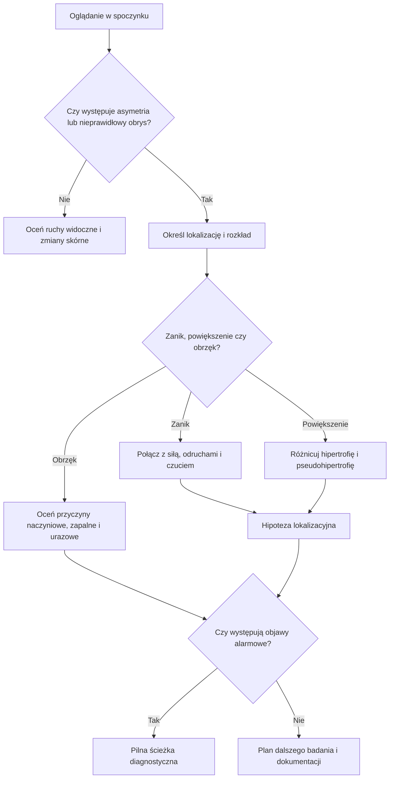
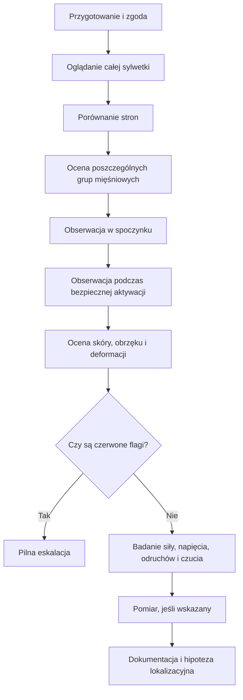

# 4.1. Oglądanie układu mięśniowego

## Wprowadzenie

Oglądanie układu mięśniowego jest pierwszym, nieinwazyjnym etapem badania motorycznego. Polega na celowej, uporządkowanej obserwacji sylwetki, obrysu i symetrii grup mięśniowych, ich objętości, konturów, widocznych skurczów, ustawienia kończyn oraz zmian skórnych i troficznych, które mogą towarzyszyć chorobom nerwowo-mięśniowym. Nie jest to bierne „spojrzenie na mięśnie”, lecz badanie wymagające znajomości anatomii powierzchownej, typowych wariantów budowy ciała, wzorców unerwienia i funkcji poszczególnych grup mięśniowych.

Inspekcja dostarcza wskazówek o lokalizacji i przewlekłości procesu chorobowego, ale sama nie rozpoznaje jego przyczyny. Zmniejszenie obwodu kończyny może wynikać z odnerwienia, miopatii, unieruchomienia, niedożywienia, choroby ogólnoustrojowej albo naturalnej asymetrii. Powiększenie mięśnia może być prawdziwym przerostem włókien, rzekomym przerostem wskutek zastępowania tkanki mięśniowej tłuszczem lub tkanką łączną, obrzękiem, krwiakiem albo zmianą w sąsiednich tkankach. Widoczne drżenia i fascykulacje wymagają odróżnienia od fizjologicznych ruchów, drżeń, mioklonii i innych dyskinez.

Prawidłowa inspekcja jest zawsze zestawiana z wywiadem, badaniem siły, napięcia, odruchów, czucia, koordynacji, chodu oraz oceną funkcjonalną. Wynik opisuje się językiem obserwacji: najpierw wskazuje się, co stwierdzono, następnie określa rozkład i stronność, a dopiero potem formułuje hipotezę kliniczną. Sam wygląd mięśnia nie pozwala przesądzić o rozpoznaniu choroby neuronu ruchowego, dystrofii mięśniowej, miopatii zapalnej ani neuropatii.

> **Zasada kliniczna:** oglądaj systematycznie, porównuj strony, uwzględniaj budowę całego ciała i potwierdzaj obserwację innymi elementami badania. Nie utożsamiaj obwodu mięśnia z jego siłą ani pojedynczej fascykulacji z rozpoznaniem choroby.

## 1. Cele kształcenia i efekty uczenia się

Po ukończeniu rozdziału uczestnik powinien:

1. wyjaśniać znaczenie inspekcji mięśni w badaniu neurologicznym;
2. rozróżniać zanik mięśniowy, obniżenie masy mięśniowej, przerost prawdziwy i rzekomy;
3. rozpoznawać podstawowe widoczne objawy zaburzeń jednostki ruchowej i mięśnia;
4. opisywać asymetrię, zanik, przerost, fascykulacje, drżenia, przykurcze i deformacje;
5. przeprowadzać oglądanie w spoczynku oraz podczas wybranych czynności;
6. dobierać pozycję pacjenta, oświetlenie i zakres odsłonięcia z poszanowaniem intymności;
7. odróżniać obserwacje możliwe do bezpośredniego stwierdzenia od hipotez etiologicznych;
8. rozpoznawać sytuacje wymagające pilnej oceny lekarskiej;
9. wykonywać powtarzalne pomiary obwodu i dokumentować ich warunki;
10. integrować wynik inspekcji z badaniem siły, napięcia, odruchów i funkcji.

## 2. Definicje i terminologia

### 2.1. Inspekcja mięśni

Inspekcja mięśni to oglądanie widocznych i dostępnych palpacyjnie grup mięśniowych w spoczynku oraz, gdy jest to potrzebne, podczas aktywacji. Ocenia się między innymi objętość, kontur, symetrię, ułożenie, widoczne skurcze, ruchy mimowolne, blizny, obrzęk i zmiany troficzne.

### 2.2. Masa mięśniowa, objętość i trofika

- **Masa mięśniowa** – ilość tkanki mięśniowej; w praktyce klinicznej nie jest bezpośrednio określana samym oglądaniem.
- **Objętość mięśnia** – przestrzenna wielkość mięśnia, którą można szacować oglądaniem, pomiarem obwodu lub obrazowaniem.
- **Trofika mięśni** – stan odżywienia i zachowania tkanki mięśniowej, oceniany pośrednio na podstawie objętości, konsystencji, funkcji i danych dodatkowych.
- **Zanik mięśniowy (atrofia)** – zmniejszenie objętości mięśnia wskutek zmniejszenia rozmiaru włókien, utraty włókien lub zastępowania ich inną tkanką.
- **Hipertrofia** – zwiększenie rozmiaru włókien mięśniowych, zwykle związane z adaptacją do obciążenia, ale niekiedy występujące w chorobach nerwowo-mięśniowych.
- **Pseudohipertrofia** – pozorne powiększenie mięśnia, w którym wzrost objętości nie odpowiada proporcjonalnemu przyrostowi czynnej tkanki mięśniowej; może wynikać z nagromadzenia tłuszczu, tkanki łącznej lub innych składników.
- **Asymetria** – różnica w wyglądzie lub wymiarach odpowiadających sobie okolic po obu stronach ciała. Nie każda asymetria oznacza chorobę.
- **Przykurcz** – utrwalone ograniczenie biernego zakresu ruchu, związane ze zmianami mięśni, ścięgien, torebek stawowych lub innych tkanek; nie jest synonimem samego skrócenia mięśnia widocznego w inspekcji.

### 2.3. Widoczne ruchy i zjawiska

- **Fascykulacja** – krótkotrwały, nieregularny skurcz jednostki ruchowej lub jej części, widoczny jako drobne drżenie fragmentu mięśnia pod skórą. Zwykle nie wywołuje ruchu całego stawu.
- **Miokimia** – falujące, robaczkowate, powtarzalne skurcze grup włókien, dające wrażenie przesuwającej się fali pod skórą.
- **Drżenie** – rytmiczna lub quasi-rytmiczna oscylacja części ciała wynikająca z naprzemiennej lub synchronicznej aktywności mięśni.
- **Mioklonie** – nagłe, krótkie, przypominające wyładowanie skurcze lub zahamowania aktywności mięśni.
- **Dystonia** – utrwalone lub okresowe skurcze powodujące skręcanie, powtarzalne ruchy albo nieprawidłowe postawy.
- **Pląsawica** – nieregularne, mimowolne, krótkie ruchy przepływające między częściami ciała.
- **Tik** – nagły, stereotypowy ruch lub wokalizacja, często poprzedzone narastającym przymusem wykonania.
- **Miotonia** – opóźnione rozluźnianie mięśnia po skurczu lub bodźcu mechanicznym; rozpoznaje się ją w badaniu funkcjonalnym i specjalistycznym, a nie wyłącznie na podstawie wyglądu.

## 3. Podstawy neuroanatomiczne i neurofizjologiczne

### 3.1. Jednostka ruchowa

Jednostka ruchowa składa się z neuronu ruchowego alfa w rogu przednim rdzenia kręgowego lub jądrze ruchowym nerwu czaszkowego, jego aksonu, połączeń nerwowo-mięśniowych oraz unerwianych przez niego włókien mięśniowych. Uszkodzenie neuronu ruchowego, korzenia, splotu lub nerwu obwodowego może prowadzić do utraty unerwienia części włókien, zmian ich pobudliwości, a z czasem do zaniku neurogennego.

W przewlekłym odnerwieniu sąsiednie jednostki ruchowe mogą przejmować część włókien przez reinerwację poboczną. Zmienia to wielkość i organizację jednostek ruchowych. Obserwowany zanik może być ogniskowy, segmentarny, związany z obszarem pojedynczego nerwu albo bardziej rozlany.

### 3.2. Mięsień jako narząd

Mięsień szkieletowy składa się z włókien mięśniowych, tkanki łącznej, naczyń i nerwów. Jego wygląd zależy od liczby i rozmiaru włókien, zawartości tłuszczu i tkanki łącznej, nawodnienia, obrzęku, stopnia napięcia oraz położenia kończyny. Z tego powodu obrys mięśnia nie jest prostym miernikiem jego sprawności.

### 3.3. Znaczenie dróg ruchowych

Drogi korowo-rdzeniowe wpływają na kontrolę ruchów dowolnych i napięcia. Ich uszkodzenie może powodować niedowład, zmianę postawy i wtórne zmniejszenie używania kończyny, a w dłuższej perspektywie także utratę masy mięśniowej z bezczynności. Uszkodzenie dolnego neuronu ruchowego częściej wiąże się z wyraźnym zanikiem neurogennym i fascykulacjami. Sam zanik nie rozstrzyga jednak, na jakim poziomie znajduje się uszkodzenie.

### 3.4. Wpływ unieruchomienia i chorób ogólnoustrojowych

Brak obciążania, długotrwałe leżenie, unieruchomienie w opatrunku, niedożywienie, wyniszczenie, choroby nowotworowe, niewydolność narządowa i starzenie się mogą prowadzić do utraty masy mięśniowej. Zmiany bywają obustronne i uogólnione, lecz nie zawsze są równomierne. Ocena powinna uwzględniać dotychczasową aktywność, odżywienie, choroby współistniejące i historię unieruchomienia.

## 4. Przygotowanie do oglądania

### 4.1. Warunki badania

1. Zweryfikuj tożsamość pacjenta i wyjaśnij cel oglądania.
2. Uzyskaj zgodę na badanie oraz wyjaśnij, które okolice trzeba odsłonić.
3. Zapewnij prywatność, odpowiednią temperaturę i dobre, równomierne oświetlenie.
4. Przygotuj krzesło lub leżankę oraz asekurację, jeśli pacjent ma zaburzenia równowagi.
5. Używaj zasłony lub prześcieradła; odsłaniaj tylko badaną okolicę.
6. Oceń ból, duszność, zmęczenie i możliwość bezpiecznej zmiany pozycji.
7. Zdejmowanie obuwia, skarpet, ortez lub odzieży wykonuj z poszanowaniem komfortu pacjenta i tylko w zakresie potrzebnym do badania.
8. Jeżeli potrzebny jest pomiar, przygotuj nieelastyczną taśmę mierniczą, marker do oznaczenia punktu pomiarowego i kartę zapisu.

### 4.2. Pozycje

W zależności od stanu pacjenta oglądaj mięśnie w pozycji:

- stojącej – sylwetka, obręcze, ustawienie kończyn, łydki, uda, postawa;
- siedzącej – obręcz barkowa, ręce, dłonie, uda, ustawienie tułowia;
- leżącej na plecach – mięśnie kończyn, symetria, widoczne skurcze;
- leżącej na brzuchu lub boku – tylne grupy mięśni, jeśli jest to bezpieczne i uzasadnione.

Nie wymuszaj pozycji, której pacjent nie może utrzymać. U osoby z ryzykiem upadku oglądanie w staniu wykonuj przy stabilnym podparciu i z asekuracją.

### 4.3. Odsłonięcie i porównywalność

Odsłonięcie powinno umożliwiać ocenę obu stron w tych samych warunkach. Odzież uciskająca, skarpetki, opatrunki i ortezy mogą zmieniać obrys lub maskować zmiany. Nie usuwaj opatrunku ani urządzenia stabilizującego bez wskazania i odpowiednich kompetencji.

## 5. Systematyczna procedura oglądania krok po kroku

### Krok 1. Ocena ogólnej budowy ciała

Zwróć uwagę na:

- ogólną masę i proporcje ciała;
- symetrię obręczy barkowej i miednicznej;
- ustawienie kręgosłupa i tułowia;
- rozkład tkanki podskórnej;
- cechy wyniszczenia lub otyłości utrudniające ocenę obrysu mięśni;
- sposób utrzymywania pozycji i spontaniczne używanie kończyn.

Nie oceniaj stanu odżywienia wyłącznie na podstawie wyglądu mięśni. W razie potrzeby uzupełnij ocenę o masę ciała, zmianę masy w czasie, BMI, obwody, ocenę dietetyczną i narzędzia przesiewowe.

### Krok 2. Oglądanie w spoczynku

Poproś pacjenta o rozluźnienie kończyn. Obserwuj:

- zarysy mięśni;
- symetrię odpowiadających sobie okolic;
- widoczne zagłębienia lub uwypuklenia;
- zanik międzykostny dłoni;
- obrys kłębu kciuka i kłębika;
- kontur mięśnia naramiennego;
- obrys mięśni uda i podudzia;
- ustawienie stóp i palców;
- spontaniczne drżenia, fascykulacje lub inne ruchy.

Nie interpretuj pojedynczej różnicy bez porównania z budową ciała, dominacją kończyny i historią urazów.

### Krok 3. Porównanie stron

Porównuj homologiczne okolice w tej samej pozycji i przy podobnym oświetleniu. W razie asymetrii ustal:

- czy dotyczy jednej grupy, kilku grup czy całej kończyny;
- czy układa się w obszar nerwu, korzenia, segmentu lub obręczy;
- czy występuje również osłabienie;
- czy towarzyszą jej zaburzenia czucia, odruchów lub napięcia;
- czy jest nowa, postępująca, stabilna, czy obecna od dawna.

### Krok 4. Oglądanie podczas aktywacji

Poproś o łagodny, bezbolesny ruch, np. uniesienie ramion, zaciśnięcie dłoni, wyprost palców, zgięcie stóp lub wspięcie na palce, o ile jest to bezpieczne. Oceniaj zmianę obrysu, rekrutację mięśni, kompensacje i widoczne ruchy. Nie zastępuj tym badania siły – aktywacja może ujawnić asymetrię, ale nie określa wiarygodnie stopnia osłabienia.

### Krok 5. Obserwacja podczas czynności funkcjonalnej

Jeśli stan pacjenta pozwala, obserwuj:

- wstawanie z krzesła;
- podnoszenie się z podłogi;
- unoszenie ramion nad głowę;
- sięganie i manipulowanie przedmiotem;
- chód i obracanie się;
- wchodzenie na stopień;
- wspięcie na palce i stanie na piętach.

Wynik należy opisać jako obserwowaną czynność, np. „wstaje z krzesła z użyciem obu kończyn górnych”, a nie automatycznie przypisywać mu konkretne rozpoznanie.

### Krok 6. Ocena skóry i tkanek otaczających

Zwróć uwagę na obrzęk, zaczerwienienie, zasinienie, blizny, zmiany pigmentacyjne, wysypkę, owrzodzenia, nadmierną suchość, łuszczenie, miejscowe ucieplenie i ślady urazów. Zmiany te mogą wskazywać na chorobę dermatologiczną, zapalną, naczyniową, urazową lub ogólnoustrojową. Nie przypisuj ich automatycznie chorobie mięśnia.

### Krok 7. Utrwalenie wyniku

Zapisz lokalizację, stronę, rozkład, nasilenie opisowe, warunki badania i ewentualny pomiar. Jeśli wykorzystujesz fotografię, uzyskaj odpowiednią zgodę, zastosuj zasady ochrony danych i przechowuj materiał wyłącznie w zatwierdzonym systemie dokumentacji.

## 6. Oglądanie poszczególnych okolic

### 6.1. Obręcz barkowa i kończyna górna

Oceniaj symetrię barków, obrys mięśni naramiennych, nad- i podgrzebieniowych, okolicy łopatki, ramienia i przedramienia. Zwróć uwagę na:

- zapadnięcie dołu nadgrzebieniowego lub podgrzebieniowego;
- zmniejszenie obrysu mięśnia naramiennego;
- skrzydłowatą łopatkę;
- asymetrię bicepsa i tricepsa;
- zanik mięśni przedramienia;
- nieprawidłowe ustawienie nadgarstka i palców.

Skrzydłowata łopatka może wynikać m.in. z osłabienia mięśnia zębatego przedniego lub czworobocznego, ale wymaga oceny ruchu łopatki i badania siły. Nie jest samodzielnym rozpoznaniem uszkodzenia konkretnego nerwu.

### 6.2. Dłoń

Oglądaj obie dłonie z grzbietu i od strony dłoniowej. Oceniaj:

- mięśnie międzykostne grzbietowe i dłoniowe;
- kłąb kciuka;
- kłębik;
- przestrzenie między kośćmi śródręcza;
- ustawienie palców, przykurcze i deformacje;
- obrzęk, blizny, zmiany skórne i troficzne.

Zanik pierwszego mięśnia międzykostnego grzbietowego może być widoczny w neuropatiach nerwu łokciowego, radikulopatiach, chorobach neuronu ruchowego i innych stanach. Zanik kłębu może występować w zaawansowanej neuropatii nerwu pośrodkowego, ale sam wygląd dłoni nie określa poziomu uszkodzenia.

### 6.3. Tułów i mięśnie przykręgosłupowe

Oceniaj ustawienie tułowia, symetrię mięśni przykręgosłupowych, zarysy mięśni brzucha, ewentualne zapadnięcia, uwypuklenia, blizny pooperacyjne i deformacje. Zwróć uwagę na skoliozę, nadmierną kifozę lub lordozę, asymetrię żeber i ustawienie miednicy. Zmiany postawy mogą być skutkiem osłabienia, bólu, przykurczu, deformacji kostnej lub zaburzeń równowagi.

### 6.4. Obręcz miedniczna i kończyna dolna

Oceniaj:

- obrys pośladków;
- mięśnie uda, zwłaszcza czworogłowy i grupę kulszowo-goleniową;
- obrys mięśni podudzia;
- mięśnie piszczelowe przednie i strzałkowe;
- mięśnie łydki;
- ustawienie stóp, palców i łuków podłużnych.

Zanik mięśnia piszczelowego przedniego może współwystępować z opadaniem stopy, ale przyczyny obejmują m.in. neuropatię nerwu strzałkowego, radikulopatię L5, polineuropatię i choroby neuronu ruchowego. Ocenę uzupełnij badaniem siły, czucia, odruchów i chodu.

### 6.5. Stopy

Oglądaj ustawienie palców, sklepienie stopy, zarysy mięśni międzykostnych, modzele, otarcia, owrzodzenia, deformacje i obrzęk. Stopa wydrążona, palce młotkowate lub szponiaste mogą towarzyszyć przewlekłym neuropatiom dziedzicznym, ale występują również jako warianty anatomiczne i w schorzeniach ortopedycznych. Oceniaj je w kontekście wywiadu rodzinnego, chodu, czucia i odruchów.

## 7. Zanik mięśniowy

### 7.1. Obraz kliniczny

Zanik może manifestować się zmniejszeniem obrysu mięśnia, zapadnięciem przestrzeni międzykostnych, uwidocznieniem konturów kostnych lub asymetrią kończyn. Wczesny zanik może być trudny do zauważenia, szczególnie u osób z większą ilością tkanki podskórnej albo przy obustronnym, symetrycznym zajęciu.

### 7.2. Główne mechanizmy

| Mechanizm | Przykładowe sytuacje | Wskazówki kliniczne |
|---|---|---|
| Neurogenne odnerwienie | uszkodzenie neuronu ruchowego, korzenia, splotu, nerwu | zanik w określonym rozkładzie, możliwe fascykulacje i zmiany odruchów |
| Pierwotna choroba mięśnia | dystrofie, miopatie zapalne, metaboliczne i toksyczne | często osłabienie proksymalne lub wzorzec zależny od typu miopatii |
| Bezczynność | unieruchomienie, ból, długotrwałe odciążanie | związek czasowy z ograniczeniem używania kończyny |
| Wyniszczenie i niedożywienie | choroby przewlekłe, nowotwory, niedostateczna podaż energii i białka | zwykle zmiany wieloobszarowe, utrata masy ciała lub osłabienie ogólne |
| Starzenie i sarkopenia | proces starzenia, choroby współistniejące, mała aktywność | stopniowe zmniejszanie masy i funkcji, szczególnie kończyn dolnych |
| Zaburzenia endokrynne lub metaboliczne | np. nadczynność tarczycy, zaburzenia hormonalne, zaburzenia elektrolitowe | objawy ogólnoustrojowe i wyniki badań laboratoryjnych |

### 7.3. Rozkład zaniku

Rozkład jest często bardziej informacyjny niż samo nasilenie:

- **ogniskowy** – pojedynczy mięsień lub grupa; rozważ miejscowe uszkodzenie, uraz, unieruchomienie lub zmianę strukturalną;
- **nerwowy** – obszar odpowiadający jednemu nerwowi obwodowemu;
- **korzeniowy** – grupa mięśni z przewagą określonego miotomu, często z bólem korzeniowym lub zmianą odruchu;
- **segmentarny** – kilka grup zależnych od sąsiednich segmentów rdzenia;
- **dystalny** – dłonie i stopy; możliwe przewlekłe neuropatie, choroby neuronu ruchowego i wybrane miopatie;
- **proksymalny** – obręcze i mięśnie bliższe tułowia; częsty wzorzec w miopatiach, ale nie wyłączny;
- **uogólniony** – rozważ choroby układowe, niedożywienie, sarkopenię, przewlekłe unieruchomienie lub rozległą chorobę nerwowo-mięśniową.

### 7.4. Ograniczenia oceny

Inspekcja nie określa dokładnej masy mięśniowej, nie rozróżnia pewnie utraty włókien od zastąpienia ich tłuszczem i nie lokalizuje samodzielnie uszkodzenia. Wątpliwości mogą wymagać pomiarów seryjnych, USG mięśni, MRI, badań neurofizjologicznych lub laboratoryjnych.

## 8. Przerost prawdziwy i pseudohipertrofia

### 8.1. Przerost prawdziwy

Przerost prawdziwy polega na zwiększeniu rozmiaru włókien mięśniowych. Może być adaptacją do treningu lub pracy, ale występuje również w niektórych chorobach, np. zaburzeniach związanych z nadmierną pobudliwością nerwowo-mięśniową. Ocena wymaga porównania z aktywnością, siłą, funkcją i pozostałymi objawami.

### 8.2. Pseudohipertrofia

W pseudohipertrofii mięsień wydaje się duży, lecz część jego objętości może stanowić tkanka tłuszczowa lub łączna, a nie czynne włókna. Klasycznym przykładem jest powiększenie łydek w dystrofinopatiach, w tym w dystrofii Duchenne’a. Pseudohipertrofia może występować także w innych dystrofiach i rzadziej w procesach neurogennych.

**Wskazówka:** duży obwód mięśnia nie oznacza dużej siły. Powiększenie z równoczesnym osłabieniem wymaga dalszej oceny.

### 8.3. Różnicowanie powiększenia okolicy kończyny

| Możliwa przyczyna | Cechy sugerujące | Co należy ocenić dalej |
|---|---|---|
| Prawdziwy przerost | związek z treningiem lub obciążeniem, zachowana funkcja | siła, historia aktywności, symetria |
| Pseudohipertrofia | duży obrys, nieproporcjonalna słabość, czasem choroba rodzinna | badanie neuromięśniowe, CK, USG lub MRI według wskazań |
| Obrzęk | rozlane zwiększenie objętości, napięcie skóry, możliwe ciastowate wgłębienie | przyczyna naczyniowa, limfatyczna, zapalna lub ogólnoustrojowa |
| Krwiak | uraz, ból, zasinienie, czasem leczenie przeciwkrzepliwe | ocena urazu, ukrwienia, zakresu i dynamiki |
| Zakrzepica żył głębokich | jednostronny obrzęk, ból, ucieplenie; objawy mogą być niepełne | pilna ocena kliniczna i diagnostyka zgodnie z algorytmem |
| Zakażenie tkanek | zaczerwienienie, ucieplenie, ból, gorączka | pilna ocena lekarska |
| Zespół ciasnoty przedziałów powięziowych | silny, narastający ból, napięty obrzęk, ból przy biernym rozciąganiu | natychmiastowa ocena ratunkowa |

## 9. Fascykulacje i inne widoczne skurcze

### 9.1. Fascykulacje

Fascykulacje są krótkimi, nieregularnymi skurczami widocznymi pod skórą. Mogą występować w zdrowych mięśniach, np. po wysiłku, przy zmęczeniu lub w łydkach osób starszych. Mogą też towarzyszyć uszkodzeniom dolnego neuronu ruchowego. Ich znaczenie zależy od współistnienia zaniku, osłabienia, zmian odruchów, sztywności, zaburzeń mowy, połykania lub oddychania.

Nie wolno rozpoznawać stwardnienia zanikowego bocznego na podstawie samej obserwacji fascykulacji. Podejrzenie choroby neuronu ruchowego wymaga oceny specjalistycznej i odpowiednich badań.

### 9.2. Jak obserwować

1. Zapewnij rozluźnienie badanego mięśnia.
2. Oświetl okolicę bocznym, rozproszonym światłem, unikając przegrzewania.
3. Obserwuj przez wystarczający czas, nie wywołując skurczu nadmiernym uciskiem.
4. Zapisz lokalizację, stronę, częstość i rozległość widocznych ruchów.
5. Sprawdź, czy ruch obejmuje mały fragment mięśnia, większą część mięśnia czy cały segment kończyny.
6. Zestaw obserwację z siłą, masą mięśniową, napięciem i odruchami.

### 9.3. Różnicowanie widocznych ruchów

| Zjawisko | Typowy wygląd | Uwagi |
|---|---|---|
| Fascykulacja | krótkie, nieregularne drgnięcie fragmentu mięśnia | zwykle bez ruchu całego stawu |
| Miokimia | falowanie lub przesuwająca się fala pod skórą | może występować w wybranych neuropatiach |
| Drżenie | bardziej rytmiczna oscylacja części ciała | oceniać w spoczynku, postawie i ruchu |
| Mioklonia | nagły, krótki skurcz lub „szarpnięcie” | może poruszać stawem |
| Pląsawica | nieregularne, zmienne ruchy | często obejmuje wiele okolic |
| Dystonia | skręcanie i utrwalanie nieprawidłowej postawy | może być zależna od zadania |
| Tik | stereotypowy ruch, często z przymusem poprzedzającym | wywiad jest istotny |
| Artefakt | ruch związany z tętnem, drżeniem całego ciała lub zewnętrznym bodźcem | wymaga weryfikacji |

## 10. Myotonia i zjawiska związane z rozluźnianiem mięśnia

Myotonia objawia się opóźnionym rozluźnieniem po skurczu. W inspekcji można zauważyć utrzymywanie zaciśniętej dłoni po poleceniu rozluźnienia, trudność szybkiego otwarcia ręki lub charakterystyczne zachowanie mięśnia po bodźcu mechanicznym. Ocenę należy przeprowadzać ostrożnie, bez bolesnego i nadmiernego powtarzania prób.

Widoczna lub palpacyjnie wyczuwalna miotonia może kierować uwagę na kanałopatie i dystrofie miotoniczne, ale nie jest rozpoznaniem etiologicznym. Dalsza ocena może obejmować badanie neurologiczne, EMG i diagnostykę genetyczną zgodnie z obrazem klinicznym.

## 11. Deformacje, ustawienie kończyn i przykurcze

Oglądanie obejmuje nie tylko sam mięsień, lecz także pozycję, w której jest utrzymywany. Zwróć uwagę na:

- opadanie stopy;
- ustawienie końskie lub końsko-szpotawe;
- palce młotkowate i szponiaste;
- przykurcz zgięciowy palców lub łokcia;
- przywiedzenie i rotację kończyny;
- przykurcz zgięciowy biodra lub kolana;
- skrzydłowatą łopatkę;
- asymetrię obręczy barkowej;
- skoliozę i kompensacyjne ustawienie tułowia.

Deformacja może być skutkiem osłabienia, zaburzeń napięcia, przewlekłego bólu, zmian ścięgien i stawów, neuropatii lub wrodzonej budowy. Odróżnij pozycję przyjmowaną czynnie od utrwalonego ograniczenia biernego zakresu ruchu. Pełną ocenę przykurczu wykonuje się w badaniu zakresu ruchu, a nie wyłącznie podczas inspekcji.

## 12. Zmiany troficzne i skórne

### 12.1. Co należy odnotować

- blizny po urazach, zabiegach i wkłuciach;
- obrzęk i zasinienie;
- zaczerwienienie i miejscowe ucieplenie;
- owrzodzenia, pęknięcia, modzele i odciski;
- zmiany paznokci i skóry;
- wysypkę, przebarwienia i zanik skóry;
- asymetrię owłosienia lub potliwości, jeśli jest wyraźna i klinicznie istotna;
- ślady ucisku przez ortezę, opatrunek lub sprzęt.

### 12.2. Znaczenie kliniczne

Zmiany skórne mogą współwystępować z neuropatią, zaburzeniami autonomicznymi, chorobą naczyniową, zapaleniem mięśni, chorobą tkanki łącznej, urazem lub zakażeniem. Wysypka w okolicy powiek, rumień na powierzchniach wyprostnych stawów lub charakterystyczne zmiany na dłoniach mogą kierować uwagę na zapalne miopatie, ale wymagają oceny dermatologicznej i lekarskiej.

Owrzodzenia stóp u osoby z neuropatią lub cukrzycą wymagają oceny głębokości, zakażenia, ukrwienia i odciążenia. Nie należy ograniczać opisu do stwierdzenia „zmiany troficzne”; trzeba określić ich lokalizację, rozmiar, wygląd i obecność objawów alarmowych.

## 13. Diagnostyka różnicowa według wzorca

### 13.1. Zanik dystalny

Może występować w:

- przewlekłych polineuropatiach aksonalnych;
- dziedzicznych neuropatiach ruchowo-czuciowych;
- uszkodzeniach nerwów obwodowych;
- radikulopatiach i uszkodzeniach splotów;
- chorobach neuronu ruchowego;
- wybranych miopatiach dystalnych.

Wskazówki lokalizacyjne uzyskuje się przez ocenę rozkładu, czucia, odruchów, napięcia i siły. Stopa wydrążona, deformacje palców i wywiad rodzinny mogą sugerować neuropatię dziedziczną, ale nie są wystarczające do rozpoznania.

### 13.2. Zanik proksymalny

Może towarzyszyć:

- miopatiom zapalnym;
- dystrofiom mięśniowym;
- miopatiom endokrynnym i toksycznym;
- sarkopenii i wyniszczeniu;
- przewlekłemu unieruchomieniu;
- chorobom neuronu ruchowego z zajęciem obręczy.

Ważne jest ustalenie, czy osłabienie jest rzeczywiście proksymalne, czy wynika z bólu stawów, ograniczenia ruchomości lub zaburzeń równowagi.

### 13.3. Zanik ogniskowy

Rozważ miejscowy uraz, zabieg, długotrwałe odciążanie, ucisk nerwu, radikulopatię, zmianę w obrębie mięśnia lub ograniczenie ruchu z powodu bólu. Jeżeli zanik narasta, towarzyszy mu osłabienie albo występują objawy neurologiczne, wskazana jest dalsza diagnostyka.

### 13.4. Zmiany obustronne i uogólnione

Rozważ sarkopenię, niedożywienie, choroby przewlekłe, zaburzenia hormonalne, miopatie, polineuropatie i długotrwałe unieruchomienie. Wzorzec nie powinien być oceniany bez analizy masy ciała, aktywności, leków i chorób towarzyszących.

## 14. Czerwone flagi i sytuacje wymagające pilnej reakcji

**Inspekcja może ujawnić objawy, które wymagają natychmiastowej oceny, ale nie może opóźniać pomocy ratunkowej.**

### 14.1. Podejrzenie ostrego zespołu ciasnoty przedziałów powięziowych

Alarmujące są: silny i narastający ból nieproporcjonalny do urazu, napięty obrzęk, ból przy biernym rozciąganiu mięśni, parestezje i narastające osłabienie. Zachowane tętno obwodowe nie wyklucza zespołu ciasnoty. Jest to stan nagły wymagający natychmiastowej oceny chirurgicznej/urazowej zgodnie z lokalną ścieżką.

### 14.2. Podejrzenie choroby neuronu ruchowego

Pilnej konsultacji neurologicznej wymaga postępujące, niewyjaśnione osłabienie z zanikiem i fascykulacjami, zwłaszcza gdy współistnieją zaburzenia mowy, połykania, oddychania, sztywność lub objawy uszkodzenia górnego neuronu ruchowego. Sama fascykulacja bez innych nieprawidłowości nie przesądza o chorobie.

### 14.3. Ostra lub szybko narastająca słabość

Nagłe osłabienie jednej strony ciała, nowa asymetria twarzy, zaburzenia mowy, widzenia lub równowagi mogą oznaczać udar. Szybko postępujące osłabienie obustronne, trudności w oddychaniu, osłabienie kaszlu lub zaburzenia połykania mogą oznaczać zagrożenie niewydolnością oddechową lub opuszkową.

### 14.4. Inne stany alarmowe

- nagły obrzęk kończyny z bólem, zasinieniem lub zaburzeniem czucia;
- szybko narastające zaczerwienienie, gorączka i silny ból tkanek;
- rozległy krwiak u osoby przyjmującej leki przeciwkrzepliwe;
- silny ból mięśni z osłabieniem i ciemnym moczem po wysiłku, urazie lub ekspozycji na lek – podejrzenie rabdomiolizy;
- osłabienie mięśni z dysfagią, dusznością lub zaburzeniami utrzymywania głowy;
- nowe objawy neurologiczne po urazie kręgosłupa lub kończyny.

W razie zagrożenia życia należy uruchomić właściwy system ratunkowy. Nie należy wykonywać długotrwałych pomiarów ani prób wysiłkowych przed zabezpieczeniem pacjenta.

## 15. Pomiary obwodów – zasady i ograniczenia

### 15.1. Kiedy pomiar jest przydatny

Pomiar obwodu może uzupełnić ocenę widoczną, szczególnie w monitorowaniu asymetrii lub zmian w czasie. Nie jest jednak bezpośrednim pomiarem masy mięśniowej: wynik zależy również od tkanki tłuszczowej, obrzęku, kości, napięcia mięśni, nawodnienia i miejsca pomiaru.

### 15.2. Procedura

1. Wybierz punkt anatomiczny możliwy do jednoznacznego odtworzenia.
2. Opisz odległość od stałego punktu kostnego lub innego landmarku.
3. Ustaw pacjenta w tej samej pozycji przy każdym pomiarze.
4. Rozluźnij badaną kończynę, jeśli protokół nie wymaga pomiaru w skurczu.
5. Ułóż taśmę prostopadle do osi kończyny, bez uciskania tkanek.
6. Zmierz obie strony.
7. Wykonaj powtórny pomiar, jeżeli wynik jest zaskakujący lub trudny do odtworzenia.
8. Zapisz jednostkę, punkt pomiaru, pozycję i datę.
9. W kolejnych pomiarach używaj tej samej metody i najlepiej tego samego badającego.

### 15.3. Normy

Nie istnieje jeden uniwersalny prawidłowy obwód dla wszystkich mięśni i wszystkich dorosłych. Wartości zależą od płci, wzrostu, wieku, budowy ciała, aktywności, dominacji kończyny, nawodnienia i metody pomiaru. Interpretuj przede wszystkim zmianę w czasie oraz różnicę między stronami w kontekście klinicznym. Nie rozpoznawaj zaniku na podstawie arbitralnego progu centymetrowego.

### 15.4. Przykład zapisu

„Obwód łydki mierzony w pozycji leżącej, w odległości 10 cm poniżej guzowatości piszczeli: prawa 34,0 cm, lewa 32,5 cm. Taśma bez ucisku, pomiar powtórzony dwukrotnie. Wynik wskazuje na asymetrię obwodu; wymaga zestawienia z siłą, obrzękiem i badaniem neurologicznym.”

## 16. Narzędzia i badania uzupełniające

Inspekcja jest częścią badania klinicznego. W zależności od hipotezy można rozważyć:

- **badanie siły mięśniowej** – ocena funkcji poszczególnych grup;
- **badanie napięcia i odruchów** – pomoc w różnicowaniu uszkodzenia ośrodkowego i obwodowego;
- **CK** – marker uszkodzenia mięśni, nieswoisty i zależny od wysiłku, urazu i wielu chorób;
- **TSH, elektrolity, parametry zapalne i inne badania laboratoryjne** – dobierane do obrazu klinicznego;
- **EMG i badanie przewodnictwa nerwowego** – ocena jednostki ruchowej, nerwów i wzorca neurogennego lub miopatycznego;
- **USG mięśni** – ocena grubości, struktury i echogeniczności;
- **MRI mięśni** – ocena obrzęku, zaniku, stłuszczenia i rozkładu zajęcia;
- **diagnostyka genetyczna lub biopsja** – w wybranych przypadkach po konsultacji specjalistycznej.

Nie zlecaj ani nie interpretuj badań wyłącznie na podstawie wyglądu jednego mięśnia. Dobór diagnostyki powinien odpowiadać pytaniu klinicznemu i kompetencjom osoby prowadzącej.

## 17. Interpretacja – od obserwacji do hipotezy

Zalecana kolejność rozumowania:

1. **Co widzę?** – np. zmniejszony obrys pierwszego mięśnia międzykostnego grzbietowego prawej dłoni.
2. **Gdzie?** – prawa dłoń, okolica mięśni wewnętrznych.
3. **Jaki jest rozkład?** – ogniskowy, jednostronny, czy obejmuje inne mięśnie?
4. **Czy występuje zaburzenie funkcji?** – osłabienie odwodzenia palca wskazującego, chwytu lub innych ruchów?
5. **Czy są objawy towarzyszące?** – zaburzenia czucia, ból, zmiana odruchów, fascykulacje?
6. **Jakie poziomy anatomiczne są możliwe?** – nerw obwodowy, korzeń, splot, róg przedni, mięsień.
7. **Jakie badania mogą rozstrzygnąć wątpliwość?** – zależnie od obrazu: EMG/NCS, obrazowanie, badania laboratoryjne.
8. **Jaki jest poziom pilności?** – stabilny przewlekły deficyt czy szybko postępujący stan alarmowy?

### Schemat interpretacyjny

### Macierz orientacyjna

| Obserwacja | Możliwy mechanizm | Konieczne uzupełnienie |
|---|---|---|
| Zanik i osłabienie w obszarze nerwu | neuropatia obwodowa | czucie, odruchy, EMG/NCS według wskazań |
| Zanik miotomalny | radikulopatia lub uszkodzenie segmentalne | ból korzeniowy, odruchy, badanie czucia, obrazowanie/EMG |
| Zanik proksymalny i osłabienie obręczy | miopatia lub choroba układowa | wzorzec siły, CK i badania ukierunkowane |
| Zanik uogólniony po unieruchomieniu | bezczynność, sarkopenia, wyniszczenie | historia aktywności, odżywienie i stan ogólny |
| Fascykulacje z postępującym zanikiem i osłabieniem | uszkodzenie dolnego neuronu ruchowego | pilna konsultacja neurologiczna |
| Duże łydki i słabość proksymalna | pseudohipertrofia w dystrofii lub innej chorobie | wywiad rodzinny, funkcja, CK, diagnostyka neuromięśniowa |
| Jednostronny bolesny obrzęk | uraz, zakrzepica, zakażenie lub zespół ciasnoty | pilna ocena zależna od objawów |

## 18. Normy, warianty i czynniki zakłócające

### 18.1. Warianty fizjologiczne

Niewielka asymetria może wynikać z dominacji kończyny, różnic treningowych, zawodu, przebytych urazów, budowy szkieletu lub naturalnej zmienności. U osób starszych może występować zmniejszenie masy mięśniowej związane z wiekiem. Nie należy jednak automatycznie uznawać każdej asymetrii u seniora za fizjologiczną.

### 18.2. Czynniki wpływające na wiarygodność

- niewystarczające oświetlenie;
- ubranie zasłaniające badaną okolicę;
- obrzęk lub znaczna ilość tkanki podskórnej;
- ból i obronne napinanie mięśni;
- zimno, drżenie z dreszczy lub lęk;
- pozycja asymetryczna;
- niedawny wysiłek;
- różnice w nawodnieniu;
- trudności komunikacyjne lub poznawcze;
- brak porównywalnych pomiarów wcześniejszych.

### 18.3. Czego nie wolno wnioskować

Nie wolno na podstawie samej inspekcji:

- rozpoznawać konkretnej neuropatii lub miopatii;
- oceniać dokładnego stopnia siły;
- przesądzać o etiologii zaniku;
- wykluczać choroby nerwowo-mięśniowej przy pozornie prawidłowym obrysie;
- uznawać fascykulacji za dowód choroby neuronu ruchowego;
- traktować prawidłowego obwodu jako dowodu prawidłowej jakości mięśnia.

## 19. Bezpieczeństwo i komfort pacjenta

- Nie wymuszaj ruchów ani pozycji powodujących ból.
- Nie wykonuj prób w staniu bez asekuracji u pacjenta z ryzykiem upadku.
- Nie uciskaj silnie bolesnej, obrzękniętej lub pourazowej okolicy.
- Nie masuj ani nie rozgrzewaj kończyny z podejrzeniem zakrzepicy, ostrego zespołu ciasnoty lub zakażenia.
- Nie zdejmuj opatrunków, ortez ani unieruchomienia bez uzasadnienia i uprawnień.
- Zadbaj o higienę rąk i czystość używanych narzędzi.
- Zabezpiecz pacjenta przed wychłodzeniem podczas odsłaniania.
- W razie pogorszenia stanu przerwij badanie i uruchom właściwą ścieżkę pomocy.
- Szanuj granice pacjenta, jego godność, zgodę i prawo do przerwania badania.

## 20. Dokumentowanie wyniku

### 20.1. Minimalny zakres opisu

W dokumentacji zapisz:

1. datę i godzinę badania;
2. pozycję pacjenta i warunki oglądania;
3. oceniane okolice;
4. symetrię lub asymetrię;
5. obecność i lokalizację zaniku lub powiększenia;
6. obecność widocznych skurczów lub ruchów mimowolnych;
7. deformacje, przykurcze i ustawienie kończyn;
8. zmiany skórne i troficzne;
9. wykonane pomiary wraz z punktami anatomicznymi;
10. ograniczenia badania;
11. dalsze zalecane elementy oceny lub pilność konsultacji – zgodnie z kompetencjami.

### 20.2. Przykładowy opis prawidłowy

„Obrys głównych grup mięśniowych kończyn górnych i dolnych symetryczny. Bez widocznego zaniku, przerostu ani fascykulacji w czasie obserwacji. Bez istotnych deformacji i przykurczów widocznych w badanych pozycjach. Skóra bez widocznych owrzodzeń i zmian troficznych w ocenianych okolicach. Ocena ograniczona w zakresie mięśni głębokich i okolic zasłoniętych odzieżą.”

### 20.3. Przykładowy opis nieprawidłowy

„Widoczne zmniejszenie obrysu pierwszego mięśnia międzykostnego grzbietowego prawej dłoni w porównaniu ze stroną lewą. Zaznaczona asymetria przestrzeni międzykostnych. Bez widocznych fascykulacji podczas kilkudziesięciosekundowej obserwacji. Wymaga zestawienia z badaniem odwodzenia palców, siły chwytu, czucia w obszarze nerwu łokciowego i oceną odruchów.”

### 20.4. Przykładowy opis powiększenia łydki

„Obustronnie zwiększony obrys mięśni łydek, wyraźniejszy po stronie prawej. Współistnieje trudność we wstawaniu z podłogi i osłabienie funkcji proksymalnej kończyn dolnych. Sam wygląd nie rozstrzyga, czy jest to przerost prawdziwy, pseudohipertrofia czy inna przyczyna zwiększenia objętości. Wskazana dalsza ocena neuromięśniowa.”

## 21. Przykłady kliniczne

### Przypadek 1. Ogniskowy zanik mięśni dłoni

Osoba dorosła zgłasza narastające trudności w rozstawianiu palców jednej dłoni. W inspekcji widoczny jest zanik pierwszego mięśnia międzykostnego grzbietowego i osłabienie obrysu kłębika.

**Tok rozumowania:**
- obserwacja: jednostronny zanik mięśni wewnętrznych dłoni;
- pytanie: czy rozkład odpowiada nerwowi łokciowemu, korzeniowi lub szerszemu procesowi?
- uzupełnienie: siła odwodzenia i przywodzenia palców, chwyt, czucie, odruchy;
- dalsza diagnostyka: zależnie od wyniku rozważa się EMG/NCS i obrazowanie;
- wniosek: inspekcja wskazuje miejsce wymagające pogłębienia badania, ale nie rozstrzyga poziomu ani przyczyny.

### Przypadek 2. Duże łydki i osłabienie proksymalne

Pacjent ma wyraźnie powiększone łydki, lecz zgłasza trudność we wchodzeniu po schodach i wstawaniu z podłogi.

**Tok rozumowania:**
- duży obrys nie jest równoznaczny z większą siłą;
- należy sprawdzić siłę mięśni obręczy biodrowej, sposób wstawania, chód i zakres ruchu;
- rozważa się pseudohipertrofię w chorobie mięśniowej, ale również inne przyczyny powiększenia;
- wywiad rodzinny i wiek początku objawów mają znaczenie;
- dalsza diagnostyka może obejmować CK, ocenę neuromięśniową, obrazowanie i badania genetyczne według wskazań.

### Przypadek 3. Fascykulacje łydki bez innych objawów

Osoba po intensywnym wysiłku zauważa krótkie drżenia mięśnia łydki. Nie zgłasza osłabienia ani zaburzeń czucia.

**Tok rozumowania:**
- należy ustalić czas trwania, częstotliwość, związek z wysiłkiem, snem, kofeiną i lekami;
- sprawdzić siłę, obwód mięśni, odruchy i inne grupy mięśniowe;
- pojedyncze fascykulacje mogą występować także u osób zdrowych;
- jeśli pojawia się postępujące osłabienie, zanik, zaburzenia mowy, połykania lub oddychania, konieczna jest pilna ocena.

### Przypadek 4. Zanik po unieruchomieniu

Pacjent po kilku tygodniach unieruchomienia kończyny zauważa mniejszy obwód uda.

**Tok rozumowania:**
- związek czasowy z unieruchomieniem sugeruje zanik z bezczynności;
- należy wykluczyć powikłania urazu, ból, uszkodzenie nerwu i ograniczenie ruchu;
- pomiary powinny być powtarzalne i wykonywane w tych samych punktach;
- wynik inspekcji zestawia się z siłą, zakresem ruchu i funkcją;
- plan rehabilitacji powinien uwzględniać zalecenia dotyczące urazu i obciążania.

### Przypadek 5. Jednostronny obrzęk i ból łydki

Pacjent zgłasza nagły ból oraz powiększenie jednej łydki. Skóra jest napięta, a ból nasila się przy ruchu.

**Tok rozumowania:**
- nie należy zakładać, że jest to przerost mięśnia;
- trzeba ocenić uraz, ryzyko zakrzepicy, zakażenia i zespół ciasnoty;
- przy silnym narastającym bólu, napięciu przedziału i bólu przy biernym rozciąganiu wymagana jest natychmiastowa ocena ratunkowa;
- nie należy opóźniać eskalacji przez wykonywanie pomiarów seryjnych w warunkach niepewności.

### Przypadek 6. Zanik i postępujące osłabienie wielu grup

Pacjent zgłasza pogarszającą się sprawność ręki, potykanie się i narastające trudności w codziennych czynnościach. W inspekcji stwierdza się zanik kilku grup mięśniowych i widoczne fascykulacje.

**Tok rozumowania:**
- konieczne jest ustalenie dynamiki i rozmieszczenia objawów;
- należy zbadać siłę, napięcie, odruchy, czucie, funkcje opuszkowe i oddechowe;
- postępujący zanik z osłabieniem i fascykulacjami wymaga pilnej konsultacji neurologicznej;
- nie wolno stawiać rozpoznania choroby neuronu ruchowego na podstawie samej inspekcji;
- należy jasno udokumentować obserwacje i pilność dalszej oceny.

## 22. Najczęstsze błędy

| Błąd | Dlaczego jest problemem | Jak postępować prawidłowo |
|---|---|---|
| Oglądanie tylko jednej strony | łatwo przeoczyć asymetrię lub uogólniony zanik | porównuj homologiczne okolice |
| Ocenianie przez ubranie | odzież maskuje obrys i zmiany skórne | odsłoń badaną okolicę z poszanowaniem intymności |
| Uznanie dużej łydki za silny mięsień | możliwa pseudohipertrofia | zestaw obrys z siłą i funkcją |
| Rozpoznawanie ALS na podstawie fascykulacji | fascykulacje nie są swoiste | oceniaj zanik, osłabienie, odruchy i dynamikę |
| Pomiar w różnych punktach | wynik nie jest porównywalny | oznacz punkt anatomiczny i pozycję |
| Brak uwzględnienia obrzęku | obwód może nie odzwierciedlać mięśnia | oceń tkanki i przyczynę powiększenia |
| Ignorowanie bólu | może prowadzić do błędnej interpretacji i szkody | zapytaj o ból i przerwij bolesną próbę |
| Utożsamienie asymetrii z patologią | naturalna dominacja i urazy mogą zmieniać obrys | uwzględnij wywiad i funkcję |
| Brak opisu ograniczeń | odbiorca nie zna wiarygodności badania | zaznacz, co było niemożliwe do oceny |
| Opóźnianie pomocy przy czerwonych flagach | grozi utratą funkcji lub życia | natychmiast uruchom właściwą ścieżkę |

## 23. Lista kontrolna badania

- [ ] Wyjaśniono cel i uzyskano zgodę.
- [ ] Zapewniono prywatność i odpowiednie oświetlenie.
- [ ] Oceniono bezpieczeństwo pozycji i ryzyko upadku.
- [ ] Oceniono ogólną budowę ciała.
- [ ] Obejrzano obie obręcze barkowe.
- [ ] Obejrzano ramiona, przedramiona i dłonie.
- [ ] Obejrzano tułów i mięśnie przykręgosłupowe w dostępnym zakresie.
- [ ] Obejrzano obręcz miedniczną, uda i podudzia.
- [ ] Obejrzano stopy i ustawienie palców.
- [ ] Oceniono symetrię, zanik i powiększenie.
- [ ] Obserwowano fascykulacje i inne ruchy mimowolne.
- [ ] Oceniono deformacje i przykurcze widoczne w badanej pozycji.
- [ ] Oceniono skórę, obrzęk i zmiany troficzne.
- [ ] W razie potrzeby wykonano powtarzalny pomiar.
- [ ] Wynik zestawiono z siłą, napięciem, odruchami i czuciem.
- [ ] Rozpoznano lub wykluczono objawy wymagające pilnej eskalacji.
- [ ] Zapisano obserwacje i ograniczenia badania.

## 24. Stacje OSCE

### Stacja 1. Inspekcja dłoni

**Zadanie:** przeprowadź oglądanie obu dłoni u pacjenta zgłaszającego osłabienie chwytu.

**Oczekiwane czynności:**
- wyjaśnienie badania i uzyskanie zgody;
- porównanie kłębu, kłębika i mięśni międzykostnych;
- opis ewentualnego zaniku i deformacji;
- wskazanie, że inspekcja wymaga uzupełnienia badaniem siły, czucia i odruchów;
- prawidłowa dokumentacja.

### Stacja 2. Oglądanie kończyn dolnych

**Zadanie:** oceń obrys ud, podudzi i stóp u pacjenta z potykaniem się.

**Oczekiwane czynności:**
- ocena symetrii i ustawienia stóp;
- obserwacja mięśni piszczelowych przednich i łydek;
- opis zaniku lub powiększenia;
- asekuracja podczas ewentualnego stania i chodu;
- wskazanie dalszych prób funkcjonalnych.

### Stacja 3. Fascykulacje

**Zadanie:** pacjent zgłasza widoczne drgania mięśni. Przeprowadź obserwację i wyjaśnij ograniczenia.

**Oczekiwane czynności:**
- rozluźnienie mięśnia i odpowiednie oświetlenie;
- opis lokalizacji i charakteru ruchu;
- różnicowanie fascykulacji z drżeniem i mioklonią;
- ocena współistnienia zaniku i osłabienia;
- unikanie przedwczesnego rozpoznania etiologicznego.

### Stacja 4. Powiększona łydka

**Zadanie:** u pacjenta stwierdzono powiększenie obrysu łydek.

**Oczekiwane czynności:**
- porównanie obu stron;
- ocena obrzęku, bólu, zaczerwienienia i napięcia;
- rozróżnienie hipotezy hipertrofii, pseudohipertrofii i obrzęku;
- rozpoznanie objawów alarmowych;
- zaproponowanie dalszej oceny bez stawiania rozpoznania na podstawie wyglądu.

## 25. Algorytm krótkiego badania

## 26. Pytania kontrolne

**1. Czy prawidłowy obwód kończyny wyklucza zanik mięśni?**  
Nie. Obwód obejmuje mięśnie, tkankę tłuszczową, skórę, kości i płyny. Obrzęk lub duża ilość tkanki podskórnej mogą maskować zanik.

**2. Czym różni się hipertrofia od pseudohipertrofii?**  
W hipertrofii zwiększa się rozmiar włókien mięśniowych. W pseudohipertrofii zwiększona objętość wynika z obecności tkanki tłuszczowej, łącznej lub innych składników, a siła może być zmniejszona.

**3. Czy fascykulacje oznaczają chorobę neuronu ruchowego?**  
Nie. Mogą występować także u osób zdrowych. Znaczenie rośnie, gdy towarzyszą im postępujące osłabienie, zanik i inne objawy neurologiczne.

**4. Dlaczego porównuje się obie strony?**  
Porównanie pomaga wykryć asymetrię i określić jej rozkład, ale musi uwzględniać dominację kończyny, urazy i naturalną zmienność.

**5. Czy oglądanie pozwala określić siłę mięśnia?**  
Nie. Siłę należy ocenić osobnymi próbami, np. według skali MRC/Lovetta, z uwzględnieniem bólu i zakresu ruchu.

**6. Jak dokumentować pomiar obwodu?**  
Należy podać stronę, punkt anatomiczny, pozycję, wartość, jednostkę i warunki pomiaru. W kolejnych pomiarach należy stosować tę samą metodę.

**7. Jakie objawy mogą sugerować ostrą ciasnotę przedziałów powięziowych?**  
Silny narastający ból, napięty obrzęk, ból przy biernym rozciąganiu i narastające zaburzenia czucia lub ruchu. Wymaga to pilnej oceny.

**8. Co zrobić przy postępującym zaniku, osłabieniu i fascykulacjach?**  
Udokumentować dokładny rozkład i dynamikę, zbadać pozostałe funkcje neurologiczne i skierować pacjenta do pilnej oceny neurologicznej zgodnie z lokalną ścieżką.

## 27. Podsumowanie

Oglądanie układu mięśniowego jest prostym technicznie, lecz wymagającym interpretacyjnie elementem badania neurologicznego. Dostarcza informacji o symetrii, objętości, konturze, widocznych skurczach, postawie, deformacjach i stanie tkanek. Największą wartość ma wtedy, gdy jest wykonywane w sposób systematyczny, porównawczy i powtarzalny, a wynik jest łączony z badaniem siły, napięcia, odruchów, czucia i funkcji.

Zanik może wynikać z odnerwienia, choroby mięśnia, bezczynności lub choroby ogólnoustrojowej. Powiększenie może być prawdziwą hipertrofią, pseudohipertrofią albo obrzękiem. Fascykulacje mogą mieć znaczenie fizjologiczne lub patologiczne; ich interpretacja zależy od całego obrazu klinicznego. Pomiary obwodu są użyteczne do monitorowania, lecz nie zastępują oceny jakości tkanki i funkcji.

Najważniejsze jest rzetelne oddzielenie obserwacji od hipotezy. Dokumentacja powinna pozwalać innemu członkowi zespołu zrozumieć, co rzeczywiście zaobserwowano, w jakich warunkach, z jakimi ograniczeniami i jakie dalsze działania są uzasadnione. W sytuacjach alarmowych bezpieczeństwo pacjenta ma pierwszeństwo przed dokończeniem planowego badania.

## 28. Bibliografia i źródła edukacyjne

1. Newman G, Levin M. **How To Assess the Motor System.** MSD Manual Professional Edition. Aktualizacja: sierpień 2025.  
   https://www.msdmanuals.com/professional/neurologic-disorders/neurologic-examination/how-to-assess-the-motor-system

2. National Institute for Health and Care Excellence (NICE). **Motor neurone disease: assessment and management (NG42) – Recommendations.** 2016, aktualna strona wytycznych.  
   https://www.nice.org.uk/guidance/ng42/chapter/recommendations

3. Walters J. **Muscle hypertrophy and pseudohypertrophy.** Practical Neurology. 2017;17:369–379.  
   https://doi.org/10.1136/practneurol-2017-001695

4. Birnkrant DJ, Bushby K, Bann CM, et al. **Diagnosis and management of Duchenne muscular dystrophy, part 1: diagnosis, and neuromuscular, rehabilitation, endocrine, and gastrointestinal and nutritional management.** Lancet Neurology. 2018;17(3):251–267.  
   https://doi.org/10.1016/S1474-4422(18)30024-3  
   Pełny tekst: https://pmc.ncbi.nlm.nih.gov/articles/PMC5869704/

5. Birnkrant DJ, Bushby K, Bann CM, et al. **Diagnosis and management of Duchenne muscular dystrophy, part 2: respiratory, cardiac, bone health, and orthopaedic management.** Lancet Neurology. 2018;17(4):347–361.  
   https://doi.org/10.1016/S1474-4422(18)30025-5

6. Birnkrant DJ, Bushby K, Bann CM, et al. **Diagnosis and management of Duchenne muscular dystrophy, part 3: primary care, emergency management, psychosocial care, and transitions of care across the lifespan.** Lancet Neurology. 2018;17(5):445–455.  
   https://doi.org/10.1016/S1474-4422(18)30026-7

7. American Academy of Family Physicians. **Evaluation of the Patient with Muscle Weakness.** American Family Physician. 2005;71(7):1327–1336.  
   https://www.aafp.org/pubs/afp/issues/2005/0401/p1327.html

8. National Health Service (NHS). **Compartment syndrome.** Informacje dla pacjentów i personelu.  
   https://www.nhs.uk/conditions/compartment-syndrome/

9. Agency for Clinical Innovation, NSW Health. **Neurovascular assessment: Clinical practice guide.** Kwiecień 2026.  
   https://aci.health.nsw.gov.au/__data/assets/pdf_file/0004/458185/ACI-MSK-Neurovascular-assessment.pdf

10. Muscular Dystrophy Association. **Duchenne Muscular Dystrophy – Signs and Symptoms.**  
    https://www.mda.org/disease/duchenne-muscular-dystrophy/signs-and-symptoms

11. Muscular Dystrophy Association. **Duchenne Muscular Dystrophy – Diagnosis.**  
    https://www.mda.org/disease/duchenne-muscular-dystrophy/diagnosis

12. Walters J. **Calf enlargement in neuromuscular diseases: a quantitative ultrasound study in 350 patients and review of the literature.** Journal of the Neurological Sciences. 1997.  
    https://pubmed.ncbi.nlm.nih.gov/8981297/

13. **Denervation pseudo hypertrophy of the calf: An important cause of lower limb swelling.** Case report and review.  
    https://pmc.ncbi.nlm.nih.gov/articles/PMC8956883/

14. Newman G, Levin M. **How To Assess Muscle Strength.** MSD Manual Professional Edition. Aktualizacja: sierpień 2025.  
    https://www.msdmanuals.com/professional/neurologic-disorders/neurologic-examination/how-to-assess-muscle-strength

15. National Institute for Health and Care Excellence. **Motor neurone disease: assessment and management – full guideline resources.**  
    https://www.nice.org.uk/guidance/ng42

### Zasady korzystania ze źródeł

- Wytyczne należy sprawdzać w aktualnej wersji przed wykorzystaniem ich do decyzji klinicznych.
- Przeglądy i opisy przypadków służą pogłębianiu rozumienia, ale nie zastępują wytycznych i badań o odpowiedniej jakości.
- Wartości pomiarów należy interpretować w odniesieniu do populacji, metody i celu badania.
- Materiał ma charakter edukacyjny. Zakres czynności i decyzji zależy od kwalifikacji zawodowych, uprawnień i procedur placówki.

---

**Powiązanie z kolejnym rozdziałem:** rozdział 4.1 opisuje oglądanie i dokumentowanie widocznych cech układu mięśniowego. Następny rozdział 4.2 powinien rozwijać obiektywną ocenę siły mięśniowej, w tym skalę Lovetta/MRC, badanie proksymalne i dystalne, próby przeciw grawitacji, opór, męczliwość oraz ograniczenia wynikające z bólu i zaburzeń współpracy.
