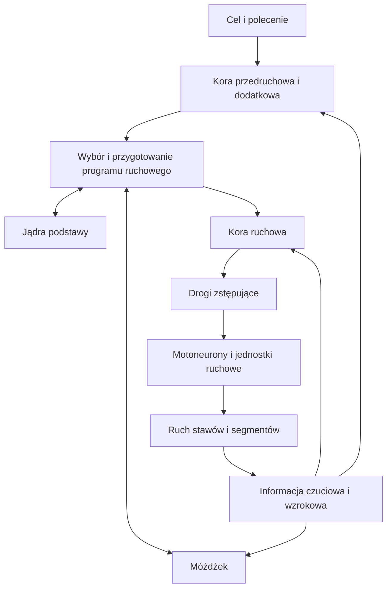
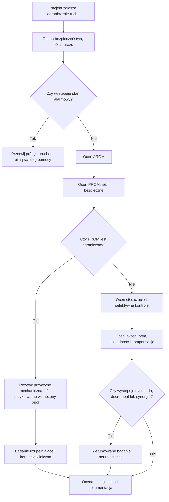

# 4.4. Zakres ruchu i kontrola ruchu

## Wprowadzenie

Ocena zakresu ruchu i kontroli ruchu stanowi kolejny etap badania motorycznego po oglądaniu układu mięśniowego, ocenie siły oraz napięcia mięśniowego. Jej zadaniem jest ustalenie, jaki ruch pacjent może wykonać samodzielnie, jaki zakres można uzyskać przy ruchu biernym, czy ruch przebiega płynnie i selektywnie oraz czy jego rozpoczęcie, kierunek, amplituda, tempo, dokładność i zakończenie są prawidłowo regulowane.

Zakres ruchu i kontrola ruchu są pojęciami powiązanymi, lecz nie są tożsame. Zakres ruchu opisuje wielkość przemieszczenia segmentu ciała w stawie lub w układzie kilku stawów. Kontrola ruchu odnosi się do sposobu, w jaki układ nerwowy planuje, inicjuje, skaluje, koryguje i zatrzymuje aktywność mięśniową. Pacjent może mieć pełny bierny zakres ruchu, a jednocześnie nie potrafić wykorzystać go w ruchu czynnym z powodu niedowładu, zaburzeń selektywnej kontroli, ataksji, bradykinezji, apraksji, zaburzeń czucia lub bólu. Z drugiej strony ograniczenie biernego zakresu może wynikać z przykurczu, zmian stawowych, skrócenia tkanek, obrzęku albo utrwalonej deformacji.

Badanie nie polega zatem wyłącznie na zmierzeniu kąta w stawie. Wymaga porównania ruchu czynnego i biernego, obserwacji kompensacji, oceny jakości wykonania, powiązania wyniku z siłą, napięciem, czuciem, odruchami, koordynacją, funkcją i zgłaszanymi dolegliwościami. W neurologii szczególnie ważne jest rozróżnienie ograniczenia mechanicznego od ograniczenia wynikającego z zaburzenia sterowania ruchem.

Rozdział koncentruje się na badaniu przyłóżkowym i ambulatoryjnym osoby dorosłej oraz pacjenta geriatrycznego. Nie zastępuje badania ortopedycznego, fizjoterapeutycznego ani specjalistycznej oceny zaburzeń ruchowych. Nie obejmuje też pełnej oceny chodu i równowagi, które są omawiane w odrębnych częściach kursu. Próby koordynacyjne przedstawiono tu w zakresie potrzebnym do oceny jakości i sterowania ruchem; ich pełna interpretacja wymaga integracji z badaniem móżdżkowym, czuciowym i przedsionkowym.

**Zasada nadrzędna:** wynik należy opisywać jako obserwację kliniczną, a nie jako samodzielne rozpoznanie etiologiczne. Nie należy przypisywać ograniczenia ruchu wyłącznie chorobie neurologicznej, zanim nie rozważy się bólu, patologii stawu, tkanek miękkich, urazu, współistniejącej choroby i wpływu leków.

---

## 1. Cele kształcenia i efekty uczenia się

Po ukończeniu rozdziału uczestnik powinien:

1. Rozróżniać zakres ruchu czynnego (AROM), biernego (PROM) i czynno-biernego (AAROM).
2. Wyjaśniać znaczenie zakresu ruchu dla funkcji kończyny, postawy i samodzielności.
3. Opisywać neuroanatomiczne i biomechaniczne podstawy kontroli ruchu.
4. Przygotować pacjenta i stanowisko do bezpiecznego badania.
5. Przeprowadzić przesiewową ocenę ruchów czynnych i biernych kończyn górnych oraz dolnych.
6. Posługiwać się goniometrem lub inklinometrem zgodnie ze standaryzowaną techniką.
7. Rozpoznawać kompensacje, ruchy synergistyczne, ograniczenie selektywności, dysmetrię, dekompozycję ruchu i zaburzenia ruchów naprzemiennych.
8. Odróżniać ograniczenie wynikające z bólu, osłabienia, zaburzeń napięcia, przykurczu i patologii stawu.
9. Interpretować różnicę między AROM i PROM bez nadmiernego wnioskowania.
10. Rozpoznawać objawy wymagające przerwania badania i pilnej konsultacji.
11. Dokumentować pozycję, metodę, wynik liczbowy, jakość ruchu, ból, kompensacje i ograniczenia pomiaru.
12. Dobierać narzędzia oceny funkcji ruchowej do pytania klinicznego i możliwości pacjenta.

### Efekty praktyczne

Uczestnik potrafi przeprowadzić badanie w sposób powtarzalny, wyjaśnić pacjentowi każde polecenie, porównać stronę prawą i lewą, odróżnić zakres dostępny od zakresu wykorzystywanego czynnie oraz sformułować opis, który może zostać zweryfikowany przez innego członka zespołu.

---

## 2. Definicje i rozróżnienia terminologiczne

### 2.1. Zakres ruchu stawu

Zakres ruchu (range of motion, ROM) to wielkość przemieszczenia, które można uzyskać w określonym stawie lub układzie stawów w danym kierunku, przy zdefiniowanych warunkach pomiaru. Najczęściej wyraża się go w stopniach kątowych. W przypadku niektórych ruchów, takich jak odwodzenie palców lub przesunięcie żuchwy, można stosować także odległość liniową.

Zakres ruchu nie jest jedną niezmienną wartością właściwą dla każdego człowieka. Zależy między innymi od wieku, budowy ciała, płci, aktywności, historii urazów, właściwości tkanek, pozycji wyjściowej, stabilizacji sąsiednich segmentów, sposobu pomiaru i definicji punktu końcowego.

### 2.2. Zakres ruchu czynnego (AROM)

AROM (active range of motion) oznacza zakres, który pacjent uzyskuje samodzielnie dzięki własnej aktywności mięśniowej i kontroli nerwowej. Wykonanie wymaga:
- odpowiedniej siły i wytrzymałości mięśni;
- prawidłowej aktywacji i hamowania mięśni antagonistycznych;
- zachowanej ruchomości stawu i podatności tkanek;
- dostatecznego czucia i informacji zwrotnej;
- rozumienia polecenia i zdolności zaplanowania zadania;
- odpowiedniej kontroli posturalnej.

AROM jest zatem miarą ruchu dostępnego w działaniu, a nie wyłącznie właściwości stawu. Wynik może być mniejszy niż PROM z powodu osłabienia, bólu, zaburzeń kontroli, lęku, zmęczenia lub niezrozumienia polecenia.

### 2.3. Zakres ruchu biernego (PROM)

PROM (passive range of motion) oznacza zakres uzyskany przez osobę badającą, gdy pacjent rozluźnia badaną część ciała, a ruch jest wywoływany siłą zewnętrzną. PROM służy przede wszystkim do oceny dostępnej ruchomości stawu i tkanek okołostawowych, ale wynik również zależy od napięcia mięśniowego, bólu, odruchowej reakcji obronnej, prędkości ruchu i techniki badającego.

PROM nie jest prostym pomiarem „czystej” ruchomości stawu. W neurologii na bierny ruch wpływać mogą spastyczność, sztywność, dystonia, paratonia, klonus, przykurcz i aktywne przeciwstawianie się ruchowi.

### 2.4. Zakres ruchu czynno-biernego (AAROM)

AAROM (active-assisted range of motion) to ruch wykonywany przez pacjenta z pomocą zewnętrzną, na przykład ręki terapeuty, drugiej kończyny, systemu podwieszenia lub odpowiednio dobranego urządzenia. Pomoc powinna być wystarczająca do bezpiecznego wykonania ruchu, lecz nie może zastępować całej aktywności pacjenta, jeśli celem jest ocena jego wkładu ruchowego.

W dokumentacji należy wyraźnie odróżnić AAROM od AROM i PROM. Wynik uzyskany z pomocą nie może być przedstawiany jako samodzielna zdolność ruchowa.

### 2.5. Kontrola ruchu

Kontrola ruchu to zdolność układu nerwowego i mięśniowo-szkieletowego do organizowania aktywności tak, aby osiągnąć cel ruchowy z odpowiednią dokładnością, siłą, czasem, kierunkiem i stabilnością. Obejmuje planowanie, inicjację, selekcję mięśni, regulację amplitudy, koordynację międzysegmentową, wykorzystanie informacji czuciowej, korektę błędu i zatrzymanie ruchu.

### 2.6. Ruch selektywny

Ruch selektywny to możliwość wykonania zamierzonego ruchu w jednym stawie lub segmencie bez niepotrzebnego, narzuconego współruchu innych segmentów. Utrata selektywności może występować po uszkodzeniu dróg zstępujących, zwłaszcza w następstwie udaru lub uszkodzenia rdzenia, i przejawiać się dominacją stereotypowych synergii.

### 2.7. Kompensacja ruchowa

Kompensacja to zastępczy sposób wykonania zadania, w którym pacjent wykorzystuje inne stawy, segmenty, mięśnie lub strategie posturalne, aby osiągnąć cel mimo ograniczenia pierwotnego ruchu. Kompensacja może być funkcjonalnie korzystna, ale jej obecność należy odnotować, ponieważ może maskować rzeczywisty deficyt.

Przykład: przy ograniczonym zgięciu barku pacjent może unosić łopatkę, odchylać tułów lub zginać kręgosłup, aby dosięgnąć półki. Sam fakt dotarcia dłoni do celu nie dowodzi prawidłowej ruchomości barku.

### 2.8. Dysmetria

Dysmetria jest zaburzeniem skalowania amplitudy ruchu, objawiającym się niedosięganiem celu (hipometria) albo przekraczaniem celu (hipermetria). Może występować w uszkodzeniach móżdżku lub jego połączeń. Należy odróżnić ją od błędu wynikającego z niedowładu, zaburzeń widzenia, czucia głębokiego, bólu lub niezrozumienia zadania.

### 2.9. Dysdiadochokineza

Dysdiadochokineza oznacza zaburzoną zdolność wykonywania szybkich, naprzemiennych ruchów, na przykład nawracania i odwracania przedramienia. Ruch może być wolny, nieregularny, o zmiennej amplitudzie lub z nieprawidłowym rytmem. Sama powolność nie wystarcza do rozpoznania dysdiadochokinezy; należy ocenić regularność, płynność, amplitudę i symetrię.

### 2.10. Dekompensacja i dekompozycja ruchu

Dekompozycja ruchu polega na rozpadzie płynnego, złożonego działania na kilka kolejnych, słabo zintegrowanych etapów. Może być widoczna w zaburzeniach móżdżkowych, ale także przy bólu, osłabieniu, zaburzeniach planowania, lęku lub ograniczeniu ruchomości. Nie należy jej interpretować bez uwzględnienia kontekstu.

### 2.11. Bradykinezja, hipokinezja i akinezja

- **Bradykinezja** – spowolnienie wykonywania ruchu, w klasycznym obrazie parkinsonizmu połączone ze zmniejszaniem amplitudy lub szybkości przy powtarzaniu.
- **Hipokinezja** – zmniejszenie amplitudy lub ilości ruchu.
- **Akinezja** – trudność lub niemożność rozpoczęcia ruchu, zależnie od kontekstu klinicznego.

Pojęcia te nie są synonimami niedowładu. Pacjent z bradykinezją może mieć zachowaną siłę w pojedynczym, maksymalnym skurczu, ale trudność w szybkim inicjowaniu i powtarzaniu ruchu.

### 2.12. Apraksja

Apraksja to zaburzenie wykonywania wyuczonych, celowych czynności ruchowych, którego nie można w pełni wyjaśnić niedowładem, zaburzeniem czucia, ataksją, niezrozumieniem polecenia ani ograniczeniem mechanicznym. Ocena apraksji wymaga odrębnych prób, uwzględniających naśladowanie gestów, wykonywanie czynności na polecenie i używanie przedmiotów. Nie należy utożsamiać jej z każdą niezgrabnością ruchową.

---

## 3. Podstawy neuroanatomiczne i neurofizjologiczne

### 3.1. Kora ruchowa i drogi korowo-rdzeniowe

Pierwszorzędowa kora ruchowa, kora przedruchowa i dodatkowa kora ruchowa uczestniczą w przygotowaniu i wykonaniu ruchu dowolnego. Kora ruchowa wpływa na motoneurony rdzeniowe poprzez drogi korowo-rdzeniowe i połączenia z innymi strukturami pnia mózgu. Drogi te są szczególnie ważne dla precyzyjnych, niezależnych ruchów dystalnych, choć kontrola ruchu jest rozproszona i nie zależy od pojedynczej struktury.

Uszkodzenie dróg korowo-rdzeniowych może powodować osłabienie, utratę selektywności, wzmożone odruchy i patologiczne wzorce synergistyczne. W początkowym okresie po uszkodzeniu ośrodkowym obraz może być odmienny od późniejszego; dlatego wynik należy interpretować z uwzględnieniem czasu od początku choroby.

### 3.2. Jądra podstawy i wybór programu ruchowego

Pętle korowo-prążkowiowo-bladeczkowo-wzgórzowo-korowe uczestniczą w wyborze, inicjacji, skalowaniu i automatyzacji programów ruchowych. Zaburzenia funkcji jąder podstawy mogą prowadzić do bradykinezji, hipokinezji, trudności inicjacji, zmniejszenia amplitudy ruchu, sztywności i ruchów mimowolnych.

W badaniu należy ocenić nie tylko to, czy pacjent potrafi wykonać pojedynczy ruch, lecz także:
- czas potrzebny do rozpoczęcia;
- wielkość pierwszego ruchu;
- utrzymanie amplitudy w kolejnych powtórzeniach;
- płynność przechodzenia między zadaniami;
- obecność zatrzymań, zawahań i zmniejszania tempa.

### 3.3. Móżdżek – przewidywanie i korekta błędu

Móżdżek porównuje planowany ruch z informacją zwrotną pochodzącą z receptorów czuciowych i układów wzrokowych oraz przedsionkowych. Uczestniczy w przewidywaniu konsekwencji ruchu, dostosowywaniu siły, czasu i kolejności aktywacji mięśni oraz uczeniu motorycznym.

Uszkodzenie móżdżku lub jego połączeń może prowadzić do:
- dysmetrii;
- drżenia zamiarowego;
- dysdiadochokinezy;
- dekompozycji ruchu;
- zaburzeń hamowania i zatrzymywania ruchu;
- nieprawidłowej regulacji siły;
- zaburzeń mowy i równowagi.

Objawy mogą być bardziej widoczne po stronie uszkodzenia półkuli móżdżku. Zależność ta nie zwalnia z oceny innych lokalizacji, zwłaszcza pnia mózgu, dróg czuciowych i układu przedsionkowego.

### 3.4. Czucie głębokie i informacja zwrotna

Propriocepcja dostarcza informacji o położeniu i ruchu segmentów ciała. Receptory mięśniowe, ścięgniste, stawowe i skórne przekazują informacje do rdzenia, pnia mózgu, móżdżku i kory czuciowej. Zaburzenie czucia głębokiego może powodować niepewność ruchu, konieczność kontroli wzrokowej, pogorszenie dokładności po zamknięciu oczu i ataksję czuciową.

W ocenie ruchu należy porównywać wykonanie zadania przy dostępnej kontroli wzrokowej i – jeśli jest to bezpieczne oraz właściwe dla próby – przy ograniczeniu informacji wzrokowej. Nie wolno jednak wyciągać wniosków o propriocepcji na podstawie samego pogorszenia ruchu po zamknięciu oczu; konieczne jest bezpośrednie badanie czucia ułożenia i wibracji.

### 3.5. Układy przedsionkowe i kontrola postawy

Układ przedsionkowy przekazuje informacje o przyspieszeniach liniowych i kątowych głowy, wspomaga stabilizację spojrzenia i postawy. Ruch kończyny wykonywany w pozycji stojącej może ujawniać ograniczenia kontroli posturalnej, które nie występują w pozycji siedzącej lub leżącej. Dlatego badanie ruchu kończyny powinno uwzględniać stabilność tułowia i bezpieczeństwo pozycji.

### 3.6. Jednostka ruchowa, mięśnie i mechanika stawu

Wykonanie ruchu zależy od aktywacji jednostek ruchowych, właściwości włókien mięśniowych, długości mięśnia, ramienia momentu siły, współpracy agonistów i antagonistów oraz oporu tkanek. Zmiana długości mięśnia lub ustawienia stawu może wpływać na siłę i zakres. Ograniczenie mechaniczne może zatem zmieniać sposób wykonania próby nawet przy prawidłowej kontroli nerwowej.

### 3.7. Sterowanie wyprzedzające i sprzężenie zwrotne

- **Sterowanie wyprzedzające (feedforward)** – przygotowanie aktywacji mięśni przed przewidywanym ruchem lub zakłóceniem.
- **Sprzężenie zwrotne (feedback)** – korekta ruchu na podstawie informacji o jego rzeczywistym przebiegu.
- **Sprzężenie posturalne** – dostosowanie tułowia i kończyn w celu utrzymania równowagi podczas ruchu.

W zaburzeniach neurologicznych może wystąpić opóźnienie korekty, nadmierna zależność od wzroku, nieprawidłowa stabilizacja proksymalna lub nadmierne współnapinanie mięśni.

### 3.8. Schemat funkcjonalny kontroli ruchu

Schemat ma charakter dydaktyczny. Rzeczywista kontrola ruchu obejmuje liczne połączenia równoległe i zwrotne, a nie prosty jednokierunkowy łańcuch.

---

## 4. Pytania kliniczne przed rozpoczęciem badania

Przed wyborem próby należy określić, na jakie pytanie ma odpowiedzieć badanie.

| Pytanie kliniczne | Odpowiednia metoda | Co należy odnotować |
|---|---|---|
| Czy staw ma ograniczoną ruchomość? | PROM, goniometria | Kąt, ból, opór końcowy, pozycja |
| Czy pacjent wykorzystuje dostępny zakres? | AROM i porównanie z PROM | Różnica AROM–PROM, kompensacje |
| Czy ograniczenie wynika z osłabienia? | AROM, badanie siły, próby funkcjonalne | Siła, zmęczenie, ból, zakres |
| Czy ruch jest selektywny? | Ruch izolowany w stawie i zadanie wielostawowe | Współruchy, synergie, stabilizacja |
| Czy ruch jest dokładny? | Próba palec–nos, pięta–kolano, zadanie celowane | Dysmetria, korekty, drżenie |
| Czy występuje zaburzenie naprzemienności? | Szybkie ruchy naprzemienne | Rytm, amplituda, regularność |
| Czy ruch ulega spowolnieniu lub zmniejszeniu? | Powtarzane ruchy palców, dłoni i stóp | Decrement, pauzy, asymetria |
| Czy pacjent kompensuje ograniczenie? | Obserwacja zadania funkcjonalnego | Tułów, łopatka, miednica, sąsiednie stawy |

Badanie powinno być ukierunkowane. Nie ma potrzeby mierzenia każdego stawu u każdego pacjenta. Zakres badania dobiera się do objawów, pytania klinicznego, bezpieczeństwa, czasu i możliwości pacjenta.

---

## 5. Przygotowanie do badania i bezpieczeństwo

### 5.1. Weryfikacja pacjenta i zgoda

1. Potwierdź tożsamość pacjenta zgodnie z procedurą placówki.
2. Wyjaśnij cel i przebieg badania.
3. Uzyskaj zgodę na odsłonięcie i poruszanie badaną kończyną.
4. Zapytaj o ból, urazy, operacje, niestabilność stawów i zalecenia pooperacyjne.
5. Ustal, czy występują zawroty głowy, duszność, znaczne zmęczenie lub inne objawy ograniczające bezpieczeństwo.
6. Zapewnij możliwość przerwania próby na prośbę pacjenta.

### 5.2. Przygotowanie stanowiska

- Zapewnij stabilne łóżko lub krzesło, odpowiednie oświetlenie i przestrzeń.
- Przygotuj goniometr, inklinometr lub inne narzędzie, jeśli jest potrzebne.
- Zadbaj o odsłonięcie badanego stawu bez naruszania intymności.
- Usuń przeszkody mogące spowodować upadek.
- Ustaw pacjenta tak, aby możliwa była stabilizacja segmentów sąsiednich.
- W razie ryzyka upadku zapewnij asekurację drugiej osoby lub odpowiednie zabezpieczenie.

### 5.3. Przeciwwskazania i środki ostrożności

Nie wykonuj ruchu biernego ani oporowego przez zakres, który może naruszyć stabilność lub bezpieczeństwo. Szczególną ostrożność zachowaj w przypadku:
- podejrzenia złamania, zwichnięcia lub świeżego urazu;
- ostrego bólu o nieustalonej przyczynie;
- świeżej operacji i nieznanych ograniczeń pooperacyjnych;
- niestabilności stawu;
- aktywnego krwawienia do stawu lub dużego obrzęku;
- ostrego zapalenia stawu z nasilonym bólem i ociepleniem;
- znacznej osteoporozy i wysokiego ryzyka złamania;
- świeżego urazu ścięgna lub mięśnia;
- podejrzenia zakrzepicy żył głębokich w kończynie;
- niestabilności kręgosłupa lub podejrzenia ucisku struktur nerwowych.

W razie wątpliwości należy sprawdzić dokumentację, zalecenia operatora lub lekarza prowadzącego i nie przekraczać dozwolonego zakresu. Nie należy wykonywać gwałtownych, balistycznych ruchów ani manipulacji stawowych w ramach standardowego badania neurologicznego.

### 5.4. Zasada bólu

Ból jest informacją kliniczną, a nie przeszkodą, którą należy przełamać. Należy:
- zapytać o lokalizację i charakter bólu;
- obserwować reakcję pacjenta;
- rozpocząć od małej amplitudy i niewielkiej prędkości;
- przerwać lub zmodyfikować próbę przy narastającym bólu;
- odnotować, czy ograniczenie wynikało z bólu, obawy czy mechanicznego oporu.

Nie należy wymuszać końcowego zakresu ruchu. Test ma opisać dostępny zakres w bezpiecznych warunkach, a nie wywołać maksymalny ból.

---

## 6. Ogólna procedura oceny zakresu ruchu krok po kroku

### Krok 1. Określenie ruchu i pozycji

Nazwij staw, kierunek ruchu i pozycję wyjściową. Ustal, czy pomiar ma dotyczyć ruchu czynnego, biernego czy obu. W miarę możliwości zachowaj tę samą pozycję podczas pomiarów porównawczych.

### Krok 2. Oglądanie i palpacja orientacyjna

Oceń ustawienie stawu, obrzęk, deformację, blizny, zanik mięśni, widoczne napięcie i ewentualne oznaki urazu. Palpacja powinna być delikatna i ograniczona do niezbędnych punktów orientacyjnych.

### Krok 3. Ocena AROM

Poproś pacjenta o wykonanie ruchu samodzielnie. Najpierw zademonstruj ruch, jeśli jest to potrzebne. Obserwuj:
- rozpoczęcie ruchu;
- kierunek i tor;
- amplitudę;
- tempo;
- płynność;
- symetrię;
- kompensacje;
- ból;
- możliwość zatrzymania ruchu w określonym punkcie.

Nie podawaj od razu wielu instrukcji. Jednoznaczne polecenie ułatwia ocenę rozumienia i wykonania.

### Krok 4. Ocena PROM

Jeżeli nie ma przeciwwskazań, poproś pacjenta o rozluźnienie. Podeprzyj kończynę w sposób ograniczający działanie grawitacji i zapobiegający niekontrolowanemu przemieszczeniu. Wykonuj ruch powoli, bez szarpnięć, obserwując ból, napięcie, opór i reakcję pacjenta.

W przypadku podejrzenia spastyczności należy rozróżnić ocenę zakresu mechanicznego od oceny zależności oporu od prędkości, która jest tematem poprzedniego rozdziału. Nie wolno utożsamiać każdego ograniczenia PROM ze spastycznością.

### Krok 5. Porównanie AROM i PROM

Porównaj wartości i jakość obu ruchów. Znaczna różnica może wskazywać na ograniczenie aktywnego wykorzystania zakresu, ale nie rozstrzyga o przyczynie. Należy zestawić ją z badaniem siły, bólu, czucia, napięcia i kontroli ruchu.

### Krok 6. Stabilizacja i ograniczenie kompensacji

Ustabilizuj segment proksymalny. W miarę możliwości kontroluj ruchy sąsiednich stawów. Jeżeli kompensacja jest częścią funkcjonalnej strategii pacjenta, nie należy jej usuwać na siłę; trzeba ją odnotować i – jeśli pytanie kliniczne tego wymaga – wykonać osobną próbę z ograniczeniem kompensacji.

### Krok 7. Pomiar kąta

Ustaw oś goniometru nad osią ruchu stawu, ramię nieruchome zgodnie z osią segmentu proksymalnego, a ramię ruchome zgodnie z osią segmentu dystalnego. Zastosuj właściwe punkty anatomiczne dla badanego ruchu. Odczytaj wynik bez zmiany pozycji pacjenta.

### Krok 8. Powtórzenie pomiaru

W razie potrzeby wykonaj powtórny pomiar, zachowując te same warunki. Nie powtarzaj wielokrotnie próby, jeśli powoduje ból lub zmęczenie. W badaniu kontrolnym najlepiej używać tego samego narzędzia, tej samej pozycji i podobnej procedury.

### Krok 9. Zapis i interpretacja

Zapisz stronę, staw, kierunek, rodzaj ruchu, wynik, pozycję, ból, kompensacje i ograniczenia. Wniosek powinien odróżniać fakt pomiarowy od hipotezy klinicznej.

---

## 7. Goniometria – technika i standaryzacja

### 7.1. Narzędzia

| Narzędzie | Zastosowanie | Ograniczenia |
|---|---|---|
| Goniometr uniwersalny | Pomiar kąta w stawie | Wymaga identyfikacji osi i stabilizacji |
| Inklinometr | Pomiar nachylenia segmentu względem grawitacji | Wynik zależy od ustawienia i kalibracji |
| Goniometr cyfrowy | Odczyt kąta i zapis pomiaru | Wymaga sprawdzenia urządzenia i procedury |
| Aplikacja telefonu | Pomiar orientacyjny lub kontrolny | Zależna od modelu, czujników, aplikacji i walidacji |
| Analiza wideo/kinematyczna | Ocena toru, prędkości i kompensacji | Wymaga kalibracji, znaczników i kompetencji |
| System analizy ruchu 3D | Szczegółowa analiza przestrzenna | Koszt, czas i ograniczona dostępność |

### 7.2. Zasady wiarygodnego pomiaru

1. Zdefiniuj konkretny ruch i pozycję.
2. Odszukaj punkty anatomiczne przed przyłożeniem narzędzia.
3. Ustaw oś goniometru nad osią ruchu lub w punkcie odniesienia przewidzianym dla danej metody.
4. Wyrównaj ramiona z osiami segmentów.
5. Stabilizuj segment proksymalny.
6. Nie pozwalaj na kompensację, jeśli celem jest pomiar izolowanego ruchu.
7. Zapisz, czy mierzono AROM, PROM czy AAROM.
8. Zapisz stronę, pozycję i sposób stabilizacji.
9. W pomiarach seryjnych stosuj tę samą technikę i narzędzie.
10. W razie wątpliwości wykonaj pomiar ponownie, ale nie kosztem bezpieczeństwa pacjenta.

### 7.3. Konwencja zapisu

Najczęściej zakres zapisuje się w stopniach, z podaniem pozycji początkowej i końcowej. Należy jednoznacznie określić, czy zapis dotyczy całego łuku ruchu, czy ograniczenia względem pozycji neutralnej.

Przykładowe zapisy:
- zgięcie łokcia: AROM 0–125°, PROM 0–145°;
- wyprost kolana: deficyt wyprostu 8° (brak pełnego wyprostu);
- przeprost kolana: 5° poza pozycję neutralną;
- zgięcie grzbietowe stopy: PROM 0–10° przy kolanie wyprostowanym, 0–18° przy kolanie zgiętym.

Wartości są przykładowe. W dokumentacji należy unikać zapisu, który nie pozwala rozpoznać, czy liczba oznacza zakres całkowity, brakujący wyprost, czy przeprost.

### 7.4. Pomiar ruchu złożonego

Niektóre ruchy wymagają współdziałania kilku stawów. Przykładem jest zgięcie barku, w którym uczestniczą staw ramienny, staw barkowo-obojczykowy, mostkowo-obojczykowy i ruch łopatki względem klatki piersiowej. Wynik zależy od tego, czy mierzony jest ruch całego kompleksu barkowego, czy izolowany ruch ramienny. W opisie trzeba wskazać, którą metodę zastosowano.

---

## 8. Orientacyjna ocena zakresu ruchu poszczególnych stawów

Poniższe procedury mają charakter klinicznego przewodnika. W badaniu szczegółowym należy korzystać z aktualnego podręcznika goniometrii, lokalnego protokołu lub zwalidowanego narzędzia. Wartości referencyjne nie są uniwersalnymi granicami prawidłowości.

### 8.1. Kończyna górna

| Staw i ruch | Pozycja wyjściowa | Najważniejsze elementy obserwacji |
|---|---|---|
| Bark – zgięcie | Siedzenie lub leżenie, ramię przy tułowiu | Unoszenie łopatki, wyprost tułowia, ból |
| Bark – wyprost | Siedzenie lub leżenie przodem, jeśli bezpieczne | Przechylenie tułowia, kompensacja łopatką |
| Bark – odwodzenie | Siedzenie lub leżenie | Unoszenie barku, rotacja tułowia, bolesny łuk |
| Bark – rotacja wewnętrzna i zewnętrzna | Ramię przy tułowiu lub odwiedzione zgodnie z protokołem | Stabilizacja łopatki, różnice zależne od pozycji |
| Łokieć – zgięcie i wyprost | Ramię podparte, przedramię w pozycji ustalonej | Ruchy barku, ból, brak pełnego wyprostu |
| Przedramię – pronacja i supinacja | Łokieć zgięty, ramię przy tułowiu | Rotacja barku zamiast przedramienia |
| Nadgarstek – zgięcie i wyprost | Przedramię podparte | Ruchy palców, odchylenie promieniowe lub łokciowe |
| Nadgarstek – odchylenia boczne | Przedramię podparte | Stabilizacja przedramienia |
| Palce – zgięcie i wyprost | Dłoń podparta, palce rozluźnione | Ruchy kompensacyjne nadgarstka, ból, obrzęk |
| Kciuk – opozycja i odwodzenie | Dłoń w pozycji neutralnej | Precyzja, zakres, współruchy pozostałych palców |

### 8.2. Kończyna dolna

| Staw i ruch | Pozycja wyjściowa | Najważniejsze elementy obserwacji |
|---|---|---|
| Biodro – zgięcie | Leżenie tyłem | Unoszenie miednicy, zgięcie kolana, ból pachwiny |
| Biodro – wyprost | Leżenie przodem lub bokiem, zależnie od możliwości | Przodopochylenie miednicy i wyprost lędźwi |
| Biodro – odwodzenie i przywodzenie | Leżenie tyłem | Rotacja miednicy, ruch przeciwnej kończyny |
| Biodro – rotacja wewnętrzna i zewnętrzna | Siedzenie lub leżenie z ustaloną pozycją kolana | Ruch miednicy i kompensacja w odcinku lędźwiowym |
| Kolano – zgięcie i wyprost | Leżenie tyłem lub siedzenie | Ustawienie biodra, ból, deficyt wyprostu |
| Staw skokowy – zgięcie grzbietowe i podeszwowe | Leżenie lub siedzenie | Ruch palców, inwersja/ewersja, pozycja kolana |
| Stopa – inwersja i ewersja | Podudzie podparte | Ruch całej kończyny zamiast stopy |
| Paluch – zgięcie i wyprost | Stopa podparta | Izolacja ruchu palucha i ból |

### 8.3. Ruchomość kręgosłupa i szyi

Ocena ruchomości kręgosłupa wymaga ostrożności. Należy zapytać o ból, uraz, zawroty głowy, objawy korzeniowe i objawy rdzeniowe. Ruchy szyi wykonuje się w bezpiecznym, komfortowym zakresie, bez gwałtownych ruchów, trakcji i manipulacji. Przy podejrzeniu niestabilności, świeżego urazu, mielopatii, rozwarstwienia tętnicy szyjnej lub kręgowej albo ostrego zespołu neurologicznego nie należy wykonywać prowokacyjnych prób ruchomości.

### 8.4. Ruchy funkcjonalne

W codziennym działaniu zakres stawu jest wykorzystywany w łańcuchach wielostawowych. Warto uzupełnić pomiar o zadania takie jak:
- sięganie do ust;
- sięganie nad głowę;
- sięganie do kieszeni;
- chwytanie i odkładanie przedmiotu;
- wstawanie z krzesła;
- zakładanie skarpet;
- wejście na stopień;
- podniesienie stopy nad przeszkodą.

Wynik zadania funkcjonalnego zależy nie tylko od ruchomości, ale również od siły, równowagi, czucia, koordynacji, bólu, motywacji i środowiska.

---

## 9. Wartości referencyjne i interpretacja norm

### 9.1. Dlaczego nie istnieje jedna uniwersalna norma

Wartości zakresu ruchu różnią się między badaniami ze względu na:
- wiek i płeć;
- budowę ciała i proporcje segmentów;
- aktywność fizyczną i wytrenowanie;
- metodę pomiaru i narzędzie;
- pozycję pacjenta i stabilizację;
- pomiar czynny lub bierny;
- sposób definiowania pozycji neutralnej;
- doświadczenie badającego;
- populację, z której wyprowadzono wartości.

W badaniu Soucie i współpracowników oceniono bierny zakres ruchu u 674 zdrowych osób w wieku 2–69 lat. Autorzy wykazali różnice zależne od wieku i płci oraz zwrócili uwagę, że wiele powszechnie cytowanych wartości podręcznikowych nie odpowiadało średnim wartościom w ich próbie. Z tego powodu tabelę należy traktować jako punkt odniesienia dla określonej populacji i określonej procedury, a nie jako uniwersalny próg diagnostyczny.

### 9.2. Wybrane średnie wartości PROM z badania populacyjnego

Poniższa tabela przedstawia wybrane średnie wartości biernego zakresu ruchu (PROM) w stopniach, zmierzone goniometrem u zdrowych osób w dwóch grupach wieku. Wartości pochodzą z badania Soucie i wsp. [1].

| Ruch | Kobiety 20–44 lata | Mężczyźni 20–44 lata | Kobiety 45–69 lat | Mężczyźni 45–69 lat |
|---|---:|---:|---:|---:|
| Zgięcie barku | 172,0° | 168,8° | 168,1° | 164,0° |
| Zgięcie łokcia | 150,0° | 144,6° | 148,3° | 143,5° |
| Pronacja przedramienia | 82,0° | 76,9° | 80,8° | 77,7° |
| Supinacja przedramienia | 90,6° | 85,0° | 87,2° | 82,4° |
| Zgięcie biodra | 133,8° | 130,4° | 130,8° | 127,2° |
| Wyprost biodra | 18,1° | 17,4° | 16,7° | 13,5° |
| Zgięcie kolana | 141,9° | 137,7° | 137,8° | 132,9° |
| Zgięcie grzbietowe stopy | 13,8° | 12,7° | 11,6° | 11,9° |
| Zgięcie podeszwowe stopy | 62,1° | 54,6° | 56,5° | 49,4° |

**Ważne ograniczenia:** dane dotyczą określonego protokołu, wybranych stawów i populacji do 69. roku życia. Nie stanowią norm dla dzieci, osób powyżej 69 lat, pacjentów z chorobami stawów ani osób po urazach. Nie należy przenosić ich bezpośrednio na AROM. Różnica kilku stopni nie musi oznaczać patologii, a znaczne ograniczenie nie powinno być automatycznie przypisywane wiekowi.

### 9.3. Porównanie stron

Porównanie strony prawej i lewej może być przydatne, jeśli jedna strona jest mniej objęta chorobą. Nie jest jednak wystarczające:
- obie strony mogą być patologicznie ograniczone;
- dominująca kończyna może mieć inną sprawność;
- urazy i choroby mogą występować obustronnie;
- fizjologiczna asymetria jest możliwa.

Wynik należy zestawić z wywiadem, wartościami referencyjnymi i funkcją. Nie należy traktować strony przeciwnej jako automatycznie prawidłowego wzorca.

### 9.4. Znaczenie zmiany w czasie

W obserwacji seryjnej często ważniejsza od pojedynczej wartości jest zmiana uzyskana tą samą metodą. Należy odnotować:
- wielkość zmiany w stopniach;
- błąd pomiaru i minimalną wykrywalną zmianę, jeśli są znane dla danego narzędzia;
- zmianę bólu i napięcia;
- zmianę funkcji;
- różnice w pozycji i technice.

Nie należy uznawać małej zmiany kąta za klinicznie istotną bez odniesienia do rzetelności pomiaru i znaczenia funkcjonalnego.

---

## 10. Różnica między AROM a PROM – interpretacja kliniczna

Porównanie ruchu czynnego i biernego pomaga zawęzić możliwe mechanizmy ograniczenia. Jest to wskazówka, nie samodzielny test rozpoznający konkretną chorobę.

| Wzorzec | Możliwe wyjaśnienia | Co należy sprawdzić dalej |
|---|---|---|
| AROM ograniczony, PROM względnie zachowany | Osłabienie, ból przy aktywacji, zaburzenie kontroli, apraksja, męczliwość | Siła, ból, czucie, polecenia, jakość ruchu |
| AROM i PROM ograniczone podobnie | Przykurcz, patologia stawu, skrócenie tkanek, obrzęk, ból, utrwalona deformacja | Oglądanie, palpacja, ból, dokumentacja urazów i operacji |
| PROM większy niż AROM, ale ruch czynny jest bolesny | Hamowanie z powodu bólu, uszkodzenie mięśnia/ścięgna, osłabienie | Lokalizacja bólu, testy siły i badanie narządu ruchu |
| PROM ograniczony bardziej przy szybkim ruchu | Możliwa składowa zależna od prędkości, np. spastyczność | Ocena napięcia zgodnie z protokołem, porównanie prędkości |
| Zakres zmienia się zależnie od uwagi i współpracy | Ból, lęk, paratonia, zaburzenia poznawcze lub czynnościowe | Powtarzalność, komunikacja, rozluźnienie, objawy dodatnie |
| Zakres jest pełny, lecz tor ruchu nieregularny | Ataksja, zaburzenia czucia, drżenie, zaburzenia kontroli | Próby koordynacji, czucie głębokie, wzrok, układ przedsionkowy |
| Pojedynczy ruch jest możliwy, lecz powtarzanie pogarsza wykonanie | Bradykinezja, męczliwość, zaburzenia koordynacji lub bólowe ograniczenie | Tempo, amplituda, regularność, siła i objawy towarzyszące |

### 10.1. Ograniczenie aktywne przy zachowanym biernym zakresie

Może wskazywać na:
- niedostateczną siłę agonistów;
- zaburzenie rekrutacji lub selektywnej kontroli;
- ból podczas aktywacji;
- uszkodzenie ścięgna lub mięśnia;
- zaburzenie czucia i planowania;
- apraksję;
- męczliwość;
- obniżoną motywację lub niezrozumienie polecenia.

Należy przeprowadzić badanie siły, ocenić ból, czucie i rozumienie instrukcji. Nie wolno automatycznie rozpoznawać niedowładu na podstawie ograniczonego AROM.

### 10.2. Ograniczenie czynne i bierne

Jeżeli AROM i PROM są ograniczone, należy rozważyć przykurcz, zmiany stawowe, skrócenie mięśni i ścięgien, obrzęk, ból, deformację lub utrwalone zaburzenie napięcia. W neurologii przewlekła spastyczność może współistnieć ze zmianami strukturalnymi. Odróżnienie komponenty dynamicznej od utrwalonej wymaga odpowiedniej oceny klinicznej, a czasem badań specjalistycznych.

### 10.3. Ograniczenie zależne od pozycji

Zakres może różnić się w zależności od ustawienia sąsiednich stawów. Przykładem jest zgięcie grzbietowe stopy przy kolanie wyprostowanym i zgiętym, które może ujawnić wpływ mięśnia brzuchatego łydki. W barku pomiar z ustabilizowaną łopatką może dawać inny wynik niż pomiar całego kompleksu barkowego. Pozycję trzeba zawsze opisać.

---

## 11. Ocena jakości i płynności ruchu

### 11.1. Elementy obserwacji

Podczas każdego zadania ruchowego należy zwrócić uwagę na następujące cechy:

| Cecha | Pytanie obserwacyjne | Możliwe znaczenie |
|---|---|---|
| Inicjacja | Czy pacjent rozpoczyna ruch bez zwłoki? | Bradykinezja, akinezja, ból, apraksja |
| Amplituda | Czy ruch osiąga zamierzony zakres? | Niedowład, hipokinezja, ograniczenie mechaniczne |
| Prędkość | Czy tempo jest adekwatne i stabilne? | Bradykinezja, męczliwość, ból |
| Rytm | Czy kolejne ruchy są regularne? | Dysdiadochokineza, drżenie, zaburzenia kontroli |
| Tor | Czy kończyna porusza się po przewidywalnej trajektorii? | Dysmetria, ataksja, osłabienie, kompensacje |
| Płynność | Czy ruch przebiega bez zatrzymań i segmentacji? | Ataksja, zaburzenia planowania, sztywność |
| Selektywność | Czy ruch jest izolowany, czy pojawiają się współruchy? | Uszkodzenie dróg zstępujących, synergie |
| Dokładność | Czy pacjent trafia w cel? | Dysmetria, zaburzenia czucia, widzenia |
| Zatrzymanie | Czy pacjent potrafi zahamować ruch? | Zaburzenia móżdżkowe, kontroli antagonistów |
| Powtarzalność | Czy wynik jest podobny w kolejnych próbach? | Męczliwość, zmienność, ból, zaburzenia uwagi |

### 11.2. Płynność i dekompozycja

Ruch prawidłowy jest zwykle zorganizowany w spójny wzorzec. Dekompozycja oznacza, że pacjent wykonuje kolejne części zadania oddzielnie, z nadmiernymi korektami lub przerwami. Przykładem może być próba dotknięcia nosa, w której zamiast płynnego ruchu ramienia, łokcia i nadgarstka pojawiają się osobne, szarpane etapy.

Przed przypisaniem objawu móżdżkowi należy wykluczyć:
- ból;
- znaczne osłabienie;
- ograniczenie ruchomości;
- zaburzenia widzenia;
- utratę czucia głębokiego;
- zaburzenia rozumienia polecenia;
- lęk i brak doświadczenia w wykonywaniu próby.

### 11.3. Ruchy synergistyczne i współruchy

Po uszkodzeniu ośrodkowego układu nerwowego może pojawić się współaktywacja kilku grup mięśniowych, utrudniająca ruch selektywny. W kończynie górnej może to być np. jednoczesne odwodzenie barku, zginanie łokcia i supinacja przedramienia. W kończynie dolnej mogą występować stereotypowe wzorce zgięciowe lub wyprostne.

Nie każdy współruch jest patologiczny. Współaktywacja może stabilizować staw i być częścią prawidłowego ruchu. O znaczeniu klinicznym decydują nadmierna stereotypowość, brak możliwości selektywnego wykonania ruchu, wpływ na funkcję i kontekst neurologiczny.

### 11.4. Kompensacje proksymalne i dystalne

Przykłady:
- unoszenie barku przy ograniczonym zgięciu ramienia;
- rotacja tułowia przy sięganiu;
- przeprost odcinka lędźwiowego przy ograniczeniu ruchu biodra;
- unoszenie miednicy przy osłabieniu zginaczy biodra;
- nadmierne zgięcie biodra przy opadaniu stopy;
- chwyt całodłoniowy zamiast precyzyjnego chwytu palcowego.

W opisie należy rozróżnić ruch docelowy i kompensację. Jeżeli zadanie jest funkcjonalne, kompensacja może być adaptacyjna; jeżeli celem jest pomiar izolowanego ruchu, może zafałszować wynik.

---

## 12. Próby kliniczne kontroli ruchu

### 12.1. Próba palec–nos

**Cel:** ocena dokładności, skalowania amplitudy i płynności ruchu kończyny górnej.

**Procedura:**
1. Pacjent siedzi stabilnie, z podpartymi stopami.
2. Poproś o naprzemienne dotykanie własnego nosa i palca badającego.
3. Zmieniaj położenie palca w bezpiecznym zakresie, bez gwałtownego wymuszania ruchu.
4. Obserwuj tor, amplitudę, korekty, drżenie zamiarowe i trafianie w cel.
5. Zbadaj obie kończyny.
6. W razie potrzeby wykonaj próbę w różnym tempie, zachowując porównywalne warunki.

**Interpretacja:** niedosięganie lub przekraczanie celu, wielokrotne korekty i drżenie nasilające się przy zbliżaniu do celu mogą wskazywać na dysfunkcję móżdżkową. Wynik wymaga zestawienia z siłą, czuciem, widzeniem i zakresem ruchu.

### 12.2. Próba pięta–kolano

**Cel:** ocena koordynacji kończyny dolnej.

**Procedura:**
1. Pacjent leży na plecach.
2. Poproś o umieszczenie pięty jednej stopy na przeciwległym kolanie.
3. Następnie poleć przesunąć piętę wzdłuż grzebienia piszczeli w kierunku kostki.
4. Obserwuj płynność, utrzymywanie kontaktu, tor ruchu i korekty.
5. Powtórz po drugiej stronie.

**Interpretacja:** zbaczanie z toru, nieregularne korekty i rozpad ruchu na etapy mogą wskazywać na ataksję kończyny dolnej. Ograniczenie biodra, ból kolana, osłabienie zginaczy biodra lub zaburzenia czucia mogą dawać podobny obraz.

### 12.3. Szybkie ruchy naprzemienne

**Cel:** ocena rytmu, naprzemienności i organizacji szybkich ruchów.

**Procedura:**
1. Poproś pacjenta o szybkie naprzemienne nawracanie i odwracanie przedramienia na udzie lub o odwracanie dłoni na dłoni przeciwnej.
2. Zademonstruj zadanie.
3. Poproś o wykonanie ruchu przez kilka sekund w wygodnym, możliwie szybkim tempie.
4. Obserwuj regularność, amplitudę, prędkość, symetrię i zmniejszanie amplitudy.
5. Powtórz po stronie przeciwnej.
6. W kończynie dolnej można ocenić naprzemienne stukanie stopą o podłoże.

**Interpretacja:** nieregularność, utrata rytmu i trudność w naprzemiennym odwracaniu ruchu mogą wskazywać na dysdiadochokinezę. Zmniejszanie amplitudy i szybkości przy powtarzaniu może sugerować bradykinezję. Należy odróżnić te zjawiska od osłabienia, bólu i ograniczenia ruchomości.

### 12.4. Próba szybkiego stukania palcami

Poproś pacjenta o szybkie, powtarzane łączenie kciuka z palcem wskazującym, następnie z pozostałymi palcami lub o szybkie otwieranie i zamykanie dłoni. Oceniaj:
- opóźnienie rozpoczęcia;
- amplitudę pierwszych ruchów;
- utrzymywanie amplitudy;
- spowolnienie;
- nieregularność;
- zatrzymania;
- różnicę stron.

W podejrzeniu parkinsonizmu istotne jest nie tylko tempo, lecz także stopniowe zmniejszanie amplitudy lub szybkości oraz narastające trudności w kontynuowaniu ruchu. Według kryteriów MDS rozpoznanie parkinsonizmu wymaga bradykinezji wraz z drżeniem spoczynkowym lub sztywnością; pojedyncza nieprawidłowa próba palcowa nie stanowi rozpoznania choroby Parkinsona.

### 12.5. Próba zatrzymywania ruchu i zjawisko odbicia

Próba odbicia (rebound phenomenon, objaw Stewarta-Holmesa) ocenia zdolność szybkiego zahamowania ruchu po nagłym usunięciu oporu. Może być przydatna w badaniu móżdżkowym, ale wymaga szczególnej ostrożności.

**Bezpieczna procedura:**
1. Wybierz pacjenta zdolnego do zrozumienia polecenia i utrzymania pozycji.
2. Ustaw kończynę tak, aby nie doszło do uderzenia twarzy ani tułowia.
3. Zapewnij osłonę lub ogranicz zakres ruchu.
4. Poproś o utrzymanie kontrolowanego napięcia przeciw niewielkiemu oporowi.
5. Zmniejsz opór w sposób kontrolowany, nie wykonując gwałtownego szarpnięcia.
6. Obserwuj, czy pacjent potrafi zahamować ruch antagonistami.

Nie wykonuj tej próby, jeśli istnieje ryzyko urazu, ból, znaczne osłabienie, niestabilność stawu, ograniczenie rozumienia lub niepewna kontrola posturalna. Próba nie jest obowiązkowym elementem każdego badania.

### 12.6. Ocena selektywności ruchu

Wybierz ruch w jednym stawie, np. wyprost łokcia przy stabilnym barku albo zgięcie grzbietowe stopy bez nadmiernej inwersji. Poproś pacjenta o wykonanie ruchu wolno, a następnie w umiarkowanym tempie. Zwróć uwagę na:
- ruchy sąsiednich stawów;
- współnapinanie antagonistów;
- stereotypowe synergie;
- zdolność zatrzymania w połowie zakresu;
- utrzymanie pozycji;
- możliwość zmiany kierunku.

Utrata selektywności może wskazywać na zaburzenia kontroli ośrodkowej, ale jej stopień zależy od siły, bólu, napięcia i rozumienia polecenia.

---

## 13. Różnicowanie zaburzeń kontroli ruchu

### 13.1. Ataksja móżdżkowa

Cechy orientacyjne:
- dysmetria;
- nieregularność ruchu;
- dekompozycja;
- dysdiadochokineza;
- drżenie zamiarowe;
- zaburzenie hamowania ruchu;
- możliwa dyzartria i oczopląs.

Ataksja móżdżkowa może być jednostronna lub obustronna. Wzorzec zależy od lokalizacji uszkodzenia. Nie należy rozpoznawać jej wyłącznie na podstawie szerokiej podstawy chodu ani pojedynczej nieprawidłowej próby.

### 13.2. Ataksja czuciowa

Może wynikać z uszkodzenia sznurów tylnych, korzeni, nerwów obwodowych lub struktur przewodzących czucie głębokie. Pacjent często wykorzystuje wzrok do kontroli położenia kończyny. Wykonanie może pogarszać się po zamknięciu oczu. Należy zbadać czucie ułożenia, wibracji i rozkład zaburzeń czucia.

### 13.3. Zaburzenia przedsionkowe

Mogą powodować niestabilność, zawroty głowy, nudności, oczopląs i zaburzenia orientacji przestrzennej. W próbach kończynowych wynik może być wtórnie pogorszony przez zawroty głowy lub trudność stabilizacji głowy i tułowia. Należy odróżnić je od ataksji móżdżkowej i czuciowej.

### 13.4. Bradykinezja parkinsonowska

Charakterystyczne jest spowolnienie ruchu wraz ze zmniejszaniem amplitudy lub szybkości podczas powtarzania, często z opóźnieniem rozpoczęcia i zatrzymaniami. Ocenia się ruchy palców, dłoni, przedramienia i stopy. Wynik powinien być interpretowany w kontekście sztywności, drżenia spoczynkowego, postawy, chodu i objawów pozaruchowych.

### 13.5. Niedowład

W niedowładzie ograniczenie ruchu wynika przede wszystkim ze zmniejszonej zdolności generowania siły, choć mogą współistnieć zaburzenia selektywności, napięcia i koordynacji. Należy ocenić siłę w skali MRC/Lovetta, ruch przeciw grawitacji, utrzymywanie pozycji i funkcję.

### 13.6. Apraksja

Pacjent może mieć zachowaną siłę i zakres ruchu, ale nieprawidłowo wykonać wyuczony gest lub czynność na polecenie. Trzeba sprawdzić rozumienie, naśladowanie, użycie rzeczywistego przedmiotu i spontaniczne wykonanie. Apraksja wymaga odrębnej oceny funkcji poznawczych i językowych.

### 13.7. Zaburzenia czynnościowe ruchu

Rozpoznanie zaburzenia czynnościowego powinno opierać się na dodatnich cechach klinicznych, takich jak niespójność lub zmienność objawów w określonych warunkach, a nie na samym braku zmian w badaniach obrazowych. Nie wolno utożsamiać objawów niewyjaśnionych z symulacją. W razie podejrzenia należy przeprowadzić odpowiednią ocenę neurologiczną i komunikować rozpoznanie w sposób niepiętnujący.

### 13.8. Ograniczenie mechaniczne

Ograniczenie mechaniczne zwykle wpływa na AROM i PROM, może być bolesne, zależne od ustawienia stawu i mieć określony opór końcowy. Nie należy jednak rozpoznawać rodzaju patologii wyłącznie na podstawie odczucia końcowego. Wskazane może być badanie ortopedyczne, obrazowanie lub konsultacja specjalistyczna.

---

## 14. Narzędzia standaryzowane do oceny funkcji i jakości ruchu

### 14.1. Fugl-Meyer Assessment (FMA)

FMA jest standaryzowanym narzędziem oceny zaburzeń czuciowo-ruchowych po udarze. Część motoryczna kończyny górnej i dolnej ocenia między innymi zdolność wykonywania ruchów w synergiach i poza nimi, selektywność, koordynację i szybkość. Nie jest to prosty pomiar zakresu ruchu ani siły. Wymaga znajomości instrukcji i standaryzowanego sposobu punktacji.

Międzynarodowy konsensusowy podręcznik FMA opublikowany w 2026 r. podkreśla znaczenie ujednolicenia pozycji, instrukcji i szkolenia osób badających, aby zwiększyć porównywalność wyników [7]. Oficjalne materiały i protokoły są udostępniane przez Uniwersytet w Göteborgu [8].

### 14.2. Action Research Arm Test (ARAT)

ARAT ocenia funkcjonalne użycie kończyny górnej w zadaniach chwytania, przenoszenia i manipulowania przedmiotami. Jest przydatny do oceny funkcji, ale nie zastępuje pomiaru izolowanego zakresu ruchu ani pełnej analizy jakości ruchu.

### 14.3. Wolf Motor Function Test (WMFT)

WMFT służy do oceny funkcji kończyny górnej, w tym czasu wykonania zadań i jakości ruchu. Dobór narzędzia powinien zależeć od poziomu sprawności, celu oceny i dostępności właściwej wersji językowej.

### 14.4. Testy zręczności i precyzji

W zależności od celu można zastosować:
- Nine-Hole Peg Test;
- Box and Block Test;
- Purdue Pegboard;
- testy chwytu i manipulacji;
- zadania funkcjonalne z przedmiotami codziennego użytku.

Testy te mierzą różne konstrukty: szybkość, zręczność, precyzję, chwyt i koordynację. Wyników nie należy traktować jako zamiennych.

### 14.5. Narzędzia do oceny kończyny dolnej i mobilności

W zależności od pytania klinicznego można rozważyć:
- 10-Meter Walk Test;
- Timed Up and Go;
- testy wstawania z krzesła;
- testy równowagi;
- FMA-LE;
- analizę chodu;
- pomiar siły dynamometrem.

Nie wszystkie te narzędzia są miarą kontroli ruchu w wąskim znaczeniu. Część ocenia mobilność, równowagę lub wykonanie funkcjonalne, dlatego należy jasno określić cel.

### 14.6. Dobór narzędzia

| Cel | Narzędzie | Ważne zastrzeżenie |
|---|---|---|
| Zakres ruchu | Goniometr/inclinometr | Standaryzuj pozycję i stabilizację |
| Funkcja ruchowa po udarze | FMA | Wymaga przeszkolenia i instrukcji |
| Używanie kończyny górnej | ARAT, WMFT | Wynik zależy od funkcji i strategii |
| Zręczność palców | Nine-Hole Peg Test | Wpływ widzenia i czucia |
| Równowaga i mobilność | TUG, BBS, Mini-BESTest | Nie zastępują badania neurologicznego |
| Jakość toru ruchu | Analiza wideo/kinematyka | Wymaga kalibracji i interpretacji |

---

## 15. Czerwone flagi i sytuacje wymagające pilnej reakcji

### 15.1. Nagły deficyt neurologiczny

Nagłe pojawienie się osłabienia, zaburzenia koordynacji, opadania kącika ust, zaburzeń mowy, widzenia, równowagi lub czucia może oznaczać udar lub inne ostre uszkodzenie układu nerwowego. Należy uruchomić właściwą ścieżkę ratunkową. Nie wolno opóźniać pomocy przez wykonywanie pełnego pomiaru goniometrycznego.

### 15.2. Nagła ataksja lub zaburzenia koordynacji

Nowa, gwałtownie rozwijająca się dysmetria, niemożność utrzymania pozycji, ostry zespół przedsionkowy lub nagłe zaburzenie chodu może wskazywać na udar móżdżku, pnia mózgu lub inną pilną przyczynę. Wymaga pilnej oceny lekarskiej, zwłaszcza jeśli towarzyszą jej ból głowy, zaburzenia mowy, podwójne widzenie, osłabienie lub zaburzenia świadomości.

### 15.3. Objawy rdzeniowe i zespół ogona końskiego

Pilnej diagnostyki wymagają:
- nowy lub narastający niedowład kończyn;
- zaburzenia chodu z objawami piramidowymi;
- poziom czuciowy na tułowiu;
- nowe zaburzenia oddawania moczu lub stolca;
- znieczulenie w okolicy siodłowej;
- silny ból kręgosłupa z deficytem neurologicznym.

Nie należy wykonywać prób prowokujących ruch kręgosłupa ani opóźniać konsultacji.

### 15.4. Ostry, gorący i obrzęknięty staw

Nagły ból, ocieplenie, zaczerwienienie, obrzęk i ograniczenie ruchu mogą oznaczać zakażenie stawu, krwawienie do stawu lub inny stan wymagający pilnej diagnostyki. Nie należy wymuszać PROM.

### 15.5. Podejrzenie złamania, zwichnięcia lub uszkodzenia ścięgna

Po urazie z deformacją, niemożnością obciążenia, znacznym bólem, utratą funkcji lub wyczuwalną niestabilnością należy przerwać badanie i wdrożyć odpowiednią ścieżkę oceny urazowej.

### 15.6. Szybko narastające osłabienie i objawy oddechowe

Postępujące osłabienie, opadanie głowy, dysfagia, zaburzenia mowy, duszność lub słaby kaszel mogą wskazywać na zagrażające niewydolnością oddechową schorzenie nerwowo-mięśniowe. Wymaga to pilnej oceny lekarskiej i monitorowania.

### 15.7. Zasada przerwania próby

Przerwij próbę, jeśli pojawią się:
- nowy lub gwałtownie nasilający się ból;
- zawroty głowy, omdlenie, duszność lub ból w klatce piersiowej;
- nagłe pogorszenie siły lub koordynacji;
- objawy neurologiczne o nagłym początku;
- bladość, sinienie, zaburzenia ukrwienia kończyny;
- wyraźny opór sugerujący niestabilność lub uraz;
- silny lęk albo brak zgody pacjenta.

W sytuacji zagrożenia należy postępować zgodnie z procedurami placówki i kompetencjami zawodowymi. Badanie nie może opóźniać wezwania pomocy.

---

## 16. Czynniki zakłócające i ograniczenia badania

### 16.1. Czynniki po stronie pacjenta

- ból i lęk przed ruchem;
- zmęczenie i brak snu;
- zaburzenia poznawcze i uwagi;
- zaburzenia rozumienia mowy;
- zaburzenia wzroku i słuchu;
- afazja;
- depresja i obniżona motywacja;
- zaburzenia czucia;
- przyjmowane leki, w tym leki uspokajające i przeciwbólowe;
- choroby stawów, mięśni i ścięgien;
- ograniczenia pooperacyjne.

### 16.2. Czynniki po stronie badającego

- niedokładna lokalizacja osi stawu;
- brak stabilizacji segmentu proksymalnego;
- zmienna pozycja pacjenta;
- różna prędkość ruchu;
- różna siła przyłożona podczas PROM;
- niejednoznaczne polecenia;
- nieuwzględnienie kompensacji;
- błędny odczyt kąta;
- używanie różnych narzędzi w pomiarach kontrolnych.

### 16.3. Rzetelność i powtarzalność

Przeglądy systematyczne wskazują, że rzetelność pomiarów zakresu ruchu zależy od stawu, kierunku, narzędzia, pozycji i doświadczenia badającego. W części badań pomiary z użyciem instrumentów były bardziej powtarzalne niż ocena wzrokowa, ale wyniki nie są jednolite. W badaniu kończyn dolnych rzetelność międzyosobnicza pomiarów ruchu biernego bywała niska [2]. W kończynie górnej goniometryczne pomiary fizjologicznego zakresu ruchu często osiągały lepszą powtarzalność niż ocena wzrokowa, lecz jakość metodologiczna badań była zróżnicowana [3].

Aplikacje telefoniczne mogą być użyteczne, ale ich dokładność zależy od urządzenia, aplikacji i sposobu przyłożenia. Nie należy zmieniać narzędzia między pomiarami seryjnymi bez odnotowania tej zmiany [4, 5].

### 16.4. Ograniczenia wnioskowania

- Pojedynczy pomiar nie rozpoznaje przyczyny ograniczenia.
- Pełny PROM nie oznacza prawidłowej funkcji.
- Prawidłowy AROM nie wyklucza subtelnych zaburzeń kontroli.
- Nieprawidłowy test koordynacji nie lokalizuje samodzielnie uszkodzenia.
- Wynik skali standaryzowanej nie zastępuje wywiadu i badania.
- Normy populacyjne nie są indywidualnym wzorcem dla każdego pacjenta.
- Mała różnica między pomiarami może mieścić się w błędzie metody.

---

## 17. Dokumentowanie wyniku

### 17.1. Minimalny zakres dokumentacji

Wpis powinien zawierać:
1. datę i godzinę;
2. badaną stronę;
3. staw i kierunek ruchu;
4. rodzaj ruchu: AROM, PROM lub AAROM;
5. pozycję pacjenta;
6. narzędzie pomiarowe;
7. wynik w stopniach lub innej jednostce;
8. ból i jego lokalizację;
9. kompensacje i jakość ruchu;
10. ograniczenia i czynniki zakłócające;
11. wniosek opisowy;
12. informację o przerwaniu próby lub konieczności konsultacji.

### 17.2. Wzór zapisu

**Badanie zakresu ruchu i kontroli ruchu**

- Data/godzina:
- Pozycja pacjenta:
- Strona:
- Staw/ruch:
- AROM:
- PROM:
- AAROM, jeśli oceniano:
- Narzędzie:
- Ból (0–10), lokalizacja:
- Kompensacje:
- Płynność i tor ruchu:
- Inicjacja i zatrzymywanie:
- Dokładność i rytm:
- Czynniki ograniczające:
- Wniosek:
- Zalecane dalsze postępowanie:

### 17.3. Przykład zapisu prawidłowego

„Kończyny górne: ruchy czynne barków, łokci, przedramion i nadgarstków płynne, symetryczne, bez bólu i widocznych kompensacji. AROM funkcjonalnie pełny w badanych kierunkach. PROM bez istotnego ograniczenia i bez bolesnego oporu. Próba palec–nos wykonana celnie i płynnie obustronnie. Szybkie ruchy naprzemienne regularne, bez wyraźnej asymetrii.”

### 17.4. Przykład zapisu ograniczenia aktywnego

„Prawe ramię: zgięcie AROM do 95°, PROM do 165° w pozycji siedzącej; przy AROM widoczne unoszenie obręczy barkowej i odchylenie tułowia. Pacjent zgłasza ból bocznej części barku 4/10 podczas unoszenia powyżej 80°. Wynik wskazuje na ograniczenie aktywnego wykorzystania dostępnego zakresu; przyczyna wymaga korelacji z badaniem siły, bólu i struktur barku.”

### 17.5. Przykład zapisu ograniczenia biernego

„Lewe kolano: wyprost PROM z deficytem 10° względem pozycji neutralnej, zgięcie PROM 115°. AROM wyprostu z deficytem 15°. Ograniczenie obecne w ruchu czynnym i biernym; ból 2/10 w końcowym zakresie. Wskazana dalsza ocena narządu ruchu i dokumentacji ortopedycznej.”

### 17.6. Przykład zapisu zaburzenia kontroli

„W próbie palec–nos po stronie prawej widoczne przekraczanie celu i wielokrotne korekty toru, nasilające się przy zbliżaniu do palca badającego. Po stronie lewej ruch płynny i celny. Szybkie ruchy naprzemienne po stronie prawej nieregularne. Wynik sugeruje zaburzenie koordynacji kończyny prawej; wymaga korelacji z czuciem głębokim, siłą, widzeniem, badaniem nerwów czaszkowych i pozostałymi objawami móżdżkowymi.”

### 17.7. Przykład zapisu bradykinezji

„W próbie szybkiego stukania palcami po stronie lewej obserwuje się opóźnione rozpoczęcie, zmniejszanie amplitudy i stopniowe zwalnianie w kolejnych powtórzeniach. Po stronie prawej amplituda i tempo bardziej stabilne. Stwierdzenie wymaga oceny w kontekście sztywności, drżenia spoczynkowego, postawy, chodu i innych cech parkinsonizmu.”

---

## 18. Przypadki kliniczne

### Przypadek 1. Ograniczony ruch czynny barku przy zachowanym PROM

Pacjent zgłasza trudność w unoszeniu prawego ramienia. AROM zgięcia wynosi 90°, PROM 165°. Ruch czynny wywołuje ból i kompensacyjne unoszenie łopatki.

**Rozumowanie:** różnica AROM–PROM wskazuje na ograniczenie aktywnego wykorzystania zakresu, ale nie określa przyczyny. Należy zbadać siłę, ból, stożek rotatorów, czucie, funkcję nerwów obwodowych i ewentualne objawy korzeniowe. Nie należy rozpoznawać niedowładu wyłącznie na podstawie AROM.

### Przypadek 2. Ograniczenie czynne i bierne po długotrwałym unieruchomieniu

Pacjent po kilku tygodniach unieruchomienia ma ograniczone zgięcie grzbietowe stopy. AROM i PROM są zmniejszone, a wynik różni się zależnie od ustawienia kolana.

**Rozumowanie:** możliwe jest skrócenie mięśni i tkanek okołostawowych, przykurcz lub współistniejące zaburzenie napięcia. Należy ocenić pozycję kolana, ból, opór końcowy, czucie, siłę i historię leczenia. Nie wolno wykonywać gwałtownego rozciągania.

### Przypadek 3. Dysmetria po stronie prawej

Pacjent ma pełny zakres ruchu i siłę zbliżoną do prawidłowej. W próbie palec–nos po prawej stronie wielokrotnie przekracza cel i wykonuje korekty. Po lewej stronie próba jest płynna.

**Rozumowanie:** wynik może wskazywać na zaburzenie koordynacji móżdżkowej, lecz trzeba ocenić czucie głębokie, wzrok, ruchy gałek ocznych, mowę, chód i inne objawy. Nagły początek wymaga pilnej oceny w kierunku udaru móżdżku lub pnia mózgu.

### Przypadek 4. Nieregularne ruchy naprzemienne

Pacjent wykonuje nawracanie i odwracanie przedramienia wolno, z nieregularnym rytmem i zmienną amplitudą. Występuje także drżenie zamiarowe.

**Rozumowanie:** należy rozważyć dysfunkcję móżdżku, ale ocenić również ból, osłabienie, sztywność, czucie i rozumienie polecenia. Sam wolny ruch nie jest równoznaczny z dysdiadochokinezą.

### Przypadek 5. Zmniejszanie amplitudy przy powtarzaniu

Pacjent rozpoczyna szybkie stukanie palcami z prawidłową amplitudą, ale po kilku powtórzeniach ruchy stają się coraz mniejsze i wolniejsze. Występuje sztywność kończyny.

**Rozumowanie:** obraz może odpowiadać bradykinezji. Należy ocenić drżenie spoczynkowe, sztywność, postawę, chód, mimikę i inne objawy. Nie należy stawiać rozpoznania choroby Parkinsona na podstawie pojedynczej próby.

### Przypadek 6. Ograniczenie ruchu z bólem i obrzękiem

Pacjent zgłasza nagły ból kolana, obrzęk i ocieplenie. Ruch czynny i bierny są znacznie ograniczone.

**Rozumowanie:** należy przerwać próbę i pilnie skierować pacjenta do oceny lekarskiej. Trzeba uwzględnić zakażenie stawu, krwawienie, uraz i inne ostre przyczyny. Nie należy forsować PROM.

### Przypadek 7. Pełny PROM, ruch z wyraźną synergią

Po udarze pacjent ma zachowany bierny zakres barku i łokcia, ale przy próbie sięgania występuje jednoczesne odwodzenie barku, zgięcie łokcia i supinacja przedramienia. Nie potrafi wykonać selektywnego wyprostu łokcia bez współruchu.

**Rozumowanie:** może występować zaburzenie selektywnej kontroli i dominacja synergii po uszkodzeniu dróg zstępujących. Należy ocenić siłę, napięcie, czucie, funkcję i zastosować odpowiednie narzędzie standaryzowane, np. FMA, jeśli jest to wskazane.

### Przypadek 8. Zaburzenie ruchu przy zachowanej sile i zakresie

Pacjent wykonuje ruchy w pełnym zakresie i osiąga prawidłową siłę, lecz ma trudność z wykonaniem gestu na polecenie. Po demonstracji i w kontekście użycia przedmiotu wynik jest lepszy.

**Rozumowanie:** należy rozważyć zaburzenia planowania praksji, rozumienia poleceń, języka lub funkcji poznawczych. Potrzebna jest odrębna ocena neuropsychologiczna i językowa. Nie należy nazywać tego niedowładem.

---

## 19. Najczęstsze błędy i sposoby ich ograniczania

| Błąd | Dlaczego jest problemem | Jak go ograniczyć |
|---|---|---|
| Pomiar bez stabilizacji | Wynik obejmuje kompensacje | Stabilizuj segment proksymalny |
| Brak rozróżnienia AROM i PROM | Nie wiadomo, co faktycznie zmierzono | Zapisuj rodzaj ruchu |
| Wymuszanie końcowego zakresu | Ryzyko bólu i urazu | Zatrzymaj się przy bezpiecznym końcu zakresu |
| Porównanie różnych pozycji | Wyniki są nieporównywalne | Używaj tej samej pozycji |
| Uznanie normy tabelarycznej za bezwzględną | Pomija indywidualną zmienność | Uwzględnij wiek, metodę i funkcję |
| Pominięcie kompensacji | Może maskować deficyt | Opisuj ruch tułowia i sąsiednich stawów |
| Utożsamienie dysmetrii z niedowładem | Różne mechanizmy mogą dawać podobny efekt | Zbadaj siłę, czucie i koordynację |
| Utożsamienie wolnego ruchu z bradykinezją | Tempo może wynikać z bólu lub osłabienia | Oceń decrement, rytm i sztywność |
| Używanie niezwalidowanej aplikacji | Możliwy błąd pomiaru | Weryfikuj narzędzie i nie zmieniaj go w serii |
| Brak dokumentacji bólu | Utrudnia interpretację | Zapisuj ból i jego lokalizację |

---

## 20. Schemat decyzyjny – od ograniczenia do dalszej oceny

Schemat nie jest algorytmem rozpoznawania choroby. Ma porządkować kolejność badania i przypominać, że objawy alarmowe mają pierwszeństwo przed pomiarem.

---

## 21. Lista kontrolna badania

### Przygotowanie
- [ ] Potwierdzono tożsamość i uzyskano zgodę.
- [ ] Ustalono cel badania.
- [ ] Zebrano informacje o bólu, urazach i operacjach.
- [ ] Sprawdzono przeciwwskazania i ograniczenia.
- [ ] Przygotowano stanowisko i narzędzia.
- [ ] Zapewniono asekurację, jeśli jest potrzebna.

### Zakres ruchu
- [ ] Oceniono AROM.
- [ ] Oceniono PROM, jeśli było bezpieczne.
- [ ] Rozróżniono AROM, PROM i AAROM.
- [ ] Ustabilizowano segment proksymalny.
- [ ] Ograniczono lub opisano kompensacje.
- [ ] Zapisano wynik liczbowy i pozycję.
- [ ] Odnotowano ból i reakcję pacjenta.

### Kontrola ruchu
- [ ] Oceniono inicjację.
- [ ] Oceniono amplitudę i tempo.
- [ ] Oceniono płynność i tor ruchu.
- [ ] Oceniono dokładność i rytm.
- [ ] Oceniono ruchy naprzemienne.
- [ ] Zwrócono uwagę na synergie i współruchy.
- [ ] Zintegrowano wynik z siłą, napięciem i czuciem.

### Zakończenie
- [ ] Przekazano pacjentowi informację o przebiegu badania.
- [ ] Udokumentowano ograniczenia i wynik.
- [ ] Zidentyfikowano wskazania do dalszej diagnostyki.
- [ ] W razie objawów alarmowych wdrożono odpowiednią procedurę.

---

## 22. Stacje OSCE

### Stacja 1. Pomiar zakresu ruchu barku

**Zadanie:** przeprowadź ocenę AROM i PROM zgięcia prawego barku, bezpiecznie ustabilizuj łopatkę i udokumentuj wynik.

**Kryteria oceny:**
- przedstawienie się i uzyskanie zgody;
- sprawdzenie bólu i przeciwwskazań;
- prawidłowe ustawienie pacjenta;
- demonstracja i jasne polecenie;
- ocena AROM;
- bezpieczna ocena PROM;
- stabilizacja i rozpoznanie kompensacji;
- prawidłowe ustawienie goniometru;
- czytelny zapis wyniku i ograniczeń.

### Stacja 2. Różnicowanie ograniczenia AROM i PROM

**Zadanie:** pacjent ma ograniczone unoszenie kończyny górnej. Ustal, czy ograniczenie występuje także przy ruchu biernym i zaproponuj dalszą ocenę.

**Kryteria oceny:**
- rozróżnienie AROM i PROM;
- ocena bólu;
- ocena siły;
- rozpoznanie kompensacji;
- uwzględnienie patologii stawu i tkanek;
- sformułowanie ostrożnego wniosku bez nadmiernego rozpoznawania.

### Stacja 3. Próby koordynacji kończyny

**Zadanie:** przeprowadź próbę palec–nos i szybkie ruchy naprzemienne, porównaj obie strony.

**Kryteria oceny:**
- właściwe wyjaśnienie zadania;
- stabilna pozycja;
- ocena obu stron;
- opis amplitudy, rytmu i dokładności;
- rozpoznanie dysmetrii lub dysdiadochokinezy;
- uwzględnienie siły, czucia i wzroku;
- zachowanie bezpieczeństwa.

### Stacja 4. Nagła ataksja i objawy alarmowe

**Zadanie:** pacjent zgłasza nagłe zaburzenie koordynacji, podwójne widzenie i silny ból głowy. Zdecyduj o priorytecie postępowania.

**Kryteria oceny:**
- rozpoznanie możliwego ostrego zespołu neurologicznego;
- przerwanie niepotrzebnych prób ruchowych;
- pilne uruchomienie ścieżki pomocy;
- zabezpieczenie pacjenta przed upadkiem;
- odnotowanie czasu początku objawów;
- przekazanie informacji zgodnie z procedurą placówki.

---

## 23. Pytania sprawdzające z odpowiedziami

### Pytanie 1
Czym różni się AROM od PROM?

**Odpowiedź:** AROM jest zakresem uzyskiwanym samodzielnie przez pacjenta, a PROM zakresem uzyskiwanym przy zewnętrznym poruszaniu kończyną przez badającego. AROM zależy dodatkowo od siły, kontroli nerwowej, czucia i rozumienia polecenia.

### Pytanie 2
Czy pełny PROM wyklucza zaburzenie neurologiczne?

**Odpowiedź:** Nie. Pacjent może mieć pełny bierny zakres, ale istotne zaburzenie siły, selektywnej kontroli, koordynacji, inicjacji lub planowania ruchu.

### Pytanie 3
Co może oznaczać znacznie mniejszy AROM niż PROM?

**Odpowiedź:** Może wskazywać na osłabienie, ból, zaburzenie kontroli, męczliwość, apraksję lub problem ze zrozumieniem polecenia. Wymaga dalszego badania.

### Pytanie 4
Czy ograniczony PROM zawsze oznacza przykurcz?

**Odpowiedź:** Nie. Może wynikać z bólu, obrzęku, patologii stawu, wzmożonego napięcia, dystonii, obronnego napinania lub innych ograniczeń mechanicznych.

### Pytanie 5
Czym jest dysmetria?

**Odpowiedź:** Zaburzeniem skalowania amplitudy ruchu, objawiającym się niedosięganiem lub przekraczaniem celu.

### Pytanie 6
Czym jest dysdiadochokineza?

**Odpowiedź:** Zaburzeniem wykonywania szybkich, naprzemiennych ruchów, widocznym jako nieregularność, zmiana amplitudy lub trudność w utrzymaniu rytmu.

### Pytanie 7
Jak odróżnić bradykinezję od samego wolnego ruchu?

**Odpowiedź:** Należy ocenić spowolnienie wraz ze zmniejszaniem amplitudy lub szybkości podczas powtarzania, opóźnienie inicjacji i zatrzymania, a następnie zestawić wynik z innymi cechami parkinsonizmu oraz wykluczyć ból i osłabienie.

### Pytanie 8
Dlaczego należy stabilizować segment proksymalny podczas goniometrii?

**Odpowiedź:** Aby ograniczyć kompensacje i zmierzyć ruch w zamierzonym stawie lub kompleksie stawowym, a nie ruch całej kończyny i tułowia.

### Pytanie 9
Czy wynik jednej próby palec–nos wystarcza do rozpoznania uszkodzenia móżdżku?

**Odpowiedź:** Nie. Wynik należy zestawić z innymi próbami koordynacji, czuciem głębokim, wzrokiem, siłą, objawami pniowymi i dynamiką początku.

### Pytanie 10
Jakie elementy powinien zawierać zapis pomiaru zakresu ruchu?

**Odpowiedź:** Stronę, staw, kierunek, AROM/PROM/AAROM, pozycję, narzędzie, wynik, ból, kompensacje i czynniki ograniczające.

### Pytanie 11
Dlaczego nie należy uznawać wartości podręcznikowej za uniwersalną normę?

**Odpowiedź:** Ponieważ zakres zależy od wieku, płci, budowy ciała, aktywności, pozycji, metody i populacji referencyjnej.

### Pytanie 12
Co zrobić przy nagłym pojawieniu się dysmetrii i podwójnego widzenia?

**Odpowiedź:** Przerwać rutynowe badanie, zabezpieczyć pacjenta i uruchomić pilną ocenę medyczną w kierunku ostrego uszkodzenia układu nerwowego.

---

## 24. Podsumowanie kliniczne

Ocena zakresu ruchu i kontroli ruchu odpowiada na dwa różne, ale uzupełniające się pytania: jaki ruch jest dostępny oraz w jaki sposób pacjent potrafi go wykorzystać. AROM odzwierciedla aktywną zdolność wykonania zadania, PROM pomaga ocenić dostępną ruchomość bierną, a analiza jakości ruchu ujawnia zaburzenia inicjacji, selektywności, rytmu, dokładności, płynności i zatrzymywania.

Najważniejsze zasady praktyczne:

1. Zawsze odróżniaj ruch czynny od biernego.
2. Zanim rozpoczniesz pomiar, oceń bezpieczeństwo, ból, uraz i ograniczenia pooperacyjne.
3. Stabilizuj segmenty i opisuj kompensacje.
4. W pomiarach seryjnych zachowuj tę samą pozycję, narzędzie i procedurę.
5. Nie utożsamiaj ograniczenia AROM z niedowładem ani ograniczenia PROM z przykurczem bez dalszej oceny.
6. Oceniaj nie tylko amplitudę, lecz także inicjację, tempo, rytm, dokładność i płynność.
7. Rozróżniaj dysmetrię, dysdiadochokinezę, bradykinezję, apraksję i osłabienie.
8. Interpretuj wynik w połączeniu z siłą, napięciem, czuciem, odruchami i funkcją.
9. Nie traktuj norm tabelarycznych jako bezwzględnych granic prawidłowości.
10. W przypadku nagłego deficytu neurologicznego lub ostrego bólu i obrzęku stawu priorytetem jest bezpieczeństwo i pilna diagnostyka.

Rzetelne badanie nie polega na mnożeniu testów, lecz na dobraniu właściwej próby do pytania klinicznego, wykonaniu jej w sposób bezpieczny i powtarzalny oraz uczciwym opisaniu tego, co rzeczywiście zaobserwowano.

---

## 25. Bibliografia i źródła edukacyjne

1. **Soucie JM, Wang C, Forsyth A, Funk S, Denny M, Roach KE, et al.** Range of motion measurements: reference values and a database for comparison studies. *Haemophilia*. 2011;17(3):500–507. DOI: [10.1111/j.1365-2516.2010.02399.x](https://doi.org/10.1111/j.1365-2516.2010.02399.x). Dane populacyjne dotyczące PROM, wieku i różnic płciowych. [PubMed](https://pubmed.ncbi.nlm.nih.gov/21070485/).
2. **van Trijffel E, van de Pol RJ, Oostendorp RAB, Lucas C.** Inter-rater reliability for measurement of passive physiological movements in lower extremity joints is generally low: a systematic review. *J Physiother*. 2010. [PubMed](https://pubmed.ncbi.nlm.nih.gov/21091412/). Ograniczenia zgodności pomiarów PROM kończyny dolnej.
3. **van Trijffel E, Oostendorp RAB, Lindeboom R, et al.** Inter-rater reliability for measurement of passive physiological range of motion of upper extremity joints is better if instruments are used: a systematic review. [PubMed](https://pubmed.ncbi.nlm.nih.gov/20500132/). Rzetelność pomiarów kończyny górnej.
4. **Keogh JWL, Cox A, Anderson S, Liew B, Olsen A, Schram B, et al.** Reliability and validity of clinically accessible smartphone applications to measure joint range of motion: a systematic review. *PLoS One*. 2019;14(5):e0215806. DOI: [10.1371/journal.pone.0215806](https://doi.org/10.1371/journal.pone.0215806). Ograniczenia i możliwości aplikacji mobilnych.
5. **Canever JB, Holz C, Marinho e Lima KM, et al.** Reliability of range of motion measurements obtained by goniometry, photogrammetry and smartphone applications in lower limb: a systematic review. *J Bodyw Mov Ther*. 2025. DOI: [10.1016/j.jbmt.2025.01.009](https://doi.org/10.1016/j.jbmt.2025.01.009). Porównanie metod pomiarowych.
6. **Emory University, Division of Physical Therapy.** Competencies and Criteria: Goniometry. Materiał dydaktyczny dotyczący planowania, pozycji, stabilizacji i techniki pomiaru. [PDF](https://med.emory.edu/departments/rehabilitation-medicine/_documents/competencies_criteria_manual.pdf).
7. **Hervé-Colas J, Newton SP, Engelter ST, Hayward KS, Held JPO, Intering N, et al.** Standardized International Manual of the Fugl-Meyer Assessment of Motor Function After Stroke. *Neurorehabil Neural Repair*. 2026. DOI: [10.1177/15459683251412300](https://doi.org/10.1177/15459683251412300). Międzynarodowy konsensus dotyczący standaryzacji FMA. [PubMed](https://pubmed.ncbi.nlm.nih.gov/41773341/).
8. **University of Gothenburg.** Fugl-Meyer Assessment. Oficjalne informacje i materiały protokołów FMA. [Strona uniwersytetu](https://www.gu.se/en/neuroscience-physiology/fugl-meyer-assessment).
9. **European Stroke Organisation.** Motor rehabilitation after stroke: European Stroke Organisation consensus-based definition and guiding framework. *European Stroke Journal*. 2023. [Pełny tekst](https://academic.oup.com/esj/article/8/4/880/8268997). Zalecenia dotyczące standaryzowanej oceny funkcji ruchowej po udarze.
10. **Stanford Medicine 25.** Cerebellar Exam. Instrukcje kliniczne dotyczące prób palec–nos, ruchów naprzemiennych i zjawiska odbicia. [Materiał edukacyjny](https://stanfordmedicine25.stanford.edu/the25/cerebellar.html).
11. **NCBI Bookshelf.** Neuroanatomy, Cerebellar Dysfunction. Omówienie dysmetrii, dysdiadochokinezy, dekompozycji ruchu i ataksji. [NCBI Bookshelf](https://www.ncbi.nlm.nih.gov/sites/books/NBK545251/).
12. **Postuma RB, Berg D, Stern M, Poewe W, Olanow CW, Oertel W, et al.** MDS clinical diagnostic criteria for Parkinson's disease. *Mov Disord*. 2015;30(12):1591–1601. DOI: [10.1002/mds.26424](https://doi.org/10.1002/mds.26424). Definicja parkinsonizmu i kryteria kliniczne.
13. **Doherty L, Lynch T.** How Do I Examine Rigidity and Spasticity? *Movement Disorders Clinical Practice*. 2015. DOI: [10.1002/mdc3.12147](https://doi.org/10.1002/mdc3.12147). Różnicowanie spastyczności i sztywności.
14. **OpenStax.** Anatomy and Physiology: The Coordination and Gait Exams. Materiał edukacyjny o próbach koordynacji. [Rozdział 16.5](https://openstax.org/books/anatomy-and-physiology/pages/16-5-the-coordination-and-gait-exams).
15. **National Center for Biotechnology Information.** Cerebellar Dysfunction. [NCBI Bookshelf](https://www.ncbi.nlm.nih.gov/sites/books/NBK562317/). Kliniczne aspekty badania móżdżku i ograniczenia prób.
16. **Soucie JM, et al.** CDC: Normal Joint Range of Motion Study. Archiwalne materiały CDC z wartościami referencyjnymi według wieku i płci. [CDC](https://archive.cdc.gov/www_cdc_gov/ncbddd/jointrom/index_1704899060.html).

### Materiały audiowizualne i praktyczne

- Stanford Medicine 25 – badanie móżdżku: [strona z instrukcjami i demonstracjami](https://stanfordmedicine25.stanford.edu/the25/cerebellar.html).
- University of Gothenburg – Fugl-Meyer Assessment: [protokoły i podręczniki](https://www.gu.se/en/neuroscience-physiology/fugl-meyer-assessment).
- OpenStax – próby koordynacji i chodu: [materiał edukacyjny](https://openstax.org/books/anatomy-and-physiology/pages/16-5-the-coordination-and-gait-exams).

### Uwagi do korzystania ze źródeł

- Przy stosowaniu FMA należy korzystać z właściwego, aktualnego podręcznika i oficjalnego protokołu; nie należy tworzyć własnych modyfikacji punktacji i porównywać ich z wynikami standaryzowanymi.
- Wartości referencyjne ROM należy zawsze interpretować w odniesieniu do populacji, metody i pozycji pomiarowej.
- Narzędzia cyfrowe powinny być walidowane dla konkretnego stawu, ruchu i sposobu użycia.
- Źródła edukacyjne służą nauce techniki, ale nie zastępują aktualnych wytycznych, lokalnych procedur ani osądu klinicznego.
- Dostęp do treści i materiałów audiowizualnych może podlegać warunkom licencji ich wydawców.

---

## 26. Słownik skrótów

| Skrót | Znaczenie |
|---|---|
| AROM | Active Range of Motion – zakres ruchu czynnego |
| PROM | Passive Range of Motion – zakres ruchu biernego |
| AAROM | Active-Assisted Range of Motion – zakres ruchu czynno-biernego |
| ROM | Range of Motion – zakres ruchu |
| FMA | Fugl-Meyer Assessment |
| FMA-UE | Fugl-Meyer Assessment – kończyna górna |
| FMA-LE | Fugl-Meyer Assessment – kończyna dolna |
| ARAT | Action Research Arm Test |
| WMFT | Wolf Motor Function Test |
| TUG | Timed Up and Go |
| BBS | Berg Balance Scale |
| MDS | Movement Disorder Society |
| OUN | Ośrodkowy układ nerwowy |
| PUN | Obwodowy układ nerwowy |
| OSCE | Objective Structured Clinical Examination |
| ICF | International Classification of Functioning, Disability and Health |
| PROM | W dokumentacji rehabilitacyjnej oznacza zakres bierny; nie należy mylić skrótu z nazwą miary wyniku PROMs – patient-reported outcome measures |

---

**Zastrzeżenie dydaktyczne:** materiał służy kształceniu i standaryzacji obserwacji klinicznej. Nie stanowi samodzielnego algorytmu rozpoznawania ani leczenia. Zakres czynności wykonywanych przez uczestnika zależy od jego wykształcenia, uprawnień, kompetencji, stanu pacjenta i procedur placówki. W razie nagłego deficytu neurologicznego, podejrzenia urazu lub ostrego procesu zapalnego należy priorytetowo wdrożyć odpowiednią pomoc medyczną.
