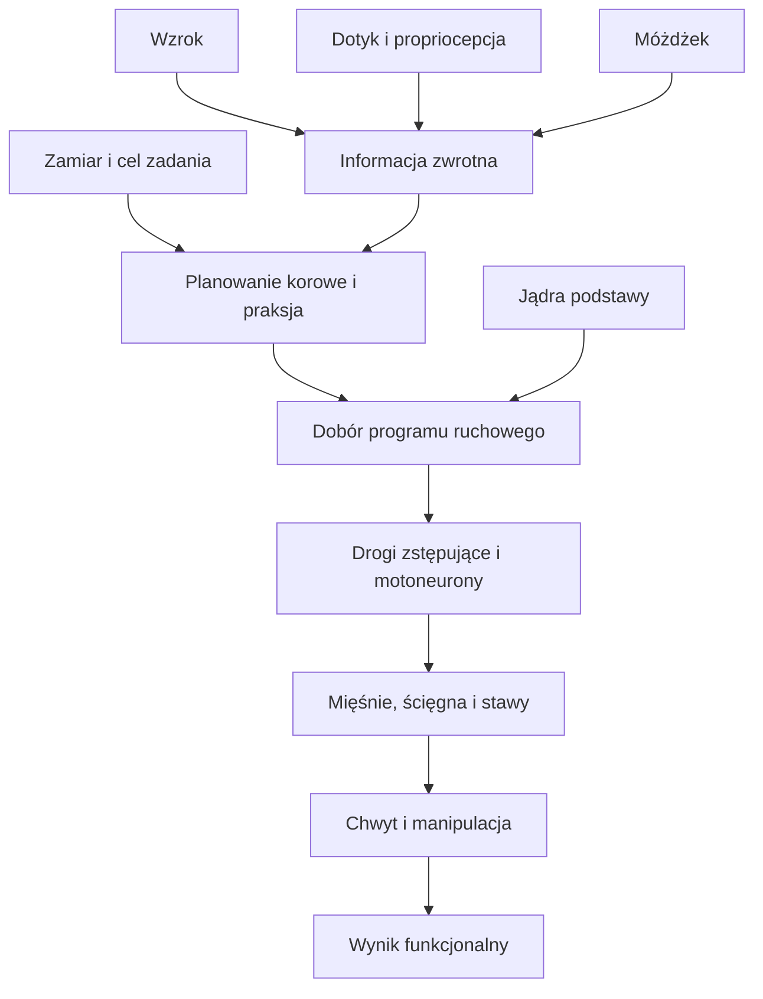
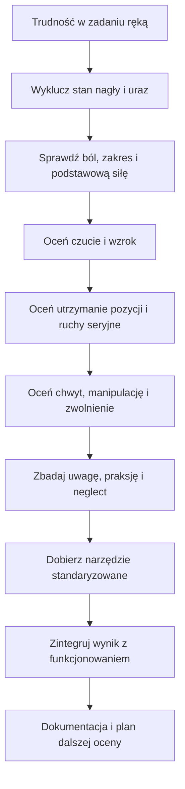
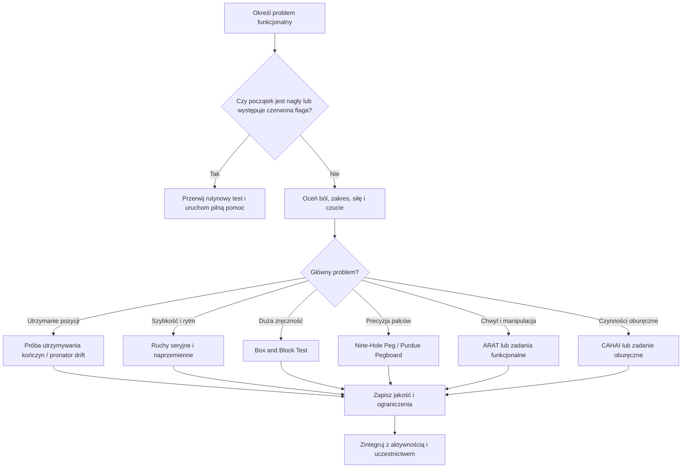

# 4.5. Próby funkcjonalne kończyn górnych

## Wprowadzenie

Próby funkcjonalne kończyn górnych służą ocenie tego, czy pacjent potrafi wykorzystać bark, ramię, przedramię, nadgarstek i rękę do wykonania celowego zadania. Nie ograniczają się do stwierdzenia, że mięsień generuje określoną siłę albo że staw osiąga określony zakres ruchu. Oceniają współdziałanie wielu elementów: inicjacji ruchu, utrzymania pozycji, selektywnej aktywacji mięśni, stabilizacji proksymalnej, kontroli nadgarstka, chwytu, manipulacji, czucia, wzroku, uwagi, planowania i korekty błędu.

W badaniu neurologicznym trzeba rozróżnić trzy poziomy opisu:

1. **Upośledzenie funkcji ciała** – na przykład osłabienie, wzmożone napięcie, zaburzenie czucia lub ograniczona selektywność ruchu.
2. **Ograniczenie aktywności** – na przykład niemożność uniesienia kubka, zapięcia guzika, przeniesienia przedmiotu albo wykonania precyzyjnego chwytu.
3. **Ograniczenie uczestnictwa** – na przykład trudność w pracy, samoobsłudze, prowadzeniu gospodarstwa domowego lub wykonywaniu ról rodzinnych.

Wynik próby funkcjonalnej jest informacją o wykonaniu konkretnego zadania w określonych warunkach. Nie jest samodzielnym rozpoznaniem etiologicznym. Ten sam nieudany chwyt może wynikać z niedowładu, bólu, zaburzenia czucia, ataksji, apraksji, zaniedbywania stronnego, ograniczenia stawowego, zaburzeń widzenia, niezrozumienia polecenia albo nieodpowiedniego przedmiotu.

Rozdział rozwija treści dotyczące siły mięśniowej, napięcia oraz zakresu i jakości ruchu. Nie zastępuje ich ponownym omawianiem. Skupia się na łączeniu tych danych w zadaniach funkcjonalnych, na doborze prób, standaryzacji, interpretacji i dokumentowaniu. W ostrym stanie neurologicznym, zwłaszcza przy nagłym osłabieniu jednej ręki, priorytetem jest pilna ocena medyczna, a nie rozbudowana bateria testów zręczności.

---

## 1. Cele kształcenia i efekty uczenia się

Po ukończeniu rozdziału uczestnik powinien:

1. wyjaśnić, czym różni się badanie funkcjonalne kończyny górnej od izolowanego badania siły, napięcia i zakresu ruchu;
2. przygotować pacjenta i stanowisko do bezpiecznej oceny kończyn górnych;
3. wykonać próbę utrzymywania kończyn i rozpoznać opadanie, pronację, drżenie, kompensacje oraz narastające zmęczenie;
4. odróżnić kliniczną próbę pronator drift od elementu motorycznego skali NIHSS;
5. ocenić szybkie ruchy naprzemienne, stukanie palcami, opozycję kciuka i selektywność ruchów palców;
6. zbadać podstawowe wzorce chwytu i manipulacji przedmiotami;
7. dobrać próbę do pytania klinicznego i możliwości pacjenta;
8. znać zastosowanie oraz ograniczenia ARAT, Box and Block Test, Nine-Hole Peg Test, Purdue Pegboard Test, Jebsen–Taylor Hand Function Test, Wolf Motor Function Test i narzędzi samoopisowych;
9. rozróżnić zaburzenia wynikające z osłabienia, braku kontroli selektywnej, ataksji, zaburzeń czucia, apraksji, zaniedbywania i bólu;
10. rozpoznać czerwone flagi wymagające przerwania badania i pilnej eskalacji;
11. sporządzić opis zawierający stronę, zadanie, warunki, wynik, jakość wykonania, kompensacje i ograniczenia;
12. odnieść wynik do aktywności i uczestnictwa pacjenta, nie wyciągając wniosków wykraczających poza zakres wykonanej próby.

### Efekty praktyczne

Uczestnik powinien umieć przeprowadzić krótką, uporządkowaną ocenę obejmującą utrzymanie kończyn, ruchy seryjne palców, podstawowe chwyty i manipulację bezpiecznym przedmiotem. Powinien także umieć wskazać, kiedy konieczne jest użycie narzędzia standaryzowanego, a kiedy wystarczy opis jakościowy.

---

## 2. Definicje i rozróżnienia terminologiczne

### 2.1. Próba funkcjonalna kończyny górnej

Próba funkcjonalna jest zorganizowanym zadaniem, w którym pacjent wykorzystuje jedną lub obie kończyny górne do osiągnięcia określonego celu. Zadanie może polegać na utrzymaniu pozycji, sięgnięciu, chwyceniu, przeniesieniu, obróceniu, zwolnieniu albo precyzyjnym umieszczeniu przedmiotu.

Wynik powinien obejmować nie tylko informację, czy zadanie wykonano, lecz także:

- czas i liczbę powtórzeń, jeśli przewiduje je protokół;
- dokładność i płynność;
- zakres oraz tor ruchu;
- rodzaj zastosowanego chwytu;
- stabilizację barku i nadgarstka;
- kompensacje tułowiem lub drugą kończyną;
- potrzebę podpowiedzi, demonstracji lub pomocy fizycznej;
- ból, zmęczenie i objawy towarzyszące.

### 2.2. Zdolność wykonania a rzeczywiste używanie kończyny

**Zdolność wykonania** oznacza to, co pacjent potrafi zrobić w warunkach badania, przy określonym poleceniu, przedmiocie i otoczeniu.

**Rzeczywiste używanie kończyny** oznacza, jak pacjent korzysta z niej w codziennym środowisku. Może występować rozbieżność: pacjent potrafi podnieść kubek podczas badania, ale w domu unika używania chorej ręki z powodu lęku, bólu, zmęczenia, przyzwyczajenia lub braku poczucia bezpieczeństwa.

Test wykonaniowy nie powinien być automatycznie utożsamiany z samodzielnością w życiu codziennym.

### 2.3. Zręczność manualna

Zręczność jest zdolnością do sprawnego, celowego i odpowiednio precyzyjnego manipulowania przedmiotami. Obejmuje współpracę palców, kciuka, nadgarstka i stabilizacji proksymalnej. Zręczność zależy od siły, czucia, propriocepcji, koordynacji, uwagi, wzroku, planowania i doświadczenia.

### 2.4. Chwyt siłowy i chwyt precyzyjny

- **Chwyt siłowy** – obejmuje przedmiot dłonią i palcami, zwykle z większym udziałem mięśni długich palców i stabilizacji nadgarstka. Przykładem jest utrzymanie uchwytu kubka lub rękojeści.
- **Chwyt precyzyjny** – wymaga kontrolowanego kontaktu opuszek kciuka i jednego lub kilku palców. Przykładem jest podniesienie monety lub małego elementu.
- **Manipulacja wewnątrzdłoniowa** – przesuwanie i obracanie przedmiotu w obrębie dłoni bez odkładania go na podłoże.
- **Chwyt i zwolnienie** – obejmują nie tylko zamknięcie dłoni, ale także kontrolowane rozluźnienie palców i odłożenie przedmiotu.

### 2.5. Stabilizacja proksymalna i kontrola dystalna

Stabilizacja proksymalna dotyczy kontroli tułowia, łopatki i barku. Kontrola dystalna obejmuje nadgarstek, dłoń i palce. Zaburzenie stabilizacji proksymalnej może pogarszać precyzję ruchów dłoni, nawet gdy same palce mają zachowaną siłę.

### 2.6. Pronator drift

Pronator drift to kliniczna próba wykrywania subtelnego zaburzenia utrzymywania kończyny górnej, często związanego z uszkodzeniem dróg korowo-rdzeniowych. Typowy dodatni wzorzec obejmuje stopniowe opadanie kończyny i pronację przedramienia po przyjęciu pozycji z wyprostowanym łokciem i supinacją.

Wynik nie jest swoisty dla jednej choroby. Należy go zestawić z siłą, czuciem głębokim, koordynacją, odruchami i pozostałymi objawami.

### 2.7. Próba utrzymywania kończyn

Próba utrzymywania kończyn ocenia zdolność zachowania zadanej pozycji przeciw grawitacji przez określony czas. Może ujawniać osłabienie, zaburzenia kontroli posturalnej, męczliwość lub asymetrię. Nie każda wersja tej próby jest równoważna elementowi NIHSS; pozycja, czas, sposób punktacji i kryteria muszą odpowiadać wybranemu protokołowi.

### 2.8. Ruchy naprzemienne i seryjne

Ruchy naprzemienne wymagają szybkiego przełączania kierunku lub wzorca aktywacji. Ruchy seryjne obejmują powtarzanie określonego zadania, na przykład stukania palcem wskazującym o kciuk. Ocenia się tempo, regularność, amplitudę, dokładność, płynność i zmianę parametrów w kolejnych powtórzeniach.

### 2.9. Kompensacja funkcjonalna

Kompensacja jest alternatywną strategią umożliwiającą wykonanie zadania mimo ograniczenia jednej z funkcji. Może być użyteczna w życiu codziennym, ale utrudnia interpretację badania, jeśli nie zostanie opisana.

Przykłady:

- pochylanie tułowia zamiast zwiększenia zasięgu barku;
- unoszenie barku w celu zastąpienia ograniczonego ruchu łopatkowo-ramiennego;
- dociskanie przedmiotu do tułowia zamiast utrzymania go dłonią;
- używanie obu rąk do zadania, które w protokole ma być wykonane jedną ręką;
- przesuwanie przedmiotu po podłożu zamiast jego uniesienia.

---

## 3. Podstawy neuroanatomiczne i neurofizjologiczne

### 3.1. Drogi korowo-rdzeniowe i selektywna kontrola ruchu

Drogi korowo-rdzeniowe, zwłaszcza ich część boczna, mają istotne znaczenie dla precyzyjnych ruchów dystalnych, niezależnych ruchów palców i dostosowywania siły chwytu. Uszkodzenie może prowadzić do niedowładu, utraty selektywności, patologicznych synergii i trudności w szybkim dostosowaniu ruchu.

Nie oznacza to, że każdy deficyt dłoni lokalizuje się w drodze korowo-rdzeniowej. Podobny problem może wynikać z uszkodzenia korzeni, splotu, nerwu obwodowego, mięśni, złącza nerwowo-mięśniowego lub struktur czuciowych.

### 3.2. Kora ruchowa i obszary przedruchowe

Pierwszorzędowa kora ruchowa uczestniczy w wykonaniu ruchu, natomiast obszary przedruchowe i dodatkowe pole ruchowe uczestniczą w przygotowaniu, wyborze i organizacji sekwencji. W zadaniach manualnych ważne są również obszary ciemieniowe, które integrują informację czuciową i wzrokową z planem działania.

### 3.3. Móżdżek

Móżdżek porównuje przewidywany i rzeczywisty przebieg ruchu, wspiera synchronizację, skalowanie siły i korektę błędów. Zaburzenia mogą powodować dysmetrię, drżenie zamiarowe, nieregularność ruchów naprzemiennych, rozpad sekwencji i trudność w dostosowaniu chwytu do masy lub kształtu przedmiotu.

### 3.4. Jądra podstawy

Jądra podstawy uczestniczą w inicjowaniu i doborze programów ruchowych oraz regulacji amplitudy i automatyzacji. W parkinsonizmie mogą występować bradykinezja, zmniejszanie amplitudy ruchów seryjnych, trudności w rozpoczęciu ruchu i ograniczenie automatycznych współruchów.

### 3.5. Drogi czuciowe i propriocepcja

Czucie dotyku, wibracji i ułożenia palców dostarcza informacji potrzebnych do dozowania siły chwytu oraz kontroli przedmiotu bez ciągłego patrzenia na dłoń. Utrata propriocepcji może prowadzić do niepewności ruchu, nadmiernego kontrolowania wzrokiem, błędów chwytu i pogorszenia wykonania po zamknięciu oczu.

### 3.6. Widzenie i uwaga przestrzenna

Widzenie pomaga kierować rękę do celu i monitorować kontakt z przedmiotem. Zaburzenia pola widzenia, podwójne widzenie, zaniedbywanie stronne i ograniczenia uwagi mogą pogarszać wynik prób, mimo względnie zachowanej siły mięśniowej.

### 3.7. Praksja i organizacja czynności celowej

Praksja obejmuje planowanie i wykonywanie wyuczonych, celowych czynności. Pacjent z apraksją może mieć zachowaną siłę i zakres ruchu, ale trudność z wykonaniem gestu na polecenie, użyciem narzędzia lub odtworzeniem sekwencji. Należy odróżnić taki problem od afazji, niezrozumienia polecenia, zaburzeń uwagi, niedowładu i zaburzeń czucia.

### 3.8. Obwodowy układ nerwowy i mięśnie

Ruch ręki wymaga sprawnego przewodzenia w nerwach obwodowych, prawidłowej funkcji mięśni przedramienia i dłoni oraz integralności ścięgien, stawów i tkanek miękkich. Uszkodzenie nerwu pośrodkowego, łokciowego lub promieniowego może powodować charakterystyczne trudności chwytu, opozycji kciuka, odwodzenia palców albo stabilizacji nadgarstka. Wzorzec kliniczny trzeba jednak potwierdzić badaniem czucia, siły i odruchów oraz – gdy wskazane – badaniami neurofizjologicznymi.

### 3.9. Schemat integracji funkcji

Schemat jest uproszczeniem. W rzeczywistości sterowanie ruchem jest rozproszone, równoległe i zależne od zadania.

---

## 4. Pytania kliniczne przed rozpoczęciem badania

Przed wyborem próby należy odpowiedzieć na kilka pytań:

1. Czy objaw pojawił się nagle, narastał stopniowo, czy jest przewlekły?
2. Czy dotyczy jednej, czy obu kończyn?
3. Czy pacjent zgłasza ból, drętwienie, mrowienie, zmęczenie lub utratę sprawności?
4. Czy trudność dotyczy utrzymania pozycji, sięgania, chwytu, manipulacji czy zwalniania przedmiotu?
5. Czy problem występuje w ruchu spontanicznym, na polecenie, czy tylko w określonym zadaniu?
6. Czy pacjent rozumie polecenie i potrafi skupić uwagę?
7. Czy występują zaburzenia widzenia, czucia głębokiego, neglect lub apraksja?
8. Czy ograniczenie wynika z bólu, urazu, operacji lub patologii stawu?
9. Czy pacjent używa kończyny dominującej i czy dominacja była znana przed zachorowaniem?
10. Czy wynik będzie służył przesiewowi, lokalizacji, planowaniu rehabilitacji czy monitorowaniu zmiany?

W przypadku nagłego początku osłabienia, zaburzeń mowy, asymetrii twarzy, zaburzeń widzenia lub nagłej utraty koordynacji należy traktować sytuację jako potencjalny stan nagły. Nie wolno opóźniać uruchomienia procedury udarowej w celu dokończenia testów.

---

## 5. Przygotowanie do badania i bezpieczeństwo

### 5.1. Weryfikacja i zgoda

- Potwierdź tożsamość pacjenta zgodnie z procedurą placówki.
- Wyjaśnij cel, przebieg i możliwe dolegliwości związane z próbami.
- Uzyskaj zgodę na badanie.
- Zapytaj o ból, urazy, operacje, ograniczenia ortopedyczne i zalecenia dotyczące obciążania kończyny.
- Ustal rękę dominującą przed wystąpieniem objawów, jeśli jest to możliwe.
- Zapewnij możliwość przerwania próby na prośbę pacjenta.

### 5.2. Stanowisko

Potrzebne mogą być:

- stabilne krzesło z oparciem;
- stół o odpowiedniej wysokości;
- bezpieczne, lekkie przedmioty o zróżnicowanym kształcie;
- klocki i pojemnik do testu Box and Block;
- zestaw Nine-Hole Peg Test;
- plansza Purdue Pegboard;
- goniometr lub dynamometr, jeśli pytanie kliniczne wymaga pomiaru uzupełniającego;
- stoper;
- formularz dokumentacji;
- środki do higieny rąk i dezynfekcji sprzętu.

Przed użyciem sprawdź stan przedmiotów. Nie używaj ostrych, gorących, ciężkich, kruchych lub łatwych do połknięcia elementów u pacjenta z zaburzeniami czucia, widzenia, świadomości albo kontroli chwytu.

### 5.3. Pozycjonowanie

Podstawowe próby wykonuj zwykle w siadzie z podparciem stóp, stabilnym tułowiem i możliwością swobodnego ruchu kończyn. Jeżeli pacjent nie może bezpiecznie siedzieć, dobierz pozycję leżącą lub półleżącą i zaznacz zmianę warunków. Nie porównuj bez zastrzeżeń wyników uzyskanych w odmiennych pozycjach.

### 5.4. Zasady bezpieczeństwa

Przerwij próbę, jeśli pojawi się:

- nowy lub nasilający się ból;
- nagła utrata siły albo czucia;
- zawroty głowy, zasłabnięcie, duszność lub ból w klatce piersiowej;
- nagłe zaburzenie mowy, widzenia, równowagi lub świadomości;
- gwałtowny wzrost napięcia, bolesny skurcz lub ryzyko urazu;
- niebezpieczne upuszczanie przedmiotów, które może spowodować uraz;
- znaczne zmęczenie uniemożliwiające wiarygodne wykonanie zadania.

Nie stosuj maksymalnego oporu ani gwałtownego rozciągania w próbach funkcjonalnych. Nie zmuszaj pacjenta do wykonania zadania, które przekracza bezpieczny zakres lub narusza ograniczenia pooperacyjne.

---

## 6. Ogólna procedura badania krok po kroku

### Krok 1. Określ cel

Zdecyduj, czy oceniasz utrzymanie pozycji, kontrolę ruchu, chwyt, manipulację, szybkość, zręczność, obustronną współpracę czy czynność dnia codziennego.

### Krok 2. Oceń warunki wstępne

Sprawdź ból, zakres ruchu, podstawową siłę, napięcie, czucie, wzrok i zdolność rozumienia poleceń. Nie powtarzaj całego badania z poprzednich rozdziałów, lecz uwzględnij wyniki, które mogą zmieniać interpretację próby.

### Krok 3. Zademonstruj zadanie

Pokaż czynność, użyj krótkiego polecenia i upewnij się, że pacjent rozumie, co ma zrobić. W afazji lub zaburzeniach poznawczych wykorzystaj demonstrację i komunikację niewerbalną, jeśli jest to możliwe.

### Krok 4. Ustal pozycję i warunki

Zachowaj stabilne podparcie, właściwą odległość od przedmiotu, podobne oświetlenie i taką samą kolejność zadań przy kolejnych pomiarach.

### Krok 5. Oceń każdą stronę

Wykonaj próbę oddzielnie dla prawej i lewej kończyny, chyba że zadanie jest z założenia oburęczne. Zapisz, która ręka jest dominująca.

### Krok 6. Obserwuj jakość

Zwróć uwagę na tor ruchu, płynność, tempo, amplitudę, precyzję, rodzaj chwytu, stabilizację nadgarstka, kompensacje i liczbę korekt.

### Krok 7. Oceń powtarzalność

Jeśli zadanie na to pozwala, powtórz je zgodnie z protokołem. Obserwuj, czy pojawia się decrement amplitudy, męczliwość, ból lub pogorszenie dokładności. Nie zwiększaj liczby prób ponad bezpieczny i przewidziany zakres.

### Krok 8. Zintegruj wynik

Zestaw rezultat z siłą, napięciem, zakresem ruchu, czuciem, koordynacją, funkcjami poznawczymi i wywiadem.

### Krok 9. Udokumentuj

Zapisz zadanie, warunki, stronę, wynik liczbowy, jakość, kompensacje, ograniczenia i potrzebę dalszej diagnostyki.

---

## 7. Próba pronator drift

### 7.1. Cel i znaczenie

Próba służy wykrywaniu subtelnego zaburzenia utrzymywania kończyny górnej. Typowy wzorzec – opadanie z jednoczesną pronacją – może wskazywać na osłabienie kontroli korowo-rdzeniowej po stronie przeciwnej do uszkodzenia ośrodkowego. Nie jest to jednak test rozstrzygający o lokalizacji ani etiologii.

### 7.2. Procedura kliniczna

1. Posadź pacjenta stabilnie, najlepiej z podpartymi stopami.
2. Poproś o wyprostowanie obu kończyn górnych przed siebie na wysokości barków.
3. Ustaw łokcie w wyproście, dłonie w supinacji, palce rozluźnione.
4. Poproś o utrzymanie pozycji i – jeśli pacjent rozumie polecenie oraz jest to bezpieczne – zamknięcie oczu.
5. Obserwuj przez ustalony w lokalnym protokole czas, zwykle kilkanaście do około trzydziestu sekund w przesiewowej próbie klinicznej.
6. Zwróć uwagę na opadanie, pronację, zmianę ustawienia palców, drżenie, asymetrię i kompensacje barkiem lub tułowiem.
7. Porównaj obie strony i sprawdź, czy wynik jest powtarzalny.
8. Jeśli występuje istotna asymetria, zestaw ją z siłą, czuciem głębokim, odruchami i pozostałym badaniem neurologicznym.

### 7.3. Interpretacja

| Obserwacja | Możliwe znaczenie | Co należy sprawdzić |
|---|---|---|
| Opadanie i pronacja jednej kończyny | Możliwy subtelny niedowład ośrodkowy | Siła, odruchy, objawy piramidowe, czucie |
| Opadanie bez wyraźnej pronacji | Osłabienie, ból, męczliwość lub problem mechaniczny | Zakres, ból, siła grup mięśniowych |
| Pronacja bez istotnego opadania | Zaburzenie kontroli lub strategii ruchowej; wynik nieswoisty | Powtarzalność, ustawienie, czucie |
| Nieregularne ruchy palców i nadgarstka | Drżenie, zaburzenie czucia, ataksja lub ruch mimowolny | Próby koordynacji i czucia |
| Pogorszenie po zamknięciu oczu | Możliwy udział propriocepcji lub kontroli wzrokowej | Czucie ułożenia, stabilność postawy |
| Ból ograniczający pozycję | Wynik niewiarygodny dla oceny niedowładu | Badanie bólu i układu mięśniowo-szkieletowego |

### 7.4. Ograniczenia

- Wynik zależy od rozumienia polecenia, uwagi, bólu, zmęczenia i możliwości utrzymania pozycji.
- Zaburzenia czucia głębokiego mogą powodować pogorszenie po zamknięciu oczu.
- Drżenie, dystonia i zaburzenia móżdżkowe mogą utrudniać interpretację.
- Brak driftu nie wyklucza łagodnego niedowładu.
- Wynik dodatni nie określa samodzielnie miejsca ani przyczyny uszkodzenia.

### 7.5. Pronator drift a NIHSS

Element 5a/5b skali NIHSS jest odrębną, ściśle standaryzowaną oceną motoryczną kończyn górnych. W standardowej procedurze pacjent utrzymuje kończynę z dłonią skierowaną ku dołowi przez 10 sekund: w siadzie przy uniesieniu około 90°, a w leżeniu około 45°. Ocenia się opadanie według kategorii NIHSS. Nie należy zastępować tej procedury własną próbą pronator drift ani przenosić punktacji jednej metody na drugą.

W NIHSS należy stosować aktualny oficjalny formularz i instrukcję szkoleniową. Wpisanie wyniku wymaga przeszkolenia i przestrzegania protokołu.

---

## 8. Próby utrzymywania kończyn górnych

### 8.1. Utrzymywanie pozycji z wyprostowanymi kończynami

Pacjent utrzymuje obie kończyny wyciągnięte przed siebie. W zależności od celu badania dłonie mogą być ustawione w supinacji lub pronacji. Badający obserwuje:

- symetrię wysokości kończyn;
- opadanie jednej strony;
- zmianę kąta w stawie łokciowym;
- pronację lub supinację;
- kompensacyjne unoszenie barku;
- drżenie posturalne;
- niestabilność nadgarstka;
- narastanie objawów w czasie.

Nie należy wymuszać pozycji przy bólu barku, niestabilności, świeżym urazie lub ograniczeniach pooperacyjnych.

### 8.2. Utrzymywanie pozycji zgięciowej i wyprostnej

Można ocenić utrzymanie określonego ustawienia łokcia, nadgarstka lub palców. Zadanie powinno być proste i porównywalne po obu stronach. Nie należy interpretować krótkiego utrzymania pozycji jako izolowanego testu wytrzymałości mięśniowej bez uwzględnienia bólu, napięcia, męczliwości i zrozumienia polecenia.

### 8.3. Obserwacja podczas zadania

W czasie utrzymywania pozycji zwróć uwagę, czy pacjent:

- zaczyna prawidłowo, ale stopniowo traci pozycję;
- od początku nie osiąga wymaganego ustawienia;
- utrzymuje pozycję dzięki kompensacji;
- wykonuje niezamierzone ruchy palców;
- ma drżenie, które narasta przy zbliżeniu do celu;
- zgłasza ból lub zmęczenie.

### 8.4. Próby w ostrym udarze

W ostrym podejrzeniu udaru należy używać uznanej skali i lokalnej ścieżki postępowania. Nie wolno opóźniać obrazowania ani leczenia przez wykonywanie dodatkowych testów funkcjonalnych. Wynik badania kończyny górnej powinien być przekazany zespołowi udarowemu razem z czasem początku objawów i innymi deficytami.

---

## 9. Szybkie ruchy naprzemienne i seryjne

### 9.1. Cel

Próby oceniają zdolność szybkiego przełączania aktywacji mięśni i utrzymywania regularnej sekwencji. Są przydatne w ocenie zaburzeń móżdżkowych, parkinsonizmu, osłabienia, zaburzeń czucia i problemów z selektywną kontrolą ruchu.

### 9.2. Naprzemienna pronacja i supinacja

1. Ustaw pacjenta w siadzie, z łokciami zgiętymi i przedramionami przed tułowiem.
2. Zademonstruj naprzemienne obracanie dłoni w górę i w dół.
3. Poproś o wykonanie ruchów obustronnie, a następnie każdą stroną oddzielnie.
4. Zwróć uwagę na rytm, amplitudę, płynność i dokładność.
5. Obserwuj, czy ruchy stają się coraz mniejsze, wolniejsze lub nieregularne.
6. Zapisz, czy pacjent wykonuje zadanie bez kompensacji barkiem i tułowiem.

### 9.3. Szybkie stukanie dłonią

Pacjent naprzemiennie dotyka dłonią powierzchni stołu lub uda. Ocenia się rytm, amplitudę, siłę kontaktu i możliwość utrzymania tempa. Różnica stron może wynikać z osłabienia, bólu, sztywności, zaburzenia koordynacji lub dominacji ręki.

### 9.4. Stukanie palcem wskazującym

Pacjent szybko i powtarzalnie dotyka palcem wskazującym kciuka. Należy ocenić:

- szybkość;
- amplitudę otwierania i zamykania;
- regularność;
- zmniejszanie amplitudy w kolejnych powtórzeniach;
- opóźnienie rozpoczęcia;
- przerwy i zatrzymania;
- asymetrię stron.

Zmniejszanie amplitudy i szybkości w kolejnych ruchach może być elementem bradykinezji, ale wynik trzeba ocenić w kontekście bólu, osłabienia, zrozumienia polecenia, sztywności i innych objawów parkinsonizmu.

### 9.5. Opozycja kciuka do kolejnych palców

Poproś pacjenta o dotykanie kciukiem kolejno opuszki palca wskazującego, środkowego, serdecznego i małego, a następnie o powrót. Obserwuj:

- czy kontakt jest precyzyjny;
- czy kciuk osiąga wszystkie palce;
- czy pojawia się współruch pozostałych palców;
- czy tempo jest regularne;
- czy pacjent gubi kolejność;
- czy występuje ból lub ograniczenie stawu.

### 9.6. Interpretacja prób naprzemiennych

| Wzorzec | Możliwe mechanizmy | Badanie uzupełniające |
|---|---|---|
| Ruch wolny, ale regularny | Osłabienie, ból, ostrożność, bradykinezja | Siła, ból, inne ruchy seryjne |
| Nieregularny rytm i amplituda | Ataksja, zaburzenia czucia, ból | Próby móżdżkowe i czucie głębokie |
| Decrement amplitudy | Bradykinezja, męczliwość lub ograniczenie mechaniczne | Powtórne próby, sztywność, siła |
| Trudność w zmianie kierunku | Zaburzenie koordynacji lub selektywności | Inne zadania naprzemienne |
| Ruchy zastępcze barkiem | Osłabienie lub ograniczenie kontroli dystalnej | Stabilizacja proksymalna, siła i zakres |
| Gubienie kolejności palców | Problem praksji, uwagi, czucia lub rozumienia | Demonstracja, gesty naśladowcze, badanie poznawcze |

Próby koordynacyjne opisane szerzej w rozdziale 4.4 pozostają podstawą analizy dysmetrii i dysdiadochokinezy. W tym rozdziale są wykorzystywane jako element oceny funkcjonalnego użycia ręki.

---

## 10. Chwyt i manipulacja

### 10.1. Zasada badania

Oceniaj zarówno samo przyjęcie chwytu, jak i utrzymanie, przeniesienie oraz zwolnienie przedmiotu. Zwróć uwagę, czy pacjent dobiera rodzaj chwytu do kształtu, wielkości i masy przedmiotu. Używaj przedmiotów bezpiecznych, czystych i dostosowanych do możliwości pacjenta.

### 10.2. Podstawowe wzorce chwytu

| Rodzaj chwytu | Przykład zadania | Co obserwować |
|---|---|---|
| Chwyt cylindryczny | Utrzymanie kubka lub walca | Obejmowanie dłonią, stabilizacja kciuka |
| Chwyt kulisty | Utrzymanie piłki | Rozstaw palców, dopasowanie do kształtu |
| Chwyt hakowy | Utrzymanie uchwytu torby | Zgięcie palców, udział kciuka |
| Chwyt boczny / kluczowy | Utrzymanie klucza lub karty | Docisk bocznej powierzchni kciuka |
| Chwyt opuszkowy | Podniesienie małego elementu | Precyzja kontaktu kciuka i palca |
| Chwyt trójpunktowy | Utrzymanie ołówka lub małego przedmiotu | Współpraca kciuka, wskaziciela i palca środkowego |
| Chwyt dłoniowy | Utrzymanie większego przedmiotu | Stabilność dłoni i nadgarstka |

### 10.3. Chwyt siłowy

W próbie chwytu siłowego pacjent obejmuje przedmiot o bezpiecznej wielkości i utrzymuje go przez krótki czas. Badający obserwuje:

- czy palce obejmują przedmiot równomiernie;
- czy kciuk stabilizuje chwyt;
- czy nadgarstek pozostaje w funkcjonalnym ustawieniu;
- czy przedmiot się wysuwa;
- czy pacjent używa drugiej ręki lub tułowia;
- czy występuje ból, drżenie albo męczliwość.

Jeśli celem jest ilościowy pomiar siły chwytu, należy zastosować dynamometr i protokół opisany w rozdziale 4.2. Próba funkcjonalna nie zastępuje pomiaru dynamometrycznego.

### 10.4. Chwyt precyzyjny

Wykorzystaj mały, lecz bezpieczny przedmiot, na przykład duży żeton lub lekki klocek. Poproś o podniesienie go opuszkami kciuka i palca wskazującego. Następnie można ocenić chwyt trójpunktowy. Obserwuj, czy pacjent:

- potrafi ustawić kciuk naprzeciw palca;
- uzyskuje stabilny kontakt opuszek;
- nie zgniata nadmiernie przedmiotu;
- nie używa bocznej powierzchni palców zamiast opuszek;
- potrafi utrzymać i kontrolowanie zwolnić przedmiot.

### 10.5. Manipulacja wewnątrzdłoniowa

Można poprosić pacjenta o przesunięcie żetonu z dłoni do opuszek, obrócenie go albo zmianę orientacji bez pomocy drugiej ręki. Trudność może wynikać z zaburzenia niezależności palców, czucia, koordynacji, siły mięśni wewnętrznych dłoni lub planowania ruchu.

### 10.6. Zwolnienie przedmiotu

Kontrolowane zwolnienie jest równie ważne jak chwyt. Obserwuj:

- opóźnienie rozluźnienia palców;
- nagłe upuszczenie;
- niemożność otwarcia dłoni;
- współruchy i nadmierne napięcie;
- potrzebę pomocy drugiej ręki;
- trudność w precyzyjnym odłożeniu przedmiotu.

Nie przypisuj opóźnionego zwolnienia jednemu mechanizmowi bez oceny napięcia, bólu, zakresu, siły, czucia i rozumienia zadania.

---

## 11. Próby palcowe i precyzja ruchu

### 11.1. Niezależność ruchów palców

Poproś pacjenta o kolejno:

1. wyprostowanie wszystkich palców;
2. zgięcie i wyprost palca wskazującego;
3. uniesienie palca wskazującego przy pozostałych palcach rozluźnionych;
4. odwodzenie i przywodzenie palców;
5. dotknięcie kciukiem kolejnych palców;
6. utrzymanie wybranego palca w pozycji przy stabilnych pozostałych palcach.

Oceniaj ruchy mimowolne, współruchy, ograniczenie selektywności i zdolność utrzymania pozycji. Nie wymuszaj ruchu w bolesnym stawie.

### 11.2. Objaw palca uciekającego

Przy próbie utrzymania wyprostowanych i złączonych palców można zaobserwować stopniowe odwodzenie i zgięcie palca małego lub innych palców. Objaw może towarzyszyć zaburzeniom dróg korowo-rdzeniowych, ale nie jest samodzielnym testem rozpoznawczym. Należy uwzględnić ból, deformacje, neuropatię łokciową i wcześniejsze uszkodzenia dłoni.

### 11.3. Próby precyzyjnego celowania

Można poprosić o dotknięcie kolejno określonych punktów na stole, podniesienie żetonu, umieszczenie go w pojemniku lub dotknięcie określonego palca. Ocenia się dokładność, liczbę korekt, czas, drżenie zamiarowe, wzrokowe monitorowanie i kompensacje.

### 11.4. Próby pisania i rysowania

Poproś pacjenta o napisanie krótkiego zdania, podpisu albo narysowanie prostego kształtu, jeżeli jest to adekwatne do wykształcenia, języka, wzroku i możliwości poznawczych. Zwróć uwagę na chwyt narzędzia, stabilizację nadgarstka, płynność, wielkość pisma, drżenie i męczliwość.

Nie oceniaj zdolności językowych na podstawie samego pisma bez uwzględnienia afazji, edukacji, znajomości alfabetu, zaburzeń widzenia i stanu kończyny.

---

## 12. Ocena manipulacji przedmiotami w zadaniach codziennych

### 12.1. Dobór zadań

Wybierz zadania bliskie codziennym potrzebom pacjenta. Przykłady:

- podniesienie i odłożenie kubka;
- przeniesienie lekkiego przedmiotu z półki na stół;
- obrócenie klucza w zamku treningowym;
- podniesienie monety lub żetonu;
- przesunięcie karty;
- otwarcie i zamknięcie lekkiego pojemnika;
- zapięcie dużego guzika;
- przesunięcie suwaka;
- użycie łyżki;
- zapisanie krótkiego wyrazu;
- obsługa dużego przycisku telefonu;
- przytrzymanie kartki jedną ręką i wykonanie zadania drugą.

Wybór musi odpowiadać bezpieczeństwu, możliwościom pacjenta i celowi badania. Nie należy używać gorącego płynu, ostrego narzędzia ani szkła u osoby z zaburzeniami czucia, kontroli lub uwagi.

### 12.2. Obserwacja zadania

Zapisz:

- czy pacjent rozumie cel;
- czy sam rozpoczyna czynność;
- czy potrafi dobrać chwyt;
- czy osiąga przedmiot;
- czy stabilizuje go podczas manipulacji;
- czy używa jednej czy obu rąk;
- czy wykonuje zadanie w odpowiedniej kolejności;
- czy kończy zadanie i odkłada przedmiot;
- czy występują błędy, upuszczenia lub kompensacje;
- czy potrzebuje wskazówki, demonstracji albo pomocy.

### 12.3. Zadania oburęczne

W wielu czynnościach jedna ręka stabilizuje, a druga manipuluje. Przykładem jest otwieranie pojemnika, składanie kartki lub zapinanie odzieży. Oceniaj rolę obu kończyn, a nie tylko ręki wykonującej główny ruch.

Asymetria funkcji może być widoczna dopiero w zadaniu oburęcznym. Nie oznacza to automatycznie, że kończyna pomocnicza jest neurologicznie prawidłowa.

### 12.4. Wpływ kontekstu

Wynik zadania zależy od:

- wielkości i masy przedmiotu;
- faktury i tarcia powierzchni;
- wysokości i odległości;
- oświetlenia;
- hałasu i rozproszeń;
- znajomości zadania;
- motywacji, lęku i zmęczenia;
- dominacji ręki;
- dostępności okularów lub innych pomocy.

Dlatego w ocenie seryjnej należy zachować podobne warunki i opisać każdą istotną zmianę.

---

## 13. Standaryzowane narzędzia oceny funkcji kończyny górnej

Narzędzia standaryzowane pomagają zwiększyć porównywalność wyników, ale każde mierzy nieco inny konstrukt. Nie należy traktować ich jako wymiennych ani samodzielnie zmieniać instrukcji, punktacji lub wyposażenia. Przed zastosowaniem należy sprawdzić aktualny podręcznik, wersję językową, wymagania szkoleniowe i warunki licencyjne.

### 13.1. Action Research Arm Test (ARAT)

ARAT jest obserwacyjnym testem aktywności kończyny górnej, szczególnie wykorzystywanym po udarze. Obejmuje zadania z czterech obszarów:

- chwytanie;
- utrzymywanie i przenoszenie przedmiotów;
- chwyt precyzyjny;
- ruchy złożone kończyny górnej.

Klasyczna wersja zawiera 19 pozycji, ocenianych w skali 0–3; maksymalny wynik wynosi 57 punktów. Wyższy wynik oznacza lepszą zdolność wykonania zadań. Szczegółowe kryteria oceny, wyposażenie i kolejność należy zaczerpnąć z oficjalnego podręcznika, a nie odtwarzać z pamięci.

**Interpretacja:**

- wynik całkowity przedstawia ogólną zdolność wykonania zadań objętych testem;
- wynik podskal może pomóc wskazać obszar trudności;
- wynik bliski maksimum może nie ujawniać subtelnych ograniczeń;
- wynik bardzo niski może ograniczać możliwość wykrycia niewielkiej poprawy;
- ból, zaburzenia czucia, afazja, apraksja, neglect i spastyczność mogą wpływać na wykonanie.

Przeglądy psychometryczne wskazują, że ARAT jest użytecznym narzędziem oceny ograniczeń aktywności po udarze, lecz jakość dowodów dla części właściwości pomiarowych, zwłaszcza w grupach ze spastycznością, pozostaje ograniczona. Należy więc interpretować zmianę wyniku razem z obrazem klinicznym i innymi miarami.

### 13.2. Box and Block Test (BBT)

BBT ocenia przede wszystkim dużą zręczność manualną. Pacjent przenosi pojedyncze klocki przez przegrodę z jednej części skrzynki do drugiej w określonym czasie, zgodnie z protokołem testu.

Najczęściej stosuje się próbę jednominutową dla każdej ręki. Wynik stanowi liczba prawidłowo przeniesionych klocków. Klocki należy przenosić pojedynczo; sposób liczenia i postępowanie przy upuszczeniu muszą być zgodne z instrukcją danego zestawu.

**Ocenia się:**

- szybkość dużej manipulacji;
- zdolność chwytu i zwolnienia;
- powtarzalność ruchu;
- różnicę między stronami.

BBT nie ocenia w pełni precyzyjnej manipulacji małymi elementami ani wszystkich czynności dnia codziennego. Wynik zależy od wieku, dominacji ręki, wzroku, czucia, siły i doświadczenia.

### 13.3. Nine-Hole Peg Test (NHPT)

NHPT jest testem zręczności palców. Pacjent umieszcza dziewięć kołeczków w otworach, a następnie wyjmuje je zgodnie z instrukcją. Wynik zwykle wyraża się czasem wykonania zadania. Jeśli pacjent nie jest w stanie ukończyć testu, należy postąpić zgodnie z podręcznikiem i odnotować nieukończenie; nie należy wpisywać arbitralnego czasu ani traktować braku ukończenia jako zera sekund.

Test jest szeroko wykorzystywany między innymi w stwardnieniu rozsianym. Jest czuły na zaburzenia zręczności, lecz wynik zależy również od czucia, wzroku, siły, bólu, uwagi i zrozumienia zadania. Zmiana procentowa bywa stosowana w badaniach nad stwardnieniem rozsianym, ale nie jest uniwersalnym progiem klinicznym dla każdej populacji i każdego celu.

### 13.4. Purdue Pegboard Test

Purdue Pegboard służy do oceny zręczności palców i koordynacji, w tym zadań jedno- i oburęcznych. W zależności od wersji obejmuje umieszczanie małych elementów w otworach oraz składanie prostych zestawów. Wymaga zachowania instrukcji, kolejności, czasu i wyposażenia określonego w podręczniku.

Wynik może zależeć od doświadczenia manualnego, wieku, edukacji, wzroku i dominacji ręki. Nie należy porównywać wyników z różnych wersji zestawu bez sprawdzenia ich równoważności.

### 13.5. Jebsen–Taylor Hand Function Test

Jebsen–Taylor obejmuje zestaw zadań symulujących wybrane czynności ręki, na przykład manipulowanie przedmiotami, pisanie i przenoszenie elementów. Zwykle mierzy się czas wykonania poszczególnych zadań. Test pozwala ocenić szybkość funkcjonalnego używania ręki, ale nie zastępuje wywiadu o rzeczywistym funkcjonowaniu w środowisku pacjenta.

### 13.6. Wolf Motor Function Test (WMFT)

WMFT służy do oceny zdolności wykonywania zadań ruchowych kończyną górną, często w badaniach i rehabilitacji poudarowej. Zależnie od wersji ocenia się czas wykonania oraz jakość ruchu. Wymaga standaryzowanego zestawu zadań, pozycji i sposobu punktacji.

### 13.7. Fugl-Meyer Assessment – część kończyny górnej

FMA-UE ocenia przede wszystkim zaburzenia motoryczne po uszkodzeniu ośrodkowego układu nerwowego, w tym zdolność wykonywania ruchów w synergiach i poza nimi, selektywność, koordynację oraz odruchy w zakresie określonym protokołem. Jest narzędziem oceny upośledzenia funkcji ciała, a nie prostym testem aktywności ręki. Nie należy utożsamiać wyniku FMA-UE z wynikiem ARAT lub BBT.

### 13.8. Chedoke Arm and Hand Activity Inventory (CAHAI)

CAHAI koncentruje się na czynnościach wykonywanych oburęcznie po udarze. Jest przydatny, gdy ważne jest współdziałanie kończyn w zadaniach codziennych. Należy stosować odpowiednią wersję i jej podręcznik.

### 13.9. ABILHAND i Motor Activity Log

Są to narzędzia uwzględniające perspektywę pacjenta. ABILHAND dotyczy postrzeganej trudności w wykonywaniu czynności manualnych, a Motor Activity Log – między innymi ilości i jakości używania kończyny w codziennych zadaniach. Wynik samoopisowy nie jest równoważny obserwacji wykonania w gabinecie, ale dostarcza informacji o funkcjonowaniu poza warunkami testowymi.

### 13.10. Porównanie narzędzi

| Narzędzie | Główny konstrukt | Typ wyniku | Główne ograniczenie |
|---|---|---|---|
| ARAT | Aktywność kończyny górnej – chwyt, manipulacja, ruchy złożone | Punktacja 0–57 | Efekt podłogi i sufitu; wpływ wielu funkcji |
| BBT | Duża zręczność manualna | Liczba klocków w czasie | Ograniczona ocena precyzyjnej manipulacji |
| NHPT | Zręczność palców | Czas wykonania | Wpływ wzroku, czucia i siły |
| Purdue Pegboard | Zręczność palców i koordynacja oburęczna | Liczba elementów / wynik według protokołu | Wpływ doświadczenia i wersji testu |
| Jebsen–Taylor | Zadania ręki zbliżone do czynności codziennych | Czas zadań | Zależność od wyposażenia i standaryzacji |
| WMFT | Zdolność ruchowa kończyny górnej | Czas i jakość | Wymaga szkolenia i określonego protokołu |
| FMA-UE | Upośledzenie motoryczne po uszkodzeniu OUN | Punktacja pozycji | Nie jest bezpośrednią miarą aktywności |
| CAHAI | Czynności oburęczne | Punktacja zadaniowa | Wymaga standaryzowanego zestawu |
| ABILHAND | Postrzegana zdolność manualna | Kwestionariusz | Zależność od samooceny i kontekstu |
| Motor Activity Log | Rzeczywiste używanie kończyny w codzienności – według relacji pacjenta | Wywiad / skala | Pamięć, wgląd i subiektywność |

### 13.11. Dobór narzędzia do pytania klinicznego

- Gdy potrzebna jest ocena dużej zręczności – rozważ BBT.
- Gdy istotna jest precyzja palców – rozważ NHPT lub Purdue Pegboard.
- Gdy chcesz ocenić różne typy chwytu i manipulacji – rozważ ARAT.
- Gdy ważna jest jakość i czas wykonywania zadań – rozważ WMFT.
- Gdy oceniasz zaburzenia motoryczne po udarze, w tym synergie – rozważ FMA-UE.
- Gdy problem dotyczy czynności oburęcznych – rozważ CAHAI.
- Gdy chcesz poznać trudności zgłaszane w domu – rozważ ABILHAND lub Motor Activity Log.

Dobór powinien wynikać z celu badania, populacji, dostępności walidowanej wersji, kwalifikacji badającego i możliwości pacjenta. Nie należy stosować wielu testów tylko po to, aby zwiększyć liczbę wyników.

---

## 14. Interpretacja wzorców klinicznych

### 14.1. Wzorzec niedowładowy

Może występować trudność w utrzymaniu kończyny, osłabiony chwyt, niemożność uniesienia przedmiotu lub szybkie opadanie kończyny. Należy ocenić siłę w poszczególnych grupach mięśniowych, rozkład osłabienia, napięcie, odruchy, czucie i objawy nerwów czaszkowych.

### 14.2. Wzorzec piramidowy

Może obejmować pronator drift, osłabienie ruchów selektywnych, współruchy, ograniczenie niezależności palców i wzmożone odruchy. Wniosek wymaga zgodności kilku objawów, a nie pojedynczej próby.

### 14.3. Wzorzec móżdżkowy

Może występować dysmetria, nieregularność ruchów naprzemiennych, drżenie zamiarowe i wielokrotne korekty toru. Trzeba uwzględnić zaburzenia czucia głębokiego, wzroku, siły i bólu.

### 14.4. Wzorzec parkinsonowski

Może występować opóźnienie inicjacji, zmniejszanie amplitudy w ruchach seryjnych, spowolnienie, sztywność i ograniczenie automatycznych współruchów. Samo wolne wykonywanie zadania nie wystarcza do rozpoznania bradykinezji.

### 14.5. Wzorzec czuciowy

Pacjent może mieć zachowaną siłę, ale gorszą precyzję chwytu, niepewność po zamknięciu oczu, nadmierne patrzenie na dłoń i trudność w manipulacji małymi przedmiotami. Należy zbadać czucie dotyku, wibracji i ułożenia.

### 14.6. Wzorzec obwodowy

Trudność może odpowiadać obszarowi unerwienia określonego nerwu, korzenia lub splotu. Należy zestawić osłabienie mięśni, zanik, fascykulacje, czucie i odruchy. Próba funkcjonalna może ujawnić problem, ale nie lokalizuje samodzielnie uszkodzenia.

### 14.7. Wzorzec bólowy lub mechaniczny

Pacjent może unikać chwytu, skracać ruch, kompensować tułowiem albo zwalniać z obawy przed bólem. W takim przypadku wynik testu nie jest czystą miarą funkcji neurologicznej. Trzeba odnotować ból i zbadać układ mięśniowo-szkieletowy.

### 14.8. Apraksja

Pacjent może mieć trudność z wykonaniem gestu na polecenie lub użyciem przedmiotu mimo względnie zachowanej siły i zakresu. Należy porównać wykonanie na polecenie, naśladowanie i użycie przedmiotu w kontekście, z uwzględnieniem rozumienia języka i funkcji poznawczych.

### 14.9. Zaniedbywanie stronne

Pacjent może pomijać jedną stronę przestrzeni lub ciała, nie kierować ręki do przedmiotu po stronie zaniedbywanej albo nie uwzględniać jej w zadaniu oburęcznym. Należy wykonać odpowiednią ocenę uwagi przestrzennej, a nie przypisywać wyniku wyłącznie niedowładowi.

### 14.10. Schemat różnicowania

Schemat nie zastępuje rozpoznania. W razie czerwonej flagi należy przerwać rutynową ścieżkę badania i wdrożyć odpowiednie postępowanie.

---

## 15. Normy, rzetelność i ograniczenia

### 15.1. Brak jednej uniwersalnej normy

Wyniki testów funkcjonalnych zależą od wieku, płci, dominacji ręki, wykształcenia, doświadczenia manualnego, wzroku, czucia, siły, bólu, chorób współistniejących i warunków badania. Wartości referencyjne muszą pochodzić z populacji porównywalnej z badanym pacjentem.

### 15.2. Rzetelność

Na rzetelność wpływają:

- przeszkolenie badającego;
- jednoznaczne instrukcje;
- ten sam zestaw i stan wyposażenia;
- stała pozycja pacjenta;
- kolejność prób;
- czas odpoczynku;
- sposób liczenia i punktowania;
- ograniczenie podpowiedzi i pomocy;
- podobne warunki środowiskowe.

### 15.3. Trafność

Narzędzie powinno mierzyć funkcję, którą deklaruje mierzyć. BBT ocenia przede wszystkim dużą zręczność, NHPT – precyzyjną zręczność palców, a ARAT – szerszy zakres zadań chwytania i manipulacji. Nie należy uznawać wyniku jednego testu za pełną ocenę funkcji kończyny górnej.

### 15.4. Czułość na zmianę i błąd pomiaru

Zmiana wyniku może wynikać z rzeczywistej poprawy, ale także z uczenia się testu, zmiany strategii, różnic w motywacji, zmęczenia lub warunków. Interpretując zmianę, należy znać błąd pomiaru i – jeśli dostępne – minimalną wykrywalną lub klinicznie istotną zmianę dla danej populacji i wersji narzędzia.

### 15.5. Efekt podłogi i sufitu

Efekt podłogi występuje, gdy pacjent ma tak duże ograniczenie, że test nie pozwala odróżnić stopnia ciężkości. Efekt sufitu pojawia się, gdy test jest zbyt łatwy dla pacjenta i nie ujawnia subtelnych deficytów. W takich sytuacjach trzeba dobrać inne narzędzie lub uzupełnić wynik jakościowym opisem.

### 15.6. Ograniczenia wynikające ze współchorobowości

Ból stawów, neuropatia, artroza, zaburzenia widzenia, afazja, otępienie, depresja, zmęczenie i zaburzenia słuchu mogą wpływać na wynik. Nie należy automatycznie interpretować niższego wyniku jako pogorszenia uszkodzenia neurologicznego.

---

## 16. Diagnostyka różnicowa i badania uzupełniające

### 16.1. Możliwe źródła ograniczenia

| Obszar | Przykładowe przyczyny | Co ocenić |
|---|---|---|
| Ośrodkowy układ nerwowy | Udar, uraz mózgu, stwardnienie rozsiane, choroby neurodegeneracyjne | Objawy ogniskowe, napięcie, odruchy, koordynacja |
| Korzenie i sploty | Radikulopatia, uszkodzenie splotu ramiennego | Miotomy, dermatomy, ból korzeniowy |
| Nerwy obwodowe | Neuropatia pośrodkowa, łokciowa, promieniowa | Rozkład osłabienia i zaburzeń czucia |
| Mięśnie i złącze | Miopatie, miastenia, męczliwość | Wzorzec osłabienia, zmienność, objawy opuszkowe |
| Stawy i ścięgna | Artroza, zapalenie, uszkodzenie ścięgna | Ból, obrzęk, zakres bierny i czynny |
| Czucie | Neuropatia czuciowa, uszkodzenie sznurów tylnych | Propriocepcja, wibracja, dotyk |
| Funkcje poznawcze | Apraksja, neglect, zaburzenia uwagi | Gesty, naśladowanie, uwaga przestrzenna |
| Czynniki ogólne | Zmęczenie, infekcja, zaburzenia metaboliczne, leki | Wywiad, stan ogólny, badania według wskazań |

### 16.2. Badania dodatkowe

W zależności od hipotezy klinicznej lekarz może rozważyć:

- MRI lub CT mózgowia;
- obrazowanie kręgosłupa szyjnego;
- USG tkanek miękkich lub stawów;
- RTG w urazach i wybranych patologiach stawowych;
- badania przewodnictwa nerwowego i EMG;
- badania laboratoryjne w kierunku przyczyn metabolicznych, zapalnych lub miopatycznych;
- ocenę neuropsychologiczną;
- ocenę terapii zajęciowej i funkcjonowania w środowisku.

Badania dodatkowe dobiera się do obrazu klinicznego. Nie należy zamawiać ich automatycznie na podstawie jednego słabego wyniku testu funkcjonalnego.

---

## 17. Czerwone flagi i sytuacje wymagające pilnej reakcji

### 17.1. Podejrzenie udaru lub przemijającego ataku niedokrwiennego

Nagłe osłabienie ręki, asymetria twarzy, zaburzenia mowy, widzenia, równowagi lub nagła utrata koordynacji wymagają natychmiastowego uruchomienia odpowiedniej ścieżki pomocy. Zanotuj czas, kiedy pacjent był ostatnio bez objawów, jeśli jest to możliwe. Nie opóźniaj wezwania pomocy przez wykonywanie testów zręczności.

### 17.2. Ostre niedokrwienie kończyny

Nagły silny ból, bladość, ochłodzenie, zaburzenia czucia, osłabienie lub brak wyczuwalnego tętna obwodowego mogą wskazywać na ostre niedokrwienie. Wymaga to pilnej oceny medycznej.

### 17.3. Zespół ciasnoty przedziałów powięziowych

Nasilający się ból, ból przy biernym rozciąganiu, napięty obrzęk i zaburzenia czucia po urazie lub reperfuzji wymagają pilnej oceny. Nie wykonuj forsownych prób chwytu ani oporu.

### 17.4. Uraz, złamanie lub uszkodzenie ścięgna

Deformacja, nagły ból, krwiak, obrzęk, utrata funkcji po urazie lub niemożność wykonania określonego ruchu wymagają oceny urazowej. Nie próbuj wymuszać chwytu ani zakresu ruchu.

### 17.5. Ostry stan zapalny lub zakażenie

Gorący, obrzęknięty, zaczerwieniony i bardzo bolesny staw, zwłaszcza z gorączką lub złym stanem ogólnym, wymaga pilnej konsultacji. Nie wykonuj powtarzanych prób manipulacji.

### 17.6. Postępujące osłabienie i objawy opuszkowe

Szybko narastające osłabienie, trudności w połykaniu, mówieniu lub oddychaniu wymagają pilnej oceny. Nie ograniczaj postępowania do badania ręki.

### 17.7. Nagłe pogorszenie podczas badania

W przypadku nagłej zmiany neurologicznej, zasłabnięcia, duszności lub bólu w klatce piersiowej przerwij badanie, zabezpiecz pacjenta i uruchom procedurę ratunkową właściwą dla placówki.

---

## 18. Dokumentowanie wyników

### 18.1. Minimalny zakres wpisu

W dokumentacji powinny znaleźć się:

- data i godzina;
- cel badania;
- pozycja i warunki;
- ręka dominująca;
- strona oceniana;
- nazwa próby lub testu;
- wersja narzędzia i protokół, jeśli dotyczy;
- wynik liczbowy;
- opis jakości ruchu;
- kompensacje i pomoc;
- ból, zmęczenie i ograniczenia;
- wniosek opisowy;
- wskazania do dalszej oceny.

### 18.2. Przykład opisu prawidłowego

„Kończyny górne utrzymywane symetrycznie w pozycji wyprostowanej przed tułowiem bez widocznego opadania i pronacji. Ruchy naprzemienne przedramion regularne, o zbliżonej amplitudzie i tempie po obu stronach. Opozycja kciuka do kolejnych palców wykonana obustronnie, bez istotnych współruchów. Pacjent podnosi, przenosi i odkłada lekki przedmiot chwytem cylindrycznym oraz precyzyjnym bez upuszczania i bez widocznych kompensacji. Badanie nie wykazuje istotnej asymetrii w zastosowanych próbach; nie stanowi pełnej oceny wszystkich aspektów funkcji ręki.”

### 18.3. Przykład opisu nieprawidłowego

„Podczas próby utrzymywania kończyn górnych prawa kończyna stopniowo opada i ulega pronacji. W próbie stukania palcem wskazującym o kciuk po stronie prawej widoczne zmniejszanie amplitudy i zwalnianie w kolejnych powtórzeniach. Chwyt precyzyjny prawą ręką wolniejszy, z kilkoma korektami ustawienia kciuka. Bez istotnego bólu podczas prób. Wynik wskazuje na asymetrię funkcjonalną kończyny prawej; wymaga korelacji z badaniem siły, odruchów, czucia, napięcia i pozostałymi objawami neurologicznymi.”

### 18.4. Przykład wyniku ograniczonego przez ból

„Próby chwytu i manipulacji prawą ręką ograniczone przez ból nadgarstka zgłaszany przez pacjenta. Nie uzyskano wiarygodnej oceny maksymalnej zdolności chwytu ani szybkości manipulacji. Wynik oznaczono jako ograniczony bólem; nie interpretowano go jako izolowanego deficytu neurologicznego.”

### 18.5. Przykład wyniku testu standaryzowanego

„ARAT: prawa kończyna – wynik 31/57, lewa – 56/57, zgodnie z zastosowaną wersją podręcznika. W prawej kończynie największe trudności w zadaniach chwytu precyzyjnego i przenoszenia. Test wykonano w siadzie, bez pomocy fizycznej; odnotowano spowolnienie i kompensacyjne unoszenie barku. Wynik interpretować łącznie z oceną siły, czucia, napięcia i funkcjonowania w domu.”

Przykład jest ilustracyjny. Nie stanowi normy ani podstawy do przypisania rozpoznania.

---

## 19. Przypadki kliniczne

### Przypadek 1. Subtelny niedowład kończyny górnej

Pacjent zgłasza nagłe osłabienie prawej ręki. W próbie utrzymywania kończyn prawa ręka opada i ulega pronacji. Występuje również asymetria mimiki i trudność w wypowiadaniu słów.

**Interpretacja:** podejrzenie ostrego udaru. Należy natychmiast uruchomić ścieżkę udarową, zanotować czas początku lub ostatniego stanu bez objawów, zabezpieczyć pacjenta i nie opóźniać diagnostyki przez testy zręczności.

### Przypadek 2. Zaburzenie precyzyjnego chwytu po udarze

Pacjent potrafi unieść rękę i utrzymać większy przedmiot, ale nie może podnieść monety opuszkami palców. Występują współruchy i trudność niezależnego prostowania palców.

**Interpretacja:** należy ocenić selektywną kontrolę dystalną, czucie, zakres, napięcie i praksję. Do oceny aktywności można dobrać ARAT, a do zręczności palców NHPT, jeżeli pacjent jest w stanie wykonać zadanie.

### Przypadek 3. Pogorszenie zręczności w stwardnieniu rozsianym

Pacjent zgłasza, że zapinanie guzików trwa dłużej. W NHPT czas wykonania jest wydłużony w porównaniu z poprzednią oceną. Pacjent zgłasza także zmęczenie i parestezje.

**Interpretacja:** wynik może odzwierciedlać pogorszenie zręczności, ale należy uwzględnić temperaturę, zmęczenie, czucie, wzrok, ból i warunki testu. Porównanie ma sens tylko przy zachowaniu tego samego protokołu.

### Przypadek 4. Decrement w ruchach seryjnych

Pacjent wykonuje stukanie palcem wskazującym o kciuk coraz wolniej i z mniejszą amplitudą. Obecna jest sztywność i ograniczenie automatycznych ruchów ręki podczas chodu.

**Interpretacja:** możliwy wzorzec bradykinetyczny. Należy ocenić pozostałe cechy parkinsonizmu i nie stawiać rozpoznania na podstawie pojedynczej próby.

### Przypadek 5. Ataksja kończyny górnej

Pacjent chwyta kubek, ale wielokrotnie koryguje tor ręki, a przy zbliżaniu do celu pojawia się drżenie zamiarowe. Występuje także nieregularność ruchów naprzemiennych.

**Interpretacja:** należy rozważyć zaburzenie koordynacji móżdżkowej, ale sprawdzić czucie głębokie, wzrok, siłę i inne objawy. Nagły początek wymaga pilnej oceny w kierunku udaru móżdżku lub pnia mózgu.

### Przypadek 6. Zaburzenie czucia i manipulacji

Pacjent ma trudność z rozpoznaniem położenia małego przedmiotu w dłoni bez patrzenia. Przy otwartych oczach wykonuje zadanie lepiej, a po ich zamknięciu często upuszcza przedmiot.

**Interpretacja:** możliwy istotny udział zaburzeń czucia głębokiego lub dotyku. Należy wykonać ukierunkowane badanie czuciowe i ocenić bezpieczeństwo manipulacji przedmiotami.

### Przypadek 7. Zachowana siła, trudność w użyciu gestu

Pacjent ma zachowaną siłę i zakres ruchu, lecz nie potrafi na polecenie zademonstrować użycia klucza. Po podaniu rzeczywistego klucza wykonuje czynność lepiej.

**Interpretacja:** należy rozważyć zaburzenie praksji, rozumienia polecenia, języka lub funkcji poznawczych. Wymagana jest odpowiednia ocena neuropsychologiczna i językowa.

### Przypadek 8. Ograniczenie z powodu bólu

Pacjent po urazie nadgarstka nie chce chwytać przedmiotów, a przy próbie podniesienia kubka zgłasza silny ból.

**Interpretacja:** należy przerwać prowokowanie objawów, ocenić uraz i nie interpretować wyniku jako izolowanego deficytu neurologicznego.

---

## 20. Najczęstsze błędy i sposoby ich ograniczania

| Błąd | Skutek | Sposób ograniczenia |
|---|---|---|
| Uznanie pronator drift za rozpoznanie | Nadmierne wnioskowanie | Zestaw wynik z pełnym badaniem |
| Mieszanie próby klinicznej z NIHSS | Nieprawidłowa punktacja | Stosuj odrębne protokoły |
| Brak określenia ręki dominującej | Błędne porównanie stron | Zapisz dominację |
| Zmiana przedmiotów między pomiarami | Brak porównywalności | Zachowaj ten sam zestaw |
| Nadmierna liczba powtórzeń | Zmęczenie i ból | Przestrzegaj protokołu |
| Uznanie wolnego ruchu za bradykinezję | Błędna interpretacja | Oceń decrement i inne objawy |
| Pominięcie czucia | Przypisanie problemu sile | Zbadaj czucie głębokie i dotyk |
| Pominięcie apraksji i neglect | Błędna lokalizacja | Oceń uwagę, gesty i użycie przedmiotu |
| Nieuwzględnienie kompensacji | Zawyżenie sprawności | Opisuj strategię wykonania |
| Używanie niezwalidowanej wersji testu | Brak porównywalności | Korzystaj z aktualnego podręcznika |
| Interpretacja testu jako ADL | Przecenienie samodzielności | Uzupełnij wywiad funkcjonalny |
| Brak dokumentacji bólu | Niejasny wynik | Zapisz ból i jego wpływ |

---

## 21. Algorytm wyboru próby

---

## 22. Lista kontrolna badania

### Przygotowanie
- [ ] Potwierdzono tożsamość i uzyskano zgodę.
- [ ] Ustalono cel i pytanie kliniczne.
- [ ] Ustalono rękę dominującą.
- [ ] Sprawdzono ból, urazy, ograniczenia i stan ogólny.
- [ ] Przygotowano bezpieczne przedmioty i stanowisko.
- [ ] Wyjaśniono zadanie i sprawdzono rozumienie polecenia.

### Utrzymywanie kończyn
- [ ] Oceniono symetrię pozycji.
- [ ] Oceniono opadanie i pronację.
- [ ] Zwrócono uwagę na drżenie i kompensacje.
- [ ] Odróżniono próbę kliniczną od NIHSS.
- [ ] Zapisano warunki i czas, jeśli były elementem protokołu.

### Ruchy seryjne i palcowe
- [ ] Oceniono naprzemienną pronację i supinację.
- [ ] Oceniono stukanie palcem i opozycję kciuka.
- [ ] Zwrócono uwagę na decrement, rytm i dokładność.
- [ ] Oceniono niezależność palców.
- [ ] Uwzględniono ból, czucie i rozumienie.

### Chwyt i manipulacja
- [ ] Oceniono chwyt siłowy.
- [ ] Oceniono chwyt precyzyjny.
- [ ] Oceniono utrzymanie i zwolnienie przedmiotu.
- [ ] Oceniono manipulację wewnątrzdłoniową, jeśli była wskazana.
- [ ] Oceniono zadanie jedno- lub oburęczne.
- [ ] Opisano kompensacje i upuszczanie przedmiotów.

### Zakończenie
- [ ] Zintegrowano wynik z siłą, napięciem, zakresem i czuciem.
- [ ] Zapisano wynik liczbowy, jeśli użyto testu standaryzowanego.
- [ ] Zapisano ograniczenia i ból.
- [ ] Oceniono potrzebę dalszej diagnostyki.
- [ ] W razie czerwonej flagi wdrożono odpowiednią procedurę.

---

## 23. Stacje OSCE

### Stacja 1. Pronator drift i utrzymywanie kończyn

**Zadanie:** przeprowadź próbę utrzymywania kończyn górnych i opisz wynik. Wyjaśnij różnicę między próbą kliniczną a oceną motoryczną NIHSS.

**Kryteria oceny:**

- wyjaśnienie i uzyskanie zgody;
- prawidłowe ustawienie pacjenta;
- prawidłowe ustawienie kończyn;
- obserwacja opadania, pronacji i kompensacji;
- porównanie stron;
- prawidłowa interpretacja ograniczeń;
- brak nieuprawnionego przypisywania rozpoznania;
- rozpoznanie sytuacji wymagającej pilnej pomocy.

### Stacja 2. Chwyt i manipulacja

**Zadanie:** oceń chwyt cylindryczny, precyzyjny oraz kontrolowane zwolnienie bezpiecznego przedmiotu.

**Kryteria oceny:**

- dobór przedmiotu;
- prawidłowe polecenie;
- obserwacja ustawienia kciuka i palców;
- ocena stabilizacji nadgarstka;
- ocena chwytu i zwolnienia;
- opis kompensacji;
- uwzględnienie bólu i czucia.

### Stacja 3. Dobór narzędzia standaryzowanego

**Zadanie:** dobierz narzędzie do oceny pacjenta po udarze, który ma zachowany chwyt dużych przedmiotów, ale trudności w precyzyjnych ruchach palców.

**Kryteria oceny:**

- rozróżnienie dużej i precyzyjnej zręczności;
- wskazanie NHPT lub odpowiedniego testu palcowego;
- uzasadnienie doboru;
- uwzględnienie ARAT jako szerszej oceny aktywności;
- znajomość ograniczeń testu;
- stosowanie aktualnego podręcznika.

### Stacja 4. Nagły niedowład ręki

**Zadanie:** pacjent zgłasza nagłe osłabienie ręki, zaburzenia mowy i opadanie kącika ust. Przedstaw priorytet postępowania.

**Kryteria oceny:**

- rozpoznanie podejrzenia udaru;
- przerwanie rutynowych prób;
- pilne uruchomienie procedury ratunkowej;
- zabezpieczenie pacjenta;
- ustalenie czasu początku lub ostatniego stanu bez objawów;
- przekazanie informacji zgodnie z procedurą placówki.

---

## 24. Pytania sprawdzające z odpowiedziami

### Pytanie 1
Czym różni się próba funkcjonalna od badania siły mięśniowej?

**Odpowiedź:** próba funkcjonalna ocenia wykonanie zadania, które wymaga współdziałania wielu funkcji. Badanie siły ocenia zdolność wytwarzania siły w określonym ruchu lub grupie mięśniowej.

### Pytanie 2
Co oznacza typowy dodatni pronator drift?

**Odpowiedź:** opadanie kończyny z pronacją po przyjęciu pozycji z wyprostowanym łokciem i supinacją może wskazywać na subtelne osłabienie kontroli korowo-rdzeniowej. Nie jest to objaw swoisty i wymaga korelacji z resztą badania.

### Pytanie 3
Czy pronator drift jest tym samym co element 5 NIHSS?

**Odpowiedź:** nie. NIHSS ma odrębny, standaryzowany protokół utrzymywania kończyny z dłonią skierowaną ku dołowi przez 10 sekund i określoną punktację.

### Pytanie 4
Co ocenia Box and Block Test?

**Odpowiedź:** przede wszystkim dużą zręczność manualną, mierzoną liczbą klocków przeniesionych przez przegrodę w określonym czasie.

### Pytanie 5
Co ocenia Nine-Hole Peg Test?

**Odpowiedź:** zręczność palców i precyzyjną manipulację małymi elementami, zwykle mierzoną czasem wykonania.

### Pytanie 6
Jaki jest maksymalny wynik klasycznego ARAT?

**Odpowiedź:** 57 punktów, przy 19 pozycjach ocenianych w skali 0–3.

### Pytanie 7
Czy ARAT, BBT i NHPT mierzą to samo?

**Odpowiedź:** nie. ARAT obejmuje szerszy zestaw zadań aktywności, BBT dużą zręczność, a NHPT precyzyjną zręczność palców.

### Pytanie 8
Co może oznaczać zmniejszanie amplitudy podczas stukania palcami?

**Odpowiedź:** może być elementem bradykinezji, ale trzeba wykluczyć ból, osłabienie, zmęczenie, ograniczenie mechaniczne i niezrozumienie polecenia.

### Pytanie 9
Dlaczego należy ocenić czucie podczas interpretacji chwytu?

**Odpowiedź:** ponieważ prawidłowe dozowanie siły i kontrola położenia przedmiotu zależą od informacji dotykowej i proprioceptywnej. Zaburzenia czucia mogą pogarszać manipulację mimo zachowanej siły.

### Pytanie 10
Czy zachowana siła i zakres ruchu wykluczają zaburzenie funkcji ręki?

**Odpowiedź:** nie. Możliwe są zaburzenia koordynacji, praksji, czucia, uwagi przestrzennej i selektywnej kontroli ruchu.

### Pytanie 11
Jak dokumentować próbę ograniczoną bólem?

**Odpowiedź:** należy opisać lokalizację i wpływ bólu, wskazać, które elementy zadania były ograniczone i nie interpretować wyniku jako czystej miary deficytu neurologicznego.

### Pytanie 12
Co zrobić przy nagłym osłabieniu ręki i zaburzeniach mowy?

**Odpowiedź:** natychmiast uruchomić ścieżkę pomocy w podejrzeniu udaru, zabezpieczyć pacjenta, ustalić czas początku objawów i nie opóźniać postępowania przez dodatkowe testy funkcjonalne.

---

## 25. Podsumowanie kliniczne

Próby funkcjonalne kończyn górnych pozwalają ocenić, czy pacjent potrafi utrzymać kończynę, wykonać ruchy seryjne, dobrać chwyt, manipulować przedmiotem i wykorzystać rękę w zadaniu codziennym. Ich wartość polega na połączeniu obserwacji ruchu z kontekstem aktywności, a nie na zastępowaniu nimi badania siły, napięcia, czucia i zakresu ruchu.

Najważniejsze zasady:

1. Zawsze określ pytanie kliniczne przed wyborem testu.
2. W nagłym niedowładzie lub innych objawach alarmowych priorytetem jest pilna pomoc.
3. Odróżniaj próbę pronator drift od standaryzowanego elementu NIHSS.
4. Oceniaj obie strony i uwzględnij dominację ręki.
5. Obserwuj nie tylko wykonanie zadania, lecz także strategię, kompensacje i jakość ruchu.
6. Rozróżniaj chwyt siłowy, precyzyjny, dużą zręczność i precyzyjną manipulację.
7. Dobieraj narzędzie do badanego konstruktu; wyniki różnych testów nie są zamienne.
8. Wykorzystuj podręczniki i aktualne wersje narzędzi standaryzowanych.
9. Uwzględniaj ból, czucie, wzrok, uwagę, praksję i zmęczenie.
10. Dokumentuj obserwacje, a nie domniemane rozpoznania.
11. Łącz wynik z aktywnością i uczestnictwem pacjenta.
12. Nie traktuj wyniku pojedynczej próby jako samodzielnego dowodu lokalizacji lub etiologii.

Rzetelne badanie kończyny górnej powinno służyć rozpoznaniu rzeczywistych możliwości i ograniczeń człowieka. Wymaga dokładności, cierpliwości, bezpieczeństwa oraz uczciwego oddzielenia obserwacji od hipotezy klinicznej.

---

## 26. Bibliografia i źródła edukacyjne

1. **National Institute of Neurological Disorders and Stroke (NINDS).** NIH Stroke Scale. Oficjalny materiał szkoleniowy, obejmujący ocenę motoryczną kończyny górnej i kryteria opadania w ciągu 10 sekund. [PDF – Know Stroke NIH Stroke Scale](https://www.ninds.nih.gov/sites/default/files/2025-03/KnowStroke_NIHStrokeScale_March2025_508c.pdf).
2. **Pike S, Lannin NA, Wales K, Cusick A.** A systematic review of the psychometric properties of the Action Research Arm Test in neurorehabilitation. *Australian Occupational Therapy Journal*. 2018;65(5):449–471. DOI: [10.1111/1440-1630.12527](https://doi.org/10.1111/1440-1630.12527). [PubMed](https://pubmed.ncbi.nlm.nih.gov/30306610/).
3. **Yozbatiran N, Der-Yeghiaian L, Cramer SC.** A standardized approach to performing the Action Research Arm Test. *Neurorehabilitation and Neural Repair*. 2008;22(1):78–90. [DOI](https://doi.org/10.1177/1545968307305353). Standaryzacja wykonania i punktacji ARAT.
4. **Miyamoto S, Kondo T, Suzukamo Y, Michimata A, Izumi SI.** Reliability and validity of the Action Research Arm Test in patients with stroke. Publikacje walidacyjne ARAT – wyszukiwanie bibliograficzne. [PubMed](https://pubmed.ncbi.nlm.nih.gov/?term=Action+Research+Arm+Test+reliability+validity+stroke).
5. **Connell LA, Tyson SF.** Clinical reality of measuring upper-limb ability in neurologic conditions: a systematic review. *Archives of Physical Medicine and Rehabilitation*. 2012;93(2):221–228. DOI: [10.1016/j.apmr.2011.09.015](https://doi.org/10.1016/j.apmr.2011.09.015). [PubMed](https://pubmed.ncbi.nlm.nih.gov/22289230/).
6. **Nordin Å, Alt Murphy M, Danielsson A.** Intra-rater and inter-rater reliability at the item level of the Action Research Arm Test for patients with stroke. [PubMed – wyszukiwanie publikacji](https://pubmed.ncbi.nlm.nih.gov/?term=Action+Research+Arm+Test+interrater+reliability+stroke).
7. **Feys P, Lamers I, Francis G, Benedict R, Phillips G, LaRocca N, Hudson LD, Rudick R.** The Nine-Hole Peg Test as a manual dexterity performance measure for multiple sclerosis. *Multiple Sclerosis Journal*. 2017;23(5):711–720. DOI: [10.1177/1352458517690824](https://doi.org/10.1177/1352458517690824). [PubMed](https://pubmed.ncbi.nlm.nih.gov/28206826/).
8. **Mathiowetz V, Weber K, Kashman N, Volland G.** Adult norms for the Nine Hole Peg Test of finger dexterity. *Occupational Therapy Journal of Research*. 1985;5(1):24–38. [Wyszukiwanie bibliograficzne](https://pubmed.ncbi.nlm.nih.gov/?term=Mathiowetz+Adult+norms+Nine+Hole+Peg+Test).
9. **Desrosiers J, Bravo G, Hébert R, Dutil E, Mercier L.** Validation of the Box and Block Test as a measure of dexterity of elderly people: reliability, validity, and norms studies. *Archives of Physical Medicine and Rehabilitation*. 1994;75(7):751–755. [PubMed](https://pubmed.ncbi.nlm.nih.gov/8024419/).
10. **Oliveira CS, Almeida CS, Freitas LC, Santana R, Fernandes G, Fonseca Junior PR, Moura RCF.** Use of the Box and Block Test for the evaluation of manual dexterity in individuals with central nervous system disorders: a systematic review. [DOI](https://doi.org/10.17784/mtprehabjournal.2016.14.436).
11. **Hervé-Colas J, Newton SP, Engelter ST, Hayward KS, Held JPO, Intering N, et al.** Standardized International Manual of the Fugl-Meyer Assessment of Motor Function After Stroke. *Neurorehabilitation and Neural Repair*. 2026. DOI: [10.1177/15459683251412300](https://doi.org/10.1177/15459683251412300).
12. **University of Gothenburg.** Fugl-Meyer Assessment. Oficjalne informacje o narzędziu, protokołach i materiałach szkoleniowych. [Strona uniwersytetu](https://www.gu.se/en/neuroscience-physiology/fugl-meyer-assessment).
13. **Wolf SL, Catlin PA, Ellis M, Archer AL, Morgan B, Piacentino A.** Assessing Wolf Motor Function Test as outcome measure for research in patients after stroke. *Stroke*. 2001;32(7):1635–1639. [PubMed](https://pubmed.ncbi.nlm.nih.gov/?term=Assessing+Wolf+Motor+Function+Test+as+outcome+measure).
14. **Chedoke-McMaster Stroke Assessment.** Materiały dotyczące oceny aktywności kończyny górnej i ręki. [Wyszukiwanie publikacji i podręczników](https://pubmed.ncbi.nlm.nih.gov/?term=Chedoke+Arm+and+Hand+Activity+Inventory+CAHAI).
15. **ABILHAND.** Kwestionariusz zdolności manualnych – informacje i materiały badawcze. [Oficjalna strona narzędzia](https://www.rehab-scales.org/abilhand-scale.html).
16. **Taub E, Uswatte G, Morris DM.** Improved motor recovery after stroke and rehabilitation: the contribution of constraint-induced movement therapy. Prace dotyczące Motor Activity Log i używania kończyny w codzienności. [PubMed – wyszukiwanie](https://pubmed.ncbi.nlm.nih.gov/?term=Motor+Activity+Log+upper+limb+stroke+Taub+Uswatte).
17. **World Health Organization.** International Classification of Functioning, Disability and Health (ICF). [WHO – ICF](https://www.who.int/standards/classifications/international-classification-of-functioning-disability-and-health).
18. **National Institute for Health and Care Excellence (NICE).** Stroke rehabilitation in adults (NG236). Zalecenia dotyczące oceny i rehabilitacji po udarze. [NICE NG236](https://www.nice.org.uk/guidance/ng236).
19. **American Heart Association / American Stroke Association.** Guidelines for Adult Stroke Rehabilitation and Recovery. Materiały i aktualizacje zaleceń dotyczących oceny funkcjonalnej po udarze. [AHA Professional Heart Daily](https://professional.heart.org/).
20. **National Multiple Sclerosis Society.** Upper limb function and assessment in multiple sclerosis. Materiały edukacyjne dotyczące funkcji ręki i badań sprawności manualnej. [National MS Society](https://www.nationalmssociety.org/).

### Uwagi do stosowania bibliografii

- Testy standaryzowane należy wykonywać zgodnie z aktualnym podręcznikiem i właściwą wersją językową.
- Nie należy kopiować lub modyfikować chronionych formularzy, materiałów testowych i szczegółowych instrukcji bez sprawdzenia warunków licencji.
- Wartości referencyjne muszą odpowiadać wiekowi, populacji i protokołowi.
- Narzędzia samoopisowe i testy wykonaniowe dostarczają różnych informacji i powinny być interpretowane łącznie.
- Materiały edukacyjne nie zastępują wytycznych klinicznych ani lokalnych procedur postępowania.

---

## 27. Słownik skrótów

| Skrót | Znaczenie |
|---|---|
| ADL | Activities of Daily Living – czynności dnia codziennego |
| ARAT | Action Research Arm Test |
| ABILHAND | Kwestionariusz zdolności manualnych |
| BBT | Box and Block Test |
| CAHAI | Chedoke Arm and Hand Activity Inventory |
| FMA-UE | Fugl-Meyer Assessment – Upper Extremity |
| ICF | International Classification of Functioning, Disability and Health |
| MMT | Manual Muscle Testing – manualne badanie siły mięśniowej |
| MS | Multiple Sclerosis – stwardnienie rozsiane |
| NHPT | Nine-Hole Peg Test |
| NIHSS | National Institutes of Health Stroke Scale |
| OUN | Ośrodkowy układ nerwowy |
| OSCE | Objective Structured Clinical Examination |
| PROM | Passive Range of Motion – zakres ruchu biernego; w innych kontekstach skrót może oznaczać patient-reported outcome measure |
| Purdue Pegboard | Test zręczności palców i koordynacji |
| TIA | Transient Ischemic Attack – przemijający atak niedokrwienny |
| WMFT | Wolf Motor Function Test |

---

**Zastrzeżenie dydaktyczne:** materiał służy kształceniu, standaryzacji obserwacji i dokumentowania. Nie jest samodzielnym algorytmem rozpoznawania ani leczenia. Zakres czynności wykonywanych przez uczestnika zależy od kwalifikacji, uprawnień, kompetencji, stanu pacjenta i procedur placówki. W przypadku nagłego deficytu neurologicznego, ostrego urazu, niedokrwienia lub zagrożenia oddechowego priorytetem jest pilna pomoc medyczna.
