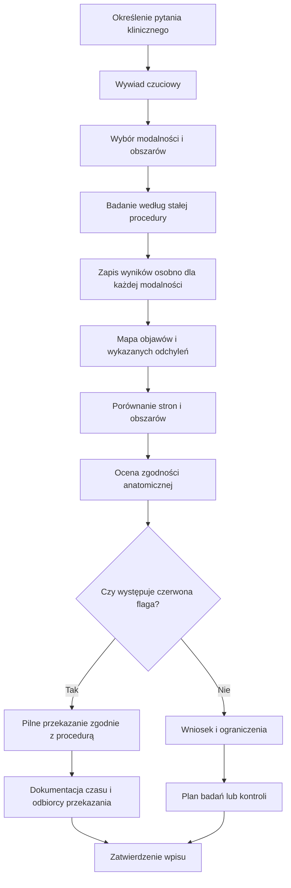
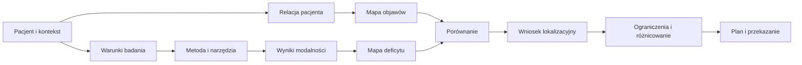

# 5.10. Dokumentowanie wyników badania czucia

## Wprowadzenie i zakres rozdziału

Badanie czucia kończy się dopiero wtedy, gdy jego wynik zostanie zapisany w sposób pozwalający innemu uprawnionemu członkowi zespołu zrozumieć, **co zbadano, jak zbadano, gdzie stwierdzono odchylenie, jakiego rodzaju było to odchylenie, jak duże było, na jakiej podstawie sformułowano wniosek oraz czego nie udało się wiarygodnie ocenić**. Sam zapis „czucie zaburzone”, „czucie osłabione” albo „neurologicznie bez odchyleń” jest zbyt mało precyzyjny, jeżeli nie wiadomo, które modalności, okolice i strony rzeczywiście zbadano.

Dokumentowanie wyników badania czucia jest częścią rozumowania klinicznego, a nie czynnością administracyjną wykonywaną po zakończeniu badania. Dobrze sporządzony zapis umożliwia porównanie kolejnych ocen, ocenę dynamiki objawów, przekazanie informacji lekarzowi kierującemu, fizjoterapeucie, pielęgniarce, terapeucie zajęciowemu lub innemu członkowi zespołu, a także ogranicza ryzyko błędnego przypisania pacjentowi rozpoznania, którego nie potwierdzono.

Niniejszy rozdział zamyka moduł oceny czuciowej. Rozwija praktyczne elementy dokumentacji omawiane wcześniej w rozdziałach 5.1–5.9, ale nie powtarza szczegółowych procedur badania poszczególnych modalności ani pełnej neuroanatomii dróg czuciowych. Koncentruje się na przekształcaniu wyników badania w uporządkowany, powtarzalny i użyteczny klinicznie zapis.

**Zasada nadrzędna:** dokumentować należy wynik rzeczywiście przeprowadzonego badania, a nie wynik oczekiwany, domniemany lub wynikający wyłącznie z rozpoznania skierowania. Brak danych nie jest wynikiem prawidłowym. Badanie niewykonane, niewiarygodne albo niemożliwe do przeprowadzenia trzeba oznaczyć wprost.

Materiał ma charakter edukacyjny. Nie zastępuje aktualnych przepisów, standardów właściwych dla danego zawodu, procedur podmiotu leczniczego ani indywidualnej oceny klinicznej. Zakres badania, sposób jego interpretacji, możliwość stawiania rozpoznań i zlecania badań dodatkowych zależą od kwalifikacji oraz uprawnień osoby wykonującej świadczenie.

---

## 1. Cele kształcenia i efekty uczenia się

### 1.1. Cel ogólny

Celem rozdziału jest przygotowanie uczestnika do sporządzania rzetelnej, czytelnej, anatomicznie zorientowanej i możliwej do porównania dokumentacji badania czucia, z rozdzieleniem relacji pacjenta, obiektywnych wyników badania, hipotezy lokalizacyjnej, rozpoznania oraz planu dalszego postępowania.

### 1.2. Szczegółowe efekty uczenia się

Po ukończeniu rozdziału uczestnik powinien umieć:

1. wyjaśnić, dlaczego dokumentacja badania czucia jest elementem bezpieczeństwa i ciągłości opieki;
2. rozróżnić objawy zgłaszane przez pacjenta od objawów stwierdzonych przez badającego;
3. sporządzić mapę zaburzeń czucia z oznaczeniem strony, okolicy, modalności i granic obszaru;
4. opisać rodzaj i nasilenie deficytu bez stosowania niejednoznacznych określeń;
5. porównać stronę prawą z lewą oraz okolice dystalne z proksymalnymi;
6. zapisać metodę, narzędzie, warunki i ograniczenia badania;
7. powiązać wynik z możliwą lokalizacją anatomiczną, zachowując rozdział między obserwacją a interpretacją;
8. rozpoznać sytuacje, w których należy użyć standaryzowanego formularza, w szczególności ISNCSCI;
9. wskazać, kiedy wynik uzasadnia rozważenie badań neurofizjologicznych, obrazowych lub laboratoryjnych;
10. dokumentować wyniki kolejnych badań w sposób umożliwiający ocenę zmiany w czasie;
11. prawidłowo oznaczyć badanie niewykonane, niewiarygodne lub nieinterpretowalne;
12. przekazać wynik w formie zrozumiałej dla pacjenta i zespołu terapeutycznego.

### 1.3. Kompetencje i odpowiedzialność

Dokumentujący odpowiada za zgodność zapisu z rzeczywistym przebiegiem badania, używaną metodą i własnymi kompetencjami. Nie należy przypisywać sobie wykonania testu, którego nie przeprowadzono, ani wpisywać wyniku na podstawie samego wywiadu. Jeżeli badanie wykonuje kilka osób, trzeba umożliwić ustalenie, kto wykonał poszczególne czynności i kto dokonał interpretacji.

W dokumentacji należy odróżniać:
- **wynik opisowy** – co pacjent zgłosił i co badający stwierdził;
- **wniosek lokalizacyjny** – jaki poziom lub struktura mogą tłumaczyć wzorzec;
- **rozpoznanie kliniczne** – rozpoznanie postawione przez osobę uprawnioną na podstawie całokształtu danych;
- **plan** – jakie działania, konsultacje lub badania są uzasadnione.

---

## 2. Definicje i rozróżnienia pojęciowe

### 2.1. Dokumentacja badania czucia

Dokumentacja badania czucia to uporządkowany zapis wywiadu czuciowego, metod badania, uzyskanych odpowiedzi, mapy przestrzennej, porównania stron, interpretacji i zaleceń dotyczących dalszej oceny. Może być częścią dokumentacji badania neurologicznego, karty rehabilitacji, opisu konsultacji lub specjalistycznego formularza.

### 2.2. Objaw subiektywny a oznaka kliniczna

**Objaw subiektywny** jest doświadczeniem zgłaszanym przez pacjenta, np. mrowieniem, pieczeniem, drętwieniem, uczuciem zimna, bólem lub wrażeniem „grubszej skóry”.

**Oznaka kliniczna** jest wynikiem uzyskanym w badaniu, np. osłabionym rozpoznawaniem bodźca, brakiem odpowiedzi na określony bodziec, allodynią stwierdzoną podczas kontrolowanej próby lub nieprawidłowym rozpoznawaniem położenia palca.

Nie wolno utożsamiać tych kategorii. Pacjent może zgłaszać drętwienie przy prawidłowym wyniku krótkiego badania przesiewowego. Może również nie zgłaszać dolegliwości, a badanie ujawni ubytek czucia ochronnego.

### 2.3. Modalność czuciowa

Modalność to rodzaj informacji ocenianej w badaniu. W dokumentacji należy podawać ją osobno, zamiast używać ogólnego określenia „czucie”.

| Skrót roboczy | Modalność lub funkcja | Przykład opisu |
|---|---|---|
| LT | dotyk lekki | odpowiedź na delikatny kontakt |
| PP | czucie ukłucia / bodźca ostrego i tępego | rozróżnianie bodźca ostrego i tępego |
| TEMP | czucie temperatury | rozróżnianie ciepła i chłodu |
| VIB | czucie wibracji | próba kamertonem, z podaniem miejsca i narzędzia |
| JPS | czucie ułożenia stawu / propriocepcja | rozpoznawanie kierunku ruchu palca |
| PRESS | czucie ucisku | ocena bodźca uciskowego, jeśli stosowana metoda jest opisana |
| CORT | czucie korowe i dyskryminacyjne | stereognozja, grafestezja, wygaszanie |
| ALLO | odpowiedź bólowa na bodziec zwykle niebolesny | allodynia, z określeniem rodzaju bodźca |
| HYP | nasilona odpowiedź na bodziec bolesny | hiperalgezja, z określeniem metody |

Skróty są pomocnicze. W lokalnym formularzu należy zdefiniować ich znaczenie i nie używać jednego skrótu dla kilku różnych testów. Jeżeli dokumentacja jest przekazywana między placówkami, zaleca się stosowanie pełnych nazw lub słownika skrótów.

### 2.4. Rodzaj odchylenia

W zapisie należy rozróżnić co najmniej:

- **anestezję** – brak czucia w określonej modalności i obszarze;
- **hipestezję** – osłabione czucie;
- **hiperalgezję** – nadmierną odpowiedź na bodziec bólowy;
- **allodynię** – ból wywołany bodźcem, który zwykle nie jest bolesny;
- **parestezję** – nieprawidłowe doznanie, często samoistne lub wywołane, niekoniecznie nieprzyjemne;
- **dysestezję** – nieprzyjemne, nieprawidłowe doznanie czuciowe;
- **hiperestezję** – zwiększoną wrażliwość na stymulację;
- **zaburzenie propriocepcji** – nieprawidłowe rozpoznawanie położenia lub ruchu części ciała.

Określenia te nie są wymienne. Jeżeli pacjent mówi „drętwienie”, warto zapytać, czy chodzi o mrowienie, osłabienie czucia, brak czucia, pieczenie czy ból.

### 2.5. Obszar objawów a obszar wykazanego deficytu

Mapa dolegliwości zgłaszanych przez pacjenta i mapa nieprawidłowości stwierdzonych w badaniu powinny być prowadzone oddzielnie. Mogą się pokrywać, ale nie muszą. Ich rozbieżność jest informacją kliniczną, a nie automatycznym dowodem niewiarygodności pacjenta.

### 2.6. Wynik prawidłowy, ujemny, niebadany i nieinterpretowalny

- **Prawidłowy w zakresie zbadanej próby** – uzyskano odpowiedzi odpowiadające przyjętej metodzie i punktowi odniesienia.
- **Ujemny** – określona cecha nie została wykazana w danym teście; termin należy wiązać z nazwą testu.
- **Niebadany** – próby nie przeprowadzono.
- **Nie można zbadać (NT)** – istnieje konkretna przeszkoda uniemożliwiająca wiarygodne wykonanie lub ocenę próby.
- **Nieinterpretowalny** – próbę wykonano, lecz wynik jest sprzeczny, niestabilny lub zbyt obciążony czynnikami zakłócającymi, aby można było wyciągnąć bezpieczny wniosek.

Nie należy wpisywać „czucie prawidłowe”, jeśli nie zbadano wszystkich istotnych modalności albo pacjent nie był w stanie współpracować.

---

## 3. Podstawy neuroanatomiczne i neurofizjologiczne istotne dla dokumentowania

### 3.1. Dlaczego mapa czucia musi uwzględniać anatomię

Informacja czuciowa jest przewodzona przez receptory obwodowe, włókna nerwowe, nerwy obwodowe, zwoje rdzeniowe lub zwoje czuciowe nerwów czaszkowych, korzenie, rdzeń kręgowy, pień mózgu, wzgórze i korę somatosensoryczną. W zależności od miejsca uszkodzenia zaburzenie może przyjmować postać:
- pola odpowiadającego nerwowi obwodowemu;
- obszaru korzeniowego lub dermatomalnego;
- wzorca długościowo zależnego, np. dystalnego i symetrycznego;
- poziomu czuciowego na tułowiu;
- zaburzenia połowiczego;
- objawu skrzyżowanego obejmującego twarz i przeciwległą połowę ciała;
- zaburzenia czucia korowego lub integracji przestrzennej.

Dokumentacja powinna umożliwiać odtworzenie przestrzennego wzorca, a nie tylko wskazywać ogólną nazwę jednostki chorobowej.

### 3.2. Dermatom, pole nerwu obwodowego i poziom czuciowy

Dermatom jest obszarem skóry związanym z określonym korzeniem rdzeniowym. Pole nerwu obwodowego jest obszarem unerwienia czuciowego konkretnego nerwu po połączeniu włókien z różnych korzeni. Poziom czuciowy w uszkodzeniu rdzenia jest kliniczną granicą zaburzeń czucia wzdłuż osi ciała, ustalaną odrębnie dla ocenianych modalności.

Granice te nakładają się i wykazują zmienność osobniczą. Pojedynczy punkt o obniżonej odpowiedzi nie wystarcza do pewnego rozpoznania korzenia, nerwu ani poziomu rdzenia. W dokumentacji należy zapisać rzeczywiście zbadany obszar oraz opisać wzorzec, a dopiero potem wskazać hipotezę lokalizacyjną.

### 3.3. Drogi czuciowe i modalności

Dotyk dyskryminacyjny, wibracja i propriocepcja są w znacznej mierze przewodzone drogą sznurów tylnych i wstęgi przyśrodkowej. Ból i temperatura są przewodzone przede wszystkim układem przednio-bocznym. Informacja z twarzy jest przekazywana przez układ trójdzielny i jego połączenia pniowe oraz wzgórzowo-korowe.

Z tego powodu selektywne zaburzenie modalności może wspierać lokalizację, ale nie jest samodzielnym dowodem uszkodzenia jednej struktury. Dokumentujący powinien zapisać, które modalności oceniono i czy ich zaburzenia mają ten sam rozkład.

### 3.4. Znaczenie zachowania czucia ochronnego

Ubytek czucia bólu, temperatury lub dotyku ochronnego może zwiększać ryzyko oparzeń, skaleczeń, ucisku, urazów stóp i uszkodzeń skóry. W opisie wyniku należy uwzględnić nie tylko lokalizację deficytu, ale także jego możliwe konsekwencje dla bezpieczeństwa i samodzielności pacjenta.

---

## 4. Zasady nadrzędne dobrej dokumentacji

### 4.1. Zasada konkretu

Każde stwierdzenie powinno odpowiadać na pytanie: gdzie, po której stronie, jaka modalność, jaki rodzaj zmiany, jaką metodą i w jakich warunkach ją oceniono?

Zapis „osłabione czucie kończyny dolnej” jest mniej użyteczny niż: „po stronie lewej osłabione rozpoznawanie dotyku lekkiego na grzbietowo-bocznej powierzchni stopy i paluchu; czucie na przyśrodkowej powierzchni podudzia zachowane; próby porównawcze wykonano w pozycji leżącej, przy zamkniętych oczach”.

### 4.2. Zasada oddzielenia danych od interpretacji

W dokumentacji warto stosować kolejność:

1. relacja pacjenta;
2. metoda i zakres badania;
3. wynik bezpośredni;
4. mapa i porównanie;
5. interpretacja lokalizacyjna;
6. ograniczenia;
7. dalsze postępowanie.

Dzięki temu kolejny specjalista może niezależnie ocenić, czy wniosek wynika z przedstawionych danych.

### 4.3. Zasada jawnego oznaczania niepewności

Jeżeli granica obszaru jest przybliżona, wynik zależy od uwagi pacjenta, występuje ból ograniczający próbę lub badanie przeprowadzono w warunkach nietypowych, należy to odnotować. Sformułowania „podejrzenie”, „wzorzec może odpowiadać”, „wynik wymaga korelacji” są właściwe, gdy dane nie pozwalają na pewne rozpoznanie.

### 4.4. Zasada powtarzalności

Aby porównywać wyniki, należy w miarę możliwości powtarzać:
- te same punkty anatomiczne;
- tę samą modalność;
- tę samą metodę i narzędzie;
- podobną pozycję ciała;
- podobne warunki środowiskowe;
- tę samą instrukcję dla pacjenta;
- tę samą skalę i sposób zapisu.

Zmiana metody może zmienić wynik niezależnie od rzeczywistej zmiany stanu neurologicznego. Jeżeli metody nie można zachować, trzeba opisać różnicę.

### 4.5. Zasada proporcjonalności

Zakres dokumentacji powinien odpowiadać pytaniu klinicznemu. Badanie przesiewowe wymaga zapisania, jakie elementy przesiewu wykonano. Badanie ukierunkowane powinno zawierać dokładniejszą mapę i wyniki w obszarze podejrzewanego uszkodzenia. W urazie rdzenia należy stosować odpowiedni standard klasyfikacyjny, a nie zastępować go dowolną tabelą.

---

## 5. Minimalne metadane badania

### 5.1. Dane identyfikacyjne i organizacyjne

W dokumentacji prowadzonej w podmiocie udzielającym świadczeń należy zachować wymagane prawem oznaczenie pacjenta, podmiotu i datę sporządzenia oraz opis stanu zdrowia lub udzielonych świadczeń. Szczegółowy zakres pól zależy od rodzaju dokumentacji, miejsca udzielania świadczeń i obowiązujących przepisów.

W części opisującej badanie czucia należy zapewnić możliwość ustalenia:
- daty i godziny badania;
- osoby badającej;
- miejsca i kontekstu badania;
- powodu badania lub pytania klinicznego;
- tego, czy jest to badanie pierwszorazowe, kontrolne, przesiewowe czy ukierunkowane;
- źródła informacji, jeżeli wywiad pochodzi również od opiekuna lub dokumentacji zewnętrznej.

### 5.2. Warunki i współpraca

Warto zapisać:
- pozycję pacjenta;
- stan czuwania i zdolność rozumienia poleceń;
- obecność bólu, zmęczenia, lęku lub zaburzeń uwagi;
- istotne ograniczenia wzroku, słuchu, języka lub komunikacji;
- obecność obrzęku, opatrunku, rany, blizny, deformacji lub zmian skórnych;
- przyczynę niepełnego wykonania badania.

Nie należy używać oceniających określeń typu „pacjent niewspółpracujący” bez podania konkretnego powodu. Lepiej napisać: „próby powtarzane, odpowiedzi zmienne; pacjent zgłasza nasilony ból przy dotyku, przez co nie uzyskano stabilnego wyniku”.

### 5.3. Narzędzia i bodźce

W zależności od metody należy zapisać:
- rodzaj narzędzia;
- jego rozmiar, próg lub parametry, jeśli są istotne;
- miejsce przyłożenia;
- sposób podawania bodźca;
- sposób porównywania odpowiedzi;
- czy stosowano bodźce pozorowane lub losową kolejność;
- czy wykorzystano skalę lub formularz standaryzowany.

Samo określenie „zbadano czucie” nie informuje, czy oceniano dotyk, ból, temperaturę, wibrację, propriocepcję czy czucie korowe.

---

## 6. Mapa zaburzeń czucia

### 6.1. Cel mapowania

Mapa ma przedstawić rozmieszczenie objawów zgłaszanych i odchyleń stwierdzonych w badaniu. Powinna ułatwiać:
- określenie strony i obszaru;
- rozpoznanie wzorca anatomicznego;
- porównanie z kolejnym badaniem;
- przekazanie informacji innemu specjaliście;
- ocenę, czy obszar zmienia się w czasie.

Mapa nie zastępuje opisu słownego. Rysunek bez legendy, daty, modalności i informacji o metodzie może być niejednoznaczny.

### 6.2. Rodzaje map

| Rodzaj mapy | Zastosowanie | Ważne ograniczenie |
|---|---|---|
| Sylwetka całego ciała – przód i tył | rozległe zaburzenia, asymetria, poziom czuciowy | schemat nie odwzorowuje dokładnie indywidualnej anatomii |
| Mapa kończyny z widokiem dłoni i stopy | neuropatie, radikulopatie, urazy miejscowe | pola nerwów i dermatomy nakładają się |
| Mapa twarzy | zaburzenia w obszarach V1, V2, V3 lub wzorce skrzyżowane | unerwienie może być zmienne i częściowo nakładające się |
| Mapa segmentalna | podejrzenie uszkodzenia rdzenia lub korzeni | poziom czuciowy wymaga odrębnej oceny modalności |
| Mapa funkcjonalna | obszary ryzyka urazu, zaburzenia czucia ochronnego | nie zastępuje lokalizacji neuroanatomicznej |
| Formularz ISNCSCI | klasyfikacja uszkodzenia rdzenia kręgowego | należy stosować aktualną, oficjalną wersję i zasady jej punktacji |

### 6.3. Oddzielne warstwy mapy

Zaleca się oddzielne oznaczenie:

1. **S – objawy zgłaszane:** mrowienie, drętwienie, pieczenie, ból, uczucie zimna, nadwrażliwość;
2. **O – ubytek stwierdzony:** osłabienie lub brak odpowiedzi na określoną modalność;
3. **P – objaw dodatni stwierdzony:** allodynia, hiperalgezja, dysestezja wywołana bodźcem;
4. **R – ryzyko funkcjonalne:** obszar z utratą czucia ochronnego, ryzyko urazu lub oparzenia;
5. **G – granica lub poziom:** orientacyjna granica zaburzenia, jeśli została ustalona.

W mapie elektronicznej każda warstwa powinna być możliwa do włączenia i wyłączenia. W wersji papierowej należy zastosować czytelną legendę. Nie wolno polegać wyłącznie na kolorze – znaczenie powinno być dodatkowo oznaczone literą, symbolem lub wzorem.

### 6.4. Zasady zaznaczania granic

- Granicę należy ustalać przez stopniowe porównywanie odpowiedzi w obszarze zmienionym i referencyjnym.
- Należy zaznaczyć, czy jest wyraźna, stopniowa, nieregularna czy trudna do odtworzenia.
- Jeżeli obszar ma charakter plamisty, należy to narysować, a nie wygładzać do regularnego dermatomu.
- Jeżeli granica zmienia się między próbami, trzeba zapisać jej zmienność.
- Nie należy rysować precyzyjnej granicy, której nie potwierdzono badaniem.
- Jeżeli badanie obejmowało tylko wybrane punkty, mapa powinna to wyraźnie pokazywać.

### 6.5. Przykładowa legenda mapy

| Symbol | Znaczenie |
|---|---|
| LT↓ | osłabione czucie dotyku lekkiego |
| PP↓ | osłabione rozpoznawanie bodźca ostrego |
| TEMP↓ | osłabione rozpoznawanie temperatury |
| VIB↓ | obniżone czucie wibracji |
| JPS↓ | nieprawidłowe rozpoznawanie położenia |
| ALLO | ból wywołany bodźcem zwykle niebolesnym |
| HYP | nadmierna odpowiedź na bodziec bolesny |
| NT | próba niewykonana lub niemożliwa do wiarygodnej oceny – z opisem powodu |
| ? | wynik niejednoznaczny, wymagający ponownej oceny |

Legenda powinna być dopasowana do konkretnego formularza. Symbole te są propozycją roboczą, a nie powszechnie obowiązującym kodem międzynarodowym.

### 6.6. Mapa objawów a mapa wyniku badania – przykład

Pacjent zgłasza pieczenie i mrowienie całej lewej dłoni. W badaniu dotyk lekki jest porównywalny w większości obszaru, natomiast rozpoznawanie bodźca ostrego jest osłabione na palcu V i łokciowej połowie palca IV. Wynik powinien zawierać dwie warstwy:
- mapa S: pieczenie i mrowienie obejmujące całą dłoń;
- mapa O: osłabione rozpoznawanie bodźca ostrego w ograniczonym obszarze łokciowym.

Nie należy automatycznie rysować całej dłoni jako obszaru obiektywnego ubytku ani rozpoznawać neuropatii nerwu łokciowego bez oceny pozostałych danych.

---

## 7. Opis rodzaju i nasilenia deficytu

### 7.1. Opis jakościowy

Każdą modalność należy opisać oddzielnie. Zalecany zestaw informacji obejmuje:
- obecność lub brak odpowiedzi;
- jakość odpowiedzi;
- porównanie z punktem referencyjnym;
- powtarzalność;
- lokalizację;
- ewentualny ból lub nadwrażliwość podczas próby.

Przykładowo: „Dotyk lekki: odpowiedź obecna obustronnie, po stronie prawej pacjent konsekwentnie ocenia bodziec jako słabszy w obrębie palców I–III niż na palcu V i niż po stronie lewej. Wynik powtórzono w trzech punktach; różnica utrzymuje się. Nie wykonywano ilościowego pomiaru progu czucia”.

### 7.2. Skala opisowa w badaniu rutynowym

W badaniu rutynowym można używać opisowej skali porządkowej, jeżeli placówka zdefiniuje ją w procedurze:

| Kategoria | Opis |
|---|---|
| N – odpowiedź porównywalna | pacjent rozpoznaje bodziec podobnie w badanym i referencyjnym obszarze |
| O – odpowiedź osłabiona | bodziec rozpoznawany, lecz konsekwentnie słabiej lub mniej dokładnie |
| A – odpowiedź nieobecna | pacjent nie rozpoznaje bodźca mimo prawidłowego podania i zrozumienia instrukcji |
| Z – odpowiedź zmieniona / jakościowo nieprawidłowa | odpowiedź jest zniekształcona, nieprzyjemna lub niezgodna z charakterem bodźca |
| NT – nie można ocenić | próby nie wykonano lub nie uzyskano wiarygodnego wyniku; należy podać przyczynę |

Ta skala jest przykładem lokalnego systemu opisowego. Nie jest równoważna punktacji ISNCSCI, nie jest skalą walidowaną dla wszystkich modalności i nie powinna być stosowana do obliczania sumarycznego wyniku bez odrębnej walidacji.

### 7.3. Skala ISNCSCI

W przypadku podejrzenia lub rozpoznania urazu rdzenia kręgowego należy stosować aktualny standard ISNCSCI, jeżeli jest wskazany klinicznie i osoba badająca ma odpowiednie przygotowanie.

W dziewiątej edycji ISNCSCI z 2026 r. formularz obejmuje ocenę dotyku lekkiego i ukłucia w punktach kluczowych po obu stronach, a wynik czuciowy oznacza się:
- 0 – brak czucia;
- 1 – czucie zmienione;
- 2 – czucie prawidłowe;
- NT – nie można zbadać.

Formularz rozdziela wyniki prawej i lewej strony, sumy dla dotyku i ukłucia oraz pola komentarza. W oznaczeniach mogą występować gwiazdki przy wynikach związanych z innym stanem niż uraz rdzenia; przy takim oznaczeniu należy podać powód i sposób uwzględnienia go w klasyfikacji zgodnie z instrukcją danej edycji. Należy zapisać wydanie standardu i korzystać z oficjalnego formularza. Nie wolno samodzielnie modyfikować formularza ASIA/ISCoS ani przenosić jego punktacji do zwykłego badania bez zaznaczenia, że jest to odrębny standard.

### 7.4. Nasilenie objawu a nasilenie deficytu

Nasilenie dolegliwości zgłaszanej przez pacjenta i wielkość ubytku stwierdzonego w badaniu są odrębnymi wymiarami. Pacjent może mieć silny ból neuropatyczny przy niewielkim ubytku w badaniu przesiewowym albo rozległy ubytek czucia bez bólu.

Warto rozdzielić:
- nasilenie bólu, np. NRS 0–10;
- częstotliwość i czas trwania parestezji;
- obszar i rodzaj ubytku czucia;
- wpływ na funkcję, sen, chód, chwyt, samoobsługę i bezpieczeństwo.

Nie należy sumować tych danych w jeden arbitralny „wynik czucia”.

### 7.5. Skale ilościowe i testy progowe

Jeżeli stosuje się monofilamenty Semmesa-Weinsteina, ilościowe testy czucia, QST lub inne narzędzia, należy podać:
- nazwę i wersję narzędzia;
- badane miejsce;
- próg lub wartość;
- jednostkę;
- protokół i warunki pomiaru;
- normę referencyjną oraz źródło normy;
- informację, czy pomiar był przesiewowy, czy ilościowy.

Wynik testu progowego nie może być bezpośrednio utożsamiany z wynikiem badania klinicznego wykonywanego inną metodą. Wartości referencyjne zależą m.in. od wieku, miejsca pomiaru, właściwości skóry, temperatury, sprzętu i procedury.

---

## 8. Porównanie stron i obszarów ciała

### 8.1. Porównanie prawo–lewo

W większości badań czuciowych przydatne jest porównanie odpowiadających sobie punktów po obu stronach ciała. Należy jednak pamiętać, że strona przeciwna nie zawsze jest zdrowym punktem odniesienia. W polineuropatii, chorobie rdzenia, zaburzeniach uogólnionych lub zmianach obustronnych obie strony mogą być nieprawidłowe.

W dokumentacji należy zapisać:
- czy porównywano punkty symetryczne;
- czy stwierdzono różnicę;
- czy porównanie było wiarygodne;
- jaki obszar przyjęto jako referencyjny;
- czy wynik jest obustronny, asymetryczny czy jednostronny.

### 8.2. Porównanie dystalno-proksymalne

W podejrzeniu polineuropatii długościowo zależnej należy opisać, czy zaburzenia są silniejsze dystalnie, a następnie stopniowo słabną proksymalnie. Zapis „rękawiczki i skarpetki” powinien być poparty wskazaniem rzeczywistych granic oraz modalności, których dotyczy.

### 8.3. Porównanie modalności

Jeżeli dotyk lekki jest zachowany, a wibracja osłabiona, trzeba zapisać tę różnicę. Nie należy uśredniać wyników do jednego określenia. Rozbieżność modalności może być istotna dla lokalizacji, diagnostyki różnicowej i wyboru badań dodatkowych.

### 8.4. Porównanie w czasie

W badaniu kontrolnym należy zestawić aktualną mapę z mapą wcześniejszą. Warto opisać:
- nowe obszary zaburzeń;
- obszary, w których odpowiedź się poprawiła;
- obszary bez zmiany;
- zmianę charakteru objawu;
- zmianę metody lub warunków badania.

Nie należy wnioskować o poprawie wyłącznie na podstawie mniejszej liczby zaznaczeń na mapie, jeżeli zmieniono sposób badania.

---

## 9. Powiązanie wyniku z anatomią i lokalizacją

### 9.1. Kolejność rozumowania

Wniosek lokalizacyjny powinien powstawać po opisaniu wyniku. Zalecana kolejność:

1. ustalenie, czy zaburzenie jest jednostronne, obustronne, symetryczne czy asymetryczne;
2. określenie, czy obejmuje obszar dystalny, proksymalny, segmentalny, połowiczy czy rozlany;
3. porównanie modalności;
4. sprawdzenie zgodności z polem nerwu, dermatomem, poziomem rdzeniowym lub wzorcem ośrodkowym;
5. uwzględnienie siły mięśniowej, odruchów, koordynacji, chodu i objawów autonomicznych;
6. sformułowanie jednej lub kilku hipotez;
7. wskazanie, jakie dane mogą je potwierdzić lub osłabić.

### 9.2. Przykładowe wzorce do opisania

| Wzorzec | Elementy, które trzeba opisać | Możliwy kierunek lokalizacji |
|---|---|---|
| Pole pojedynczego nerwu | dokładny obszar skóry, osłabienie mięśni, objawy prowokowane | nerw obwodowy |
| Wzorzec korzeniowy | obszar dermatomalny, ból promieniujący, odruchy, mięśnie z różnych nerwów | korzeń rdzeniowy |
| Dystalny symetryczny | długość kończyn, symetria, modalności, odruchy | polineuropatia |
| Poziom czuciowy | granica na tułowiu, osobno dotyk i ukłucie, objawy piramidowe | rdzeń kręgowy |
| Połowiczy | twarz, kończyna górna, tułów i kończyna dolna; nagłość początku | struktury ośrodkowe |
| Skrzyżowany | strona twarzy i przeciwległa strona ciała | pień mózgu |
| Korowy | czucie pierwotne, wygaszanie, stereognozja, grafestezja, uwaga | kora i sieci asocjacyjne |

Tabela nie jest algorytmem rozpoznawania. Każdy wzorzec wymaga korelacji z pełnym badaniem, czasem początku i kontekstem klinicznym.

### 9.3. Sformułowania lokalizacyjne

Preferowane:
- „Wynik sugeruje wzorzec zgodny z obszarem czuciowym nerwu…”
- „Obraz może odpowiadać zajęciu korzenia…, jednak granice nie są w pełni dermatomalne”.
- „Stwierdzono poziom czuciowy orientacyjnie na wysokości…, wymagający pilnej korelacji z pozostałymi objawami”.
- „Występuje asymetryczny ubytek czucia po stronie…, bez podstaw do określenia etiologii na podstawie samego badania”.

Niewskazane:
- „Pacjent ma uszkodzony nerw…”, jeśli nie potwierdzono tego odpowiednim badaniem;
- „Czucie jest prawidłowe”, gdy oceniono tylko dotyk;
- „Objawy są czynnościowe”, wyłącznie na podstawie niezgodnej mapy;
- „Brak zmian neurologicznych”, jeśli zakres badania był ograniczony.

---

## 10. Wskazania do badań neurofizjologicznych i obrazowych

### 10.1. Zasada doboru badań

Badanie dodatkowe powinno odpowiadać na konkretne pytanie kliniczne. Nie należy zlecać EMG, ENG, QST, MRI lub badań laboratoryjnych wyłącznie dlatego, że w dokumentacji występuje słowo „drętwienie”. Najpierw trzeba opisać wzorzec, czas trwania, dynamikę i objawy towarzyszące.

### 10.2. Elektroneurografia i elektromiografia

Badania przewodnictwa nerwowego (NCS/ENG) i elektromiografia igłowa (EMG) mogą pomóc w ocenie:
- neuropatii obwodowych;
- uszkodzeń nerwów w miejscach uwięźnięcia;
- polineuropatii;
- splotopatii;
- radikulopatii, zwłaszcza gdy występują objawy ruchowe lub podejrzenie uszkodzenia aksonalnego.

W dokumentacji skierowania należy wskazać pytanie kliniczne, stronę, obszar, czas trwania objawów, wyniki badania neurologicznego i dotychczasowe badania. W opisie badania EDX powinny znaleźć się wykonane testy, istotne wyniki, rozkład nieprawidłowości i interpretacja. Sam wniosek bez danych utrudnia ocenę jakości i porównanie kolejnych badań.

**Ograniczenia:** rutynowe NCS/EMG nie oceniają bezpośrednio wszystkich włókien czuciowych. Prawidłowy wynik nie wyklucza m.in. neuropatii małych włókien, bardzo wczesnego lub czysto czuciowego uszkodzenia korzenia ani patologii poza zakresem zastosowanego protokołu. Wnioski muszą uwzględniać czas od początku objawów i zakres badanych nerwów oraz mięśni.

### 10.3. Ilościowe badanie czucia (QST)

QST jest zestawem psychofizycznych metod oceny progów czuciowych i odpowiedzi na bodźce termiczne lub mechaniczne. Wynik zależy od współpracy, uwagi, rozumienia instrukcji, wieku, miejsca badania, urządzenia i procedury. QST może uzupełniać ocenę, ale nie jest samodzielnym testem potwierdzającym konkretną chorobę ani anatomiczne miejsce uszkodzenia.

W dokumentacji należy zapisać protokół, miejsce, urządzenie, wartości, jednostki, normy i ograniczenia.

### 10.4. Badania włókien małych

W zależności od wskazań specjalista może rozważyć metody oceny włókien małych, np. biopsję skóry z oceną gęstości włókien śródnaskórkowych lub testy autonomiczne. W opisie skierowania trzeba wskazać objawy sugerujące zajęcie włókien małych, takie jak ból palący, zaburzenia temperatury lub objawy autonomiczne, oraz zaznaczyć, czy rutynowe NCS były prawidłowe.

### 10.5. Rezonans magnetyczny i inne badania obrazowe

MRI mózgowia lub kręgosłupa należy rozważać, gdy lokalizacja, dynamika i objawy towarzyszące wskazują na możliwe uszkodzenie ośrodkowe, rdzeniowe, uciskowe, zapalne, naczyniowe lub nowotworowe. Przy podejrzeniu ostrej mielopatii obrazowanie jest pilne; w większości nieurazowych sytuacji MRI jest podstawową metodą oceny rdzenia. W ostrym urazie dobór CT lub MRI zależy od mechanizmu urazu i pytania klinicznego.

W dokumentacji skierowania należy podać:
- podejrzewaną lokalizację;
- początek i dynamikę objawów;
- wyniki badania czucia i objawy ruchowe;
- objawy zwieraczowe lub autonomiczne;
- przebyte urazy, nowotwory, infekcje i zabiegi;
- konkretne pytanie diagnostyczne.

### 10.6. Badania laboratoryjne

W zależności od obrazu klinicznego lekarz może rozważyć m.in. glikemię lub HbA1c, witaminę B12, TSH, funkcję nerek, markery zapalne, badania w kierunku celiakii, białka monoklonalnego lub przyczyn toksycznych. Dobór powinien być ukierunkowany, a nie automatyczny. W dokumentacji należy oddzielić wynik badania czucia od hipotezy etiologicznej i wskazać, dlaczego określone badanie jest rozważane.

### 10.7. Przykładowa macierz doboru badań

| Pytanie kliniczne | Możliwe badanie | Co powinno znaleźć się w skierowaniu |
|---|---|---|
| Czy występuje neuropatia dużych włókien? | NCS/ENG, ewentualnie EMG | modalności, odruchy, symetria, rozkład dystalny |
| Czy objawy wynikają z radikulopatii? | EMG/NCS, MRI zależnie od wskazań | ból promieniujący, miotomy, odruchy, czas trwania |
| Czy możliwa jest mielopatia? | pilne MRI odpowiedniego odcinka | poziom czuciowy, objawy piramidowe, chód, zwieracze |
| Czy możliwa jest neuropatia małych włókien? | QST, biopsja skóry, testy autonomiczne | ból palący, temperatura, objawy autonomiczne, NCS |
| Czy występuje ostre uszkodzenie ośrodkowe? | pilna diagnostyka udarowa i obrazowanie mózgowia | czas początku, ostatni moment bez objawów, lateralizacja, objawy towarzyszące |
| Czy występuje zaburzenie funkcjonalne? | ocena specjalistyczna na podstawie dodatnich cech klinicznych | konkretne dodatnie objawy, pełne badanie, wykluczenie stanów nagłych |

---

## 11. Dokumentowanie wyników w kolejnych badaniach

### 11.1. Ustalenie punktu odniesienia

W pierwszym badaniu należy możliwie dokładnie opisać metodę i obszary. W kolejnych badaniach należy używać tej samej mapy i protokołu, jeżeli jest to klinicznie właściwe.

### 11.2. Porównywanie zmian

Warto stosować tabelę:

| Obszar / modalność | Badanie początkowe | Badanie kontrolne | Wniosek |
|---|---|---|---|
| Grzbiet stopy, VIB | odpowiedź osłabiona | odpowiedź osłabiona | bez wyraźnej zmiany |
| Paluch, JPS | odpowiedzi niestabilne | odpowiedzi prawidłowe w powtarzanych próbach | możliwa poprawa, potwierdzić w kolejnej ocenie |
| Podudzie, LT | odpowiedź porównywalna | odpowiedź porównywalna | bez zmiany |

Nie należy używać wyłącznie określeń „lepiej” lub „gorzej”. Warto wskazać, jaka cecha uległa zmianie i czy metoda była taka sama.

### 11.3. Zmiana protokołu

Jeżeli w badaniu kontrolnym zastosowano inne narzędzie, inną pozycję lub inny zestaw punktów, trzeba to wyraźnie odnotować. Wyniki nie są wówczas w pełni porównywalne ilościowo.

### 11.4. Znaczenie powtarzalności między badającymi

Różnice między badającymi mogą wynikać z siły bodźca, miejsca przyłożenia, instrukcji, tempa, oczekiwań pacjenta i doświadczenia osoby badającej. Standaryzacja instrukcji i szkolenie zespołu ograniczają zmienność, lecz jej nie eliminują. W przypadku wyników granicznych lub niezgodnych z obrazem klinicznym warto rozważyć powtórzenie badania przez odpowiednio przygotowaną osobę.

---

## 12. Normy, ograniczenia i jakość pomiaru

### 12.1. Brak jednej uniwersalnej normy

Nie istnieje jedna skala, która pozwalałaby bezpośrednio porównywać wszystkie modalności czuciowe, wszystkie okolice ciała i wszystkie grupy wieku. Wynik zależy od rodzaju bodźca, miejsca badania, właściwości skóry, temperatury, uwagi, rozumienia instrukcji, wzroku, słuchu, bólu i metody.

### 12.2. Punkt odniesienia

Punkt odniesienia może stanowić:
- symetryczny punkt po przeciwnej stronie;
- sąsiedni obszar o zachowanej odpowiedzi;
- wcześniejszy wynik tego samego pacjenta;
- normy narzędzia lub procedury;
- standaryzowany formularz kliniczny.

Wybór należy opisać. Nie wolno traktować strony przeciwnej jako prawidłowej, jeśli podejrzewa się zaburzenie obustronne.

### 12.3. Błędy pomiaru

Na wynik mogą wpływać:
- zbyt silny lub zbyt słaby bodziec;
- brak losowej kolejności i przewidywalność testu;
- dotykanie skóry w sposób wskazujący miejsce bodźca;
- różna temperatura narzędzia;
- gruba skóra, modzele, obrzęk, blizny i opatrunki;
- zmęczenie, senność, ból i rozproszenie uwagi;
- niezrozumienie polecenia;
- zaburzenia językowe lub poznawcze;
- stosowanie różnych metod w kolejnych badaniach.

### 12.4. Ograniczenia map dermatomalnych

Mapy dermatomów i pól nerwów obwodowych są schematami orientacyjnymi. Granice są zmienne, a sąsiednie obszary nakładają się. Mapa powinna wspierać lokalizację, ale nie zastępować badania siły, odruchów, bólu, koordynacji i funkcji.

### 12.5. Ograniczenia testów przesiewowych

Prawidłowy wynik krótkiego testu przesiewowego nie wyklucza wszystkich zaburzeń czucia. Nieprawidłowy wynik nie potwierdza samodzielnie etiologii. Jeżeli pytanie kliniczne wymaga dokładniejszej oceny, należy zastosować odpowiednią metodę specjalistyczną.

---

## 13. Czerwone flagi i zasady pilnego przekazania informacji

### 13.1. Nagły ubytek czucia

Nagłe jednostronne zaburzenie czucia, zwłaszcza z niedowładem, asymetrią twarzy, zaburzeniami mowy, widzenia, równowagi lub koordynacji, może oznaczać udar mózgu lub przemijający atak niedokrwienny. Należy niezwłocznie uruchomić właściwą ścieżkę ratunkową. Dokumentacja powinna zawierać czas początku objawów lub ostatni moment, w którym pacjent był bez objawów, oraz czas rozpoznania i przekazania.

### 13.2. Szybko postępujące objawy obustronne

Szybko narastające, symetryczne drętwienie i osłabienie lub zaburzenia równowagi w ciągu godzin lub dni wymagają natychmiastowej oceny neurologicznej. Jeżeli występują zaburzenia oddychania, połykania, głosu lub objawy autonomiczne, priorytetem jest bezpieczeństwo podstawowych funkcji życiowych.

### 13.3. Poziom czuciowy i objawy rdzeniowe

Nowy poziom czuciowy, zaburzenia chodu, objawy piramidowe, narastające osłabienie, ból kręgosłupa lub zaburzenia zwieraczy mogą wskazywać na mielopatię lub ucisk rdzenia. Wymagają pilnej oceny, a w zależności od obrazu – pilnego obrazowania.

### 13.4. Objawy zespołu ogona końskiego

Nowe zaburzenia czucia w okolicy siodłowej, zatrzymanie moczu, nowe nietrzymanie moczu lub stolca, zaburzenia czucia krocza, obustronne objawy korzeniowe albo postępujący niedowład kończyn dolnych wymagają pilnej diagnostyki w kierunku zespołu ogona końskiego. Nie należy czekać na wystąpienie pełnego obrazu klinicznego.

### 13.5. Inne sygnały alarmowe

Pilnej oceny wymagają także:
- zaburzenia czucia po istotnym urazie;
- objawy z gorączką, sztywnością karku lub zaburzeniami świadomości;
- szybko narastający ból i deficyt u osoby z nowotworem, immunosupresją lub ryzykiem zakażenia;
- postępujące osłabienie z zaburzeniami połykania lub oddychania;
- ostre zaburzenia czucia z bólem głowy o nagłym, maksymalnym początku.

### 13.6. Co zapisać przy eskalacji

W dokumentacji należy odnotować:
1. objaw alarmowy;
2. czas początku lub ostatni moment bez objawów;
3. wynik badania i jego ograniczenia;
4. ocenę stanu ogólnego i parametrów życiowych, jeżeli były mierzone;
5. osobę lub zespół, któremu przekazano informację;
6. czas przekazania;
7. podjęte działania zgodne z procedurą;
8. reakcję pacjenta i dalszy los, o ile jest znany.

Nie należy opóźniać pilnego przekazania pacjenta w celu uzupełniania mapy lub wykonywania pełnego badania planowego.

---

## 14. Bezpieczeństwo, prawa pacjenta i dokumentacja

### 14.1. Bezpieczeństwo podczas badania

- Wyjaśnić cel, przebieg i rodzaj bodźców.
- Uzyskać zgodę zgodnie z zasadami obowiązującymi dla danego świadczenia.
- Zapewnić prywatność, komfort i możliwość przerwania próby.
- Stosować jednorazowe, bezpieczne narzędzia do badania bodźców ostrych.
- Nie używać przedmiotów, które mogą przebić skórę lub spowodować uraz.
- Nie stosować skrajnych temperatur ani bodźców mogących wywołać oparzenie.
- Nie badać przez opatrunek jako równoważnika skóry niezmienionej.
- Zwracać uwagę na neuropatię, utratę czucia ochronnego i ryzyko uszkodzenia skóry.
- Po badaniu ocenić, czy nie doszło do podrażnienia lub urazu.

### 14.2. Godność, intymność i zgoda

Badanie okolicy krocza i siodłowej wymaga szczególnej dbałości o intymność, wyjaśnienia celu, ograniczenia zakresu do niezbędnego minimum i przestrzegania zasad zgody. Należy dokumentować istotne ograniczenia badania, odmowę lub przerwanie próby zgodnie z procedurą. Nie wolno wykonywać czynności wykraczających poza kompetencje i uprawnienia.

### 14.3. Wymogi prawne w Polsce

Na dzień opracowania materiału, 27 listopada 2026 r., podstawowe znaczenie mają w szczególności:
- ustawa z dnia 6 listopada 2008 r. o prawach pacjenta i Rzeczniku Praw Pacjenta – prawo pacjenta do dokumentacji, obowiązek jej prowadzenia, przechowywania, udostępniania i ochrony danych;
- art. 25 ustawy – minimalne elementy dokumentacji, w tym identyfikacja pacjenta, oznaczenie podmiotu, opis stanu zdrowia lub udzielonych świadczeń oraz data sporządzenia;
- rozporządzenie Ministra Zdrowia z dnia 6 kwietnia 2020 r. w sprawie rodzajów, zakresu i wzorów dokumentacji medycznej oraz sposobu jej przetwarzania, w aktualnym tekście jednolitym ogłoszonym w Dz.U. z 2026 r. poz. 1391;
- RODO, w zakresie ochrony danych osobowych i danych dotyczących zdrowia.

Wskazane przepisy należy czytać łącznie z aktualnym brzmieniem aktów prawnych i regulacjami właściwymi dla rodzaju praktyki lub podmiotu. Ten rozdział nie stanowi porady prawnej i nie zastępuje procedury dokumentacyjnej placówki.

### 14.4. Dokumentacja elektroniczna i integralność zapisu

Aktualne rozporządzenie przewiduje co do zasady prowadzenie dokumentacji medycznej w postaci elektronicznej, z wyjątkami określonymi w przepisach. System powinien zapewniać dostęp wyłącznie osobom uprawnionym, integralność treści i metadanych oraz ochronę przed nieuprawnioną zmianą. Korekty należy wykonywać zgodnie z funkcjonalnością i procedurą systemu, z zachowaniem śladu zmian; nie należy po cichu usuwać lub nadpisywać pierwotnych danych.

### 14.5. Język dokumentacji

Należy używać języka rzeczowego, neutralnego i zrozumiałego. Unikać:
- ocen moralnych pacjenta;
- sformułowań stygmatyzujących;
- nieuzasadnionych rozpoznań;
- skrótów niezdefiniowanych w dokumentacji;
- nieprecyzyjnych określeń „dziwne czucie”, „brak współpracy”, „czucie słabe” bez opisu.

---

## 15. Wzór dokumentacji badania czucia

Poniższy wzór jest propozycją dydaktyczną. Powinien zostać dostosowany do dokumentacji właściwej dla placówki i zawodu.

### 15.1. Formularz opisowy

**Data i godzina:** ............................................................

**Osoba badająca:** ............................................................

**Powód badania / pytanie kliniczne:** ............................................................

**Tryb badania:** przesiewowe / ukierunkowane / pełne / kontrolne

**Warunki badania:** pozycja pacjenta, stan czuwania, współpraca, ból, ograniczenia komunikacji, zmiany skórne i inne czynniki zakłócające.

**Relacja pacjenta:** rodzaj dolegliwości, czas początku, dynamika, lokalizacja, czynniki nasilające i łagodzące.

**Metody i narzędzia:** ............................................................

**Wynik badania:**

| Okolica | Strona | Modalność | Wynik | Metoda / uwagi |
|---|---|---|---|---|
|  | P / L / obustronnie | LT |  |  |
|  | P / L / obustronnie | PP |  |  |
|  | P / L / obustronnie | TEMP |  |  |
|  | P / L / obustronnie | VIB |  |  |
|  | P / L / obustronnie | JPS |  |  |
|  | P / L / obustronnie | CORT |  |  |

**Mapa:** załączona / brak; rodzaj mapy; legenda; data.

**Porównanie:** prawa–lewa; dystalnie–proksymalnie; obszar referencyjny; porównanie z poprzednim badaniem.

**Ograniczenia:** ............................................................

**Wniosek opisowy:** ............................................................

**Hipoteza lokalizacyjna:** ............................................................

**Rozpoznanie / rozpoznania:** tylko jeżeli zostały postawione przez osobę uprawnioną na podstawie pełnych danych.

**Plan:** dalsze badanie, konsultacja, pilne przekazanie, badania dodatkowe lub zalecenia dotyczące bezpieczeństwa.

**Podpis / identyfikacja osoby dokumentującej:** ............................................................

### 15.2. Minimalny zapis badania przesiewowego

„Badanie przesiewowe czucia wykonano w pozycji siedzącej. Oceniono dotyk lekki i rozpoznawanie bodźca ostrego w symetrycznych punktach kończyn górnych i dolnych, przy zamkniętych oczach. Odpowiedzi porównywalne w badanych punktach, bez stwierdzonej asymetrii. Nie oceniano temperatury, wibracji, propriocepcji ani czucia korowego. Wynik dotyczy wyłącznie wymienionych prób i nie wyklucza wszystkich zaburzeń czucia”.

### 15.3. Zapis badania ukierunkowanego

„Po stronie prawej stwierdzono osłabione rozpoznawanie dotyku lekkiego w obrębie palca I–III, z zachowaną odpowiedzią w obrębie palca V. Rozpoznawanie bodźca ostrego jest mniej wyraźne w tej samej okolicy. Czucie na przedramieniu porównywalne obustronnie. Próby wykonano w losowej kolejności, przy zamkniętych oczach, z porównaniem strony przeciwnej i powtórzeniem odpowiedzi. Wzorzec może sugerować zajęcie obszaru czuciowego nerwu pośrodkowego, jednak wymaga korelacji z siłą mięśniową, objawami prowokacyjnymi i ewentualnym badaniem EDX. Nie formułowano rozpoznania etiologicznego wyłącznie na podstawie mapy czucia”.

### 15.4. Zapis badania ograniczonego

„Ocena czucia częściowo ograniczona z powodu zaburzeń rozumienia poleceń i zmiennej czujności. Dotyk lekki rozpoznawany niestabilnie w kończynach dolnych; nie uzyskano wiarygodnego porównania stron. Wynik oznaczono jako nieinterpretowalny w zakresie prób wymagających powtarzalnej odpowiedzi. Zalecana ponowna ocena po poprawie stanu ogólnego; ze względu na współistniejący nowy niedowład przekazano pacjenta do pilnej oceny lekarskiej”.

### 15.5. Zapis kontrolny

„W porównaniu z badaniem z dnia …, wykonanym tą samą metodą i w tych samych punktach, odpowiedź na wibrację w obrębie palucha obustronnie pozostaje osłabiona. Rozpoznawanie położenia palucha po stronie prawej jest obecnie bardziej powtarzalne niż w badaniu poprzednim. Dotyk lekki bez wyraźnej zmiany. Wynik sugeruje częściową poprawę powtarzalności próby propriocepcji, jednak nie stanowi samodzielnego dowodu regeneracji włókien czuciowych”.

---

## 16. Praktyczne przykłady dokumentowania

### Przypadek 1. Podejrzenie neuropatii nerwu pośrodkowego

**Dane:** pacjent zgłasza nocne drętwienie kciuka, palca wskazującego i środkowego prawej ręki.

**Badanie:** dotyk lekki i bodziec ostry porównano w obszarach palców I–V. Odpowiedzi osłabione w palcach I–III po prawej, zachowane na palcu V i w obrębie łokciowej części dłoni. Objawy odtwarzane podczas wybranej próby prowokacyjnej, jeżeli była wskazana i prawidłowo wykonana.

**Dokumentacja:** należy oddzielić zgłaszane nocne drętwienie od wykazanego osłabienia odpowiedzi. Wniosek może wskazywać na wzorzec w obszarze nerwu pośrodkowego, ale rozpoznanie zespołu cieśni nadgarstka wymaga całokształtu danych. W zależności od obrazu można rozważyć badanie EDX.

**Błąd, którego należy uniknąć:** wpisanie „neuropatia nerwu pośrodkowego potwierdzona” bez odpowiednich podstaw.

### Przypadek 2. Dystalny, symetryczny ubytek czucia

**Dane:** pacjent z cukrzycą zgłasza pieczenie stóp i uczucie chodzenia po watolinie.

**Badanie:** opisano dotyk, wibrację i propriocepcję w punktach dystalnych i proksymalnych obu kończyn dolnych. Stwierdzono symetryczne osłabienie wibracji na paluchach, słabsze rozpoznawanie dotyku na przodostopiu oraz zachowaną odpowiedź bardziej proksymalnie.

**Dokumentacja:** mapa obu stóp, modalności i odruchy powinny być zapisane oddzielnie. Warto odnotować stan skóry, obecność modzeli, rany, deformacji i ryzyko urazu.

**Wniosek:** wzorzec może być zgodny z dystalną neuropatią długościowo zależną, ale nie określa samodzielnie jej przyczyny. Należy uwzględnić ocenę metaboliczną i badania dodatkowe zgodnie z decyzją lekarza.

### Przypadek 3. Podejrzenie mielopatii z poziomem czuciowym

**Dane:** pacjent zgłasza narastające zaburzenia czucia obu kończyn dolnych i uczucie opasania tułowia.

**Badanie:** opisano orientacyjną granicę zaburzenia dotyku i ukłucia na tułowiu, osobno dla obu modalności i stron. Zapisano siłę mięśniową, odruchy, objawy piramidowe, chód oraz wywiad dotyczący funkcji pęcherza i jelit.

**Dokumentacja:** należy podać poziom orientacyjny, metodę jego ustalenia, rozbieżność między modalnościami i dynamikę objawów. Nie wolno opóźniać pilnej oceny w celu dokładniejszego rysowania granicy.

**Wniosek:** podejrzenie zajęcia rdzenia wymaga pilnej oceny lekarskiej i rozważenia MRI odpowiedniego odcinka.

### Przypadek 4. Nagły ubytek czucia połowiczego

**Dane:** nagły początek drętwienia prawej połowy twarzy, ręki i nogi.

**Badanie:** krótko opisano stronę, zakres, modalności, współistniejące objawy ruchowe, mowę, widzenie, koordynację i czas początku. Jeżeli stosowana jest skala NIHSS, wynik punktowy należy wpisać wraz z datą, godziną i identyfikacją osoby oceniającej.

**Dokumentacja:** odnotować ostatni moment bez objawów, czas wezwania pomocy i przekazania do ścieżki udarowej. Badanie czucia nie może opóźniać diagnostyki udarowej.

**Wniosek:** nagły ubytek połowiczy wymaga pilnego postępowania w kierunku udaru lub TIA; nie należy czekać na pełną mapę.

### Przypadek 5. Zaburzenia czucia i trudności poznawcze

**Dane:** pacjent po udarze nie potrafi stabilnie wskazać miejsca dotyku.

**Badanie:** opisano poziom kontaktu, rozumienie poleceń, uwagę, zdolność wskazywania i ewentualne wygaszanie czuciowe. Próby wykonano w ograniczonym zakresie.

**Dokumentacja:** należy zaznaczyć, czy wynik ograniczał deficyt pierwotnego czucia, zaburzenie uwagi, afazja, apraksja czy trudność w wykonaniu polecenia. Nie należy wpisywać „brak czucia”, jeżeli pacjent nie rozumie zadania.

### Przypadek 6. Badanie kontrolne po urazie rdzenia

**Dane:** pacjent po urazie rdzenia w rehabilitacji.

**Badanie:** zastosowano oficjalny formularz ISNCSCI, zapisano wydanie standardu, wyniki dotyku lekkiego i ukłucia po obu stronach, punkty NT, komentarze dotyczące bólu i innych stanów oraz odpowiednie elementy klasyfikacji.

**Dokumentacja:** nie należy zastępować formularza ISNCSCI własną tabelą ani zmieniać definicji punktacji. W przypadku porównania z poprzednim badaniem trzeba wskazać datę i wydanie standardu.

### Przypadek 7. Allodynia po półpaścu

**Dane:** pacjent zgłasza ból przy kontakcie ubrania ze skórą w obrębie dermatomu po przebytym półpaścu.

**Badanie:** zapisano lokalizację bólu, rodzaj bodźca wywołującego, charakter odpowiedzi, zakres skóry, obecność ubytku czucia i zmian skórnych. Nie powtarzano bodźców w sposób mogący niepotrzebnie nasilić ból.

**Dokumentacja:** mapa objawów i mapa odpowiedzi na bodziec powinny być rozdzielone. Wniosek opisuje allodynię, jeśli została wykazana zgodnie z definicją, ale nie zastępuje oceny przyczyny i leczenia bólu.

### Przypadek 8. Wynik niejednoznaczny

**Dane:** pacjent zgłasza zmienne drętwienie całej kończyny, odpowiedzi zmieniają się między próbami.

**Badanie:** bodźce podawano w losowej kolejności, porównano punkty referencyjne, powtórzono część prób i sprawdzono zrozumienie instrukcji. Wynik pozostał zmienny.

**Dokumentacja:** opisać konkretne rozbieżności i ograniczenia. Nie przypisywać automatycznie rozpoznania czynnościowego ani nie kwestionować realności objawów. Jeżeli istnieją dodatnie objawy kliniczne sugerujące zaburzenie czynnościowe, powinny być opisane oddzielnie i ocenione przez odpowiednio przygotowanego specjalistę.

---

## 17. Stacje OSCE – ocena umiejętności dokumentowania

### Stacja 1. Mapa i opis modalności

**Zadanie:** pacjent symulowany zgłasza drętwienie lewej dłoni. Uczestnik wykonuje ukierunkowane badanie dotyku lekkiego i bodźca ostrego, sporządza mapę i zapis.

**Oceniane elementy:**
- wyjaśnienie badania i uzyskanie zgody;
- poprawne porównanie stron;
- oddzielny zapis modalności;
- rozdzielenie objawów zgłaszanych i wykazanych;
- czytelna legenda mapy;
- ostrożny wniosek lokalizacyjny.

### Stacja 2. Dokumentowanie poziomu czuciowego

**Zadanie:** na podstawie scenariusza pacjenta z podejrzeniem mielopatii uczestnik dokumentuje poziom czuciowy i objawy towarzyszące.

**Oceniane elementy:**
- osobny zapis dotyku i ukłucia;
- opis strony i orientacyjnej granicy;
- uwzględnienie siły, odruchów i chodu;
- rozpoznanie czerwonych flag;
- prawidłowa eskalacja;
- brak opóźniania pilnego przekazania.

### Stacja 3. Dokumentacja kontrolna

**Zadanie:** porównać dwa zestawy wyników wykonanych tym samym protokołem.

**Oceniane elementy:**
- rozpoznanie zmian i braku zmian;
- wskazanie różnic metody;
- unikanie nieuzasadnionych wniosków o regeneracji;
- opis ograniczeń;
- jasny plan kolejnej oceny.

### Stacja 4. Formularz ISNCSCI

**Zadanie:** uczestnik analizuje wypełniony formularz ISNCSCI i identyfikuje brakujące pola oraz nieprawidłowo użyte oznaczenia.

**Oceniane elementy:**
- rozpoznanie właściwej wersji standardu;
- poprawne rozumienie 0, 1, 2 i NT;
- rozpoznanie potrzeby komentarza przy stanie niezwiązanym z urazem rdzenia;
- niezmienianie oficjalnego formularza;
- świadomość, że klasyfikacja wymaga uwzględnienia elementów czuciowych, ruchowych i krzyżowych.

---

## 18. Najczęstsze błędy dokumentacyjne

| Błąd | Dlaczego jest niebezpieczny | Jak go poprawić |
|---|---|---|
| „Czucie zaburzone” bez modalności | nie wiadomo, co oceniono | zapisać każdą modalność oddzielnie |
| Brak strony | utrudnia lokalizację | używać P/L lub pełnych określeń |
| Brak mapy przy rozległym deficycie | utrudnia porównanie | dołączyć sylwetkę i legendę |
| Mapa bez metody | nie wiadomo, jak uzyskano wynik | opisać narzędzie i sposób badania |
| Objaw pacjenta zapisany jako wynik obiektywny | miesza wywiad z badaniem | prowadzić oddzielne sekcje |
| NT zapisane jako 0 | fałszywie sugeruje brak czucia | odróżnić brak odpowiedzi od braku możliwości badania |
| Automatyczne rozpoznanie nerwu na podstawie jednego punktu | ryzyko błędnej lokalizacji | ocenić cały obszar, siłę i odruchy |
| Porównanie do strony chorej w neuropatii obustronnej | błędny punkt odniesienia | użyć norm lub innego uzasadnionego punktu |
| Brak czasu początku w ostrym deficycie | może opóźnić właściwą ścieżkę | zapisać początek lub ostatni moment bez objawów |
| „Brak współpracy” bez wyjaśnienia | zapis oceniający i mało użyteczny | opisać konkretną przeszkodę |
| Zmiana metody bez adnotacji | wyniki nie są porównywalne | wskazać zmianę protokołu |
| Wniosek etiologiczny bez danych | nadmierna pewność | oddzielić wynik od hipotezy |

### 18.1. Kontrola jakości przed zatwierdzeniem wpisu

Przed zakończeniem dokumentacji należy sprawdzić:
- czy zapis dotyczy właściwego pacjenta;
- czy data i godzina są prawidłowe;
- czy wskazano osobę badającą;
- czy zapisano zakres i modalności;
- czy określono stronę i lokalizację;
- czy wynik jest odróżniony od relacji pacjenta;
- czy mapa ma legendę;
- czy NT i ograniczenia mają wyjaśnienie;
- czy wniosek nie wykracza poza dane;
- czy odnotowano czerwone flagi i eskalację;
- czy zaplanowano dalszą ocenę, jeśli jest potrzebna.

---

## 19. Schemat postępowania dokumentacyjnego

### 19.1. Model danych badania

---

## 20. Dokumentowanie funkcjonowania i klasyfikacje

### 20.1. Rozdzielenie diagnozy od funkcjonowania

Opis deficytu czuciowego nie mówi samodzielnie, jak pacjent funkcjonuje. Ubytek czucia palców może wpływać na chwyt, manipulację małymi przedmiotami, zapinanie guzików, obsługę narzędzi lub bezpieczeństwo pracy. Zaburzenia czucia stóp mogą zwiększać ryzyko upadku, urazu i oparzenia.

W dokumentacji warto zatem oddzielić:
- funkcję organizmu – np. zaburzenie dotyku, propriocepcji lub czucia bólu;
- strukturę ciała – jeżeli istnieje uzasadniona informacja o uszkodzeniu konkretnej struktury;
- aktywność – np. chwytanie, chodzenie, ubieranie;
- uczestnictwo – wpływ na pracę, naukę, rodzinę i życie społeczne;
- czynniki środowiskowe – obuwie, powierzchnia podłoża, pomoce, warunki pracy i wsparcie opiekuna.

### 20.2. Międzynarodowa Klasyfikacja Funkcjonowania, Niepełnosprawności i Zdrowia (ICF)

ICF może uzupełniać dokumentację neurologiczną o wpływ zaburzeń czucia na funkcjonowanie. Przykładowe kategorie funkcji organizmu obejmują:
- b260 – funkcje proprioceptywne;
- b265 – funkcje dotyku;
- b270 – funkcje czuciowe związane z temperaturą i innymi bodźcami;
- b280 – czucie bólu.

Dobór kodu i kwalifikatora wymaga sprawdzenia aktualnej wersji klasyfikacji i właściwego kontekstu. Kod ICF nie zastępuje opisu klinicznego ani rozpoznania etiologicznego. Jeżeli nie ma podstaw do rozpoznania choroby, należy dokumentować objaw i funkcjonowanie na poziomie zgodnym z aktualną wiedzą.

### 20.3. ICD a ICF

ICD służy przede wszystkim klasyfikowaniu chorób i problemów zdrowotnych, natomiast ICF opisuje funkcjonowanie, niepełnosprawność i czynniki środowiskowe. W dokumentacji nie należy używać kodu choroby jako substytutu opisu wyniku badania czucia. Wybór kodu powinien odzwierciedlać stopień pewności diagnostycznej i obowiązujące zasady kodowania.

---

## 21. Pytania kontrolne

### Pytanie 1
Dlaczego zapis „czucie osłabione” jest niewystarczający?

**Odpowiedź:** Nie wskazuje strony, okolicy, modalności, metody, punktu odniesienia ani nasilenia. Nie pozwala ustalić, czy chodzi o dotyk, ból, temperaturę, wibrację czy propriocepcję.

### Pytanie 2
Czy zgłaszane przez pacjenta mrowienie jest tym samym co obiektywnie stwierdzony ubytek czucia?

**Odpowiedź:** Nie. Mrowienie jest objawem subiektywnym. Ubytek czucia jest wynikiem badania określonej modalności.

### Pytanie 3
Co oznacza NT?

**Odpowiedź:** Próba nie została wiarygodnie oceniona lub nie mogła zostać wykonana. Należy podać powód. NT nie jest równoznaczne z brakiem czucia.

### Pytanie 4
Czy strona przeciwna zawsze może być punktem odniesienia?

**Odpowiedź:** Nie. W chorobach obustronnych lub uogólnionych obie strony mogą być zajęte.

### Pytanie 5
Czy prawidłowy wynik dotyku lekkiego wyklucza neuropatię?

**Odpowiedź:** Nie. Zaburzenie może dotyczyć innej modalności, małych włókien, określonego obszaru lub być niewykrywalne w krótkim badaniu przesiewowym.

### Pytanie 6
Co należy podać przy mapie czucia?

**Odpowiedź:** Stronę, obszar, modalność, rodzaj odchylenia, legendę, metodę, datę i informację, czy mapa przedstawia objawy zgłaszane czy wynik badania.

### Pytanie 7
Czy można rozpoznać radikulopatię na podstawie jednego punktu o obniżonym czuciu?

**Odpowiedź:** Nie. Należy ocenić cały wzorzec, ból, siłę, odruchy i ewentualne wyniki badań dodatkowych.

### Pytanie 8
Jakie dane są szczególnie ważne przy nagłym jednostronnym zaburzeniu czucia?

**Odpowiedź:** Czas początku lub ostatni moment bez objawów, strona i zakres deficytu, objawy towarzyszące, czas eskalacji i osoba lub zespół, któremu przekazano pacjenta.

### Pytanie 9
Czy wynik QST można bezpośrednio porównać z rutynowym badaniem dotyku?

**Odpowiedź:** Nie. Są to odmienne metody o innych protokołach i jednostkach. Trzeba zapisać metodę, normy i ograniczenia.

### Pytanie 10
Dlaczego należy zapisywać użyte narzędzie?

**Odpowiedź:** Rodzaj i parametry bodźca wpływają na wynik. Bez informacji o narzędziu nie można właściwie odtworzyć ani porównać badania.

### Pytanie 11
Czy ICF zastępuje rozpoznanie neurologiczne?

**Odpowiedź:** Nie. ICF opisuje funkcjonowanie i ograniczenia, a nie zastępuje diagnozy etiologicznej.

### Pytanie 12
Co zrobić, gdy wynik badania jest niejednoznaczny, a pacjent ma szybko narastające osłabienie?

**Odpowiedź:** Nie należy opóźniać pilnej oceny. Trzeba zapisać ograniczenia badania, objawy alarmowe, czas eskalacji i przekazać pacjenta zgodnie z procedurą.

---

## 22. Lista kontrolna osoby badającej

Przed zatwierdzeniem wpisu sprawdź:

- [ ] Czy potwierdzono tożsamość pacjenta?
- [ ] Czy zapisano datę, godzinę i osobę badającą?
- [ ] Czy określono cel i zakres badania?
- [ ] Czy oddzielono objawy zgłaszane od wyników badania?
- [ ] Czy zapisano każdą ocenianą modalność?
- [ ] Czy wskazano stronę i dokładny obszar?
- [ ] Czy porównano strony lub podano przyczynę braku porównania?
- [ ] Czy mapa ma legendę i jest jednoznaczna?
- [ ] Czy podano metodę, narzędzie i warunki?
- [ ] Czy opisano ograniczenia i przyczynę NT?
- [ ] Czy wniosek lokalizacyjny jest proporcjonalny do danych?
- [ ] Czy nie pomylono wyniku badania z rozpoznaniem etiologicznym?
- [ ] Czy rozpoznano i przekazano czerwone flagi?
- [ ] Czy zapisano plan dalszego postępowania?
- [ ] Czy dokumentacja została zabezpieczona zgodnie z procedurą?

---

## 23. Podsumowanie kliniczne

Rzetelne dokumentowanie badania czucia wymaga połączenia dokładności anatomicznej, standaryzacji metody, krytycznej interpretacji i poszanowania doświadczenia pacjenta. Wpis powinien pozwalać odtworzyć, co zbadano, gdzie i jak uzyskano wynik, jakie ograniczenia wystąpiły oraz dlaczego sformułowano określony wniosek.

Najważniejsze reguły praktyczne:

1. Zapisuj osobno objawy zgłaszane i odchylenia stwierdzone w badaniu.
2. Podawaj modalność, stronę, obszar, metodę i punkt odniesienia.
3. Używaj mapy z legendą, lecz zawsze uzupełniaj ją opisem słownym.
4. Nie traktuj dermatomów i pól nerwów jako granic absolutnych.
5. Nie utożsamiaj wyniku przesiewowego z rozpoznaniem.
6. Oznaczaj badanie niepełne i nieinterpretowalne, zamiast wpisywać wynik prawidłowy.
7. W kolejnych badaniach zachowuj porównywalną metodę i punkty.
8. W urazie rdzenia stosuj aktualny standard ISNCSCI.
9. Dobieraj badania dodatkowe do pytania klinicznego.
10. Nie opóźniaj pilnego postępowania z powodu uzupełniania dokumentacji.
11. Chroń integralność i poufność danych.
12. Pamiętaj, że dokumentacja jest narzędziem komunikacji, bezpieczeństwa i ciągłości opieki.

Dobrze sporządzona dokumentacja nie jest najdłuższa, lecz taka, która wiernie oddaje stan pacjenta, pozwala sprawdzić sposób rozumowania i wspiera bezpieczne decyzje kolejnych członków zespołu. Szacunek dla prawdy wymaga opisu tego, co rzeczywiście stwierdzono; szacunek dla godności pacjenta – języka neutralnego i ochrony prywatności; sprawiedliwość – rzetelnego przedstawienia ograniczeń i potrzeb; troska o dobro chorego – szybkiego przekazania informacji, gdy wynik wskazuje na zagrożenie.

---

## 24. Bibliografia i źródła

Poniższe źródła dobrano z uwzględnieniem standardów międzynarodowych, organizacji medycznych, instytucji państwowych i literatury naukowej. Linki prowadzą do źródeł pierwotnych lub oficjalnych stron organizacji. Przed wykorzystaniem formularza, skali lub przepisu w praktyce należy sprawdzić aktualne wydanie i warunki licencyjne.

1. Rupp R, Biering-Sørensen F, Burns SP, Franz S, Furlan J, Guest J, Jones L, Kirshblum S, Krassioukov A, McClure I, Rodriguez GM, Schmidt-Read M, Schuld C, Snider B, Tansey KE, Walden K. International Standards for Neurological Classification of Spinal Cord Injury: 9th edition 2026. *Topics in Spinal Cord Injury Rehabilitation*. 2026;32(4):141–168. DOI: [10.46292/sci26-00067](https://doi.org/10.46292/sci26-00067). Oficjalny formularz i licencja: [ASIA – ISNCSCI Worksheet Permissions](https://asia-spinalinjury.org/international-standards-neurological-classification-sci-isncsci-worksheet/).
2. American Spinal Injury Association, International Spinal Cord Society. [ISNCSCI Worksheet, 9th edition 2026 – oficjalny formularz PDF](https://asia-spinalinjury.org/wp-content/uploads/2026/07/ASIA-ISCOS-Worksheet-Both-Sides_11_2026.pdf). Formularz jest objęty licencją CC BY-NC-ND 4.0; należy przestrzegać warunków licencji i nie modyfikować go bez uprawnienia.
3. American Spinal Injury Association. [ISNCSCI resources and worksheet permissions](https://asia-spinalinjury.org/international-standards-neurological-classification-sci-isncsci-worksheet/).
4. ASIA and ISCoS International Standards Committee. The 2019 revision of the International Standards for Neurological Classification of Spinal Cord Injury (ISNCSCI)—What’s new? *Spinal Cord*. 2019;57:815–817. [Nature – artykuł](https://www.nature.com/articles/s41393-019-0350-9).
5. National Institute for Health and Care Excellence. [Suspected neurological conditions: recognition and referral (NG127)](https://www.nice.org.uk/guidance/ng127). Szczególnie zalecenia dotyczące nagłego i postępującego zaburzenia czucia, neuropatii obwodowej oraz objawów sugerujących chorobę mózgu lub rdzenia.
6. Expert Panel on Neurological Imaging. ACR Appropriateness Criteria® Myelopathy: 2021 Update. *Journal of the American College of Radiology*. 2021;18(5 Suppl):S73–S82. DOI: [10.1016/j.jacr.2021.01.020](https://doi.org/10.1016/j.jacr.2021.01.020).
7. American College of Radiology. [ACR Appropriateness Criteria – Myelopathy](https://acsearch.acr.org/docs/69484/Narrative/).
8. American Association of Neuromuscular & Electrodiagnostic Medicine. [Reporting the Results of Nerve Conduction Studies and Needle EMG – Position Statement](https://www.aanem.org/docs/default-source/documents/aanem/practice/rptresultsemgncs-pdf.pdf).
9. American Association of Neuromuscular & Electrodiagnostic Medicine. AANEM policy statement on electrodiagnosis for distal symmetric polyneuropathy. *Muscle & Nerve*. 2018;57(2):337–339. DOI: [10.1002/mus.26003](https://doi.org/10.1002/mus.26003).
10. Tankisi H, Pugdahl K, Beniczky S, Andersen H, Fuglsang-Frederiksen A. Evidence-based recommendations for examination and diagnostic strategies of polyneuropathy electrodiagnosis. *Clinical Neurophysiology Practice*. 2019;4:214–222. DOI: [10.1016/j.cnp.2019.10.005](https://doi.org/10.1016/j.cnp.2019.10.005).
11. American Heart Association / American Stroke Association. [NIH Stroke Scale – materiały i formularz oceny](https://www.stroke.org/-/media/Data-Import/downloadables/5/2/3/NIH-Stroke-Scale-UCM_490144.pdf).
12. World Health Organization. [International Classification of Functioning, Disability and Health (ICF)](https://www.who.int/classifications/international-classification-of-functioning-disability-and-health).
13. World Health Organization. [ICF Checklist, Version 2.1a – Clinician Form](https://www.who.int/publications/m/item/icf-checklist).
14. World Health Organization. [Clinician Documentation Hub – ICD-11, ICF and ICHI](https://www.who.int/standards/classifications/clinician-documentation-hub).
15. World Health Organization. [WHODAS 2.0 – WHO Disability Assessment Schedule](https://www.who.int/classifications/international-classification-of-functioning-disability-and-health/who-disability-assessment-schedule).
16. Vora I, Kline DK, McCauley CA, Link A, Asiello JD, Gaudino SG, Reilly WJ, Keilty MS, Banks RE, Kimberley TJ. Psychometric properties of light touch-pressure somatosensory measures in adults with neurological disorders: A systematic review. *Clinical Rehabilitation*. 2023;37(8):1074–1086. DOI: [10.1177/02692155231152417](https://doi.org/10.1177/02692155231152417).
17. Ustawa z dnia 6 listopada 2008 r. o prawach pacjenta i Rzeczniku Praw Pacjenta, w szczególności art. 20–25 i 26–29. [Elektroniczny Dziennik Ustaw – tekst jednolity Dz.U. 2024 poz. 581](https://eli.gov.pl/api/acts/DU/2024/581/text.html). Przy stosowaniu należy uwzględnić późniejsze nowelizacje.
18. Rozporządzenie Ministra Zdrowia z dnia 6 kwietnia 2020 r. w sprawie rodzajów, zakresu i wzorów dokumentacji medycznej oraz sposobu jej przetwarzania, tekst jednolity ogłoszony obwieszczeniem z 4 września 2026 r., Dz.U. 2026 poz. 1391. [Oficjalny tekst PDF w systemie ELI / Sejm](https://api.sejm.gov.pl/eli/acts/DU/2026/1391/text.pdf).
19. Rozporządzenie Parlamentu Europejskiego i Rady (UE) 2016/679 z dnia 27 kwietnia 2016 r. (RODO). [EUR-Lex – tekst rozporządzenia](https://eur-lex.europa.eu/eli/reg/2016/679/oj).

### Materiały edukacyjne uzupełniające

- [ASIA – oficjalne zasoby ISNCSCI](https://asia-spinalinjury.org/resources/).
- [WHO – przeglądarka ICF](https://icf.who.int/).
- [AANEM – informacje o badaniach przewodnictwa nerwowego i EMG](https://www.aanem.org/clinical-practice-resources/patient-information).
- [NICE NG127 – rozpoznawanie i kierowanie pacjentów z podejrzeniem chorób neurologicznych](https://www.nice.org.uk/guidance/ng127).

---

## 25. Uwagi końcowe dotyczące aktualizacji

1. Przy każdym istotnym uaktualnieniu formularzy należy sprawdzić aktualną wersję ISNCSCI i warunki licencji ASIA/ISCoS.
2. W przypadku zmiany przepisów dotyczących dokumentacji medycznej należy zaktualizować część prawną na podstawie tekstu ogłoszonego w Dzienniku Ustaw, a nie wyłącznie poradników branżowych.
3. Skale lokalne powinny mieć definicje, instrukcję stosowania i kontrolę zgodności między badającymi.
4. W dokumentacji elektronicznej należy zachować historię zmian, kontrolę dostępu i integralność danych.
5. W materiałach szkoleniowych należy wykorzystywać fikcyjne przypadki lub dane zanonimizowane; nie wolno umieszczać identyfikujących danych pacjentów w repozytorium publicznym.
6. W razie rozbieżności między niniejszym materiałem a aktualnym standardem lub prawem pierwszeństwo ma aktualny standard i obowiązujący przepis.

**Koniec rozdziału 5.10.**
