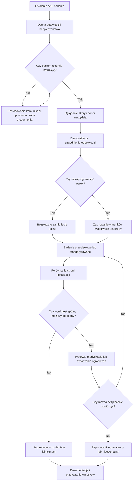
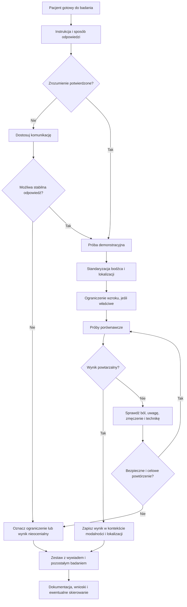

# 5.2. Przygotowanie i zasady badania czucia

> **Zasada przewodnia:** wiarygodne badanie czucia wymaga nie tylko właściwego bodźca, lecz także zrozumiałej instrukcji, ograniczenia podpowiedzi wzrokowych, kontrolowania warunków, porównywania odpowiedzi według jawnych reguł i uczciwego odnotowania niepewności. Brak odpowiedzi nie jest automatycznie dowodem utraty czucia, a odpowiedź niespójna nie upoważnia do przypisywania pacjentowi złej woli.

## Wprowadzenie i zakres rozdziału

Badanie czucia jest częścią badania neurologicznego, w której wynik w znacznym stopniu zależy od współpracy, uwagi, zrozumienia polecenia i sposobu zadawania pytań. W przeciwieństwie do wielu obserwowalnych zjawisk ruchowych, odczuwanie bodźca jest w dużej mierze dostępne badającemu poprzez relację pacjenta. Dlatego nawet prawidłowo dobrane narzędzie nie gwarantuje wiarygodnego wyniku, jeśli pacjent widzi miejsce przyłożenia bodźca, nie rozumie zadania, jest zmęczony, odczuwa ból, doświadcza lęku albo otrzymuje niezamierzone wskazówki od osoby badającej.

Celem tego rozdziału jest przedstawienie praktycznego, powtarzalnego sposobu przygotowania i prowadzenia badania czucia u osoby dorosłej, w tym pacjenta geriatrycznego. Nacisk położono na przekazywanie instrukcji, zasłonięcie informacji wzrokowej wtedy, gdy jest to potrzebne, porównywanie stron i obszarów symetrycznych, kontrolowanie kolejności bodźców, ocenę jakości odpowiedzi oraz uwzględnianie ograniczeń poznawczych, językowych, bólowych i emocjonalnych.

Rozdział **nie powtarza** ogólnego przygotowania pacjenta, weryfikacji tożsamości, uzyskiwania zgody, przygotowania pomieszczenia i oceny ryzyka upadku opisanych w rozdziale 1.5. Nie zastępuje też zasad higieny rąk, środków ochrony indywidualnej i pełnego systemu dekontaminacji przedstawionych w rozdziale 1.7. Zagadnienia te są tutaj przywoływane wyłącznie w zakresie niezbędnym dla specyfiki badania czucia. Ogólną kolejność badania neurologicznego przedstawia rozdział 1.8, neuroanatomię i fizjologię czucia – rozdział 5.1, a szczegółowe techniki poszczególnych modalności będą omawiane w kolejnych podrozdziałach modułu 5.

**Granice zakresu:** ten rozdział dotyczy zasad jakości i organizacji badania. Nie jest pełną instrukcją badania czucia dotyku, bólu, temperatury, wibracji, propriocepcji ani czucia korowego. Nie ustanawia uniwersalnych norm progowych dla wszystkich narzędzi i lokalizacji anatomicznych. W formalnych klasyfikacjach, badaniach przesiewowych i protokołach walidowanych należy stosować dokładnie właściwy dla nich formularz, kolejność, narzędzia i kryteria interpretacji.

---

## 1. Cele kształcenia i efekty uczenia się

### 1.1. Cel ogólny

Celem jest przygotowanie uczestnika do przeprowadzenia badania czucia w sposób bezpieczny, zrozumiały dla pacjenta, możliwie obiektywny i powtarzalny, a następnie do oddzielenia wyniku samej próby od ograniczeń, które mogły wpłynąć na odpowiedź.

### 1.2. Szczegółowe efekty uczenia się

Po ukończeniu rozdziału uczestnik:

1. wyjaśnia, dlaczego badanie czucia jest zależne od współpracy i standaryzacji;
2. przygotowuje pacjenta do prób czuciowych bez niepotrzebnego powtarzania ogólnych czynności organizacyjnych;
3. przekazuje krótką, neutralną i zrozumiałą instrukcję;
4. sprawdza, czy pacjent rozumie rodzaj oczekiwanej odpowiedzi;
5. rozpoznaje sytuacje, w których należy ograniczyć bodźce wzrokowe;
6. odróżnia zasłonięcie oczu od pozbawienia pacjenta niezbędnej orientacji i poczucia bezpieczeństwa;
7. porównuje strony ciała, obszary symetryczne oraz lokalizacje dystalne i proksymalne;
8. dobiera kolejność prób do celu badania, nie naruszając wymogów protokołów standaryzowanych;
9. stosuje losową lub zrównoważoną kolejność bodźców w badaniu przyłóżkowym, gdy jest to uzasadnione;
10. rozumie rolę prób kontrolnych i prób pozorowanych, a także ich ograniczenia;
11. ocenia wpływ uwagi, zmęczenia, bólu, lęku, afazji, niedosłuchu, zaburzeń widzenia i zaburzeń poznawczych;
12. rozpoznaje, kiedy wynik należy oznaczyć jako niewiarygodny, niepełny lub niemożliwy do oceny;
13. stosuje zasady bezpiecznego używania narzędzi czuciowych i zapobiegania zakażeniom;
14. dokumentuje modalność, lokalizację, warunki, odpowiedź, powtarzalność i ograniczenia;
15. rozpoznaje sygnały alarmowe wymagające pilnej oceny medycznej.

### 1.3. Kompetencje i odpowiedzialność

Zakres samodzielnego badania, interpretacji i podejmowania decyzji zależy od kwalifikacji zawodowych, uprawnień, stanu pacjenta oraz procedur obowiązujących w danym podmiocie. Materiał ma charakter dydaktyczny. Nie upoważnia do przekraczania kompetencji, samodzielnego rozpoznawania chorób wymagających diagnostyki lekarskiej ani do opóźniania pomocy w stanie nagłym.

---

## 2. Dlaczego przygotowanie specyficzne dla badania czucia jest tak ważne?

### 2.1. Wynik jest współtworzony przez pacjenta i badającego

W badaniu czucia należy rozróżnić co najmniej cztery elementy:

- **bodziec** – to, co badający rzeczywiście zastosował;
- **percepcję** – to, co pacjent odebrał i uświadomił sobie;
- **odpowiedź** – sposób, w jaki pacjent przekazał informację;
- **interpretację** – wniosek badającego na podstawie odpowiedzi i warunków próby.

Błąd na dowolnym etapie może zmienić wynik. Bodziec zbyt słaby lub zbyt silny może nie odpowiadać celowi testu. Pacjent może nie rozumieć, czy ma zgłaszać samo odczucie, jego jakość, lokalizację czy porównanie intensywności. Odpowiedź może być opóźniona z powodu afazji, niedosłuchu albo spowolnienia poznawczego. Badający może natomiast nieświadomie naprowadzać pacjenta mimiką, rytmem ruchu, komentarzem lub przewidywalną kolejnością dotykania.

### 2.2. Badanie czucia jest badaniem psychofizycznym

Próba czuciowa łączy właściwości fizycznego bodźca z subiektywną percepcją i decyzją o odpowiedzi. W badaniu progowym wynik zależy między innymi od siły bodźca, zmienności receptorowej, uwagi, kryterium odpowiedzi i prawdopodobieństwa oczekiwania bodźca. W badaniu różnicowania wynik zależy od tego, czy pacjent potrafi odróżnić dwa rodzaje lub dwa poziomy bodźca, a nie tylko stwierdzić, że „coś poczuł”.

W praktyce klinicznej nie zawsze da się oddzielić wszystkie te składniki. Można jednak ograniczyć błędy poprzez standaryzację instrukcji, miejsca, czasu, siły, kolejności i sposobu zapisu.

### 2.3. Wpływ oczekiwań i wskazówek

Pacjent może odpowiadać zgodnie z rzeczywistym odczuciem, ale jego odpowiedź może być również modyfikowana przez:

- widok ręki badającego i narzędzia;
- odgłos przygotowywania narzędzia;
- ruch ciała badającego przed dotknięciem;
- stały rytm i przewidywalną kolejność bodźców;
- pytania sugerujące oczekiwaną odpowiedź;
- komentarze typu „teraz powinno być mocniej”;
- mimikę, skinienie głową lub zmianę tonu głosu;
- wcześniejsze ujawnienie miejsca, które będzie badane.

Nie oznacza to, że pacjent świadomie udziela odpowiedzi niezgodnych z odczuciem. Są to zwykłe mechanizmy uwagi, oczekiwania i uczenia się. Zadaniem badającego jest ograniczyć wpływ tych czynników, nie zaś oceniać moralnie zachowanie pacjenta.

### 2.4. Zasada minimalnego, ale wystarczającego badania

Celem nie jest wykonanie największej liczby dotknięć. Celem jest uzyskanie danych wystarczających do odpowiedzi na pytanie kliniczne. Nadmierne powtarzanie bodźców może wywołać habituację, adaptację, dyskomfort, ból, zmęczenie i utratę koncentracji. Należy rozpocząć od krótkiego badania przesiewowego, a następnie rozszerzać je tylko tam, gdzie wynik, objawy lub hipoteza lokalizacyjna tego wymagają.

---

## 3. Pytanie kliniczne przed pierwszym bodźcem

### 3.1. Ustalenie celu próby

Przed badaniem należy wiedzieć, czego poszukuje się w danej części oceny. Przykładowe pytania:

- Czy pacjent wykrywa lekki dotyk?
- Czy rozróżnia bodziec ostry i tępy?
- Czy rozpoznaje kierunek ruchu palca?
- Czy odbiera wibrację i czy potrafi wskazać moment jej ustania?
- Czy istnieje różnica między prawą i lewą stroną?
- Czy zaburzenie ma charakter dystalny, proksymalny, dermatomalny lub obszarowy?
- Czy pacjent prawidłowo integruje bodźce obustronne?
- Czy wynik jest zgodny z wywiadem i innymi elementami badania?

Nie należy zaczynać od nieukierunkowanego „sprawdzania wszystkiego”. Wstępny cel pomaga dobrać bodziec, lokalizację, instrukcję i sposób zapisu.

### 3.2. Hipoteza nie może zastąpić obserwacji

Wstępna hipoteza lokalizacyjna może ukierunkować wybór obszarów, ale nie może prowadzić do zadawania pytań sugerujących. Jeżeli na podstawie wywiadu podejrzewa się radikulopatię, nie należy pytać: „Czy tutaj, w obszarze tego korzenia, czuje Pan mniej?”. Należy zastosować neutralną instrukcję i porównać odpowiedź w zaplanowanych lokalizacjach.

### 3.3. Badanie przesiewowe i badanie ukierunkowane

| Rodzaj badania | Cel | Zakres | Zasada organizacji |
|---|---|---|---|
| Przesiewowe | Wykrycie wyraźnego deficytu | Wybrane modalności i punkty reprezentatywne | Krótkie, porównawcze, bez nadmiernego powtarzania |
| Ukierunkowane | Sprawdzenie hipotezy lokalizacyjnej | Obszary wynikające z wywiadu i badania | Większa gęstość punktów, kontrola granic obszaru |
| Standaryzowane | Klasyfikacja lub pomiar według określonego narzędzia | Dokładnie wskazane punkty i modalności | Bez samowolnej zmiany procedury |
| Kontrolne w czasie | Ocena zmiany | Te same punkty, narzędzia i warunki, o ile to możliwe | Porównanie z wcześniejszym zapisem i odnotowanie różnic warunków |

---

## 4. Instrukcja dla pacjenta

### 4.1. Cechy dobrej instrukcji

Instrukcja powinna być:

1. krótka;
2. konkretna;
3. pozbawiona żargonu;
4. zgodna z rzeczywistym zadaniem;
5. neutralna – bez sugerowania, jaka odpowiedź jest prawidłowa;
6. przekazana przed rozpoczęciem próby;
7. dostosowana do języka i możliwości komunikacyjnych pacjenta.

Nie należy łączyć w jednym poleceniu kilku zadań, jeżeli pacjent może mieć trudności z pamięcią roboczą lub rozumieniem złożonych instrukcji.

### 4.2. Przykładowy skrypt ogólny

> „Za chwilę będę delikatnie dotykać różnych miejsc na rękach i nogach. Proszę powiedzieć, kiedy poczuje Pan/Pani dotyk. Czasami dotknę prawej strony, czasami lewej, a czasami nie dotknę wcale. Proszę odpowiadać zgodnie z tym, co Pan/Pani rzeczywiście odczuwa. Nie ma potrzeby zgadywania. Jeżeli polecenie będzie niejasne albo poczuje Pan/Pani ból, proszę mi powiedzieć.”

Instrukcję należy zmodyfikować dla konkretnej modalności. Jeżeli zadaniem jest porównanie intensywności, pacjent powinien wiedzieć, że ma wskazać różnicę. Jeżeli zadaniem jest określenie kierunku ruchu, należy użyć prostych określeń „w górę” i „w dół” albo uzgodnionych odpowiedników.

### 4.3. Uzgodnienie sposobu odpowiedzi

Przed próbą należy ustalić, czy pacjent będzie:

- mówił „tak/nie”;
- nazywał jakość bodźca;
- wskazywał miejsce;
- wybierał odpowiedź z dwóch lub kilku możliwości;
- sygnalizował odpowiedź ruchem palca, dłonią lub innym uzgodnionym gestem.

Ważne jest, aby sygnał niewerbalny był jednoznaczny. Samo poruszenie kończyną może być reakcją odruchową, odruchem obronnym lub ruchem mimowolnym, a nie świadomym potwierdzeniem percepcji.

### 4.4. Sprawdzenie zrozumienia – próba demonstracyjna

Przed właściwym badaniem można przeprowadzić próbę demonstracyjną w obszarze, w którym pacjent prawdopodobnie prawidłowo odbiera bodziec. Najpierw wyjaśnia się zadanie, następnie stosuje jeden lub dwa łatwe do rozpoznania bodźce i prosi pacjenta o opisanie, co ma zrobić.

Przykład:
1. Badający wyjaśnia, że pacjent ma powiedzieć „czuję”.
2. Za zgodą pacjenta pokazuje narzędzie i demonstruje bezpieczny bodziec na dłoni lub przedramieniu.
3. Pacjent powtarza własnymi słowami, czego oczekuje się od niego podczas próby.
4. Badający sprawdza, czy pacjent odróżnia „czuję bodziec” od „wiem, że badający dotyka”.
5. Dopiero po potwierdzeniu zrozumienia przechodzi do właściwego badania.

Próba demonstracyjna nie służy do ustalenia normy ani do „nauczenia” pacjenta oczekiwanych odpowiedzi. Jej celem jest upewnienie się, że instrukcja została zrozumiana.

### 4.5. Informowanie bez naprowadzania

Dopuszczalne są komunikaty neutralne:
- „Dziękuję, proszę odpowiadać dalej w ten sam sposób.”
- „Proszę powiedzieć, jeśli nie ma Pan/Pani pewności.”
- „Możemy zrobić krótką przerwę.”
- „Czy instrukcja jest nadal jasna?”

Należy unikać:
- „Dobrze, teraz na pewno Pan/Pani poczuje.”
- „Tutaj powinno być słabiej.”
- „Czy po lewej stronie jest gorzej?”
- „Proszę się bardziej postarać.”
- „Przecież przed chwilą Pan/Pani to czuł(a).”

Pochwała za samą zgodność z oczekiwaniem może zmieniać kryterium odpowiedzi. Wsparcie powinno dotyczyć wysiłku i komfortu, a nie kierunku odpowiedzi.

---

## 5. Ograniczenie informacji wzrokowej

### 5.1. Dlaczego pacjent zamyka oczy?

W wybranych próbach zasłonięcie informacji wzrokowej ogranicza możliwość przewidywania miejsca, czasu i rodzaju bodźca. Pozwala ocenić, czy odpowiedź wynika z percepcji somatosensorycznej, a nie z obserwowania ręki badającego, narzędzia lub ruchu kończyny.

Zamknięcie oczu jest szczególnie użyteczne w próbach:
- wykrywania dotyku;
- rozróżniania bodźca ostrego i tępego;
- lokalizacji miejsca dotyku;
- oceny wibracji;
- oceny czucia ułożenia i kierunku ruchu biernego;
- wybranych prób czucia dyskryminacyjnego.

### 5.2. Kiedy nie należy automatycznie zamykać oczu?

Nie każda próba wymaga eliminacji wzroku. Niektóre zadania dotyczą integracji wzrokowo-somatosensorycznej, rozpoznawania przedmiotu w kontekście funkcjonalnym lub oceny wpływu informacji wzrokowej na postawę. W takich sytuacjach zasłonięcie oczu zmienia samo zadanie.

Nie należy także nakazywać zamknięcia oczu, jeżeli:
- pacjent odczuwa nasilony lęk lub dezorientację;
- ma zaburzenia świadomości;
- nie rozumie polecenia;
- potrzebuje kontroli wzrokowej dla zachowania bezpiecznej pozycji;
- zamknięcie oczu może zwiększyć ryzyko upadku;
- ma zaburzenia zachowania lub doświadcza objawów psychotycznych, które nasilają się przy ograniczeniu bodźców wzrokowych.

W takich sytuacjach należy zmodyfikować pozycję, zastosować delikatne zasłonięcie pola widzenia, wykonać próbę w bezpiecznym ułożeniu albo oznaczyć, że standardowego warunku nie udało się uzyskać.

### 5.3. Jak ograniczyć wzrok bez utraty poczucia bezpieczeństwa?

1. Wyjaśnić cel zamknięcia oczu.
2. Uzyskać zgodę pacjenta.
3. Upewnić się, że pacjent znajduje się w stabilnej pozycji.
4. Poprosić o zamknięcie oczu, zamiast niespodziewanie zakładać opaskę.
5. Nie zasłaniać oczu materiałem uciskającym ani nie dotykać powiek.
6. Zapowiedzieć, że badający pozostaje obok i będzie informował o zakończeniu próby.
7. W razie dyskomfortu natychmiast przerwać lub zmienić warunki.

### 5.4. Kontrola pozostałych wskazówek

Zamknięcie oczu nie usuwa wszystkich wskazówek. Pacjent może rozpoznawać moment bodźca na podstawie:
- odgłosu narzędzia;
- ruchu powietrza;
- przesunięcia pościeli;
- dotyku badającego w sąsiedztwie;
- napięcia mięśni lub ruchu stawu;
- rytmu powtarzanych prób.

Należy ograniczyć zbędne dźwięki i ruchy, nie wykonywać przesadnie przewidywalnych sekwencji i nie zmieniać innych warunków w sposób, który utrudnia porównanie.

---

## 6. Porównywanie stron i obszarów symetrycznych

### 6.1. Dlaczego porównanie jest ważne?

Porównanie prawej i lewej strony może ujawnić asymetrię, której pacjent nie opisuje spontanicznie. Jest szczególnie przydatne w podejrzeniu uszkodzenia jednostronnego, radikulopatii, mononeuropatii, zespołu rdzeniowego lub uszkodzenia ośrodkowego.

Porównanie nie oznacza jednak, że jedna strona zawsze stanowi prawidłową normę. Obie strony mogą być zajęte, na przykład w polineuropatii, chorobie metabolicznej, niedoborowej, toksycznej lub neurodegeneracyjnej.

### 6.2. Zasady porównania

- porównywać te same punkty anatomiczne;
- stosować ten sam rodzaj i możliwie tę samą intensywność bodźca;
- zachować podobny czas kontaktu i sposób przyłożenia;
- unikać podpowiadania, którą stronę bada się;
- zapisywać różnicę jakościową i ilościową, jeżeli można ją wiarygodnie określić;
- nie zakładać symetrii, jeżeli wywiad wskazuje na obustronne objawy;
- w razie potrzeby porównać również obszar dystalny z proksymalnym.

### 6.3. Porównanie parami a sekwencja naprzemienna

W prostym badaniu przesiewowym można zastosować porównanie parami: najpierw prawy punkt, potem odpowiadający mu punkt po lewej stronie. W badaniu ukierunkowanym można przeplatać lokalizacje, aby zmniejszyć wpływ przewidywania. W protokole formalnym kolejność musi odpowiadać instrukcji danego narzędzia.

### 6.4. Porównanie dystalno-proksymalne

Jeżeli pacjent zgłasza zaburzenia w obrębie kończyn, warto porównać:
- punkt dystalny z sąsiednim proksymalnym;
- kilka poziomów wzdłuż tej samej kończyny;
- obszary odpowiadające różnym nerwom;
- obszary odpowiadające sąsiednim dermatomom.

Pozwala to lepiej określić topografię, ale nie zastępuje szczegółowego mapowania ani badań dodatkowych. Wybór punktów i ich interpretacja powinny uwzględniać anatomię opisaną w rozdziale 5.1.

### 6.5. Przykład

Pacjent zgłasza „drętwienie całej stopy”. W badaniu przesiewowym należy unikać ograniczenia się do jednego punktu na paluchu. Warto porównać kilka obszarów grzbietu i podeszwy stopy oraz wybrane punkty bardziej proksymalne, stosując ten sam bodziec. Jeżeli deficyt dotyczy obu stóp, symetria nie wyklucza patologii – może być zgodna z długościowo zależnym wzorcem polineuropatii.

---

## 7. Kolejność i losowość bodźców

### 7.1. Po co zmieniać kolejność?

Stała, łatwa do przewidzenia sekwencja może prowadzić do zgadywania, antycypacji i automatycznego powtarzania odpowiedzi. Naprzemienne lub pseudolosowe rozmieszczenie prób pomaga ocenić, czy odpowiedź jest związana z rzeczywistym bodźcem, a nie z oczekiwaniem pacjenta.

### 7.2. Losowość nie oznacza chaosu

W badaniu przyłóżkowym można użyć zrównoważonej sekwencji, w której:
- strony są przeplatane;
- bodźce występują w zmiennej kolejności;
- odstępy czasowe nie są identyczne;
- pojawiają się przerwy;
- nie występuje długi przewidywalny ciąg jednego rodzaju bodźca.

Nie należy jednak tworzyć przypadkowej sekwencji, której nie da się odtworzyć w badaniu kontrolnym. Jeżeli wynik ma być porównywany w czasie, warto zapisać zastosowaną sekwencję lub przynajmniej zasadę jej tworzenia.

### 7.3. Kiedy zachować ściśle określoną kolejność?

W narzędziach standaryzowanych należy bezwzględnie stosować procedurę określoną przez twórców. Dotyczy to między innymi:
- ISNCSCI w klasyfikacji uszkodzeń rdzenia kręgowego;
- określonych protokołów oceny ochronnego czucia stóp;
- badań klinicznych, w których kolejność jest częścią zatwierdzonego protokołu;
- pomiarów wymagających porównania z normami danego narzędzia.

Nie wolno samowolnie zmieniać kolejności, liczby prób, lokalizacji, narzędzi ani sposobu punktowania, a następnie przedstawiać wyniku jako uzyskanego zgodnie z pełnym protokołem.

### 7.4. Przykładowa sekwencja przesiewowa

W nieformalnym badaniu przyłóżkowym można przygotować sekwencję zrównoważoną, np.:
- prawa dłoń;
- lewa dłoń;
- lewe przedramię;
- pozorowana przerwa bez bodźca;
- prawe przedramię;
- lewa stopa;
- prawa stopa.

Nie jest to uniwersalny protokół ani zestaw normatywny. Kolejność należy dostosować do celu badania i zapisać, jeżeli ma znaczenie dla interpretacji.

### 7.5. Unikanie serii przewidywalnych

Jeżeli pacjent otrzymuje kolejno pięć bodźców po prawej stronie, a następnie pięć po lewej, może rozpoznać schemat. W próbie przesiewowej lepsze może być przeplatanie stron. W formalnym protokole nie należy jednak zmieniać kolejności przewidzianej w formularzu.

---

## 8. Próby pozorowane i kontrola odpowiedzi

### 8.1. Czym jest próba pozorowana?

Próba pozorowana polega na zadaniu pytania lub zachowaniu procedury w taki sposób, aby w danym momencie nie wystąpił właściwy bodziec. Jej celem jest sprawdzenie, czy pacjent zgłasza odczucie wyłącznie wtedy, gdy bodziec rzeczywiście zastosowano, czy także w jego braku.

Próby pozorowane mogą być przydatne w określonych, zwalidowanych protokołach. Nie należy jednak automatycznie wprowadzać ich do każdej próby czuciowej.

### 8.2. Przykłady zastosowania

Wytyczne IWGDF dotyczące oceny ochronnego czucia stóp opisują konkretne postępowanie z monofilamentem 10 g i kamertonem 128 Hz, obejmujące powtórzenia oraz co najmniej jedną próbę bez właściwego bodźca. Dla określonych lokalizacji i procedury wynik jest interpretowany według wskazanego kryterium dwóch poprawnych odpowiedzi na trzy próby. Tego progu nie należy przenosić na wszystkie modalności, wszystkie obszary ciała ani wszystkie narzędzia.

### 8.3. Ograniczenia prób pozorowanych

- Pacjent może reagować na subtelne wskazówki ruchowe lub dźwiękowe.
- Odpowiedź może zależeć od uwagi i zrozumienia instrukcji.
- Brak odpowiedzi może wynikać z opóźnienia reakcji, a nie z braku percepcji.
- Próba pozorowana może zwiększać niepokój, jeśli nie została wcześniej wyjaśniona.
- Nadmierna liczba prób może prowadzić do zmęczenia i spadku koncentracji.
- Pojedyncza odpowiedź w próbie pozorowanej nie stanowi dowodu symulacji.

### 8.4. Zasada etyczna

Próba pozorowana nie jest narzędziem do wykrywania kłamstwa. Nie wolno na jej podstawie rozstrzygać, że pacjent celowo symuluje, wyolbrzymia lub zataja objawy. Wynik powinien być opisany neutralnie, np. „odpowiedź nie była powtarzalna w próbach z bodźcem i bez bodźca; interpretacja ograniczona”.

---

## 9. Standaryzacja bodźca i narzędzia

### 9.1. Podstawowe parametry bodźca

Dla każdej próby należy kontrolować, o ile to możliwe:
- rodzaj narzędzia;
- powierzchnię kontaktu;
- siłę lub nacisk;
- czas kontaktu;
- kierunek i szybkość ruchu;
- lokalizację anatomiczną;
- temperaturę narzędzia, jeżeli ma znaczenie;
- liczbę powtórzeń;
- odstępy między bodźcami.

W praktyce nie każdy parametr można dokładnie zmierzyć, ale trzeba unikać dużych, niezamierzonych różnic pomiędzy stronami i kolejnymi badaniami.

### 9.2. Bodziec zbyt silny i zbyt słaby

Bodziec zbyt silny może wywołać ból, reakcję obronną, odruch wycofania lub długotrwałą nadwrażliwość. Bodziec zbyt słaby może być niewykrywalny nawet u osoby bez zaburzeń, zwłaszcza w niekorzystnych warunkach. Należy stosować bodziec adekwatny do testowanej modalności i narzędzia, a nie zwiększać go gwałtownie w celu uzyskania odpowiedzi.

### 9.3. Narzędzia jednorazowe i wielorazowe

W zależności od badania można stosować:
- jednorazowe aplikatory z miękką końcówką;
- jednorazowe narzędzia do oceny ostrości;
- monofilamenty o określonej sile;
- kamerton o określonej częstotliwości;
- przyrządy do różnicowania dwóch punktów;
- specjalistyczne zestawy do badania czucia.

Narzędzie powinno być przeznaczone do danego zastosowania, sprawne, czyste i używane zgodnie z instrukcją producenta oraz lokalną procedurą. Nie należy improwizować narzędziami, które mogą uszkodzić skórę lub nie zapewniają powtarzalnego bodźca.

### 9.4. Kontrola stanu narzędzia

Przed badaniem należy sprawdzić:
- czy narzędzie nie jest uszkodzone;
- czy końcówka nie jest zdeformowana;
- czy monofilament nie jest trwale wygięty;
- czy kamerton nie ma pęknięć ani zniekształceń;
- czy skala i oznaczenia są czytelne;
- czy narzędzie jest właściwie zdezynfekowane lub jednorazowe;
- czy warunki jego przechowywania były zgodne z zaleceniami.

W przypadku monofilamentów siła zginania może zmieniać się w wyniku intensywnego używania i starzenia. Należy przestrzegać zaleceń producenta i wytycznych dotyczących odpoczynku, kontroli i wymiany przyrządu.

### 9.5. Nie należy stosować bodźców uszkadzających skórę

Badanie czucia nie powinno powodować niepotrzebnego naruszenia ciągłości skóry. W razie potrzeby oceny rozróżniania ostrości należy używać odpowiedniego, bezpiecznego, jednorazowego narzędzia, z właściwą techniką i bez nadmiernego nacisku. Nie wolno używać igieł wielorazowych, ostrych przedmiotów domowych, zszywek ani narzędzi o niekontrolowanej ostrości.

Nie wykonuje się prób bólowych na owrzodzeniach, ranach, skórze zakażonej, martwiczej, silnie uszkodzonej ani w miejscu, w którym bodziec może pogorszyć stan tkanek. W takich sytuacjach wybiera się bezpieczną alternatywną lokalizację albo odstępuje od próby i zapisuje przyczynę.

---

## 10. Warunki środowiskowe i pozycja pacjenta

### 10.1. Spokój i ograniczenie rozproszeń

Badanie należy przeprowadzić w możliwie cichym miejscu. Telewizor, rozmowy osób postronnych, dźwięki aparatury, powiadomienia telefoniczne i częste wchodzenie personelu mogą utrudniać koncentrację. Nie zawsze da się całkowicie wyeliminować hałas, dlatego należy go odnotować, jeśli wpływa na jakość próby.

### 10.2. Temperatura i stan skóry

Zimna kończyna, wychłodzenie, obrzęk, nadmierna suchość skóry, potliwość, zrogowacenia i blizny mogą zmieniać odczuwanie bodźców lub sposób ich przekazywania. Przed próbą należy obejrzeć badaną okolicę i uwzględnić:
- temperaturę skóry;
- obrzęk;
- rany i otarcia;
- blizny;
- modzele i zrogowacenia;
- zmiany zapalne;
- deformacje;
- opatrunki;
- obecność wkłuć, cewników i innych urządzeń.

Nie należy ogrzewać ani chłodzić skóry w sposób niekontrolowany tylko po to, aby „wyrównać” warunki. W razie znacznej różnicy temperatury lub zmian skórnych należy zapisać ograniczenie i dobrać bezpieczny obszar.

### 10.3. Pozycja

Pozycja powinna:
- zapewniać wygodę i stabilność;
- umożliwiać dostęp do badanych obszarów;
- ograniczać napięcie mięśni;
- nie powodować ucisku na nerwy i naczynia;
- umożliwiać bezpieczne zasłonięcie wzroku, jeśli jest to potrzebne.

Badanie czucia kończyn można zwykle przeprowadzać w pozycji siedzącej lub leżącej, zależnie od stanu pacjenta i celu. Próby równowagi lub chodu nie są częścią tego rozdziału i wymagają odrębnej asekuracji.

### 10.4. Ograniczenia pozycji

Jeżeli pacjent nie może przyjąć standardowej pozycji z powodu bólu, przykurczu, urazu, duszności lub niestabilności, należy zmodyfikować ułożenie. Wynik należy opisać jako uzyskany w warunkach zmodyfikowanych. Nie wolno porównywać go bez zastrzeżeń z pomiarem wykonanym w standardowej pozycji.

---

## 11. Procedura badania – krok po kroku

Poniższy schemat jest ramą organizacyjną dla przyłóżkowego badania czucia. Nie zastępuje szczegółowych protokołów modalności ani narzędzi standaryzowanych.

### Krok 1. Ustalenie celu i przegląd informacji

- Zapoznaj się z powodem badania i objawami zgłaszanymi przez pacjenta.
- Ustal, czy badanie ma być przesiewowe, ukierunkowane, kontrolne czy formalnie standaryzowane.
- Zidentyfikuj obszary, które wymagają szczególnej ostrożności.
- Sprawdź, czy nie występują objawy alarmowe wymagające pilnego postępowania.

### Krok 2. Potwierdzenie gotowości pacjenta

- Zapytaj o ból, zmęczenie, zawroty głowy i dyskomfort.
- Ustal, czy pacjent jest w stanie skupić uwagę.
- Sprawdź, czy rozumie język instrukcji.
- Zapewnij możliwość przerwania próby.
- Jeżeli pacjent jest zmęczony lub rozproszony, zaproponuj krótką przerwę.

### Krok 3. Oglądanie badanych obszarów

- Oceń stan skóry.
- Zidentyfikuj miejsca, których nie należy stymulować.
- Sprawdź, czy nie ma opatrunków, ran, owrzodzeń, modzeli i zmian zapalnych.
- Zwróć uwagę na obrzęk, deformacje i ograniczenia ruchu.
- Zapisz istotne ograniczenia przed rozpoczęciem próby.

### Krok 4. Przygotowanie narzędzi

- Dobierz narzędzie do modalności i celu.
- Sprawdź stan techniczny.
- Przygotuj materiały jednorazowe.
- Uporządkuj narzędzia tak, aby nie podpowiadały rodzaju kolejnego bodźca.
- Zapewnij bezpieczne miejsce na zużyte elementy.

### Krok 5. Wyjaśnienie zadania

- Użyj krótkiej, neutralnej instrukcji.
- Uzgodnij sposób odpowiedzi.
- Wyjaśnij, że brak odczucia również jest prawidłową odpowiedzią.
- Powiedz, że pacjent nie powinien zgadywać.
- Ustal sygnał przerwania próby.

### Krok 6. Próba demonstracyjna i sprawdzenie zrozumienia

- Zademonstruj bodziec w bezpiecznej lokalizacji.
- Sprawdź, czy pacjent rozumie zadanie.
- Nie podawaj informacji, która sugeruje wynik badanych punktów.
- W razie nieporozumienia zmień instrukcję, a nie siłę bodźca.

### Krok 7. Ograniczenie wzroku, jeśli wymaga tego próba

- Poproś pacjenta o zamknięcie oczu.
- Upewnij się, że czuje się bezpiecznie.
- Nie używaj opaski, jeśli nie jest potrzebna.
- Jeżeli pacjent nie może zamknąć oczu, rozważ bezpieczną alternatywę i odnotuj modyfikację.

### Krok 8. Badanie wstępne w obszarach reprezentatywnych

- Rozpocznij od bodźców i lokalizacji odpowiednich do pytania klinicznego.
- Używaj porównywalnej techniki po obu stronach.
- Obserwuj odpowiedź, ale nie naprowadzaj pacjenta.
- Zapisuj wyraźne różnice oraz niepewność.

### Krok 9. Porównanie stron i obszarów

- Porównaj punkty symetryczne.
- W razie potrzeby przejdź od obszaru dystalnego do proksymalnego.
- Sprawdź, czy granica zaburzenia jest powtarzalna.
- Nie zakładaj, że strona przeciwna jest zdrowa.
- Jeżeli podejrzewa się deficyt obustronny, użyj dodatkowych punktów odniesienia i danych z wywiadu.

### Krok 10. Kontrola kolejności i powtarzalności

- W badaniu przyłóżkowym przeplataj strony lub lokalizacje, jeśli nie narusza to celu próby.
- W protokole formalnym zachowaj jego kolejność.
- Powtarzaj tylko te próby, których wynik jest niepewny lub wymaga potwierdzenia.
- Nie zwiększaj bez potrzeby liczby bodźców.
- Zapisz liczbę prób, jeśli ma ona znaczenie dla interpretacji.

### Krok 11. Ocena ograniczeń

- Sprawdź, czy odpowiedź mogła być zaburzona przez ból, uwagę, zmęczenie, język lub poznanie.
- Jeżeli odpowiedź jest niespójna, rozważ powtórzenie po krótkiej przerwie.
- Jeżeli nie można uzyskać wiarygodnej odpowiedzi, oznacz wynik jako ograniczony lub nieocenialny.
- Nie przypisuj automatycznie przyczyny psychogennej.

### Krok 12. Zakończenie i dokumentacja

- Poinformuj pacjenta o zakończeniu próby.
- Zapytaj o dyskomfort lub ból.
- Zabezpiecz i usuń materiały jednorazowe zgodnie z procedurą.
- Oczyść i zdezynfekuj sprzęt wielorazowy.
- Wykonaj higienę rąk.
- Zapisz modalność, lokalizację, warunki, odpowiedź i ograniczenia.
- Przekaż pilne nieprawidłowości zgodnie z procedurą.

### Schemat ogólny

---

## 12. Ocena wiarygodności odpowiedzi

### 12.1. Wiarygodność nie jest cechą charakteru pacjenta

W dokumentacji należy opisywać jakość uzyskanych danych, a nie przypisywać pacjentowi intencje. Określenie „niewiarygodny pacjent” jest nieprecyzyjne i stygmatyzujące. Lepsze sformułowania to:
- „odpowiedzi zmienne między powtórzeniami”;
- „brak możliwości potwierdzenia wyniku z powodu ograniczonej uwagi”;
- „próba nieocenialna z powodu afazji i braku ustalonego sposobu odpowiedzi”;
- „wynik ograniczony przez ból przy stymulacji”;
- „nie udało się uzyskać powtarzalnego rozróżnienia bodźca”.

### 12.2. Elementy oceny

| Element | Co ocenić? | Możliwe ograniczenie |
|---|---|---|
| Rozumienie | Czy pacjent rozumie zadanie? | Afazja, niedosłuch, bariera językowa |
| Uwaga | Czy utrzymuje koncentrację? | Majaczenie, zmęczenie, ból |
| Detekcja | Czy zgłasza obecność bodźca? | Deficyt czuciowy, próg bodźca |
| Dyskryminacja | Czy rozróżnia jakość lub kierunek? | Zaburzenia korowe, poznawcze |
| Lokalizacja | Czy wskazuje miejsce bodźca? | Zaburzenia uwagi przestrzennej |
| Powtarzalność | Czy odpowiedzi są zbliżone w powtórzeniach? | Wahania uwagi, zmienność bodźca |
| Zgodność z innymi danymi | Czy wynik pasuje do wywiadu i badania? | Wielopoziomowe lub mieszane uszkodzenie |

### 12.3. Zgodność odpowiedzi

Nie należy oczekiwać identycznych odpowiedzi w każdej próbie. Percepcja ma naturalną zmienność, a próg wykrywania może zależeć od uwagi i intensywności bodźca. Ważne jest, czy odpowiedzi tworzą powtarzalny wzorzec, a nie czy każda pojedyncza próba daje ten sam rezultat.

### 12.4. Powtarzanie próby

Powtórzenie ma sens, gdy:
- instrukcja mogła być niezrozumiała;
- pacjent został rozproszony;
- narzędzie mogło zostać użyte nieprawidłowo;
- odpowiedź była niejednoznaczna;
- trzeba potwierdzić granicę zaburzenia.

Powtórzenie nie powinno być wykonywane w nieskończoność do uzyskania oczekiwanego wyniku. Należy ustalić rozsądną liczbę prób i przerwać, jeżeli dalsze badanie zwiększa dyskomfort lub nie poprawia jakości danych.

### 12.5. Ograniczenia zgodności między badającymi

Badanie czucia jest zależne od umiejętności badającego i współpracy pacjenta. W badaniu zgodności między lekarzami neurologicznymi wykazano jedynie umiarkowaną lub niewielką zgodność dla części wywoływanych objawów, a zgodność dla czucia była niższa niż dla wielu objawów obserwowalnych. Wynik ten uzasadnia szkolenie, standaryzację i precyzyjną dokumentację, a nie rezygnację z badania.

---

## 13. Uwaga, zmęczenie i stan ogólny

### 13.1. Uwaga

Uwaga umożliwia wybór i podtrzymanie informacji istotnej dla zadania. Jej zaburzenia mogą prowadzić do:
- pomijania bodźców;
- opóźnionych odpowiedzi;
- odpowiedzi przypadkowych;
- trudności w utrzymaniu ustalonego sposobu reagowania;
- zwiększonej zmienności wyniku.

Przed rozpoczęciem próby warto ocenić, czy pacjent potrafi skupić się na krótkiej instrukcji i wykonać prosty test zrozumienia.

### 13.2. Zmęczenie

Zmęczenie może być skutkiem choroby, hospitalizacji, bólu, zaburzeń snu, leczenia lub samego długiego badania. Należy:
- planować krótkie serie prób;
- robić przerwy;
- unikać badania wielu modalności bez odpoczynku;
- rozważyć powtórzenie najważniejszych prób po odpoczynku;
- zapisać, jeśli wynik uzyskano w warunkach znacznego zmęczenia.

### 13.3. Ból

Ból może utrudniać koncentrację, zwiększać reakcję obronną i zmieniać interpretację bodźca. W przypadku allodynii nawet lekki bodziec może być bolesny. Nie należy zwiększać intensywności ani wielokrotnie powtarzać bodźca, który wywołuje nasilony ból.

Jeżeli badanie jest konieczne, należy:
- wyjaśnić pacjentowi, że może przerwać próbę;
- rozpocząć od bezpiecznej, mniej bolesnej lokalizacji;
- unikać obszarów z aktywnym uszkodzeniem skóry;
- zapisać, że ból ograniczył ocenę;
- rozważyć inne sposoby uzyskania danych.

### 13.4. Lęk i napięcie emocjonalne

Lęk może powodować nadmierne skupienie na bodźcach, reakcje przestrachu, napięcie mięśni i unikanie próby. Należy wyjaśnić, co będzie wykonywane, zapewnić możliwość przerwania i nie stosować zaskakujących, silnych bodźców.

### 13.5. Leki i substancje

Leki uspokajające, przeciwbólowe, przeciwpadaczkowe, przeciwpsychotyczne i inne substancje wpływające na czuwanie mogą zmieniać uwagę, czas reakcji i zgłaszanie doznań. Nie należy samodzielnie odstawiać ani modyfikować leczenia w celu poprawienia wyniku. W dokumentacji można odnotować znane okoliczności farmakologiczne, jeżeli mają znaczenie dla interpretacji.

---

## 14. Zaburzenia komunikacji i funkcji poznawczych

### 14.1. Afazja

Afazja może utrudniać rozumienie instrukcji lub werbalne zgłaszanie odpowiedzi. Nie jest równoznaczna z utratą czucia ani z brakiem świadomości bodźca.

Możliwe dostosowania:
- krótkie zdania i jedno polecenie naraz;
- demonstracja;
- odpowiedź gestem;
- tablica z prostymi symbolami;
- wybór między dwoma obrazami;
- uzgodniony sygnał ręką;
- obecność przeszkolonego terapeuty komunikacji, jeśli jest dostępny.

Trzeba sprawdzić, czy pacjent nie używa tego samego gestu do potwierdzania i zaprzeczania. Jeżeli nie można uzyskać stabilnego kodu odpowiedzi, należy oznaczyć wynik jako nieocenialny.

### 14.2. Dyzartria

Dyzartria wpływa na wykonanie ruchowe mowy, a niekoniecznie na rozumienie. Można zastosować odpowiedź niewerbalną, tablicę lub proste wskazanie. Nie należy mylić trudności artykulacyjnych z brakiem współpracy.

### 14.3. Niedosłuch

Przy niedosłuchu należy:
- upewnić się, że pacjent ma aparat słuchowy, jeśli go używa;
- mówić wyraźnie, twarzą do pacjenta;
- ograniczyć hałas;
- nie krzyczeć;
- użyć pisemnej lub wizualnej instrukcji, jeśli pacjent ją rozumie;
- sprawdzić, czy pacjent słyszy sygnał odpowiedzi i pytania.

### 14.4. Zaburzenia widzenia

Ubytek wzroku może utrudniać odczytanie instrukcji lub obserwację demonstracji. Można wykorzystać opis słowny, dotykową demonstrację bezpiecznego bodźca i większy kontrast materiałów. Jeżeli badanie wymaga ograniczenia wzroku, należy upewnić się, że pacjent rozumie zadanie bez konieczności obserwowania narzędzia.

### 14.5. Zaburzenia poznawcze i otępienie

W zaburzeniach poznawczych należy:
- stosować krótkie instrukcje;
- ograniczyć liczbę jednocześnie badanych modalności;
- wykonywać próby w porze najlepszego funkcjonowania pacjenta;
- obserwować oznaki zmęczenia i frustracji;
- korzystać z odpowiedzi niewerbalnych, jeśli są stabilne;
- nie wyciągać wniosków o braku czucia na podstawie samego braku odpowiedzi.

Wynik może być częściowo możliwy do oceny. Należy zapisać, które elementy były wiarygodne, a które ograniczone.

### 14.6. Majaczenie

Majaczenie charakteryzuje się ostrym lub podostrym zaburzeniem uwagi i świadomości, zwykle o zmiennym nasileniu. W takim stanie wynik badania czucia może być niestabilny. Należy priorytetowo ocenić przyczynę majaczenia i bezpieczeństwo pacjenta. Badanie czucia ogranicza się do zakresu, który nie zwiększa obciążenia i jest klinicznie uzasadniony.

### 14.7. Bariera językowa

Należy korzystać z profesjonalnego tłumacza, jeżeli jest dostępny. Nie należy opierać oceny na przypadkowym tłumaczeniu przez osobę towarzyszącą, szczególnie w sytuacji, w której odpowiedź pacjenta może mieć znaczenie dla decyzji klinicznej. Można wykorzystać proste gesty, piktogramy i demonstrację, ale trzeba upewnić się, że ich znaczenie jest wspólne dla pacjenta i badającego.

---

## 15. Zaniedbywanie stronne i zaburzenia uwagi przestrzennej

Zaniedbywanie stronne (neglect) jest zaburzeniem uwagi i reprezentacji przestrzennej, a nie prostą utratą czucia obwodowego. Pacjent może nie reagować na bodźce po stronie przeciwnej do uszkodzenia mózgu, szczególnie przy jednoczesnej stymulacji obustronnej.

W badaniu należy rozróżnić:
- brak wykrywania bodźca w pojedynczej stymulacji;
- wygaszanie bodźca podczas stymulacji obustronnej;
- zaburzenie lokalizacji bodźca;
- zaburzenie rozpoznawania części ciała;
- zaburzenie czucia pierwotnego.

Nie należy interpretować wygaszania czuciowego jako dowodu uszkodzenia nerwu obwodowego. Trzeba zestawić wynik z badaniem wzrokowym, ruchem, orientacją przestrzenną, językiem i zachowaniem.

---

## 16. Szczególne zasady w formalnych protokołach

### 16.1. ISNCSCI – klasyfikacja uszkodzeń rdzenia kręgowego

International Standards for Neurological Classification of Spinal Cord Injury (ISNCSCI) jest formalnym standardem oceny neurologicznej i klasyfikacji urazów rdzenia. Wydanie dziewiąte z 2026 roku aktualizuje standard i arkusz. W formalnym zastosowaniu należy:
- korzystać z aktualnego oficjalnego wydania;
- stosować właściwe punkty kluczowe i modalności;
- przestrzegać sposobu punktowania;
- odnotować pozycje niemożliwe do zbadania;
- nie zastępować standardowego formularza własną, zmodyfikowaną wersją;
- korzystać z przeszkolenia i lokalnych zasad dokumentacji.

W standardzie tym ocenia się między innymi lekki dotyk i rozróżnianie ostrego oraz tępego bodźca w określonych punktach dermatomalnych. Nie jest to uniwersalny protokół dla każdego pacjenta neurologicznego. Nie wolno przenosić jego punktacji na inne narzędzia ani odwrotnie.

Oficjalne materiały: [ASIA – ISNCSCI Resources](https://asia-spinalinjury.org/isncsci-resources/). Arkusz ISNCSCI 2026 ma określone warunki licencyjne. Przed reprodukowaniem, modyfikowaniem, tłumaczeniem lub użyciem komercyjnym należy sprawdzić aktualną licencję i uzyskać wymagane pozwolenia: [ASIA – Worksheet Permissions](https://asia-spinalinjury.org/international-standards-neurological-classification-sci-isncsci-worksheet/).

### 16.2. Ocena ochronnego czucia stóp w cukrzycy

Wytyczne IWGDF 2023 opisują ocenę utraty czucia ochronnego między innymi przy użyciu monofilamentu Semmes–Weinstein 10 g oraz kamertonu 128 Hz. Procedura obejmuje określone miejsca, demonstrację, ograniczenie informacji wzrokowej, sposób przyłożenia narzędzia, próby kontrolne i kryteria wyniku.

W protokole monofilamentu 10 g zaleca się:
- demonstrację bodźca na dłoni, łokciu lub czole;
- badanie wybranych punktów obu stóp;
- ustawienie monofilamentu prostopadle do skóry;
- doprowadzenie do jego zgięcia zgodnie z instrukcją;
- unikanie przesuwania po skórze;
- pominięcie owrzodzeń, modzeli, blizn i tkanki martwiczej;
- stosowanie określonej liczby prób i próby bez bodźca;
- interpretację według kryterium przewidzianego dla tego protokołu.

W ocenie wibracji kamertonem 128 Hz należy zapoznać pacjenta z odczuciem, ograniczyć wzrok, stosować określony punkt kostny i porównywalny nacisk oraz w razie braku odczucia przejść do bardziej proksymalnego punktu zgodnie z wytycznymi.

**Ważne ograniczenie:** protokół stopy cukrzycowej służy ocenie utraty czucia ochronnego i ryzyka powikłań stopy. Nie zastępuje pełnego badania neurologicznego, nie lokalizuje samodzielnie uszkodzenia i nie stanowi uniwersalnej normy dla wszystkich modalności.

### 16.3. Badania kliniczne i naukowe

W badaniach naukowych należy przestrzegać zatwierdzonego protokołu, kolejności, kryteriów włączenia, procedur randomizacji, zaślepienia i zasad raportowania. Każda modyfikacja procedury powinna być uzasadniona i udokumentowana. Nie wolno łączyć wyników uzyskanych różnymi metodami bez oceny ich porównywalności.

---

## 17. Normy, ograniczenia i interpretacja

### 17.1. Nie istnieje jedna uniwersalna norma dla całego badania czucia

Wynik zależy od:
- rodzaju receptora i modalności;
- lokalizacji anatomicznej;
- wieku;
- stanu skóry i tkanek;
- temperatury;
- narzędzia;
- siły i czasu bodźca;
- sposobu odpowiedzi;
- uwagi i poznania;
- doświadczenia badającego;
- zastosowanego protokołu.

W badaniu przyłóżkowym często ocenia się jakościowo: prawidłowe, osłabione, zniesione, nadmierne lub nieprawidłowe odczuwanie. Jeżeli stosuje się ilościowe narzędzie, należy użyć norm właściwych dla tego narzędzia, wieku, lokalizacji i populacji.

### 17.2. Różnica między „brak czucia” a „brak odpowiedzi”

Brak odpowiedzi może wynikać z:
- rzeczywistego deficytu;
- niezrozumienia instrukcji;
- braku uwagi;
- opóźnienia odpowiedzi;
- bariery językowej;
- zaburzeń świadomości;
- trudności ruchowych w sygnalizowaniu;
- lęku lub bólu;
- nieprawidłowego zastosowania bodźca.

Dlatego nie należy zapisywać „czucie zniesione”, jeżeli nie ma podstaw do odróżnienia braku percepcji od braku możliwości odpowiedzi. W takiej sytuacji właściwy może być zapis „nieocenialne” albo „wynik ograniczony”.

### 17.3. Wartości referencyjne

Wartości referencyjne są zależne od konkretnego narzędzia. Przykładowo próg ochronnego czucia przy użyciu monofilamentu 10 g ma określone znaczenie w ocenie stopy cukrzycowej. Nie jest to próg prawidłowego czucia dotyku na dowolnej części ciała.

Podobnie wynik badania czucia wibracji kamertonem 128 Hz należy interpretować w kontekście miejsca, wieku, techniki i celu badania. Czas odczuwania wibracji nie jest uniwersalną miarą funkcji wszystkich dróg proprioceptywnych.

### 17.4. Powtarzalność a trafność

Powtarzalność oznacza, że pomiar w podobnych warunkach daje zbliżone wyniki. Trafność oznacza, że narzędzie rzeczywiście mierzy funkcję, którą ma oceniać. Narzędzie może być powtarzalne, ale niekoniecznie trafne dla określonego pytania klinicznego.

Systematyczny przegląd pomiarów lekkiego dotyku i nacisku u dorosłych z chorobami neurologicznymi wykazał, że część metod ma dobrą lub bardzo dobrą rzetelność, ale dowody dotyczące trafności i błędu pomiaru są znacznie mniej kompletne. Autorzy zwrócili uwagę na niską lub bardzo niską jakość dużej części dostępnych badań. Wniosek praktyczny: należy wybierać narzędzia odpowiednie do celu i nie przypisywać wynikom większej precyzji, niż uzasadniają dane.

### 17.5. Ograniczenia porównania między badającymi

Różnice w sile bodźca, tempie, lokalizacji i instrukcji mogą prowadzić do rozbieżności między osobami badającymi. Szkolenie i standaryzacja zmniejszają to ryzyko, ale go nie eliminują. W badaniu kontrolnym najlepiej, jeśli to możliwe, używać tego samego narzędzia, podobnej pozycji, tych samych punktów i zbliżonych warunków.

---

## 18. Bezpieczeństwo pacjenta

### 18.1. Bezpieczeństwo fizyczne

- Nie stosować bodźców o sile mogącej uszkodzić skórę.
- Nie badać bezpośrednio na ranie, owrzodzeniu, tkance martwiczej ani świeżym urazie.
- Nie wywoływać bólu ponad to, co jest konieczne do wykonania właściwej próby.
- Nie wykonywać wielokrotnych prób w miejscu silnej allodynii.
- Utrzymywać kończynę w stabilnym i wygodnym ułożeniu.
- Nie wymuszać pozycji powodującej ból, duszność lub zaburzenia krążenia.
- Przerwać badanie przy nagłym pogorszeniu samopoczucia, nasilonym bólu lub objawach alarmowych.

### 18.2. Kontrola zakażeń

Badanie czucia wymaga kontaktu ze skórą i czasem użycia narzędzi, które mogą naruszyć jej ciągłość. Należy stosować standardowe środki ostrożności:
- higienę rąk przed kontaktem z pacjentem i po badaniu;
- rękawiczki, gdy można przewidywać kontakt z krwią, płynami ustrojowymi, uszkodzoną skórą lub skażonym sprzętem;
- jednorazowe narzędzia do prób, w których może dojść do naruszenia skóry;
- bezpieczne usuwanie ostrych odpadów;
- czyszczenie i dezynfekcję sprzętu wielorazowego zgodnie z instrukcją producenta;
- rozdzielenie sprzętu czystego i użytego.

Rękawiczki nie zastępują higieny rąk. Zasady WHO i CDC obowiązują niezależnie od tego, czy pacjent ma rozpoznane zakażenie.

### 18.3. Ochrona godności i autonomii

Pacjent ma prawo:
- wiedzieć, jaki bodziec będzie stosowany;
- odmówić konkretnej próby;
- poprosić o przerwę;
- zgłosić ból lub dyskomfort;
- otrzymać wyjaśnienie wyniku w zakresie właściwym dla osoby badającej;
- być traktowany bez zawstydzania z powodu trudności z odpowiedzią.

### 18.4. Czerwone flagi – przerwij rutynowe badanie

Pilnej oceny medycznej wymagają między innymi:
- nagłe, jednostronne zaburzenia czucia twarzy, kończyny lub połowy ciała, szczególnie z osłabieniem, zaburzeniami mowy, widzenia lub równowagi;
- nagły, szybko narastający deficyt czuciowy z niedowładem;
- nowy poziom czuciowy na tułowiu;
- zaburzenia czucia w okolicy siodłowej z nowymi zaburzeniami mikcji, defekacji lub funkcji seksualnych;
- szybko postępujące, obustronne zaburzenia czucia z osłabieniem kończyn;
- zaburzenia czucia z dusznością, osłabieniem kaszlu lub dysfagią;
- gorączka, silny ból głowy, sztywność karku i zaburzenia świadomości;
- objawy po urazie kręgosłupa lub głowy;
- nagły, bolesny, blady, zimny lub siniejący obszar kończyny, sugerujący zaburzenie perfuzji.

W razie podejrzenia udaru lub innego stanu nagłego należy uruchomić odpowiednią ścieżkę ratunkową. Nie wolno opóźniać pilnej pomocy przez kontynuowanie szczegółowego badania czucia.

---

## 19. Diagnostyka różnicowa ograniczonej lub niespójnej odpowiedzi

| Możliwa przyczyna | Typowe wskazówki | Postępowanie organizacyjne |
|---|---|---|
| Rzeczywisty deficyt obwodowy | Powtarzalny wzorzec zgodny z nerwem, korzeniem lub polineuropatią | Porównać punkty anatomiczne i inne modalności |
| Uszkodzenie ośrodkowe | Wzorzec połowiczy, skrzyżowany lub poziom czuciowy | Zestawić z siłą, odruchami, funkcjami poznawczymi i objawami alarmowymi |
| Zaburzenie uwagi | Pomijanie prób, duża zmienność, trudność w podtrzymaniu zadania | Krótsze serie, przerwa, uproszczona instrukcja |
| Afazja | Trudność rozumienia lub nazywania odpowiedzi | Demonstracja i uzgodniony sygnał niewerbalny |
| Niedosłuch | Brak reakcji na instrukcję słowną | Poprawa komunikacji, aparat słuchowy, zapis wizualny |
| Ból lub allodynia | Unikanie bodźca, reakcja obronna, nasilone doznania | Zmiana lokalizacji, ograniczenie bodźca, przerwanie przy bólu |
| Majaczenie | Zmienność uwagi i świadomości | Ocena przyczyny majaczenia; ograniczenie badania |
| Zaniedbywanie stronne | Pomijanie strony, wygaszanie przy stymulacji obustronnej | Ocena uwagi przestrzennej i innych funkcji |
| Zaburzenie czynnościowe | Dodatnie cechy kliniczne niespójności lub zmienności, oceniane w odpowiednim kontekście | Nie rozpoznawać na podstawie pojedynczej próby; wymagana kompetentna ocena kliniczna |
| Błąd techniczny | Zmienna siła, lokalizacja, narzędzie lub instrukcja | Powtórzyć po standaryzacji, jeśli bezpieczne |

### 19.1. Zaburzenia czynnościowe a symulacja

Zaburzenia neurologiczne czynnościowe są rzeczywistymi zaburzeniami funkcjonowania układu nerwowego. Nie należy ich utożsamiać z symulacją ani rozpoznawać wyłącznie na podstawie zmienności odpowiedzi. Rozpoznanie wymaga dodatnich cech klinicznych, właściwego kontekstu i kompetencji diagnostycznych. W badaniu czucia można opisać obserwowaną niespójność, ale nie należy samodzielnie przypisywać jej przyczyny.

---

## 20. Dokumentowanie badania czucia

### 20.1. Minimalny zakres dokumentacji

W zapisie powinny znaleźć się:
1. data i godzina badania;
2. cel badania;
3. badane modalności;
4. zastosowane narzędzie;
5. badane okolice i punkty;
6. pozycja pacjenta;
7. informacja, czy ograniczono wzrok;
8. sposób odpowiedzi;
9. wynik po prawej i lewej stronie;
10. liczba powtórzeń, jeśli ma znaczenie;
11. występujące ograniczenia;
12. tolerancja badania i ewentualny ból;
13. wnioski w zakresie danych uzyskanych w próbie;
14. informacja o przekazaniu objawów alarmowych, jeśli wystąpiły.

### 20.2. Przykładowy formularz

| Pole | Zapis |
|---|---|
| Data i godzina | ................................................ |
| Cel badania | ................................................ |
| Modalność | ................................................ |
| Narzędzie | ................................................ |
| Pozycja pacjenta | ................................................ |
| Ograniczenie wzroku | tak / nie / częściowo |
| Instrukcja zrozumiana | tak / częściowo / nie |
| Sposób odpowiedzi | werbalny / gest / wskazanie / inny |
| Prawa strona | ................................................ |
| Lewa strona | ................................................ |
| Porównanie dystalno-proksymalne | ................................................ |
| Powtarzalność | dobra / zmienna / nieocenialna |
| Ograniczenia | ................................................ |
| Tolerancja | dobra / ból / dyskomfort / przerwano |
| Wniosek | ................................................ |

### 20.3. Przykład poprawnego wpisu

„Badanie lekkiego dotyku wykonano w pozycji leżącej. Pacjent zrozumiał instrukcję po demonstracji i odpowiadał werbalnie. W wybranych próbach wzrok ograniczono przez zamknięcie oczu. Porównano symetryczne punkty kończyn górnych i dolnych. Odpowiedzi powtarzalne w obrębie badanych lokalizacji; pacjent zgłaszał mniejszą intensywność bodźca w dystalnej części obu stóp w porównaniu z podudziami. Wynik przesiewowy, nie stanowi samodzielnej diagnozy ani pełnego mapowania dermatomów. Nie zgłoszono bólu podczas próby.”

### 20.4. Przykład zapisu z ograniczeniem

„Próba różnicowania bodźca ostrego i tępego ograniczona z powodu allodynii w obrębie prawej dłoni. Pacjent rozumiał instrukcję, jednak bodziec wywoływał ból i reakcję obronną. Nie zwiększano intensywności ani nie powtarzano wielokrotnie próby. Wynik w tym obszarze oznaczono jako nieocenialny; pozostałe badane lokalizacje oceniono osobno.”

### 20.5. Sformułowania, których należy unikać

| Nieprecyzyjny zapis | Lepszy zapis |
|---|---|
| „Pacjent nic nie czuje” | „Nie zgłaszał percepcji zastosowanego bodźca w badanych punktach; warunki i ograniczenia opisano poniżej” |
| „Czucie złe” | „Osłabione odczuwanie lekkiego dotyku w określonej lokalizacji” |
| „Pacjent nie współpracuje” | „Nie udało się uzyskać stabilnego sposobu odpowiedzi z powodu…” |
| „Pacjent symuluje” | „Odpowiedzi były niespójne; sama obserwacja nie pozwala ustalić przyczyny” |
| „Czucie prawidłowe wszędzie” | „W badanych punktach, w zastosowanych modalnościach, nie stwierdzono wyraźnej asymetrii” |

---

## 21. Przykłady kliniczne

### Przypadek 1. Pacjent z podejrzeniem polineuropatii

**Sytuacja:** osoba z cukrzycą zgłasza pieczenie i drętwienie obu stóp, nasilające się wieczorem.

**Problem organizacyjny:** badanie musi uwzględnić możliwe zrogowacenia, przesuszenie skóry, owrzodzenia i obustronny charakter objawów.

**Postępowanie:**
1. Obejrzeć skórę obu stóp.
2. Nie stymulować bezpośrednio ran i modzeli.
3. Wyjaśnić zadanie i zademonstrować bodziec.
4. Ograniczyć wzrok zgodnie z protokołem.
5. Zastosować odpowiednie narzędzie do oceny ochronnego czucia, jeśli jest to celem.
6. Porównać analogiczne punkty obu stóp.
7. Zapisać, że badanie przesiewowe nie zastępuje pełnej diagnostyki neuropatii.

**Wniosek dydaktyczny:** obustronna symetria nie oznacza prawidłowego czucia. W tym przypadku ważne jest porównanie dystalno-proksymalne i ocena według właściwego protokołu.

### Przypadek 2. Pacjent po udarze z afazją

**Sytuacja:** pacjent rozumie część poleceń, ale nie potrafi nazwać odczucia.

**Problem organizacyjny:** odpowiedź werbalna nie jest wiarygodnym kanałem komunikacji.

**Postępowanie:**
1. Użyć krótkich poleceń i demonstracji.
2. Uzgodnić prosty gest oznaczający „czuję”.
3. Sprawdzić, czy gest jest wykonywany celowo.
4. Przeprowadzić krótką serię prób.
5. Nie traktować braku wypowiedzi jako braku czucia.
6. Zapisać zastosowany sposób komunikacji i jego ograniczenia.

**Wniosek dydaktyczny:** afazja może ograniczać sposób odpowiedzi, ale nie przesądza o zdolności odczuwania bodźca.

### Przypadek 3. Pacjent z majaczeniem

**Sytuacja:** starsza osoba hospitalizowana z powodu infekcji jest okresowo zdezorientowana i ma zmienną uwagę.

**Problem organizacyjny:** wynik może różnić się między kolejnymi próbami i porami dnia.

**Postępowanie:**
1. Ocenić stan świadomości i bezpieczeństwo.
2. Nie wykonywać długiego, wielomodalnego badania.
3. Jeżeli istnieje pilne pytanie kliniczne, ograniczyć się do krótkich, niezbędnych prób.
4. Wykonać przerwę, jeśli uwaga wyraźnie spada.
5. Udokumentować zmienność i stan pacjenta.
6. Priorytetowo przekazać informacje o podejrzeniu majaczenia.

**Wniosek dydaktyczny:** nie należy formułować kategorycznego wniosku o utracie czucia na podstawie badania w okresie znacznego zaburzenia uwagi.

### Przypadek 4. Pacjent z allodynią

**Sytuacja:** lekki dotyk na przedramieniu wywołuje ból i odruchowe cofnięcie kończyny.

**Problem organizacyjny:** bodziec, który u innej osoby jest neutralny, staje się dla pacjenta bolesny.

**Postępowanie:**
1. Wyjaśnić, że pacjent może przerwać próbę.
2. Nie powtarzać wielokrotnie bodźca wywołującego ból.
3. Nie zwiększać siły.
4. Ocenić bezpieczne, mniej bolesne obszary, jeśli jest to potrzebne.
5. Oddzielić informację o detekcji bodźca od reakcji bólowej.
6. Zapisać ograniczenie i tolerancję.

**Wniosek dydaktyczny:** ból nie jest równoznaczny z prawidłowym czuciem wszystkich modalności, a reakcja obronna nie jest miarą siły czucia.

### Przypadek 5. Pacjent z niedosłuchem

**Sytuacja:** pacjent nie reaguje na polecenia słowne, ale utrzymuje kontakt wzrokowy.

**Problem organizacyjny:** brak odpowiedzi może wynikać z nieusłyszenia instrukcji.

**Postępowanie:**
1. Upewnić się, że aparat słuchowy jest dostępny i działa, jeśli pacjent go używa.
2. Ograniczyć hałas.
3. Przekazać instrukcję pisemnie lub za pomocą gestów.
4. Sprawdzić zrozumienie przed badaniem.
5. Uzgodnić sygnał odpowiedzi.
6. Zapisać dostosowanie komunikacji.

**Wniosek dydaktyczny:** nie wolno interpretować braku reakcji na pytanie jako braku percepcji bodźca czuciowego.

### Przypadek 6. Pacjent z możliwym zaniedbywaniem stronnym

**Sytuacja:** po udarze pacjent odpowiada na bodźce po prawej stronie, ale pomija część bodźców po lewej, szczególnie przy stymulacji obustronnej.

**Problem organizacyjny:** wynik może odzwierciedlać zaburzenie uwagi przestrzennej, a nie wyłącznie ubytek czucia pierwotnego.

**Postępowanie:**
1. Sprawdzić odpowiedzi przy pojedynczej stymulacji.
2. Następnie, jeśli jest to bezpieczne i uzasadnione, ocenić reakcję na stymulację obustronną.
3. Zestawić wynik z badaniem wzroku, ruchu i funkcji poznawczych.
4. Opisać wygaszanie, jeżeli zostało zaobserwowane.
5. Nie lokalizować automatycznie deficytu w nerwie obwodowym.

**Wniosek dydaktyczny:** uwaga przestrzenna jest ważnym elementem interpretacji czucia.

### Przypadek 7. Pacjent po urazie rdzenia – formalna klasyfikacja

**Sytuacja:** pacjent jest oceniany w celu określenia neurologicznego poziomu uszkodzenia rdzenia.

**Problem organizacyjny:** nie wystarcza dowolne badanie przesiewowe. Wymagany jest aktualny standard.

**Postępowanie:**
1. Upewnić się, że badający zna aktualny ISNCSCI.
2. Przygotować właściwy oficjalny arkusz.
3. Stosować punkty i modalności określone w standardzie.
4. Zachować zasady punktowania.
5. Oznaczać pozycje nieocenialne zgodnie z formularzem.
6. Nie zastępować arkusza własną tabelą i nie zmieniać kolejności bez podstawy.

**Wniosek dydaktyczny:** formalna klasyfikacja wymaga ścisłej standaryzacji i nie może być utożsamiana z rutynowym badaniem przesiewowym.

### Przypadek 8. Pacjent z dużą męczliwością

**Sytuacja:** osoba z chorobą przewlekłą zgłasza nasilone zmęczenie, a w trakcie badania odpowiedzi stają się coraz wolniejsze.

**Problem organizacyjny:** jakość odpowiedzi pogarsza się w czasie.

**Postępowanie:**
1. Skrócić serię prób.
2. Zastosować przerwę.
3. Wykonać najważniejsze elementy badania w pierwszej kolejności.
4. Nie zwiększać liczby bodźców w celu uzyskania pewności.
5. Powtórzyć wybrane próby po odpoczynku tylko wtedy, gdy jest to uzasadnione.
6. Udokumentować wpływ męczliwości.

**Wniosek dydaktyczny:** spadek jakości odpowiedzi może wynikać z obciążenia badaniem, a nie z narastającego deficytu czuciowego.

---

## 22. Algorytm oceny jakości badania

---

## 23. Lista kontrolna dla osoby badającej

### Przed badaniem

- [ ] Znam cel i rodzaj badania.
- [ ] Sprawdziłem, czy nie występują objawy alarmowe.
- [ ] Pacjent wie, na czym będzie polegała próba.
- [ ] Uzgodniono sposób odpowiedzi.
- [ ] Pacjent rozumie instrukcję.
- [ ] Oceniono ból, zmęczenie i uwagę.
- [ ] Obejrzano skórę i wybrano bezpieczne miejsca.
- [ ] Narzędzia są właściwe i sprawne.
- [ ] W razie protokołu formalnego przygotowano właściwy formularz.

### Podczas badania

- [ ] Stosuję neutralne pytania.
- [ ] Ograniczam wskazówki wzrokowe, gdy jest to właściwe.
- [ ] Nie zmieniam niekontrolowanie siły i czasu bodźca.
- [ ] Porównuję odpowiadające sobie lokalizacje.
- [ ] Zachowuję właściwą kolejność protokołu.
- [ ] Nie powtarzam nadmiernie bodźców.
- [ ] Obserwuję ból, zmęczenie i spadek uwagi.
- [ ] Nie interpretuję braku odpowiedzi automatycznie jako braku czucia.
- [ ] Przerywam próbę, jeśli pojawia się zagrożenie lub istotny dyskomfort.

### Po badaniu

- [ ] Zapisano modalność i lokalizację.
- [ ] Zapisano sposób odpowiedzi i warunki.
- [ ] Opisano ograniczenia.
- [ ] Oddzielono wynik od interpretacji.
- [ ] Zabezpieczono i oczyszczono narzędzia.
- [ ] Wykonano higienę rąk.
- [ ] Przekazano informacje o objawach alarmowych.

---

## 24. Stacje OSCE – ocena umiejętności praktycznych

### Stacja 1. Wyjaśnienie próby i sprawdzenie zrozumienia

**Zadanie:** przygotować pacjenta do badania lekkiego dotyku.

Oceniane elementy:
1. przedstawienie celu próby;
2. neutralna instrukcja;
3. uzgodnienie sygnału odpowiedzi;
4. demonstracja;
5. sprawdzenie zrozumienia;
6. zapytanie o gotowość i możliwość przerwania.

**Błąd krytyczny:** rozpoczęcie badania bez wyjaśnienia zadania lub bez ustalenia sposobu odpowiedzi.

### Stacja 2. Porównanie stron i kontrola wskazówek wzrokowych

**Zadanie:** przeprowadzić krótką próbę porównawczą na symetrycznych punktach kończyn.

Oceniane elementy:
1. właściwy dobór punktów;
2. porównywalny bodziec;
3. ograniczenie wzroku, jeśli jest właściwe;
4. brak naprowadzania;
5. przeplatanie stron w badaniu przyłóżkowym;
6. zapis odpowiedzi.

**Błąd krytyczny:** sugerowanie pacjentowi, po której stronie powinien odczuwać bodziec słabiej.

### Stacja 3. Pacjent z afazją lub niedosłuchem

**Zadanie:** dostosować sposób komunikacji bez rezygnacji z oceny, jeśli jest ona możliwa.

Oceniane elementy:
1. rozpoznanie bariery komunikacyjnej;
2. uproszczenie instrukcji;
3. wykorzystanie demonstracji lub gestu;
4. weryfikacja stabilności sygnału odpowiedzi;
5. opis ograniczeń.

**Błąd krytyczny:** uznanie braku odpowiedzi werbalnej za brak czucia bez próby dostosowania komunikacji.

### Stacja 4. Ocena ograniczonej powtarzalności

**Zadanie:** pacjent udziela zmiennych odpowiedzi i zgłasza zmęczenie.

Oceniane elementy:
1. rozpoznanie możliwych przyczyn zmienności;
2. sprawdzenie techniki;
3. zaproponowanie przerwy;
4. ograniczenie liczby powtórzeń;
5. neutralny opis wyniku;
6. brak nieuprawnionego wniosku o symulacji.

**Błąd krytyczny:** wymuszanie kolejnych bodźców lub przypisywanie pacjentowi intencji bez podstaw.

---

## 25. Pytania kontrolne

### Pytanie 1

Dlaczego w wielu próbach czuciowych prosi się pacjenta o zamknięcie oczu?

A. Aby zwiększyć siłę bodźca.  
B. Aby ograniczyć wpływ wskazówek wzrokowych na odpowiedź.  
C. Aby wywołać odruch.  
D. Aby zmniejszyć przewodnictwo nerwowe.

**Prawidłowa odpowiedź: B.** Ograniczenie wzroku pomaga ocenić odpowiedź na bodziec bez podpowiedzi wynikającej z obserwacji narzędzia lub miejsca kontaktu.

### Pytanie 2

Czy brak odpowiedzi pacjenta zawsze oznacza utratę czucia?

A. Tak.  
B. Nie; może wynikać również z zaburzeń uwagi, komunikacji, świadomości lub techniki.  
C. Tak, jeśli pacjent ma zamknięte oczy.  
D. Tylko u osób starszych.

**Prawidłowa odpowiedź: B.**

### Pytanie 3

Co należy zrobić, gdy pacjent nie rozumie instrukcji?

A. Zwiększyć siłę bodźca.  
B. Powtarzać próbę bez wyjaśnienia.  
C. Dostosować komunikację, zademonstrować zadanie i sprawdzić zrozumienie.  
D. Uznać wynik za prawidłowy.

**Prawidłowa odpowiedź: C.**

### Pytanie 4

Czy w formalnym protokole wolno dowolnie zmieniać kolejność bodźców?

A. Tak, zawsze.  
B. Nie, należy stosować procedurę określoną przez standard.  
C. Tak, jeśli pacjent jest zmęczony, bez zapisu.  
D. Tak, jeżeli badający ma doświadczenie.

**Prawidłowa odpowiedź: B.**

### Pytanie 5

Jaki jest główny cel porównywania stron?

A. Ustalenie, która kończyna jest dominująca.  
B. Wykrycie asymetrii i porównanie odpowiedzi w odpowiadających sobie lokalizacjach.  
C. Zastąpienie badania wszystkich modalności.  
D. Wykluczenie polineuropatii.

**Prawidłowa odpowiedź: B.**

### Pytanie 6

Czy próby pozorowane są uniwersalnie obowiązkowe?

A. Tak, w każdym badaniu.  
B. Nie; stosuje się je w określonych protokołach i z uwzględnieniem ograniczeń.  
C. Tak, ale tylko u pacjentów z afazją.  
D. Nie wolno ich stosować nigdy.

**Prawidłowa odpowiedź: B.**

### Pytanie 7

Co zrobić, gdy lekki bodziec wywołuje silny ból?

A. Zwiększyć siłę, aby uzyskać wyraźniejszą odpowiedź.  
B. Powtarzać bodziec aż do uzyskania stabilnej reakcji.  
C. Przerwać lub zmodyfikować próbę, nie zwiększać niepotrzebnie bodźca i zapisać ograniczenie.  
D. Uznać czucie za prawidłowe.

**Prawidłowa odpowiedź: C.**

### Pytanie 8

Czy wynik badania ochronnego czucia stóp można bezpośrednio przenieść na każdą lokalizację ciała?

A. Tak.  
B. Nie; protokół ma określony cel, narzędzie, miejsca i kryteria.  
C. Tak, jeśli użyto monofilamentu.  
D. Tylko u osób młodych.

**Prawidłowa odpowiedź: B.**

### Pytanie 9

Jak należy opisać niespójne odpowiedzi?

A. „Pacjent symuluje”.  
B. „Pacjent kłamie”.  
C. „Odpowiedzi zmienne między próbami; interpretacja ograniczona”.  
D. „Czucie prawidłowe”.

**Prawidłowa odpowiedź: C.**

### Pytanie 10

Czy rękawiczki zastępują higienę rąk?

A. Tak.  
B. Nie; higiena rąk jest wymagana zgodnie z zasadami kontroli zakażeń.  
C. Tak, jeżeli rękawiczki są jednorazowe.  
D. Tylko przy badaniu stóp.

**Prawidłowa odpowiedź: B.**

### Pytanie 11

Co należy zrobić przy podejrzeniu ostrego udaru z nagłym zaburzeniem czucia i niedowładem?

A. Dokończyć pełne badanie czucia.  
B. Powtórzyć wszystkie bodźce trzy razy.  
C. Uruchomić pilną ścieżkę pomocy zgodnie z procedurą, nie opóźniając jej badaniem rutynowym.  
D. Zaplanować kontrolę za tydzień.

**Prawidłowa odpowiedź: C.**

### Pytanie 12

Co jest najważniejsze w dokumentacji ograniczonego badania?

A. Wpisanie, że pacjent nie współpracował.  
B. Opis modalności, lokalizacji, warunków, sposobu odpowiedzi i konkretnej przyczyny ograniczenia.  
C. Sam wynik „czucie osłabione”.  
D. Wyłącznie podpis badającego.

**Prawidłowa odpowiedź: B.**

---

## 26. Najczęstsze błędy i sposoby ich unikania

| Błąd | Dlaczego jest problemem? | Jak go ograniczyć? |
|---|---|---|
| Brak instrukcji | Pacjent nie wie, czego oczekuje badający | Wyjaśnić zadanie i sprawdzić zrozumienie |
| Zbyt złożone polecenie | Przeciąża uwagę i pamięć roboczą | Jedno polecenie na raz |
| Przewidywalna sekwencja | Ułatwia zgadywanie i antycypację | Przeplatać bodźce w badaniu przyłóżkowym |
| Zmienna siła bodźca | Utrudnia porównanie stron | Używać narzędzia i stałej techniki |
| Nadmierne powtarzanie | Powoduje zmęczenie i habituację | Ograniczyć liczbę prób |
| Pytania sugerujące | Wpływają na odpowiedź | Używać neutralnego języka |
| Brak oceny skóry | Może prowadzić do bólu lub uszkodzenia | Obejrzeć miejsce przed próbą |
| Automatyczne zamknięcie oczu | Może zwiększyć lęk lub zmienić zadanie | Ograniczać wzrok tylko wtedy, gdy to właściwe |
| Uznanie braku odpowiedzi za brak czucia | Pomija bariery komunikacyjne i poznawcze | Oceniać sposób odpowiedzi i ograniczenia |
| Zmiana protokołu standaryzowanego | Uniemożliwia porównanie z normami | Stosować aktualny oficjalny protokół |
| Brak opisu ograniczeń | Czytelnik nie zna jakości danych | Jawnie opisać warunki i niepewność |
| Przypisywanie symulacji | Jest nieuprawnione i stygmatyzujące | Opisywać obserwowane fakty, nie intencje |

---

## 27. Podsumowanie praktyczne

Najważniejsze zasady dobrego badania czucia:

1. **Cel przed bodźcem:** określ, jaką funkcję chcesz ocenić.
2. **Instrukcja przed próbą:** pacjent powinien wiedzieć, jak odpowiadać.
3. **Neutralność:** nie sugeruj, jaka odpowiedź jest oczekiwana.
4. **Kontrola wzroku:** ograniczaj wskazówki wzrokowe, jeśli wymaga tego zadanie.
5. **Porównywalność:** stosuj te same punkty, narzędzia i technikę po obu stronach.
6. **Kolejność:** przeplataj bodźce w badaniu przyłóżkowym, ale zachowuj dokładny porządek protokołów standaryzowanych.
7. **Umiar:** nie powtarzaj prób bez uzasadnienia.
8. **Kontekst:** uwzględniaj ból, uwagę, zmęczenie, język, słuch, wzrok i poznanie.
9. **Bezpieczeństwo:** nie stosuj bodźców mogących uszkodzić skórę i przestrzegaj zasad kontroli zakażeń.
10. **Uczciwy zapis:** oddziel wynik od interpretacji i jawnie opisuj ograniczenia.

Badanie czucia jest wartościowe wtedy, gdy jego wynik można odtworzyć, zrozumieć i zestawić z pozostałymi danymi klinicznymi. Rzetelność wymaga cierpliwości, poszanowania pacjenta i gotowości do przyznania, że nie każdą próbę można wiarygodnie ocenić.

---

## 28. Słownik pojęć

| Pojęcie | Znaczenie |
|---|---|
| Bodziec | Fizyczna lub chemiczna zmiana oddziałująca na receptor |
| Detekcja | Wykrycie obecności bodźca |
| Dyskryminacja | Rozróżnienie cech, jakości lub lokalizacji bodźca |
| Percepcja | Świadome lub dostępne raportowaniu odczucie bodźca |
| Próba pozorowana | Próba, w której nie stosuje się właściwego bodźca |
| Standaryzacja | Ujednolicenie warunków i sposobu wykonania testu |
| Powtarzalność | Uzyskiwanie zbliżonych wyników w porównywalnych warunkach |
| Trafność | Stopień, w jakim narzędzie mierzy zamierzoną funkcję |
| Wskazówka wzrokowa | Informacja wzrokowa mogąca wpływać na odpowiedź |
| Odpowiedź niewerbalna | Gest lub inny sygnał zastępujący wypowiedź |
| Wynik nieocenialny | Brak warunków do wiarygodnej oceny danej próby |
| Ograniczenie badania | Czynnik zmniejszający pewność lub zakres interpretacji |
| Wygaszanie czuciowe | Pomijanie jednego z bodźców przy stymulacji obustronnej |
| Allodynia | Ból wywołany bodźcem zwykle niebolesnym |
| Habituacja | Zmniejszenie reakcji na powtarzany bodziec |
| Adaptacja | Zmniejszenie odpowiedzi receptora lub układu na utrzymujący się bodziec |

---

## 29. Bibliografia i materiały źródłowe

Poniższe źródła wykorzystano do opracowania zasad standaryzacji, oceny czucia, kontroli zakażeń oraz ograniczeń pomiarowych. Szczegółowe techniki poszczególnych modalności są rozwijane w kolejnych rozdziałach.

1. **Clinical Methods: The History, Physical, and Laboratory Examinations.** Chapter: Sensation. National Center for Biotechnology Information, U.S. National Library of Medicine. Dostęp: [https://www.ncbi.nlm.nih.gov/books/NBK390/](https://www.ncbi.nlm.nih.gov/books/NBK390/). Klasyczne omówienie subiektywności badania czucia, potrzeby współpracy, porównywania stron i dokumentowania obszarów nieprawidłowych.
2. **Schaper NC, van Netten JJ, Apelqvist J, Bus SA, Fitridge R, Game F, et al.** Practical guidelines on the prevention and management of diabetes-related foot disease (IWGDF 2023 update). *Diabetes Metab Res Rev.* 2024;40(3):e3657. DOI: [10.1002/dmrr.3657](https://doi.org/10.1002/dmrr.3657). Źródło protokołu oceny ochronnego czucia stóp monofilamentem 10 g i kamertonem 128 Hz.
3. **Vora I, Kline DK, McCauley CA, Link A, Asiello JD, Gaudino SG, et al.** Psychometric properties of light touch-pressure somatosensory measures in adults with neurological disorders: A systematic review. *Clin Rehabil.* 2023;37(8). DOI: [10.1177/02692155231152417](https://doi.org/10.1177/02692155231152417). Systematyczny przegląd właściwości psychometrycznych narzędzi do oceny lekkiego dotyku i nacisku.
4. **Inter-rater agreement of observable and elicitable neurological signs.** *Clin Med (Lond).* 2014;14(3):264–267. DOI: [10.7861/clinmedicine.14-3-264](https://doi.org/10.7861/clinmedicine.14-3-264). Badanie zgodności między oceniającymi, wskazujące na potrzebę standaryzacji wywoływanych objawów neurologicznych.
5. **Rupp R, Biering-Sørensen F, Burns S, Franz S, Furlan JC, Guest J, et al.** International Standards for Neurological Classification of Spinal Cord Injury: 9th edition 2026. *Top Spinal Cord Inj Rehabil.* 2026;32(4):141–168. DOI: [10.46292/sci26-00067](https://doi.org/10.46292/sci26-00067). Aktualny standard klasyfikacji neurologicznej uszkodzeń rdzenia kręgowego.
6. **American Spinal Injury Association.** ISNCSCI Resources. [https://asia-spinalinjury.org/isncsci-resources/](https://asia-spinalinjury.org/isncsci-resources/). Oficjalne materiały, arkusz i informacje o wydaniu 2026.
7. **American Spinal Injury Association.** ISNCSCI Worksheet Permissions. [https://asia-spinalinjury.org/international-standards-neurological-classification-sci-isncsci-worksheet/](https://asia-spinalinjury.org/international-standards-neurological-classification-sci-isncsci-worksheet/). Warunki korzystania z arkusza i ograniczenia licencyjne.
8. **Kirshblum S, et al.** Patient preferences for order of the sensory portion of the International Standards for Neurological Classification of Spinal Cord Injury (ISNCSCI) examination. *J Spinal Cord Med.* 2019. DOI: [10.1080/10790268.2019.1582602](https://doi.org/10.1080/10790268.2019.1582602). Badanie dotyczące komfortu pacjentów podczas kolejności prób lekkiego dotyku i rozróżniania ostrego/tępego bodźca.
9. **Centers for Disease Control and Prevention.** CDC's Core Infection Prevention and Control Practices for Safe Healthcare Delivery in All Settings. Aktualizacja: 12 kwietnia 2024. [https://www.cdc.gov/infection-control/hcp/core-practices/index.html](https://www.cdc.gov/infection-control/hcp/core-practices/index.html). Standardowe środki ostrożności, higiena rąk, dobór środków ochrony i reprocesowanie sprzętu.
10. **World Health Organization.** My 5 Moments for Hand Hygiene. [https://www.who.int/teams/integrated-health-services/infection-prevention-control/hand-hygiene/implementation-tools](https://www.who.int/teams/integrated-health-services/infection-prevention-control/hand-hygiene/implementation-tools). Oficjalny model pięciu momentów higieny rąk.
11. **World Health Organization.** Hand Hygiene: Why, How & When? [https://www.who.int/docs/default-source/documents/health-topics/hand-hygiene-why-how-and-when-brochure.pdf](https://www.who.int/docs/default-source/documents/health-topics/hand-hygiene-why-how-and-when-brochure.pdf). Materiał edukacyjny dotyczący higieny rąk w opiece zdrowotnej.
12. **IWGDF.** Practical Guidelines on the Prevention and Management of Diabetes-Related Foot Disease – Appendix A: Conducting a sensory foot examination. [https://iwgdfguidelines.org/](https://iwgdfguidelines.org/). Materiały uzupełniające dotyczące ochronnego czucia stóp.
13. **NICE.** Delirium: prevention, diagnosis and management in hospital and long-term care (CG103). [https://www.nice.org.uk/guidance/cg103](https://www.nice.org.uk/guidance/cg103). Kontekst kliniczny zaburzeń uwagi i świadomości, które mogą ograniczać wiarygodność badania.
14. **NICE.** Stroke and transient ischaemic attack in over 16s: diagnosis and initial management (NG128). [https://www.nice.org.uk/guidance/ng128](https://www.nice.org.uk/guidance/ng128). Kontekst pilnego postępowania w przypadku nagłego ogniskowego deficytu neurologicznego.

### Uwagi metodologiczne do bibliografii

- Protokół IWGDF jest przeznaczony do oceny ryzyka utraty czucia ochronnego stóp u osób z cukrzycą; nie należy rozszerzać jego kryteriów na wszystkie próby neurologiczne.
- ISNCSCI jest formalnym standardem klasyfikacji uszkodzeń rdzenia kręgowego; w praktyce należy korzystać z aktualnego oficjalnego wydania.
- Wyniki badań psychometrycznych dotyczą konkretnych narzędzi i populacji. Nie można automatycznie przenosić ich na każdy test przyłóżkowy.
- Materiał edukacyjny nie zastępuje lokalnych procedur kontroli zakażeń, instrukcji producenta ani aktualnych wytycznych klinicznych.

---

**Zasada końcowa:** badanie czucia powinno być przeprowadzone tak, aby pacjent wiedział, czego się od niego oczekuje, badający nie podpowiadał wyniku, a każda interpretacja była proporcjonalna do jakości uzyskanych danych. Rzetelność oznacza zarówno umiejętność wykrycia deficytu, jak i gotowość do uczciwego stwierdzenia, że w danych warunkach nie można go wiarygodnie ocenić.
