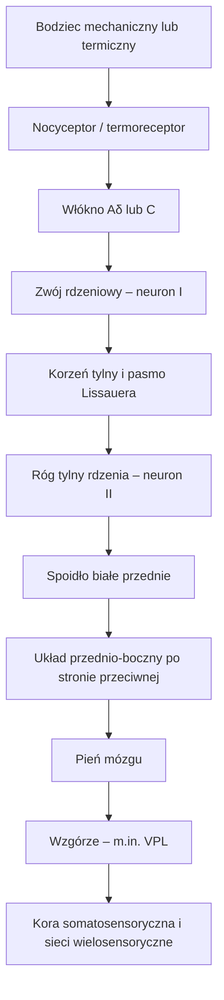
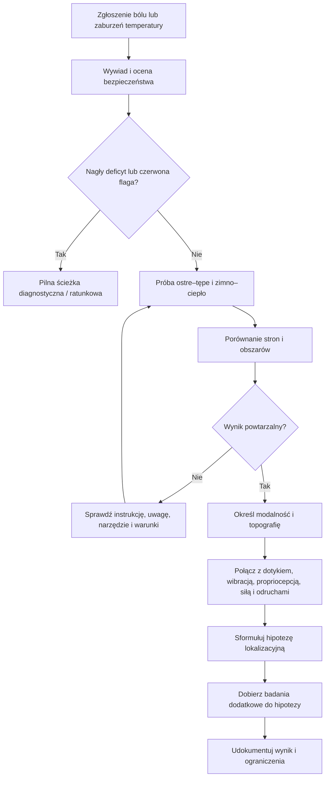

# 5.4. Czucie bólu i temperatury

> **Zasada kliniczna:** badanie bólu i temperatury jest oceną wybranych funkcji układu nocyceptywnego i termicznego, a nie pomiarem całego doświadczenia bólu. Bodziec ma być wystarczający do rozpoznania jego jakości, ale nie może uszkadzać skóry ani wywoływać niepotrzebnego cierpienia. Wynik interpretuje się łącznie z wywiadem, mapą objawów, pozostałymi modalnościami czucia, odruchami i badaniem ruchowym.

## Wprowadzenie i zakres rozdziału

Czucie bólu i temperatury dostarcza informacji o potencjalnym zagrożeniu dla tkanek, zmianach temperatury otoczenia oraz stanie powierzchni ciała. W badaniu neurologicznym ocena tych modalności pomaga wykrywać zaburzenia włókien cienkich, lokalizować uszkodzenia układu przednio-bocznego rdzenia kręgowego i rozpoznawać niektóre zespoły pniowe, wzgórzowe oraz korowe. Ma również znaczenie praktyczne dla oceny ryzyka nieświadomych oparzeń, odmrożeń i urazów u osób z ubytkiem czucia ochronnego.

Rozdział rozwija pięć pozycji spisu treści modułu 5: rozpoznawanie bodźca ostrego i tępego, ocenę czucia bólu, rozpoznawanie zimna i ciepła, porównanie stron ciała oraz analizę rozkładu zaburzeń w uszkodzeniach rdzenia i nerwów. Nie powtarza szczegółowej neuroanatomii dróg czuciowych przedstawionej w rozdziale 5.1, ogólnych zasad przygotowania badania z rozdziału 5.2 ani techniki oceny dotyku lekkiego z rozdziału 5.3. Odwołuje się do nich tam, gdzie jest to niezbędne do prawidłowej interpretacji.

**Ważne rozróżnienie:** wykrycie bodźca nocyceptywnego, świadome odczuwanie bólu, opis jego jakości i reakcja ruchowa na bodziec są zjawiskami powiązanymi, lecz nie tożsamymi. Pacjent może rozpoznawać bodziec jako ostry, mimo że opisuje niewielkie nieprzyjemne odczucie; może też zgłaszać ból samoistny przy prawidłowym wyniku krótkiej próby przyłóżkowej. Żadna z tych sytuacji nie uzasadnia automatycznego uznania odpowiedzi za niewiarygodną.

---

## 1. Cele kształcenia i efekty uczenia się

### 1.1. Cel ogólny

Celem rozdziału jest przygotowanie uczestnika do bezpiecznego, uporządkowanego i możliwie powtarzalnego badania czucia bólu oraz temperatury, a następnie do interpretowania wyniku w odniesieniu do anatomii układu somatosensorycznego i obrazu klinicznego.

### 1.2. Szczegółowe efekty uczenia się

Po ukończeniu rozdziału uczestnik powinien umieć:

1. odróżnić nocycepcję od świadomego doświadczenia bólu;
2. wyjaśnić kliniczne znaczenie włókien Aδ i C bez przypisywania im sztywnego, wyłącznego podziału wszystkich modalności;
3. opisać w podstawowym zakresie drogę przewodzenia bólu i temperatury;
4. przygotować bezpieczne narzędzia do próby ostre–tępe oraz zimno–ciepło;
5. przeprowadzić badanie z zachowaniem porównywalnej siły, czasu i sposobu przykładania bodźca;
6. ocenić osobno detekcję bodźca, rozpoznawanie jego jakości i porównanie stron;
7. mapować granice zaburzenia, nie ograniczając się do stwierdzenia „czucie osłabione”;
8. rozpoznać wzorce sugerujące uszkodzenie nerwu obwodowego, korzenia, rdzenia kręgowego lub struktur nadrdzeniowych;
9. wskazać ograniczenia badania jakościowego i sytuacje wymagające badań ilościowych;
10. udokumentować wynik w sposób umożliwiający porównanie w kolejnych badaniach;
11. rozpoznać czerwone flagi wymagające pilnej diagnostyki;
12. zachować godność, autonomię i bezpieczeństwo pacjenta.

### 1.3. Zakres kompetencji

Badanie powinno być wykonywane w granicach kwalifikacji zawodowych, uprawnień i procedur obowiązujących w danej placówce. Rozpoznawanie wzorca neurologicznego nie jest równoznaczne z samodzielnym ustaleniem etiologii ani zlecaniem badań lub leczenia poza zakresem uprawnień osoby badającej. W przypadku nagłego deficytu neurologicznego priorytetem jest uruchomienie właściwej ścieżki pilnej pomocy, a nie dokończenie planowego protokołu.

---

## 2. Definicje i rozróżnienia pojęciowe

### 2.1. Nocycepcja

Nocycepcja jest procesem neuronalnego kodowania bodźców szkodliwych lub potencjalnie uszkadzających tkanki. Obejmuje transdukcję bodźca w zakończeniu czuciowym, przewodzenie sygnału, jego przetwarzanie w rdzeniu kręgowym i dalszych strukturach ośrodkowego układu nerwowego. Nocycepcja może uruchamiać reakcje autonomiczne i obronne, ale sama aktywność nocyceptywna nie jest równoznaczna ze świadomym doświadczeniem bólu.

### 2.2. Ból

Według International Association for the Study of Pain (IASP) ból jest nieprzyjemnym doświadczeniem czuciowym i emocjonalnym związanym z rzeczywistym lub potencjalnym uszkodzeniem tkanek albo przypominającym takie doświadczenie. Ból jest zjawiskiem osobistym, kształtowanym przez czynniki biologiczne, psychologiczne i społeczne. Nie można go wnioskować wyłącznie z aktywności neuronów, obrazu uszkodzenia tkanki ani zachowania pacjenta.

**Konsekwencja kliniczna:** relacja pacjenta o bólu wymaga szacunku, nawet jeśli badanie przedmiotowe nie wykazuje uchwytnego ubytku czucia. Brak możliwości werbalnego opisania bólu również nie dowodzi, że pacjent go nie doświadcza.

### 2.3. Czucie bólu w badaniu neurologicznym

W klasycznym badaniu przyłóżkowym najczęściej ocenia się zdolność rozpoznania bodźca ostrego i odróżnienia go od tępego. Próba ta jest praktycznym wskaźnikiem funkcji wybranych elementów układu nocyceptywnego. Nie stanowi bezpośredniego pomiaru natężenia bólu, progu bólowego, tolerancji bólu ani wszystkich składowych jego doświadczenia.

### 2.4. Czucie temperatury

Czucie temperatury obejmuje rozpoznawanie zmian temperatury skóry, przede wszystkim bodźców chłodnych i ciepłych. Receptory termiczne i nocyceptory termiczne mają częściowo odrębne zakresy odpowiedzi. Skrajne temperatury mogą pobudzać nocyceptory i stwarzać ryzyko uszkodzenia tkanek; w badaniu klinicznym nie ma potrzeby stosowania bodźców skrajnych.

### 2.5. Pojęcia opisujące nieprawidłowe czucie

| Termin | Znaczenie kliniczne |
|---|---|
| Hipalgezja | Osłabione odczuwanie bodźca, który normalnie jest bolesny |
| Analgezja | Brak odczuwania bólu w określonych warunkach badania |
| Hiperalgezja | Nasilona odpowiedź bólową na bodziec, który zwykle jest bolesny |
| Allodynia | Ból wywołany bodźcem, który normalnie nie jest bolesny |
| Hipoestezja | Osłabienie czucia; określenie ogólne, wymagające wskazania modalności |
| Znieczulenie czuciowe | Brak odczuwania określonej modalności w badanym obszarze |
| Termohipoestezja | Osłabione rozpoznawanie bodźców termicznych |
| Termoanestezja | Brak rozpoznawania bodźców termicznych w badanych warunkach |
| Parestezja | Nieprawidłowe czucie, np. mrowienie, niekoniecznie nieprzyjemne |
| Dysestezja | Nieprawidłowe, zwykle nieprzyjemne odczucie |
| Hiperalgezja termiczna | Nadmierna odpowiedź bólową na bodziec termiczny o określonych parametrach |

W dokumentacji należy podać, której modalności dotyczy nieprawidłowość. Samo określenie „zaburzone czucie” jest zbyt mało precyzyjne, jeśli badanie obejmowało osobno ból, zimno, ciepło i dotyk.

### 2.6. Rodzaje bólu jako opisy mechanizmu

IASP wyróżnia między innymi:

- **ból nocyceptywny** – związany z rzeczywistym lub zagrażającym uszkodzeniem tkanki nieneuronalnej i aktywacją nocyceptorów;
- **ból neuropatyczny** – spowodowany uszkodzeniem lub chorobą somatosensorycznego układu nerwowego;
- **ból nocyplastyczny** – związany ze zmienioną nocycepcją, gdy nie ma wystarczających dowodów na aktywację nocyceptorów wskutek uszkodzenia tkanki ani na uszkodzenie lub chorobę układu somatosensorycznego wyjaśniające ból.

Są to opisy mechanistyczne, a nie samodzielne rozpoznania etiologiczne. Mechanizmy mogą współistnieć. Nie należy rozpoznawać bólu neuropatycznego wyłącznie na podstawie słów „pieczenie”, „prąd” lub „mrowienie”; potrzebna jest zgodność wywiadu, lokalizacji neuroanatomicznej, badania i – gdy jest to wskazane – badań potwierdzających.

---

## 3. Podstawy neuroanatomiczne i neurofizjologiczne istotne dla badania

### 3.1. Nocyceptory i termoreceptory

Nocyceptory są wyspecjalizowanymi zakończeniami czuciowymi o wysokim progu pobudliwości, zdolnymi do kodowania bodźców mechanicznych, termicznych lub chemicznych zagrażających integralności tkanek. W skórze występują przede wszystkim jako wolne zakończenia nerwowe. Część neuronów nocyceptywnych reaguje na więcej niż jeden rodzaj bodźca, dlatego określenie „polimodalny” ma znaczenie funkcjonalne.

Termoreceptory kodują zmiany temperatury w zakresie, który nie musi oznaczać uszkodzenia tkanki. Odpowiedź receptorów zależy od temperatury bezwzględnej, szybkości zmiany temperatury, czasu kontaktu, miejsca badania i adaptacji receptorowej.

### 3.2. Włókna Aδ i C

| Właściwość | Włókna Aδ | Włókna C |
|---|---|---|
| Mielinizacja | Cienka osłonka mielinowa | Brak mieliny |
| Przewodzenie | Szybsze niż w C | Wolniejsze |
| Typowe skojarzenie kliniczne | Wczesny, ostry, kłujący komponent bólu | Późniejszy, piekący, tępy lub rozlany komponent bólu |
| Termorecepcja | Istotny udział w przewodzeniu informacji o chłodzie | Udział w przewodzeniu informacji o cieple i części sygnałów termicznych |
| Nocycepcja | Tak | Tak |
| Ograniczenie interpretacji | Nie jest wyłącznym „włóknem ostrego bólu” | Nie jest wyłącznym „włóknem pieczenia” |

Powyższe zestawienie jest uproszczeniem dydaktycznym. Rzeczywiste kodowanie bólu i temperatury jest bardziej złożone: poszczególne populacje włókien mają nakładające się właściwości, a percepcja zależy również od przetwarzania ośrodkowego.

### 3.3. Droga rdzeniowo-wzgórzowa i układ przednio-boczny

Włókna pierwszego neuronu mają ciała komórkowe w zwojach rdzeniowych. Ich wypustki centralne wchodzą do rdzenia przez korzenie tylne i mogą rozgałęziać się w obrębie pasma grzbietowo-bocznego Lissauera, zanim zakończą się w rogach tylnych. Neurony drugiego rzędu znajdują się w różnych blaszkach istoty szarej rdzenia, między innymi w obszarach związanych z przetwarzaniem bodźców nocyceptywnych.

Włókna drugiego neuronu przechodzą na stronę przeciwną przez spoidło białe przednie i wstępują w układzie przednio-bocznym. Skrzyżowanie następuje zwykle w pobliżu poziomu wejścia włókien, często w ciągu około jednego–dwóch segmentów, ale występuje zmienność osobnicza i anatomiczna. Nie należy zatem wyznaczać poziomu uszkodzenia wyłącznie na podstawie jednego punktu granicznego niedoczulicy.

Włókna wstępują przez rdzeń i pień mózgu do wzgórza, w tym do jądra brzuszno-tylno-bocznego (VPL) dla czucia z ciała. Dalsze projekcje docierają do kory somatosensorycznej oraz do sieci uczestniczących w ocenie znaczenia bodźca, uwagi, reakcji autonomicznych i komponentu afektywnego bólu. W praktyce klinicznej układ przednio-boczny należy rozumieć jako szerszy system wstępujący, a nie wyłącznie pojedynczą, idealnie odgraniczoną wiązkę.

### 3.4. Przetwarzanie w rdzeniu i modulacja zstępująca

Róg tylny rdzenia nie jest biernym przekaźnikiem. Dochodzi w nim do integracji informacji z obwodu, modulacji pobudzenia oraz interakcji między sygnałami nocyceptywnymi i nienocyceptywnymi. Zstępujące układy modulacyjne z pnia mózgu i innych struktur mogą hamować lub ułatwiać przewodzenie. Zjawiska sensytyzacji obwodowej i ośrodkowej pomagają wyjaśnić, dlaczego odpowiedź na podobny bodziec może różnić się między pacjentami i zmieniać w czasie.

### 3.5. Czucie bólu i temperatury twarzy

Informacje z twarzy są przewodzone głównie przez nerw trójdzielny. Część włókien bólowych i termicznych zstępuje w obrębie drogi rdzeniowej nerwu trójdzielnego i przełącza się w jądrze rdzeniowym nerwu V. Dalsze neurony krzyżują się i wstępują do wzgórza. Szczegółowe badanie twarzy, w tym podział na V1, V2 i V3, przedstawiono w rozdziale 3.5. W tym rozdziale omawia się jedynie znaczenie wyniku dla lokalizacji uszkodzenia.

### 3.6. Schemat drogi przewodzenia

Schemat przedstawia główną drogę dla czucia z ciała. Nie pokazuje wszystkich projekcji, połączeń wielosynaptycznych ani dróg czuciowych twarzy.

---

## 4. Co dokładnie ocenia próba ostre–tępe?

### 4.1. Cel próby

Próba ma ustalić, czy pacjent:
- wykrywa delikatny bodziec punktowy;
- rozpoznaje różnicę między bodźcem ostrym a tępym;
- porównuje jakość odczucia w symetrycznych miejscach;
- wykazuje powtarzalny ubytek, nadmierną odpowiedź lub nieprawidłowe odczucie;
- ma rozkład zaburzeń zgodny z określonym poziomem układu nerwowego.

Nie należy utożsamiać prawidłowego rozpoznania ostrości z prawidłowym progiem bólowym. Próba przyłóżkowa jest jakościowa, a nie ilościowym testem psychofizycznym.

### 4.2. Dobór narzędzia

Preferowany jest jednorazowy, przeznaczony do badania neurologicznego przyrząd z kontrolowaną końcówką ostrą i tępą, używany zgodnie z instrukcją producenta i zasadami kontroli zakażeń. Przyrząd nie powinien przebijać skóry ani pozostawiać uszkodzenia. Po użyciu element jednorazowy należy zutylizować zgodnie z procedurą placówki.

Nie należy używać:
- igieł iniekcyjnych;
- ostrzy, skalpeli ani przedmiotów o niekontrolowanej ostrości;
- wielorazowych ostrych narzędzi bez zatwierdzonej procedury dekontaminacji;
- narzędzi, których końcówka jest złamana, zabrudzona lub uszkodzona;
- bodźców powodujących krwawienie lub naruszenie ciągłości skóry.

### 4.3. Jak formułować pytanie?

Zalecane polecenie:

> „Za chwilę będę lekko dotykać skóry końcówką ostrą albo tępą. Proszę powiedzieć, czy odczucie jest ostre, czy tępe. Nie trzeba zgadywać. Jeżeli nie czuje Pan/Pani bodźca, proszę to wyraźnie powiedzieć”.

W zależności od celu można oddzielnie pytać:
- „Czy czuje Pan/Pani dotknięcie?”;
- „Czy bodziec jest ostry czy tępy?”;
- „Czy odczucie po prawej stronie jest takie samo jak po lewej?”.

Nie należy pytać wyłącznie „czy boli?”, ponieważ odpowiedź może zależeć od progu bólowego, lęku, wcześniejszych doświadczeń i sposobu rozumienia słowa „ból”. W standardowej próbie rozróżniania ostrości ważniejsza jest jakość bodźca niż jego nieprzyjemność.

---

## 5. Badanie czucia bólu – procedura krok po kroku

### 5.1. Etap przygotowawczy

1. Ustal cel badania i obszary wynikające z wywiadu.
2. Sprawdź, czy skóra jest nieuszkodzona, bez świeżych ran, owrzodzeń, aktywnego zakażenia lub zmian, które zwiększałyby ryzyko urazu.
3. Oceń, czy pacjent rozumie polecenie i może wiarygodnie komunikować odpowiedź.
4. Przygotuj jednorazowy przyrząd neurologiczny.
5. Wyjaśnij próbę i pokaż różnicę między końcówką ostrą a tępą na bezpiecznym, niezmienionym obszarze skóry.
6. Ustal sposób odpowiedzi i sprawdź, czy pacjent nie widzi miejsca aplikacji, jeżeli ograniczenie wzroku jest potrzebne.
7. Uzgodnij, że pacjent może w każdej chwili poprosić o przerwę.

### 5.2. Wykonanie próby

1. Rozpocznij od obszaru, w którym pacjent zgłasza prawidłowe czucie lub który jest klinicznie użytecznym punktem odniesienia.
2. Delikatnie przyłóż końcówkę ostrą, bez nakłuwania i bez przesuwania po skórze.
3. W innym, nieprzewidywalnym momencie zastosuj końcówkę tępą z porównywalnym, niewielkim naciskiem.
4. Zachowaj zbliżony czas kontaktu i unikaj rytmicznego, łatwego do przewidzenia schematu.
5. Poproś o określenie jakości bodźca.
6. Porównaj te same lub anatomicznie odpowiadające sobie punkty po obu stronach.
7. W razie nieprawidłowości sprawdź obszary sąsiednie, przechodząc stopniowo od miejsca o prawidłowym odczuciu do obszaru zaburzonego i z powrotem.
8. Powtórz wybrane próby w celu oceny powtarzalności, ale nie wykonuj nadmiernej liczby bodźców.
9. Zapisz osobno brak detekcji, błędne rozpoznanie ostrości, osłabienie odczucia i nadmierną reakcję.
10. Przerwij próbę, jeśli pojawia się nasilony ból, lęk, reakcja wazowagalna, uszkodzenie skóry albo prośba pacjenta o zakończenie.

### 5.3. Zasady techniczne

- Kontakt powinien być krótki, kontrolowany i nieuszkadzający.
- Nie wolno „sprawdzać” czucia przez nakłuwanie skóry.
- Nie należy zwiększać siły bodźca do momentu, w którym pacjent odczuje ból za wszelką cenę.
- W obrębie jednego porównania należy zachować możliwie podobną technikę.
- Nie należy badać wyłącznie jednego punktu, jeśli wynik ma służyć lokalizacji uszkodzenia.
- Należy odróżnić brak detekcji od rozpoznania bodźca jako tępego.
- W razie podejrzenia zaburzeń czynnościowych trzeba opisywać konkretne dodatnie cechy badania, a nie wyciągać wniosku z samej zmienności odpowiedzi.

### 5.4. Przykładowa sekwencja

| Próba | Strona prawa | Strona lewa | Cel |
|---|---|---|---|
| 1 | Ostry | Tępy | Sprawdzenie rozumienia zadania |
| 2 | Tępy | Ostry | Ograniczenie przewidywania |
| 3 | Ostry | Ostry | Kontrola jakości rozpoznania |
| 4 | Tępy | Tępy | Kontrola jakości rozpoznania |
| 5 | Naprzemiennie w wybranych punktach | Naprzemiennie | Ocena powtarzalności |

Tabela jest przykładem dydaktycznym, a nie obowiązkowym, uniwersalnym protokołem. Kolejność należy zmieniać i dostosować do celu badania. W formalnym badaniu klasyfikacyjnym należy stosować dokładnie właściwy protokół, a nie sekwencję autorską.

### 5.5. Badanie w obszarach dystalnych i proksymalnych

W podejrzeniu polineuropatii warto porównać:
- palce stóp;
- grzbiet stopy;
- okolice kostki;
- podudzie;
- udo;
- analogiczne punkty po drugiej stronie.

W kończynie górnej można porównywać opuszki palców, grzbiet dłoni, przedramię i ramię. Celem jest określenie, czy deficyt jest zależny od długości aksonów, ograniczony do obszaru konkretnego nerwu, dermatomu czy ma bardziej rozlany charakter.

Nie należy traktować pojedynczego punktu jako wystarczającego do rozpoznania neuropatii. Rozkład objawów powinien być zestawiony z siłą mięśniową, odruchami, czuciem wibracji, propriocepcją, wywiadem i badaniami dodatkowymi.

---

## 6. Badanie czucia temperatury – zimno i ciepło

### 6.1. Cel próby

Celem jest sprawdzenie, czy pacjent wykrywa bodziec chłodny i ciepły oraz czy prawidłowo rozróżnia ich jakość. Badanie pomaga wykrywać zaburzenia funkcji włókien cienkich i układu przednio-bocznego. W praktyce klinicznej ocenia się przede wszystkim porównanie odczuć, a nie precyzyjny próg temperatury.

### 6.2. Narzędzia

Można stosować:
- przeznaczone do badania neurologicznego termorodki;
- dwa bezpieczne, dobrze kontrolowane termiczne aplikatory;
- metalowy przedmiot o kontrolowanej, umiarkowanie chłodnej temperaturze oraz drugi o umiarkowanie ciepłej temperaturze, jeśli procedura placówki na to pozwala.

Narzędzie powinno być czyste, suche, nieuszkodzone i mieć temperaturę zweryfikowaną przed kontaktem ze skórą. Należy unikać skrajnych temperatur, lodu przykładnego bezpośrednio do skóry, gorących przedmiotów, wrzątku, otwartego płomienia i substancji chemicznych. Nie wolno stosować bodźca, który może spowodować oparzenie, odmrożenie lub podrażnienie.

### 6.3. Bezpieczeństwo termiczne

**Zasada nadrzędna:** badanie ma wykrywać zaburzenie czucia, a nie wywoływać uszkodzenie tkanki. Pacjent z upośledzonym czuciem temperatury może nie zareagować na bodziec, który dla osoby badającej wydaje się zbyt gorący lub zbyt zimny.

Przed przyłożeniem narzędzia należy:
1. sprawdzić jego temperaturę poza ciałem pacjenta;
2. upewnić się, że nie występują ostre krawędzie ani kondensacja mogąca utrudniać kontakt;
3. ocenić stan skóry i ukrwienie obszaru;
4. zastosować krótki kontakt bez ucisku;
5. natychmiast przerwać w razie bólu, pieczenia, zblednięcia, zaczerwienienia lub innej niepokojącej reakcji.

U pacjenta z ciężką neuropatią, zaburzeniami krążenia, owrzodzeniem, świeżym oparzeniem lub znacznym uszkodzeniem skóry należy rozważyć pominięcie bodźca termicznego w danym miejscu.

### 6.4. Procedura krok po kroku

1. Wyjaśnij, że pacjent będzie odczuwać bodziec chłodny lub ciepły, ale nie powinien zgadywać.
2. Pokaż różnicę na bezpiecznym, prawidłowo czującym obszarze, jeżeli jest to możliwe.
3. Ustal odpowiedzi: „zimne”, „ciepłe”, „takie samo”, „nie czuję”.
4. Ogranicz wskazówki wzrokowe, jeśli są nieistotne dla zadania.
5. Przyłóż krótko chłodny aplikator do wybranego punktu.
6. W innym momencie przyłóż ciepły aplikator w odpowiadającym miejscu.
7. Zmieniaj kolejność bodźców, aby pacjent nie mógł przewidywać odpowiedzi.
8. Porównaj strony w tych samych lub zbliżonych anatomicznie punktach.
9. W razie nieprawidłowości rozszerz badanie na obszary sąsiednie.
10. Powtórz wybrane próby, jeśli wynik jest niejednoznaczny.
11. Zapisz osobno rozpoznawanie zimna i ciepła.
12. Zakończ próbę, jeśli pacjent zgłasza dyskomfort lub pojawia się nieprawidłowa reakcja skóry.

### 6.5. Co oznacza wynik?

| Wynik | Możliwa interpretacja | Co należy sprawdzić dalej? |
|---|---|---|
| Prawidłowe rozpoznanie zimna i ciepła | Wykrywanie zastosowanych bodźców w warunkach próby jest zachowane | Pozostałe modalności i zgodność z wywiadem |
| Osłabione rozpoznawanie zimna | Możliwe zaburzenie funkcji termicznej, zwłaszcza włókien cienkich | Powtarzalność, porównanie stron, badanie bólu |
| Osłabione rozpoznawanie ciepła | Możliwe zaburzenie termiczne; wynik zależy od narzędzia i temperatury bodźca | Kontrola temperatury narzędzia i badanie w innym punkcie |
| Brak rozpoznawania obu bodźców | Możliwy istotny deficyt, ale również problem z instrukcją, uwagą lub narzędziem | Próba kontrolna, inne modalności, ocena poznawcza |
| Nadmierne odczuwanie ciepła lub zimna | Możliwa nadwrażliwość lub dysestezja | Charakter spontanicznych objawów, stan skóry, kontekst kliniczny |
| Błędne rozpoznanie w sposób zmienny | Wynik niejednoznaczny | Odpoczynek, ponowna instrukcja, ograniczenie liczby prób |

### 6.6. Zimno i ciepło należy oceniać osobno

Prawidłowe rozpoznanie chłodu nie dowodzi prawidłowego rozpoznawania ciepła. Nie należy też przyjmować, że brak odczuwania jednej kategorii automatycznie oznacza brak drugiej. Poszczególne populacje receptorów i włókien mają częściowo odmienne właściwości, a odpowiedź zależy od parametrów bodźca.

### 6.7. Ograniczenia prostych narzędzi

Metalowy przedmiot o temperaturze otoczenia nie jest precyzyjnym przyrządem do pomiaru progu termicznego. Temperatura powierzchni może zmieniać się podczas kontaktu ze skórą, a przewodnictwo cieplne materiału wpływa na odczucie. Dlatego w badaniu przesiewowym można ocenić jakościowe rozróżnianie zimna i ciepła, ale nie należy wyliczać na tej podstawie dokładnych progów termicznych.

---

## 7. Porównanie stron ciała i mapowanie deficytu

### 7.1. Porównanie stron

Porównanie powinno obejmować:
- te same punkty anatomiczne po prawej i lewej stronie;
- osobną ocenę ostrości, zimna i ciepła;
- porównanie odcinków dystalnych i proksymalnych;
- ocenę obszaru objawowego oraz obszaru referencyjnego;
- powtarzalność odpowiedzi w kilku próbach.

Wynik symetryczny nie zawsze oznacza prawidłowy. Obustronna polineuropatia może powodować podobny deficyt po obu stronach, dlatego konieczne jest również porównanie z bardziej proksymalnymi obszarami i z obrazem klinicznym.

### 7.2. Mapowanie granic

Jeżeli stwierdzono obszar osłabionego czucia, należy:
1. określić punkt o najbardziej wyraźnym ubytku;
2. wybrać kierunki badania w stronę obszaru o lepszym czuciu;
3. badać sąsiednie punkty w sposób uporządkowany;
4. zaznaczyć granicę orientacyjną, nie udając większej precyzji niż pozwala metoda;
5. porównać mapę z dermatomami i obszarami nerwów obwodowych;
6. sprawdzić, czy granica jest zgodna z innymi modalnościami.

Mapa powinna rozróżniać ubytek czucia bólu, zaburzenie rozpoznawania temperatury i obszar bólu samoistnego. Nie należy łączyć tych zjawisk w jedną niesprecyzowaną plamę.

### 7.3. Proponowana legenda

| Symbol | Znaczenie |
|---|---|
| P | Czucie bólu – wynik prawidłowy w warunkach próby |
| P↓ | Osłabione rozpoznawanie bodźca ostrego |
| P0 | Brak rozpoznawania bodźca ostrego w badanym punkcie |
| Z | Rozpoznawanie zimna zachowane |
| Z↓ | Osłabione rozpoznawanie zimna |
| C | Rozpoznawanie ciepła zachowane |
| C↓ | Osłabione rozpoznawanie ciepła |
| A | Allodynia – ból wywołany bodźcem normalnie niebolesnym |
| H | Hiperalgezja – nadmierna odpowiedź na bodziec bolesny |
| NT | Próba niewykonana lub niemożliwa do wiarygodnej oceny |

Legenda jest propozycją dokumentacyjną, a nie oficjalnym kodem klasyfikacyjnym. W dokumentacji należy podać jej znaczenie.

---

## 8. Interpretacja wyników i lokalizacja uszkodzenia

### 8.1. Zasada interpretacji

Wynik należy analizować według czterech pytań:

1. **Jaka modalność jest zaburzona?** Ból, zimno, ciepło czy kilka modalności?
2. **Gdzie przebiega deficyt?** Nerw, dermatom, poziom czuciowy, połowa ciała, obszar dystalny czy rozlany?
3. **Czy wynik jest powtarzalny?** Czy podobny wzorzec występuje przy ponownej próbie i w sąsiednich punktach?
4. **Czy pozostałe elementy badania wspierają lokalizację?** Siła, napięcie, odruchy, czucie wibracji, propriocepcja, nerwy czaszkowe, chód i funkcje autonomiczne.

Nie wolno lokalizować uszkodzenia wyłącznie na podstawie pojedynczego nieprawidłowego punktu.

### 8.2. Uszkodzenie nerwu obwodowego

Zaburzenia bólu i temperatury mogą występować w obszarze unerwienia określonego nerwu. W zależności od rodzaju uszkodzenia mogą współistnieć parestezje, ból neuropatyczny, osłabienie mięśni i zmiana odruchów. Rozkład nie musi idealnie pokrywać się z atlasową mapą, ponieważ obszary czuciowe nerwów nakładają się i wykazują zmienność osobniczą.

### 8.3. Radikulopatia

W radikulopatii zaburzenia czucia mogą mieć rozkład zbliżony do dermatomu, często z bólem promieniującym. Należy ocenić również siłę w mięśniach związanych z danym korzeniem, odruchy i objawy prowokacyjne. Sama mapa czucia nie wystarcza do rozpoznania ucisku korzenia.

### 8.4. Polineuropatia włókien cienkich

Uszkodzenie cienkich włókien może prowadzić do:
- pieczenia stóp lub dłoni;
- bólu samoistnego i bólu wywołanego;
- osłabienia rozpoznawania ostrości;
- zaburzeń rozpoznawania zimna i ciepła;
- przeczulicy lub allodynii;
- objawów autonomicznych, np. zaburzeń potliwości lub tolerancji temperatury.

W typowej neuropatii zależnej od długości aksonów objawy zaczynają się często dystalnie w stopach, a następnie mogą obejmować bardziej proksymalne obszary i dłonie. Nie jest to jednak jedyny możliwy wzorzec.

Rutynowe badania przewodnictwa nerwowego oceniają przede wszystkim włókna dużego kalibru. Prawidłowy wynik ENG/NCS nie wyklucza izolowanej neuropatii włókien cienkich. W wybranych przypadkach specjalista może rozważyć ilościowe badanie czucia (QST), biopsję skóry z oceną gęstości śródnaskórkowych włókien nerwowych (IENFD) lub badania funkcji autonomicznej.

### 8.5. Uszkodzenie spoidła białego przedniego – dysocjacja czuciowa

Uszkodzenie włókien krzyżujących się w spoidle białym przednim może powodować obustronne zaburzenie bólu i temperatury na poziomie zajętych segmentów, przy względnym zachowaniu czucia wibracji i ułożenia przewodzonego drogą sznurów tylnych. Klasycznym przykładem jest jamistość rdzenia szyjnego, w której może pojawić się „płaszczowaty” obszar ubytku czucia na barkach i kończynach górnych.

W miarę powiększania się jamy mogą dołączać:
- osłabienie i zanik mięśni ręki wskutek zajęcia rogów przednich;
- objawy piramidowe poniżej poziomu uszkodzenia;
- zaburzenia chodu;
- ból neuropatyczny;
- objawy pniowe, jeśli proces obejmuje rdzeń przedłużony.

Nie każdy ubytek o takim kształcie oznacza jamistość rdzenia. Należy rozważyć również inne uszkodzenia śródrdzeniowe, w tym guz, zapalenie, uraz i zmiany naczyniowe.

### 8.6. Zespół połowiczego uszkodzenia rdzenia (Brown-Séquard)

Przy uszkodzeniu połowy rdzenia poniżej poziomu zmiany klasycznie obserwuje się:
- po stronie uszkodzenia: zaburzenie siły i czucia głębokiego, w tym wibracji i propriocepcji;
- po stronie przeciwnej: zaburzenie bólu i temperatury, często rozpoczynające się kilka segmentów poniżej poziomu uszkodzenia, ponieważ włókna układu przednio-bocznego krzyżują się w rdzeniu.

Obraz rzeczywisty bywa niepełny i mieszany. W urazach mogą współistnieć uszkodzenia tkanek, korzeni i innych dróg.

### 8.7. Zespół tętnicy rdzeniowej przedniej

Niedokrwienie przednich części rdzenia może powodować obustronne zaburzenia funkcji ruchowych oraz bólu i temperatury poniżej poziomu uszkodzenia, przy względnym oszczędzeniu sznurów tylnych. Obraz kliniczny zależy od rozległości i poziomu niedokrwienia. Nagły początek, ból kręgosłupa, niedowład i poziom czuciowy wymagają pilnej diagnostyki.

### 8.8. Uszkodzenie pnia mózgu

W niektórych zespołach pniowych występuje skrzyżowany wzorzec czuciowy: zaburzenia bólu i temperatury po stronie twarzy po stronie uszkodzenia oraz po przeciwnej stronie ciała. Wynika to z sąsiedztwa dróg i jąder czuciowych nerwu trójdzielnego oraz układu przednio-bocznego. Współistniejące objawy nerwów czaszkowych, ataksja, oczopląs, zaburzenia połykania lub niedowład zwiększają znaczenie lokalizacyjne.

### 8.9. Uszkodzenie wzgórza i kory

Uszkodzenie wzgórza lub struktur korowych może powodować przeciwstronne zaburzenia czucia obejmujące kilka modalności. W wybranych przypadkach po uszkodzeniu ośrodkowym może rozwinąć się ból ośrodkowy. Badanie bólu i temperatury należy wówczas interpretować razem z dotykiem, czuciem głębokim, wygaszaniem, funkcjami poznawczymi i objawami ruchowymi.

### 8.10. Tabela wzorców lokalizacyjnych

| Wzorzec | Ból i temperatura | Inne wskazówki | Możliwy poziom |
|---|---|---|---|
| Dystalny, symetryczny | Często osłabione, czasem ból dodatni | Stopy przed dłońmi, możliwe objawy autonomiczne | Polineuropatia, w tym włókien cienkich |
| Obszar jednego nerwu | Ograniczone do terytorium nerwu | Możliwy ból neuropatyczny i osłabienie określonych mięśni | Nerw obwodowy |
| Zbliżony do dermatomu | Segmentarne zaburzenie | Ból promieniujący, możliwa zmiana odruchu lub siły | Korzeń |
| Obustronny „płaszczowaty” | Ubytek bólu i temperatury | Względnie zachowane wibracja i propriocepcja; możliwe objawy ruchowe | Centralna część rdzenia |
| Połowiczy rdzeniowy | Przeciwstronny ubytek bólu i temperatury | Ipsilateralne objawy piramidowe i sznurów tylnych | Połowa rdzenia |
| Poziom czuciowy z niedowładem | Często obustronne zaburzenia poniżej poziomu | Zaburzenia zwieraczy lub chodu | Rdzeń kręgowy |
| Skrzyżowany twarz–ciało | Twarz po stronie uszkodzenia, ciało po przeciwnej | Objawy pniowe | Pień mózgu |
| Przeciwstronny ubytek połowy ciała | Różne modalności, niekiedy ból ośrodkowy | Objawy korowe lub wzgórzowe | Wzgórze lub kora |

---

## 9. Diagnostyka różnicowa

### 9.1. Najważniejsze grupy przyczyn

**Neuropatie obwodowe**
- cukrzycowa neuropatia czuciowa;
- neuropatia włókien cienkich;
- neuropatie toksyczne i polekowe;
- neuropatie metaboliczne i niedoborowe;
- neuropatie zapalne i immunologiczne;
- mononeuropatie uciskowe;
- uszkodzenia pourazowe nerwów.

**Uszkodzenia korzeni i splotów**
- radikulopatie dyskogenne i zwyrodnieniowe;
- uszkodzenia splotu ramiennego lub lędźwiowo-krzyżowego;
- procesy nowotworowe, zapalne i pourazowe.

**Choroby rdzenia kręgowego**
- uraz rdzenia;
- jamistość rdzenia;
- stwardnienie rozsiane i inne choroby demielinizacyjne;
- zapalenie rdzenia;
- niedokrwienie rdzenia;
- ucisk przez guz, ropień lub zmianę zwyrodnieniową.

**Uszkodzenia mózgowia**
- udar niedokrwienny lub krwotoczny;
- zmiany wzgórzowe;
- uszkodzenia pnia mózgu;
- guzy i procesy zapalne;
- pourazowe uszkodzenia struktur czuciowych.

### 9.2. Ból neuropatyczny a ból nocyceptywny i nocyplastyczny

| Cecha | Nocyceptywny | Neuropatyczny | Nocyplastyczny |
|---|---|---|---|
| Mechanizm opisowy | Aktywacja nocyceptorów w związku z uszkodzeniem lub zagrożeniem uszkodzenia tkanki nieneuronalnej | Uszkodzenie lub choroba układu somatosensorycznego | Zmienione przetwarzanie nocyceptywne bez wystarczających dowodów na uszkodzenie tkanki lub układu somatosensorycznego wyjaśniające ból |
| Typowe opisy | Tkliwość, ból przy obciążeniu lub ruchu | Pieczenie, wyładowania, przeszywanie, drętwienie, allodynia | Ból rozlany lub wielomiejscowy, nadwrażliwość i współistniejące objawy |
| Badanie neurologiczne | Może być prawidłowe poza tkliwością | Może wykazywać ubytek lub zysk czuciowy w wiarygodnym obszarze neuroanatomicznym | Może wykazywać nadwrażliwość, ale brak swoistego wzorca uszkodzenia nie wystarcza do rozpoznania |
| Ograniczenie | Nie wyklucza współistnienia innych mechanizmów | Same deskryptory bólu nie potwierdzają uszkodzenia nerwowego | Nie jest rozpoznaniem z wykluczenia wszystkich chorób; wymaga całościowej oceny |

W praktyce mechanizmy mogą się nakładać. Przykładowo pacjent z chorobą zwyrodnieniową kręgosłupa może mieć jednocześnie komponent nocyceptywny i neuropatyczny. W dokumentacji należy opisać dowody kliniczne i poziom pewności, zamiast przypisywać jeden mechanizm bez uzasadnienia.

### 9.3. Stopniowanie pewności rozpoznania bólu neuropatycznego

Podejście NeuPSIG uwzględnia:
1. wywiad sugerujący chorobę lub uszkodzenie somatosensorycznego układu nerwowego;
2. wiarygodny neuroanatomicznie rozkład bólu;
3. nieprawidłowości w ukierunkowanym badaniu neurologicznym w obszarze zgodnym z lokalizacją;
4. potwierdzające badanie diagnostyczne, jeśli jest potrzebne do zwiększenia pewności rozpoznania.

Wyróżnia się poziomy możliwego, prawdopodobnego i potwierdzonego bólu neuropatycznego. Nie każdy pacjent wymaga rozbudowanej diagnostyki, a wynik badań dodatkowych musi być interpretowany w kontekście klinicznym. Aktualny materiał IASP z 2026 roku omawia praktyczne zastosowanie tego podejścia i przypomina, że ból neuropatyczny może współistnieć z innymi mechanizmami.

### 9.4. Neuropatia włókien cienkich – ważne ograniczenie ENG/NCS

Włókna cienkie Aδ i C nie są oceniane w taki sam sposób jak duże, mielinizowane włókna w rutynowych badaniach przewodnictwa nerwowego. Dlatego prawidłowe ENG/NCS nie wyklucza neuropatii włókien cienkich. Przy utrzymującym się podejrzeniu specjalista może zlecić:
- ilościowe badanie czucia (QST);
- biopsję skóry z oceną gęstości śródnaskórkowych włókien nerwowych;
- badania funkcji sudomotorycznej lub inne testy autonomiczne;
- ukierunkowane badania laboratoryjne w poszukiwaniu przyczyny.

Biopsja skóry jest badaniem specjalistycznym. Wynik powinien być porównany z normami laboratorium uwzględniającymi metodę, miejsce pobrania i właściwe wartości referencyjne. Gęstość włókien śródnaskórkowych nie jest prostym miernikiem natężenia bólu.

---

## 10. Normy, wartości referencyjne i ograniczenia

### 10.1. Brak uniwersalnej liczbowej normy dla badania przyłóżkowego

W rutynowej próbie ostre–tępe oraz zimno–ciepło nie istnieje jedna uniwersalna wartość liczbowa, która oddzielałaby wynik prawidłowy od nieprawidłowego u wszystkich osób. Wynik ma charakter jakościowy i zależy od:
- narzędzia oraz jego właściwości;
- miejsca aplikacji;
- siły i czasu kontaktu;
- temperatury otoczenia i skóry;
- wieku i stanu skóry;
- uwagi, rozumienia instrukcji i zmęczenia;
- chorób współistniejących i stosowanych leków;
- doświadczenia osoby badającej.

Najważniejsze jest porównanie wewnątrzosobnicze, powtarzalność i zgodność z innymi elementami badania.

### 10.2. Wynik prawidłowy

Wynik można opisać jako prawidłowy, jeśli pacjent w sposób powtarzalny:
- wykrywa zastosowany bodziec;
- rozpoznaje ostrość zgodnie z rzeczywistym rodzajem końcówki;
- odróżnia bodziec chłodny od ciepłego;
- nie wykazuje istotnej, powtarzalnej asymetrii w badanych punktach.

Nie oznacza to, że wszystkie włókna cienkie i wszystkie drogi czuciowe są prawidłowe. Krótka próba przesiewowa nie wyklucza wczesnej, ogniskowej ani wybiórczej neuropatii.

### 10.3. Wartości referencyjne w QST

Ilościowe badanie czucia (QST) wykorzystuje kontrolowane bodźce i określone protokoły do oceny progów wykrywania oraz progów bólowych. Wartości referencyjne są zależne od miejsca badania, wieku, płci, aparatury, procedury i populacji odniesienia. Wyniku QST nie należy interpretować bez informacji o zastosowanym protokole i właściwych normach.

### 10.4. ISNCSCI – formalna ocena po urazie rdzenia

Międzynarodowe standardy ISNCSCI służą do neurologicznej klasyfikacji uszkodzenia rdzenia kręgowego. Obejmują standaryzowaną ocenę lekkiego dotyku i ukłucia (pin prick) w określonych punktach czuciowych. W standardzie stosuje się ocenę porządkową, a nie dowolną skalę procentową. Należy korzystać z aktualnego arkusza i instrukcji, a nie przenosić uproszczonej próby z gabinetu do formalnej klasyfikacji.

**Wydanie 2026 (9. edycja) jest aktualnym wydaniem wskazanym przez ASIA.** Standard ISNCSCI nie obejmuje odrębnego punktowanego testu rozpoznawania zimna i ciepła. Wyniku temperatury nie wolno dopisywać do punktacji ISNCSCI jako równoważnego elementu.

### 10.5. Najważniejsze ograniczenia

- Wynik zależy od współpracy i zrozumienia polecenia.
- Test ostre–tępe nie mierzy bezpośrednio natężenia bólu.
- Test temperatury wykonany przedmiotem o temperaturze otoczenia nie jest precyzyjnym pomiarem progu termicznego.
- Zachowana odpowiedź w jednym punkcie nie wyklucza ogniskowego deficytu w innym miejscu.
- Symetryczny wynik nie wyklucza obustronnej neuropatii.
- Brak nieprawidłowości w badaniu przesiewowym nie wyklucza bólu neuropatycznego.
- Nadwrażliwość może wykraczać poza obszar pierwotnego uszkodzenia wskutek zmian przetwarzania ośrodkowego.
- Zmienna odpowiedź wymaga oceny warunków badania i nie jest sama w sobie dowodem symulacji.
- Badanie jakościowe nie zastępuje QST, biopsji skóry, badań przewodnictwa, obrazowania ani oceny specjalistycznej.

---

## 11. Czerwone flagi i bezpieczeństwo pacjenta

### 11.1. Nagły deficyt czuciowy

Nagła utrata czucia po jednej stronie twarzy lub ciała, zwłaszcza z niedowładem, zaburzeniami mowy, widzenia, równowagi, świadomości lub nagłym silnym bólem głowy, może oznaczać udar lub inne ostre uszkodzenie ośrodkowego układu nerwowego.

**Postępowanie:** natychmiast uruchomić procedurę udarową lub wezwać zespół ratownictwa medycznego pod numerem 112 albo 999. Zapisać czas, kiedy pacjent był ostatnio widziany bez objawów. Nie opóźniać pomocy przez długie mapowanie czucia.

### 11.2. Objawy rdzeniowe

Pilnej oceny wymagają:
- nowy poziom czuciowy na tułowiu;
- szybko narastający niedowład lub zaburzenia chodu;
- obustronne zaburzenia czucia poniżej określonego poziomu;
- zaburzenia mikcji lub defekacji;
- znieczulenie okolicy siodłowej;
- ostry ból kręgosłupa z objawami neurologicznymi;
- objawy po urazie kręgosłupa;
- ból kręgosłupa z gorączką, immunosupresją, zakażeniem lub chorobą nowotworową w wywiadzie.

Możliwe przyczyny obejmują ucisk rdzenia, zespół ogona końskiego, ropień nadtwardówkowy, krwiak, guz, uraz lub niedokrwienie. W przypadku podejrzenia zespołu ogona końskiego lub ostrego ucisku rdzenia konieczna jest pilna diagnostyka szpitalna.

### 11.3. Szybko postępujące objawy obwodowe

Narastające, symetryczne zaburzenia czucia z osłabieniem, osłabieniem odruchów, zaburzeniami połykania, dusznością lub objawami autonomicznymi mogą wskazywać na ostrą poliradikuloneuropatię, w tym zespół Guillaina–Barrégo. Wymagają pilnej oceny lekarskiej i monitorowania funkcji oddechowych oraz autonomicznych.

### 11.4. Ryzyko oparzeń i urazów

Utrata czucia bólu i temperatury może prowadzić do:
- oparzeń od termoforów, grzejników, kąpieli i gorących naczyń;
- odmrożeń;
- urazów stóp i dłoni;
- opóźnionego zauważenia rany lub zakażenia;
- przewlekłych owrzodzeń.

Należy poinformować pacjenta o konieczności oglądania skóry, ostrożnego sprawdzania temperatury wody i unikania bezpośredniego kontaktu z gorącymi lub bardzo zimnymi przedmiotami. W razie stwierdzenia rany, oparzenia lub zakażenia należy wdrożyć odpowiednią ścieżkę oceny i leczenia.

### 11.5. Kiedy przerwać próbę?

Próbę należy przerwać, jeśli:
- pacjent wyraża sprzeciw lub prosi o zakończenie;
- pojawia się nasilony ból, lęk, omdlenie lub objawy wazowagalne;
- narzędzie uszkadza skórę;
- występuje krwawienie lub reakcja miejscowa;
- pacjent nie rozumie instrukcji mimo dostosowania komunikacji;
- stan ogólny ulega pogorszeniu;
- ujawnia się objaw alarmowy wymagający pilnej pomocy.

---

## 12. Diagnostyka dodatkowa – kiedy badanie przyłóżkowe nie wystarcza?

### 12.1. Badania neurofizjologiczne

ENG/NCS i EMG mogą pomóc w ocenie neuropatii dużych włókien, uszkodzeń nerwów obwodowych i korzeni. Nie należy jednak oczekiwać, że rutynowe badanie przewodnictwa wykluczy izolowaną neuropatię włókien cienkich.

### 12.2. Ilościowe badanie czucia (QST)

QST umożliwia kontrolowane badanie progów wykrywania zimna, ciepła, bólu termicznego i innych modalności. Jest metodą psychofizyczną: wymaga współpracy i odpowiedzi pacjenta. Wynik zależy od protokołu, aparatury, miejsca badania i norm. Nie lokalizuje samodzielnie uszkodzenia i nie zastępuje badania neurologicznego.

### 12.3. Biopsja skóry

Biopsja skóry z oceną gęstości śródnaskórkowych włókien nerwowych może być przydatna w diagnostyce neuropatii włókien cienkich. Interpretacja wymaga właściwych wartości referencyjnych, standaryzacji pobrania i analizy w doświadczonym laboratorium. Wynik nie mierzy bezpośrednio intensywności bólu i nie wyjaśnia automatycznie jego przyczyny.

### 12.4. Badania autonomiczne

Jeśli występują zaburzenia potliwości, nietolerancja temperatury, hipotonia ortostatyczna lub inne objawy dysautonomii, specjalista może rozważyć badania funkcji autonomicznej. Zakres zależy od podejrzewanej choroby i dostępności metod.

### 12.5. Obrazowanie

MRI mózgowia lub rdzenia kręgowego jest dobierane do lokalizacji i dynamiki objawów. W przypadku poziomu czuciowego, objawów pniowych, postępującego niedowładu lub podejrzenia jamistości rdzenia obrazowanie może mieć kluczowe znaczenie. Nie należy zlecać ani interpretować obrazowania bez odniesienia do badania klinicznego.

### 12.6. Badania laboratoryjne

Badania laboratoryjne powinny wynikać z hipotezy etiologicznej. W zależności od obrazu mogą obejmować ocenę gospodarki węglowodanowej, witaminy B12, funkcji tarczycy, parametrów nerkowych i wątrobowych, markerów zapalnych, badań immunologicznych lub zakaźnych. Nie istnieje jeden panel, który jest właściwy dla każdego pacjenta z zaburzeniem bólu i temperatury.

---

## 13. Dokumentowanie wyników

### 13.1. Minimalny zakres dokumentacji

W zapisie należy uwzględnić:
- datę, godzinę i cel badania;
- badaną modalność;
- użyte narzędzie i sposób aplikacji;
- badane okolice i punkty orientacyjne;
- wynik po prawej i lewej stronie;
- rozpoznawanie ostrego i tępego bodźca;
- rozpoznawanie zimna i ciepła;
- obecność hipalgezji, analgezji, hiperalgezji, allodynii lub dysestezji;
- topografię i orientacyjne granice deficytu;
- powtarzalność odpowiedzi;
- ograniczenia badania;
- tolerancję pacjenta i ewentualne przerwanie próby;
- zalecenia dotyczące dalszej oceny lub pilnego skierowania.

### 13.2. Przykładowy formularz

| Obszar | Ostre–tępe | Zimno | Ciepło | Strona / uwagi |
|---|---|---|---|---|
| Twarz – V1 | | | | |
| Twarz – V2 | | | | |
| Twarz – V3 | | | | |
| Kończyna górna – dystalnie | | | | |
| Kończyna górna – proksymalnie | | | | |
| Tułów – poziomy orientacyjne | | | | |
| Kończyna dolna – dystalnie | | | | |
| Kończyna dolna – proksymalnie | | | | |

W każdej komórce należy wpisać wynik opisowy, a nie pozostawiać samego symbolu bez objaśnienia. W formalnym badaniu ISNCSCI należy użyć oficjalnego arkusza i jego skali.

### 13.3. Przykład opisu prawidłowego

„W badanych punktach kończyn górnych i dolnych pacjent prawidłowo rozpoznaje bodziec ostry i tępy oraz odróżnia bodziec chłodny od ciepłego. Odpowiedzi powtarzalne, bez istotnej asymetrii w zakresie przeprowadzonych prób. Wynik dotyczy badanych punktów i zastosowanych bodźców; nie stanowi wykluczenia wszystkich postaci neuropatii włókien cienkich”.

### 13.4. Przykład opisu nieprawidłowego

„W obrębie dystalnych części obu stóp stwierdzono powtarzalne osłabienie rozpoznawania bodźca ostrego oraz chłodu w porównaniu z podudziami. Rozpoznawanie bodźca tępego i ciepła częściowo zachowane. Wzorzec symetryczny, dystalny. Wynik może wskazywać na zajęcie włókien cienkich; wymaga korelacji z wywiadem, badaniem pozostałych modalności i diagnostyką przyczynową”.

### 13.5. Przykład zapisu z ograniczeniem

„Ocena czucia temperatury ograniczona z powodu trudności w rozumieniu instrukcji i zmiennej uwagi. Pacjent wykrywa kontakt aplikatora, jednak nie różnicuje w sposób powtarzalny bodźców chłodnego i ciepłego. Wynik nie pozwala na wiarygodną ocenę termorecepcji. Zaleca się ponowną ocenę w warunkach umożliwiających lepszą komunikację”.

### 13.6. Sformułowania, których należy unikać

| Nieprecyzyjny zapis | Zalecany zapis |
|---|---|
| „Ból prawidłowy” | „Prawidłowo rozpoznaje bodziec ostry i tępy w badanych punktach” |
| „Temperatura zachowana” | „Rozpoznaje bodźce chłodne i ciepłe w badanych punktach” |
| „Brak czucia” | „Nie wykrywa bodźca ostrego w określonym obszarze; detekcja bodźca tępego zachowana/niezachowana” |
| „Neuropatia” | „Wzorzec zaburzeń sugeruje zajęcie włókien cienkich; wymaga korelacji klinicznej” |
| „Pacjent nie współpracuje” | „Wynik ograniczony przez zmienną uwagę i brak powtarzalności odpowiedzi” |
| „Symulacja” | „Stwierdzono określone cechy niespójności; brak podstaw do wnioskowania o intencji pacjenta” |

---

## 14. Przykłady kliniczne

### Przypadek 1. Dystalne pieczenie stóp

**Dane:** osoba z cukrzycą zgłasza pieczenie i kłucie obu stóp, nasilające się wieczorem. W badaniu stwierdza się symetryczne osłabienie rozpoznawania bodźca ostrego i chłodu w palcach oraz na przodostopiu. Czucie dotyku lekkiego jest względnie zachowane.

**Rozumowanie:** obraz może wskazywać na zajęcie włókien cienkich w przebiegu polineuropatii. Nie przesądza o etiologii ani o stopniu zaawansowania. Należy ocenić czucie wibracji, odruchy skokowe, siłę, skórę stóp, tętno obwodowe i czynniki ryzyka.

**Dalsze postępowanie:** ocena lekarska i diagnostyka przyczynowa; w razie potrzeby badania specjalistyczne. Należy przekazać zasady ochrony stóp przed urazem termicznym.

### Przypadek 2. Ból promieniujący do kończyny dolnej

**Dane:** pacjent zgłasza ból od okolicy lędźwiowej do bocznej części podudzia i grzbietu stopy. Badanie wykazuje obszar osłabionego rozpoznawania ostrości w przybliżonym rozkładzie korzeniowym. Występuje również osłabienie wybranych ruchów stopy.

**Rozumowanie:** możliwa radikulopatia. Sam wzorzec czuciowy nie wskazuje jednoznacznie poziomu ani przyczyny ucisku. Należy zestawić go z siłą, odruchami, wywiadem i objawami prowokacyjnymi.

**Czerwona flaga:** nowy niedowład, zaburzenia zwieraczy lub znieczulenie siodłowe wymagają pilnej oceny.

### Przypadek 3. Ubytek bólu i temperatury na barkach

**Dane:** młoda osoba zgłasza częste oparzenia dłoni i nie zauważa gorącej wody. Badanie ujawnia obustronne osłabienie rozpoznawania ostrości i temperatury w obrębie barków oraz kończyn górnych, przy względnie zachowanym czuciu wibracji.

**Rozumowanie:** wzorzec dysocjacji czuciowej może sugerować zajęcie centralnych włókien krzyżujących się w rdzeniu, np. w jamistości rdzenia. Należy ocenić siłę, zanik mięśni ręki, odruchy i objawy piramidowe.

**Dalsze postępowanie:** pilna konsultacja neurologiczna i odpowiednie obrazowanie rdzenia. Konieczne jest ograniczenie ryzyka oparzeń.

### Przypadek 4. Ubytek bólu i temperatury po przeciwnej stronie tułowia

**Dane:** po urazie jednej połowy rdzenia pacjent ma osłabienie siły i czucia wibracji po stronie urazu, a po stronie przeciwnej osłabione rozpoznawanie bodźca ostrego i temperatury kilka segmentów niżej.

**Rozumowanie:** obraz może odpowiadać niepełnemu zespołowi Brown-Séquarda. Rzeczywisty zakres uszkodzenia należy określić pełnym badaniem neurologicznym i obrazowaniem.

**Dalsze postępowanie:** pilna ocena urazowa/neurochirurgiczna zgodnie z mechanizmem urazu i stanem pacjenta.

### Przypadek 5. Nagła połowicza niedoczulica

**Dane:** pacjent nagle przestaje prawidłowo odczuwać dotyk i bodźce ostre po prawej stronie twarzy i kończyn. Występuje zaburzenie mowy.

**Rozumowanie:** należy podejrzewać ostry udar mózgu. Nie ma miejsca na długie mapowanie deficytu w warunkach planowych.

**Postępowanie:** natychmiastowe uruchomienie procedury udarowej, wezwanie 112/999 i ustalenie czasu początku objawów lub ostatniego momentu bez objawów.

### Przypadek 6. Prawidłowe ENG przy pieczeniu stóp

**Dane:** pacjent zgłasza pieczenie stóp, nadwrażliwość na ciepło i osłabione rozpoznawanie chłodu. Rutynowe badanie przewodnictwa nerwowego nie wykazuje istotnych odchyleń.

**Rozumowanie:** prawidłowe ENG/NCS nie wyklucza neuropatii włókien cienkich. Należy ocenić rozkład objawów, funkcje autonomiczne, czucie bólu i temperatury oraz możliwe przyczyny metaboliczne, toksyczne i immunologiczne.

**Dalsze postępowanie:** konsultacja neurologiczna; w zależności od wskazań QST, biopsja skóry i badania autonomiczne.

### Przypadek 7. Ból po półpaścu

**Dane:** po wygojeniu zmian skórnych w obszarze dermatomu pacjent zgłasza pieczenie i ból przy lekkim kontakcie ubrania ze skórą. Badanie wykazuje allodynię i obszar zmienionego czucia.

**Rozumowanie:** możliwa neuralgia popółpaścowa, czyli ból neuropatyczny związany z chorobą nerwów czuciowych. Allodynia jest objawem dodatnim, a nie dowodem zwiększonej sprawności czucia ochronnego.

**Dalsze postępowanie:** ocena lekarska, określenie wpływu bólu na sen i funkcjonowanie oraz plan leczenia zgodny z rozpoznaniem.

### Przypadek 8. Niespójne rozpoznawanie bodźców

**Dane:** pacjent w pierwszej serii prawidłowo odróżnia ostre i tępe, a w kolejnej odpowiada losowo. Zgłasza zmęczenie i trudność w koncentracji.

**Rozumowanie:** wynik jest niejednoznaczny. Należy sprawdzić zrozumienie instrukcji, ograniczyć liczbę bodźców, zapewnić odpoczynek i ponownie ocenić tylko niezbędne punkty. Nie wolno na tej podstawie przypisywać pacjentowi symulacji.

**Dalsze postępowanie:** odnotować ograniczenie badania i rozważyć ponowną ocenę w lepszych warunkach.

---

## 15. Algorytm postępowania przy nieprawidłowym wyniku

Algorytm wspiera rozumowanie, ale nie zastępuje oceny klinicznej ani lokalnych procedur postępowania w stanach nagłych.

---

## 16. Stacje OSCE – ocena praktyczna

### Stacja 1. Próba ostre–tępe

**Zadanie:** przeprowadź badanie w wybranych punktach kończyny górnej, porównaj strony i udokumentuj wynik.

**Oceniane elementy:**
- prawidłowa instrukcja;
- sprawdzenie rozumienia;
- użycie bezpiecznego, jednorazowego narzędzia;
- delikatny kontakt bez naruszenia skóry;
- losowa kolejność bodźców;
- oddzielne pytanie o detekcję i jakość;
- porównanie stron;
- dokumentacja.

**Błędy krytyczne:** użycie igły iniekcyjnej, przebijanie skóry, ignorowanie sprzeciwu pacjenta lub brak kontroli zakażeń.

### Stacja 2. Badanie zimna i ciepła

**Zadanie:** sprawdź rozpoznawanie chłodu i ciepła w kończynach dolnych.

**Oceniane elementy:**
- dobór bezpiecznych aplikatorów;
- sprawdzenie temperatury narzędzi;
- unikanie skrajnych temperatur;
- oddzielne badanie zimna i ciepła;
- porównanie stron;
- kontrola powtarzalności;
- prawidłowy opis ograniczeń.

**Błędy krytyczne:** użycie lodu bezpośrednio na skórze, gorącego przedmiotu, wrzątku lub narzędzia o nieznanej temperaturze.

### Stacja 3. Lokalizacja zaburzenia czucia

**Zadanie:** na podstawie opisu i mapy wyniku wskaż najbardziej prawdopodobny poziom uszkodzenia.

**Oceniane elementy:**
- rozpoznanie modalności;
- ocena topografii;
- różnicowanie nerwu, korzenia i rdzenia;
- uwzględnienie skrzyżowania dróg;
- wskazanie niepewności;
- dobór dalszej diagnostyki.

### Stacja 4. Czerwona flaga i dokumentacja

**Zadanie:** pacjent zgłasza nagłą połowiczą niedoczulicę i zaburzenia mowy. Przedstaw postępowanie.

**Oceniane elementy:**
- rozpoznanie podejrzenia udaru;
- przerwanie rutynowego badania;
- uruchomienie procedury ratunkowej;
- ustalenie czasu początku objawów/ostatniego znanego stanu bez objawów;
- przekazanie informacji zespołowi;
- zwięzła dokumentacja.

---

## 17. Pytania kontrolne

### Pytanie 1
Czy nocycepcja i ból oznaczają to samo?

**Odpowiedź:** Nie. Nocycepcja jest neuronalnym kodowaniem bodźców szkodliwych, a ból jest osobistym doświadczeniem czuciowym i emocjonalnym.

### Pytanie 2
Jakie włókna są szczególnie istotne dla przewodzenia bólu i temperatury?

**Odpowiedź:** Cienko mielinizowane włókna Aδ oraz niemielinizowane włókna C. Ich funkcje częściowo się nakładają.

### Pytanie 3
Jaką drogą wstępuje większość informacji o bólu i temperaturze z ciała?

**Odpowiedź:** Przez układ przednio-boczny, w tym drogę rdzeniowo-wzgórzową.

### Pytanie 4
Gdzie krzyżują się włókna drugiego neuronu drogi rdzeniowo-wzgórzowej?

**Odpowiedź:** W spoidle białym przednim rdzenia kręgowego, zwykle w pobliżu poziomu wejścia, często w ciągu około jednego–dwóch segmentów, z możliwą zmiennością.

### Pytanie 5
Czy próba ostre–tępe mierzy natężenie bólu?

**Odpowiedź:** Nie. Ocenia przede wszystkim rozpoznawanie jakości bodźca w warunkach badania.

### Pytanie 6
Dlaczego nie wolno nakłuwać skóry podczas badania?

**Odpowiedź:** Nie jest to potrzebne do oceny rozróżniania ostrości, a zwiększa ryzyko urazu, zakażenia i niepotrzebnego bólu.

### Pytanie 7
Jaki wzorzec może sugerować zajęcie spoidła białego przedniego?

**Odpowiedź:** Obustronny, segmentarny ubytek bólu i temperatury przy względnym zachowaniu czucia wibracji i ułożenia.

### Pytanie 8
Czy prawidłowe ENG/NCS wyklucza neuropatię włókien cienkich?

**Odpowiedź:** Nie. Rutynowe badania przewodnictwa oceniają przede wszystkim duże włókna; w wybranych przypadkach potrzebne są QST, biopsja skóry lub badania autonomiczne.

### Pytanie 9
Czy allodynia jest tym samym co hiperalgezja?

**Odpowiedź:** Nie. Allodynia to ból wywołany bodźcem normalnie niebolesnym, a hiperalgezja to nadmierna odpowiedź na bodziec normalnie bolesny.

### Pytanie 10
Czy symetryczny wynik badania wyklucza neuropatię?

**Odpowiedź:** Nie. Polineuropatie często są obustronne i symetryczne.

### Pytanie 11
Czy ISNCSCI obejmuje osobną punktowaną próbę temperatury?

**Odpowiedź:** Nie. Formalny standard obejmuje między innymi ocenę lekkiego dotyku i ukłucia w określonych punktach czuciowych. Temperatury nie należy dopisywać do punktacji jako równoważnej próby.

### Pytanie 12
Co należy zrobić przy nagłej połowiczej niedoczulicy z zaburzeniami mowy?

**Odpowiedź:** Natychmiast uruchomić procedurę udarową lub wezwać 112/999, ustalić czas początku objawów i nie opóźniać pomocy przez planowe mapowanie czucia.

---

## 18. Lista kontrolna osoby badającej

### Przed badaniem
- [ ] Znam cel kliniczny i obszary wymagające oceny.
- [ ] Sprawdziłem stan skóry.
- [ ] Wyjaśniłem różnicę między próbą ostre–tępe a oceną bólu samoistnego.
- [ ] Przygotowałem bezpieczny, jednorazowy przyrząd.
- [ ] Sprawdziłem stan i temperaturę aplikatorów termicznych.
- [ ] Uzgodniłem sposób komunikowania odpowiedzi.

### Podczas badania
- [ ] Nie naruszam ciągłości skóry.
- [ ] Nie stosuję skrajnych temperatur.
- [ ] Ograniczam wskazówki wzrokowe, jeśli jest to potrzebne.
- [ ] Zmieniam kolejność bodźców.
- [ ] Porównuję odpowiadające sobie punkty po obu stronach.
- [ ] Badam osobno rozpoznawanie zimna i ciepła.
- [ ] Odróżniam brak detekcji od błędnej identyfikacji jakości.
- [ ] Przerywam próbę na prośbę pacjenta lub przy objawach alarmowych.

### Po badaniu
- [ ] Opisałem każdą modalność osobno.
- [ ] Zaznaczyłem topografię i orientacyjne granice deficytu.
- [ ] Odnotowałem powtarzalność i ograniczenia.
- [ ] Zestawiłem wynik z pozostałymi elementami badania.
- [ ] Wskazałem potrzebę dalszej diagnostyki lub pilnego skierowania.
- [ ] Zutylizowałem materiały jednorazowe i zabezpieczyłem sprzęt.

---

## 19. Najczęstsze błędy i sposoby ich ograniczania

| Błąd | Dlaczego jest problemem? | Jak postąpić prawidłowo? |
|---|---|---|
| Pytanie wyłącznie „czy boli?” | Nie rozdziela detekcji od jakości bodźca | Pytać osobno o obecność i ostrość bodźca |
| Nakłuwanie skóry | Powoduje uraz i zwiększa ryzyko zakażenia | Używać delikatnego, nieuszkadzającego kontaktu |
| Stosowanie zbyt silnego bodźca | Może maskować częściowy ubytek i wywołać ból | Zachować minimalny, wystarczający bodziec |
| Używanie lodu lub gorącego metalu | Grozi uszkodzeniem skóry | Stosować bezpieczne, kontrolowane aplikatory |
| Badanie tylko jednej strony | Może przeoczyć asymetrię | Porównywać odpowiadające sobie punkty |
| Badanie tylko jednego punktu | Nie pozwala ocenić topografii | Rozszerzyć badanie na obszary sąsiednie |
| Łączenie bólu i temperatury w jeden wynik | Może przeoczyć selektywne zaburzenie | Dokumentować modalności oddzielnie |
| Uznanie prawidłowego ENG za wykluczenie neuropatii | ENG może nie wykryć izolowanej neuropatii włókien cienkich | Rozważyć diagnostykę ukierunkowaną |
| Uznanie allodynii za dowód symulacji | Allodynia jest rzeczywistym objawem czuciowym | Opisać bodziec wywołujący i reakcję |
| Opóźnianie pomocy przy udarze lub mielopatii | Grozi utratą czasu terapeutycznego | Przerwać badanie rutynowe i uruchomić pilną ścieżkę |

---

## 20. Słownik pojęć

- **Allodynia:** ból wywołany bodźcem, który zwykle nie jest bolesny.
- **Analgezja:** brak odczuwania bólu w określonych warunkach.
- **Aδ:** cienko mielinizowane włókna aferentne przewodzące między innymi szybkie sygnały nocyceptywne i część informacji termicznych.
- **C:** niemielinizowane włókna aferentne przewodzące między innymi wolniejsze sygnały nocyceptywne i termiczne.
- **Dysestezja:** nieprawidłowe, zwykle nieprzyjemne odczucie.
- **Hiperalgezja:** zwiększona odpowiedź bólową na bodziec normalnie bolesny.
- **Hipalgezja:** osłabione odczuwanie bodźca bólowego.
- **Nocycepcja:** neuronalne kodowanie bodźców szkodliwych lub potencjalnie szkodliwych.
- **Nocyceptor:** receptor czuciowy zdolny do kodowania bodźców zagrażających tkankom.
- **Termorecepcja:** odbiór i kodowanie zmian temperatury.
- **Układ przednio-boczny:** zespół dróg wstępujących przewodzących między innymi informacje o bólu i temperaturze.
- **QST:** ilościowe badanie czucia, wykorzystujące standaryzowane bodźce i odpowiedzi psychofizyczne.
- **IENFD:** gęstość śródnaskórkowych włókien nerwowych oceniana w biopsji skóry.
- **Dysocjacja czuciowa:** wybiórcze zaburzenie jednych modalności przy względnym zachowaniu innych.

---

## 21. Podsumowanie kliniczne

1. Badanie bólu i temperatury powinno być bezpieczne, jakościowe i ukierunkowane na konkretne pytanie kliniczne.
2. Nocycepcja nie jest tożsama z bólem, a próba ostre–tępe nie mierzy natężenia doświadczenia bólowego.
3. Włókna Aδ i C uczestniczą w przewodzeniu informacji nocyceptywnych i termicznych, lecz ich funkcje nie są całkowicie rozdzielone.
4. Układ przednio-boczny krzyżuje się w rdzeniu kręgowym, co ma zasadnicze znaczenie dla lokalizacji uszkodzeń.
5. Zimno i ciepło należy oceniać osobno, przy użyciu bezpiecznych, kontrolowanych bodźców.
6. Obustronny ubytek bólu i temperatury przy względnym zachowaniu czucia głębokiego może wskazywać na uszkodzenie centralnej części rdzenia.
7. Symetryczne dystalne zaburzenia mogą sugerować polineuropatię, w tym neuropatię włókien cienkich.
8. Prawidłowe ENG/NCS nie wyklucza izolowanego uszkodzenia włókien cienkich.
9. Każdy wynik należy interpretować w połączeniu z wywiadem, pozostałymi modalnościami i badaniem ruchowym.
10. Nagły deficyt, poziom czuciowy, zaburzenia zwieraczy, znieczulenie siodłowe lub szybko postępujący niedowład wymagają pilnej oceny.

---

## 22. Bibliografia i materiały źródłowe

Poniższe pozycje dobrano z uwzględnieniem źródeł organizacji międzynarodowych, podręczników medycznych, publikacji naukowych i materiałów edukacyjnych. Opracowanie jest parafrazą i syntezą informacji, a nie kopią fragmentów źródeł. Stan odnośników i treść merytoryczną sprawdzono 27 listopada 2026 r.

1. International Association for the Study of Pain. **IASP Terminology.** Definicje bólu, nocycepcji, bólu nocyceptywnego, neuropatycznego i nocyplastycznego. Dostęp: https://www.iasp-pain.org/resources/terminology/

2. Themistocleous AC, Schmid A, Sierra-Silvestre E, Moisset X, Gylfadottir SS, Fundaun J, Menichella DM. **Identifying Neuropathic Pain in the Clinic: A Guide for Clinicians.** International Association for the Study of Pain; opublikowano 6 kwietnia 2026 r. Dostęp: https://www.iasp-pain.org/resources/fact-sheets/identifying-neuropathic-pain-in-the-clinic-a-guide-for-clinicians/

3. Al-Chalabi M, Reddy V, Gupta S. **Neuroanatomy, Spinothalamic Tract.** StatPearls [Internet]. Treasure Island (FL): StatPearls Publishing; aktualizacja 14 sierpnia 2023 r. NCBI Bookshelf. Dostęp: https://www.ncbi.nlm.nih.gov/books/NBK507824/

4. Newman G. **Neurologic Examination.** Merck Manual Consumer Version. Ostatnia aktualizacja: wrzesień 2026 r. Dostęp: https://www.merckmanuals.com/home/brain-spinal-cord-and-nerve-disorders/neurologic-examination/neurologic-examination

5. American Spinal Injury Association. **ISNCSCI Resources – 2026 International Standards for Neurological Classification of SCI Worksheet and 9th Edition.** Dostęp: https://asia-spinalinjury.org/isncsci-resources/

6. Rupp R, Biering-Sørensen F, Burns S, et al. **International Standards for Neurological Classification of Spinal Cord Injury: 9th edition 2026.** Top Spinal Cord Inj Rehabil. 2026;32(4):141–168. Odnośnik do publikacji i arkusza: https://asia-spinalinjury.org/isncsci-resources/

7. Shams S, Farrell CL, Arain A. **Brown-Séquard Syndrome.** StatPearls [Internet]. Treasure Island (FL): StatPearls Publishing; aktualizacja 27 lutego 2024 r. Dostęp: https://www.ncbi.nlm.nih.gov/books/NBK538135/

8. **Syringomyelia.** StatPearls [Internet]. NCBI Bookshelf. Materiał przeglądowy dotyczący etiologii, objawów i lokalizacji jamy rdzenia. Dostęp: https://www.ncbi.nlm.nih.gov/books/NBK537110/

9. Lauria G, Hsieh ST, Johansson O, Kennedy WR, Leger JM, Mellgren SI, et al. **European Federation of Neurological Societies/Peripheral Nerve Society Guideline on the use of skin biopsy in the diagnosis of small fiber neuropathy.** Eur J Neurol. 2010;17(7):903–e49. DOI: https://doi.org/10.1111/j.1468-1331.2010.03023.x

10. Devigili G, Tugnoli V, Penza P, et al. **The diagnostic criteria for small fibre neuropathy: from symptoms to neuropathology.** Brain. 2008;131(Pt 7):1912–1925. DOI: https://doi.org/10.1093/brain/awn093

11. Finnerup NB, Haroutounian S, Kamerman P, Baron R, Bennett DLH, Bouhassira D, et al. **Neuropathic pain: an updated grading system for research and clinical practice.** Pain. 2016;157(8):1599–1606. DOI: https://doi.org/10.1097/j.pain.0000000000000492

12. Jensen TS, Baron R, Haanpää M, Kalso E, Loeser JD, Rice ASC, Treede RD. **A new definition of neuropathic pain.** Pain. 2011;152(10):2204–2205. DOI: https://doi.org/10.1016/j.pain.2011.06.017

13. Finnerup NB, Kuner R, Jensen TS. **Neuropathic Pain: From Mechanisms to Treatment.** Physiol Rev. 2021;101(1):259–301. DOI: https://doi.org/10.1152/physrev.00045.2019

14. European Pain Federation. **Types of pain: nociceptive, neuropathic, and nociplastic pain.** Materiał edukacyjny. Dostęp: https://europeanpainfederation.eu/types-of-pain/

15. University of Texas Health Science Center at Houston. **Neuroanatomy Online: Somatosensory, Viscerosensory and Spinocerebellar Pathways – Spinothalamic Tract.** Materiał dydaktyczny. Dostęp: https://nba.uth.tmc.edu/neuroanatomy/L3/Lab03p03_index.html

16. Firlik AD, Welch WC. **Brown–Séquard Syndrome.** N Engl J Med. 1999;340:285. DOI: https://doi.org/10.1056/NEJM199901283400406

### Materiały uzupełniające

- IASP – materiały edukacyjne i filmy dla klinicystów: https://www.iasp-pain.org/resources/
- ASIA – szkolenia ISNCSCI, w tym przewodniki badania i punkty czuciowe: https://asia-spinalinjury.org/isncsci-resources/
- NCBI Bookshelf – przeglądy neuroanatomiczne i kliniczne: https://www.ncbi.nlm.nih.gov/books/

---

## 23. Uwagi metodologiczne

1. Badanie przyłóżkowe ma charakter jakościowy. Nie należy przekształcać jego wyników w procentową ocenę „sprawności włókien bólowych”.
2. Wynik prawidłowy oznacza prawidłowe rozpoznawanie zastosowanych bodźców w badanych punktach, a nie wykluczenie każdej choroby układu somatosensorycznego.
3. W przypadku formalnej klasyfikacji uszkodzenia rdzenia należy korzystać z aktualnego arkusza ISNCSCI 2026 i przestrzegać zasad jego stosowania.
4. Nie wolno stosować bodźców, które uszkadzają skórę. Badanie ma oceniać funkcję, a nie wywoływać uraz.
5. Rozpoznanie bólu neuropatycznego wymaga zgodności wywiadu, lokalizacji, badania i – zależnie od przypadku – dowodów diagnostycznych. Same deskryptory bólu nie są wystarczające.
6. W razie rozbieżności między objawami a badaniem należy opisać niepewność, ponowić próbę w odpowiednich warunkach lub skierować pacjenta do dalszej oceny, zamiast przypisywać mu intencję.
7. Zakres samodzielnego postępowania zależy od kwalifikacji zawodowych i lokalnych regulacji. Objawy alarmowe wymagają pilnej ścieżki pomocy.
