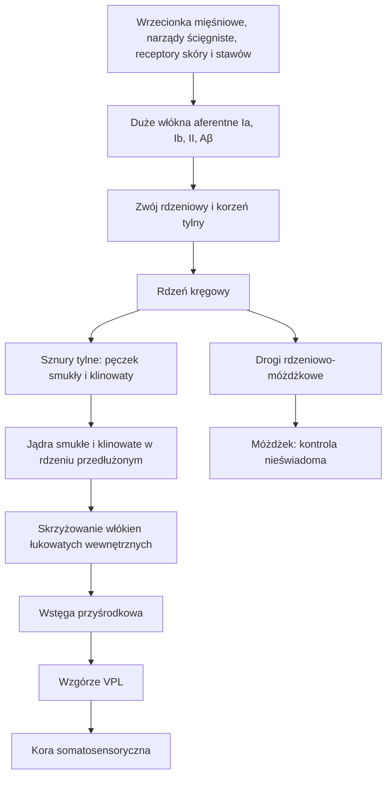
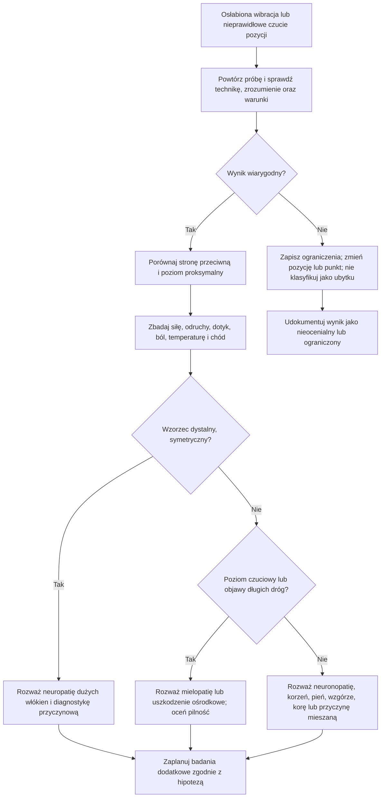

# 5.5. Czucie wibracji i ułożenia

## Wprowadzenie i zakres rozdziału

Czucie wibracji oraz czucie ułożenia i ruchu biernego należą do najważniejszych klinicznych składowych oceny dużych, mielinizowanych włókien czuciowych i układu sznurów tylnych–wstęgi przyśrodkowej. Ich badanie pozwala ocenić, czy pacjent odbiera rytmiczne odkształcenia tkanek oraz czy potrafi rozpoznać położenie części ciała i kierunek niewielkiego ruchu wykonywanego przez badającego bez udziału wzroku.

Zaburzenia tych modalności mogą prowadzić do niepewności ruchu, trudności w manipulowaniu przedmiotami, gorszej kontroli ustawienia stóp, niestabilności w ciemności i ataksji czuciowej. Mogą wynikać z uszkodzenia receptorów, dużych włókien nerwowych, nerwów obwodowych, zwojów rdzeniowych, korzeni tylnych, sznurów tylnych rdzenia, wstęgi przyśrodkowej, wzgórza albo kory somatosensorycznej. Podobny obraz funkcjonalny może powstać również przy zaburzeniach przedsionkowych, móżdżkowych, wzrokowych, ortopedycznych lub poznawczych, dlatego wynik należy interpretować w kontekście całego badania.

**Granice zakresu:** rozdział koncentruje się na praktycznym badaniu wibracji, czucia statycznego ułożenia, kinestezji i klinicznych następstw zaburzeń propriocepcji. Ogólna anatomia dróg czuciowych została przedstawiona w rozdziale 5.1, zasady organizacji badania w 5.2, dotyk lekki w 5.3, a ból i temperatura w 5.4. Czucie korowe i dyskryminacyjne, w tym stereognozja i grafestezja, są przedmiotem rozdziału 5.6. W niniejszym materiale zagadnienia te pojawiają się wyłącznie wtedy, gdy są potrzebne do różnicowania.

Badanie przyłóżkowe jest jakościową lub półilościową oceną funkcji. Nie zastępuje badania neurofizjologicznego, obrazowania ani formalnej klasyfikacji uszkodzenia rdzenia kręgowego. Zakres czynności wykonywanych samodzielnie zależy od kwalifikacji zawodowych, uprawnień i lokalnych procedur.

---

## 1. Cele kształcenia i efekty uczenia się

### 1.1. Cel ogólny

Celem rozdziału jest przygotowanie uczestnika do bezpiecznego, powtarzalnego i anatomicznie ukierunkowanego badania czucia wibracji, statycznego czucia ułożenia oraz kierunku ruchu biernego, a także do rozpoznawania wzorców sugerujących zaburzenie dużych włókien czuciowych lub dróg sznurów tylnych.

### 1.2. Szczegółowe efekty uczenia się

Po zakończeniu nauki uczestnik powinien potrafić:

1. odróżnić czucie wibracji, statyczne czucie pozycji stawu i kinestezję;
2. wyjaśnić rolę wrzecionek mięśniowych, narządów ścięgnistych Golgiego, mechanoreceptorów skóry i receptorów stawowych;
3. powiązać wynik badania z przebiegiem dużych włókien aferentnych i drogi sznurów tylnych–wstęgi przyśrodkowej;
4. prawidłowo dobrać kamerton 128 Hz do jakościowej oceny wibracji;
5. odróżnić zwykły kamerton od kamertonu Rydel–Seiffera i nie przenosić norm między różnymi urządzeniami;
6. zbadać wibrację od punktów dystalnych do proksymalnych, z porównaniem stron;
7. przeprowadzić próbę rozpoznawania kierunku niewielkiego ruchu biernego palca;
8. ograniczyć wskazówki dotykowe i wzrokowe, które mogłyby ułatwiać odgadywanie odpowiedzi;
9. ocenić wiarygodność odpowiedzi i rozpoznać sytuacje, w których wynik jest niewiarygodny lub niemożliwy do uzyskania;
10. rozpoznać kliniczne cechy ataksji czuciowej i odróżnić je od typowej ataksji móżdżkowej;
11. bezpiecznie wykonać próbę Romberga, jeżeli stan pacjenta na to pozwala;
12. wskazać możliwe lokalizacje uszkodzenia i potrzebę dalszej diagnostyki;
13. udokumentować wynik w sposób umożliwiający porównanie podczas kolejnych wizyt.

### 1.3. Kompetencje i odpowiedzialność

Wynik badania jest obserwacją kliniczną, a nie samodzielnym rozpoznaniem choroby. Uczestnik powinien:

- nie utożsamiać nieprawidłowego testu z określoną etiologią;
- nie interpretować pojedynczego wyniku bez uwzględnienia wieku, stanu skóry, bólu, ruchomości stawów i współpracy pacjenta;
- przerwać próbę, jeżeli występuje ryzyko upadku, urazu lub nagłego pogorszenia stanu;
- nie opóźniać pilnej pomocy medycznej w razie nowych objawów ogniskowych lub podejrzenia ostrego uszkodzenia rdzenia;
- stosować aktualne, licencjonowane formularze, jeżeli badanie jest częścią formalnego protokołu.

---

## 2. Definicje i rozróżnienia pojęciowe

### 2.1. Czucie wibracji

Czucie wibracji, określane również jako pallestezja, jest zdolnością odbierania rytmicznych, szybko powtarzających się odkształceń mechanicznych tkanek. W badaniu klinicznym ocenia się najczęściej, czy pacjent rozpoznaje obecność wibracji kamertonu przyłożonego do określonego punktu kostnego oraz czy potrafi wskazać moment jej ustania.

Wrażenie wibracji zależy od częstotliwości, amplitudy, siły i czasu pobudzenia, miejsca przyłożenia narzędzia, właściwości tkanek oraz stanu układu aferentnego. Nie jest ono prostym pomiarem przewodzenia w pojedynczym nerwie.

### 2.2. Statyczne czucie ułożenia

Statyczne czucie ułożenia, czyli świadoma informacja o pozycji części ciała, pozwala rozpoznać, w jakim ustawieniu znajduje się staw lub segment kończyny bez konieczności obserwowania go wzrokiem. W badaniu przyłóżkowym sprawdza się najczęściej, czy pacjent rozpoznaje ustawienie palca skierowanego ku górze lub ku dołowi.

### 2.3. Kinestezja i czucie ruchu biernego

Kinestezja oznacza świadome odczuwanie ruchu części ciała, w tym jego kierunku i zmian położenia. W badaniu klinicznym badający wykonuje niewielki ruch bierny, a pacjent określa, w którą stronę poruszył się segment.

Czucie pozycji i czucie ruchu są ze sobą powiązane, ale nie są tożsame. Pacjent może lepiej rozpoznawać położenie utrzymywane przez kilka sekund niż bardzo mały, krótki ruch, albo odwrotnie. Dlatego w razie nieprawidłowości warto ocenić oba elementy.

### 2.4. Propriocepcja

Propriocepcja to informacja o położeniu, ruchu i stanie mechanicznym części ciała, pochodząca z receptorów mięśni, ścięgien, stawów i skóry. Uczestniczy w świadomej ocenie pozycji kończyn, regulacji napięcia, koordynacji oraz automatycznej kontroli postawy.

Należy rozróżnić:

- **propriocepcję świadomą** – informację docierającą do struktur wzgórzowo-korowych, umożliwiającą świadome rozpoznawanie położenia i ruchu;
- **propriocepcję nieświadomą** – informację wykorzystywaną przede wszystkim przez móżdżek do bieżącej regulacji ruchu;
- **czucie wibracji** – modalność mechaniczna, która w klasycznym badaniu klinicznym jest oceniana oddzielnie od czucia pozycji.

### 2.5. Duże włókna czuciowe

Duże, szybko przewodzące i mielinizowane włókna aferentne przenoszą znaczną część informacji z mechanoreceptorów i proprioceptorów. W uproszczonym opisie klinicznym zalicza się do nich włókna grupy Ia, Ib i II oraz duże włókna skórne Aβ. Ich uszkodzenie może powodować osłabienie czucia wibracji, pozycji, ruchu i dotyku dyskryminacyjnego.

### 2.6. Ataksja czuciowa

Ataksja czuciowa jest zaburzeniem koordynacji wynikającym z niedostatecznej informacji o położeniu i ruchu kończyn. Pacjent może wykonywać ruchy niepewnie, nadmiernie kontrolować wzrokiem ustawienie stóp i dłoni, a po zamknięciu oczu wyraźnie tracić stabilność. Nie jest to pierwotnie zaburzenie planowania ruchu w móżdżku, lecz konsekwencja utraty lub zniekształcenia informacji aferentnej.

---

## 3. Podstawy neuroanatomiczne i neurofizjologiczne

### 3.1. Receptory mięśniowe

**Wrzecionka mięśniowe** znajdują się w mięśniach szkieletowych, równolegle do włókien mięśniowych. Informują o długości mięśnia i szybkości jej zmiany.

- Zakończenia pierwotne, związane głównie z włóknami Ia, reagują na rozciąganie i dynamiczną zmianę długości.
- Zakończenia wtórne, związane głównie z włóknami II, przekazują informacje o długości mięśnia i jej utrzymywaniu.
- Aktywność wrzecionek jest modulowana przez układ gamma, co pozwala zachować czułość receptorów podczas skurczu mięśnia.

**Znaczenie kliniczne:** uszkodzenie dużych włókien czuciowych lub ich połączeń może zaburzać informację o długości mięśnia, a w konsekwencji utrudniać świadome rozpoznawanie ruchu i kontrolę pozycji kończyny.

### 3.2. Narządy ścięgniste Golgiego

Narządy ścięgniste Golgiego znajdują się w obrębie połączenia mięśniowo-ścięgnistego, szeregowo względem włókien mięśniowych. Włókna aferentne Ib przekazują informacje o napięciu rozwijanym w jednostce mięśniowo-ścięgnistej. Ich rola obejmuje modulację aktywności ruchowej i ochronę przed nadmiernym obciążeniem.

Nie należy sprowadzać całej propriocepcji do jednego rodzaju receptora. Ostateczna informacja o pozycji i ruchu powstaje przez integrację sygnałów pochodzących z kilku źródeł.

### 3.3. Mechanoreceptory skóry i tkanek okołostawowych

Receptory skórne reagują na rozciąganie, ucisk, przesuwanie skóry i wibrację. Są istotne, ponieważ informacja o położeniu kończyny nie pochodzi wyłącznie z mięśni i stawów. Zmiana napięcia skóry wokół stawu może wspierać rozpoznawanie kierunku ruchu.

Receptory stawowe dostarczają informacji o odkształceniu tkanek i położeniu stawu, szczególnie przy określonych zakresach ruchu. Ich wkład zależy od rodzaju stawu, zakresu ruchu i warunków mechanicznych.

### 3.4. Włókna aferentne

| Grupa włókien | Charakterystyka | Główne znaczenie funkcjonalne |
|---|---|---|
| Ia | Bardzo duże, silnie mielinizowane | Dynamiczna informacja z wrzecionek mięśniowych, odruch na rozciąganie |
| Ib | Duże, mielinizowane | Informacja z narządów ścięgnistych Golgiego |
| II | Duże, mielinizowane | Statyczna informacja o długości mięśnia i część sygnałów proprioceptywnych |
| Aβ | Duże, mielinizowane | Dotyk, ucisk, wibracja i część informacji mechanicznej ze skóry |

Wartości prędkości przewodzenia są zależne od temperatury, średnicy aksonu, stopnia mielinizacji i metody pomiaru. Nie należy używać pojedynczej wartości prędkości jako klinicznej normy dla wszystkich włókien.

### 3.5. Droga sznurów tylnych–wstęgi przyśrodkowej

Świadome czucie wibracji i pozycji z tułowia oraz kończyn jest w znacznej mierze przekazywane przez układ sznurów tylnych i wstęgi przyśrodkowej.

Schemat przebiegu:

1. Receptor pobudza włókno czuciowe neuronu, którego ciało komórkowe znajduje się w zwoju rdzeniowym.
2. Włókno wchodzi do rdzenia przez korzeń tylny.
3. Znaczna część włókien odpowiedzialnych za świadome czucie wibracji i pozycji wstępuje po tej samej stronie w sznurach tylnych.
4. Włókna z dolnej części ciała biegną głównie w pęczku smukłym, a z górnej części – w pęczku klinowatym.
5. W rdzeniu przedłużonym następuje przełączenie w jądrze smukłym i klinowatym.
6. Włókna drugiego neuronu krzyżują się jako włókna łukowate wewnętrzne i tworzą wstęgę przyśrodkową.
7. Wzgórzowe neurony trzeciego rzędu przekazują informację do kory somatosensorycznej.

**Znaczenie lokalizacyjne:** uszkodzenie sznurów tylnych w rdzeniu kręgowym może powodować zaburzenie czucia wibracji i pozycji po stronie uszkodzenia poniżej zmiany. Uszkodzenie wstęgi przyśrodkowej po skrzyżowaniu zwykle daje zaburzenie po stronie przeciwnej. Ostateczny wzorzec zależy od poziomu i rozległości uszkodzenia.

### 3.6. Drogi proprioceptywne do móżdżku

Nie cała informacja proprioceptywna służy świadomemu rozpoznawaniu pozycji. Część dociera do móżdżku drogami rdzeniowo-móżdżkowymi i klinowo-móżdżkowymi, wspierając automatyczną kontrolę postawy i ruchu.

- Droga rdzeniowo-móżdżkowa tylna przenosi znaczną część informacji z tułowia i kończyn dolnych.
- Droga klinowo-móżdżkowa przekazuje analogiczne informacje z kończyny górnej.
- Droga rdzeniowo-móżdżkowa przednia przekazuje złożoną informację o aktywności obwodowych obwodów ruchowych i stanie kończyny.

Drogi te mają odrębną organizację i nie powinny być utożsamiane ze świadomą drogą sznurów tylnych–wstęgi przyśrodkowej.

### 3.7. Kora somatosensoryczna i integracja

Informacja dociera do pól somatosensorycznych płata ciemieniowego. Przetwarzanie obejmuje rozpoznawanie położenia, kierunku ruchu, intensywności bodźca i relacji przestrzennych. Uszkodzenie struktur korowych może zaburzać interpretację informacji mimo zachowanego odbioru części bodźców na poziomie obwodowym.

### 3.8. Schemat funkcjonalny



---

## 4. Znaczenie kliniczne i wskazania do badania

### 4.1. Kiedy badać wibrację i propriocepcję?

Badanie jest szczególnie wskazane, gdy pacjent zgłasza:

- uczucie chodzenia po miękkim lub nierównym podłożu;
- trudność w chodzeniu po ciemku;
- gorszą kontrolę stóp podczas zakładania obuwia;
- niezgrabność palców przy zapinaniu guzików lub manipulowaniu drobnymi przedmiotami;
- konieczność patrzenia na kończyny podczas wykonywania precyzyjnych ruchów;
- częste potykanie się bez wyraźnego osłabienia mięśni;
- zaburzenia równowagi nasilające się po zamknięciu oczu;
- drętwienie i mrowienie z towarzyszącym osłabieniem odruchów;
- podejrzenie neuropatii dużych włókien lub uszkodzenia sznurów tylnych.

### 4.2. Badanie przesiewowe a ukierunkowane

**Badanie przesiewowe** ma odpowiedzieć, czy w podstawowych punktach kończyn występuje wiarygodne odczuwanie wibracji i ruchu biernego. Powinno być krótkie, obustronne i obejmować punkty dystalne.

**Badanie ukierunkowane** wykonuje się po stwierdzeniu nieprawidłowości lub przy silnym podejrzeniu klinicznym. Obejmuje ocenę kilku poziomów kończyny, dokładniejsze porównanie stron, ocenę dodatkowych modalności czucia, odruchów, siły, koordynacji i chodu.

### 4.3. Pytania kliniczne przed badaniem

Przed pierwszym bodźcem należy ustalić:

1. Czy objawy są obustronne, czy jednostronne?
2. Czy mają rozkład dystalny, segmentarny, dermatomalny czy nieregularny?
3. Czy pojawiły się nagle, czy narastały stopniowo?
4. Czy występuje ból, osłabienie, zaburzenie chodu lub objawy autonomiczne?
5. Czy pacjent ma cukrzycę, niedobory żywieniowe, chorobę nerek, chorobę autoimmunologiczną lub ekspozycję na neurotoksyny?
6. Czy wystąpił uraz, zabieg, infekcja lub nowy lek?
7. Czy badanie można wykonać bezpiecznie w pozycji stojącej?

---

## 5. Przygotowanie, sprzęt i warunki badania

### 5.1. Podstawowe wyposażenie

| Narzędzie | Zastosowanie | Uwagi |
|---|---|---|
| Kamerton 128 Hz | Jakościowa ocena wibracji | Najczęściej używany w badaniu przyłóżkowym |
| Kamerton Rydel–Seiffera | Półilościowa ocena progu wibracji | Ma skalę odczytu; wymaga stosowania właściwych norm dla urządzenia |
| Stoper | Kontrola czasu w określonych protokołach | Nie ustanawia uniwersalnej normy dla zwykłego kamertonu |
| Karta dokumentacji | Zapis lokalizacji i odpowiedzi | Należy podać rodzaj kamertonu i miejsca badania |
| Stabilne krzesło lub łóżko | Bezpieczne badanie w pozycji siedzącej | Szczególnie ważne przy zaburzeniach równowagi |
| Asekuracja lub pas do chodu | Próby równoważne | Stosować zgodnie z kompetencjami i lokalną procedurą |

### 5.2. Ocena warunków miejscowych

Przed przyłożeniem kamertonu należy obejrzeć skórę i tkanki w miejscu badania. Zwrócić uwagę na:

- owrzodzenia, rany, pęcherze i zakażenia;
- znaczne modzele lub zgrubienia skóry;
- obrzęk i deformacje;
- blizny i zmiany pooperacyjne;
- bolesność uciskową;
- złamanie, świeży uraz lub niestabilność stawu.

Nie należy przykładać kamertonu do rany, owrzodzenia, miejsca zakażonego ani bolesnego urazu. Wybiera się bezpieczny, sąsiedni punkt kostny i odnotowuje odstępstwo od standardowego miejsca.

### 5.3. Pozycja pacjenta

Badanie wibracji można wykonywać w pozycji siedzącej lub leżącej. Kończyna powinna być rozluźniona i stabilna. Badanie pozycji palców najlepiej przeprowadzać w pozycji, w której pacjent nie musi utrzymywać kończyny przeciw grawitacji.

Próby stojące, w tym Romberg, wykonuje się dopiero po ocenie ryzyka upadku. Nie należy rozpoczynać od próby z zamkniętymi oczami.

### 5.4. Instrukcja

Przykładowa instrukcja do badania wibracji:

> „Przyłożę do palca narzędzie, które może delikatnie drgać. Proszę powiedzieć, czy czuje Pan/Pani drganie i zasygnalizować, kiedy przestanie być odczuwalne. Proszę nie zgadywać; jeśli nie ma Pan/Pani pewności, proszę to powiedzieć”.

Przykładowa instrukcja do badania ułożenia:

> „Będę delikatnie poruszać palcem w górę albo w dół. Proszę nie pomagać ruchem i nie napinać mięśni. Po każdym ruchu proszę powiedzieć: góra albo dół. Jeżeli ruchu nie będzie można rozpoznać, proszę powiedzieć: nie wiem”.

Przed właściwą próbą należy zademonstrować zadanie przy otwartych oczach, upewnić się, że pacjent rozumie kierunki i dopiero potem ograniczyć kontrolę wzrokową.

---

## 6. Badanie czucia wibracji kamertonem 128 Hz

### 6.1. Dlaczego stosuje się 128 Hz?

Kamerton 128 Hz jest powszechnym narzędziem do jakościowej oceny czucia wibracji. Dostarcza powtarzalnego bodźca mechanicznego, jeżeli jest prawidłowo pobudzony i przykładany w podobnych warunkach. Nie jest jednak urządzeniem do precyzyjnego pomiaru progu czucia, ponieważ amplituda drgań zmienia się w czasie, a siła uderzenia i sposób przyłożenia wpływają na bodziec.

Nie należy mylić kamertonu 128 Hz do badania czucia z kamertonami o wyższych częstotliwościach używanymi w innych celach diagnostycznych.

### 6.2. Typowe miejsca badania

**Kończyna dolna:**

- grzbietowa powierzchnia dalszego paliczka palucha, w okolicy stawu międzypaliczkowego;
- grzbietowa powierzchnia innego palca, jeżeli paluch jest amputowany lub miejsce jest niedostępne;
- kostka przyśrodkowa;
- guzowatość piszczeli lub inny odpowiedni punkt proksymalny.

**Kończyna górna:**

- grzbietowa powierzchnia dalszego paliczka palca wskazującego;
- wyrostek rylcowaty kości łokciowej;
- wyrostek łokciowy;
- obojczyk lub inny punkt proksymalny, jeśli jest to klinicznie uzasadnione.

Wybór punktów powinien być możliwie symetryczny. Nie należy porównywać bezpośrednio dwóch różnych struktur kostnych tak, jakby miały identyczne właściwości mechaniczne.

### 6.3. Procedura krok po kroku

1. Wyjaśnij pacjentowi cel i przebieg próby.
2. Sprawdź, czy kamerton jest nieuszkodzony i czy ma oznaczenie częstotliwości 128 Hz.
3. Zademonstruj odczucie wibracji na nadgarstku, łokciu lub obojczyku, gdzie pacjent zwykle łatwo je rozpoznaje.
4. Ustaw kończynę w wygodnej, stabilnej pozycji.
5. Poproś pacjenta o zamknięcie oczu lub zastosuj inne bezpieczne ograniczenie wskazówek wzrokowych.
6. Pobudź kamerton w sposób zapewniający wyraźne, niebolesne drgania. Nie uderzaj narzędziem o twardą, ostrą krawędź.
7. Przyłóż podstawę kamertonu prostopadle do wybranego punktu kostnego, z kontrolowanym, niewielkim naciskiem.
8. Zapytaj, czy pacjent odczuwa wibrację.
9. Poproś o sygnalizację momentu, w którym wibracja przestaje być odczuwana.
10. Zakończ bodziec i porównaj wynik z analogicznym miejscem po drugiej stronie.
11. Jeżeli czucie jest osłabione lub nieobecne dystalnie, przejdź do bardziej proksymalnego punktu.
12. Powtórz próbę, jeżeli wynik jest niejednoznaczny, ale unikaj wielokrotnego, męczącego pobudzania tego samego miejsca.
13. Zapisz stronę, lokalizację, rodzaj kamertonu, odpowiedź i ewentualne czynniki zakłócające.

### 6.4. Technika przyłożenia

Podstawa kamertonu powinna mieć stabilny kontakt z punktem kostnym. Należy unikać:

- przesuwania kamertonu po skórze;
- zbyt mocnego dociskania;
- dotykania widełek kamertonu do sąsiednich tkanek;
- zmieniania punktu przyłożenia w trakcie jednej próby;
- podpowiadania pacjentowi momentu zakończenia bodźca;
- rytmicznego, przewidywalnego powtarzania prób.

Wibracja może być odbierana także przez tkanki sąsiednie. Dlatego wynik powinien być oceniany jako odpowiedź całego układu czuciowego, a nie izolowanego receptora znajdującego się dokładnie pod kamertonem.

### 6.5. Interpretacja odpowiedzi

Warto rozróżnić:

- **detekcję** – pacjent potwierdza, że odczuwa wibrację;
- **rozpoznanie zaniku** – pacjent wskazuje moment ustania wibracji;
- **porównanie stron** – pacjent odczuwa wyraźnie słabszą lub krócej utrzymującą się wibrację po jednej stronie;
- **próg percepcji** – najmniejszy bodziec, który pacjent potrafi wykryć; wymaga bardziej kontrolowanego narzędzia i procedury niż zwykły kamerton.

Nie należy uznawać samego potwierdzenia obecności wibracji za dowód prawidłowego progu. Pacjent może czuć silną wibrację, ale nie wykrywać jej przy małej amplitudzie.

### 6.6. Ocena dystalno-proksymalna

Jeżeli wibracja jest osłabiona na paluchu, należy zbadać bardziej proksymalny punkt, na przykład kostkę przyśrodkową. Jeśli nieprawidłowość utrzymuje się, można kontynuować ocenę na dalszych poziomach kończyny.

Schemat:

```text
PALUCH
  │
  ├── czucie obecne i symetryczne → porównaj stronę przeciwną, zakończ ocenę przesiewową
  │
  └── czucie osłabione lub nieobecne
          │
          ▼
KOSTKA PRZYŚRODKOWA
          │
          ├── czucie obecne → zapisz granicę dystalnego osłabienia
          │
          └── czucie nadal osłabione
                  │
                  ▼
GUZOWATOŚĆ PISZCZELI / KOLEJNY PUNKT PROKSYMALNY
```

Taki schemat nie służy do automatycznego rozpoznawania polineuropatii. Granica percepcji zależy również od techniki, miejsca, wieku, budowy tkanek i współpracy pacjenta.

### 6.7. Protokół IWGDF w ocenie stopy osoby z cukrzycą

Wytyczne IWGDF 2023 opisują określoną procedurę użycia kamertonu 128 Hz w ocenie czucia wibracji u osób z cukrzycą:

1. Najpierw demonstruje się odczucie na nadgarstku, łokciu lub obojczyku.
2. Pacjent nie powinien widzieć miejsca ani momentu przyłożenia kamertonu.
3. Kamerton przykłada się do kostnego obszaru grzbietowej powierzchni dalszego paliczka palucha lub innego palca, jeżeli paluch jest niedostępny.
4. Podstawę przykłada się prostopadle, z kontrolowanym naciskiem.
5. Wykonuje się dwie aplikacje z wibracją, przeplatane co najmniej jedną próbą pozorowaną bez wibracji.
6. Percepcję uznaje się za obecną, jeżeli pacjent prawidłowo rozpoznaje co najmniej dwie z trzech prezentacji; dwie nieprawidłowe odpowiedzi wskazują na brak wiarygodnego rozpoznania w tej procedurze.
7. Jeżeli pacjent nie rozpoznaje wibracji na paluchu, ocenę powtarza się bardziej proksymalnie, na przykład na kostce lub guzowatości piszczeli.

**Ważne:** kryterium dwóch poprawnych odpowiedzi na trzy prezentacje dotyczy konkretnej procedury IWGDF. Nie wolno przenosić go automatycznie na każdy protokół neurologiczny, każdy punkt anatomiczny ani badanie propriocepcji. W dokumentacji należy wskazać, że zastosowano procedurę przesiewową dla stopy w kontekście cukrzycy.

---

## 7. Półilościowa ocena wibracji kamertonem Rydel–Seiffera

### 7.1. Charakterystyka narzędzia

Kamerton Rydel–Seiffera jest kamertonem z dodatkowymi elementami umożliwiającymi odczyt półilościowy. W typowej wersji stosuje się skalę od 0 do 8, gdzie większa wartość oznacza lepsze odczuwanie wibracji, a niższa – wyższy próg percepcji.

W wielu publikacjach urządzenie opisywane jest jako kamerton 64 Hz z podziałką. Należy sprawdzić oznaczenie konkretnego egzemplarza i instrukcję producenta. Nie wolno zakładać, że wszystkie kamertony Rydel–Seiffera i zwykłe kamertony 128 Hz mają identyczne parametry.

### 7.2. Procedura

1. Sprawdź, czy elementy skali są kompletne i prawidłowo zamocowane.
2. Zastosuj procedurę producenta dotyczącą pobudzenia i odczytu.
3. Ustaw narzędzie w sposób przewidziany dla danego modelu.
4. Przykładaj je do standaryzowanego punktu kostnego.
5. Odczytaj wartość w momencie, w którym pacjent przestaje odczuwać wibrację, zgodnie z instrukcją urządzenia.
6. Wykonaj pomiar po obu stronach.
7. Jeżeli protokół wymaga powtórzeń, wykonaj je w identycznych warunkach.
8. Zapisz model kamertonu, punkt anatomiczny, stronę i wynik.

### 7.3. Przykładowe wartości referencyjne – ograniczenia

W badaniu Martina i współpracowników z 1998 roku oceniano kamerton Rydel–Seiffera u 198 zdrowych osób oraz 59 pacjentów z polineuropatią. Autorzy wykazali zależny od wieku spadek percepcji wibracji, a także lepsze wyniki w kończynach górnych niż dolnych.

W tej pracy podano następujące dolne granice referencyjne (skala 0–8) dla określonych miejsc i grup wieku:

| Wiek | Kończyna górna | Kończyna dolna |
|---|---:|---:|
| Do 40 lat | ≥ 6,5 | ≥ 4,5 |
| 41–60 lat | ≥ 6,0 | ≥ 4,0 |
| 61–85 lat | ≥ 6,0 | ≥ 3,5 |
| Powyżej 85 lat | ≥ 5,5 | ≥ 3,0 |

**Ograniczenia tabeli:**

- są to dane z konkretnego badania, a nie uniwersalne normy dla każdej populacji;
- wartości zależą od modelu kamertonu, punktu anatomicznego i metody odczytu;
- w publikacji z 2022 roku ponownie wykazano wpływ wieku i płci na wyniki kamertonu Rydel–Seiffera;
- wyniki z różnych urządzeń nie są automatycznie wymienne;
- półilościowy wynik nie zastępuje badania przewodnictwa nerwowego ani całościowej oceny neurologicznej.

W praktyce należy stosować normy właściwe dla używanego modelu i populacji, a w razie braku odpowiednich norm opisywać wynik wraz z metodą, stroną i lokalizacją, bez tworzenia pozornie precyzyjnego rozpoznania.

### 7.4. Zwykły kamerton a narzędzie z podziałką

| Cecha | Kamerton 128 Hz | Rydel–Seiffer |
|---|---|---|
| Główne zastosowanie | Jakościowa ocena wibracji | Półilościowa ocena progu |
| Odczyt | Obecna, osłabiona, nieobecna; moment ustania | Skala właściwa dla urządzenia |
| Wpływ siły pobudzenia | Znaczny | Nadal istotny, lecz procedura umożliwia bardziej uporządkowany odczyt |
| Normy | Brak uniwersalnego czasu dla wszystkich miejsc i grup wieku | Dostępne dane referencyjne zależne od wieku i miejsca |
| Dokumentacja | Częstotliwość, punkt, strona, odpowiedź | Model, skala, punkt, strona, wynik |

---

## 8. Badanie statycznego czucia ułożenia palców

### 8.1. Cel próby

Celem jest ustalenie, czy pacjent potrafi rozpoznać pozycję stawu lub kierunek niewielkiego przemieszczenia palca bez korzystania ze wzroku. Próba powinna być wykonana w taki sposób, aby odpowiedź nie mogła być oparta na ucisku skóry, zmianie napięcia mięśniowego widocznej dla pacjenta ani przewidywalnym rytmie ruchów.

### 8.2. Dobór stawu

W kończynie dolnej najczęściej ocenia się paluch, zwykle w stawie międzypaliczkowym. W kończynie górnej można wykorzystać staw międzypaliczkowy dalszy palca wskazującego lub innego palca, jeśli warunki miejscowe są lepsze.

Wybór zależy od:

- dostępności i ruchomości stawu;
- deformacji, bólu lub przykurczu;
- wcześniejszych urazów i zabiegów;
- możliwości stabilnego uchwycenia paliczka;
- celu klinicznego i porównywalności kolejnych pomiarów.

### 8.3. Prawidłowy chwyt

Badający powinien:

- stabilizować paliczek położony bliżej tułowia;
- chwytać dalszy paliczek za jego boczne powierzchnie;
- unikać uciskania opuszki i paznokcia;
- nie przesuwać skóry w kierunku, który mógłby zdradzać kierunek ruchu;
- wykonywać ruch w płaszczyźnie stawu, bez skręcania i nadmiernego rozciągania.

Chwyt za powierzchnię grzbietową i podeszwową może wytwarzać wskazówki dotykowe, dlatego zaleca się uchwyt boczny.

### 8.4. Procedura krok po kroku

1. Wyjaśnij pacjentowi, że będzie rozpoznawał ruch „w górę” i „w dół”.
2. Zademonstruj oba kierunki przy otwartych oczach.
3. Poproś pacjenta o zamknięcie oczu.
4. Ustaw staw w pozycji pośredniej, bez skrajnego zgięcia lub wyprostu.
5. Stabilizuj segment proksymalny.
6. Delikatnie przemieść dalszy paliczek o niewielki, wyraźny zakres.
7. Zatrzymaj ruch i poproś o wskazanie kierunku.
8. Wróć do pozycji wyjściowej.
9. Zmieniaj kierunek w kolejnych próbach w sposób nieprzewidywalny.
10. W razie potrzeby zastosuj próbę bez ruchu, aby ocenić, czy pacjent nie odpowiada automatycznie.
11. Powtórz próbę po stronie przeciwnej.
12. Jeżeli wynik jest nieprawidłowy, zbadaj bardziej proksymalny staw.
13. Zapisz liczbę poprawnych odpowiedzi, zakres ruchu, stronę i ograniczenia.

### 8.5. Wielkość ruchu

Ruch powinien być możliwie mały, ale wystarczający do rozpoznania. Zbyt duży ruch może być odczuwany przez rozciąganie skóry i tkanek, a nie tylko przez właściwe mechanizmy proprioceptywne. Zbyt mały ruch może natomiast przekraczać możliwości pacjenta lub możliwości standaryzacji badającego.

Nie istnieje jedna uniwersalna amplituda ruchu odpowiednia dla wszystkich stawów, pacjentów i protokołów. Należy stosować kryteria danego narzędzia lub standardu, a w badaniu klinicznym zapisywać, czy pacjent rozpoznawał ruch mały, większy czy dopiero wyraźny.

### 8.6. Rozpoznawanie pozycji statycznej

Jeżeli pacjent nie rozpoznaje kierunku ruchu, można dodatkowo sprawdzić, czy rozpoznaje utrzymywane ustawienie stawu. Badający ustawia palec w jednej z dwóch pozycji i pyta o jej położenie. Próbę wykonuje się losowo, po uprzednim pokazaniu obu ustawień.

Należy odnotować, czy trudność dotyczy:

- rozpoznawania kierunku ruchu;
- rozpoznawania statycznego ustawienia;
- obu elementów;
- tylko bardzo małych przemieszczeń.

### 8.7. Ocena dystalno-proksymalna

Jeżeli pacjent nie rozpoznaje ruchu w paluchu, należy przejść do stawu śródstopno-paliczkowego, skokowego lub innego dostępnego stawu proksymalnego. W kończynie górnej można kolejno oceniać staw międzypaliczkowy bliższy, śródręczno-paliczkowy, nadgarstek i łokieć.

Nie należy zwiększać zakresu ruchu bez końca. Jeżeli pacjent nie rozpoznaje nawet wyraźnego, bezpiecznego ruchu proksymalnego, wynik wskazuje na istotne zaburzenie czucia pozycji, ale jego lokalizacja wymaga dalszej analizy.

### 8.8. Typowe błędy techniczne

| Błąd | Skutek | Korekta |
|---|---|---|
| Chwyt za opuszkę i paznokieć | Pacjent wyczuwa nacisk zamiast kierunku ruchu | Chwyt boczny paliczka |
| Ruch zawsze w tej samej kolejności | Pacjent może przewidywać odpowiedź | Losowa, zrównoważona kolejność |
| Brak stabilizacji segmentu proksymalnego | Ruch może odbywać się w kilku stawach | Stabilizacja jednego segmentu |
| Zbyt duża amplituda | Odpowiedź może wynikać z innych wskazówek | Zmniejsz zakres do wyraźnego minimum |
| Ruch wykonywany rytmicznie | Pacjent może zgadywać na podstawie rytmu | Zmieniaj odstępy i kierunki |
| Brak demonstracji | Pacjent może nie rozumieć pojęć „góra” i „dół” | Demonstracja i sprawdzenie rozumienia |
| Ucisk bolesnego stawu | Odpowiedź jest zniekształcona przez ból | Zmień staw lub odnotuj brak możliwości badania |

---

## 9. Ocena czucia ruchu biernego i próby propriocepcji

### 9.1. Różnica między pozycją a ruchem

Pacjent może rozpoznawać ustawienie kończyny, ale nie wykrywać niewielkich zmian położenia. Może również rozpoznawać kierunek ruchu, lecz mieć trudność z odtworzeniem końcowego ustawienia. Dlatego warto zapisywać oba wyniki osobno.

### 9.2. Próba ruchu biernego w palcach

Wykonuje się ją analogicznie do próby statycznego czucia ułożenia, z naciskiem na rozpoznanie kierunku i momentu rozpoczęcia ruchu. Ruch powinien być płynny, bez szarpnięcia. Pacjent nie powinien widzieć kończyny.

W razie wątpliwości można:

- zwiększyć amplitudę w granicach bezpiecznego zakresu;
- zmienić tempo, unikając gwałtownego ruchu;
- przejść do bardziej proksymalnego stawu;
- porównać wynik z drugą kończyną;
- powtórzyć próbę po przerwie.

### 9.3. Próba odtwarzania ustawienia

Badający ustawia jeden palec w określonej pozycji, a pacjent drugą ręką próbuje odtworzyć podobne ustawienie bez patrzenia na badaną kończynę. Próba jest pomocnicza i zależy również od sprawności ruchowej, rozumienia polecenia, pamięci roboczej i koordynacji. Nie może zastąpić bezpośredniego badania biernego czucia pozycji.

### 9.4. Próba z kończyną górną

Można poprosić pacjenta o zamknięcie oczu, wyprostowanie kończyn przed sobą i utrzymanie ich w określonym ustawieniu. Badający wykonuje niewielkie, kontrolowane przemieszczenie jednego palca lub ręki, a pacjent próbuje odtworzyć pozycję drugą kończyną.

Należy pamiętać, że wynik zależy także od siły, zakresu ruchu, bólu, uwagi i rozumienia polecenia. Jest to próba uzupełniająca, a nie izolowany test czucia stawowego.

### 9.5. Pseudoatetoza

Przy znacznym ubytku propriocepcji mogą pojawiać się powolne, falujące ruchy palców lub dłoni, szczególnie po zamknięciu oczu. Zjawisko to określa się jako pseudoatetozę. Pacjent próbuje utrzymać kończynę w określonej pozycji, ale brak wiarygodnej informacji zwrotnej powoduje niestabilne, korygujące ruchy.

Pseudoatetoza sugeruje zaburzenie informacji czuciowej, lecz sama nie określa poziomu uszkodzenia. Należy ją zestawić z czuciem wibracji, ruchem biernym, odruchami i innymi objawami.

---

## 10. Próba Romberga i funkcjonalne następstwa utraty propriocepcji

### 10.1. Cel próby Romberga

Próba Romberga ocenia zdolność utrzymywania pozycji stojącej po ograniczeniu kontroli wzrokowej. Stabilność postawy zależy od integracji trzech głównych źródeł informacji:

1. wzroku;
2. układu przedsionkowego;
3. informacji somatosensorycznej, w tym propriocepcji.

Gdy pacjent stoi stabilnie przy otwartych oczach, ale wyraźnie traci równowagę po ich zamknięciu, może to wskazywać na niewystarczającą informację proprioceptywną lub przedsionkową. Próba nie jest samodzielnym testem rozpoznającym określoną chorobę.

### 10.2. Warunki bezpieczeństwa

Próby nie należy wykonywać, jeżeli pacjent:

- nie potrafi bezpiecznie stać z otwartymi oczami;
- ma znaczne osłabienie kończyn dolnych;
- jest w stanie ostrego splątania lub nie rozumie poleceń;
- ma ciężkie zawroty głowy, omdlenie lub objawową hipotonię ortostatyczną;
- jest po świeżym urazie, z niestabilnością stawów lub istotnym bólem;
- ma wysokie ryzyko upadku, którego nie można odpowiednio zabezpieczyć.

Badający powinien stać blisko pacjenta, zapewnić wolną przestrzeń i możliwość natychmiastowej asekuracji. W razie potrzeby należy użyć pasa do chodu lub drugiej przeszkolonej osoby. Nie wolno celowo doprowadzać do upadku.

### 10.3. Procedura

1. Oceń, czy pacjent potrafi stać stabilnie z otwartymi oczami.
2. Ustaw pacjenta na twardym, równym podłożu, ze stopami złączonymi lub w innym jasno określonym ustawieniu.
3. Ustaw się blisko pacjenta, gotowy do asekuracji.
4. Obserwuj postawę przy otwartych oczach.
5. Jeżeli jest bezpiecznie, poproś o zamknięcie oczu.
6. Obserwuj kołysanie tułowia, ruchy stóp, konieczność wykonania kroku i utratę stabilności.
7. Przerwij próbę natychmiast, gdy pacjent zaczyna tracić równowagę.
8. Zapisz warunki próby, czas obserwacji i rodzaj reakcji.

### 10.4. Interpretacja

**Wynik sugerujący dodatnią próbę Romberga:** pacjent utrzymuje pozycję przy otwartych oczach, a po zamknięciu oczu pojawia się wyraźne nasilenie chwiania, konieczność wykonania kroku lub utrata równowagi.

Nie należy utożsamiać dodatniej próby wyłącznie z uszkodzeniem sznurów tylnych. Podobny wynik może występować przy zaburzeniach przedsionkowych. W zaburzeniach móżdżkowych niestabilność często jest widoczna również przy otwartych oczach, ale obraz kliniczny bywa złożony.

### 10.5. Próba Romberga a ataksja móżdżkowa

| Cecha | Ataksja czuciowa | Ataksja móżdżkowa |
|---|---|---|
| Kontrola wzrokowa | Wyraźnie pomaga | Nie usuwa zasadniczego deficytu |
| Zamknięcie oczu | Często znacznie nasila niestabilność | Może nasilać niestabilność, ale nie jest warunkiem jej ujawnienia |
| Czucie wibracji | Często osłabione | Zwykle zachowane, jeśli nie ma współistniejącego uszkodzenia |
| Czucie pozycji | Często osłabione | Zwykle zachowane |
| Próby palec–nos | Ruch może poprawiać się przy kontroli wzrokowej | Typowa dysmetria i zaburzenie hamowania ruchu |
| Chód | Często ostrożny, kontrolowany wzrokiem, czasem tupiący | Często szerokopodstawny, nieregularny, z zaburzeniem kierunku i rytmu |
| Oczy i mowa | Zwykle bez pierwotnych objawów móżdżkowych | Możliwe oczopląs, dyzartria, zaburzenia sakkad |

Tabela przedstawia typowe tendencje, a nie sztywne kryteria rozpoznania.

### 10.6. Próby trudniejsze

U pacjentów o dobrym poziomie funkcjonalnym można rozważyć próbę tandemową lub inne zadania równoważne, ale dopiero po ocenie bezpieczeństwa. Stanie na niestabilnym podłożu z zamkniętymi oczami nie jest prostym zamiennikiem klasycznej próby Romberga: zmienia udział informacji somatosensorycznej i przedsionkowej, przez co wymaga odrębnej interpretacji.

---

## 11. Ataksja czuciowa – obraz kliniczny

### 11.1. Typowe objawy

Pacjent z zaburzeniem propriocepcji może:

- patrzeć na stopy podczas chodzenia;
- mocniej stawiać stopy, aby zwiększyć informację mechaniczną;
- mieć trudności z chodzeniem po ciemku;
- niepewnie wykonywać ruchy precyzyjne bez kontroli wzrokowej;
- mieć trudności z trafieniem dłonią w przedmiot po zamknięciu oczu;
- wykonywać niepewne ruchy palców;
- zgłaszać, że kończyna „nie należy do niego” lub jest trudna do wyczucia;
- mieć dodatnią próbę Romberga;
- prezentować pseudoatetozę przy wyciągniętych rękach.

### 11.2. Chód ataktyczny czuciowy

W ataksji czuciowej chód może być ostrożny, z podwyższonym unoszeniem stóp i mocniejszym kontaktem stopy z podłożem. Pacjent często kompensuje utratę informacji czuciowej wzrokiem. W ciemności lub na nierównym podłożu kompensacja staje się mniej skuteczna.

Nie każdy pacjent prezentuje klasyczny chód tupiący. Wzorzec zależy od nasilenia deficytu, współistniejącego osłabienia mięśni, bólu, wieku i zdolności kompensacyjnych.

### 11.3. Znaczenie funkcjonalne

Utrata propriocepcji zwiększa ryzyko:

- potknięć i upadków;
- urazów stóp i palców;
- błędnego ustawiania kończyn podczas transferów;
- trudności w zapinaniu odzieży i manipulowaniu narzędziami;
- urazów termicznych i mechanicznych w razie współistniejącej utraty czucia ochronnego;
- ograniczenia samodzielnego poruszania się w słabym oświetleniu.

Ocena powinna obejmować nie tylko wynik testu, ale również rzeczywiste funkcjonowanie pacjenta w domu i środowisku.

---

## 12. Interpretacja wyników i lokalizacja uszkodzenia

### 12.1. Zasada ogólna

Nieprawidłowe czucie wibracji lub pozycji należy interpretować według czterech wymiarów:

1. **modalność** – czy zaburzona jest wibracja, pozycja, ruch bierny, czy kilka z nich;
2. **topografia** – czy objaw jest dystalny, proksymalny, jednostronny, obustronny, dermatomalny lub odpowiada określonemu nerwowi;
3. **współistniejące objawy** – siła, napięcie, odruchy, ból, temperatura, dotyk, chód i funkcje autonomiczne;
4. **dynamika** – nagły początek, postęp, nawroty, związek z urazem, lekiem lub chorobą ogólnoustrojową.

### 12.2. Typowe wzorce lokalizacyjne

| Wzorzec | Możliwa lokalizacja | Co sprawdzić dodatkowo |
|---|---|---|
| Symetryczne, dystalne osłabienie wibracji i pozycji | Polineuropatia dużych włókien | Odruchy skokowe, siła dystalna, czucie bólu i temperatury, badania przewodnictwa |
| Asymetryczny, wieloogniskowy deficyt propriocepcji | Neuronopatia czuciowa, wieloogniskowe uszkodzenie nerwów | Rozkład objawów, odruchy, choroby autoimmunologiczne i paraneoplastyczne |
| Deficyt wibracji i pozycji poniżej określonego poziomu | Uszkodzenie sznurów tylnych rdzenia | Poziom czuciowy, objawy piramidowe, ból kręgosłupa, MRI |
| Jednostronny deficyt z objawami długich dróg po tej samej stronie | Uszkodzenie połowy rdzenia | Siła, odruchy, ból i temperatura po stronie przeciwnej |
| Deficyt po stronie przeciwnej do objawów pniowych | Uszkodzenie pnia mózgu lub wstęgi przyśrodkowej | Nerwy czaszkowe, oczopląs, ataksja, objawy naczyniowe |
| Zaburzenia pozycji i koordynacji z objawami korowymi | Uszkodzenie kory ciemieniowej | Czucie korowe, zaniedbywanie stronne, funkcje poznawcze |
| Niestabilność przy zamknięciu oczu bez jednoznacznego ubytku czucia | Zaburzenie propriocepcji, przedsionkowe lub mieszane | Badanie przedsionkowe, wzrok, chód, próby koordynacyjne |

### 12.3. Polineuropatia dużych włókien

Typowy obraz obejmuje obustronne, często symetryczne zaburzenia dystalne, osłabienie wibracji i propriocepcji, zmniejszenie odruchów ścięgnistych oraz niekiedy osłabienie mięśni dystalnych. Przyczyny obejmują między innymi cukrzycę, niedobory witaminowe, przewlekłą chorobę nerek, alkohol, leki neurotoksyczne, choroby dziedziczne i neuropatie zapalne.

Rutynowe badanie przewodnictwa nerwowego może wykazać uszkodzenie dużych włókien. Prawidłowy wynik nie wyklucza wszystkich zaburzeń czuciowych, a w szczególności nie wyklucza izolowanej neuropatii małych włókien.

### 12.4. Uszkodzenie sznurów tylnych

Uszkodzenie może powodować osłabienie czucia wibracji i pozycji poniżej poziomu zmiany, zaburzenie kontroli kończyn bez wzroku oraz ataksję czuciową. W zależności od przyczyny mogą współistnieć objawy piramidowe, zaburzenia czucia bólu i temperatury lub objawy korzeniowe.

Przykładowe przyczyny:

- niedobór witaminy B12 i podostre zwyrodnienie sznurowe rdzenia;
- niedobór miedzi;
- ucisk rdzenia;
- choroby demielinizacyjne;
- kiła układu nerwowego w późnym stadium;
- uraz;
- niedokrwienie tylnej części rdzenia.

### 12.5. Uszkodzenie zwoju rdzeniowego lub neuronopatia czuciowa

Może powodować nieproporcjonalnie ciężkie zaburzenia propriocepcji, często asymetryczne i niespełniające typowego wzorca długościowego. Pacjent może prezentować pseudoatetozę i nasilone zaburzenia koordynacji przy ograniczeniu kontroli wzrokowej.

W diagnostyce różnicowej należy uwzględnić przyczyny autoimmunologiczne, paraneoplastyczne, toksyczne i zakaźne. Sam obraz kliniczny nie wskazuje jednoznacznie etiologii.

### 12.6. Wzgórze i kora ciemieniowa

Uszkodzenia ośrodkowe mogą powodować zaburzenia czucia po stronie przeciwnej do ogniska. Jeżeli współistnieją zaburzenia rozpoznawania bodźców, lokalizacji, uwagi przestrzennej lub funkcji poznawczych, należy rozszerzyć badanie o czucie korowe i funkcje wyższe.

### 12.7. Wzorce mieszane

W praktyce częste są uszkodzenia obejmujące kilka poziomów, na przykład polineuropatia współistniejąca z mielopatią szyjną. U osoby starszej z cukrzycą nie należy automatycznie przypisywać każdego zaburzenia czucia neuropatii cukrzycowej. Współistniejące przyczyny mogą zmieniać obraz i rokowanie.

---

## 13. Normy, wiarygodność i ograniczenia pomiaru

### 13.1. Czy istnieje uniwersalna norma dla 128 Hz?

Nie istnieje jeden uniwersalny czas odczuwania wibracji kamertonu 128 Hz, który można bezwarunkowo zastosować u każdej osoby, w każdym wieku i na każdym punkcie ciała. Wynik zależy od:

- wieku;
- częstotliwości i amplitudy rzeczywistego bodźca;
- sposobu pobudzenia kamertonu;
- nacisku i kąta przyłożenia;
- miejsca anatomicznego;
- grubości skóry, tkanki podskórnej i modzeli;
- temperatury skóry;
- uwagi, zmęczenia i zrozumienia polecenia;
- współistniejących chorób neurologicznych i ogólnoustrojowych.

Dlatego w badaniu jakościowym należy przede wszystkim porównywać strony i poziomy anatomiczne w tych samych warunkach.

### 13.2. Normy dla kamertonu Rydel–Seiffera

Dane referencyjne są zależne od wieku i lokalizacji. Badania wykazały, że percepcja wibracji jest zwykle lepsza w kończynach górnych niż dolnych i pogarsza się wraz z wiekiem. Wartości z jednego badania mogą różnić się od wartości w innych populacjach.

Jeżeli stosuje się skalę 0–8, trzeba zapisać:

- model kamertonu;
- częstotliwość;
- miejsce badania;
- stronę;
- pozycję pacjenta;
- wynik odczytu;
- źródło norm referencyjnych.

### 13.3. Wiarygodność badania pozycji

Badanie ruchu biernego jest zależne od techniki i współpracy. Na wynik wpływają:

- ból stawu;
- przykurcz;
- ograniczony zakres ruchu;
- sztywność i spastyczność;
- zaburzenia rozumienia poleceń;
- afazja, niedosłuch i bariera językowa;
- zaburzenia uwagi;
- lęk i zmęczenie;
- nieprawidłowy chwyt badającego.

Nie należy interpretować nieprawidłowej odpowiedzi jako dowodu braku propriocepcji, jeśli pacjent nie rozumiał instrukcji lub ruch był bolesny.

### 13.4. Powtarzalność

Aby poprawić powtarzalność:

- używaj tego samego rodzaju narzędzia;
- badaj te same punkty;
- utrzymuj podobną pozycję pacjenta;
- stosuj tę samą instrukcję;
- porównuj strony w podobnych warunkach;
- zapisuj sposób wykonania próby;
- nie zmieniaj kryterium interpretacji pomiędzy wizytami;
- w razie niejednoznaczności powtórz badanie po przerwie.

### 13.5. Ograniczenia czułości

Prawidłowy wynik nie wyklucza wczesnej neuropatii, uszkodzenia o niewielkim nasileniu ani zaburzenia ograniczonego do innej modalności. Kamerton jest narzędziem przesiewowym i klinicznym, a nie testem o stuprocentowej czułości.

W razie utrzymującego się podejrzenia klinicznego należy rozważyć badania przewodnictwa nerwowego, elektromiografię, ilościowe badanie czucia, badania laboratoryjne lub obrazowanie – zależnie od hipotezy lokalizacyjnej.

---

## 14. Diagnostyka różnicowa

### 14.1. Zaburzenie propriocepcji a zaburzenie siły

Pacjent może nie trafiać kończyną w cel z powodu niedowładu, bólu, ograniczenia ruchu, ataksji móżdżkowej albo utraty propriocepcji. Należy porównać siłę, zakres ruchu, czucie pozycji, koordynację i zachowanie przy kontroli wzrokowej.

### 14.2. Zaburzenie propriocepcji a ataksja móżdżkowa

W ataksji móżdżkowej pacjent może mieć dysmetrię, drżenie zamiarowe, dysdiadochokinezę, zaburzenia mowy lub oczopląs. Kontrola wzrokowa zwykle nie normalizuje całkowicie koordynacji.

W ataksji czuciowej ruchy mogą być wyraźnie bardziej precyzyjne przy obserwacji kończyny, a pogarszać się po zamknięciu oczu.

### 14.3. Zaburzenie propriocepcji a zaburzenie przedsionkowe

Zaburzenia przedsionkowe mogą powodować zawroty głowy, nudności, oczopląs, niepewność chodu i dodatnią próbę Romberga. Należy uwzględnić charakter zawrotów, objawy słuchowe, oczopląs, testy przedsionkowe i objawy neurologiczne.

W ostrym zespole przedsionkowym z nowymi objawami neurologicznymi należy pilnie wykluczyć przyczynę ośrodkową. Test HINTS ma zastosowanie tylko w odpowiednim kontekście klinicznym i powinien być wykonywany przez osobę przeszkoloną; nie jest ogólnym testem przesiewowym dla każdego pacjenta z zawrotami głowy.

### 14.4. Zaburzenia wzrokowe

Znaczne pogorszenie widzenia może ograniczać kompensację ubytków propriocepcji. Warto sprawdzić, czy pacjent ma odpowiednią korekcję wzroku, czy rozumie polecenia i czy objawy zmieniają się po zapewnieniu dobrego oświetlenia.

### 14.5. Zaburzenia ortopedyczne i ból

Choroba zwyrodnieniowa stawów, przykurcz, uraz, obrzęk i ból mogą ograniczać ruch bierny lub zmieniać odczuwanie nacisku. W takiej sytuacji wynik może być niewiarygodny, a badanie należy przenieść na inny staw lub opisać jako niemożliwe do oceny.

### 14.6. Zaburzenia poznawcze i komunikacyjne

Afazja, majaczenie, otępienie, niedosłuch i bariera językowa mogą uniemożliwić wiarygodną odpowiedź. Należy dobrać sposób komunikacji, zastosować demonstrację i upewnić się, że pacjent rozumie kierunki ruchu. Jeżeli nie można uzyskać wiarygodnej odpowiedzi, należy oznaczyć wynik jako nieocenialny, a nie jako nieobecne czucie.

### 14.7. Zaburzenia czynnościowe

Rozpoznanie zaburzenia czynnościowego nie powinno opierać się wyłącznie na niezgodności odpowiedzi w badaniu czucia. Wymaga dodatnich cech klinicznych i całościowej oceny. Nie należy przypisywać objawów psychogennych tylko dlatego, że badanie jest trudne lub wyniki są zmienne.

---

## 15. Czerwone flagi i sytuacje wymagające pilnej oceny

### 15.1. Nagły początek objawów

Nagła utrata czucia, propriocepcji lub koordynacji, zwłaszcza z osłabieniem jednej strony, zaburzeniem mowy, widzenia, połykaniem, silnym bólem głowy lub zawrotami głowy, wymaga pilnej oceny w kierunku udaru lub innego ostrego uszkodzenia ośrodkowego układu nerwowego.

### 15.2. Podejrzenie ostrego uszkodzenia rdzenia

Pilnej diagnostyki wymagają:

- nowy poziom czuciowy na tułowiu;
- narastający niedowład kończyn;
- obustronne zaburzenia czucia z bólem kręgosłupa;
- nowe zaburzenia oddawania moczu lub stolca;
- znieczulenie okolicy siodłowej;
- objawy po urazie kręgosłupa;
- szybko narastająca niestabilność chodu.

### 15.3. Szybko postępująca neuropatia

Narastające w ciągu godzin lub dni osłabienie, zaburzenia czucia, osłabienie odruchów, zaburzenia połykania, duszność lub objawy autonomiczne mogą wskazywać na ostrą poliradikuloneuropatię, w tym zespół Guillaina–Barrégo. Wymagają pilnej oceny lekarskiej, a w razie objawów oddechowych lub opuszkowych – postępowania ratunkowego.

### 15.4. Zaburzenia czucia ochronnego stóp

U osoby z cukrzycą utrata czucia ochronnego, owrzodzenie, zaczerwienienie, obrzęk, wzrost temperatury stopy lub podejrzenie zakażenia wymagają odpowiedniej oceny i wdrożenia ścieżki opieki nad stopą cukrzycową. Utrata czucia zwiększa ryzyko urazu, ale nie wyklucza jednoczesnego niedokrwienia.

### 15.5. Niedobory metaboliczne i żywieniowe

Postępująca ataksja czuciowa, zaburzenia wibracji i pozycji, niedokrwistość, objawy hematologiczne lub czynniki ryzyka niedoboru witaminy B12 albo miedzi wymagają diagnostyki przyczynowej. Wczesne rozpoznanie może ograniczyć trwałe następstwa neurologiczne.

---

## 16. Bezpieczeństwo pacjenta

### 16.1. Bezpieczeństwo podczas badania kamertonem

- Nie przykładaj narzędzia do uszkodzonej skóry ani bolesnej zmiany.
- Nie uderzaj kamertonem w ciało.
- Nie stosuj nadmiernego nacisku.
- Nie używaj uszkodzonego narzędzia.
- Dezynfekuj narzędzie zgodnie z zaleceniami producenta i procedurą placówki.
- Przy pacjencie z owrzodzeniem stopy wybierz bezpieczne miejsce lub odstąp od badania w danej lokalizacji.

### 16.2. Bezpieczeństwo podczas badania ruchu biernego

- Nie przekraczaj fizjologicznego zakresu ruchu.
- Nie wykonuj gwałtownych ruchów.
- Przerwij próbę przy bólu, oporze mechanicznym lub niepokojących objawach.
- Nie testuj stawu z podejrzeniem złamania, niestabilności lub świeżego urazu.
- Uwzględnij przykurcze, spastyczność i deformacje.

### 16.3. Bezpieczeństwo podczas próby Romberga

- Oceń najpierw stabilność przy otwartych oczach.
- Zabezpiecz przestrzeń i usuń przeszkody.
- Stój blisko pacjenta.
- W razie ryzyka zastosuj asekurację przez drugą osobę.
- Nie wykonuj próby na niestabilnym podłożu bez wskazań i odpowiedniego zabezpieczenia.
- Nie zmuszaj pacjenta do zamknięcia oczu, jeśli nie czuje się bezpiecznie.
- Przerwij próbę, gdy pacjent traci równowagę.

### 16.4. Zasada nadrzędna

**Badanie nie może zwiększać ryzyka urazu ani opóźniać pilnej diagnostyki.** W razie podejrzenia udaru, ostrego uszkodzenia rdzenia, zespołu ogona końskiego lub szybko postępującej neuropatii priorytetem jest uruchomienie właściwej ścieżki pomocy.

---

## 17. Dokumentacja badania

### 17.1. Elementy obowiązkowe

W dokumentacji powinny znaleźć się:

1. data i godzina badania;
2. pozycja pacjenta;
3. rodzaj i częstotliwość kamertonu;
4. miejsca przyłożenia;
5. strona prawa i lewa;
6. obecność, osłabienie lub brak percepcji wibracji;
7. rozpoznawanie momentu ustania wibracji, jeśli oceniano;
8. wynik badania pozycji i kierunku ruchu biernego;
9. zakres ruchu użyty podczas próby, jeżeli był nietypowy;
10. wynik próby Romberga i warunki jej wykonania;
11. ograniczenia, ból, deformacje, bariery komunikacyjne i inne czynniki zakłócające;
12. zalecenia dotyczące dalszej diagnostyki lub konsultacji.

### 17.2. Proponowane skróty

Skróty należy zdefiniować w dokumentacji placówki. Przykładowa legenda:

| Zapis | Znaczenie |
|---|---|
| W+ | Wibracja rozpoznawana |
| W↓ | Wibracja osłabiona |
| W0 | Wibracja nierozpoznawana |
| P+ | Pozycja rozpoznawana prawidłowo |
| P↓ | Pozycja rozpoznawana niepewnie |
| P0 | Pozycja nierozpoznawana |
| NT | Nie można ocenić |
| R+ | Próba Romberga dodatnia według opisanych warunków |
| R− | Brak istotnego pogorszenia po zamknięciu oczu |

Skróty nie są uniwersalnym standardem międzynarodowym. Warto stosować pełny opis przy pierwszym użyciu.

### 17.3. Przykład zapisu prawidłowego

„Czucie wibracji kamertonem 128 Hz rozpoznawane symetrycznie na grzbietowej powierzchni dalszych paliczków paluchów i palców wskazujących. Pacjent prawidłowo sygnalizuje moment ustania wibracji. Statyczne czucie pozycji i kierunku ruchu biernego palucha oraz palców wskazujących zachowane obustronnie. Próba Romberga bez wyraźnego pogorszenia stabilności po zamknięciu oczu; wykonana w bezpiecznych warunkach, z asekuracją.”

### 17.4. Przykład zapisu nieprawidłowego

„Czucie wibracji kamertonem 128 Hz osłabione obustronnie na paluchach, lepiej zachowane na kostkach przyśrodkowych. Pacjent niepewnie rozpoznaje niewielkie ruchy bierne paluchów, prawidłowo rozpoznaje większe ruchy w stawach skokowych. Obserwuje się pogorszenie stabilności po zamknięciu oczu. Obraz może sugerować zaburzenie dużych włókien czuciowych lub dróg proprioceptywnych; wymaga korelacji z odruchami, siłą, pozostałymi modalnościami czucia i diagnostyką przyczynową.”

### 17.5. Formularz do uzupełnienia

| Modalność | Punkt prawa | Wynik prawa | Punkt lewa | Wynik lewa |
|---|---|---|---|---|
| Wibracja | Paluch |  | Paluch |  |
| Wibracja | Kostka przyśrodkowa |  | Kostka przyśrodkowa |  |
| Wibracja | Palec wskazujący |  | Palec wskazujący |  |
| Wibracja | Wyrostek rylcowaty kości łokciowej |  | Wyrostek rylcowaty kości łokciowej |  |
| Pozycja palucha | Staw międzypaliczkowy |  | Staw międzypaliczkowy |  |
| Pozycja palca wskazującego | Staw międzypaliczkowy dalszy |  | Staw międzypaliczkowy dalszy |  |
| Ruch bierny | Paluch |  | Paluch |  |
| Ruch bierny | Palec wskazujący |  | Palec wskazujący |  |

**Uwagi:** ............................................................................................................

**Warunki badania i ograniczenia:** ........................................................................

**Wniosek lokalizacyjny – hipoteza, nie rozpoznanie etiologiczne:** ..........................

---

## 18. Przykłady kliniczne

### Przypadek 1. Symetryczna neuropatia dużych włókien

**Dane:** pacjent z wieloletnią cukrzycą zgłasza niepewność chodu i trudność w poruszaniu się po zmroku. Czucie wibracji na paluchach jest osłabione obustronnie, na kostkach lepiej zachowane. Czucie pozycji paluchów jest niepewne. Odruchy skokowe osłabione.

**Interpretacja:** obraz może sugerować dystalną, symetryczną neuropatię z zajęciem dużych włókien. Nie należy jednak automatycznie przypisywać wszystkich objawów cukrzycy. Wymagana jest ocena pozostałych modalności, siły, skóry stóp, tętna obwodowego i czynników ryzyka.

**Dalsze postępowanie:** zgodnie z kompetencjami i ścieżką opieki należy skierować pacjenta do diagnostyki przyczynowej oraz oceny ryzyka owrzodzenia. W razie zmian skórnych lub podejrzenia zakażenia potrzebna jest pilna ocena stopy.

### Przypadek 2. Podostre zaburzenia propriocepcji przy niedoborze witaminy B12

**Dane:** pacjent zgłasza narastającą od kilku tygodni niepewność chodu, mrowienie stóp i trudność z utrzymaniem równowagi po zamknięciu oczu. Wibracja i pozycja paluchów są osłabione, odruchy kolanowe żywe, skokowe osłabione. Występuje dodatnia próba Romberga.

**Interpretacja:** możliwe jest zajęcie sznurów tylnych z jednoczesnym uszkodzeniem innych dróg rdzeniowych. Niedobór witaminy B12 jest jedną z przyczyn podostrego zwyrodnienia sznurowego rdzenia, ale wymaga potwierdzenia i różnicowania z innymi przyczynami mielopatii.

**Dalsze postępowanie:** pilna konsultacja lekarska i diagnostyka laboratoryjna oraz obrazowa zgodnie z obrazem klinicznym. Nie należy czekać na rozwój niedokrwistości, jeżeli występują objawy neurologiczne sugerujące niedobór B12.

### Przypadek 3. Podejrzenie mielopatii szyjnej

**Dane:** pacjent zgłasza niezgrabność dłoni, trudności z zapinaniem guzików i niestabilność chodu. Wibracja na palcach jest osłabiona, czucie pozycji niepewne, odruchy kończyn dolnych wzmożone, obecny objaw patologiczny w stopie.

**Interpretacja:** współistnienie zaburzeń propriocepcji i objawów uszkodzenia górnego neuronu ruchowego może sugerować mielopatię szyjną lub inną zmianę ośrodkową.

**Dalsze postępowanie:** wymaga pilnej oceny neurologicznej i rozważenia obrazowania kręgosłupa szyjnego. W razie szybkiej progresji, nowych zaburzeń zwieraczy lub osłabienia – pilna pomoc medyczna.

### Przypadek 4. Neuronopatia czuciowa

**Dane:** pacjent ma asymetryczne, nieregularne zaburzenia czucia pozycji w kończynach górnych i dolnych. Występuje pseudoatetoza, znaczne pogorszenie kontroli kończyn po zamknięciu oczu, a osłabienie siły jest niewielkie.

**Interpretacja:** taki obraz może wskazywać na zajęcie zwojów rdzeniowych lub neuronopatię czuciową. Rozkład nie jest typowo długościowy, co przemawia przeciw prostemu rozpoznaniu dystalnej polineuropatii.

**Dalsze postępowanie:** diagnostyka neurologiczna obejmująca badania przewodnictwa czuciowego i poszukiwanie przyczyn autoimmunologicznych, paraneoplastycznych, toksycznych lub innych.

### Przypadek 5. Zmniejszona percepcja wibracji u osoby starszej

**Dane:** pacjent w podeszłym wieku ma nieco słabsze odczuwanie wibracji na paluchach, ale zachowane czucie pozycji, prawidłowe odruchy, stabilny chód i brak progresji objawów.

**Interpretacja:** wynik może być związany z wiekiem, ale nie wolno automatycznie uznać go za fizjologiczny. Należy ocenić symetrię, dynamikę, czynniki ryzyka i pozostałe elementy badania.

**Dalsze postępowanie:** porównać wynik z odpowiednimi normami dla używanego narzędzia, powtórzyć badanie w podobnych warunkach i obserwować ewentualną progresję.

### Przypadek 6. Nieocenialna próba pozycji z powodu choroby stawu

**Dane:** pacjent z bolesnym, obrzękniętym stawem palucha nie toleruje ruchu biernego. Nie jest w stanie wskazać kierunku ruchu.

**Interpretacja:** wynik nie może być uznany za dowód utraty propriocepcji. Próba jest ograniczona przez ból i stan miejscowy.

**Dalsze postępowanie:** ocenić inny, bezpieczny staw, jeśli jest to zasadne, i odnotować pierwotną próbę jako nieocenialną z powodu bólu.

### Przypadek 7. Zaburzenia równowagi o podłożu przedsionkowym

**Dane:** pacjent zgłasza napadowe zawroty głowy, nudności i niestabilność. Czucie wibracji oraz pozycja palców są zachowane. Próba Romberga nasila chwianie, a w badaniu obserwuje się oczopląs.

**Interpretacja:** dodatnia próba Romberga nie przesądza o zaburzeniu propriocepcji. Wymagana jest ocena układu przedsionkowego i różnicowanie przyczyn obwodowych oraz ośrodkowych.

**Dalsze postępowanie:** przy ostrym początku, nowych objawach neurologicznych lub niemożności samodzielnego chodzenia należy pilnie wykluczyć przyczynę ośrodkową.

### Przypadek 8. Nagły deficyt czucia głębokiego po urazie

**Dane:** po urazie kręgosłupa pacjent nagle traci czucie wibracji i pozycji poniżej określonego poziomu, pojawia się osłabienie kończyn i zaburzenie chodu.

**Interpretacja:** podejrzenie ostrego uszkodzenia rdzenia kręgowego. Badanie przyłóżkowe nie może opóźniać zabezpieczenia pacjenta i diagnostyki.

**Dalsze postępowanie:** natychmiastowe uruchomienie właściwej ścieżki ratunkowej, unieruchomienie zgodnie z procedurą i pilna diagnostyka specjalistyczna.

---

## 19. Stacje OSCE

### Stacja 1. Badanie wibracji kamertonem 128 Hz

**Zadanie:** wykonaj badanie wibracji na paluchach i kostkach przyśrodkowych.

**Oceniane elementy:**

- dobór właściwego kamertonu;
- demonstracja bodźca;
- ograniczenie wskazówek wzrokowych;
- prawidłowe przyłożenie;
- porównanie stron;
- przejście dystalno-proksymalne;
- poprawna interpretacja;
- dokumentacja.

**Błędy krytyczne:** użycie narzędzia o nieznanej częstotliwości, bolesne uderzanie, brak kontroli bezpieczeństwa lub uznanie jednego wyniku za rozpoznanie etiologiczne.

### Stacja 2. Badanie czucia pozycji palucha

**Zadanie:** zbadaj kierunek ruchu biernego palucha.

**Oceniane elementy:**

- demonstracja kierunków;
- stabilizacja segmentu proksymalnego;
- chwyt boczny paliczka;
- losowa kolejność ruchów;
- kontrola amplitudy;
- oddzielenie detekcji ruchu od rozpoznania kierunku;
- porównanie stron;
- prawidłowy zapis wyniku.

### Stacja 3. Ocena ataksji czuciowej i próba Romberga

**Zadanie:** oceń bezpieczeństwo, przeprowadź próbę Romberga i opisz jej ograniczenia.

**Oceniane elementy:**

- wstępna ocena stabilności;
- asekuracja;
- prawidłowe warunki próby;
- obserwacja przy otwartych i zamkniętych oczach;
- rozpoznanie kryterium dodatniego wyniku;
- różnicowanie z zaburzeniem móżdżkowym i przedsionkowym;
- decyzja o przerwaniu próby.

### Stacja 4. Interpretacja lokalizacyjna

**Zadanie:** na podstawie wyników czucia wibracji, pozycji, odruchów i chodu zaproponuj lokalizację uszkodzenia.

**Oceniane elementy:**

- określenie modalności;
- opis topografii;
- korelacja z drogami czuciowymi;
- rozpoznanie czerwonych flag;
- wskazanie dalszej diagnostyki;
- odróżnienie hipotezy lokalizacyjnej od rozpoznania etiologicznego.

---

## 20. Algorytm postępowania przy nieprawidłowym wyniku



---

## 21. Lista kontrolna badającego

Przed badaniem:

- [ ] Ustaliłem cel kliniczny.
- [ ] Wyjaśniłem przebieg i uzyskałem zgodę.
- [ ] Oceniłem ból, ruchomość i stan skóry.
- [ ] Sprawdziłem narzędzie i jego częstotliwość.
- [ ] Przygotowałem bezpieczną pozycję pacjenta.
- [ ] Upewniłem się, że pacjent rozumie instrukcję.

Podczas badania:

- [ ] Zademonstrowałem bodziec.
- [ ] Ograniczyłem wskazówki wzrokowe.
- [ ] Badałem punkty dystalne i porównałem strony.
- [ ] W razie nieprawidłowości przeszedłem proksymalnie.
- [ ] Przy badaniu pozycji zastosowałem chwyt boczny.
- [ ] Zmieniałem kierunek ruchu w sposób nieprzewidywalny.
- [ ] Nie wywoływałem bólu ani nie przekraczałem zakresu ruchu.
- [ ] Zabezpieczyłem pacjenta podczas prób stojących.

Po badaniu:

- [ ] Zapisałem lokalizację i stronę.
- [ ] Podałem rodzaj narzędzia i zastosowaną procedurę.
- [ ] Oddzieliłem wynik prawidłowy, nieprawidłowy i nieocenialny.
- [ ] Połączyłem wynik z pozostałymi elementami badania.
- [ ] Rozpoznałem ewentualne czerwone flagi.
- [ ] Zaplanowałem dalsze postępowanie zgodnie z kompetencjami.

---

## 22. Pytania kontrolne

### Pytanie 1

Który układ przewodzi znaczną część świadomej informacji o wibracji i pozycji kończyn?

A. Droga korowo-rdzeniowa  
B. Układ sznurów tylnych–wstęgi przyśrodkowej  
C. Droga siatkowato-rdzeniowa  
D. Droga rdzeniowo-wzgórzowa boczna

**Odpowiedź: B.** Układ sznurów tylnych–wstęgi przyśrodkowej przewodzi znaczną część świadomej informacji o wibracji i propriocepcji.

### Pytanie 2

Jaką częstotliwość ma najczęściej używany kamerton do jakościowego badania wibracji?

A. 32 Hz  
B. 64 Hz  
C. 128 Hz  
D. 512 Hz

**Odpowiedź: C.** W klasycznym badaniu przyłóżkowym najczęściej stosuje się kamerton 128 Hz.

### Pytanie 3

Dlaczego w badaniu czucia pozycji palca należy chwytać paliczek za boki?

A. Aby zwiększyć siłę ruchu  
B. Aby ograniczyć wskazówki dotykowe zdradzające kierunek ruchu  
C. Aby wywołać odruch ścięgnisty  
D. Aby zmniejszyć zakres ruchu stawu

**Odpowiedź: B.** Chwyt boczny ogranicza nacisk na powierzchnię grzbietową i podeszwową lub dłoniową, które mogłyby dostarczać dodatkowych wskazówek.

### Pytanie 4

Co oznacza dodatnia próba Romberga w typowym ujęciu klinicznym?

A. Pacjent jest niestabilny wyłącznie przy otwartych oczach  
B. Pacjent traci równowagę po ograniczeniu kontroli wzrokowej  
C. Pacjent ma zawsze uszkodzenie móżdżku  
D. Pacjent ma zawsze uszkodzenie nerwu przedsionkowego

**Odpowiedź: B.** Wynik może wskazywać na zaburzenie propriocepcji lub układu przedsionkowego, ale wymaga dalszej interpretacji.

### Pytanie 5

Czy prawidłowe czucie wibracji wyklucza zaburzenie czucia pozycji?

A. Tak, zawsze  
B. Nie  
C. Tylko u osób młodych  
D. Tylko w kończynach górnych

**Odpowiedź: B.** Modalności są powiązane, lecz nie są identyczne; należy badać je oddzielnie.

### Pytanie 6

Które receptory są szczególnie ważne dla informacji o długości mięśnia?

A. Nocyceptory  
B. Wrzecionka mięśniowe  
C. Termoreceptory  
D. Fotoreceptory

**Odpowiedź: B.** Wrzecionka mięśniowe informują o długości mięśnia i zmianie tej długości.

### Pytanie 7

Jaki wzorzec może sugerować polineuropatię dużych włókien?

A. Jednostronny ból twarzy bez innych objawów  
B. Symetryczne, dystalne osłabienie wibracji i propriocepcji  
C. Izolowana afazja  
D. Nagła utrata widzenia w jednym oku

**Odpowiedź: B.** Typowy jest dystalny, często symetryczny rozkład zaburzeń czucia dużych włókien.

### Pytanie 8

Czy czas odczuwania wibracji zwykłym kamertonem 128 Hz ma jedną uniwersalną normę dla wszystkich lokalizacji i grup wieku?

A. Tak  
B. Nie

**Odpowiedź: B.** Wynik zależy od wieku, miejsca, parametrów bodźca i techniki. Należy stosować właściwe normy lub opis jakościowy.

### Pytanie 9

Co należy zrobić, gdy pacjent nie rozpoznaje ruchu palucha, ale ma bolesny, obrzęknięty staw?

A. Uznać propriocepcję za nieobecną  
B. Zwiększyć siłę ruchu  
C. Oznaczyć próbę jako ograniczoną lub nieocenialną i rozważyć inny bezpieczny staw  
D. Wykonać szybkie ruchy w skrajnym zakresie

**Odpowiedź: C.** Ból i ograniczenie mechaniczne mogą uniemożliwić wiarygodną ocenę.

### Pytanie 10

Które objawy wymagają pilnej oceny?

A. Wieloletnie, stabilne osłabienie wibracji bez progresji  
B. Nagły deficyt czucia z niedowładem i zaburzeniem zwieraczy  
C. Niewielka różnica odczuwania wibracji bez innych objawów  
D. Przejściowa niepewność odpowiedzi w jednej próbie

**Odpowiedź: B.** Taki obraz może wskazywać na ostre uszkodzenie rdzenia lub inny stan nagły.

### Pytanie 11

Czy wynik badania kamertonem zastępuje badanie przewodnictwa nerwowego?

A. Tak  
B. Nie

**Odpowiedź: B.** Kamerton jest narzędziem klinicznym, a badanie neurofizjologiczne odpowiada na inne pytania i może być konieczne.

### Pytanie 12

Dlaczego należy badać czucie wibracji i pozycję oddzielnie?

A. Ponieważ mają całkowicie odrębne drogi rdzeniowe  
B. Ponieważ mimo częściowo wspólnych dróg wykorzystują różne receptory i mogą być zaburzone w różnym stopniu  
C. Ponieważ wibracja nie jest modalnością czuciową  
D. Ponieważ pozycję ocenia się wyłącznie wzrokiem

**Odpowiedź: B.** Modalności są powiązane, ale różnią się receptorami, sposobem pobudzania i organizacją przetwarzania.

---

## 23. Podsumowanie kliniczne

1. Czucie wibracji, statycznej pozycji i ruchu biernego należy badać oddzielnie.
2. Kamerton 128 Hz jest narzędziem jakościowym; nie należy przypisywać mu uniwersalnych progów czasowych.
3. Kamerton Rydel–Seiffera umożliwia ocenę półilościową, ale wymaga norm właściwych dla urządzenia, miejsca i wieku.
4. W badaniu pozycji palca należy stabilizować segment proksymalny i chwytać paliczek za boki.
5. Badanie rozpoczyna się zwykle dystalnie, a przy nieprawidłowości rozszerza proksymalnie.
6. Dodatnia próba Romberga nie jest równoznaczna z rozpoznaniem uszkodzenia sznurów tylnych.
7. Utrata propriocepcji może powodować ataksję czuciową, pseudoatetozę i zwiększone ryzyko upadków.
8. Rozkład zaburzeń, odruchy, siła i pozostałe modalności czucia pomagają lokalizować uszkodzenie.
9. Wiek, ból, stan skóry, deformacje i zaburzenia poznawcze mogą istotnie wpływać na wynik.
10. Nagły lub szybko postępujący deficyt wymaga pilnej oceny, a nie wielokrotnego powtarzania prób przyłóżkowych.

---

## 24. Bibliografia i materiały źródłowe

1. **Gilman S.** Joint position sense and vibration sense: anatomical organisation and assessment. *J Neurol Neurosurg Psychiatry.* 2002;73(5):473–477. DOI: [10.1136/jnnp.73.5.473](https://doi.org/10.1136/jnnp.73.5.473). PMID: 12397137. [Pełny tekst w PubMed Central](https://pmc.ncbi.nlm.nih.gov/articles/PMC1738112/).

2. **Khoo YH, Abdullah JM, Idris Z, Ghani ARI, Halim SA.** Dorsal Column Bedside Examination Test: Tips for the Neurosurgical Resident. *Malays J Med Sci.* 2023;30(2):172–179. DOI: [10.21315/mjms2023.30.2.16](https://doi.org/10.21315/mjms2023.30.2.16). PMID: 37102052. [Pełny tekst](https://pmc.ncbi.nlm.nih.gov/articles/PMC10125238/).

3. **Walker HK.** Sensation. In: Walker HK, Hall WD, Hurst JW, editors. *Clinical Methods: The History, Physical, and Laboratory Examinations.* 3rd ed. Boston: Butterworths; 1990. [NCBI Bookshelf – rozdział o badaniu czucia](https://www.ncbi.nlm.nih.gov/books/NBK390/).

4. **Martina ISJ, van Koningsveld R, Schmitz PIM, van der Meché FGA, van Doorn PA.** Measuring vibration threshold with a graduated tuning fork in normal aging and in patients with polyneuropathy. *J Neurol Neurosurg Psychiatry.* 1998;65(5):743–747. DOI: [10.1136/jnnp.65.5.743](https://doi.org/10.1136/jnnp.65.5.743). PMID: 9810949. [Pełny tekst](https://pmc.ncbi.nlm.nih.gov/articles/PMC2170371/).

5. **Alanazy MH, Alfurayh NA, Almweisheer SN, Aljafen BN, Muayqil T.** The conventional tuning fork as a quantitative tool for vibration threshold. *Muscle Nerve.* 2018;57(1):49–53. DOI: [10.1002/mus.25680](https://doi.org/10.1002/mus.25680). PMID: 28466970.

6. **Xirou S, et al.** Vibratory testing with the 64 Hz Rydel–Seiffer tuning fork and its relation to the sural nerve action potential. *J Peripher Nerv Syst.* 2020. [PubMed – opis badania i wyników](https://pubmed.ncbi.nlm.nih.gov/33107143/).

7. **Kaprive JF, Munakomi S, Cronovich HA.** Romberg Test. In: *StatPearls [Internet].* Treasure Island (FL): StatPearls Publishing; aktualizacja 13 sierpnia 2023. [NCBI Bookshelf](https://www.ncbi.nlm.nih.gov/books/NBK563187/).

8. **Schaper NC, van Netten JJ, Apelqvist J, Bus SA, Fitridge R, Game F, et al.** Practical guidelines on the prevention and management of diabetes-related foot disease (IWGDF 2023 update). *Diabetes Metab Res Rev.* 2024;40(3):e3657. DOI: [10.1002/dmrr.3657](https://doi.org/10.1002/dmrr.3657). [Oficjalne wytyczne IWGDF](https://iwgdfguidelines.org/guidelines-2023/).

9. **Feldman AM.** Overview of Peripheral Nervous System Disorders. *Merck Manual Professional Edition.* Aktualizacja: maj 2026. [Merck Manual](https://www.merckmanuals.com/professional/neurologic-disorders/peripheral-nervous-system-and-motor-unit-disorders/overview-of-peripheral-nervous-system-disorders).

10. **Mauermann ML, Burns TM.** Pearls and Oy-sters: Evaluation of peripheral neuropathies. *Neurology.* 2009;72(6):e28–e31. DOI: [10.1212/01.wnl.0000342135.27500.df](https://doi.org/10.1212/01.wnl.0000342135.27500.df).

11. **Rupp R, Biering-Sørensen F, Burns S, Franz S, Furlan JC, Guest J, et al.** International Standards for Neurological Classification of Spinal Cord Injury: 9th edition 2026. *Top Spinal Cord Inj Rehabil.* 2026;32(4):141–168. DOI: [10.46292/sci26-00067](https://doi.org/10.46292/sci26-00067). [Oficjalne zasoby ASIA i aktualny arkusz](https://asia-spinalinjury.org/isncsci-resources/).

12. **National Institute of Neurological Disorders and Stroke (NINDS).** Informacje edukacyjne dotyczące neuropatii obwodowych i chorób rdzenia kręgowego. [NINDS](https://www.ninds.nih.gov/health-information/disorders).

13. **National Institute for Health and Care Excellence (NICE).** Neurological conditions: assessment and management – zasady oceny objawów neurologicznych i kierowania do dalszej diagnostyki. [NICE guidance](https://www.nice.org.uk/guidance).

14. **American Spinal Injury Association (ASIA).** ISNCSCI Resources – aktualny arkusz klasyfikacji urazu rdzenia kręgowego i materiały szkoleniowe. [ASIA](https://asia-spinalinjury.org/isncsci-resources/).

### Materiały edukacyjne do samodzielnego studiowania

- [Khoo i wsp. – badanie sznurów tylnych, techniki przyłóżkowe i demonstracje](https://pmc.ncbi.nlm.nih.gov/articles/PMC10125238/).
- [Gilman – anatomia i ocena czucia pozycji oraz wibracji](https://pmc.ncbi.nlm.nih.gov/articles/PMC1738112/).
- [IWGDF – praktyczne wytyczne i ilustracja prawidłowego przyłożenia kamertonu 128 Hz](https://iwgdfguidelines.org/wp-content/uploads/2023/07/IWGDF-Guidelines-2023.pdf).
- [ASIA – aktualne standardy ISNCSCI, arkusz i materiały szkoleniowe](https://asia-spinalinjury.org/isncsci-resources/).

---

## 25. Uwagi końcowe dotyczące jakości i aktualizacji

Rozdział należy wykorzystywać łącznie z pozostałymi częściami modułu oceny czuciowej. Szczególnie ważne jest, aby nie traktować czucia wibracji jako zamiennika badania pozycji stawu ani dodatniej próby Romberga jako samodzielnego rozpoznania.

W formalnym badaniu urazu rdzenia kręgowego należy stosować aktualne wydanie ISNCSCI i jego oficjalny arkusz. Wydanie dziewiąte z 2026 roku jest aktualnym standardem ASIA/ISCoS. Ocena wibracji i pozycji może uzupełniać opis kliniczny, lecz nie zastępuje elementów wymaganych do wyznaczania poziomu neurologicznego i klasyfikacji AIS.

W opiece nad osobą z cukrzycą procedurę IWGDF należy stosować w jej określonym zakresie. Nie należy mieszać kryteriów badania ochronnego czucia stóp z oceną propriocepcji w pełnym badaniu neurologicznym.

Najważniejszym celem badania jest uzyskanie wiarygodnej informacji, która pomaga chronić pacjenta, rozpoznać możliwe miejsce uszkodzenia i skierować go do właściwej diagnostyki. Rzetelność, ostrożność i uczciwe opisanie ograniczeń są ważniejsze niż pozorna precyzja pojedynczej próby.
