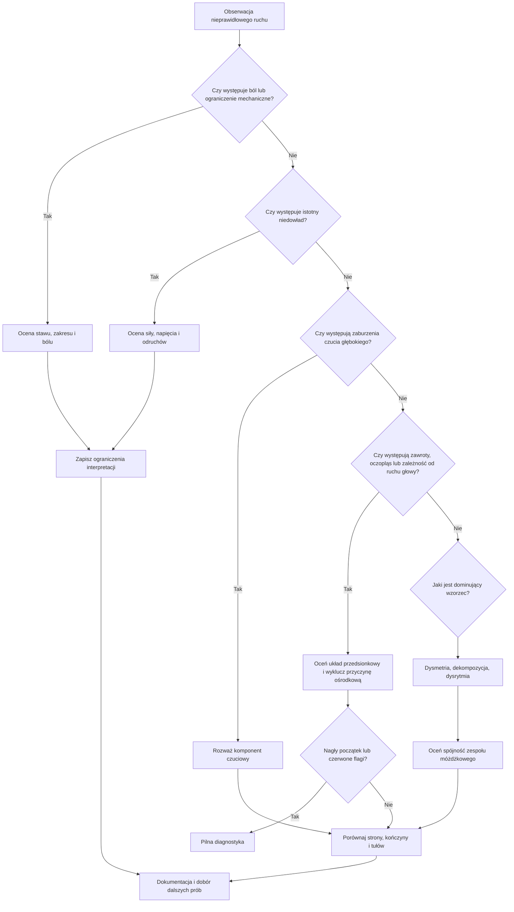

# 6.2. Oglądanie i ocena koordynacji

## Wprowadzenie i zakres rozdziału

Ocena koordynacji rozpoczyna się przed wykonaniem formalnych prób neurologicznych. Sposób, w jaki pacjent siada, sięga po przedmiot, manipuluje odzieżą, utrzymuje kończynę w określonej pozycji, wykonuje gest i kończy ruch, dostarcza informacji o organizacji czynności ruchowej. Zadaniem badającego jest odróżnienie nieprawidłowości wynikającej z zaburzenia koordynacji od ograniczenia siły, czucia, zakresu ruchu, bólu, zaburzeń rozumienia poleceń lub choroby układu mięśniowo-szkieletowego.

Koordynacja nie oznacza wyłącznie precyzji trafienia w cel. Obejmuje również płynność, odpowiednie skalowanie siły i amplitudy, czasowanie skurczu i rozluźnienia mięśni, synchronizację segmentów ciała, dostosowanie ruchu do zmieniających się warunków oraz zdolność do jego płynnego zatrzymania. Zaburzenie tych procesów może ujawniać się jako dysmetria, asynergia, dekompozycja ruchu, drżenie zamiarowe, nieregularność rytmu lub niezdolność do wykonywania szybkich ruchów naprzemiennych.

W praktyce klinicznej określenie „ataksja” jest nazwą zespołu objawów, a nie rozpoznaniem etiologicznym. Może wynikać z uszkodzenia móżdżku lub jego połączeń, zaburzeń propriocepcji, dysfunkcji układu przedsionkowego, choroby pnia mózgu, zaburzeń metabolicznych, działania leków i toksyn, a także z przyczyn mieszanych. Nie każda niezgrabność ruchu jest ataksją móżdżkową i nie każdy objaw przypominający dysmetrię lokalizuje zmianę w samym móżdżku [1–4].

Rozdział koncentruje się na obserwacji i klinicznym opisie jakości koordynacji, zwłaszcza na sześciu zagadnieniach wskazanych w spisie treści: płynności ruchów, dysmetrii, asynergii, drżeniu zamiarowym, adiadochokinezie oraz rozkładzie objawów i lateralizacji. Szczegółowe techniki prób kończyn górnych i dolnych przedstawiono odpowiednio w rozdziałach 6.3 i 6.4. Podstawy obwodów móżdżkowych, układu przedsionkowego, propriocepcji i integracji sensorycznej omówiono w rozdziale 6.1. W tym miejscu wiedza ta zostaje przełożona na systematyczną obserwację kliniczną.

Materiał jest przeznaczony do kształcenia i doskonalenia badania neurologicznego. Nie zastępuje badania lekarskiego, lokalnych procedur udzielania pomocy ani pilnej diagnostyki w stanach nagłych. Zakres samodzielnych czynności należy dostosować do kwalifikacji zawodowych i uprawnień osoby badającej.

---

## 1. Cele kształcenia i efekty uczenia się

### 1.1. Cel ogólny

Celem rozdziału jest przygotowanie uczestnika do systematycznej obserwacji jakości ruchu, rozpoznawania podstawowych cech ataksji kończynowej i osiowej, opisywania objawów w sposób obiektywny oraz formułowania ostrożnych hipotez lokalizacyjnych bez utożsamiania pojedynczego objawu z określoną chorobą.

### 1.2. Szczegółowe efekty uczenia się

Po ukończeniu rozdziału uczestnik powinien umieć:

1. wyjaśnić, czym różnią się koordynacja, precyzja, płynność, rytm i synergia ruchu;
2. odróżnić ataksję jako zespół kliniczny od etiologicznego rozpoznania choroby;
3. prowadzić obserwację ruchu w spoczynku, podczas czynności spontanicznych i w zadaniach ukierunkowanych;
4. opisać dysmetrię, wskazując, czy występuje nadmierna, czy niedostateczna amplituda ruchu;
5. rozpoznać dekompozycję ruchu i zaburzenie synergii wielostawowej;
6. scharakteryzować drżenie zamiarowe, uwzględniając jego zależność od fazy ruchu;
7. opisać zaburzenia szybkich ruchów naprzemiennych, nie utożsamiając ich automatycznie z uszkodzeniem móżdżku;
8. porównać rozkład objawów po obu stronach ciała i odnieść go do możliwej lokalizacji uszkodzenia;
9. wskazać objawy przemawiające za ataksją czuciową, przedsionkową, czołową, polekową lub mieszaną;
10. rozpoznać sytuacje wymagające przerwania badania i pilnego skierowania pacjenta do diagnostyki;
11. sporządzić dokumentację opartą na obserwowalnych cechach, a nie na nieprecyzyjnych etykietach;
12. uwzględnić ograniczenia badania przyłóżkowego i czynniki zakłócające wynik.

### 1.3. Granice kompetencji

Osoba prowadząca badanie powinna rozróżniać trzy poziomy wnioskowania:

- **obserwacja:** „podczas ruchu kończyna przekracza cel, po czym wykonuje korektę”;
- **interpretacja kliniczna:** „obraz jest zgodny z dysmetrią, możliwy jest udział układu móżdżkowego”;
- **rozpoznanie etiologiczne:** „objawy wynikają z określonej choroby lub zmiany strukturalnej”.

Przejście od obserwacji do rozpoznania etiologicznego wymaga uwzględnienia czasu początku, całego badania neurologicznego, stanu ogólnego, leków, chorób współistniejących oraz badań dodatkowych. Nie należy przypisywać pacjentowi choroby zwyrodnieniowej, udaru, zatrucia ani zaburzenia czynnościowego wyłącznie na podstawie jednego znaku klinicznego.

---

## 2. Pojęcia i terminologia kliniczna

### 2.1. Koordynacja ruchowa

Koordynacja ruchowa to zdolność organizowania aktywności wielu mięśni i segmentów ciała w taki sposób, aby osiągnąć zamierzony cel z odpowiednią dokładnością, siłą, amplitudą, prędkością i czasowaniem. Obejmuje planowanie, przewidywanie skutków ruchu, monitorowanie wykonania i korygowanie błędu.

Koordynacja jest właściwością całego układu czuciowo-ruchowego. Móżdżek odgrywa w niej istotną rolę, ale prawidłowy ruch zależy również od kory mózgu, jąder podstawy, wzgórza, pnia mózgu, rdzenia kręgowego, dróg czuciowych, narządu wzroku, układu przedsionkowego oraz sprawności mięśni i stawów.

### 2.2. Ataksja

Ataksja oznacza zaburzenie koordynacji ruchów, które nie jest wyjaśnione wyłącznie niedowładem, bólem, ograniczeniem mechanicznym ani niezrozumieniem polecenia. Może dotyczyć kończyn, tułowia, chodu, mowy i ruchów gałek ocznych. W praktyce należy określić, czy dominują objawy kończynowe, osiowe, chodu, przedsionkowe, czuciowe czy mieszane.

### 2.3. Płynność ruchu

Płynny ruch ma ciągły przebieg, odpowiednią dynamikę i niewielką liczbę niepotrzebnych korekt. Zaburzenie płynności może objawiać się:

- ruchem szarpanym lub oscylacyjnym;
- nieregularną prędkością;
- nagłymi zmianami kierunku;
- nadmiernymi korektami;
- przerywaniem ruchu;
- wykonywaniem czynności w kilku oddzielnych etapach.

Samo spowolnienie nie jest równoznaczne z ataksją. Może wynikać z bradykinezji, bólu, osłabienia, lęku, zmęczenia lub świadomej ostrożności.

### 2.4. Dysmetria

Dysmetria to zaburzenie skalowania amplitudy, siły lub zasięgu ruchu w stosunku do położenia celu. Wyróżnia się:

- **hipermetrię** – ruch przekracza zamierzony cel;
- **hipometrię** – ruch nie osiąga celu i kończy się przed nim.

Dysmetria może być zmienna, zależna od kierunku, prędkości i obciążenia zadania. Należy odróżnić ją od drżenia, które może powodować oscylacje wokół celu, oraz od niedowładu, który ogranicza zdolność wytworzenia odpowiedniej siły.

### 2.5. Asynergia i dyssynergia

Synergia to skoordynowana współpraca grup mięśniowych i segmentów ciała podczas czynności złożonej. Asynergia lub dyssynergia oznacza zaburzenie tej współpracy. Ruch, który prawidłowo powinien przebiegać jako zintegrowana całość, zostaje wykonany w nieodpowiedniej kolejności, z nieprawidłowym udziałem poszczególnych segmentów albo z utratą stabilizacji.

W piśmiennictwie terminy „asynergia”, „dyssynergia” i „dekompozycja ruchu” bywają używane częściowo zamiennie. W dokumentacji należy opisać zjawisko, a nie polegać wyłącznie na nazwie.

### 2.6. Dekompensacja i dekompozycja ruchu

Dekompensacja jest szerokim określeniem utraty prawidłowej kontroli ruchu. **Dekompozycja** oznacza natomiast rozbicie ruchu złożonego na kilka kolejnych, mniej płynnych etapów. Przykładowo, zamiast jednoczesnego i harmonijnego zgięcia w stawie barkowym, łokciowym i nadgarstkowym pacjent najpierw przesuwa bark, następnie prostuje lub zgina łokieć, a dopiero później koryguje ustawienie dłoni.

Dekompozycja jest charakterystyczną cechą zespołu móżdżkowego, ale jej interpretacja wymaga wykluczenia ograniczenia ruchomości, bólu, apraksji, niedowładu i zaburzeń czucia.

### 2.7. Drżenie zamiarowe

Drżenie zamiarowe jest rytmiczną lub półrytmiczną oscylacją pojawiającą się podczas ruchu celowego, często wyraźniejszą w miarę zbliżania się kończyny do celu. W zespole móżdżkowym może współistnieć z dysmetrią i dekompozycją ruchu. Nie jest jednak synonimem każdego drżenia czynnościowego ani każdego drżenia nasilającego się przy ruchu.

### 2.8. Adiadochokineza i dysdiadochokineza

Adiadochokineza oznacza niemożność wykonywania szybkich, naprzemiennych ruchów o zmiennym kierunku. Dysdiadochokineza jest częściowym lub niepełnym zaburzeniem tej zdolności. W obserwacji można zauważyć nieregularny rytm, zmienną amplitudę, opóźnione odwracanie kierunku, gubienie sekwencji lub narastające pogorszenie jakości ruchu.

### 2.9. Dysrytmia

Dysrytmia to zaburzenie regularności czasowej ruchu powtarzalnego. Może występować bez wyraźnej dysmetrii. W opisie należy rozróżnić nieregularność tempa od spowolnienia, zmniejszania amplitudy, drżenia i przerywania ruchu.

### 2.10. Ataksja kończynowa i osiowa

- **Ataksja kończynowa** dotyczy precyzji i koordynacji ruchów kończyn, zwłaszcza podczas czynności celowych.
- **Ataksja osiowa** obejmuje zaburzenia stabilizacji głowy i tułowia, utrzymywania pozycji siedzącej lub stojącej oraz kontroli środka masy ciała.
- **Ataksja chodu** odnosi się do nieprawidłowej organizacji lokomocji, zwykle z poszerzeniem podstawy chodu, zmiennością długości i kierunku kroków oraz trudnością podczas zwrotów.

Nieprawidłowości mogą występować łącznie, ale ich rozkład pomaga w lokalizacji i różnicowaniu.

---

## 3. Podstawy neuroanatomiczne i neurofizjologiczne – znaczenie dla obserwacji

### 3.1. Móżdżek jako układ porównujący i kalibrujący ruch

Móżdżek otrzymuje informacje o planowanym ruchu i o jego rzeczywistym przebiegu. Uczestniczy w przewidywaniu skutków poleceń ruchowych, doborze czasowania, skalowaniu siły oraz aktualizacji modeli wewnętrznych. Nie „wydaje” samodzielnie wszystkich poleceń ruchowych; moduluje aktywność sieci korowych i pniowych.

Uszkodzenie obwodów móżdżkowych może prowadzić do błędnego oszacowania zasięgu ruchu, opóźnionej korekty, nieprawidłowego hamowania agonistów i aktywacji antagonistów, utraty płynności oraz trudności w łączeniu wielu segmentów w jeden ruch [1,2].

### 3.2. Półkule móżdżku, robak i połączenia

W uproszczeniu:

- półkule móżdżku uczestniczą szczególnie w koordynacji ruchów kończyn i planowaniu czynności;
- część przyśrodkowa, w tym robak, ma istotne znaczenie dla kontroli osiowej, postawy i chodu;
- okolica kłaczkowo-grudkowa oraz połączenia przedsionkowe wpływają na stabilizację spojrzenia i równowagę;
- jądra głębokie i konary móżdżku łączą przetwarzanie móżdżkowe z korą oraz pniem mózgu.

Związek topograficzny nie jest absolutny. Objawy mogą wynikać z uszkodzenia dróg doprowadzających lub odprowadzających, pnia mózgu, wzgórza i połączeń korowo-móżdżkowych, a nie wyłącznie z ogniskowej zmiany w korze móżdżku.

### 3.3. Lateralizacja móżdżkowa

Uszkodzenie półkuli móżdżku zwykle powoduje wyraźniejsze zaburzenia koordynacji kończyn po tej samej stronie ciała. Wynika to z organizacji połączeń móżdżku z układem ruchowym i podwójnego skrzyżowania części dróg. Zasada ta jest użyteczna, ale nie powinna być stosowana mechanicznie: zmiany w pniu mózgu mogą powodować objawy skrzyżowane, a uszkodzenia szlaków nad- lub podnamiotowych mogą dawać inne wzorce.

### 3.4. Układ czuciowy jako warunek prawidłowego celowania

Ruch celowy wymaga informacji o położeniu kończyny. Uszkodzenie dużych włókien czuciowych, zwojów korzeni grzbietowych lub sznurów tylnych może powodować niepewność ruchu i nasilanie błędów po ograniczeniu kontroli wzrokowej. W ataksji czuciowej pacjent często kompensuje brak informacji proprioceptywnej wzrokiem. W ataksji móżdżkowej sama kontrola wzrokowa zwykle nie usuwa zaburzenia koordynacji [3,4].

### 3.5. Układ przedsionkowy i stabilizacja osiowa

Zaburzenia przedsionkowe mogą prowadzić do niestabilności, odchylenia tułowia, zawrotów głowy, oscylopsji i zaburzeń orientacji przestrzennej. W odróżnieniu od typowej ataksji kończynowej móżdżkowej objawy mogą być silnie zależne od ruchów głowy, pozycji ciała i bodźców wzrokowych. Współistnienie zaburzeń przedsionkowych i móżdżkowych jest możliwe, zwłaszcza w niektórych zespołach neurodegeneracyjnych [5].

### 3.6. Schemat powstawania objawu

```text
Plan ruchu i przewidywany skutek
              |
              v
   Sieci korowo-móżdżkowe
              |
              v
Dobór czasu, siły i amplitudy
              |
              v
      Wykonanie ruchu
              |
              v
Porównanie zamiaru z wynikiem
              |
       +------+------+
       |             |
       v             v
  Korekta         Utrwalenie
  ruchu           błędu/uczenie
       |
       v
Płynność, precyzja, rytm
       |
       v
Zaburzenie obwodu -> dysmetria, dekompozycja,
                     dysrytmia, drżenie zamiarowe
```

Schemat ma charakter dydaktyczny. Rzeczywiste sterowanie ruchem jest równoległe, rozproszone i zależne od zadania; nie przebiega jako pojedynczy liniowy łańcuch.

---

## 4. Pytania kliniczne przed rozpoczęciem oceny

Przed obserwacją należy ustalić:

1. Czy zaburzenie rozpoczęło się nagle, narastało w ciągu dni, czy rozwijało się miesiącami lub latami?
2. Czy dotyczy jednej kończyny, jednej strony, obu kończyn, tułowia czy chodu?
3. Czy występuje w spoczynku, podczas utrzymywania pozycji, w ruchu celowym, czy tylko przy określonym zadaniu?
4. Czy pacjent zgłasza drętwienie, zaburzenia czucia ułożenia, zawroty głowy, podwójne widzenie, zaburzenia mowy lub osłabienie?
5. Czy występują ból, ograniczenie zakresu ruchu, uraz, obrzęk lub choroba stawu?
6. Czy pacjent przyjmuje leki uspokajające, przeciwpadaczkowe, lit, leki przeciwpsychotyczne, alkohol lub inne substancje mogące zaburzać koordynację?
7. Czy objawy nasilają się przy zmęczeniu, po wysiłku, przy ograniczeniu kontroli wzrokowej lub w ciemności?
8. Czy wystąpiły upadki, trudności w połykaniu, duszność, zaburzenia świadomości albo gwałtowny ból głowy?
9. Czy istnieje wcześniejsza dokumentacja, nagranie funkcjonowania lub wynik badania neurologicznego pozwalający ocenić zmianę w czasie?

Wywiad powinien być krótki, ale ukierunkowany. W razie nagłego początku z nowym deficytem neurologicznym nie należy opóźniać pilnego postępowania przez wykonywanie rozbudowanych prób koordynacyjnych.

---

## 5. Przygotowanie do obserwacji i zasady badania

### 5.1. Warunki badania

Przed rozpoczęciem:

- potwierdź tożsamość pacjenta i wyjaśnij cel badania;
- uzyskaj zgodę na wykonanie prób;
- oceń stan świadomości, kontakt, rozumienie poleceń i zdolność współpracy;
- zapytaj o ból, zawroty głowy, nudności, zmęczenie i ryzyko upadku;
- zapewnij dobre oświetlenie i przestrzeń do bezpiecznego ruchu;
- odsłoń tylko te części ciała, których obserwacja jest potrzebna;
- przygotuj stabilne krzesło, łóżko i – jeśli ocena obejmuje pozycję stojącą – asekurację;
- usuń przeszkody, luźne przewody, śliskie dywaniki i przedmioty z drogi.

### 5.2. Obserwacja bez narzucania zadania

Warto rozpocząć od czynności spontanicznych: zmiany pozycji, sięgania po przedmiot, manipulowania ubraniem, odkładania rzeczy, gestykulacji i sposobu stabilizowania tułowia. Nie należy celowo zaskakiwać pacjenta ani wykonywać nieuzgodnionych bodźców. Obserwacja spontaniczna uzupełnia badanie, lecz nie zastępuje standaryzowanych prób.

### 5.3. Porównywalność stron

Jeżeli stan pacjenta na to pozwala, należy porównać prawą i lewą stronę przy podobnym ustawieniu, podobnej liczbie powtórzeń i podobnym tempie poleceń. Trzeba uwzględnić dominację ręki, wcześniejsze urazy, zwyrodnienia stawów, amputacje, ograniczenia wzroku i różnice w sile mięśniowej.

### 5.4. Stopniowanie trudności

Badanie należy prowadzić od zadań prostych do bardziej wymagających. Nie zaczyna się od szybkich, wielokrotnie powtarzanych ruchów, jeżeli pacjent jest niestabilny, osłabiony lub zgłasza nasilone zawroty głowy. Zwiększanie prędkości, amplitudy i złożoności powinno być stopniowe i bezpieczne.

---

## 6. Systematyczna procedura oglądania i oceny koordynacji

### Krok 1. Ocena zachowania ruchowego przed próbami

Obserwuj, czy pacjent spontanicznie używa obu kończyn, czy unika jednej strony, czy podpiera kończynę, czy utrzymuje ją w nietypowej pozycji oraz czy wykonuje ruchy płynnie. Zwróć uwagę na ruchy mimowolne, drżenie, drżenie głowy, niestabilność tułowia i trudności w zmianie pozycji.

### Krok 2. Ocena pozycji wyjściowej i stabilizacji

Oceń ustawienie głowy, obręczy barkowej, tułowia, miednicy i kończyn. Zwróć uwagę, czy pacjent potrafi utrzymać stabilną pozycję bez nadmiernego podpierania się. Niestabilność tułowia może ograniczać precyzję ruchów kończyn, dlatego nie należy interpretować niezgrabności kończyny bez oceny stabilizacji osiowej.

### Krok 3. Ocena ruchu spontanicznego i celowego

Porównaj czynności niewymagające dużej precyzji z zadaniami wymagającymi celowania. Nieprawidłowość ujawniająca się głównie podczas ruchu celowego może wskazywać na zaburzenie skalowania i korekcji ruchu, ale należy uwzględnić również niedowład, zaburzenia czucia, apraksję i ból.

### Krok 4. Ocena płynności

Obserwuj ciągłość trajektorii, zmiany prędkości, liczbę korekt, zatrzymania, oscylacje i rytm. Zapisz, czy ruch jest płynny, nieznacznie nieregularny, wyraźnie szarpany, czy wykonywany etapami.

### Krok 5. Ocena dokładności i amplitudy

Zwróć uwagę, czy pacjent osiąga cel, przekracza go, zatrzymuje się przed nim, czy kilkukrotnie koryguje położenie. W opisie używaj terminów hipermetria i hipometria tylko wtedy, gdy obserwacja rzeczywiście wskazuje na błąd amplitudy, a nie na drżenie, ból lub ograniczenie mechaniczne.

### Krok 6. Ocena współpracy segmentów

Obserwuj, czy ruch wielostawowy przebiega harmonijnie, czy poszczególne segmenty poruszają się kolejno. Zapisz, czy występuje nadmierne unoszenie barku, ruch tułowia zastępujący ruch kończyny, utrata stabilizacji lub konieczność wykonywania czynności w kilku etapach.

### Krok 7. Ocena rytmu i odwracania kierunku

W zadaniach powtarzalnych obserwuj regularność odstępów czasowych, stałość amplitudy i płynność zmiany kierunku. Zwróć uwagę na opóźnienie, zatrzymywanie się, gubienie sekwencji oraz narastającą nieregularność.

### Krok 8. Ocena zależności od prędkości i złożoności

Jeżeli jest to bezpieczne, porównaj wykonanie zadania w tempie komfortowym i nieco szybszym. Nie wymuszaj maksymalnej prędkości. Zaburzenie koordynacji może stać się bardziej widoczne przy zwiększeniu wymagań czasowych, ale pogorszenie przy szybkim ruchu może również wynikać z bólu, osłabienia, męczliwości lub zaburzeń rozumienia.

### Krok 9. Porównanie stron i segmentów

Porównaj kończyny górne, kończyny dolne oraz kontrolę osiową. Zapisz, czy nieprawidłowość jest jednostronna, obustronna, symetryczna, asymetryczna, dystalna, proksymalna czy dominująca w tułowiu.

### Krok 10. Synteza i decyzja o dalszym badaniu

Po obserwacji sformułuj opis fenomenologiczny. Dopiero następnie wybierz próby szczegółowe z rozdziałów 6.3 i 6.4, badanie równowagi z rozdziałów 6.5 i 6.6 lub ocenę układu przedsionkowego z rozdziału 6.7. Jeśli występują czerwone flagi, priorytetem jest pilne postępowanie, a nie dokończenie planowego badania.

---

## 7. Płynność i jakość ruchów

### 7.1. Co należy oceniać?

Płynność ruchu można analizować w kilku niezależnych wymiarach:

| Wymiar | Obserwacja | Możliwy opis |
|---|---|---|
| Ciągłość | Czy ruch przebiega bez zatrzymań? | ciągły / przerywany |
| Prędkość | Czy tempo jest stabilne? | stałe / zmienne / spowolnione |
| Amplituda | Czy zasięg jest powtarzalny? | stały / zmienny / nadmierny / zbyt mały |
| Trajektoria | Czy tor jest przewidywalny? | prosty / falisty / oscylacyjny |
| Korekty | Czy pacjent wielokrotnie poprawia ruch? | pojedyncza / liczne korekty |
| Sekwencja | Czy segmenty poruszają się harmonijnie? | zintegrowana / zdekomponowana |
| Rytm | Czy powtórzenia są regularne? | regularny / nieregularny |
| Zatrzymanie | Czy ruch kończy się w odpowiednim miejscu? | precyzyjne / z przekroczeniem / przed celem |

### 7.2. Ruch szarpany a ruch zdekomponowany

Ruch szarpany jest nieciągły lub gwałtownie zmienia prędkość. Ruch zdekomponowany składa się z kolejnych segmentów, które nie tworzą harmonijnej całości. Oba zjawiska mogą współistnieć, ale nie są tożsame.

Przykład:
- pacjent wykonuje ruch w jednym torze, ale z drobnymi oscylacjami – dominują zaburzenia płynności;
- pacjent najpierw przesuwa bark, następnie prostuje łokieć, a potem koryguje nadgarstek – widoczna jest dekompozycja;
- pacjent wykonuje ruch płynnie, lecz kończy go daleko poza celem – dominuje błąd amplitudy.

### 7.3. Płynność a prędkość

Nie wolno utożsamiać powolnego ruchu z ataksją. Bradykinezja, osłabienie, ból, zaburzenia nastroju, obawa przed upadkiem i działanie leków mogą spowalniać ruch przy zachowanej precyzji. W zespole móżdżkowym ruch może być zarówno spowolniony, jak i nadmiernie przyspieszony, a jego główną cechą jest często nieregularność, błędne skalowanie lub brak harmonii.

### 7.4. Wpływ zadania

Jakość ruchu zależy od:
- stopnia precyzji wymaganego przez zadanie;
- wielkości i odległości celu;
- obciążenia kończyny;
- liczby jednocześnie wykonywanych czynności;
- szybkości polecenia;
- stabilności tułowia;
- dostępności informacji wzrokowej i proprioceptywnej.

Dlatego opis powinien wskazywać warunki, w których ujawnia się nieprawidłowość.

---

## 8. Dysmetria – rozpoznawanie i interpretacja

### 8.1. Mechanizm kliniczny

W dysmetrii układ nerwowy nieprawidłowo dobiera wielkość ruchu do odległości celu i aktualnej dynamiki kończyny. Błąd może dotyczyć amplitudy, siły, prędkości lub czasu hamowania. W typowym obrazie móżdżkowym pacjent może przekraczać cel, po czym wykonywać kilka korekt, albo zatrzymywać ruch przed celem i ponownie go inicjować.

### 8.2. Hipermetria

Hipermetria polega na przekraczaniu zamierzonego celu. W obserwacji można zauważyć:

- nadmierne wychylenie kończyny;
- przekroczenie punktu docelowego;
- wtórny ruch korekcyjny w przeciwnym kierunku;
- zmienność wielkości błędu w kolejnych powtórzeniach.

Hipermetria może być szczególnie wyraźna przy szybkim ruchu celowym. Nie jest jednak samodzielnym dowodem uszkodzenia półkuli móżdżku; może wystąpić również przy uszkodzeniach dróg móżdżkowych, wzgórza i połączeń pnia mózgu [1].

### 8.3. Hipometria

Hipometria oznacza niedosięganie celu. Może wynikać z zaburzenia skalowania ruchu, ale także z niedowładu, bólu, ograniczenia zakresu ruchu, lęku przed ruchem lub niepewności czuciowej. W razie wątpliwości należy osobno ocenić siłę mięśniową, zakres ruchu i czucie głębokie.

### 8.4. Dysmetria a drżenie

| Cecha | Dysmetria | Drżenie zamiarowe |
|---|---|---|
| Główna nieprawidłowość | błąd zasięgu lub amplitudy | oscylacja podczas ruchu |
| Kierunek błędu | przekroczenie lub niedosięgnięcie celu | naprzemienne odchylenia wokół toru |
| Przebieg | pojedynczy błąd lub seria korekt | powtarzające się wychylenia |
| Zależność od celu | błąd końcowego położenia | często nasilenie przy zbliżaniu do celu |
| Współwystępowanie | może występować z drżeniem | często współistnieje z dysmetrią |

Rozróżnienie ma znaczenie, ponieważ pacjent może mieć oba objawy, a opis „drżenie przy próbie palec–nos” nie wyjaśnia, czy występuje oscylacja, przekraczanie celu, czy oba zjawiska.

### 8.5. Interpretacja jednostronnej i obustronnej dysmetrii

Jednostronna dysmetria może sugerować ogniskowe uszkodzenie półkuli móżdżku lub jej połączeń po stronie objawów. Obustronna dysmetria może występować w chorobach rozlanych, toksycznych, metabolicznych, zapalnych, zwyrodnieniowych lub w uszkodzeniach obustronnych. Nie należy jednak wyciągać wniosku o etiologii wyłącznie z symetrii objawów.

### 8.6. Ograniczenia

Dysmetria może być trudna do oceny u osób z:
- znacznym osłabieniem mięśni;
- bólem i ograniczeniem ruchu;
- zaburzeniami widzenia;
- neuropatią czuciową;
- zaburzeniami poznawczymi;
- niepełnym rozumieniem poleceń;
- silnym zmęczeniem lub sedacją.

Jeśli warunki badania są nieoptymalne, należy to odnotować, zamiast wymuszać jednoznaczną ocenę.

---

## 9. Asynergia i dekompozycja ruchu

### 9.1. Istota zaburzenia

W prawidłowym ruchu złożonym mięśnie działają w skoordynowanych grupach, a poszczególne stawy zmieniają położenie w odpowiedniej kolejności i czasie. W asynergii współpraca ta jest zaburzona. Pacjent może wykonać wszystkie składowe ruchu, ale nie potrafi połączyć ich w płynny, jednoczesny i ekonomiczny wzorzec.

### 9.2. Cechy obserwowane

Do typowych cech należą:
- rozdzielenie ruchu na kilka etapów;
- nieprawidłowa kolejność aktywacji segmentów;
- nadmierne ruchy kompensacyjne;
- brak stabilizacji segmentu proksymalnego;
- opóźnione włączanie mięśni antagonistycznych;
- nieadekwatne współruchy tułowia lub obręczy barkowej;
- utrata płynności przy przejściu między fazami ruchu.

### 9.3. Asynergia osiowa i kończynowa

Asynergia osiowa może ujawniać się jako trudność w skoordynowanym pochyleniu i wyprostowaniu tułowia, utrzymaniu pozycji siedzącej lub dostosowaniu postawy podczas ruchu. Asynergia kończynowa dotyczy harmonii współpracy stawów i grup mięśniowych kończyny.

Nie należy utożsamiać niestabilności tułowia z ataksją kończynową. Oba zjawiska mogą występować razem, ale wymagają odrębnego opisu.

### 9.4. Różnicowanie dekompozycji od apraksji

W dekompozycji pacjent rozumie zadanie i zasadniczo wie, jaki ruch ma wykonać, lecz wykonuje go w sposób nieprawidłowo rozłożony w czasie i przestrzeni. W apraksji trudność dotyczy planowania lub realizacji wyuczonego, celowego działania mimo braku wystarczającego niedowładu, zaburzenia czucia czy ograniczenia mechanicznego. Rozróżnienie wymaga oceny rozumienia, naśladowania, używania przedmiotów i innych funkcji korowych.

### 9.5. Różnicowanie od kompensacji ortopedycznej

Pacjent z ograniczeniem ruchu w stawie barkowym może unosić łopatkę i pochylać tułów, aby sięgnąć po przedmiot. Jest to kompensacja biomechaniczna, a niekoniecznie asynergia móżdżkowa. O interpretacji decydują: zakres ruchu, ból, siła, powtarzalność, kontekst zadania i pozostałe objawy neurologiczne.

---

## 10. Drżenie zamiarowe w ocenie koordynacji

### 10.1. Charakterystyka

Drżenie zamiarowe jest drżeniem czynnościowym, które pojawia się lub nasila podczas wykonywania ruchu celowego, często szczególnie w jego końcowej fazie. Może mieć charakter nieregularny, o zmiennej amplitudzie i częstotliwości. W zespole móżdżkowym często towarzyszą mu dysmetria, dekompozycja ruchu, zaburzenia rytmu i inne objawy.

### 10.2. Co należy opisać?

W dokumentacji warto uwzględnić:

1. czy drżenie występuje w spoczynku, podczas utrzymywania pozycji, czy wyłącznie w ruchu;
2. czy nasila się w miarę zbliżania do celu;
3. czy dominuje w części proksymalnej, dystalnej, czy obejmuje całą kończynę;
4. czy jest jednostronne, asymetryczne lub obustronne;
5. czy współistnieje z dysmetrią i dekompozycją;
6. czy wpływa na codzienne czynności, takie jak picie z kubka, jedzenie, pisanie lub zapinanie guzików;
7. czy zmienia się pod wpływem zmęczenia, leków lub alkoholu.

### 10.3. Różnicowanie

Drżenie nasilające się podczas czynności może być również:
- drżeniem samoistnym;
- drżeniem wzmożonym fizjologicznym;
- drżeniem polekowym lub toksycznym;
- drżeniem dystonicznym;
- drżeniem parkinsonowskim w określonych warunkach;
- drżeniem czynnościowym.

Szczegółową klasyfikację fenomenologiczną i badanie drżenia przedstawiono w rozdziale 4.8. W niniejszym rozdziale drżenie zamiarowe należy traktować jako jeden z elementów jakości koordynacji, a nie jako samodzielne rozpoznanie.

### 10.4. Częstotliwość i amplituda

Nie należy szacować częstotliwości „na oko” z nadmierną precyzją. Jeśli pomiar ilościowy jest istotny, potrzebne są odpowiednie narzędzia, na przykład akcelerometria lub analiza wideo z kontrolowanymi warunkami. W badaniu przyłóżkowym należy opisać widoczne nasilenie, fazę zadania, rozkład i wpływ na funkcję.

### 10.5. Znaczenie funkcjonalne

Niewielkie drżenie może mieć duży wpływ na zadania wymagające precyzji, a wyraźne drżenie nie zawsze oznacza taki sam poziom ograniczenia funkcjonalnego. Warto zapytać pacjenta, które czynności są utrudnione i czy stosuje kompensacje, na przykład podpieranie łokcia, używanie obu rąk lub wybieranie naczyń z przykrywką.

---

## 11. Adiadochokineza i zaburzenia szybkich ruchów naprzemiennych

### 11.1. Mechanizm

Szybkie ruchy naprzemienne wymagają sprawnego przełączania aktywności agonistów i antagonistów, prawidłowego czasowania oraz dostosowania amplitudy do rytmu. W zaburzeniach móżdżkowych pacjent może mieć trudność z płynnym odwracaniem kierunku, zachowaniem stałego tempa i utrzymaniem podobnej amplitudy kolejnych ruchów [1,6].

### 11.2. Cechy kliniczne

Obserwuje się:
- nierównomierne tempo;
- zmienną amplitudę;
- opóźnione przechodzenie z jednego kierunku do drugiego;
- nieprawidłowe zatrzymanie ruchu;
- gubienie rytmu;
- narastające rozregulowanie podczas powtarzania;
- trudność w utrzymaniu płynności mimo zrozumienia polecenia.

### 11.3. Adiadochokineza a bradykinezja

W bradykinezji podstawowym problemem jest spowolnienie i często zmniejszanie amplitudy ruchów powtarzalnych. W dysdiadochokinezie dominują zaburzenia rytmu, czasu przełączania i koordynacji. Oba zjawiska mogą współistnieć, dlatego należy osobno zapisać tempo, amplitudę i regularność.

### 11.4. Adiadochokineza a niedowład

Osłabienie mięśni może ograniczać szybkość i zakres ruchu. Jeżeli pacjent nie jest w stanie wykonać pełnego ruchu z powodu niedowładu, nie należy automatycznie rozpoznawać dysdiadochokinezy. Najpierw trzeba ocenić siłę, napięcie, ból i zakres ruchu.

### 11.5. Adiadochokineza a zaburzenia czucia

Brak informacji proprioceptywnej może powodować nieregularność i niepewność ruchu, zwłaszcza gdy pacjent nie kontroluje wzrokowo kończyny. W takiej sytuacji należy zestawić wynik z badaniem czucia wibracji i ułożenia oraz z oceną zależności od wzroku. Szczegółowe badanie propriocepcji opisano w module 5.

### 11.6. Adiadochokineza a dystonia

Dystonia może powodować nieprawidłowe ustawienie, skurcze i trudność w powtarzaniu ruchu. Należy zwrócić uwagę na wzorzec postawy, współruchy, zależność od zadania, obecność pozycji dystonicznych i ewentualny gest antagonizujący. Nie należy przypisywać każdej nieregularności ruchu uszkodzeniu móżdżku.

---

## 12. Rozkład objawów: kończyny, tułów i funkcje dodatkowe

### 12.1. Ataksja kończynowa

Objawy kończynowe mogą obejmować dysmetrię, drżenie zamiarowe, dekompozycję, dysdiadochokinezę, dysrytmie i trudność w precyzyjnej manipulacji. W opisie należy wskazać, które kończyny są zajęte i czy objawy są bardziej nasilone proksymalnie, czy dystalnie.

### 12.2. Ataksja osiowa

Niestabilność tułowia może być widoczna podczas siedzenia bez podparcia, zmiany pozycji lub utrzymywania głowy i tułowia w osi. W cięższych zaburzeniach pacjent może mieć trudność z samodzielnym siedzeniem lub staniem. Dominująca ataksja osiowa może wskazywać na zajęcie struktur przyśrodkowych móżdżku, ale nie jest swoista dla pojedynczej lokalizacji.

### 12.3. Ataksja chodu

Chód ataktyczny często cechuje się:
- poszerzoną podstawą;
- zmienną długością i kierunkiem kroków;
- nieregularnym przenoszeniem ciężaru;
- trudnością podczas zwrotów;
- niestabilnością przy zmianie tempa;
- zwiększoną liczbą korekt posturalnych.

Nie każdy chód szerokopodstawny jest móżdżkowy. Podobny obraz może występować w ataksji czuciowej, przedsionkowej, zatruciu, zaburzeniach czołowych i w wielochorobowości osoby starszej [3,4,7].

### 12.4. Objawy towarzyszące

W zespole móżdżkowym mogą współistnieć:
- dyzartria o charakterze ataktycznym;
- oczopląs i inne zaburzenia ruchów gałek ocznych;
- hipotonia;
- zaburzenia kontroli posturalnej;
- trudności w wykonywaniu ruchów naprzemiennych;
- objawy poznawcze lub afektywne w określonych zespołach móżdżkowych.

Ich obecność zwiększa spójność obrazu zespołowego, ale nie przesądza o etiologii.

---

## 13. Lateralizacja i wnioskowanie lokalizacyjne

### 13.1. Zasady ogólne

Wnioskowanie lokalizacyjne powinno opierać się na zestawieniu:
- strony dominujących objawów;
- rodzaju zaburzenia ruchu;
- zajęcia kończyn lub tułowia;
- obecności objawów piramidowych;
- zaburzeń czucia;
- objawów nerwów czaszkowych;
- zaburzeń mowy i ruchów gałek ocznych;
- dynamiki początku.

### 13.2. Typowe wzorce

| Wzorzec | Możliwa lokalizacja lub mechanizm | Ważne zastrzeżenie |
|---|---|---|
| Jednostronna ataksja kończyny | półkula móżdżku lub jej połączenia po stronie objawów | możliwe uszkodzenie dróg w pniu, wzgórzu lub istocie białej |
| Obustronna ataksja kończyn | obustronne lub rozlane zajęcie sieci móżdżkowych, toksyczne, metaboliczne albo zwyrodnieniowe | wymaga oceny leków, alkoholu i chorób ogólnych |
| Dominująca niestabilność tułowia | robak i połączenia przedsionkowo-móżdżkowe lub inne układy kontroli osiowej | możliwe przyczyny przedsionkowe i ogólnoustrojowe |
| Ataksja z zaburzeniami czucia głębokiego | sznury tylne, nerwy czuciowe lub duże włókna obwodowe | może współistnieć z chorobą móżdżku |
| Ataksja z zawrotami i oczopląsem | układ przedsionkowy, pień mózgu lub móżdżek | nie rozstrzyga samodzielnie o lokalizacji |
| Ataksja z objawami skrzyżowanymi | pień mózgu lub połączenia pniowe | wymaga pilnej oceny, szczególnie przy nagłym początku |

### 13.3. Objawy ipsilateralne i skrzyżowane

W typowej zmianie półkuli móżdżku zaburzenia koordynacji kończyn są bardziej widoczne po stronie uszkodzenia. Jeżeli współistnieją objawy nerwów czaszkowych po jednej stronie i niedowład lub zaburzenia czucia po stronie przeciwnej, należy rozważyć uszkodzenie pnia mózgu. Taki wzorzec, zwłaszcza o nagłym początku, może oznaczać udar krążenia tylnego i wymaga pilnej diagnostyki.

### 13.4. Ograniczenia lateralizacji

Nie należy lokalizować uszkodzenia wyłącznie na podstawie tego, która ręka jest mniej sprawna. Dominacja kończyny, wcześniejsze urazy, neuropatie, choroby stawów, ból, niedowład i różnice w doświadczeniu ruchowym mogą wpływać na wynik. Lokalizacja musi być zgodna z pozostałymi elementami badania.

---

## 14. Diagnostyka różnicowa zaburzeń koordynacji

### 14.1. Ataksja móżdżkowa

Często występuje dysmetria, dekompozycja ruchu, dysdiadochokineza, drżenie zamiarowe i zaburzenia płynności. Kontrola wzrokowa zwykle nie normalizuje koordynacji. Mogą występować zaburzenia mowy, oczopląs i niestabilność tułowia.

### 14.2. Ataksja czuciowa

Wynika z zaburzenia informacji proprioceptywnej. Pacjent może mocniej kontrolować kończynę wzrokiem, a pogorszenie pojawia się po zamknięciu oczu lub w ciemności. W badaniu mogą występować zaburzenia czucia wibracji i ułożenia, osłabienie odruchów lub objawy neuropatii. Próba Romberga i badanie czucia są omawiane w odpowiednich rozdziałach, a ich wynik należy interpretować łącznie [3].

### 14.3. Ataksja przedsionkowa

Może dominować niestabilność, odchylenie tułowia, zawroty głowy, nudności, oczopląs i pogorszenie przy ruchach głowy. Objawy kończynowe mogą być mniej wyraźne niż w ataksji móżdżkowej. Złożone zespoły mogą łączyć komponent przedsionkowy i móżdżkowy [5].

### 14.4. Zaburzenia pozapiramidowe

Bradykinezja, sztywność, zmniejszanie amplitudy ruchu, drżenie spoczynkowe i zaburzenia automatyzmów mogą wyglądać jak niezgrabność. W parkinsonizmie istotne jest odróżnienie spowolnienia i zmniejszania amplitudy od błędów trajektorii i rytmu typowych dla ataksji móżdżkowej. Szczegółową ocenę przedstawiono w module 4.

### 14.5. Niedowład i choroby nerwowo-mięśniowe

Osłabienie mięśni ogranicza zakres i szybkość ruchu, może powodować opadanie kończyny oraz kompensacje. Męczliwość, ból i zaburzenia przewodnictwa nerwowo-mięśniowego mogą pogarszać wykonanie powtarzanych zadań. W pierwszej kolejności należy ocenić siłę, napięcie, odruchy i objawy opuszkowe.

### 14.6. Apraksja i zaburzenia funkcji korowych

Pacjent może mieć trudność z wykonaniem wyuczonego gestu lub zorganizowaniem działania mimo zachowanej siły. Należy ocenić rozumienie polecenia, naśladowanie, używanie przedmiotów, język i funkcje wzrokowo-przestrzenne.

### 14.7. Zaburzenia czynnościowe ruchu

Zaburzenia czynnościowe mogą obejmować zmienność, niespójność i objawy zależne od uwagi. Rozpoznanie powinno opierać się na dodatnich, swoistych cechach klinicznych ocenianych przez odpowiednio przygotowanego specjalistę, a nie na samym prawidłowym wyniku obrazowania, obecności stresu czy braku znanej przyczyny strukturalnej. Nie należy stosować etykiety „czynnościowe” jako wyjaśnienia każdej niejednoznacznej obserwacji.

### 14.8. Przyczyny toksyczne, metaboliczne i polekowe

Alkohol, leki przeciwpadaczkowe, benzodiazepiny, lit, niektóre leki przeciwnowotworowe i inne substancje mogą powodować niezgrabność, oczopląs, zaburzenia mowy i ataksję. Należy przeprowadzić dokładny wywiad lekowy i toksykologiczny. Ostry obraz po ekspozycji wymaga oceny stanu ogólnego i możliwego zatrucia.

### 14.9. Zaburzenia wzroku i układu mięśniowo-szkieletowego

Upośledzenie widzenia, diplopia, ból, ograniczenie ruchomości stawu, deformacja, uraz i zaburzenia czucia skórnego mogą zakłócać celowanie. Przed rozpoznaniem dysmetrii należy sprawdzić, czy pacjent widzi cel, rozumie zadanie i może wykonać ruch w wymaganym zakresie.

### 14.10. Tabela różnicująca

| Cecha | Móżdżkowa | Czuciowa | Przedsionkowa | Parkinsonowska | Mechaniczna / bólowа |
|---|---|---|---|---|---|
| Dysmetria | częsta | możliwa, zwłaszcza bez kontroli wzroku | zwykle mniej dominująca | nie jest cechą główną | może wynikać z ograniczenia |
| Zależność od wzroku | deficyt zwykle utrzymuje się | często wyraźne pogorszenie bez wzroku | może zależeć od konfliktu sensorycznego | zmienna | zależy od zadania |
| Rytm ruchów | nieregularny | niepewny, zależny od kontroli wzrokowej | zwykle nie jest głównym objawem | spowolnienie, zmniejszanie amplitudy | ograniczony bólem |
| Dekompozycja | może być wyraźna | może wystąpić wtórnie | zwykle nie dominuje | możliwe zaburzenia sekwencji | kompensacje stawowe |
| Objawy dodatkowe | dyzartria, oczopląs, hipotonia | utrata propriocepcji, hiporefleksja | zawroty, nudności, oczopląs | sztywność, bradykinezja | ból, obrzęk, ograniczenie ROM |

Tabela ma charakter orientacyjny. W praktyce możliwe są zespoły mieszane, a żadna pojedyncza cecha nie ma wystarczającej swoistości do samodzielnego rozpoznania.

---

## 15. Normy, zmienność osobnicza i ograniczenia oceny

### 15.1. Brak jednej uniwersalnej normy

Nie istnieje jedna wartość graniczna, która pozwalałaby na podstawie samej płynności, amplitudy lub rytmu rozpoznać ataksję u wszystkich dorosłych. Wynik zależy od wieku, dominacji kończyny, wykształcenia ruchowego, sprawności wzroku, bólu, chorób stawów, zmęczenia i rodzaju zadania.

### 15.2. Porównanie wewnątrzosobnicze

W badaniu przyłóżkowym szczególnie użyteczne jest porównanie:
- prawej i lewej strony;
- ruchu spontanicznego i celowego;
- zadania prostego i złożonego;
- tempa komfortowego i umiarkowanie zwiększonego;
- wyniku obecnego z wcześniejszą dokumentacją.

Porównanie stron nie może jednak zastąpić norm populacyjnych ani uwzględnienia dominacji ręki.

### 15.3. Wpływ wieku

Wraz z wiekiem mogą zmieniać się szybkość, precyzja, czas reakcji, siła, stabilność posturalna i zdolność wykonywania zadań podwójnych. Niewielka zmiana jakości ruchu u osoby starszej nie jest automatycznie chorobą móżdżku. Z drugiej strony nowy, nagły lub szybko narastający deficyt nie powinien być tłumaczony wiekiem.

### 15.4. Czynniki zakłócające

| Czynnik | Możliwy wpływ | Jak ograniczyć błąd |
|---|---|---|
| Ból | zwolnienie, unikanie ruchu, kompensacje | zapisać lokalizację i nasilenie bólu |
| Niedowład | hipometria i zmniejszenie amplitudy | osobno ocenić siłę |
| Neuropatia | niepewność i zależność od wzroku | zbadać czucie głębokie |
| Zaburzenia widzenia | błędne celowanie | sprawdzić ostrość i pole widzenia w zakresie wskazań |
| Sedacja | spowolnienie i niestabilność | przeanalizować leki i stan świadomości |
| Lęk | sztywność, ostrożność, zmienność | wyjaśnić zadanie i zapewnić spokojne warunki |
| Niezrozumienie polecenia | pozorna niesprawność | sprawdzić rozumienie i demonstrację |
| Zmęczenie | pogorszenie powtarzalności | zapewnić przerwy |
| Dominacja ręki | różnica szybkości i precyzji | odnotować stronę dominującą |

### 15.5. Powtarzalność i rzetelność

Aby porównywać wyniki w czasie, należy zachować podobne warunki, pozycję pacjenta, sposób wydawania poleceń, liczbę prób i sposób dokumentowania. W badaniach naukowych i monitorowaniu chorób stosuje się standaryzowane skale, takie jak SARA lub ICARS. Skale te wymagają przeszkolenia i nie zastępują opisu klinicznego. Przegląd właściwości psychometrycznych i zastosowania skal wskazuje, że dobór narzędzia powinien zależeć od rozpoznania, celu oceny i populacji [8,9].

---

## 16. Czerwone flagi i pilna eskalacja

### 16.1. Nagły początek zaburzeń koordynacji

Nagła ataksja, nowa niestabilność chodu lub nagłe zaburzenie celowania może być objawem udaru móżdżku lub pnia mózgu, krwawienia albo innego ostrego uszkodzenia ośrodkowego układu nerwowego. Nie wolno zakładać, że brak typowego niedowładu wyklucza udar. Nagłe zaburzenie chodu wymaga pilnej oceny zgodnie z lokalną ścieżką udarową [10,11].

### 16.2. Objawy towarzyszące wymagające pilnej oceny

Szczególny niepokój powinny budzić:
- nagły, silny ból głowy, zwłaszcza potyliczny;
- powtarzające się wymioty z nową ataksją;
- zaburzenia świadomości, narastająca senność lub splątanie;
- podwójne widzenie, dyzartria lub dysfagia o nagłym początku;
- nowe objawy nerwów czaszkowych;
- jednostronny niedowład lub zaburzenia czucia;
- niemożność samodzielnego siedzenia lub stania, która pojawiła się nagle;
- gorączka, sztywność karku i zaburzenia neurologiczne;
- ataksja po urazie głowy lub przy leczeniu przeciwkrzepliwym;
- szybko narastające objawy w ciągu dni lub tygodni;
- ataksja z dusznością, zaburzeniami połykania lub osłabieniem mięśni oddechowych.

### 16.3. Szybko postępująca ataksja

Postępujące w ciągu dni lub tygodni zaburzenie chodu i koordynacji może wskazywać na guz, zakażenie, proces zapalny, toksyczny, metaboliczny lub paraneoplastyczny. Wymaga pilnej diagnostyki specjalistycznej. NICE zaleca pilne skierowanie dorosłych z szybko postępującą niestabilnością chodu, a przy stopniowo narastających objawach – ocenę przyczyn potencjalnie odwracalnych, między innymi ekspozycji na alkohol, zaburzeń czynności tarczycy oraz niedoborów witaminy B12 i folianów [10].

### 16.4. Ostry zespół przedsionkowy

Nagłe zawroty głowy z nudnościami lub wymiotami i niestabilnością chodu mogą wynikać z przyczyny obwodowej albo ośrodkowej. Badanie HINTS powinno być wykonywane i interpretowane wyłącznie przez osobę z odpowiednim przeszkoleniem i doświadczeniem. Jeżeli takiej osoby nie ma, nie należy uspokajać pacjenta na podstawie niepełnej lub nieprawidłowo wykonanej próby; należy postępować zgodnie z pilną ścieżką diagnostyczną [10].

### 16.5. Postępowanie w sytuacji alarmowej

1. Przerwij planowe próby.
2. Zabezpiecz pacjenta przed upadkiem i urazem.
3. Oceń podstawowe parametry życiowe i stan świadomości w zakresie kompetencji.
4. Ustal czas, w którym pacjent był ostatnio bez objawów, jeśli podejrzewany jest udar.
5. Nie podawaj doustnie płynów, pokarmów ani leków osobie z podejrzeniem zaburzeń połykania lub zaburzeniami świadomości.
6. Uruchom lokalną procedurę pilnej pomocy; w Polsce w sytuacji zagrożenia życia lub zdrowia należy wezwać zespół ratownictwa medycznego pod numerem 112 lub 999.
7. Przekaż zespołowi informacje o początku objawów, lekach, chorobach, objawach towarzyszących i wykonanych obserwacjach.
8. Udokumentuj czas rozpoznania zagrożenia, podjęte działania i osobę, której przekazano pacjenta.

---

## 17. Bezpieczeństwo pacjenta podczas oceny koordynacji

### 17.1. Ocena ryzyka upadku

Przed próbami w pozycji stojącej oceń, czy pacjent:
- utrzymuje samodzielnie pozycję siedzącą;
- potrafi bezpiecznie wstać;
- ma zawroty głowy lub omdlenia;
- korzysta z laski, balkonika albo pomocy drugiej osoby;
- przebył niedawno upadek;
- ma zaburzenia widzenia, neuropatię lub znaczne osłabienie;
- przyjmuje leki zwiększające ryzyko sedacji lub hipotensji.

### 17.2. Zasady asekuracji

- rozpocznij od pozycji siedzącej lub leżącej, jeżeli ryzyko upadku jest duże;
- ustaw się po stronie większej niestabilności, nie blokując ruchu pacjenta;
- stosuj odpowiednie techniki asekuracji i sprzęt zgodnie z przeszkoleniem;
- nie wykonuj prób z zamkniętymi oczami bez zabezpieczenia;
- nie prowokuj gwałtownych zaburzeń równowagi;
- zapewnij możliwość natychmiastowego podparcia;
- nie wymagaj samodzielnego chodu, jeżeli pacjent nie jest w stanie bezpiecznie stać.

### 17.3. Kryteria przerwania próby

Próbę należy przerwać, gdy pojawią się:
- narastające zawroty głowy, nudności lub wymioty;
- ból w klatce piersiowej, duszność, zasłabnięcie;
- gwałtowne pogorszenie koordynacji;
- nowe objawy ogniskowe;
- znaczny ból;
- utrata równowagi wymagająca chwytania pacjenta;
- wyraźne zmęczenie uniemożliwiające wiarygodne wykonanie zadania;
- odmowa pacjenta lub wycofanie zgody.

### 17.4. Szacunek i komunikacja

Nie należy określać pacjenta jako „niezdarnego”, „pijanego” lub „niezdolnego do współpracy” na podstawie samego wyglądu ruchu. Lepiej opisać konkretną obserwację: „ruchy kończyn są nieregularne, a podczas celowania występują wielokrotne korekty”. Takie sformułowanie jest bardziej precyzyjne i ogranicza stygmatyzację.

---

## 18. Dokumentowanie wyników

### 18.1. Zasady

Dokumentacja powinna być:
- obiektywna i zrozumiała;
- oparta na obserwowalnych cechach;
- porównywalna w czasie;
- jednoznaczna co do strony i segmentu ciała;
- uzupełniona o warunki badania i ograniczenia;
- wolna od nieuzasadnionych wniosków etiologicznych.

Nie wystarczy zapisać „koordynacja zaburzona”. Należy wskazać, jaki rodzaj zaburzenia występuje, w jakiej kończynie, podczas jakiego zadania i z jakim nasileniem.

### 18.2. Minimalny zakres dokumentacji

1. Data, godzina i osoba badająca.
2. Pozycja pacjenta i warunki badania.
3. Dominująca kończyna.
4. Zdolność rozumienia i wykonywania poleceń.
5. Ból, zmęczenie, zawroty głowy i inne czynniki zakłócające.
6. Płynność, rytm, amplituda i trajektoria ruchu.
7. Obecność lub brak dysmetrii.
8. Obecność lub brak dekompozycji i asynergii.
9. Charakter drżenia, jeśli występuje.
10. Jakość szybkich ruchów naprzemiennych.
11. Strona i rozkład objawów.
12. Objawy towarzyszące.
13. Ograniczenia badania.
14. Wniosek kliniczny i dalsze zalecane postępowanie.

### 18.3. Przykładowy szablon

| Element | Zapis |
|---|---|
| Pozycja | siedząca / stojąca / leżąca |
| Współpraca | pełna / ograniczona / niemożliwa do oceny |
| Strona dominująca | prawa / lewa / oburęczność / nieustalona |
| Płynność | prawidłowa / nieregularna / szarpana / przerywana |
| Dysmetria | brak / hipermetria / hipometria / niejednoznaczna |
| Dekompozycja | brak / obecna, opis segmentów |
| Drżenie zamiarowe | brak / obecne, strona i faza ruchu |
| Ruchy naprzemienne | regularne / nieregularne / spowolnione / niemożliwe do oceny |
| Rozkład | jednostronny / asymetryczny / obustronny / osiowy |
| Czynniki zakłócające | ból / osłabienie / czucie / wzrok / zmęczenie / inne |
| Wniosek | opis fenomenologiczny i ostrożna hipoteza |

### 18.4. Przykład prawidłowego opisu

„Pacjent przytomny, rozumie polecenia. W obserwacji spontanicznej ruchy kończyn górnych płynne, symetryczne, bez widocznych ruchów mimowolnych. W zadaniach celowych tor ruchu stabilny, bez przekraczania celu i bez dodatkowych korekt. Szybkie ruchy naprzemienne regularne, o powtarzalnej amplitudzie. Nie stwierdza się jawnych cech ataksji kończynowej w zakresie wykonanych prób. Ocena chodu i równowagi przeprowadzona odrębnie.”

### 18.5. Przykład opisu dysmetrii

„Podczas ruchów celowych prawej kończyny górnej obserwuje się powtarzalne przekraczanie celu, z następczymi korektami kierunku i amplitudy. Po stronie lewej ruchy bardziej płynne i dokładne. Obraz odpowiada prawostronnej dysmetrii. Siła mięśniowa w badanych grupach bez istotnej asymetrii; interpretację należy zestawić z czuciem głębokim, badaniem nerwów czaszkowych i pozostałymi elementami badania neurologicznego.”

### 18.6. Przykład opisu dekompozycji

„Ruch złożony prawej kończyny górnej wykonywany etapowo: najpierw przesunięcie obręczy barkowej, następnie ruch w stawie łokciowym i wtórna korekta nadgarstka. Występują dodatkowe ruchy kompensacyjne tułowia. Zjawisko wyraźniejsze przy zwiększeniu złożoności zadania. Nie stwierdzono bólu ograniczającego ruch; zakres ruchu zachowany.”

### 18.7. Przykład opisu drżenia zamiarowego

„Podczas ruchu celowego lewej kończyny górnej pojawia się oscylacja, której amplituda zwiększa się w końcowej fazie zbliżania do celu. Współistnieje niewielkie przekraczanie celu. Drżenia spoczynkowego w obserwacji nie stwierdzono. Wynik należy interpretować w kontekście pozostałych objawów móżdżkowych i badań dodatkowych.”

### 18.8. Przykład ograniczonej wiarygodności

„Ocena koordynacji ograniczona z powodu bólu barku i zmniejszonego czynnego zakresu ruchu po stronie prawej. Nie można wiarygodnie rozstrzygnąć, czy obserwowane niedosięganie celu wynika z hipometrii, bólu czy ograniczenia mechanicznego. Wskazana ponowna ocena po uwzględnieniu przyczyny bólu, o ile stan kliniczny na to pozwala.”

---

## 19. Przykłady kliniczne

### Przypadek 1. Jednostronna dysmetria po nagłym początku

**Opis:** 68-letni pacjent zgłasza nagłe pogorszenie precyzji prawej ręki, nudności i trudność w chodzeniu od około godziny. W obserwacji widoczne jest przekraczanie celu prawą kończyną, niestabilność i nowa dyzartria.

**Interpretacja:** nagły początek, ataksja kończyny, niestabilność i zaburzenia mowy są czerwonymi flagami. Należy podejrzewać ostre uszkodzenie ośrodkowego układu nerwowego, w tym udar krążenia tylnego.

**Postępowanie:** przerwać planowe badanie, zabezpieczyć pacjenta i natychmiast uruchomić lokalną ścieżkę udarową. Nie należy czekać na rozwój niedowładu ani wykonywać wielokrotnych prób w celu „potwierdzenia” dysmetrii.

### Przypadek 2. Obustronna nieregularność ruchów i wywiad alkoholowy

**Opis:** 54-letni pacjent od kilku miesięcy zgłasza pogorszenie precyzji ruchów obu rąk i niestabilność. Występuje obustronna dysmetria, drżenie czynnościowe i trudność w utrzymaniu stabilnego tułowia. W wywiadzie przewlekłe spożywanie alkoholu i niedożywienie.

**Interpretacja:** możliwy zespół móżdżkowy, ale należy rozważyć współistniejące neuropatie, niedobory żywieniowe i inne przyczyny toksyczno-metaboliczne.

**Postępowanie:** ocena lekarska i diagnostyka przyczynowa; uwzględnienie stanu odżywienia i ryzyka niedoboru tiaminy. Nie wolno sprowadzać objawów do samego „upojenia” ani odkładać diagnostyki.

### Przypadek 3. Pogorszenie koordynacji po zamknięciu oczu

**Opis:** 61-letnia pacjentka ma trudność z precyzyjnym ustawianiem stóp i palców. Wzrokowo kontroluje położenie kończyn, a po ograniczeniu kontroli wzrokowej ruchy stają się wyraźnie mniej pewne. Badanie wykazuje osłabienie czucia wibracji i ułożenia.

**Interpretacja:** należy rozważyć ataksję czuciową. Sama nieregularność ruchu nie uzasadnia rozpoznania zespołu móżdżkowego.

**Postępowanie:** pełne badanie czucia głębokiego, odruchów i układu obwodowego; dalsza diagnostyka zależna od obrazu klinicznego.

### Przypadek 4. Dekompozycja bez wyraźnego niedowładu

**Opis:** 47-letni pacjent ma zachowaną siłę, ale podczas złożonych czynności kończyna porusza się etapowo. Widoczne są dodatkowe ruchy barku i tułowia, a zmiana kierunku wymaga kilku korekt.

**Interpretacja:** obraz może odpowiadać dekompozycji ruchu. Należy ocenić pozostałe cechy móżdżkowe, czucie, zakres ruchu i funkcje korowe.

**Postępowanie:** wykonać próby szczegółowe z rozdziału 6.3, zbadać czucie i funkcje korowe oraz zestawić wynik z badaniem siły i napięcia.

### Przypadek 5. Nieregularne ruchy naprzemienne przy bradykinezji

**Opis:** 72-letni pacjent wykonuje ruchy naprzemienne wolno, a amplituda kolejnych ruchów stopniowo maleje. Nie obserwuje się wyraźnego przekraczania celu ani oscylacji końcowej. Występuje sztywność i zmniejszenie automatyzmów ruchowych.

**Interpretacja:** obraz bardziej przemawia za zaburzeniem pozapiramidowym niż za izolowaną dysdiadochokinezą móżdżkową.

**Postępowanie:** pełna ocena parkinsonizmu zgodnie z modułem 4.9; nie należy opisywać samego spowolnienia jako ataksji.

### Przypadek 6. Drżenie podczas celowania

**Opis:** 39-letni pacjent zgłasza trudność w trafianiu do małych przedmiotów. Podczas ruchu celowego występuje oscylacja, która nasila się w końcowej fazie, a ruch kończy się poza celem.

**Interpretacja:** możliwe współistnienie drżenia zamiarowego i dysmetrii. Konieczne jest różnicowanie z innymi drżeniami czynnościowymi oraz oceną leków i chorób towarzyszących.

**Postępowanie:** opisać fazę ruchu, stronę, amplitudę, wpływ na funkcję i objawy współistniejące. Szczegółową klasyfikację drżenia przeprowadzić zgodnie z rozdziałem 4.8.

### Przypadek 7. Niestabilność tułowia i oczopląs

**Opis:** 58-letnia pacjentka zgłasza zawroty głowy, nudności i trudność utrzymania pozycji stojącej. Występuje oczopląs i odchylenie tułowia; ruchy kończyn są względnie precyzyjne.

**Interpretacja:** należy rozważyć zaburzenie przedsionkowe, ale przy ostrym początku i niestabilności trzeba wykluczyć przyczynę ośrodkową. Sama obecność oczopląsu nie rozstrzyga o lokalizacji.

**Postępowanie:** ocena zgodna z kompetencjami i lokalnym protokołem. HINTS wyłącznie przez osobę odpowiednio przeszkoloną; w przeciwnym razie pilna ścieżka diagnostyczna.

### Przypadek 8. Niezgrabność związana z bólem stawu

**Opis:** 63-letni pacjent ma ból i ograniczenie ruchu w lewym barku. Podczas sięgania unosi łopatkę i pochyla tułów, a ruch kończy przed celem.

**Interpretacja:** obserwacja może wynikać z ograniczenia mechanicznego i bólu. Nie ma podstaw do rozpoznania hipometrii móżdżkowej bez dalszej oceny.

**Postępowanie:** ocenić zakres ruchu, ból i siłę. W dokumentacji zaznaczyć, że koordynacja w tej kończynie jest ocenialna tylko częściowo.

---

## 20. Algorytm interpretacji obserwowanych nieprawidłowości



Algorytm porządkuje tok myślenia, ale nie jest narzędziem wykluczającym udar, guz, zatrucie ani inne poważne schorzenie. Przy nagłym początku i objawach alarmowych pilne postępowanie ma pierwszeństwo przed pełnym różnicowaniem.

---

## 21. Najczęstsze błędy interpretacyjne

1. **Utożsamianie każdej niezgrabności z ataksją móżdżkową.** Niezgrabność może wynikać z bólu, niedowładu, neuropatii, zaburzeń wzroku, apraksji lub działania leków.
2. **Rozpoznawanie dysmetrii bez oceny siły.** Niedowład może powodować niedosięganie celu.
3. **Mylenie drżenia z dysmetrią.** Oscylacja i błąd końcowego położenia to różne zjawiska, choć mogą współistnieć.
4. **Uznawanie spowolnienia za dysdiadochokinezę.** Należy osobno opisać tempo, amplitudę, rytm i przełączanie kierunku.
5. **Pomijanie bólu i ograniczenia zakresu ruchu.** Kompensacja stawowa może przypominać dekompozycję.
6. **Brak porównania stron.** Bez porównania łatwo przeoczyć subtelną asymetrię.
7. **Nieuwzględnianie dominacji kończyny.** Różnice sprawności nie zawsze oznaczają uszkodzenie.
8. **Przypisywanie objawów samemu wiekowi.** Nowy deficyt wymaga diagnostyki niezależnie od wieku.
9. **Wykonywanie prób mimo czerwonych flag.** Rozbudowane badanie nie może opóźniać pilnego postępowania.
10. **Nieprecyzyjna dokumentacja.** Określenie „koordynacja słaba” nie pozwala ocenić rodzaju i dynamiki zaburzenia.
11. **Nadmierne wnioskowanie z pojedynczego objawu.** Dysmetria, drżenie zamiarowe i dysdiadochokineza są elementami obrazu, a nie samodzielnymi rozpoznaniami.
12. **Pomijanie zespołów mieszanych.** U jednego pacjenta mogą współistnieć ataksja móżdżkowa, neuropatia i zaburzenia przedsionkowe.
13. **Nieprawidłowe używanie skal.** Wynik skali bez znajomości protokołu, warunków i ograniczeń może być mylący.
14. **Brak informacji o warunkach badania.** Zmęczenie, leki, ból i sedacja mogą istotnie zmieniać wynik.

---

## 22. Lista kontrolna osoby badającej

### Przed badaniem

- [ ] Potwierdzono tożsamość i uzyskano zgodę.
- [ ] Ustalono początek i dynamikę objawów.
- [ ] Zapytano o ból, zawroty głowy, upadki i leki.
- [ ] Oceniono stan świadomości i rozumienie poleceń.
- [ ] Zapewniono bezpieczne stanowisko i asekurację.
- [ ] Sprawdzono, czy nie występują czerwone flagi.

### Podczas obserwacji

- [ ] Oceniono ruchy spontaniczne.
- [ ] Oceniono stabilizację głowy i tułowia.
- [ ] Opisano płynność i ciągłość ruchu.
- [ ] Oceniono amplitudę i dokładność celowania.
- [ ] Zwrócono uwagę na dekompozycję i kompensacje.
- [ ] Opisano drżenie i jego zależność od fazy ruchu.
- [ ] Oceniono rytm i zmianę kierunku ruchu.
- [ ] Porównano obie strony.
- [ ] Uwzględniono siłę, czucie, wzrok, ból i zakres ruchu.

### Po badaniu

- [ ] Zapisano obserwowalne cechy, stronę i warunki badania.
- [ ] Oddzielono wynik od hipotezy lokalizacyjnej.
- [ ] Opisano ograniczenia i czynniki zakłócające.
- [ ] Ustalono, czy potrzebne są dalsze próby lub konsultacja.
- [ ] W razie zagrożenia uruchomiono właściwą procedurę.
- [ ] Przekazano pacjentowi zrozumiałą informację o dalszym postępowaniu.

---

## 23. Stacje OSCE

### Stacja 1. Opis jakości ruchu

**Zadanie:** uczestnik obserwuje nagranie lub demonstrację ruchu kończyny i opisuje płynność, amplitudę, trajektorię oraz liczbę korekt.

**Oczekiwane elementy:**
- opis fenomenologiczny bez przedwczesnego rozpoznania etiologii;
- wskazanie strony;
- rozróżnienie dysmetrii i drżenia;
- wskazanie możliwych czynników zakłócających.

**Błędy krytyczne:** stwierdzenie „uszkodzenie móżdżku” wyłącznie na podstawie jednego nieprawidłowego ruchu.

### Stacja 2. Rozpoznawanie dekompozycji

**Zadanie:** uczestnik opisuje ruch wielostawowy wykonywany etapami i odróżnia dekompozycję od kompensacji bólowej.

**Oczekiwane elementy:**
- wskazanie kolejności aktywacji segmentów;
- ocena bólu i zakresu ruchu;
- ocena siły;
- ostrożna interpretacja.

### Stacja 3. Drżenie zamiarowe i dysmetria

**Zadanie:** uczestnik analizuje ruch celowy z oscylacją nasilającą się przy zbliżaniu do celu.

**Oczekiwane elementy:**
- rozróżnienie oscylacji od przekraczania celu;
- opis fazy ruchu;
- ocena strony i wpływu na funkcję;
- uwzględnienie różnicowania z innymi drżeniami.

### Stacja 4. Nagła ataksja – decyzja o eskalacji

**Zadanie:** pacjent ma nagłą dysmetrię, zawroty głowy i nową dyzartrię.

**Oczekiwane elementy:**
- rozpoznanie czerwonych flag;
- przerwanie planowych prób;
- zabezpieczenie pacjenta;
- natychmiastowe uruchomienie lokalnej ścieżki udarowej;
- przekazanie czasu początku objawów i kluczowych danych.

**Błąd krytyczny:** kontynuowanie rozbudowanego badania w celu potwierdzenia ataksji przed wezwaniem pilnej pomocy.

---

## 24. Pytania kontrolne z odpowiedziami

### Pytanie 1

Czym różni się dysmetria od drżenia zamiarowego?

**Odpowiedź:** dysmetria jest błędem amplitudy lub zasięgu ruchu, polegającym na przekroczeniu albo niedosięgnięciu celu. Drżenie zamiarowe jest oscylacją pojawiającą się podczas ruchu celowego, często nasilającą się w pobliżu celu. Oba objawy mogą współistnieć.

### Pytanie 2

Czy każda hipometria wskazuje na uszkodzenie móżdżku?

**Odpowiedź:** nie. Może wynikać z niedowładu, bólu, ograniczenia mechanicznego, zaburzenia czucia lub niepełnego rozumienia polecenia.

### Pytanie 3

Co oznacza dekompozycja ruchu?

**Odpowiedź:** wykonanie czynności złożonej w oddzielnych, kolejnych etapach zamiast jako płynnego, zintegrowanego ruchu wielostawowego.

### Pytanie 4

Jak odróżnić spowolnienie od dysdiadochokinezy?

**Odpowiedź:** należy osobno ocenić tempo, amplitudę, regularność, czas przełączania kierunku i zdolność utrzymania rytmu. Samo spowolnienie nie wystarcza do rozpoznania dysdiadochokinezy.

### Pytanie 5

Dlaczego należy zbadać czucie głębokie przy podejrzeniu ataksji?

**Odpowiedź:** utrata propriocepcji może powodować niezgrabność i niepewność ruchu, które przypominają ataksję móżdżkową. W ataksji czuciowej kontrola wzrokowa często kompensuje deficyt.

### Pytanie 6

Jaki jest typowy związek strony objawów z uszkodzeniem półkuli móżdżku?

**Odpowiedź:** objawy kończynowe zwykle dominują po stronie uszkodzenia półkuli móżdżku, ale lokalizacja wymaga uwzględnienia przebiegu dróg, objawów skrzyżowanych i pozostałych elementów badania.

### Pytanie 7

Czy drżenie zamiarowe jest równoznaczne z chorobą móżdżku?

**Odpowiedź:** nie. Jest ważną wskazówką, ale może występować w uszkodzeniach innych elementów sieci móżdżkowych i wymaga różnicowania.

### Pytanie 8

Jakie objawy wymagają pilnej eskalacji?

**Odpowiedź:** nagły początek ataksji, nowa dyzartria lub dysfagia, podwójne widzenie, ogniskowy niedowład, silny ból głowy, wymioty, zaburzenia świadomości, gorączka z objawami oponowymi lub szybka progresja.

### Pytanie 9

Dlaczego nie należy wykonywać wszystkich prób w pozycji stojącej?

**Odpowiedź:** u pacjenta z niestabilnością, osłabieniem lub zawrotami głowy istnieje ryzyko upadku. Zakres badania należy dostosować do bezpieczeństwa.

### Pytanie 10

Jak powinna wyglądać dobra dokumentacja?

**Odpowiedź:** powinna określać stronę, zadanie, płynność, amplitudę, rytm, obecność dysmetrii, dekompozycji i drżenia, czynniki zakłócające oraz ograniczenia interpretacji.

### Pytanie 11

Czy prawidłowa kontrola wzrokowa wyklucza ataksję czuciową?

**Odpowiedź:** nie. W ataksji czuciowej wzrok może częściowo kompensować utratę propriocepcji, dlatego zaburzenia mogą być mniej widoczne przy otwartych oczach.

### Pytanie 12

Czy skala SARA zastępuje badanie neurologiczne?

**Odpowiedź:** nie. SARA jest standaryzowanym narzędziem oceny nasilenia ataksji. Nie zastępuje wywiadu, badania lokalizacyjnego ani diagnostyki etiologicznej.

---

## 25. Słownik pojęć

| Termin | Znaczenie |
|---|---|
| Ataksja | zaburzenie koordynacji ruchów |
| Ataksja osiowa | zaburzenie kontroli tułowia i postawy |
| Ataksja kończynowa | zaburzenie koordynacji ruchów kończyn |
| Dysmetria | nieprawidłowe skalowanie zasięgu ruchu |
| Hipermetria | przekraczanie celu |
| Hipometria | niedosięganie celu |
| Asynergia | zaburzenie współpracy mięśni i segmentów w ruchu złożonym |
| Dyssynergia | nieprawidłowa organizacja synergii ruchowej |
| Dekompozycja | rozbicie ruchu złożonego na kolejne etapy |
| Drżenie zamiarowe | drżenie podczas ruchu celowego, często nasilające się przy celu |
| Adiadochokineza | niemożność wykonywania szybkich ruchów naprzemiennych |
| Dysdiadochokineza | częściowe zaburzenie szybkich ruchów naprzemiennych |
| Dysrytmia | zaburzenie regularności czasowej ruchu |
| Propriocepcja | czucie położenia i ruchu części ciała |
| Lateralizacja | określenie strony dominujących objawów |
| Dyzartria ataktyczna | zaburzenie artykulacji i prozodii związane z dyskoordynacją |
| Hipotonia | obniżone napięcie mięśniowe |
| Ataksja mieszana | współistnienie co najmniej dwóch mechanizmów ataksji |

---

## 26. Bibliografia i źródła edukacyjne

Poniższe pozycje obejmują konsensus kliniczny, badania walidacyjne skal, przeglądy neurologiczne, wytyczne rozpoznawania stanów wymagających pilnego skierowania oraz materiały uniwersyteckie. Odnośniki prowadzą do publikacji lub stron instytucjonalnych. W razie rozbieżności należy kierować się aktualnymi wytycznymi, lokalnymi procedurami i pełnym tekstem źródła.

1. Bodranghien Florian, Bastian Amy J., Casali Carlo, Hallett Mark, Louis Elan D., Manto Mario, Mariën Peter, Nowak Dennis A., Schmahmann Jeremy D., Serrao Mariano, Steiner Katharina Marie, Strupp Michael, Tilikete Caroline, Timmann Dagmar, van Dun Kim. Consensus Paper: Revisiting the Symptoms and Signs of Cerebellar Syndrome. *The Cerebellum*. 2016;15(3):369–391. DOI: [10.1007/s12311-015-0687-3](https://doi.org/10.1007/s12311-015-0687-3). Pełny tekst: [PubMed Central](https://pmc.ncbi.nlm.nih.gov/articles/PMC5565264/).
2. Grimaldi Giuliana. Deficits of Limbs Movements. In: Gruol David L., Koibuchi Noriyuki, Manto Mario, Molinari Marco, Schmahmann Jeremy D., Shen Yuhua, editors. *Essentials of Cerebellum and Cerebellar Disorders*. Springer; 2016. DOI: [10.1007/978-3-319-24551-5_66](https://doi.org/10.1007/978-3-319-24551-5_66).
3. Chhetri S. K., Gow D., Shaunak S., Varma A. Clinical assessment of the sensory ataxias; diagnostic algorithm with illustrative cases. *Practical Neurology*. 2014;14(4):242–251. DOI: [10.1136/practneurol-2013-000764](https://doi.org/10.1136/practneurol-2013-000764).
4. Hoche Florian, Guell Xavier, Vangel Mark G., Sherman Jeremy C., Schmahmann Jeremy D. The cerebellar cognitive affective/Schmahmann syndrome scale. *Brain*. 2018;141(1):248–270. DOI: [10.1093/brain/awx317](https://doi.org/10.1093/brain/awx317).
5. Joffily Lucia, Simonyan Syuzanna, Giunti Paola, Tarnutzer Alexander Andrea, Koohi Nehzat, Kaski Diego. Vestibular Loss and Cerebellar Ataxia: A Practical Approach. *Ear and Hearing*. 2026;47(1):85–94. DOI: [10.1097/AUD.0000000000001708](https://doi.org/10.1097/AUD.0000000000001708).
6. University of Texas Health Science Center at Houston, Department of Neurobiology and Anatomy. Disorders of the Motor System. *Neuroscience Online: An Electronic Textbook for the Neurosciences*. [Rozdział edukacyjny](https://nba.uth.tmc.edu/neuroscience/m/s3/chapter06.html).
7. Pirker Walter, Katzenschlager Rosmarin. Gait disorders in adults and the elderly: A clinical guide. *Wiener Klinische Wochenschrift*. 2017;129:81–95. DOI: [10.1007/s00508-016-1096-4](https://doi.org/10.1007/s00508-016-1096-4).
8. Schmitz-Hübsch Tanja, Tezenas du Montcel Stéphane, Baliko László, Berciano José, Boesch Sylvia, Depondt Chantal, Giunti Paola, Globas Christian, Infante Jon, Kang Jae-Sung, Kremer Bernd, Mariotti Caterina, Melegh Béla, Pandolfo Massimo, Rakowicz Małgorzata, Ribai Philippe, Rola Rafał, Schöls Ludger, Szymanski Sławomir, van de Warrenburg Bart P., Dürr Alexandra, Klockgether Thomas, Fancellu Roberto. Scale for the assessment and rating of ataxia: development of a new clinical scale. *Neurology*. 2006;66(11):1717–1720. DOI: [10.1212/01.wnl.0000219042.60538.92](https://doi.org/10.1212/01.wnl.0000219042.60538.92). PMID: [16769946](https://pubmed.ncbi.nlm.nih.gov/16769946/).
9. Perez-Lloret Santiago, van de Warrenburg Bart, Rossi Malco, Rodríguez-Blázquez Carmen, Zesiewicz Theresa, Saute Jonas A. M., Durr Alexandra, Nishizawa Masatoyo, Martinez-Martin Pablo, Stebbins Glenn T., Schrag Anette, Skorvanek Matej, and members of the Movement Disorder Society Rating Scales Review Committee. Assessment of Ataxia Rating Scales and Cerebellar Functional Tests: Critique and Recommendations. *Movement Disorders*. 2021;36(2):283–297. DOI: [10.1002/mds.28313](https://doi.org/10.1002/mds.28313).
10. National Institute for Health and Care Excellence. *Suspected neurological conditions: recognition and referral*. NICE guideline NG127. Published 1 May 2019; updated 2 October 2023. [Zalecenia dla dorosłych](https://www.nice.org.uk/guidance/ng127/chapter/Recommendations-for-adults-aged-over-16).
11. Edlow Jonathan A., Hurwitz Sarah, Edlow Brian L. Diagnosis of DWI-negative acute ischemic stroke: A meta-analysis. *Neurology*. 2017;89(3):256–262. DOI: [10.1212/WNL.0000000000004120](https://doi.org/10.1212/WNL.0000000000004120). Źródło pomocne w zrozumieniu ograniczeń wczesnego obrazowania w wybranych udarach, zwłaszcza tylnego krążenia.
12. Nouh Amre, Remke Jessica, Ruland Sean. Ischemic posterior circulation stroke: a review of anatomy, clinical presentations, diagnosis, and current management. *Frontiers in Neurology*. 2014;5:30. DOI: [10.3389/fneur.2014.00030](https://doi.org/10.3389/fneur.2014.00030).
13. Roberts Leslie J., McVeigh Michael, Seiderer Linda, Harding Ian H., Corben Louise A., Delatycki Martin B., Szmulewicz David J. Overview of the Clinical Approach to Individuals With Cerebellar Ataxia and Neuropathy. *Neurology: Genetics*. 2022;8(5):e200021. DOI: [10.1212/NXG.0000000000200021](https://doi.org/10.1212/NXG.0000000000200021).
14. National Institute for Health and Care Excellence. *Stroke and transient ischaemic attack in over 16s: diagnosis and initial management*. NICE guideline NG128. [Wytyczne](https://www.nice.org.uk/guidance/ng128).
15. Canadian Stroke Best Practices. Stroke Awareness, Recognition, and Response. [Zalecenia dotyczące rozpoznawania i pilnej reakcji](https://www.strokebestpractices.ca/recommendations/acute-stroke-management/stroke-awareness-recognition-and-response).

### Materiały edukacyjne i audiowizualne

- University of Texas Health Science Center at Houston – [Neuroscience Online, Disorders of the Motor System](https://nba.uth.tmc.edu/neuroscience/m/s3/chapter06.html): schematy i materiały dydaktyczne dotyczące objawów uszkodzenia móżdżku.
- Movement Disorder Society – [Assessment of Ataxia Rating Scales and Cerebellar Functional Tests](https://movementdisorders.onlinelibrary.wiley.com/doi/10.1002/mds.28313): przegląd narzędzi oceny ataksji.
- PubMed – [SARA: Scale for the Assessment and Rating of Ataxia](https://pubmed.ncbi.nlm.nih.gov/16769946/): publikacja walidacyjna skali.

### Uwagi do bibliografii

Każda publikacja została wymieniona w wykazie tylko raz. Źródła internetowe należy sprawdzać pod kątem aktualizacji i dostępności.

---

## 27. Podsumowanie kliniczne

1. Koordynacja obejmuje dokładność, amplitudę, czasowanie, rytm, płynność i współpracę segmentów.
2. Dysmetria jest błędem skalowania ruchu; hipermetria oznacza przekroczenie celu, a hipometria – niedosięgnięcie.
3. Asynergia i dekompozycja oznaczają zaburzenie harmonijnego łączenia składowych ruchu.
4. Drżenie zamiarowe jest oscylacją podczas ruchu celowego, często nasilającą się przy zbliżaniu do celu.
5. Adiadochokineza i dysdiadochokineza dotyczą zdolności do wykonywania szybkich ruchów naprzemiennych, ale wymagają różnicowania ze spowolnieniem, niedowładem, bólem i zaburzeniami czucia.
6. Jednostronna ataksja kończynowa często wskazuje na zaburzenie połączeń móżdżkowych po stronie objawów, lecz lokalizacja nie może opierać się na jednej cesze.
7. Ataksja czuciowa i przedsionkowa mogą przypominać móżdżkową; należy badać czucie głębokie, zależność od wzroku, objawy przedsionkowe i pozostałe funkcje neurologiczne.
8. Nagły początek ataksji, dyzartria, diplopia, silny ból głowy, wymioty lub zaburzenia świadomości wymagają pilnej oceny.
9. Dokumentacja powinna opisywać obserwowalne zjawiska, stronę, warunki badania i ograniczenia.
10. Bezpieczeństwo pacjenta ma pierwszeństwo przed kompletnością prób.

**Najważniejsza zasada praktyczna:** najpierw opisz, co rzeczywiście widzisz, następnie ustal, które mechanizmy mogą to wyjaśniać, a dopiero na końcu formułuj hipotezę lokalizacyjną i etiologiczną. Rzetelne badanie neurologiczne wymaga cierpliwości, pokory wobec niepewności i szacunku dla osoby badanej.

---

## Uwagi redakcyjne i kliniczne

- Szczegółowe procedury prób kończyn górnych znajdują się w rozdziale 6.3, a kończyn dolnych w rozdziale 6.4. W tym rozdziale celowo nie powielano pełnych instrukcji tych prób.
- Ocena równowagi statycznej i dynamicznej jest rozwijana w rozdziałach 6.5 i 6.6.
- Badanie oczopląsu, prób przedsionkowych i różnicowanie ostrego zespołu przedsionkowego jest rozwijane w rozdziale 6.7.
- Skale i testy funkcjonalne zostaną szerzej omówione w rozdziale 6.9.
- Treść ma charakter edukacyjny. Decyzje kliniczne należy podejmować na podstawie pełnego obrazu pacjenta, aktualnych wytycznych, kwalifikacji zawodowych i lokalnych procedur.
