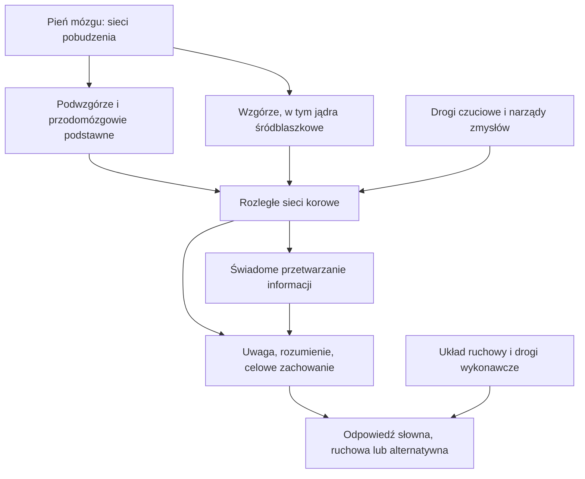
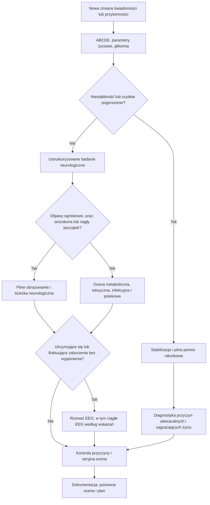
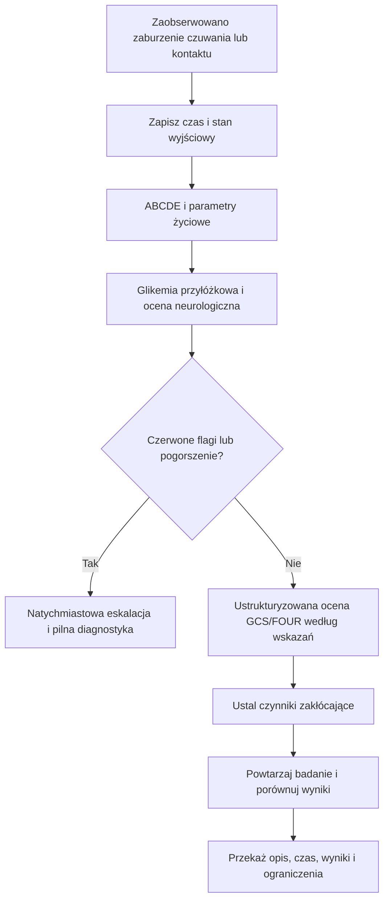

# 7.1. Świadomość i przytomność

> **Moduł 7 – Ocena funkcji poznawczych i psychicznych**  
> **Zakres:** kliniczna ocena poziomu czuwania, reaktywności, kontaktu i obserwowalnych przejawów świadomości u osoby dorosłej, z uwzględnieniem pacjenta geriatrycznego, stanów ostrych oraz zaburzeń świadomości utrzymujących się po uszkodzeniu mózgu.  
> **Charakter opracowania:** materiał dydaktyczny dla osób przygotowujących się do badania neurologicznego. Zakres czynności, interpretacja wyników i decyzje kliniczne zależą od kwalifikacji zawodowych, uprawnień oraz procedur obowiązujących w danym miejscu udzielania świadczeń.

---

## Wprowadzenie

Ocena świadomości i przytomności należy do podstawowych elementów badania neurologicznego, ponieważ zmiana poziomu czuwania może być pierwszym lub najbardziej widocznym objawem ostrego uszkodzenia mózgu, zaburzenia metabolicznego, zatrucia, zakażenia, napadu padaczkowego albo niewydolności układu oddechowego i krążenia. Nie jest to jedynie sprawdzenie, czy pacjent ma otwarte oczy lub odpowiada na pytania. Rzetelna ocena wymaga rozdzielenia kilku powiązanych, ale odmiennych funkcji: czuwania, zdolności do reagowania, treści świadomości, rozumienia komunikatów, orientacji, celowości zachowania oraz możliwości przekazania odpowiedzi.

W praktyce klinicznej szczególnie ważne jest odróżnienie **obniżonego poziomu pobudzenia** od **zaburzenia treści świadomości**. Pacjent senny, który po zwróceniu się po imieniu otwiera oczy, nawiązuje kontakt i wykonuje polecenia, znajduje się w innym stanie niż osoba przytomna, lecz zdezorientowana, nieuważna i doświadczająca zaburzeń percepcji. Z kolei osoba, która nie mówi i nie porusza kończynami, nie musi być nieprzytomna: przyczyną może być afazja, ciężkie zaburzenie ruchowe, zespół zamknięcia lub ograniczenie komunikacji wynikające z niedosłuchu, bariery językowej albo intubacji.

Ocena ma dwa równoległe cele:

1. **Bezpieczeństwo i pilność:** szybkie rozpoznanie, czy doszło do nowego lub postępującego zaburzenia wymagającego natychmiastowej pomocy.
2. **Charakterystyka neurologiczna:** możliwie precyzyjny opis poziomu czuwania, reaktywności, odpowiedzi słownej i ruchowej, funkcji pniowych oraz zmian w czasie.

W ostrym pogorszeniu stanu pacjenta nie wolno opóźniać postępowania ratunkowego przez wykonywanie pełnego badania poznawczego. W pierwszej kolejności ocenia się i zabezpiecza funkcje życiowe, następnie wykonuje krótką, standaryzowaną ocenę neurologiczną i uruchamia właściwą ścieżkę diagnostyczną. U osoby stabilnej można przeprowadzić badanie rozszerzone, uwzględniające powtarzane próby kontaktu, orientacji i wykonywania poleceń.

Niniejszy rozdział koncentruje się na **badaniu przedmiotowym**. Wywiad dotyczący napadów, omdleń, przemijającej utraty przytomności i relacji świadka został rozwinięty w rozdziale 2.7. Zbieranie informacji o pamięci, uwadze, języku, nastroju i zmianach zachowania przedstawiono w rozdziale 2.8. Ogólną kolejność badania neurologicznego opisuje rozdział 1.8, a szersze podstawy fizjologii czuwania i świadomości – rozdział 1.3. W tym miejscu nacisk położono na bezpośrednią obserwację, procedurę badania, standaryzację i interpretację wyników.

---

## 1. Cele kształcenia i efekty uczenia się

### 1.1. Cel ogólny

Celem rozdziału jest przygotowanie uczestnika do systematycznej, bezpiecznej i możliwej do odtworzenia oceny świadomości, przytomności i reaktywności, z prawidłowym wykorzystaniem skal klinicznych oraz rozpoznawaniem sytuacji, w których brak odpowiedzi nie oznacza braku świadomości.

### 1.2. Szczegółowe efekty uczenia się

Po ukończeniu rozdziału uczestnik powinien umieć:

1. Wyjaśnić różnicę między czuwaniem, pobudzeniem, reaktywnością, świadomością, orientacją i zdolnością komunikowania odpowiedzi.
2. Opisać podstawowe struktury i sieci mózgowe warunkujące czuwanie i świadome przetwarzanie informacji.
3. Rozróżnić jakościowe i ilościowe zaburzenia świadomości.
4. Scharakteryzować senność, spowolnienie reakcji, stupor i śpiączkę, unikając niejednoznacznych etykiet bez opisu zachowania.
5. Przeprowadzić obserwację spontaniczną przed zastosowaniem bodźców.
6. Ocenić reakcję na głos, proste polecenie, bodziec dotykowy oraz – jeśli jest to konieczne i bezpieczne – standaryzowany bodziec uciskowy.
7. Sprawdzić orientację i zdolność wykonywania prostych oraz złożonych poleceń.
8. Właściwie zastosować i udokumentować elementy skali Glasgow (GCS).
9. Wyjaśnić zastosowanie i ograniczenia skali FOUR oraz szybkiej oceny AVPU.
10. Rozpoznać czynniki zakłócające ocenę, w tym sedację, intubację, afazję, niedosłuch, zaburzenia ruchowe i bariery językowe.
11. Wskazać objawy mogące sugerować uszkodzenie pnia mózgu, napad niekonwulsyjny, udar, zakażenie ośrodkowego układu nerwowego lub zaburzenie metaboliczne.
12. Odróżnić zaburzenia świadomości od zespołu zamknięcia, akinezy mutyzmu, ciężkiej afazji, katatonii i zaburzeń komunikacji.
13. Znać zasady powtarzania badania oraz interpretacji zmian w czasie.
14. Sporządzić opis wyniku, który oddziela obserwację od interpretacji i wskazuje ograniczenia badania.
15. Rozpoznać sytuacje wymagające pilnej eskalacji i niezwłocznego przekazania pacjenta do odpowiedniego zespołu.

### 1.3. Zakres kompetencji

Wykonywanie prób z użyciem bodźców uciskowych, ocena odruchów pniowych, interpretacja GCS i FOUR, dobór badań dodatkowych oraz decyzje dotyczące zabezpieczenia dróg oddechowych wymagają przygotowania adekwatnego do wykonywanej czynności. Badanie w stanie nagłym powinno przebiegać według lokalnego protokołu i z udziałem osób posiadających odpowiednie uprawnienia. Materiał nie zastępuje szkolenia praktycznego, konsultacji lekarskiej ani procedur ratunkowych.

### 1.4. Kryterium jakości

Wysokiej jakości opis nie ogranicza się do stwierdzenia „pacjent przytomny” lub „kontakt utrudniony”. Powinien odpowiadać na pytania:

- Czy pacjent spontanicznie utrzymuje oczy otwarte?
- Czy reaguje na głos i czy reakcja jest powtarzalna?
- Czy rozumie polecenia i wykonuje je celowo?
- Czy odpowiedzi są adekwatne do pytania?
- Czy występują fluktuacje?
- Czy można ocenić mowę i ruch, czy też istnieją czynniki uniemożliwiające ich wiarygodną ocenę?
- Czy stwierdzono asymetrię reakcji, zaburzenia źrenic lub inne objawy ogniskowe?
- Czy wynik zmienił się względem poprzedniej oceny?

---

## 2. Podstawowe pojęcia i definicje

### 2.1. Świadomość

Świadomość jest złożoną funkcją układu nerwowego, obejmującą zdolność do doświadczania siebie i otoczenia oraz integrowania informacji w spójne przeżycia i zachowanie. Nie można jej sprowadzić do jednego odruchu, pojedynczego obszaru mózgu ani wyniku jednej skali.

W ujęciu klinicznym przydatne jest rozdzielenie dwóch wymiarów:

- **Pobudzenie (arousal, poziom czuwania):** zdolność do osiągnięcia i utrzymania stanu aktywności umożliwiającego reagowanie.
- **Świadomość treści (awareness):** obecność oznak świadomego przetwarzania siebie i otoczenia, takich jak celowe zachowanie, rozumienie poleceń, komunikacja lub ukierunkowane reagowanie.

Oba wymiary są powiązane, ale nie są tożsame. Pacjent może mieć oczy otwarte i wykazywać cykle czuwania, lecz nie prezentować wiarygodnych oznak świadomego kontaktu. Inny pacjent może zachowywać świadomość, ale nie być w stanie jej ujawnić z powodu ciężkiego porażenia lub zaburzenia komunikacji.

### 2.2. Przytomność

W języku klinicznym termin „przytomność” najczęściej odnosi się do stanu, w którym osoba pozostaje w stanie czuwania i może reagować na bodźce. Jest to określenie praktyczne, lecz samo w sobie zbyt mało precyzyjne do dokumentacji. Warto dopisać, czy pacjent reaguje spontanicznie, na głos, na dotyk, czy dopiero na silniejszy bodziec oraz czy odpowiedzi są celowe.

Stwierdzenie „pacjent przytomny” nie wyklucza majaczenia, dezorientacji, afazji, zaburzeń pamięci, urojeń ani innych zaburzeń treści świadomości.

### 2.3. Czuwanie

Czuwanie jest stanem fizjologicznym, w którym układ nerwowy utrzymuje aktywność pozwalającą na odbiór i przetwarzanie bodźców. Obejmuje nie tylko otwarcie oczu, ale również zdolność do utrzymania aktywności i reagowania w sposób zależny od sytuacji.

W badaniu należy odróżnić:

- spontaniczne utrzymywanie oczu otwartych;
- otwieranie oczu po zwróceniu się do pacjenta;
- krótkotrwałe wybudzenie, po którym pacjent ponownie zasypia;
- brak możliwego do uzyskania wybudzenia.

### 2.4. Reaktywność

Reaktywność to obserwowalna odpowiedź na bodziec. Może być:

- **spontaniczna** – pojawia się bez celowego pobudzania;
- **na głos** – po wypowiedzeniu imienia lub polecenia;
- **na dotyk** – po delikatnym dotknięciu ramienia;
- **na bodziec uciskowy** – po zastosowaniu odpowiednio dobranej, krótkiej i standaryzowanej stymulacji przez przeszkoloną osobę;
- **celowa** – ukierunkowana na źródło bodźca lub zgodna z poleceniem;
- **odruchowa** – automatyczna, bez wykazanej celowości.

Nie każda reakcja ruchowa świadczy o świadomym rozumieniu. Zgięcie kończyny, grymas lub cofnięcie ręki mogą mieć charakter odruchowy. Z drugiej strony brak ruchu nie dowodzi braku świadomości, jeżeli pacjent ma porażenie, zespół zamknięcia, uszkodzenie rdzenia, blokadę nerwowo-mięśniową lub ciężkie zaburzenie wykonawcze.

### 2.5. Kontakt

Kontakt jest praktycznym określeniem jakości interakcji z pacjentem. W opisie należy rozróżniać:

- kontakt wzrokowy;
- kontakt słowny;
- kontakt gestowy;
- reakcję na polecenia;
- zdolność do utrzymania interakcji;
- adekwatność odpowiedzi;
- spontaniczne inicjowanie komunikacji.

„Kontakt logiczny” jest określeniem nieprecyzyjnym, jeśli nie podano, co pacjent faktycznie robił i mówił.

### 2.6. Orientacja

Orientacja dotyczy rozpoznawania i prawidłowego odnoszenia się do podstawowych elementów sytuacji:

- **autopsychiczna** – wiedza o własnej osobie i tożsamości;
- **allopsychiczna** – orientacja w otoczeniu, miejscu, czasie i sytuacji.

W praktyce można zapytać o imię i nazwisko, miejsce pobytu, przybliżoną datę, porę dnia i powód badania. Błędna odpowiedź nie jest sama w sobie dowodem śpiączki ani braku świadomości. Może wynikać z dezorientacji, afazji, nieznajomości miejsca, zaburzeń pamięci, niskiego poziomu edukacji, bariery językowej lub ostrego majaczenia.

### 2.7. Zaburzenia ilościowe i jakościowe

W tradycyjnym opisie klinicznym rozróżnia się:

- **Zaburzenia ilościowe:** obniżenie poziomu czuwania i reaktywności, np. senność, stupor, śpiączka.
- **Zaburzenia jakościowe:** zaburzenie treści świadomości, uwagi, orientacji, percepcji lub spójności zachowania, np. splątanie i majaczenie.

Podział jest użyteczny dydaktycznie, ale w praktyce stany mogą się nakładać. Majaczenie może przebiegać z pobudzeniem, prawidłowym pozornie poziomem czuwania albo z wyraźną sennością. Pacjent może jednocześnie mieć obniżone czuwanie i zaburzoną treść świadomości.

### 2.8. Encefalopatia

Encefalopatia jest szerokim określeniem zaburzenia funkcji mózgu, zwykle wtórnego do procesu ogólnoustrojowego, metabolicznego, toksycznego, zapalnego, niedotlenieniowego lub strukturalnego. Nie jest rozpoznaniem etiologicznym. Określenie „ostra encefalopatia” powinno skłaniać do poszukiwania przyczyny, a nie zastępować rozpoznania choroby podstawowej.

### 2.9. Splątanie

Splątanie oznacza nieuporządkowane, niespójne lub nieadekwatne przetwarzanie informacji, często z dezorientacją, zaburzeniem uwagi i trudnością w prowadzeniu logicznej rozmowy. Termin jest opisowy i powinien zostać uzupełniony informacją o początku, fluktuacjach, poziomie czuwania i objawach towarzyszących.

### 2.10. Majaczenie

Majaczenie (delirium) jest ostrym lub podostrym zespołem zaburzeń uwagi i świadomości, zwykle o zmiennym nasileniu, związanym z chorobą somatyczną, działaniem substancji, odstawieniem albo współistnieniem wielu czynników. Może przebiegać z pobudzeniem, spowolnieniem lub obrazem mieszanym. Szczegółowe kryteria, czynniki ryzyka i różnicowanie z otępieniem przedstawiono w rozdziale 7.7. W niniejszym rozdziale majaczenie traktowane jest jako ważny przykład jakościowego zaburzenia świadomości.

### 2.11. Śpiączka

Śpiączka jest stanem głębokiego zaburzenia świadomości, w którym pacjent nie może zostać wybudzony, ma zamknięte oczy i nie wykazuje prawidłowego cyklu snu i czuwania. Nie jest równoznaczna z głębokim snem. Wymaga pilnej oceny przyczyny, zabezpieczenia funkcji życiowych i monitorowania neurologicznego.

### 2.12. Stupor

Stupor jest określeniem stanu znacznego obniżenia reaktywności, w którym uzyskanie odpowiedzi wymaga silnej lub powtarzanej stymulacji, a uzyskana reakcja jest krótkotrwała i nie pozwala na utrzymanie kontaktu. Termin bywa różnie definiowany w piśmiennictwie, dlatego w dokumentacji należy przede wszystkim opisać konkretną reakcję i zastosowany bodziec.

### 2.13. Zespół zamknięcia

Zespół zamknięcia (locked-in syndrome) jest stanem ciężkiego porażenia, często obejmującego kończyny i mięśnie opuszkowe, przy względnie zachowanej świadomości. Klasyczna postać wiąże się z uszkodzeniem brzusznej części mostu. Pacjent może zachować pionowe ruchy gałek ocznych lub mruganie, które umożliwiają komunikację. Nierozpoznanie tego zespołu może prowadzić do błędnego uznania pacjenta za nieprzytomnego.

### 2.14. Zespół niereaktywnego czuwania i stan minimalnej świadomości

W zaburzeniach świadomości utrzymujących się po ciężkim uszkodzeniu mózgu stosuje się precyzyjniejsze kategorie:

- **Zespół niereaktywnego czuwania (UWS, dawniej stan wegetatywny):** występują okresy otwierania oczu i cykle czuwania, lecz nie obserwuje się wiarygodnych klinicznych oznak świadomości.
- **Stan minimalnej świadomości (MCS):** występują ograniczone, ale powtarzalne i wiarygodne oznaki świadomego zachowania, choć mogą być niestałe.
- **Wyjście ze stanu minimalnej świadomości:** osiągnięcie kryteriów funkcjonalnych, takich jak funkcjonalna komunikacja lub celowe używanie przedmiotów, oceniane według odpowiednich standardów.

Ocena tych stanów wymaga powtarzanych, standaryzowanych badań i nie powinna opierać się na jednorazowym, krótkim kontakcie. W wyspecjalizowanej diagnostyce wykorzystuje się między innymi Coma Recovery Scale–Revised (CRS-R).

---

## 3. Podstawy neuroanatomiczne i neurofizjologiczne

### 3.1. Dwa współdziałające układy funkcjonalne

Utrzymanie świadomości wymaga współpracy rozproszonych struktur. Dla celów klinicznych można wyróżnić:

1. **Układ pobudzenia:** wstępujące połączenia pnia mózgu, podwzgórza, wzgórza i przodomózgowia, które wspierają stan czuwania.
2. **Sieci świadomości treści:** rozległe, wzajemnie połączone obszary kory mózgowej i połączenia korowo-podkorowe, które umożliwiają świadome przetwarzanie informacji.

To uproszczenie dydaktyczne. W rzeczywistości pobudzenie i treść świadomości nie są całkowicie odrębnymi modułami; wzajemnie na siebie wpływają i zależą od dynamiki sieci neuronalnych.

### 3.2. Wstępujący układ siatkowaty aktywujący

Wstępujący układ siatkowaty aktywujący (ARAS) obejmuje grupy neuronów w obrębie górnej części pnia mózgu, szczególnie nakrywki mostu i śródmózgowia, oraz ich połączenia z podwzgórzem, wzgórzem, przodomózgowiem podstawnym i korą. Układ ten nie jest pojedynczym przewodem ani jednym jądrem, lecz siecią wielu dróg i układów neuroprzekaźnikowych.

Do ważnych struktur i układów należą:

- okolica nakrywki mostu i śródmózgowia;
- jądra szwu i układ serotoninergiczny;
- miejsce sinawe i układ noradrenergiczny;
- jądra cholinergiczne nakrywki mostu i śródmózgowia;
- podwzgórze, w tym układy histaminergiczne i oreksynowe;
- przodomózgowie podstawne;
- jądra śródblaszkowe i inne połączenia wzgórzowe.

Uszkodzenie obustronne lub rozległe tych struktur i ich połączeń może prowadzić do znacznego obniżenia czuwania, aż do śpiączki.

### 3.3. Wzgórze i połączenia korowo-wzgórzowe

Wzgórze uczestniczy w przekazywaniu i modulowaniu informacji kierowanej do kory. Jego jądra śródblaszkowe i połączenia z rozległymi obszarami korowymi mają istotne znaczenie dla pobudzenia, integracji informacji i podtrzymywania aktywności sieciowej.

Obustronne uszkodzenia wybranych obszarów wzgórza, zwłaszcza struktur paramedialnych, mogą prowadzić do zaburzeń czuwania i świadomości. Nie oznacza to jednak, że każde uszkodzenie wzgórza wywołuje śpiączkę. Znaczenie ma lokalizacja, rozległość, strona, dynamika i współistniejące uszkodzenia.

### 3.4. Kora mózgowa i sieci rozległe

Świadome przetwarzanie informacji wymaga współpracy wielu obszarów korowych. Znaczenie mają między innymi sieci czołowo-ciemieniowe, obszary skroniowe, wyspy, obręcz i połączenia z jądrami podkorowymi. Utrata funkcji może wynikać z rozległego, obustronnego uszkodzenia półkul albo z przerwania połączeń między ważnymi węzłami sieci.

Pojedyncze, ograniczone uszkodzenie jednej półkuli częściej powoduje określony deficyt, np. afazję lub zaniedbywanie stronne, niż głęboką śpiączkę. Wyjątki zależą od rozległości uszkodzenia, obrzęku, efektu masy i współistniejących zaburzeń.

### 3.5. Neuroprzekaźnictwo i czuwanie

W regulacji czuwania uczestniczą liczne układy neuroprzekaźnikowe:

| Układ | Główne źródła | Znaczenie funkcjonalne |
|---|---|---|
| Noradrenergiczny | Miejsce sinawe | Czujność, reakcja na znaczące bodźce |
| Serotoninergiczny | Jądra szwu | Regulacja stanów snu i czuwania, modulacja aktywności sieci |
| Cholinergiczny | Nakrywka mostu i śródmózgowia, przodomózgowie podstawne | Aktywacja korowa i modulacja uwagi |
| Histaminergiczny | Jądro guzowo-suteczkowate podwzgórza | Podtrzymywanie czuwania |
| Oreksynowy | Podwzgórze boczne | Stabilizacja stanów czuwania |
| Dopaminergiczny | Śródmózgowie i inne obszary | Motywacja, napęd, aktywacja i zachowanie ukierunkowane |
| GABA-ergiczny | Liczne struktury | Hamowanie i regulacja przejść między stanami sieciowymi |
| Glutaminergiczny | Rozległe sieci | Przekaźnictwo pobudzające i integracja aktywności |

Leki uspokajające, anestetyki, opioidy i substancje psychoaktywne mogą zmieniać aktywność tych układów, wpływając na czuwanie, reakcje, oddychanie i zdolność komunikowania.

### 3.6. Dlaczego uszkodzenie pnia mózgu może prowadzić do śpiączki?

Pień mózgu zawiera elementy wstępującego układu pobudzenia, a także ośrodki i drogi związane z oddychaniem, krążeniem, odruchami źrenicznymi, ruchami oczu oraz napięciem mięśniowym. Rozległe uszkodzenie odpowiednich struktur może jednocześnie zaburzyć czuwanie i funkcje życiowe.

Nie każdy deficyt pniowy oznacza śpiączkę. Uszkodzenie brzusznej części mostu może wywołać zespół zamknięcia, w którym pacjent jest świadomy, ale nie może wykonywać większości ruchów. Dlatego ocenę czuwania trzeba oddzielić od oceny możliwości ruchowych.

### 3.7. Schemat funkcjonalny

### 3.8. Lokalizacja a obraz kliniczny

| Potencjalna lokalizacja lub mechanizm | Możliwy obraz kliniczny | Ważne zastrzeżenie |
|---|---|---|
| Obustronne uszkodzenie układu pobudzenia pnia mózgu | Głębokie obniżenie czuwania, śpiączka | Wymaga oceny funkcji pniowych i obrazowania |
| Obustronne uszkodzenie wzgórza paramedialnego | Senność, zaburzenie czuwania, dezorientacja | Obraz zależy od rozległości i połączeń |
| Rozległe obustronne uszkodzenie półkul | Zaburzenia treści świadomości, czasem śpiączka | Możliwy udział obrzęku i zaburzeń metabolicznych |
| Brzuszna część mostu | Zespół zamknięcia | Świadomość może być zachowana |
| Rozlane zaburzenie metaboliczne lub toksyczne | Splątanie, senność, stupor lub śpiączka | Często brak wyraźnej lokalizacji ogniskowej |
| Napad niekonwulsyjny lub stan padaczkowy | Fluktuacje kontaktu, brak odpowiedzi, automatyzmy | Rozpoznanie może wymagać EEG |

---

## 4. Przygotowanie do badania i zasady bezpieczeństwa

### 4.1. Ocena stanu nagłego przed badaniem szczegółowym

Jeżeli pacjent jest nieprzytomny, gwałtownie splątany lub jego stan się pogarsza, należy rozpocząć od oceny ABCDE zgodnie z kompetencjami i lokalnym protokołem:

- **A – Airway:** drożność dróg oddechowych, ryzyko aspiracji, obecność wydzieliny lub wymiocin.
- **B – Breathing:** częstość i jakość oddechu, saturacja, wysiłek oddechowy, podejrzenie hipowentylacji.
- **C – Circulation:** tętno, ciśnienie tętnicze, perfuzja, krwawienie i objawy wstrząsu.
- **D – Disability:** poziom czuwania, GCS lub inne właściwe narzędzie, źrenice, glikemia przyłóżkowa, objawy ogniskowe i drgawki.
- **E – Exposure:** temperatura, urazy, wysypka, ślady wkłuć, plastry lekowe, opaski i inne informacje widoczne podczas bezpiecznego badania.

W stanach nagłych należy wezwać odpowiednią pomoc i nie pozostawiać pacjenta bez nadzoru. Nie należy wykonywać prób stojących, prowokować bólu ani podawać doustnie płynów lub leków osobie z istotnie obniżonym czuwaniem i niepewnym bezpieczeństwem połykania.

### 4.2. Przygotowanie otoczenia

W badaniu planowym należy:

1. Zapewnić spokojne pomieszczenie i ograniczyć zbędne bodźce.
2. Zadbać o odpowiednie oświetlenie, bez oślepiania pacjenta.
3. Zapewnić dostęp do aparatu słuchowego, okularów lub innych pomocy sensorycznych.
4. Ustawić pacjenta w bezpiecznej pozycji.
5. Sprawdzić, czy pacjent nie odczuwa silnego bólu, duszności lub nudności.
6. Przygotować dokumentację, zegar i odpowiednią skalę.
7. Wyjaśnić cel badania w prostym języku, jeżeli pacjent jest w stanie zrozumieć komunikat.

### 4.3. Weryfikacja czynników zakłócających

Przed interpretacją odpowiedzi należy ustalić, czy nie występują:

- sedacja lub niedawne znieczulenie;
- opioidy, benzodiazepiny, leki nasenne lub inne substancje działające depresyjnie na ośrodkowy układ nerwowy;
- blokada nerwowo-mięśniowa;
- intubacja, tracheostomia lub inne ograniczenie fonacji;
- afazja, dyzartria, apraksja mowy;
- niedosłuch, głuchota lub brak aparatu słuchowego;
- ślepota, znaczne ograniczenie widzenia albo opadanie powiek;
- porażenie, ciężki niedowład, uraz kończyn lub unieruchomienie;
- bariera językowa, brak tłumacza albo nieznajomość sposobu komunikacji;
- zaburzenia rozwoju, niepełnosprawność intelektualna lub wcześniejsze zaburzenia poznawcze;
- hipotermia, hipoksja, hiperkapnia, zaburzenia glikemii i inne odchylenia ogólnoustrojowe.

Jeżeli czynnik uniemożliwia wiarygodną ocenę określonego elementu skali, należy oznaczyć go jako niemożliwy do zbadania zgodnie z zasadami narzędzia. Nie wolno automatycznie przyznawać najniższej punktacji.

### 4.4. Zgoda, godność i komunikacja

Pacjent zachowuje podmiotowość niezależnie od poziomu reaktywności. Należy zwracać się do niego bezpośrednio, przedstawiać się, informować o dotyku i nie prowadzić rozmowy tak, jakby pacjent nie był obecny. W przypadku zaburzeń świadomości należy stosować zasady zgody, przedstawicielstwa i pilnego działania wynikające z prawa oraz procedur placówki.

### 4.5. Bezpieczne stosowanie bodźców

Badanie powinno przebiegać od bodźców najmniej obciążających do silniejszych:

1. obserwacja bez stymulacji;
2. spokojne zwrócenie się po imieniu;
3. proste polecenie wypowiedziane wyraźnie;
4. powtórzenie polecenia lub zastosowanie gestu;
5. delikatny bodziec dotykowy, jeśli nie ma przeciwwskazań;
6. standaryzowany bodziec uciskowy, wyłącznie jeśli jest konieczny, bezpieczny i wykonywany przez osobę przeszkoloną.

Nie należy stosować niekontrolowanego, długotrwałego ani wielokrotnie powtarzanego bodźca bólowego. Nie zaleca się rutynowego pocierania mostka, które może powodować urazy skóry i nie jest potrzebne do większości ocen. Należy unikać bodźców w miejscu urazu, złamania, świeżej operacji, zmian skórnych lub podejrzenia urazu kręgosłupa szyjnego. Stymulacja nie może opóźniać wezwania pomocy ani zabezpieczenia funkcji życiowych.

---

## 5. Metodyka badania krok po kroku

### 5.1. Krok 1 – obserwacja spontaniczna

Przed dotknięciem pacjenta należy przez chwilę obserwować:

- czy oczy są otwarte;
- czy pacjent utrzymuje spojrzenie;
- czy śledzi poruszający się obiekt;
- czy spontanicznie porusza kończynami;
- czy wydaje dźwięki lub mówi;
- czy wykonuje czynności celowe;
- czy występują automatyzmy, drżenia, mioklonie lub drgawki;
- czy oddech jest regularny;
- czy zachowanie zmienia się samoistnie.

Należy odróżnić ruchy spontaniczne od reakcji na bodziec. Samo otwarcie oczu nie oznacza prawidłowego kontaktu, a brak spontanicznego ruchu nie przesądza o braku świadomości.

### 5.2. Krok 2 – nawiązanie kontaktu słownego

Należy przedstawić się, zwrócić się do pacjenta po imieniu, wypowiedzieć krótkie zdanie i zadać proste pytanie. Przykłady:

- „Proszę otworzyć oczy”.
- „Czy mnie Pan/Pani słyszy?”
- „Proszę spojrzeć na mnie”.
- „Proszę podać swoje imię”.

Ważne jest nie tylko to, czy odpowiedź się pojawiła, ale również:

- po jakim czasie;
- czy była adekwatna;
- czy pacjent utrzymał kontakt;
- czy odpowiedź była powtarzalna;
- czy pacjent potrzebował powtarzania polecenia.

### 5.3. Krok 3 – ocena rozumienia poleceń

Polecenia powinny być krótkie, jednoznaczne i dostosowane do możliwości pacjenta. Przykładowa sekwencja:

1. „Proszę zamknąć oczy”.
2. „Proszę otworzyć usta”.
3. „Proszę unieść prawą rękę”.
4. „Proszę ścisnąć moją dłoń, a następnie ją puścić”.
5. „Proszę spojrzeć w górę, a następnie w dół”.

Jeżeli pacjent nie wykonuje polecenia, należy sprawdzić, czy je usłyszał i zrozumiał. Można zastosować gest, demonstrację lub polecenie alternatywne. Nie należy automatycznie interpretować niepowodzenia jako obniżenia świadomości – przyczyną może być afazja, apraksja, niedowład, zaburzenie słuchu albo niezrozumienie języka.

### 5.4. Krok 4 – ocena odpowiedzi celowej

Za bardziej przekonujące oznaki celowego zachowania można uznać:

- wykonanie polecenia w odpowiednim czasie;
- powtarzalne wskazanie odpowiedzi wzrokiem lub gestem;
- ukierunkowanie ruchu na źródło bodźca;
- celowe odszukiwanie przedmiotu;
- adekwatne użycie przedmiotu;
- powtarzalne śledzenie wzrokiem;
- komunikowanie „tak” i „nie” w sposób sprawdzony w kilku próbach.

Pojedyncza reakcja może być przypadkowa. Warto powtórzyć próbę, zmienić kolejność poleceń i sprawdzić, czy odpowiedź jest zgodna z nowym komunikatem.

### 5.5. Krok 5 – ocena orientacji

U pacjenta, który nawiązuje kontakt, można ocenić orientację:

| Obszar | Przykładowe pytanie | Co należy uwzględnić |
|---|---|---|
| Osoba | „Jak się Pan/Pani nazywa?” | Nie zawsze wymaga podania wszystkich danych osobowych |
| Miejsce | „Gdzie teraz jesteśmy?” | Pacjent może nie znać nazwy oddziału |
| Czas | „Jaki jest dziś dzień lub miesiąc?” | Dopuszczalne jest określenie przybliżone, jeśli tak ustalono |
| Sytuacja | „Dlaczego jest Pan/Pani w tym miejscu?” | Odpowiedź zależy od pamięci i rozumienia sytuacji |

Orientację należy interpretować w kontekście wieku, wykształcenia, języka, wcześniejszego stanu poznawczego, miejsca pobytu i ostrości choroby. Błędna odpowiedź na jedno pytanie nie powinna prowadzić do automatycznej etykiety „brak świadomości”.

### 5.6. Krok 6 – ocena utrzymania uwagi i kontaktu

W ramach tego rozdziału nie przeprowadza się pełnego badania uwagi, które opisano w rozdziale 7.2. Wystarczy odnotować, czy pacjent:

- utrzymuje kontakt przez czas potrzebny do wykonania prostego polecenia;
- łatwo odwraca uwagę;
- przerywa odpowiedź;
- wymaga częstego przywoływania;
- wykazuje wyraźne wahania czuwania.

Jeżeli obserwuje się fluktuacje, należy opisać ich czas, nasilenie i związek z porą dnia, lekami, snem, bólem lub innymi czynnikami.

### 5.7. Krok 7 – ocena reakcji ruchowej

Należy obserwować reakcje obu stron ciała i nie ograniczać oceny do jednej kończyny. W zależności od stanu pacjenta można sprawdzić:

- wykonanie polecenia ruchowego;
- spontaniczne ruchy kończyn;
- lokalizowanie bodźca;
- cofanie kończyny;
- wzorce nieprawidłowego zgięcia lub wyprostu;
- asymetrię odpowiedzi.

Ruch odruchowy, cofnięcie kończyny i lokalizowanie bodźca są różnymi reakcjami. Ich rozróżnienie ma znaczenie dla punktacji GCS i oceny neurologicznej.

### 5.8. Krok 8 – ocena źrenic i wybranych funkcji pniowych

W zależności od stanu pacjenta, wskazań i kompetencji należy ocenić:

- wielkość i symetrię źrenic;
- reakcję źrenic na światło;
- ustawienie gałek ocznych;
- spontaniczne ruchy gałek ocznych;
- wybrane odruchy pniowe, jeśli istnieją wskazania i badanie jest wykonywane przez przeszkoloną osobę.

Należy odnotować leki, wcześniejsze choroby okulistyczne, urazy oka i zabiegi, które mogą wpływać na wygląd źrenic. Badanie odruchów pniowych nie jest równoznaczne z oceną śmierci mózgu. Ustalenie śmierci mózgu jest odrębną, ściśle regulowaną procedurą medyczno-prawną.

### 5.9. Krok 9 – ocena zmian w czasie

Pojedynczy pomiar może być mylący. W razie zaburzeń świadomości należy powtarzać ocenę według ustalonego harmonogramu, używając tej samej skali i porównywalnej techniki. Szczególnie istotne są:

- spadek poziomu czuwania;
- zmniejszenie reakcji na głos;
- pogorszenie odpowiedzi ruchowej;
- pojawienie się asymetrii;
- nowa anizokoria;
- utrata wcześniej obecnej reakcji;
- narastające zaburzenia oddychania;
- nowe drgawki lub subtelne objawy napadowe.

Pogorszenie wyniku należy traktować jako sygnał do ponownej oceny pacjenta i eskalacji zgodnie z procedurą, a nie jedynie jako zmianę liczbową.

### 5.10. Krok 10 – podsumowanie

Po zakończeniu badania należy krótko określić:

1. poziom czuwania;
2. sposób uzyskiwania reakcji;
3. jakość kontaktu i odpowiedzi;
4. zdolność wykonywania poleceń;
5. orientację, jeśli była możliwa do oceny;
6. wynik GCS lub FOUR, jeżeli zastosowano;
7. czynniki ograniczające wiarygodność;
8. obecność objawów ogniskowych i pniowych;
9. zmianę względem poprzedniej oceny;
10. potrzebę pilnej eskalacji lub dalszej diagnostyki.

---

## 6. Skala Glasgow – Glasgow Coma Scale (GCS)

### 6.1. Cel i zakres zastosowania

Skala Glasgow została opracowana do standaryzowanej oceny reaktywności, początkowo przede wszystkim u osób z ostrym uszkodzeniem mózgu. Ocenia trzy komponenty:

- **E – Eye response:** otwieranie oczu;
- **V – Verbal response:** odpowiedź słowna;
- **M – Motor response:** najlepsza odpowiedź ruchowa.

GCS jest narzędziem do opisu i monitorowania reaktywności. Nie określa samodzielnie etiologii zaburzenia, nie mierzy wszystkich aspektów świadomości i nie zastępuje pełnego badania neurologicznego.

### 6.2. Punktacja komponentów

| Komponent | Punkty | Kryterium |
|---|---:|---|
| Otwieranie oczu E | 4 | Spontaniczne |
|  | 3 | W odpowiedzi na głos |
|  | 2 | W odpowiedzi na ucisk |
|  | 1 | Brak otwierania oczu |
| Odpowiedź słowna V | 5 | Zorientowana |
|  | 4 | Splątana, ale prowadzi rozmowę |
|  | 3 | Wypowiada pojedyncze, nieadekwatne słowa |
|  | 2 | Wydaje niezrozumiałe dźwięki |
|  | 1 | Brak odpowiedzi słownej |
| Odpowiedź ruchowa M | 6 | Wykonuje polecenia |
|  | 5 | Lokalizuje bodziec |
|  | 4 | Prawidłowe zgięcie / cofanie kończyny |
|  | 3 | Nieprawidłowe zgięcie |
|  | 2 | Wyprost |
|  | 1 | Brak odpowiedzi ruchowej |

Suma mieści się w zakresie 3–15, jeżeli wszystkie trzy komponenty można wiarygodnie ocenić. W dokumentacji należy zawsze zapisać komponenty osobno, np. E3 V4 M6, a nie wyłącznie sumę.

### 6.3. Komponent E – otwieranie oczu

Ocenę należy rozpocząć od obserwacji spontanicznej, następnie zastosować głos, a dopiero w razie potrzeby – bezpieczną stymulację zgodną ze standardem GCS.

Należy odróżnić:

- spontaniczne otwieranie oczu;
- otwieranie oczu po poleceniu lub zwróceniu się do pacjenta;
- otwieranie oczu dopiero po bodźcu uciskowym;
- brak otwierania oczu mimo prawidłowo przeprowadzonej oceny.

Jeżeli powieki są mechanicznie zablokowane przez obrzęk, uraz, opatrunek lub inną przyczynę, komponent może być niemożliwy do oceny. Nie należy wtedy przypisywać wartości 1.

### 6.4. Komponent V – odpowiedź słowna

Ocenia się jakość i adekwatność odpowiedzi, a nie samą zdolność wydawania dźwięków.

- **V5:** pacjent odpowiada adekwatnie i jest zorientowany.
- **V4:** prowadzi rozmowę, ale występuje dezorientacja lub splątanie.
- **V3:** wypowiada rozpoznawalne słowa, lecz nie tworzy adekwatnej rozmowy.
- **V2:** wydaje dźwięki, które nie tworzą rozpoznawalnych słów.
- **V1:** brak odpowiedzi słownej.

Intubacja, tracheostomia, ciężka afazja, istotny niedosłuch, bariera językowa lub zaburzenia fonacji mogą uniemożliwiać wiarygodną ocenę. Należy użyć oznaczenia „NT” (not testable – nie można zbadać) zgodnie z zasadami stosowanego formularza i opisać przyczynę. Nie wolno traktować intubacji jako równoważnej braku świadomości.

### 6.5. Komponent M – odpowiedź ruchowa

Ocenia się najlepszą wiarygodną reakcję ruchową. Warto sprawdzić obie strony, ponieważ asymetria może mieć znaczenie lokalizacyjne.

- **M6 – wykonuje polecenia:** pacjent wykonuje prostą, jednoznaczną instrukcję.
- **M5 – lokalizuje bodziec:** celowo kieruje kończynę w stronę miejsca stymulacji, próbując usunąć bodziec.
- **M4 – prawidłowe zgięcie / cofanie:** kończyna odsuwa się od bodźca, ale bez wyraźnego celowego lokalizowania jego źródła.
- **M3 – nieprawidłowe zgięcie:** stereotypowy wzorzec patologicznego zgięcia.
- **M2 – wyprost:** patologiczny wzorzec wyprostny.
- **M1 – brak odpowiedzi ruchowej:** nie obserwuje się reakcji ruchowej na prawidłowo przeprowadzony bodziec.

Nie należy uznawać ruchu ograniczonego przez złamanie, opatrunek, porażenie obwodowe lub blokadę nerwowo-mięśniową za brak reakcji ośrodkowej bez uwzględnienia tych czynników.

### 6.6. Ustrukturyzowana metoda GCS

Zalecana jest sekwencja:

1. **Sprawdź (Check):** zidentyfikuj czynniki, które mogą zakłócić ocenę.
2. **Obserwuj (Observe):** oceń reakcje spontaniczne.
3. **Stymuluj (Stimulate):** zastosuj odpowiedni bodziec, jeżeli jest potrzebny.
4. **Oceń (Rate):** przypisz wynik każdemu komponentowi osobno i zapisz ograniczenia.

Taki porządek ogranicza nadmierną stymulację i poprawia porównywalność badań.

### 6.7. Interpretacja GCS

Wynik należy interpretować jako opis reaktywności w danym momencie. W urazach mózgu często stosuje się kategorie ciężkości oparte na sumie GCS, jednak progi te nie powinny być bezkrytycznie przenoszone na wszystkie przyczyny zaburzeń świadomości.

Najważniejsze zasady:

- wynik 15 nie wyklucza zaburzeń poznawczych, afazji ani majaczenia;
- ten sam wynik sumaryczny może wynikać z różnych kombinacji E, V i M;
- spadek jednego komponentu może być klinicznie istotny, nawet gdy suma zmienia się niewiele;
- wynik nie jest prognozą indywidualnego rokowania;
- GCS nie rozpoznaje stanu padaczkowego bez drgawek;
- nie zastępuje oceny źrenic, oddychania, objawów ogniskowych i parametrów życiowych.

### 6.8. Przykłady zapisu

| Zapis | Znaczenie | Komentarz |
|---|---|---|
| E4 V5 M6 = 15 | Pełna odpowiedź w trzech komponentach | Nie wyklucza innych deficytów neurologicznych |
| E3 V4 M6 = 13 | Otwieranie oczu na głos, splątana rozmowa, wykonywanie poleceń | Opisać przyczynę dezorientacji i dynamikę |
| E2 V2 M5 = 9 | Oczy na ucisk, niezrozumiałe dźwięki, lokalizowanie | Wymaga pilnej oceny przyczyny i monitorowania |
| E1 V1 M1 = 3 | Brak reakcji w trzech komponentach | Nie określa etiologii ani samodzielnie nie rozstrzyga rokowania |
| E4 V-NT M6 | Oczy spontanicznie, komponent słowny niemożliwy do oceny, polecenia wykonywane | Nie należy obliczać sumy z nieocenialnym komponentem |

### 6.9. Ograniczenia GCS

GCS nie mierzy bezpośrednio świadomości treści, nie ocenia w pełni funkcji pniowych i może być ograniczona przez:

- intubację i tracheostomię;
- afazję i ciężką dyzartrię;
- niedosłuch lub brak wspólnego języka;
- obrzęk powiek i urazy twarzy;
- porażenie, uraz kończyn i blokadę nerwowo-mięśniową;
- sedację, znieczulenie i zatrucia;
- wcześniejsze zaburzenia poznawcze lub komunikacyjne;
- zmęczenie i wahania czuwania.

Skala powinna być stosowana przez osoby przeszkolone. Wynik uzyskany przez różne osoby może się różnić, jeśli nie zachowano jednakowej techniki.

---

## 7. Skala FOUR – Full Outline of UnResponsiveness

### 7.1. Cel i budowa

Skala FOUR została opracowana jako narzędzie do oceny pacjentów z ciężkimi zaburzeniami świadomości, szczególnie w warunkach intensywnej terapii. Obejmuje cztery domeny:

1. reakcję oczu;
2. odpowiedź ruchową;
3. odruchy pniowe;
4. wzorzec oddychania.

Każda domena jest oceniana od 0 do 4, a suma mieści się w zakresie 0–16. W odróżnieniu od GCS nie zawiera osobnego komponentu odpowiedzi słownej, co ułatwia ocenę pacjenta zaintubowanego, ale wymaga kompetencji w ocenie odruchów pniowych i oddychania.

### 7.2. Domeny skali

| Domena | Zakres oceny |
|---|---|
| Oczy | Otwarcie powiek, śledzenie, mruganie na polecenie lub brak reakcji |
| Ruch | Wykonywanie poleceń, lokalizowanie, zgięcie, wyprost, brak reakcji |
| Odruchy pniowe | Reakcje źreniczne i rogówkowe, w wybranych punktacjach także odruch kaszlowy |
| Oddychanie | Samodzielny rytm oddechowy, wzorce nieregularne, zależność od respiratora |

### 7.3. Zasady stosowania

FOUR jest narzędziem specjalistycznym. Należy używać oryginalnej karty punktacji i przeszkolenia, a nie odtwarzać skali z pamięci. Szczególnie istotne jest rozróżnienie braku odruchu od niemożności jego zbadania oraz uwzględnienie leków, uszkodzeń oka, wentylacji mechanicznej i zaburzeń nerwowo-mięśniowych.

Europejska Akademia Neurologii w wytycznych dotyczących śpiączki i innych zaburzeń świadomości wskazała FOUR jako preferowane narzędzie w ostrym kontekście oceny zaburzeń świadomości w porównaniu z ograniczeniami GCS. Nie oznacza to, że FOUR ma zastąpić GCS w każdej placówce lub w każdym typie pacjenta. Wybór skali powinien wynikać z celu badania, dostępnego szkolenia, populacji i lokalnego protokołu.

### 7.4. Ograniczenia FOUR

- wymaga umiejętności oceny odruchów pniowych;
- nie jest narzędziem do pełnego badania funkcji poznawczych;
- wynik może być zakłócony przez leki, wentylację i choroby okulistyczne;
- nie może samodzielnie rozstrzygać o rokowaniu;
- nie jest procedurą stwierdzania śmierci mózgu.

---

## 8. Szybka ocena AVPU

### 8.1. Zastosowanie

AVPU jest krótką metodą orientacyjnej oceny reaktywności, przydatną w pierwszym kontakcie i w szybkiej komunikacji zespołowej. Obejmuje:

- **A – Alert:** pacjent czujny;
- **V – Voice:** reaguje na głos;
- **P – Pain:** reaguje dopiero na bodziec uciskowy;
- **U – Unresponsive:** brak obserwowalnej reakcji.

### 8.2. Zalety i ograniczenia

AVPU jest szybka i łatwa do zapamiętania, ale nie opisuje szczegółowo odpowiedzi słownej i ruchowej, orientacji ani odruchów pniowych. Nie powinna zastępować GCS lub FOUR w monitorowaniu pacjenta z istotnym zaburzeniem świadomości. Jeżeli pacjent reaguje na głos, należy doprecyzować jakość odpowiedzi.

### 8.3. Przykład użycia

Pacjent otwiera oczy po zwróceniu się do niego, ale natychmiast ponownie zasypia. W szybkim przesiewie może zostać zaklasyfikowany jako reagujący na głos, jednak dokumentacja powinna wskazywać, że wybudzenie jest krótkotrwałe i nie pozwala utrzymać kontaktu. Sama litera „V” nie oddaje całego obrazu.

---

## 9. Ocena orientacji i wykonywania poleceń

### 9.1. Orientacja autopsychiczna

Należy ustalić, czy pacjent rozpoznaje siebie, zna swoje imię i potrafi podać podstawowe informacje o sobie. Nie należy wymagać ujawniania danych wrażliwych, które nie są potrzebne do oceny.

### 9.2. Orientacja allopsychiczna

Ocena obejmuje miejsce, czas i sytuację. Pytania powinny być dostosowane do warunków. Osoba hospitalizowana może nie znać nazwy oddziału, a pacjent z zaburzeniami pamięci może nie znać daty mimo zachowanej zdolności do świadomego kontaktu.

### 9.3. Wykonywanie poleceń jedno- i wieloetapowych

Polecenia jednoetapowe są przydatne w szybkiej ocenie. Polecenia wieloetapowe mogą ujawnić trudności rozumienia, pamięci roboczej lub funkcji wykonawczych, ale należą już do rozszerzonego badania poznawczego. W tym rozdziale nie należy utożsamiać ich niepowodzenia z obniżeniem poziomu czuwania.

### 9.4. Weryfikacja komunikacji alternatywnej

Jeżeli pacjent nie może mówić, należy sprawdzić możliwość:

- mrugania na polecenie;
- patrzenia w górę lub w dół;
- wskazywania wzrokiem odpowiedzi;
- używania tablicy liter lub piktogramów;
- wykonywania powtarzalnego gestu;
- korzystania z urządzenia wspomagającego komunikację.

Zanim przyjmie się system odpowiedzi „tak/nie”, trzeba go zweryfikować kilkoma pytaniami o znanej odpowiedzi, z naprzemienną kolejnością i pytaniami kontrolnymi. Niewiarygodny kanał komunikacji może prowadzić do błędnych wniosków.

---

## 10. Różnicowanie zaburzeń świadomości od stanów je naśladujących

### 10.1. Zespół zamknięcia

Pacjent może być w pełni świadomy, ale niezdolny do mówienia i wykonywania większości ruchów. Należy poszukiwać zachowanych pionowych ruchów oczu, mrugania na polecenie i innych powtarzalnych kanałów komunikacji. Podejrzenie zespołu zamknięcia wymaga pilnej diagnostyki neurologicznej i obrazowej.

### 10.2. Ciężka afazja

Pacjent może być przytomny i mieć zachowane czuwanie, ale nie rozumieć lub nie tworzyć wypowiedzi z powodu zaburzenia językowego. Należy ocenić komunikację gestową, reakcje wzrokowe i polecenia niewerbalne. W nagłym początku afazja może być objawem udaru i wymaga pilnej ścieżki diagnostycznej.

### 10.3. Ciężki niedowład lub porażenie

Brak ruchu kończyn może wynikać z uszkodzenia dróg ruchowych, rdzenia, nerwów obwodowych, złącza nerwowo-mięśniowego lub mięśni. Należy poszukiwać innych kanałów odpowiedzi, w szczególności ruchów oczu i reakcji twarzy.

### 10.4. Akineza mutyzmu

W akinezie mutyzmu może występować znaczne ograniczenie spontanicznej aktywności ruchowej i mowy przy częściowo zachowanej świadomości. Pacjent może sprawiać wrażenie obojętnego, mimo że bodźce są przetwarzane. Wymaga to szczegółowej oceny neurologicznej i diagnostyki przyczyny.

### 10.5. Katatonia

Katatonia może obejmować mutyzm, bezruch, negatywizm, posturing, sztywność, echolalię lub echopraksję. Nie wolno automatycznie uznawać bezruchu i braku mowy za śpiączkę ani przypisywać ich przyczynie psychogennej bez oceny medycznej. Katatonia może współistnieć z ciężkimi chorobami somatycznymi i wymaga odpowiedniego rozpoznania.

### 10.6. Zaburzenia sensoryczne

Niedosłuch, ślepota, zaburzenia czucia i brak odpowiednich pomocy mogą uniemożliwić reakcję na określony bodziec. Należy zmienić kanał komunikacji i odnotować ograniczenia.

### 10.7. Zaburzenia językowe i kulturowe

Pacjent może nie reagować na polecenia, ponieważ ich nie rozumie. W miarę możliwości należy zapewnić tłumacza, używać prostych zdań i gestów oraz unikać interpretowania nieznajomości języka jako zaburzenia świadomości.

### 10.8. Sen i zaburzenia rytmu dobowego

Pacjent może być senny z powodu niedoboru snu, zaburzeń rytmu dobowego, bezdechu sennego lub działania leków. Jeżeli senność jest nowa, nasilona albo współistnieje z innymi objawami, należy poszukiwać przyczyny medycznej. Nie wolno z góry uznawać głębokiej senności za fizjologiczną.

### 10.9. Porównanie stanów

| Stan | Oczy i czuwanie | Kontakt i zachowanie | Najważniejsza pułapka |
|---|---|---|---|
| Senność | Oczy zamknięte lub okresowo otwierane | Wybudzenie możliwe, czasem krótkotrwałe | Zlekceważenie nowej senności |
| Splątanie | Czuwanie często zachowane, może fluktuować | Odpowiedzi niespójne, dezorientacja | Uznanie za „zwykłe starzenie się” |
| Majaczenie | Zmienny poziom czuwania | Zaburzona uwaga, zmienność, możliwe omamy | Przeoczenie postaci hipoaktywnej |
| Stupor | Znacznie obniżone czuwanie | Odpowiedź tylko po silniejszej stymulacji, krótkotrwała | Brak pilnej oceny przyczyny |
| Śpiączka | Brak wybudzenia, oczy zamknięte | Brak celowego kontaktu | Utożsamienie z rozpoznaniem etiologicznym |
| UWS | Okresowe otwieranie oczu i cykle czuwania | Brak wiarygodnych oznak świadomości | Jednorazowe badanie i fałszywa pewność |
| MCS | Czuwanie zmienne | Ograniczone, lecz powtarzalne oznaki świadomości | Nierozpoznanie subtelnych odpowiedzi |
| Zespół zamknięcia | Czuwanie zachowane | Świadomość może być zachowana, ruch i mowa skrajnie ograniczone | Błędne uznanie za śpiączkę |
| Afazja | Zwykle czuwanie zachowane | Zaburzone rozumienie lub tworzenie języka | Uznanie braku odpowiedzi słownej za brak świadomości |

---

## 11. Diagnostyka różnicowa zaburzeń świadomości

### 11.1. Przyczyny strukturalne

Do ważnych przyczyn należą:

- krwotok śródczaszkowy;
- udar niedokrwienny, w tym udar pnia mózgu i krążenia tylnego;
- uraz czaszkowo-mózgowy;
- krwiak nadtwardówkowy lub podtwardówkowy;
- guz, obrzęk lub efekt masy;
- wodogłowie i zaburzenia odpływu płynu mózgowo-rdzeniowego;
- zapalenie mózgu z obrzękiem;
- obustronne uszkodzenia wzgórza lub rozległych struktur półkulowych.

Nagły początek, objawy ogniskowe, nowa anizokoria, silny ból głowy lub pogorszenie po urazie zwiększają pilność diagnostyki.

### 11.2. Przyczyny metaboliczne i ogólnoustrojowe

Przykłady:

- hipoglikemia i ciężka hiperglikemia;
- zaburzenia sodu, wapnia i innych elektrolitów;
- niewydolność wątroby i encefalopatia wątrobowa;
- mocznica i ciężka niewydolność nerek;
- hipoksja i hiperkapnia;
- zaburzenia kwasowo-zasadowe;
- ciężkie zaburzenia endokrynologiczne, w tym niedoczynność lub przełom tarczycowy i niewydolność nadnerczy;
- hipotermia i hipertermia;
- odwodnienie, niedożywienie i niedobory witaminowe;
- wstrząs i ciężka niewydolność krążenia.

Zaburzenia metaboliczne mogą dawać obraz rozlany, bez wyraźnych objawów ogniskowych, ale nie wyklucza to współistniejącej choroby strukturalnej.

### 11.3. Przyczyny toksyczne i polekowe

Należy uwzględnić:

- opioidy;
- benzodiazepiny i leki nasenne;
- alkohol i inne substancje psychoaktywne;
- leki przeciwpadaczkowe i przeciwpsychotyczne;
- leki antycholinergiczne;
- zatrucia tlenkiem węgla;
- zatrucia rozpuszczalnikami, pestycydami i innymi toksynami;
- zespół odstawienny po alkoholu, benzodiazepinach lub innych substancjach.

Wywiad powinien obejmować leki przepisane, preparaty bez recepty, suplementy, substancje rekreacyjne, zmianę dawek i możliwość celowego lub przypadkowego przedawkowania.

### 11.4. Przyczyny infekcyjne i zapalne

Do rozważenia należą:

- zapalenie opon mózgowo-rdzeniowych;
- zapalenie mózgu;
- ropień mózgu;
- sepsa i encefalopatia związana z zakażeniem;
- choroby autoimmunologiczne i zapalne ośrodkowego układu nerwowego.

Gorączka, ból głowy, sztywność karku, światłowstręt, wysypka, drgawki i zmiana zachowania wymagają pilnej oceny. U osób starszych i pacjentów z immunosupresją klasyczne objawy mogą być niepełne.

### 11.5. Przyczyny padaczkowe

Zaburzenie kontaktu może być skutkiem:

- okresu ponapadowego;
- stanu padaczkowego z drgawkami;
- stanu padaczkowego bez drgawek;
- napadów ogniskowych z zaburzeniem świadomości;
- napadów powtarzających się bez pełnego powrotu do stanu wyjściowego.

Utrzymujące się lub fluktuujące zaburzenia świadomości po napadzie wymagają rozważenia EEG, a w odpowiednich sytuacjach monitorowania ciągłego.

### 11.6. Przyczyny psychiatryczne i czynnościowe

Zaburzenia psychiczne, katatonia i epizody dysocjacyjne mogą wpływać na zachowanie i komunikację. Nie powinny jednak być rozpoznawane wyłącznie na podstawie nietypowej reakcji lub braku odpowiedzi. Najpierw należy ocenić zagrożenia somatyczne i neurologiczne, a następnie zastosować właściwe kryteria diagnostyczne.

### 11.7. Przyczyny mieszane

U pacjentów geriatrycznych i ciężko chorych często współistnieje kilka mechanizmów, np. zakażenie, odwodnienie, leki uspokajające, niewydolność nerek i wcześniejsze otępienie. Poszukiwanie jednej przyczyny może być błędem. Należy uwzględnić wieloczynnikowy charakter ostrej zmiany.

### 11.8. Schemat diagnostyczny

---

## 12. Czerwone flagi i sytuacje wymagające pilnej pomocy

### 12.1. Nagły początek lub szybkie pogorszenie

Każda nowa, nagła zmiana poziomu świadomości, zwłaszcza bez znanej i wiarygodnej przyczyny, wymaga pilnej oceny. Szczególnie niepokojące są:

- nagła utrata kontaktu;
- szybko narastająca senność;
- gwałtowny spadek GCS lub FOUR;
- nowe zaburzenie oddychania;
- brak powrotu do stanu wyjściowego po napadzie;
- pogorszenie po urazie głowy.

### 12.2. Objawy sugerujące uszkodzenie pnia mózgu lub wzrost ciśnienia śródczaszkowego

Alarmujące mogą być:

- nowa anizokoria lub nierówne, słabo reagujące źrenice;
- nagłe zaburzenie ruchów gałek ocznych;
- nieprawidłowe ustawienie oczu;
- patologiczne wzorce zgięciowe lub wyprostne;
- postępujące zaburzenia oddechu;
- połączenie spadku czuwania z nowym deficytem ogniskowym;
- gwałtowne pogorszenie po wcześniejszym okresie względnej stabilności.

Triada Cushinga (nadciśnienie, bradykardia i nieprawidłowy oddech) jest objawem późnym i nie należy czekać na jej wystąpienie.

### 12.3. Podejrzenie udaru

Nagła afazja, asymetria twarzy, niedowład, zaburzenie pola widzenia, diplopia, ataksja, dyzartria lub nagła utrata przytomności mogą wskazywać na udar. Należy uruchomić właściwą ścieżkę udarową i odnotować czas, kiedy pacjent był ostatnio widziany bez nowych objawów.

### 12.4. Podejrzenie zakażenia ośrodkowego układu nerwowego

Połączenie gorączki, bólu głowy, sztywności karku i zaburzenia świadomości jest szczególnie alarmujące w kierunku bakteryjnego zapalenia opon mózgowo-rdzeniowych. Brak pełnej klasycznej kombinacji nie wyklucza zakażenia. Wysypka wybroczynowa lub plamica, cechy sepsy, drgawki i pogorszenie kontaktu wymagają pilnej pomocy.

### 12.5. Hipoglikemia, hipoksja i zatrucia

Należy pilnie sprawdzić glikemię, utlenowanie, wentylację i możliwość ekspozycji na substancje. W zatruciu opioidami należy rozważyć odpowiednie postępowanie zgodne z protokołem ratunkowym. Nie należy opóźniać zabezpieczenia pacjenta w oczekiwaniu na pełne wyniki badań.

### 12.6. Stan padaczkowy i napady bez drgawek

Utrzymujące się zaburzenie świadomości po napadzie, subtelne drgania twarzy lub powiek, automatyzmy, niewyjaśnione fluktuacje i brak powrotu do stanu wyjściowego mogą wymagać pilnego EEG. Brak dużych drgawek nie wyklucza stanu padaczkowego.

### 12.7. Uraz i leki przeciwkrzepliwe

Nowa senność, ból głowy, wymioty, splątanie lub utrata przytomności po urazie głowy, zwłaszcza u osoby przyjmującej leki przeciwkrzepliwe, wymaga pilnej oceny. U osób starszych krwiak podtwardówkowy może ujawnić się z opóźnieniem i nietypowym obrazem.

### 12.8. Kryteria natychmiastowego przerwania badania

Badanie planowe należy przerwać i wezwać pomoc, gdy wystąpi:

- gwałtowne pogorszenie świadomości;
- drgawki;
- zaburzenia oddychania lub sinica;
- niestabilność krążeniowa;
- nowy objaw ogniskowy;
- nagły, bardzo silny ból głowy;
- podejrzenie urazu lub krwawienia;
- objawy wstrząsu lub sepsy;
- nagła anizokoria albo inne nowe objawy pniowe.

---

## 13. Badania dodatkowe – wskazania i ograniczenia

### 13.1. Badania przyłóżkowe

W zależności od sytuacji klinicznej podstawowe znaczenie mogą mieć:

- glikemia przyłóżkowa;
- saturacja i ocena oddechu;
- temperatura;
- ciśnienie tętnicze i tętno;
- EKG;
- ocena urazu i parametrów perfuzji.

Nie są to badania zastępujące ocenę neurologiczną. Pozwalają jednak szybko rozpoznać część odwracalnych i zagrażających życiu przyczyn zaburzeń świadomości.

### 13.2. Badania laboratoryjne

Dobór badań zależy od obrazu klinicznego i może obejmować:

- morfologię krwi;
- glukozę i elektrolity;
- parametry nerkowe i wątrobowe;
- gazometrię;
- markery zakażenia;
- stężenie wapnia i magnezu;
- badania toksykologiczne, jeśli istnieją wskazania;
- stężenia wybranych leków;
- badania hormonalne lub niedoborowe w uzasadnionych sytuacjach.

Nie istnieje jeden uniwersalny panel laboratoryjny dla każdego pacjenta. Wyniki należy interpretować w kontekście objawów i prawdopodobieństwa wstępnego.

### 13.3. Neuroobrazowanie

Tomografia komputerowa głowy jest często wykorzystywana w pilnej ocenie podejrzenia krwawienia, urazu, efektu masy lub innych ostrych zmian strukturalnych. W zależności od podejrzenia klinicznego może być potrzebna angiografia TK, rezonans magnetyczny lub inne badanie.

Prawidłowy wynik wczesnego badania obrazowego nie wyklucza wszystkich przyczyn zaburzenia świadomości, w tym stanu padaczkowego, encefalopatii metabolicznej czy niektórych wczesnych zmian niedokrwiennych.

### 13.4. Elektroencefalografia

EEG jest ważne w diagnostyce napadów bez drgawek, stanu padaczkowego bezdrgawkowego i wybranych encefalopatii. U pacjentów z utrzymującym się, niewyjaśnionym zaburzeniem świadomości, fluktuacjami lub brakiem powrotu do stanu wyjściowego po napadzie należy rozważyć EEG, a w odpowiednich sytuacjach ciągłe monitorowanie EEG.

EEG nie zastępuje badania neurologicznego ani obrazowania. Interpretacja wymaga odpowiedniego przygotowania specjalistycznego.

### 13.5. Badanie płynu mózgowo-rdzeniowego

Punkcja lędźwiowa może być wskazana w podejrzeniu zapalenia opon mózgowo-rdzeniowych, zapalenia mózgu lub innych chorób. Decyzja o jej wykonaniu, kolejności względem obrazowania i bezpieczeństwie należy do zespołu lekarskiego. W podejrzeniu ciężkiego zakażenia nie wolno opóźniać pilnego leczenia z powodu oczekiwania na badanie, które nie może być natychmiast wykonane.

### 13.6. Badania w przedłużających się zaburzeniach świadomości

W diagnostyce zaburzeń świadomości po ciężkim uszkodzeniu mózgu, poza seryjnym badaniem klinicznym, mogą być stosowane:

- CRS-R;
- standardowe EEG;
- badania obrazowe strukturalne;
- w wybranych ośrodkach PET, funkcjonalny MRI lub zaawansowane metody EEG;
- ocena potencjalnych oznak ukrytej świadomości.

Nie wszystkie metody są dostępne w każdym ośrodku. Wyniki należy integrować z badaniem klinicznym i uwzględniać ograniczenia metod.

---

## 14. Normy, wiarygodność i ograniczenia oceny

### 14.1. Czy istnieje jedna norma świadomości?

Nie istnieje pojedyncza liczba ani test, który samodzielnie określałby prawidłową świadomość. U zdrowej, wybudzonej osoby oczekuje się zwykle spontanicznego czuwania, adekwatnej reakcji na otoczenie, możliwości nawiązania kontaktu i wykonywania prostych poleceń. Jednak orientacja co do dokładnej daty, nazwy placówki czy sytuacji może zależeć od okoliczności i nie jest jedynym kryterium zachowanej świadomości.

### 14.2. GCS jako skala, a nie diagnoza

GCS 15 oznacza najwyższy wynik w trzech komponentach skali. Nie wyklucza afazji o łagodniejszym nasileniu, deficytów uwagi, zaburzeń pamięci, majaczenia ani innych problemów poznawczych. GCS poniżej 15 wymaga interpretacji komponentów i przyczyny, a nie automatycznego przypisania jednego rozpoznania.

### 14.3. Zmienność w czasie

Poziom czuwania może zmieniać się w ciągu minut lub godzin. Wpływają na niego:

- sen i rytm dobowy;
- leki i ich czas działania;
- ból;
- gorączka;
- hipoksja i hiperkapnia;
- zaburzenia metaboliczne;
- napady padaczkowe;
- środowisko i przeciążenie bodźcami;
- zmęczenie.

Wartość jednorazowego badania jest ograniczona, jeżeli pacjent wykazuje wyraźne fluktuacje.

### 14.4. Wiarygodność odpowiedzi

Odpowiedź może być przypadkowa, automatyczna, odruchowa albo celowa. Należy powtarzać polecenia, zmieniać ich kolejność, stosować pytania kontrolne i sprawdzać, czy pacjent reaguje adekwatnie. Nie wolno wyciągać daleko idących wniosków z pojedynczego mrugnięcia lub ruchu.

### 14.5. Ograniczenia oceny przy łóżku

Badanie kliniczne może nie wykryć wszystkich form ukrytej świadomości. Brak widocznej odpowiedzi behawioralnej nie zawsze oznacza brak świadomego przetwarzania. Wytyczne Europejskiej Akademii Neurologii podkreślają znaczenie powtarzanych badań, użycia lusterka do oceny śledzenia wzrokiem, odpowiednich skal i – w uzasadnionych przypadkach – metod EEG oraz neuroobrazowania funkcjonalnego.

### 14.6. Ograniczenia rokownicze

Ani GCS, ani FOUR, ani pojedynczy objaw źreniczny nie powinny samodzielnie służyć do przesądzania o rokowaniu. Rokowanie wymaga uwzględnienia etiologii, czasu od urazu lub zdarzenia, sedacji, temperatury, zaburzeń metabolicznych, wyników obrazowania, EEG, dynamiki badania i całego obrazu klinicznego. W szczególności wczesna ocena po zatrzymaniu krążenia wymaga stosowania odrębnych, wielomodalnych zasad prognostycznych.

---

## 15. Bezpieczeństwo pacjenta i postępowanie w sytuacjach szczególnych

### 15.1. Pacjent geriatryczny

U osób starszych częściej współistnieją zaburzenia słuchu, wzroku, pamięci, wielochorobowość i polifarmakoterapia. Nagła zmiana zachowania może być pierwszym objawem zakażenia, odwodnienia, działania leków, zaburzenia metabolicznego lub udaru. Należy uzyskać informację o stanie wyjściowym od rodziny lub opiekuna, ale nie zastępować nią bezpośredniego badania.

### 15.2. Pacjent z otępieniem

Przed interpretacją wyniku należy ustalić poziom funkcjonowania przed aktualnym pogorszeniem. Nowa dezorientacja, senność lub spowolnienie u osoby z rozpoznanym otępieniem nie powinny być automatycznie przypisywane chorobie przewlekłej. Trzeba poszukiwać majaczenia nałożonego na otępienie i odwracalnych przyczyn.

### 15.3. Pacjent po urazie

Należy uwzględnić ryzyko urazu kręgosłupa szyjnego, krwawienia, obrzęku i pogorszenia neurologicznego. Nie należy wykonywać prób wymagających poruszania szyją, jeśli istnieje podejrzenie urazu. Ocena GCS powinna być powtarzana zgodnie z protokołem urazowym.

### 15.4. Pacjent zaintubowany

Brak odpowiedzi słownej jest ograniczeniem technicznym, a nie dowodem braku świadomości. Należy użyć odpowiedniego oznaczenia komponentu niemożliwego do zbadania i ocenić reakcję oczu, ruch, źrenice, odruchy pniowe oraz dostępne kanały komunikacji. Sedację należy interpretować zgodnie z dokumentacją i planem leczenia; nie wolno samodzielnie jej odstawiać.

### 15.5. Pacjent z porażeniem lub blokadą nerwowo-mięśniową

Brak odpowiedzi ruchowej może wynikać z niemożności wykonania ruchu, a nie z braku rozumienia. Należy poszukiwać reakcji oczu, mrugania i innych form komunikacji. Przy blokadzie nerwowo-mięśniowej ocena ruchowa jest ograniczona, a interpretacja wymaga uwzględnienia farmakologii i monitorowania.

### 15.6. Pacjent z barierą językową

Należy zapewnić tłumacza lub odpowiednie narzędzie komunikacji. Nie należy opierać oceny wyłącznie na odpowiedzi słownej. Polecenia mogą być demonstrowane lub przekazywane za pomocą gestów, o ile nie zniekształca to badanej funkcji.

### 15.7. Pacjent z zaburzeniami słuchu lub wzroku

Aparat słuchowy, okulary, odpowiednie oświetlenie i zmiana kanału komunikacji mogą istotnie poprawić wiarygodność oceny. Brak reakcji na głos u osoby z głębokim niedosłuchem nie może być interpretowany jako obniżenie czuwania bez próby innego sposobu komunikacji.

### 15.8. Pacjent z dużym ryzykiem aspiracji

Nie należy podawać doustnie wody, pokarmu ani leków osobie z obniżonym czuwaniem, niepewnym połykaniem lub brakiem ochrony dróg oddechowych. Ocena połykania wymaga właściwej procedury i kompetencji.

---

## 16. Dokumentacja badania

### 16.1. Minimalny zakres zapisu

Dokumentacja powinna obejmować:

1. datę i godzinę badania;
2. osobę wykonującą ocenę;
3. powód badania i informację, czy jest to ocena pierwsza, czy kontrolna;
4. stan ogólny i parametry życiowe, jeśli były mierzone;
5. poziom czuwania i sposób wybudzenia;
6. reakcję na głos, polecenia i dotyk;
7. orientację i jakość odpowiedzi, jeśli możliwe do oceny;
8. GCS z komponentami lub FOUR, jeśli zastosowano;
9. źrenice i istotne objawy neurologiczne;
10. czynniki ograniczające ocenę;
11. zmianę względem poprzedniego badania;
12. podjęte działania i osobę, której przekazano informację.

### 16.2. Przykład prawidłowego opisu

**Przykład A – pacjent senny, ale wybudzalny:**

„Pacjent w pozycji leżącej, oczy zamknięte. Po zwróceniu się po imieniu otwiera oczy, nawiązuje krótkotrwały kontakt wzrokowy, odpowiada na proste pytania, po kilkunastu sekundach ponownie zasypia. Polecenia jednoetapowe wykonuje prawidłowo. Orientacja co do osoby i miejsca zachowana, co do daty niepełna. GCS: E3 V4 M6 = 13. Źrenice symetryczne, reagujące na światło. Wynik wymaga porównania z wcześniejszą oceną i dalszej obserwacji.”

### 16.3. Przykład B – ograniczona ocena słowna

„Pacjent zaintubowany, komponent V w GCS niemożliwy do oceny z powodu rurki intubacyjnej. Oczy otwiera spontanicznie. Na polecenie wykonuje ruch prawą dłonią, po demonstracji powtarza ruch. Reakcja ruchowa symetryczna w zakresie możliwym do zbadania. GCS: E4 V-NT M6; nie obliczono sumy. Ocena prowadzona z uwzględnieniem sedacji zgodnie z dokumentacją.”

### 16.4. Przykład C – nagłe pogorszenie

„O godzinie 14:20 pacjent przestał odpowiadać na głos, wcześniej wykonywał polecenia. Otwieranie oczu wyłącznie po ucisku, nowa asymetria reakcji ruchowej kończyn. GCS obniżone względem poprzedniej oceny. Niezwłocznie powiadomiono lekarza i uruchomiono procedurę pilnej oceny. Dalsze czynności zgodnie z protokołem.”

### 16.5. Szablon do wykorzystania

| Pole | Zapis |
|---|---|
| Data i godzina |  |
| Powód oceny |  |
| Stan wyjściowy |  |
| Oczy spontanicznie | Tak / Nie |
| Reakcja na głos |  |
| Reakcja na polecenia |  |
| Reakcja na dotyk / ucisk |  |
| Kontakt słowny |  |
| Kontakt alternatywny |  |
| Orientacja | Osoba / Miejsce / Czas / Sytuacja |
| GCS | E__ V__ M__ = __ / NT |
| FOUR (jeśli stosowano) | O__ M__ B__ R__ = __ |
| Źrenice |  |
| Objawy ogniskowe |  |
| Czynniki zakłócające |  |
| Porównanie z poprzednią oceną |  |
| Działania i przekazanie informacji |  |

### 16.6. Zasady języka dokumentacji

Należy unikać nieprecyzyjnych sformułowań:

- „kontakt słaby” – zamiast tego opisać, na jakie bodźce pacjent reaguje;
- „nieprzytomny” – zamiast tego podać poziom czuwania i reakcje;
- „brak współpracy” – wskazać, czy przyczyną jest afazja, ból, splątanie, bariera językowa czy brak reakcji;
- „GCS 8” – podać E, V i M oraz ograniczenia;
- „pacjent śpi” – opisać możliwość wybudzenia i utrzymania kontaktu.

---

## 17. Przykłady kliniczne

### 17.1. Przypadek 1 – senność po podaniu leku

Pacjent po zabiegu operacyjnym jest senny, otwiera oczy na głos i wykonuje proste polecenia, ale szybko ponownie zasypia.

**Analiza:**
- należy sprawdzić dokumentację lekową, czas podania analgetyków i leków uspokajających;
- ocenić oddech, saturację i parametry krążeniowe;
- wykonać ocenę GCS z komponentami;
- porównać z poprzednim badaniem;
- nie zakładać, że senność jest wyłącznie skutkiem leku, jeżeli jest nowa, nasilona lub postępująca.

**Wniosek dydaktyczny:** obecność prawdopodobnego czynnika farmakologicznego nie zwalnia z poszukiwania innych przyczyn pogorszenia.

### 17.2. Przypadek 2 – nagłe splątanie u osoby starszej

Pacjentka w wieku 82 lat dotychczas samodzielna, od rana nie rozpoznaje miejsca, odpowiada nieadekwatnie i ma zmienne okresy senności.

**Analiza:**
- należy uzyskać informację o stanie wyjściowym od bliskich;
- ocenić parametry życiowe, glikemię, nawodnienie i leki;
- poszukiwać zakażenia, zaburzeń metabolicznych i udaru;
- rozważyć majaczenie i użycie 4AT zgodnie z lokalnym standardem;
- nie przypisywać objawów wiekowi ani niepotwierdzonemu otępieniu.

**Wniosek dydaktyczny:** nagła zmiana w stosunku do stanu wyjściowego jest ważniejsza niż sam wiek pacjenta.

### 17.3. Przypadek 3 – brak mowy po udarze

Pacjent ma otwarte oczy, śledzi wzrokiem, wykonuje polecenie zamknięcia oczu, ale nie odpowiada słownie.

**Analiza:**
- należy ocenić afazję i dyzartrię;
- sprawdzić odpowiedzi gestowe i ruchowe;
- ocenić symetrię twarzy i kończyn;
- ustalić, czy brak mowy wynika z zaburzenia językowego, ruchowego czy obniżonego czuwania.

**Wniosek dydaktyczny:** brak odpowiedzi słownej nie jest równoważny utracie świadomości.

### 17.4. Przypadek 4 – utrzymujące się zaburzenie kontaktu po napadzie

Pacjent po napadzie toniczno-klonicznym nie odzyskuje typowego kontaktu, okresowo wykonuje automatyczne ruchy ust i ma zmienne reakcje.

**Analiza:**
- ocenić oddychanie, krążenie, glikemię i urazy;
- ustalić czas trwania napadu i czas od jego zakończenia;
- wykonać seryjną ocenę neurologiczną;
- rozważyć stan padaczkowy bez drgawek i pilne EEG;
- nie przypisywać całego obrazu wyłącznie stanowi ponapadowemu.

**Wniosek dydaktyczny:** utrzymujące się zaburzenie świadomości po napadzie wymaga aktywnego różnicowania.

### 17.5. Przypadek 5 – zespół zamknięcia

Pacjent po nagłym zdarzeniu naczyniowym nie mówi i nie porusza kończynami, ale utrzymuje spojrzenie i powtarzalnie mruga na polecenie.

**Analiza:**
- należy sprawdzić, czy odpowiedzi wzrokowe są powtarzalne;
- zweryfikować system komunikacji „tak/nie”;
- ocenić pionowe ruchy gałek ocznych;
- pilnie przeprowadzić diagnostykę neurologiczną i obrazową.

**Wniosek dydaktyczny:** brak ruchu i mowy może współistnieć z zachowaną świadomością.

### 17.6. Przypadek 6 – podejrzenie zakażenia OUN

Pacjent z gorączką, silnym bólem głowy, sztywnością karku i narastającym splątaniem.

**Analiza:**
- sytuacja wymaga pilnej oceny szpitalnej;
- należy ocenić funkcje życiowe, wysypkę, objawy sepsy i drgawki;
- nie należy czekać na wystąpienie wszystkich klasycznych objawów;
- dalsze postępowanie powinno przebiegać według aktualnego protokołu diagnostyczno-terapeutycznego.

**Wniosek dydaktyczny:** zaburzenie świadomości w połączeniu z objawami infekcji może oznaczać stan bezpośredniego zagrożenia życia.

### 17.7. Przypadek 7 – pacjent zaintubowany i sedowany

Pacjent na oddziale intensywnej terapii nie odpowiada słownie, ma okresowo otwarte oczy, a reakcje ruchowe są ograniczone.

**Analiza:**
- komponent słowny GCS należy oznaczyć jako niemożliwy do oceny z powodu intubacji;
- należy sprawdzić dawki i czas działania leków sedacyjnych;
- uwzględnić możliwość blokady nerwowo-mięśniowej;
- zastosować narzędzie odpowiednie do warunków oddziału, np. FOUR, jeżeli personel jest przeszkolony;
- nie wyciągać wniosków o świadomości wyłącznie na podstawie braku ruchu.

**Wniosek dydaktyczny:** ocena pacjenta intensywnej terapii wymaga integracji badania z farmakologią i parametrami wentylacji.

### 17.8. Przypadek 8 – fluktuacje bez wyraźnej przyczyny

Pacjent w ciągu dnia naprzemiennie rozmawia logicznie, jest senny, a następnie staje się pobudzony i zdezorientowany.

**Analiza:**
- należy odnotować godziny i charakter fluktuacji;
- ocenić leki, sen, ból, zakażenie, nawodnienie, parametry metaboliczne i sensoryczne;
- rozważyć majaczenie;
- wykonać odpowiednie badanie przesiewowe zgodnie z procedurą;
- powtarzać ocenę i dokumentować zmiany.

**Wniosek dydaktyczny:** zmienność stanu jest ważną informacją kliniczną, a nie powodem do uznania badania za niewiarygodne.

---

## 18. Procedura praktyczna – lista kontrolna

### 18.1. Przed badaniem

- [ ] Potwierdzono tożsamość pacjenta.
- [ ] Ustalono cel i pilność oceny.
- [ ] Sprawdzono bezpieczeństwo i parametry życiowe.
- [ ] Uwzględniono leki i czynniki zakłócające.
- [ ] Zapewniono okulary, aparat słuchowy lub tłumacza, jeśli są potrzebne.
- [ ] Przygotowano odpowiednią skalę.

### 18.2. W trakcie badania

- [ ] Najpierw wykonano obserwację spontaniczną.
- [ ] Zwrócono się do pacjenta po imieniu.
- [ ] Oceniono reakcję na głos.
- [ ] Zastosowano proste polecenia.
- [ ] Sprawdzono celowość i powtarzalność odpowiedzi.
- [ ] Oceniono orientację, jeśli pacjent nawiązuje kontakt.
- [ ] Sprawdzono odpowiedzi alternatywne, gdy mowa lub ruch są ograniczone.
- [ ] Oceniono źrenice i wybrane funkcje pniowe, jeśli były wskazania.
- [ ] Nie stosowano zbędnej ani nadmiernej stymulacji.

### 18.3. Po badaniu

- [ ] Zapisano komponenty skali, a nie tylko sumę.
- [ ] Opisano czynniki ograniczające ocenę.
- [ ] Porównano wynik z wcześniejszym badaniem.
- [ ] Zidentyfikowano czerwone flagi.
- [ ] Przekazano pilne informacje właściwej osobie.
- [ ] Zaplanowano dalszą obserwację lub diagnostykę.
- [ ] Udokumentowano godzinę, wynik i podjęte działania.

---

## 19. Najczęstsze błędy i sposoby ich unikania

### 19.1. Utożsamianie otwartych oczu ze świadomością

Otwieranie oczu jest wskaźnikiem czuwania, ale nie dowodzi świadomego kontaktu. Należy ocenić celowość zachowania, rozumienie i powtarzalność reakcji.

### 19.2. Utożsamianie braku mowy z brakiem świadomości

Intubacja, afazja, dyzartria, porażenie i zespół zamknięcia mogą uniemożliwiać odpowiedź słowną. Należy poszukiwać innych kanałów komunikacji.

### 19.3. Zapisywanie wyłącznie sumy GCS

Suma może ukrywać różnice między komponentami. Należy zawsze zapisywać E, V i M oraz czynniki zakłócające.

### 19.4. Przyznawanie najniższej punktacji za komponent niemożliwy do zbadania

Intubacja, uraz powiek, afazja lub blokada ruchu nie są automatycznie równoważne brakowi odpowiedzi. Należy używać oznaczenia NT, jeśli przewiduje je stosowane narzędzie.

### 19.5. Nadmierne stosowanie bodźców bólowych

Bodziec uciskowy powinien być konieczny, krótki i standaryzowany. Powtarzanie bolesnych prób nie poprawia automatycznie jakości badania i może szkodzić pacjentowi.

### 19.6. Brak porównania z poprzednim wynikiem

Pojedynczy wynik bez osi czasu ma ograniczoną wartość. Zmiana o jeden komponent może być ważna, zwłaszcza jeśli pojawia się nowa asymetria lub utrata wcześniej obecnej reakcji.

### 19.7. Przedwczesne przypisanie przyczyny psychicznej

Nietypowe zachowanie, mutyzm lub bezruch mogą wynikać z choroby neurologicznej, metabolicznej, toksycznej lub zakaźnej. Diagnostyka somatyczna powinna być odpowiednia do ryzyka i obrazu klinicznego.

### 19.8. Przeoczenie majaczenia hipoaktywnego

Pacjent cichy, senny i wycofany może mieć majaczenie. Brak pobudzenia nie oznacza braku zagrożenia.

### 19.9. Uznanie braku objawów ogniskowych za wykluczenie ciężkiej przyczyny

Zaburzenia metaboliczne, toksyczne, infekcyjne i napady niekonwulsyjne mogą przebiegać bez wyraźnej lateralizacji. Brak niedowładu nie wyklucza poważnego stanu.

### 19.10. Używanie terminu „śpiączka” bez kryteriów

Należy opisać oczy, reakcję na bodźce, odpowiedzi ruchowe, cykl czuwania i odruchy. Termin powinien wynikać z obrazu klinicznego, a nie z pojedynczego niskiego wyniku.

---

## 20. Scenariusze OSCE

### 20.1. Stacja 1 – ocena przytomności u pacjenta sennego

**Cel:** przeprowadzenie podstawowej oceny czuwania i reaktywności.

**Zadanie:** pacjent leży z zamkniętymi oczami, po zwróceniu się po imieniu otwiera oczy, odpowiada krótko i ponownie zasypia.

**Oczekiwane działania:**
1. Przedstawienie się i ocena bezpieczeństwa.
2. Obserwacja spontaniczna.
3. Zwrócenie się po imieniu.
4. Ocena reakcji na głos i polecenia.
5. Ocena orientacji w zakresie możliwym do wykonania.
6. Zapis GCS z komponentami.
7. Uwzględnienie leków i parametrów życiowych.
8. Przekazanie informacji o krótkotrwałym wybudzeniu.

**Błędy krytyczne:** uznanie senności za stan fizjologiczny bez oceny przyczyny; brak oceny oddychania; zapisanie samej sumy GCS.

### 20.2. Stacja 2 – pacjent nie mówi, ale reaguje

**Cel:** różnicowanie zaburzenia świadomości od zaburzenia komunikacji.

**Zadanie:** pacjent nie odpowiada słownie, ale śledzi wzrokiem i wykonuje polecenie mrugnięcia.

**Oczekiwane działania:**
1. Sprawdzenie słuchu i rozumienia poleceń.
2. Ocena ruchów oczu.
3. Sprawdzenie powtarzalnego systemu odpowiedzi.
4. Ocena symetrii ruchowej i funkcji twarzy.
5. Uwzględnienie afazji i zespołu zamknięcia.
6. Pilne przekazanie podejrzenia ostrego deficytu neurologicznego.

**Błędy krytyczne:** uznanie braku mowy za brak świadomości; zaniechanie pilnej diagnostyki udaru.

### 20.3. Stacja 3 – GCS u pacjenta zaintubowanego

**Cel:** prawidłowe dokumentowanie komponentów i ograniczeń skali.

**Zadanie:** pacjent zaintubowany, otwiera oczy na głos, wykonuje polecenia ruchowe, nie może mówić.

**Oczekiwane działania:**
1. Sprawdzenie dokumentacji i sedacji.
2. Ocena komponentu E.
3. Oznaczenie komponentu V jako NT z podaniem przyczyny.
4. Ocena komponentu M.
5. Rezygnacja z sumowania, jeśli formularz nie pozwala na wiarygodną ocenę wszystkich komponentów.
6. Opisanie ograniczeń i przekazanie wyniku.

**Błędy krytyczne:** wpisanie V1 z powodu intubacji; podanie sumy bez wyjaśnienia.

### 20.4. Stacja 4 – nagłe pogorszenie kontaktu

**Cel:** rozpoznanie potrzeby pilnej eskalacji.

**Zadanie:** pacjent, który wcześniej wykonywał polecenia, przestaje reagować na głos, ma nową asymetrię źrenic.

**Oczekiwane działania:**
1. Przerwanie rutynowego badania.
2. Ocena ABCDE.
3. Wezwanie pomocy i uruchomienie lokalnej procedury.
4. Krótka, bezpieczna ocena neurologiczna.
5. Udokumentowanie czasu pogorszenia i poprzedniego stanu.
6. Przekazanie informacji zespołowi.

**Błędy krytyczne:** kontynuowanie pełnego badania, opóźnienie wezwania pomocy, brak zapisu czasu.

---

## 21. Pytania kontrolne

### 21.1. Pytania

**1. Jakie dwa podstawowe wymiary świadomości są użyteczne w ocenie klinicznej?**

**2. Dlaczego otwarte oczy nie są wystarczającym dowodem zachowanej świadomości?**

**3. Jakie struktury uczestniczą w utrzymaniu czuwania?**

**4. Czym różni się senność od śpiączki?**

**5. Jakie trzy komponenty obejmuje GCS?**

**6. Dlaczego należy zapisywać E, V i M oddzielnie?**

**7. Jak oznaczyć komponent słowny GCS u pacjenta zaintubowanego?**

**8. Co odróżnia lokalizowanie bodźca od zwykłego cofnięcia kończyny?**

**9. Dlaczego brak ruchu nie zawsze oznacza brak świadomości?**

**10. W jakiej sytuacji należy rozważyć EEG u pacjenta z zaburzeniami świadomości?**

**11. Jakie objawy w połączeniu z gorączką i zaburzeniem świadomości zwiększają podejrzenie bakteryjnego zapalenia opon mózgowo-rdzeniowych?**

**12. Dlaczego pojedynczy wynik GCS nie może samodzielnie określać rokowania?**

### 21.2. Odpowiedzi – wskazówki

1. Pobudzenie/czuwanie oraz świadomość treści.
2. Otwieranie oczu może występować bez wiarygodnych oznak świadomego przetwarzania.
3. Wstępujące sieci pobudzenia pnia mózgu, podwzgórze, wzgórze, przodomózgowie podstawne i połączenia korowe.
4. W senności pacjenta można wybudzić, choć kontakt może być krótki; w śpiączce nie można go wybudzić i brak prawidłowego cyklu snu i czuwania.
5. Otwieranie oczu, odpowiedź słowna i odpowiedź ruchowa.
6. Suma może ukrywać różne wzorce zaburzeń i zmiany w konkretnym komponencie.
7. Jako NT – niemożliwy do zbadania, z podaniem przyczyny; nie jako V1.
8. Lokalizowanie jest celowym ruchem w stronę źródła bodźca, a cofnięcie może być reakcją odruchową.
9. Przyczyną mogą być porażenie, zespół zamknięcia, afazja, uraz lub blokada nerwowo-mięśniowa.
10. Przy utrzymującym się, fluktuującym lub niewyjaśnionym zaburzeniu kontaktu, zwłaszcza po napadzie lub przy podejrzeniu stanu padaczkowego bez drgawek.
11. Gorączka, ból głowy, sztywność karku i zmiana poziomu świadomości lub funkcji poznawczych.
12. Wynik zależy od etiologii, czasu, leków, parametrów ogólnych i wielu innych czynników; rokowanie wymaga oceny wielomodalnej.

---

## 22. Przykładowy algorytm przekazania pacjenta

### 22.1. Minimalny komunikat przekazania

W komunikacie do zespołu należy podać:

- kto jest pacjentem i gdzie się znajduje;
- jaki był stan wyjściowy;
- kiedy zauważono zmianę;
- jakie są parametry życiowe;
- jaki jest wynik GCS lub FOUR z komponentami;
- czy występują objawy ogniskowe, źreniczne, oddechowe lub drgawki;
- jakie czynniki zakłócające ocenę są obecne;
- jakie działania zostały już wykonane;
- czy stan się pogarsza.

---

## 23. Integracja wyników z lokalizacją neurologiczną

### 23.1. Zasada łączenia poziomu czuwania i objawów ogniskowych

Zaburzenie świadomości może być rozlane, ogniskowe lub mieszane. Należy równolegle oceniać:

- poziom czuwania;
- źrenice;
- ustawienie i ruchy gałek ocznych;
- symetrię twarzy;
- mowę i rozumienie;
- ruchy kończyn;
- napięcie i odruchy;
- oddychanie;
- parametry krążeniowe.

Nowa asymetria w badaniu przy obniżonym czuwaniu zwiększa podejrzenie procesu strukturalnego, ale nie jest swoista wyłącznie dla niego.

### 23.2. Przykładowe wzorce

| Wzorzec | Możliwe znaczenie | Dalsza ocena |
|---|---|---|
| Obniżone czuwanie bez wyraźnej asymetrii | Przyczyna metaboliczna, toksyczna, infekcyjna, napadowa lub rozlana | Parametry, glikemia, badania laboratoryjne, EEG i obrazowanie według wskazań |
| Obniżone czuwanie z nową anizokorią | Możliwy proces strukturalny, ucisk lub uszkodzenie drogi źrenicznej | Pilna ocena i obrazowanie |
| Brak mowy przy zachowanych reakcjach wzrokowych | Afazja, zespół zamknięcia, zaburzenie fonacji | Badanie języka, ruchów oczu i obrazowanie |
| Fluktuacje kontaktu i subtelne automatyzmy | Możliwy napad niekonwulsyjny lub majaczenie | EEG, ocena metaboliczna i infekcyjna |
| Otwieranie oczu bez celowego kontaktu po ciężkim uszkodzeniu mózgu | Możliwy UWS lub inne zaburzenie świadomości | Powtarzane badanie standaryzowane, CRS-R, diagnostyka specjalistyczna |

### 23.3. Nie utożsamiaj objawu z lokalizacją

Wynik badania wskazuje kierunek diagnostyki, ale nie stanowi samodzielnego rozpoznania. Na przykład obustronne zwężenie źrenic może wynikać z leków, a nie wyłącznie z uszkodzenia mostu. Nowa anizokoria może być związana z urazem oka, lekami lub procesem wewnątrzczaszkowym. Każdy objaw należy interpretować z uwzględnieniem całego obrazu.

---

## 24. Wskazówki dydaktyczne i organizacja ćwiczeń

### 24.1. Ćwiczenie obserwacji

Uczestnicy powinni nauczyć się opisywać zachowanie bez natychmiastowego nadawania mu etykiety. Zamiast „pacjent nieprzytomny” należy zapisać: „oczy zamknięte, brak reakcji na głos, po delikatnym bodźcu dotykowym otwiera oczy na kilka sekund, nie wykonuje poleceń”.

### 24.2. Ćwiczenie GCS

Warto ćwiczyć osobno każdy komponent, a następnie sumowanie tylko wtedy, gdy wszystkie komponenty są możliwe do oceny. Uczestnicy powinni analizować przykłady z intubacją, afazją, urazem powiek i porażeniem.

### 24.3. Ćwiczenie komunikacji alternatywnej

Należy przećwiczyć ustalanie sygnału „tak/nie”, komunikację przez mruganie i ruchy gałek ocznych. Trzeba sprawdzić, czy odpowiedzi są powtarzalne i czy pacjent nie odpowiada automatycznie na każde pytanie.

### 24.4. Ćwiczenie rozpoznawania czerwonych flag

W scenariuszach symulacyjnych należy oceniać nie tylko poprawność badania, ale również moment, w którym uczestnik przerywa rutynową procedurę i wzywa pomoc.

---

## 25. Podsumowanie praktyczne

1. Świadomość jest funkcją sieciową, a nie prostym odruchem.
2. Czuwanie i treść świadomości są powiązane, ale odrębne.
3. Otwieranie oczu nie dowodzi zachowanego świadomego kontaktu.
4. Brak mowy lub ruchu nie dowodzi utraty świadomości.
5. Zawsze należy uwzględnić afazję, niedosłuch, zaburzenia widzenia, sedację, intubację, porażenie i bariery językowe.
6. W pierwszej kolejności należy ocenić bezpieczeństwo i funkcje życiowe.
7. GCS należy zapisywać komponentami E, V i M, a komponent niemożliwy do oceny oznaczać zgodnie z zasadami skali.
8. FOUR może dostarczyć dodatkowych informacji o funkcjach pniowych i oddychaniu, lecz wymaga szkolenia.
9. AVPU jest narzędziem szybkiego przesiewu, nie pełną oceną neurologiczną.
10. Orientacja nie jest równoznaczna ze świadomością.
11. Utrzymujące się lub fluktuujące zaburzenie kontaktu może wymagać EEG.
12. Nagłe pogorszenie, nowa anizokoria, objawy ogniskowe, drgawki, zaburzenia oddychania i podejrzenie zakażenia OUN wymagają pilnej eskalacji.
13. W zaburzeniach świadomości należy powtarzać badanie, porównywać wyniki i dokumentować czas.
14. Pojedynczy wynik skali nie powinien samodzielnie określać etiologii ani rokowania.
15. Pacjent zachowuje godność i prawo do szacunku niezależnie od poziomu reaktywności i możliwości komunikowania się.

---

## 26. Bibliografia i materiały źródłowe

### 26.1. Wytyczne i rekomendacje

1. Kondziella D, Bender A, Diserens K, van Erp W, Estraneo A, Formisano R, Laureys S, Naccache L, Ozturk S, Rohaut B, Sitt JD, Stender J, Tiainen M, Rossetti AO, Gosseries O, Chatelle C, EAN Panel on Coma, Disorders of Consciousness. European Academy of Neurology guideline on the diagnosis of coma and other disorders of consciousness. *Eur J Neurol.* 2020;27(5):741–756. DOI: [10.1111/ene.14151](https://doi.org/10.1111/ene.14151). Pełny tekst: [Wiley Online Library](https://onlinelibrary.wiley.com/doi/full/10.1111/ene.14151). PubMed: [PMID 32090418](https://pubmed.ncbi.nlm.nih.gov/32090418/).

2. Giacino JT, Katz DI, Schiff ND, Whyte J, Ashman EJ, Ashwal S, Barbano R, Hammond FM, Laureys S, Ling GSF, Nakase-Richardson R, Seel RT, Yablon S, Getchius TSD, Gronseth GS, Armstrong MJ. Practice guideline update recommendations summary: Disorders of consciousness. *Neurology.* 2018;91(10):450–460. DOI: [10.1212/WNL.0000000000005926](https://doi.org/10.1212/WNL.0000000000005926).

3. National Institute for Health and Care Excellence. Delirium: prevention, diagnosis and management in hospital and long-term care. NICE Guideline CG103. Aktualizacja 18 stycznia 2023. [Oficjalne zalecenia NICE](https://www.nice.org.uk/guidance/cg103/chapter/Recommendations).

4. National Institute for Health and Care Excellence. Meningitis (bacterial) and meningococcal disease: recognition, diagnosis and management. NICE Guideline NG240. 2024. [Oficjalne zalecenia NICE](https://www.nice.org.uk/guidance/ng240/chapter/Recommendations).

5. American College of Radiology. ACR Appropriateness Criteria®: Altered Mental Status, Coma, Delirium, and Psychosis. 2024 Update. [ACR Appropriateness Criteria](https://acsearch.acr.org/docs/3102409/Narrative/).

### 26.2. Skale i badanie kliniczne

6. Teasdale G, Jennett B. Assessment of coma and impaired consciousness. A practical scale. *Lancet.* 1974;2(7872):81–84. DOI: [10.1016/S0140-6736(74)91639-0](https://doi.org/10.1016/S0140-6736(74)91639-0).

7. Glasgow Coma Scale. The Glasgow Structured Approach to Assessment of the Glasgow Coma Scale. [Oficjalny portal i materiały szkoleniowe](https://www.glasgowcomascale.org/).

8. Glasgow Coma Scale. What is GCS? [Opis komponentów i zasad skali](https://www.glasgowcomascale.org/what-is-gcs/).

9. Wijdicks EFM, Bamlet WR, Maramattom BV, Manno EM, McClelland RL. Validation of a new coma scale: The FOUR score. *Ann Neurol.* 2005;58(4):585–593. DOI: [10.1002/ana.20611](https://doi.org/10.1002/ana.20611).

10. Foo CC, Loan JJM, Brennan PM. The relationship of the FOUR score to patient outcome: A systematic review. *J Neurotrauma.* 2019;36(17):2469–2483. DOI: [10.1089/neu.2018.6243](https://doi.org/10.1089/neu.2018.6243). PubMed: [PMID 31044668](https://pubmed.ncbi.nlm.nih.gov/31044668/).

11. Glasgow Coma Scale. GCS Aid – Structured Assessment. [Materiały edukacyjne](https://www.glasgowcomascale.org/gcs-aid/).

### 26.3. Przeglądy naukowe i neuroanatomia

12. Bateman DE. Neurological assessment of coma. *J Neurol Neurosurg Psychiatry.* 2001;71(Suppl 1):i13–i17. DOI: [10.1136/jnnp.71.suppl_1.i13](https://doi.org/10.1136/jnnp.71.suppl_1.i13).

13. Acute Onset of Impaired Consciousness: Diagnostic Evaluation in the Emergency Department. *Dtsch Arztebl Int.* 2024;121(15):508–518. DOI: [10.3238/arztebl.m2024.0079](https://doi.org/10.3238/arztebl.m2024.0079). Pełny tekst: [PubMed Central](https://pmc.ncbi.nlm.nih.gov/articles/PMC11526356/).

14. Lieberman OJ, Berkowitz AL. Diagnostic Approach to the Patient with Altered Mental Status. *Semin Neurol.* 2024;44(6):579–605. DOI: [10.1055/s-0044-1791245](https://doi.org/10.1055/s-0044-1791245). PubMed: [PMID 39353612](https://pubmed.ncbi.nlm.nih.gov/39353612/).

15. Taran S, Gros P, Gofton T, Boyd G, Briard JN, Chassé M, Singh JM. The reticular activating system: a narrative review of discovery, evolving understanding, and relevance to current formulations of brain death. *Can J Anesth.* 2023;70(4):788–795. DOI: [10.1007/s12630-023-02421-6](https://doi.org/10.1007/s12630-023-02421-6). PubMed: [PMID 37155119](https://pubmed.ncbi.nlm.nih.gov/37155119/).

16. Cacciatore F, Magnani F, Barbadoro P, Ippoliti R, Stanziano A, Clementi V, Nigri A, Nanetti L, Marino S, La Porta F, Lucca LF, Prada V, Leonardi M. Thalamus and consciousness: a systematic review on thalamic nuclei associated with consciousness. *Front Neurol.* 2025;16:1509668. DOI: [10.3389/fneur.2025.1509668](https://doi.org/10.3389/fneur.2025.1509668).

17. Consensus Statement on Continuous EEG in Critically Ill Adults and Children, Part I: Indications. *J Clin Neurophysiol.* 2015;32(2):87–95. DOI: [10.1097/WNP.0000000000000166](https://doi.org/10.1097/WNP.0000000000000166).

18. Locked-In Syndrome – StatPearls. [NCBI Bookshelf](https://www.ncbi.nlm.nih.gov/books/NBK559026/).

### 26.4. Uwagi do korzystania ze źródeł

- GCS należy uczyć się z oficjalnego, ustrukturyzowanego materiału, a nie wyłącznie z tabeli punktowej.
- FOUR wymaga poznania oryginalnych kryteriów i szkolenia praktycznego.
- Wytyczne EAN dotyczą diagnostyki śpiączki i zaburzeń świadomości, w tym przypadków przedłużających się; nie należy traktować ich jako automatycznego protokołu dla każdego pacjenta z sennością.
- Zalecenia NICE dotyczące majaczenia należy stosować zgodnie z aktualną wersją i lokalnym standardem.
- Wyniki badań i progi punktowe należy interpretować w populacji, dla której zostały zwalidowane.
- W stanach nagłych należy korzystać z aktualnych procedur ratunkowych, udarowych, urazowych i intensywnej terapii obowiązujących w danej placówce.

---

## 27. Materiały do dalszej nauki

- [Glasgow Coma Scale – oficjalny portal szkoleniowy](https://www.glasgowcomascale.org/)
- [European Academy of Neurology – wytyczne dotyczące śpiączki i zaburzeń świadomości](https://onlinelibrary.wiley.com/doi/full/10.1111/ene.14151)
- [NICE CG103 – majaczenie](https://www.nice.org.uk/guidance/cg103)
- [NICE NG240 – zapalenie opon mózgowo-rdzeniowych](https://www.nice.org.uk/guidance/ng240)
- [NCBI Bookshelf – Locked-In Syndrome](https://www.ncbi.nlm.nih.gov/books/NBK559026/)
- [PubMed – przegląd ostrego zaburzenia świadomości](https://pubmed.ncbi.nlm.nih.gov/39066639/)

**Zasada końcowa:** świadomość pacjenta należy oceniać przez uważną obserwację, standaryzowane próby, poszanowanie ograniczeń komunikacyjnych i powtarzanie badania. Każda nowa zmiana poziomu czuwania jest objawem wymagającym wyjaśnienia, a nie etykietą diagnostyczną. Pacjent, który nie może mówić, poruszać się lub odpowiadać w typowy sposób, nadal zasługuje na bezpośrednie zwracanie się do niego, ochronę godności i poszukiwanie możliwego kanału kontaktu.
