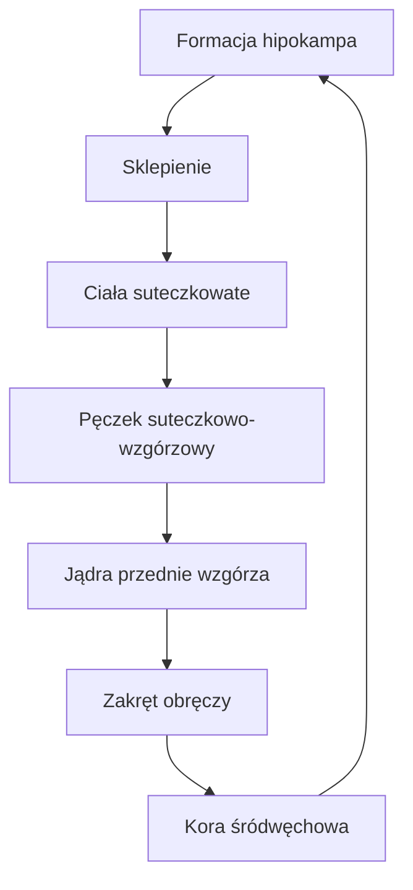
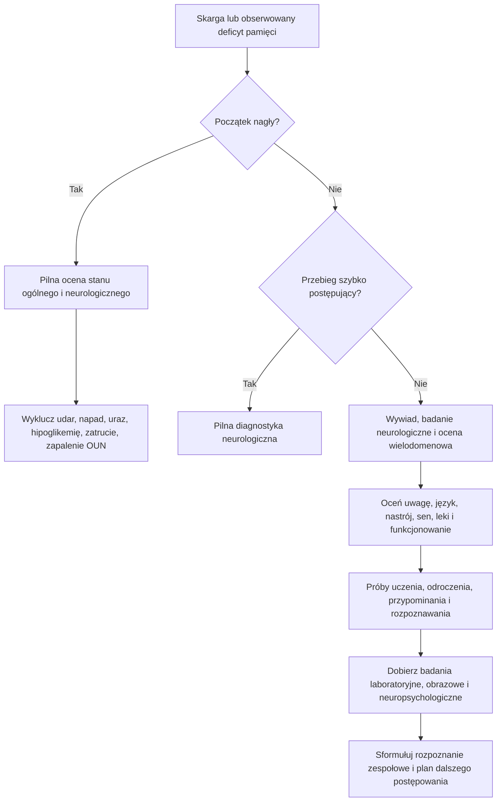
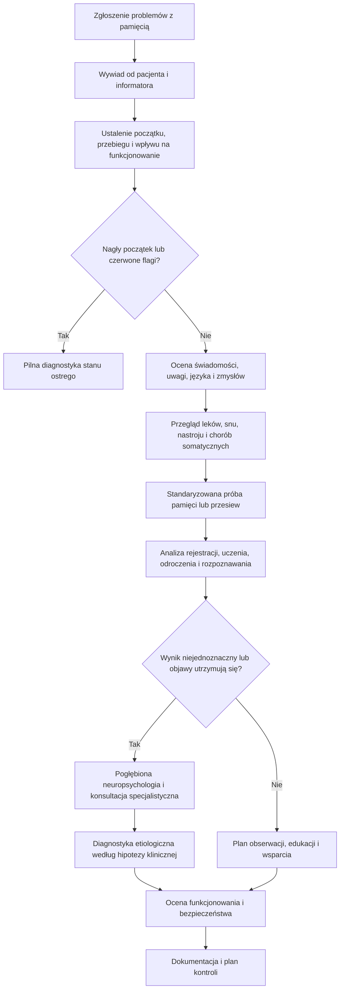

# 7.3. Pamięć

> **Moduł 7. Ocena funkcji poznawczych i psychicznych**  
> Materiał dydaktyczny do kursu badania neurologicznego. Opracowanie przeznaczone dla osób uczących się systematycznej oceny funkcji poznawczych; nie zastępuje szkolenia neuropsychologicznego, badania lekarskiego ani lokalnych procedur diagnostycznych.

## Cele kształcenia

Po ukończeniu rozdziału uczestnik powinien umieć:

1. Wyjaśnić, czym jest pamięć oraz odróżnić kodowanie, konsolidację, przechowywanie i wydobywanie informacji.
2. Rozróżnić pamięć bezpośrednią, krótkotrwałą, roboczą, świeżą, odległą, epizodyczną, semantyczną, proceduralną i prospektywną.
3. Opisać najważniejsze struktury mózgu uczestniczące w tworzeniu i odtwarzaniu wspomnień, ze szczególnym uwzględnieniem przyśrodkowej części płata skroniowego, hipokampa, struktur międzymózgowia, kory przedczołowej i połączeń istoty białej.
4. Przeprowadzić uporządkowaną, bezpieczną i możliwą do powtórzenia przyłóżkową ocenę pamięci.
5. Odróżnić trudność w rejestracji materiału od zaburzeń uczenia się, konsolidacji, przechowywania i wydobywania informacji.
6. Interpretować swobodne przypominanie, przypominanie z podpowiedzią i rozpoznawanie, nie traktując żadnego z tych wyników jako samodzielnego rozpoznania etiologicznego.
7. Uwzględnić wpływ uwagi, języka, słuchu, wzroku, nastroju, snu, bólu, leków, chorób somatycznych, wykształcenia i uwarunkowań kulturowych.
8. Rozpoznać objawy alarmowe wymagające pilnej diagnostyki, w tym nagłą amnezję, szybko postępujące zaburzenia pamięci, stan majaczeniowy i podejrzenie encefalopatii Wernickego.
9. Prawidłowo dokumentować wyniki, ograniczenia badania, źródła informacji i wpływ deficytu na samodzielność pacjenta.
10. Wskazać sytuacje, w których potrzebne jest pogłębione badanie neuropsychologiczne, konsultacja neurologiczna, psychiatryczna, geriatryczna lub pilna diagnostyka szpitalna.

---

## 1. Znaczenie kliniczne i definicje

### 1.1. Czym jest pamięć

Pamięć jest zespołem procesów umożliwiających nabywanie, utrwalanie, przechowywanie, aktualizowanie i wykorzystywanie informacji o doświadczeniach, faktach, umiejętnościach oraz zamiarach. Nie jest pojedynczą funkcją ani właściwością jednej struktury mózgu. Zależy od współdziałania rozproszonych sieci neuronalnych, sprawnego odbioru bodźców, uwagi, motywacji, stanu świadomości, języka i funkcji wykonawczych.

W badaniu klinicznym należy rozdzielić dwa pytania:

- **Czy pacjent potrafi nauczyć się i zachować nową informację?**
- **Czy potrafi odnaleźć, przywołać i wykorzystać informację, która została wcześniej zapisana?**

Odpowiedź na pierwsze pytanie dotyczy przede wszystkim rejestracji, uczenia się i konsolidacji. Odpowiedź na drugie obejmuje wydobywanie, wskazówki kontekstowe, rozpoznawanie oraz kontrolę źródła wspomnienia.

### 1.2. Etapy procesów pamięciowych

| Etap | Znaczenie | Przykładowa trudność kliniczna |
|---|---|---|
| Rejestracja i kodowanie | Przyjęcie bodźca, nadanie mu reprezentacji i powiązanie z kontekstem | Pacjent nie zapamiętuje polecenia, ponieważ nie usłyszał go lub nie skupił uwagi |
| Uczenie się | Zmiana skuteczności zapamiętywania w kolejnych ekspozycjach | Brak poprawy mimo powtarzania materiału |
| Konsolidacja | Stabilizowanie śladu pamięciowego po początkowym nabyciu | Informacja jest dostępna bezpośrednio po prezentacji, lecz szybko zanika |
| Przechowywanie | Utrzymywanie reprezentacji w czasie | Utrata wcześniej utrwalonych informacji |
| Wydobywanie | Dostęp do zapisanej informacji i jej odtworzenie | Trudność w swobodnym przypomnieniu przy lepszym rozpoznawaniu lub po podpowiedzi |
| Monitorowanie źródła | Ustalenie, skąd pochodzi informacja i czy dotyczy własnego doświadczenia | Mylenie zasłyszanej wiadomości z osobistym wspomnieniem |

Etapy te są użytecznym modelem klinicznym, ale w rzeczywistym funkcjonowaniu zachodzą na siebie. Słaby wynik odtwarzania nie dowodzi automatycznie uszkodzenia samego magazynu pamięciowego. Może wynikać z niewłaściwego kodowania, zaburzeń uwagi, trudności językowych, spowolnienia, lęku albo nieefektywnego wydobywania.

### 1.3. Pamięć bezpośrednia

Pojęcie pamięci bezpośredniej jest używane w różnych znaczeniach. W praktyce badania przyłóżkowego często odnosi się do krótkiego utrzymania informacji bezpośrednio po jej przedstawieniu, na przykład powtórzenia ciągu cyfr lub trzech słów. W części klasycznych opisów termin ten bywa utożsamiany z pamięcią natychmiastową albo krótkotrwałą.

Aby dokumentacja była jednoznaczna, należy podać konkretną czynność, a nie ograniczać się do określenia „pamięć bezpośrednia prawidłowa”. Przykłady:

- „Powtarza prawidłowo pięć cyfr w kolejności podanej”.
- „Natychmiast powtarza trzy z trzech słów”.
- „Nie odtwarza instrukcji dwuelementowej bez ponownego przedstawienia”.

Pamięć bezpośrednia nie jest równoznaczna z pamięcią epizodyczną. Poprawne natychmiastowe powtórzenie materiału nie przesądza o zdolności zapamiętania go po kilku minutach.

### 1.4. Pamięć krótkotrwała i pamięć robocza

**Pamięć krótkotrwała** oznacza ograniczone czasowo utrzymywanie niewielkiej ilości informacji. W zadaniach klinicznych może być oceniana przez natychmiastowe powtarzanie cyfr, słów lub krótkiej sekwencji.

**Pamięć robocza** obejmuje nie tylko przechowywanie, lecz także aktywne przetwarzanie informacji. Umożliwia na przykład odwrócenie kolejności cyfr, wykonanie obliczenia w pamięci, utrzymanie kilku elementów instrukcji i aktualizowanie ich w trakcie działania.

Wynik zadania pamięci roboczej zależy również od uwagi i funkcji wykonawczych. Nie należy interpretować błędów w odwracaniu ciągu cyfr jako czystego deficytu pamięciowego bez oceny rozumienia instrukcji, tempa przetwarzania i kontroli poznawczej.

### 1.5. Pamięć świeża i odległa

W praktyce klinicznej:

- **Pamięć świeża** odnosi się do zapamiętywania wydarzeń i informacji z niedawnego okresu. Obejmuje między innymi pamiętanie rozmowy sprzed kilkunastu minut, planu dnia lub informacji przekazanej podczas wizyty.
- **Pamięć odległa** dotyczy informacji i doświadczeń utrwalonych wcześniej, często wiele lat temu. Obejmuje wiedzę autobiograficzną, fakty historyczne i utrwaloną wiedzę semantyczną.

Granica między pamięcią świeżą i odległą nie jest sztywna. Wspomnienia autobiograficzne mogą zachowywać szczegółowy kontekst przez wiele lat, a wiedza semantyczna może być wielokrotnie aktualizowana. W badaniu należy zapytać o konkretny okres i rodzaj informacji.

### 1.6. Główne systemy pamięci

| System | Co obejmuje | Przykład badania lub obserwacji |
|---|---|---|
| Pamięć sensoryczna | Krótkotrwałe utrzymanie śladu bodźca zmysłowego | Krótka dostępność obrazu lub dźwięku po ustaniu bodźca |
| Pamięć robocza | Utrzymanie i manipulowanie informacją | Powtarzanie cyfr wspak, wykonywanie wieloetapowej instrukcji |
| Pamięć epizodyczna | Zdarzenia osadzone w czasie i kontekście | Zapamiętanie listy słów, przebiegu wizyty lub konkretnego wydarzenia |
| Pamięć semantyczna | Wiedza o faktach, pojęciach i znaczeniach | Nazywanie stolic, wyjaśnianie znaczenia pojęcia |
| Pamięć proceduralna | Wyuczone umiejętności i nawyki | Jazda na rowerze, wiązanie sznurowadeł, wyuczona sekwencja ruchowa |
| Torowanie (priming) | Ułatwienie przetwarzania bodźca po wcześniejszej ekspozycji | Szybsze rozpoznanie wcześniej widzianego materiału bez świadomego przypominania |
| Warunkowanie | Uczenie się związków między bodźcami i reakcjami | Reakcja fizjologiczna na wcześniej kojarzony bodziec |
| Pamięć prospektywna | Pamiętanie o wykonaniu zamiaru w przyszłości | Przyjęcie leku o określonej porze lub przekazanie wiadomości po zakończeniu zadania |
| Pamięć autobiograficzna | Wspomnienia własnego życia oraz wiedza o sobie | Opis ważnego wydarzenia z dzieciństwa i jego kontekstu |

Pamięć deklaratywna obejmuje przede wszystkim pamięć epizodyczną i semantyczną. Pamięć niedeklaratywna obejmuje między innymi uczenie proceduralne, torowanie i niektóre formy warunkowania. Podział ma znaczenie kliniczne, ponieważ różne choroby mogą uszkadzać poszczególne systemy w niejednakowym stopniu.

### 1.7. Amnezja – podstawowe pojęcia

- **Amnezja następcza (anterograde)** – trudność w tworzeniu nowych trwałych wspomnień po określonym zdarzeniu lub początku choroby.
- **Amnezja wsteczna (retrograde)** – utrata dostępu do wspomnień powstałych przed określonym zdarzeniem.
- **Amnezja okołourazowa** – zaburzenia pamięci związane z urazem mózgu, obejmujące okres przed urazem i/lub po nim.
- **Amnezja wybiórcza** – utrata określonego zakresu informacji lub wspomnień; wymaga starannej oceny kontekstu i mechanizmu.
- **Amnezja globalna** – znaczne zaburzenie zapamiętywania nowych informacji, często z towarzyszącą utratą części wspomnień wstecznych; określenie opisowe, które nie zastępuje ustalenia przyczyny.
- **Luka pamięciowa (amnesic gap)** – okres, z którego pacjent nie potrafi odtworzyć wydarzeń.

Nie wolno utożsamiać amnezji z utratą przytomności. Pacjent może pozostawać przytomny, prowadzić rozmowę i wykonywać wyuczone czynności, a jednocześnie nie tworzyć trwałych wspomnień dotyczących bieżących wydarzeń.

---

## 2. Podstawy neuroanatomiczne pamięci

### 2.1. Pamięć jako funkcja sieciowa

Pamięć nie ma jednego ośrodka. Poszczególne jej komponenty zależą od współpracy struktur przyśrodkowego płata skroniowego, międzymózgowia, kory przedczołowej, obszarów ciemieniowych, jąder podstawy, móżdżku i rozległych obszarów kory nowej.

Uszkodzenie określonego węzła sieci może powodować charakterystyczny profil zaburzeń, ale obraz kliniczny zależy od rozległości uszkodzenia, rezerwy poznawczej, wcześniejszego stanu funkcjonalnego i współistniejących chorób.

### 2.2. Przyśrodkowa część płata skroniowego

Najważniejsze struktury obejmują:

- hipokamp;
- zakręt zębaty;
- pola CA hipokampa;
- podporę (subiculum);
- korę śródwęchową;
- korę okołowęchową;
- korę przyhipokampową.

Struktury te uczestniczą w wiązaniu elementów doświadczenia w spójną reprezentację, uczeniu się nowych informacji epizodycznych oraz ich konsolidacji. Nie są prostym „magazynem wszystkich wspomnień”. Długotrwałe reprezentacje wiedzy są rozproszone w sieciach kory nowej.

**Hipokamp** odgrywa szczególnie ważną rolę w tworzeniu nowych wspomnień deklaratywnych, wiązaniu informacji o obiektach, miejscu i czasie oraz w nawigacji przestrzennej. Uszkodzenie obu hipokampów może prowadzić do ciężkiej amnezji następczej.

**Kora śródwęchowa** jest ważnym węzłem wejściowym i wyjściowym między korą asocjacyjną a formacją hipokampa. Jej uszkodzenie może zakłócać przepływ informacji niezbędny do tworzenia wspomnień.

**Kora okołowęchowa** uczestniczy w rozpoznawaniu obiektów i ich znajomości, a **kora przyhipokampowa** jest istotna dla reprezentacji kontekstu i przestrzeni. Funkcje tych struktur nakładają się i nie powinny być przedstawiane jako całkowicie rozdzielne moduły.

### 2.3. Obwód hipokampalny

Uproszczony schemat przepływu informacji w formacji hipokampa:

```text
Kora asocjacyjna
      |
      v
Kora śródwęchowa
      |
      v
Zakret zębaty
      |
      v
Pola CA3
      |
      v
Pola CA1
      |
      v
Podpora (subiculum)
      |
      v
Kora śródwęchowa i inne obszary korowe
```

Schemat jest uproszczeniem. W rzeczywistości występują połączenia zwrotne, równoległe drogi wejściowe i liczne modulacje. Wewnętrzne obwody hipokampa wspierają rozdzielanie podobnych wzorców, ich kojarzenie i odtwarzanie.

### 2.4. Struktury międzymózgowia

W pamięci deklaratywnej istotne znaczenie mają:

- ciała suteczkowate podwzgórza;
- pęczek suteczkowo-wzgórzowy;
- jądra przednie wzgórza;
- jądro przyśrodkowo-grzbietowe wzgórza;
- połączenia wzgórzowo-korowe;
- sklepienie mózgu (fornix), łączące hipokamp z innymi strukturami układu limbicznego.

Uszkodzenia struktur międzymózgowia mogą wywoływać zespół amnestyczny, czasem z dezorientacją, zaburzeniami uczenia się i konfabulacjami. Klasycznym kontekstem klinicznym jest zespół Korsakowa związany z niedoborem tiaminy, ale amnezję międzymózgowiową mogą powodować także inne uszkodzenia naczyniowe, zapalne lub nowotworowe.

### 2.5. Obwód Papeza

Klasyczny obwód Papeza jest historycznym i dydaktycznym modelem połączeń limbicznych:



Obwód Papeza pomaga zrozumieć, dlaczego uszkodzenie struktur skroniowych, podwzgórzowych lub wzgórzowych może prowadzić do zaburzeń pamięci. Nie jest jednak kompletnym opisem wszystkich sieci pamięciowych. Współczesna neurobiologia uwzględnia również połączenia z korą przedczołową, ciemieniową, wyspą, ciałem migdałowatym i strukturami podkorowymi.

### 2.6. Kora przedczołowa

Kora przedczołowa wspiera organizację, kontrolę i wydobywanie informacji:

- grzbietowo-boczna kora przedczołowa – organizowanie materiału, strategie uczenia się, pamięć robocza i kontrolowane wydobywanie;
- brzuszno-boczna kora przedczołowa – selekcja i kontrola wydobywanych informacji, dobór wskazówek;
- przyśrodkowa kora przedczołowa – samoodniesienie, organizacja wspomnień autobiograficznych i monitorowanie;
- okolica oczodołowo-czołowa – ocena znaczenia, kontekstu i wartości informacji oraz kontrola zachowania.

Uszkodzenie sieci czołowych może powodować słabe spontaniczne przypominanie, dezorganizację materiału, powtarzanie tych samych odpowiedzi, intruzje i trudności w monitorowaniu źródła wspomnienia. W części takich przypadków rozpoznawanie i przypominanie z podpowiedzią są relatywnie lepsze niż swobodne odtwarzanie.

### 2.7. Kora ciemieniowa i sieci rozproszone

Obszary ciemieniowe uczestniczą w kierowaniu uwagi na ślady pamięciowe, subiektywnym poczuciu przypominania, integracji informacji i pamięci przestrzennej. Uszkodzenia połączeń skroniowo-ciemieniowych mogą współwystępować z zaburzeniami językowymi, wzrokowo-przestrzennymi i pamięciowymi.

Pamięć autobiograficzna, semantyczna i epizodyczna angażuje rozległe sieci korowe. Wspomnienie jest odtwarzane poprzez ponowną aktywację części rozproszonych reprezentacji, a nie przez odczyt pojedynczego, niezmiennego zapisu.

### 2.8. Ciało migdałowate

Ciało migdałowate moduluje utrwalanie informacji o znaczeniu emocjonalnym, zwłaszcza związanych z zagrożeniem, nagrodą i pobudzeniem. Nie jest głównym ośrodkiem przechowywania wspomnień deklaratywnych. Wpływ emocji może wzmacniać niektóre aspekty pamięci, ale silne pobudzenie, stres lub trauma mogą także zakłócać dokładność odtwarzania szczegółów i kontekstu.

### 2.9. Jądra podstawy i móżdżek

Prążkowie i obwody korowo-prążkowiowo-wzgórzowo-korowe uczestniczą w uczeniu nawyków, sekwencji i zachowań opartych na wzmocnieniu. Móżdżek wspiera automatyzację i uczenie zależności czuciowo-ruchowych. Uszkodzenia tych struktur mogą zaburzać uczenie proceduralne, choć nie muszą powodować ciężkiej amnezji epizodycznej.

### 2.10. Znaczenie połączeń istoty białej

Sklepienie, obręcz, pęczki podłużne, połączenia czołowo-skroniowe i wzgórzowo-korowe umożliwiają współpracę odległych struktur. Rozlane uszkodzenie istoty białej, choroba małych naczyń, uraz aksonalny lub proces neurodegeneracyjny mogą powodować spowolnienie przetwarzania, trudności w wydobywaniu i zaburzenia pamięci roboczej.

### 2.11. Lokalizacja a wzorzec kliniczny

| Potencjalnie zajęta sieć | Możliwy wzorzec | Ważne zastrzeżenie |
|---|---|---|
| Obustronny hipokamp i przyśrodkowe płaty skroniowe | Ciężkie zaburzenia uczenia się nowych informacji epizodycznych | Obraz zależy od rozległości uszkodzenia |
| Struktury międzymózgowia | Zespół amnestyczny, zaburzenia uczenia się i orientacji | Konfabulacje nie są objawem obowiązkowym |
| Kora przedczołowa i połączenia czołowo-podkorowe | Słabe spontaniczne wydobywanie, dezorganizacja, intruzje | Należy ocenić także uwagę i funkcje wykonawcze |
| Sieci skroniowo-ciemieniowe | Zaburzenia semantyczne, językowe lub dostępu do wspomnień | Objawy mogą wynikać z afazji lub agnozji |
| Prążkowie i móżdżek | Trudności w uczeniu proceduralnym i automatyzacji | Nie oznaczają automatycznie zaburzeń pamięci deklaratywnej |
| Rozlane połączenia istoty białej | Spowolnienie, trudności z organizacją i wydobywaniem | Wzorzec bywa nieswoisty |

---

## 3. Podstawy neurofizjologiczne

### 3.1. Plastyczność synaptyczna

Uczenie się wiąże się ze zmianami skuteczności połączeń synaptycznych i organizacji sieci neuronalnych. Jednym z najlepiej poznanych mechanizmów jest długotrwałe wzmocnienie synaptyczne (LTP), w którym powtarzana lub odpowiednio zsynchronizowana aktywność może zwiększać skuteczność przekazywania sygnału.

Receptory glutaminianergiczne NMDA i AMPA uczestniczą w indukcji i ekspresji części mechanizmów LTP. Wapń pełni rolę ważnego sygnału wewnątrzkomórkowego, aktywującego kaskady prowadzące do zmian funkcjonalnych, a w dłuższej perspektywie także strukturalnych. LTP nie jest jednak jedynym mechanizmem pamięci i nie należy utożsamiać jej z pojedynczym wspomnieniem.

### 3.2. Kodowanie informacji

Kodowanie zależy od:

- selekcji bodźców przez uwagę;
- nadania znaczenia i organizacji materiału;
- powiązania nowej informacji z wcześniejszą wiedzą;
- kontekstu przestrzennego, czasowego i emocjonalnego;
- powtarzania i aktywnego opracowania materiału.

Informacja usłyszana, ale niepoddana wystarczającej uwadze, może nie zostać skutecznie zakodowana. Dlatego przed rozpoznaniem zaburzenia utrwalania należy sprawdzić, czy pacjent prawidłowo usłyszał, zrozumiał i zarejestrował materiał.

### 3.3. Konsolidacja i utrwalanie

Konsolidacja obejmuje procesy stabilizujące ślad pamięciowy po początkowym uczeniu się. Wyróżnia się między innymi:

- konsolidację synaptyczną – zmiany zachodzące w stosunkowo krótkim czasie w obrębie aktywnych sieci;
- konsolidację systemową – reorganizację zależności między hipokampem i korą w dłuższej perspektywie;
- ponowne utrwalanie (rekonsolidację) – modyfikację śladu po jego reaktywacji.

Nie wszystkie wspomnienia usamodzielniają się od hipokampa w jednakowy sposób. Szczegółowe, żywe wspomnienia autobiograficzne mogą nadal angażować układ hipokampalny także po długim czasie.

### 3.4. Rola snu

Sen, w tym sen wolnofalowy i faza REM, uczestniczy w procesach konsolidacji i reorganizacji pamięci. Niewyspanie, bezdech senny, zaburzenia rytmu dobowego, praca zmianowa i częste wybudzenia mogą pogarszać uwagę, uczenie się i późniejsze odtwarzanie.

W wywiadzie należy pytać nie tylko o liczbę godzin snu, lecz również o jego jakość, chrapanie, bezdechy obserwowane przez bliskich, senność dzienną, częste wybudzenia i stosowanie leków nasennych.

### 3.5. Wydobywanie i wskazówki

Wydobywanie może być spontaniczne lub wspomagane wskazówkami. W badaniu przyłóżkowym porównanie swobodnego przypominania, przypominania z podpowiedzią i rozpoznawania pomaga opisać profil trudności:

- słabe swobodne przypominanie przy wyraźnej poprawie po wskazówce może sugerować problem z organizacją lub wydobywaniem;
- słabe swobodne przypominanie i słabe rozpoznawanie mogą wskazywać na trudność w nabyciu lub utrzymaniu śladu;
- liczne fałszywe rozpoznania mogą świadczyć o zaburzeniu monitorowania odpowiedzi, kryterium rozpoznawania lub jakości śladu.

Żaden z tych wzorców nie jest swoisty dla jednej choroby. Wymaga interpretacji z uwzględnieniem rodzaju materiału, czasu odroczenia, poziomu trudności i norm dla populacji.

### 3.6. Emocje i stres

Pobudzenie emocjonalne wpływa na uwagę i utrwalanie. Umiarkowane pobudzenie może zwiększać zapamiętywanie informacji istotnych, natomiast silny lęk, ból, stres pourazowy i depresja mogą pogarszać koncentrację, tempo przetwarzania i swobodne wydobywanie.

Nie należy automatycznie przypisywać skarg pamięciowych zaburzeniom emocjonalnym. Objawy psychiczne i neurologiczne mogą współistnieć, a depresja może być zarówno czynnikiem pogarszającym funkcje poznawcze, jak i objawem towarzyszącym chorobie neurologicznej.

---

## 4. Obraz kliniczny zaburzeń pamięci

### 4.1. Typowe skargi pacjentów

Pacjenci mogą zgłaszać:

- zapominanie rozmów i ustaleń;
- wielokrotne zadawanie tych samych pytań;
- gubienie przedmiotów;
- trudność w przypomnieniu sobie nazw, terminów i imion;
- zapominanie o przyjęciu leku lub umówionej wizycie;
- trudność w odtworzeniu niedawnych wydarzeń;
- gubienie wątku podczas rozmowy;
- problemy z orientacją w znanym otoczeniu;
- konieczność częstego korzystania z notatek i przypomnień;
- trudność w uczeniu się nowych procedur lub obsługi urządzeń.

Sama skarga „mam słabą pamięć” nie określa mechanizmu. Należy dopytać o przykład, częstotliwość, początek, przebieg, konsekwencje i potwierdzenie przez osoby bliskie.

### 4.2. Pytania ukierunkowujące wywiad

1. Kiedy po raz pierwszy zauważono zmianę?
2. Czy początek był nagły, podostry czy stopniowy?
3. Czy trudności narastają, pozostają stabilne, czy występują napadowo?
4. Czy pacjent zapomina całe wydarzenie, czy jedynie szczegół?
5. Czy po przypomnieniu lub podpowiedzi odzyskuje informację?
6. Czy powtarza pytania, mimo że otrzymał odpowiedź?
7. Czy trudności dotyczą głównie nowych informacji, czy również dawnych wspomnień?
8. Czy pacjent gubi się w znanych miejscach?
9. Czy popełnia błędy w przyjmowaniu leków, płaceniu rachunków lub przygotowywaniu posiłków?
10. Czy występują zaburzenia uwagi, języka, nastroju, snu, słuchu lub wzroku?
11. Czy nastąpiła zmiana leków, dawki, używek albo stanu somatycznego?
12. Czy wystąpił uraz głowy, napad, omdlenie, infekcja lub objawy ogniskowe?

### 4.3. Informacja od osoby bliskiej

W przypadku podejrzenia postępujących zaburzeń pamięci należy, za zgodą pacjenta i z poszanowaniem jego prywatności, uzyskać informacje od osoby dobrze znającej jego codzienne funkcjonowanie.

Warto zapytać o:

- różnicę względem wcześniejszego poziomu;
- pierwsze zauważone zmiany;
- przykłady powtarzania pytań;
- błędy w lekach, finansach i organizacji dnia;
- zagubienia, wypadki i sytuacje ryzykowne;
- zachowane umiejętności;
- tempo zmian i zmienność w ciągu dnia.

Informator nie powinien zastępować pacjenta w każdej odpowiedzi. Należy odróżnić jego obserwacje od własnej relacji badanego i od wyników testu.

---

## 5. Przygotowanie do badania pamięci

### 5.1. Warunki badania

Przed rozpoczęciem:

1. Potwierdź tożsamość pacjenta i cel badania.
2. Wyjaśnij, że próby służą ocenie funkcjonowania, a nie egzaminowaniu ani ocenianiu wartości osoby.
3. Uzyskaj zgodę i sprawdź gotowość do współpracy.
4. Zapewnij spokojne pomieszczenie, ogranicz hałas i przerwania.
5. Sprawdź, czy pacjent używa okularów i aparatów słuchowych.
6. Oceń ból, zmęczenie, senność, głód, pragnienie i potrzebę skorzystania z toalety.
7. Ustal język badania, poziom biegłości językowej i ewentualną potrzebę tłumacza.
8. Zbierz informacje o wykształceniu, zawodzie, kulturze i wcześniejszych trudnościach w uczeniu się.
9. Sprawdź aktualne leki, używki i stan somatyczny.
10. Ustal, czy pacjent nie znajduje się w stanie ostrego majaczenia lub innego zaburzenia świadomości.

### 5.2. Czynniki zakłócające

| Czynnik | Możliwy wpływ | Postępowanie |
|---|---|---|
| Niedosłuch | Niepełna rejestracja materiału słownego | Sprawdź aparat słuchowy, mów wyraźnie, ogranicz hałas |
| Zaburzenia widzenia | Gorsze wykonanie zadań wzrokowych | Zadbaj o okulary i odpowiedni kontrast |
| Afazja | Trudności w rozumieniu lub nazywaniu | Dobierz zadania niewerbalne i oceń język osobno |
| Nieznajomość języka | Pozornie słabe zapamiętywanie materiału werbalnego | Użyj zwalidowanej wersji językowej i tłumacza |
| Niski poziom edukacji lub odmienna edukacja | Niewłaściwa interpretacja wyniku surowego | Korzystaj z odpowiednich norm |
| Ból, duszność, gorączka | Rozproszenie i zmęczenie | Najpierw stabilizuj stan ogólny |
| Depresja i lęk | Spowolnienie, obniżona inicjacja, obawy przed błędem | Oceń nastrój i kontekst, nie zakładaj jednej etiologii |
| Bezsenność i bezdech senny | Spadek czujności i utrwalania | Zbierz wywiad dotyczący snu |
| Leki sedatywne i antycholinergiczne | Pogorszenie uwagi i zapamiętywania | Dokonaj przeglądu farmakoterapii |
| Majaczenie | Zmienność uwagi i świadomości | Pilnie oceń przyczynę; nie interpretuj wyniku jako stabilnego profilu pamięci |
| Alkohol i inne substancje | Zaburzenia kodowania, konsolidacji i odtwarzania | Ustal czas ekspozycji i możliwe zatrucie lub odstawienie |
| Zmęczenie | Pogorszenie wyników w kolejnych próbach | Zaplanuj przerwy i odnotuj warunki |

### 5.3. Zasady standaryzacji

- Stosuj tę samą instrukcję i kolejność prób, jeżeli korzystasz ze standaryzowanego narzędzia.
- Nie podpowiadaj odpowiedzi, chyba że dana procedura przewiduje określony rodzaj wskazówki.
- Zapisuj odpowiedzi dosłownie, zwłaszcza intruzje, powtórzenia i fałszywe rozpoznania.
- Oddziel wynik surowy od interpretacji klinicznej.
- Zapisz czas odroczenia między uczeniem się a odtwarzaniem.
- Nie zmieniaj materiału testowego w trakcie standaryzowanego badania.
- Nie używaj wielokrotnie tej samej listy słów w krótkich odstępach, jeśli istnieje ryzyko efektu wprawy.
- Korzystaj z aktualnej, uprawnionej i odpowiednio znormalizowanej wersji narzędzia.

**Ważne:** przykładowe zadania opisane w tym rozdziale służą nauce zasad badania. Nie stanowią samodzielnego, znormalizowanego testu i nie zastępują chronionych materiałów testowych, podręczników, licencji ani szkolenia.

---

## 6. Metodyka badania pamięci – procedura krok po kroku

### 6.1. Etap pierwszy: ocena warunków wstępnych

1. Oceń czuwanie, kontakt i zdolność rozumienia instrukcji.
2. Sprawdź orientację, ale nie utożsamiaj jej z pamięcią.
3. Oceń słuch, wzrok, mowę i zdolność nazywania.
4. Ustal, czy pacjent rozumie język, w którym prowadzone jest badanie.
5. Zwróć uwagę na ból, zmęczenie, lęk i rozproszenie.
6. W przypadku ostrej zmiany świadomości lub uwagi przerwij rutynową ocenę pamięci i przejdź do diagnostyki stanu ostrego.

### 6.2. Etap drugi: rejestracja materiału

Można wykorzystać krótką, neutralną instrukcję i niewielki zestaw słów dobrany do celu badania. W badaniu standaryzowanym należy używać wyłącznie materiału i instrukcji określonych w podręczniku danego narzędzia.

Po przedstawieniu materiału:

1. Poproś o natychmiastowe powtórzenie.
2. Zapisz liczbę prawidłowych elementów i kolejność, jeżeli jest istotna.
3. Odnotuj pominięcia, zamiany, perseweracje i intruzje.
4. Sprawdź, czy pacjent nie miał trudności ze słyszeniem lub rozumieniem.
5. Nie przechodź do interpretacji długotrwałej pamięci, jeśli rejestracja była niepełna.

Przykładowy opis: „Po jednokrotnej prezentacji natychmiast odtwarza trzy z czterech elementów; dwa elementy powtarza poprawnie po ponownej prezentacji. Występuje rozproszenie uwagi podczas instrukcji”.

### 6.3. Etap trzeci: uczenie się

W odpowiednio dobranej procedurze można przedstawić ten sam materiał w kilku próbach. Należy obserwować:

- przyrost liczby prawidłowo odtworzonych elementów;
- stabilność odpowiedzi;
- wpływ powtórzeń;
- stosowanie strategii grupowania;
- kolejność odtwarzania;
- liczbę intruzji i powtórzeń;
- podatność na dystraktory.

**Krzywa uczenia się** opisuje zmianę wyniku w kolejnych próbach. Prawidłowa krzywa nie musi być liniowa. Jej interpretacja wymaga norm dla danego testu, wieku i grupy odniesienia.

Brak przyrostu może wynikać z nieefektywnego kodowania, deficytu uwagi, zaburzeń językowych, niewłaściwej strategii lub zaburzenia pamięci. Nie stanowi samodzielnego dowodu określonej choroby.

### 6.4. Etap czwarty: odroczenie

Po zakończeniu uczenia się należy odczekać czas określony w procedurze. W okresie odroczenia można wykonywać inne zadania, aby ograniczyć mechaniczne powtarzanie materiału.

Należy zapisać:

- dokładny czas odroczenia;
- rodzaj aktywności w czasie odroczenia;
- ewentualne przerwy;
- wystąpienie zmęczenia lub zmian stanu pacjenta.

Nie wolno porównywać wyników uzyskanych po różnych czasach odroczenia tak, jakby były równoważne.

### 6.5. Etap piąty: swobodne przypominanie

Poproś pacjenta o odtworzenie materiału bez podpowiedzi.

Zapisz:

- liczbę prawidłowych elementów;
- kolejność;
- intruzje;
- powtórzenia;
- odpowiedzi niepewne;
- czas rozpoczęcia i ewentualne przerwy;
- spontaniczne strategie wydobywania.

Nie poprawiaj pacjenta w trakcie próby. Zachowaj neutralną postawę, aby nie sugerować odpowiedzi.

### 6.6. Etap szósty: przypominanie z podpowiedzią

Jeżeli procedura przewiduje podpowiedzi, można zastosować wskazówki semantyczne lub kontekstowe.

Przykładowo, jeśli materiał obejmował kilka kategorii, można podać kategorię jednego z elementów. Należy jednak odróżnić podpowiedź dopuszczoną przez test od spontanicznego naprowadzania, które zmienia warunki badania.

Zapisz:
- które elementy zostały odzyskane po wskazówce;
- rodzaj użytej wskazówki;
- liczbę błędów i intruzji;
- czy poprawa była wyraźna, częściowa czy żadna.

### 6.7. Etap siódmy: rozpoznawanie

W próbie rozpoznawania pacjent wskazuje, czy dany bodziec był wcześniej przedstawiony. Materiał może zawierać elementy docelowe i dystraktory.

Należy ocenić:
- trafne rozpoznania;
- pominięcia;
- fałszywie dodatnie rozpoznania;
- pewność odpowiedzi, jeżeli procedura to przewiduje;
- tendencję do odpowiadania „tak” lub „nie”.

Wysoki wynik rozpoznawania przy słabym swobodnym przypominaniu może wskazywać na większy udział trudności wydobywania. Liczne fałszywe rozpoznania mogą wynikać z osłabienia śladu, zaburzeń monitorowania źródła lub nieadekwatnej strategii odpowiedzi.

### 6.8. Etap ósmy: pamięć wzrokowa

Pamięć wzrokową można oceniać poprzez:

- zapamiętywanie figur i układów przestrzennych;
- odtwarzanie złożonego materiału po odroczeniu;
- rozpoznawanie wcześniej widzianych obrazów;
- pamiętanie lokalizacji przedmiotów;
- uczenie się tras i układów przestrzennych.

Należy odróżnić zaburzenie pamięci wzrokowej od problemów z percepcją, konstrukcją, praksją, polem widzenia i funkcjami wzrokowo-przestrzennymi.

### 6.9. Etap dziewiąty: pamięć autobiograficzna i semantyczna

Pamięć autobiograficzną ocenia się przez pytania o wydarzenia z życia pacjenta. Należy unikać pytań sugerujących i nie wymagać ujawniania informacji wrażliwych, jeżeli nie są potrzebne klinicznie.

Przykładowe obszary:
- przebieg edukacji i pracy;
- ważne wydarzenia rodzinne;
- istotne zmiany życiowe;
- ostatnie wydarzenia i ich chronologia;
- wiedza o własnej historii.

Pamięć semantyczną można oceniać przez nazywanie, wyjaśnianie pojęć i przywoływanie wiedzy ogólnej. Błędy mogą wynikać z zaburzeń językowych, edukacyjnych lub kulturowych, a nie wyłącznie z zaburzenia pamięci.

### 6.10. Etap dziesiąty: pamięć prospektywna

Pamięć prospektywna dotyczy realizowania zamiarów w przyszłości. W codziennym życiu obejmuje przyjęcie leku, wykonanie telefonu, zabranie dokumentu lub przekazanie wiadomości.

Można zapytać o typowe sytuacje, w których pacjent zapomina wykonać zaplanowaną czynność. W badaniu specjalistycznym stosuje się standaryzowane próby pamięci prospektywnej. Nie należy tworzyć niebezpiecznych zadań polegających na celowym opóźnianiu koniecznych czynności medycznych.

### 6.11. Etap jedenasty: monitorowanie źródła i konfabulacje

Należy zwrócić uwagę, czy pacjent odróżnia:
- własne doświadczenie od informacji zasłyszanej;
- zdarzenie rzeczywiste od wyobrażonego;
- wydarzenie obecne od dawnego;
- pewne wspomnienie od przypuszczenia.

**Konfabulacja** to niezamierzone wytwarzanie fałszywych lub zniekształconych relacji, często w celu wypełnienia luk pamięciowych. Nie jest tym samym co świadome kłamstwo. Może występować w zespole Korsakowa i niektórych zaburzeniach czołowych, ale nie jest objawem koniecznym ani swoistym.

### 6.12. Etap dwunasty: odniesienie do funkcjonowania

Na końcu należy powiązać wyniki z realnym życiem:

- Czy pacjent pamięta o lekach?
- Czy samodzielnie przygotowuje posiłki?
- Czy potrafi zaplanować i odbyć podróż?
- Czy pamięta o terminach i zobowiązaniach?
- Czy bezpiecznie korzysta z urządzeń?
- Czy potrzebuje pomocy w finansach?
- Czy potrafi przekazać ważne informacje opiekunowi?
- Czy rozpoznaje zagrożenia i reaguje na nie?

Ocenę funkcjonalną należy prowadzić z poszanowaniem autonomii pacjenta. Celem nie jest automatyczne odbieranie samodzielności, lecz ustalenie konkretnych potrzeb i możliwych zabezpieczeń.

---

## 7. Interpretacja wzorców pamięci

### 7.1. Dlaczego sam wynik przypominania nie wystarcza

Niski wynik swobodnego przypominania może mieć wiele przyczyn. W celu zrozumienia mechanizmu należy zestawić:

1. jakość rejestracji;
2. krzywą uczenia się;
3. wynik po odroczeniu;
4. korzyść z podpowiedzi;
5. rozpoznawanie;
6. liczbę intruzji i fałszywych rozpoznań;
7. uwagę i funkcje wykonawcze;
8. język i sprawność sensoryczną;
9. funkcjonowanie w codziennym życiu.

### 7.2. Przykładowe wzorce

| Wzorzec | Możliwa interpretacja | Co należy sprawdzić |
|---|---|---|
| Słaba rejestracja od początku | Niedostateczna uwaga, niedosłuch, niezrozumienie lub cięższy deficyt poznawczy | Słuch, język, czuwanie, instrukcję |
| Mały przyrost w kolejnych próbach | Trudność uczenia się, organizacji lub uwagi | Strategię, powtarzalność, dystraktory |
| Dobre uczenie, duży spadek po odroczeniu | Możliwy problem utrzymania śladu lub konsolidacji | Czas odroczenia, interferencję, stan kliniczny |
| Słabe przypominanie swobodne, poprawa po wskazówce | Możliwy problem wydobywania lub organizacji | Pamięć roboczą, funkcje wykonawcze, typ wskazówki |
| Słabe przypominanie i słabe rozpoznawanie | Możliwy deficyt uczenia się lub przechowywania | Fałszywe rozpoznania, uwagę, język, normy |
| Liczne intruzje i powtórzenia | Zaburzenia kontroli wydobywania lub monitorowania | Funkcje wykonawcze, hamowanie, stan psychiczny |
| Zachowana pamięć proceduralna przy ciężkiej amnezji epizodycznej | Rozdzielenie systemów pamięci | Kontekst neurologiczny i funkcjonalny |
| Gorsze wyniki tylko w materiale werbalnym | Możliwy wpływ języka, słuchu lub dominującej sieci językowej | Afazję, słuch, edukację i zadania wzrokowe |

To tabela orientacyjna, a nie algorytm rozpoznawania chorób. Wzorce nakładają się i mogą być modyfikowane przez wiele współistniejących czynników.

### 7.3. Pamięć a uwaga

Pacjent, który nie utrzymuje uwagi na zadaniu, może nie zakodować materiału. Wówczas późniejszy brak przypominania nie jest dowodem pierwotnego zaburzenia pamięci długotrwałej.

Należy porównać:
- prostą rejestrację;
- zadania uwagowe;
- powtarzanie materiału;
- uczenie się po upewnieniu się, że instrukcja została zrozumiana.

Jeżeli uwaga jest znacznie zmienna, wynik badania pamięci może być niestabilny i nie powinien być interpretowany jako wiarygodny profil neuropsychologiczny.

### 7.4. Pamięć a język

W badaniu werbalnym konieczne jest rozróżnienie:
- niepamiętania słowa;
- trudności w jego wydobyciu językowym;
- niezrozumienia znaczenia;
- zaburzeń słuchowego rozpoznawania;
- błędów fonologicznych;
- nieznajomości danego słownictwa.

W razie podejrzenia afazji należy ocenić rozumienie, nazywanie, powtarzanie i płynność mowy oraz uwzględnić materiał niewerbalny.

### 7.5. Pamięć a funkcje wykonawcze

Pacjent z zaburzeniami czołowymi może mieć trudności z samodzielnym uporządkowaniem materiału, inicjowaniem wydobywania i kontrolą błędów. Po podpowiedzi może przypomnieć sobie więcej, lecz nadal mieć problemy z planowaniem, monitorowaniem i zastosowaniem informacji.

Należy ocenić:
- organizację uczenia się;
- spontaniczne grupowanie materiału;
- powtarzanie tych samych odpowiedzi;
- intruzje;
- przełączanie strategii;
- monitorowanie poprawności.

### 7.6. Pamięć a nastrój

Depresja, lęk, przewlekły stres i apatia mogą wpływać na szybkość, motywację i skuteczność uczenia się. Nie należy jednak stosować uproszczonego określenia „otępienie rzekome” jako wyjaśnienia każdej skargi pamięciowej u osoby z obniżonym nastrojem.

Ocena powinna uwzględniać:
- początek i przebieg objawów;
- subiektywne poczucie deficytu;
- obserwację opiekuna;
- wynik obiektywnych prób;
- nastrój, sen i funkcjonowanie;
- współistniejące choroby neurologiczne i somatyczne.

### 7.7. Pamięć a wiek

Wraz z wiekiem mogą występować:
- wolniejsze uczenie się nowego materiału;
- dłuższy czas wydobywania słów i nazw;
- większa zależność od wskazówek;
- trudności z podzielnością uwagi;
- większa podatność na zakłócenia.

Nie należy uznawać za prawidłowe każdej zmiany przypisywanej wiekowi. Istotne są progresja, wpływ na samodzielność, powtarzanie pytań, zagubienia, błędy w codziennych czynnościach i obiektywne pogorszenie względem wcześniejszego poziomu.

---

## 8. Narzędzia oceny pamięci

### 8.1. Badanie przyłóżkowe a neuropsychologiczne

Badanie przyłóżkowe ma na celu szybkie wykrycie i opisanie nieprawidłowości. Pełna diagnoza neuropsychologiczna wymaga szerszej baterii testów, standaryzowanych procedur, norm i interpretacji profilu wyników.

Nie należy traktować krótkiej próby trzech słów jako równoważnej pełnemu badaniu pamięci epizodycznej.

### 8.2. Przykładowe narzędzia

| Narzędzie | Główny zakres | Zastosowanie i ograniczenia |
|---|---|---|
| MoCA | Wielodomenowy przesiew poznawczy, w tym uczenie i odtwarzanie słów | Nie jest pełnym badaniem pamięci; wynik zależy od wieku, edukacji, języka i warunków |
| MMSE | Orientacja, rejestracja, uwaga, odtwarzanie i inne funkcje | Może nie wykrywać subtelnych zaburzeń; nie zastępuje badania neuropsychologicznego |
| Mini-Cog | Krótka próba przypominania i rysowania zegara | Narzędzie przesiewowe, a nie test etiologiczny |
| Memory Impairment Screen | Krótka ocena pamięci słownej z elementami wskazówek | Wymaga stosowania zwalidowanej wersji i odpowiedniej procedury |
| RAVLT / AVLT | Uczenie się listy słów, przypominanie, interferencja i rozpoznawanie | Test neuropsychologiczny; materiał i normy zależą od wersji |
| HVLT-R | Uczenie się i pamięć werbalna | Istnieje polska adaptacja i opracowanie norm dla seniorów; należy stosować właściwe materiały |
| WMS | Wieloaspektowa ocena pamięci i uczenia się | Wymaga kwalifikacji, odpowiedniej wersji i norm |
| RBANS | Krótka bateria obejmująca między innymi pamięć bezpośrednią i odroczoną | Wynik zależy od wersji i profilu populacji |
| CERAD | Zestaw prób stosowany w ocenie zaburzeń poznawczych i otępień | Należy stosować właściwą wersję i procedurę |
| BVMT-R | Pamięć wzrokowa i uczenie się materiału niewerbalnego | Wymaga odróżnienia pamięci od percepcji i konstrukcji |
| Rivermead Behavioural Memory Test | Pamięć w zadaniach zbliżonych do codziennych sytuacji | Przydatny do oceny funkcjonalnych konsekwencji, zależny od wersji |
| TOMAL-2 | Wieloaspektowa ocena pamięci i uczenia się | Zakres wieku i normy zależą od wydania oraz adaptacji |

### 8.3. Zasady doboru narzędzia

Dobór powinien uwzględniać:

- pytanie kliniczne;
- wiek pacjenta;
- język i kulturę;
- poziom edukacji;
- dominujący rodzaj skargi;
- podejrzenie zaburzeń słuchu, wzroku, języka lub ruchu;
- dostępność polskiej adaptacji;
- aktualność norm;
- kompetencje osoby badającej;
- licencję i prawa do materiałów.

**Nie należy przepisywać, publikować ani odtwarzać chronionych arkuszy, list słów, plansz lub kluczy testowych bez odpowiedniej licencji.** W materiałach dydaktycznych można opisać konstrukcję i cel narzędzia, ale nie wolno zastępować oryginalnych materiałów niezwalidowanymi kopiami.

### 8.4. MoCA i MMSE – ostrożność interpretacyjna

MoCA i MMSE są narzędziami przesiewowymi oceniającymi wiele domen poznawczych. Nie mierzą wyłącznie pamięci. Różnice w wyniku mogą wynikać z uwagi, języka, funkcji wykonawczych, wzrokowo-przestrzennych i edukacji.

W Polsce dostępne są adaptacje językowe MoCA, w tym wersja 7.2. Badania nad równoważnością polskich wersji wskazywały na wysoką korelację wyników w badanej próbie, ale nie oznacza to, że można dowolnie zmieniać wersje, mieszać normy lub samodzielnie tworzyć arkusze.

### 8.5. Testy werbalnego uczenia się

RAVLT i HVLT-R pozwalają analizować nie tylko końcową liczbę zapamiętanych słów, ale również przebieg uczenia, odporność na interferencję, przypominanie po odroczeniu i rozpoznawanie. Wyniki powinny być interpretowane według podręcznika właściwej wersji.

W polskiej literaturze opisano adaptację HVLT i normy dla osób starszych. Należy korzystać z publikacji i materiałów źródłowych, a nie przenosić bezpośrednio norm zagranicznych na polskiego pacjenta.

### 8.6. Kiedy kierować na badanie neuropsychologiczne

Pogłębione badanie jest szczególnie przydatne, gdy:

- skargi pacjenta lub rodziny są wyraźne, a przesiew jest prawidłowy;
- wynik przesiewu jest niejednoznaczny;
- występują zaburzenia wielu domen;
- trzeba odróżnić zaburzenie pamięci od zaburzeń uwagi, języka lub funkcji wykonawczych;
- pacjent jest młodszy i podejrzewa się nietypowy profil zaburzeń;
- istnieje potrzeba określenia profilu przed rehabilitacją lub monitorowaniem;
- rozpoznanie ma istotne konsekwencje zawodowe, prawne lub dotyczące samodzielności;
- wyniki są niezgodne z codziennym funkcjonowaniem.

---

## 9. Diagnostyka różnicowa zaburzeń pamięci

### 9.1. Prawidłowe starzenie się

Pojedyncze zapomnienie, wolniejsze przypominanie nazw lub potrzeba większej liczby powtórzeń nie muszą oznaczać choroby. W prawidłowym starzeniu zwykle zachowana jest zdolność uczenia się i samodzielnego funkcjonowania, choć tempo może być wolniejsze.

Za bardziej niepokojące uznaje się:
- narastające powtarzanie pytań;
- gubienie się w znanych miejscach;
- utratę samodzielności w złożonych czynnościach;
- błędy w lekach i finansach;
- wyraźne pogorszenie względem wcześniejszego poziomu.

### 9.2. Subiektywne pogorszenie funkcji poznawczych

Osoba zgłasza pogorszenie pamięci, ale w badaniu nie stwierdza się jednoznacznego obiektywnego deficytu. Taki stan wymaga obserwacji i oceny czynników wpływających na poznanie. Nie wolno ani bagatelizować skargi, ani automatycznie rozpoznawać choroby neurodegeneracyjnej.

### 9.3. Łagodne zaburzenia poznawcze

Łagodne zaburzenia poznawcze (MCI) oznaczają obiektywnie stwierdzony spadek funkcji poznawczych względem wcześniejszego poziomu, przy względnie zachowanej samodzielności w podstawowych czynnościach życia codziennego. Osoba może potrzebować większego wysiłku, strategii kompensacyjnych lub pomocy w bardziej złożonych zadaniach.

MCI nie jest równoznaczne z otępieniem i nie u każdej osoby prowadzi do jego rozwoju. Konieczna jest ocena przyczyn, profilu deficytów i zmian w czasie.

### 9.4. Otępienie / duże zaburzenie neurokognitywne

O rozpoznaniu decyduje nie tylko wynik testu, lecz także pogorszenie względem wcześniejszego poziomu i wpływ zaburzeń poznawczych lub behawioralnych na niezależność w codziennym funkcjonowaniu. Pamięć może być domeną dominującą, ale nie jest jedyną możliwą domeną początkowo zajętą.

### 9.5. Choroba Alzheimera

Typowy obraz amnestyczny obejmuje stopniowe pogarszanie uczenia się i zapamiętywania nowych informacji, z trudnością odtwarzania niedawnych wydarzeń i powtarzaniem pytań. W miarę postępu mogą dołączać zaburzenia języka, orientacji, funkcji wykonawczych i wzrokowo-przestrzennych.

Wczesny obraz nie zawsze jest amnestyczny. Możliwe są prezentacje językowe, wzrokowo-przestrzenne lub wykonawcze. Rozpoznanie wymaga całościowej oceny klinicznej, a w wybranych sytuacjach badań biomarkerowych zgodnie z aktualnymi wytycznymi i dostępnością.

### 9.6. Otępienie naczyniopochodne i zaburzenia poznawcze związane z chorobą naczyń

Mogą występować zaburzenia uwagi, szybkości przetwarzania, funkcji wykonawczych i pamięci. Przebieg może być skokowy, związany z udarami, albo stopniowy w chorobie małych naczyń. Nie należy zakładać, że każde zaburzenie pamięci u osoby z czynnikami naczyniowymi jest wyłącznie naczyniowe; patologie mieszane są częste.

### 9.7. Otępienie z ciałami Lewy'ego i choroba Parkinsona

Zaburzenia uwagi, funkcji wykonawczych i wzrokowo-przestrzennych mogą być bardziej widoczne niż klasyczny deficyt pamięci epizodycznej. W wywiadzie należy pytać o fluktuacje poznawcze, omamy wzrokowe, zaburzenia zachowania w fazie REM, parkinsonizm i reakcje na leki.

### 9.8. Otępienie czołowo-skroniowe

W części wariantów początkowo dominują zmiany zachowania, osobowości, empatii, kontroli impulsów lub języka. Wynik prób pamięciowych może być względnie lepszy niż w typowym amnestycznym obrazie choroby Alzheimera, ale nie jest to reguła bez wyjątków.

### 9.9. Depresja i zaburzenia lękowe

Mogą powodować subiektywne skargi, spowolnienie, obniżenie inicjacji i trudności w koncentracji. Wymagają oceny nastroju, snu, apetytu, energii, anhedonii i funkcjonowania. Nie wolno zakładać, że obecność depresji wyklucza chorobę neurologiczną.

### 9.10. Majaczenie

Majaczenie jest ostrym, zwykle zmiennym w czasie zaburzeniem uwagi i świadomości, często z zaburzeniami poznawczymi obejmującymi pamięć. Wymaga pilnego poszukiwania przyczyny, na przykład infekcji, zaburzeń metabolicznych, odwodnienia, niedotlenienia, bólu, zatrucia lub działania leków.

Badanie pamięci wykonane w trakcie majaczenia nie powinno być traktowane jako wiarygodny pomiar trwałego deficytu. Priorytetem jest rozpoznanie i leczenie stanu ostrego.

### 9.11. Zaburzenia snu i zmęczenie

Niewystarczający sen, bezdech senny, zaburzenia rytmu dobowego i nadmierna senność dzienna mogą pogarszać uwagę oraz zapamiętywanie. Warto zapytać o chrapanie, obserwowane bezdechy, poranne bóle głowy i senność podczas aktywności.

### 9.12. Leki i substancje

Do grup mogących pogarszać pamięć i uwagę należą między innymi:

- leki o działaniu antycholinergicznym;
- benzodiazepiny i leki nasenne;
- opioidy;
- niektóre leki przeciwpadaczkowe;
- leki o działaniu uspokajającym;
- część leków przeciwpsychotycznych;
- glikokortykosteroidy w określonych sytuacjach;
- alkohol i substancje psychoaktywne.

Nie należy samodzielnie odstawiać leków. Przegląd farmakoterapii powinien uwzględniać wskazania, dawkę, czas stosowania, interakcje, funkcję nerek i wątroby oraz ryzyko objawów odstawiennych.

### 9.13. Przyczyny metaboliczne, endokrynologiczne i niedoborowe

W zależności od obrazu klinicznego należy rozważyć:
- zaburzenia glikemii;
- zaburzenia sodu, wapnia i innych elektrolitów;
- zaburzenia czynności tarczycy;
- niedobór witaminy B12 i folianów;
- niedobór tiaminy;
- niewydolność wątroby i nerek;
- niedożywienie i odwodnienie;
- zaburzenia gospodarki tlenowej.

Zakres badań laboratoryjnych dobiera lekarz do wywiadu, badania i prawdopodobnych przyczyn. Nie istnieje jeden identyczny panel właściwy dla każdego pacjenta.

### 9.14. Zespół Wernickego–Korsakowa

Encefalopatia Wernickego jest stanem nagłym związanym z niedoborem tiaminy. Klasyczna triada zaburzeń świadomości, ataksji i zaburzeń ruchów gałek ocznych występuje tylko u części chorych. Brak pełnej triady nie wyklucza rozpoznania.

Zespół Korsakowa może obejmować ciężkie zaburzenia uczenia się nowych informacji, amnezję następczą, różnego stopnia amnezję wsteczną, dezorientację i konfabulacje. Część funkcji językowych i proceduralnych może być względnie zachowana.

Przy podejrzeniu encefalopatii Wernickego konieczna jest pilna pomoc lekarska i niezwłoczne leczenie parenteralną tiaminą zgodnie z protokołem. W razie hipoglikemii nie wolno opóźniać podania glukozy ratującej życie; tiaminę należy podać przed nią lub równocześnie, jeśli jest to możliwe bez zwłoki.

### 9.15. Padaczka i przemijające zaburzenia pamięci

Napady skroniowe mogą powodować krótkie epizody zaburzeń pamięci, automatyzmy i stan ponapadowy. Przemijająca amnezja padaczkowa (transient epileptic amnesia, TEA) może nawracać, niekiedy występować po przebudzeniu i być mylona z przemijającą amnezją globalną.

W razie nawracających epizodów, objawów napadowych, automatyzmów lub nietypowego przebiegu należy rozważyć diagnostykę neurologiczną, w tym EEG. Prawidłowe rutynowe EEG nie wyklucza całkowicie padaczki.

### 9.16. Przemijająca amnezja globalna

Przemijająca amnezja globalna (TGA) charakteryzuje się nagłym wystąpieniem znacznego zaburzenia zapamiętywania nowych informacji, często z powtarzaniem pytań i częściową amnezją wsteczną. Pacjent zwykle pozostaje przytomny, zachowuje tożsamość osobistą i nie wykazuje innych istotnych ogniskowych objawów neurologicznych. Epizod ustępuje w ciągu 24 godzin.

TGA jest rozpoznaniem klinicznym po ocenie i wykluczeniu ważnych przyczyn alternatywnych. Pierwszy epizod nagłej amnezji wymaga pilnej oceny, ponieważ udar hipokampa lub tylnego krążenia, napad padaczkowy, hipoglikemia, zatrucie i inne stany mogą dawać podobny obraz.

W MRI drobne zmiany DWI w hipokampie mogą być lepiej widoczne po 24–72 godzinach, ale brak takich zmian nie wyklucza TGA. Obecność dodatkowych zmian poza hipokampem wymaga rozważenia etiologii naczyniowej i dalszej diagnostyki.

### 9.17. Uraz mózgu

Po urazie mogą występować zaburzenia pamięci przed urazem i po nim, trudności z koncentracją, spowolnienie i zmęczenie. Należy ustalić mechanizm, utratę przytomności, czas dezorientacji, lukę pamięciową, leczenie przeciwkrzepliwe i objawy narastające.

Pogarszający się ból głowy, powtarzające się wymioty, narastająca senność, drgawki, nowy niedowład lub nierówność źrenic wymagają pilnej pomocy.

### 9.18. Autoimmunologiczne, zakaźne i szybko postępujące choroby mózgu

Szybko narastające zaburzenia pamięci w ciągu dni lub tygodni, zwłaszcza z napadami, zmianami zachowania, gorączką, zaburzeniami świadomości, ruchami mimowolnymi lub objawami autonomicznymi, mogą wskazywać na zapalenie mózgu, w tym autoimmunologiczne.

W różnicowaniu należy uwzględnić również zakażenia OUN, choroby prionowe, nowotwory, zaburzenia toksyczno-metaboliczne i przyczyny naczyniowe. Taki przebieg wymaga pilnej diagnostyki specjalistycznej.

### 9.19. Amnezja dysocjacyjna i czynniki psychologiczne

W niektórych sytuacjach występują zaburzenia pamięci autobiograficznej związane z silnym stresem lub czynnikami psychologicznymi. Rozpoznanie wymaga specjalistycznej oceny i wykluczenia przyczyn neurologicznych, toksycznych, metabolicznych oraz urazowych. Nie wolno wnioskować o psychogennym charakterze amnezji wyłącznie na podstawie nietypowej relacji pacjenta.

### 9.20. Schemat różnicowania



---

## 10. Czerwone flagi i wskazania do pilnej pomocy

### 10.1. Objawy alarmowe

| Objaw | Możliwe zagrożenie | Postępowanie |
|---|---|---|
| Nagła amnezja lub nagłe splątanie | Udar, krwawienie, napad, zaburzenie metaboliczne | Natychmiastowa ocena w trybie pilnym |
| Nowy niedowład, afazja, zaburzenia widzenia lub ataksja | Udar lub inne ostre uszkodzenie OUN | Aktywuj lokalną ścieżkę udarową |
| Zaburzenia pamięci z gorączką, bólem głowy i sztywnością karku | Zapalenie opon lub mózgu | Pilna diagnostyka szpitalna |
| Napad drgawkowy, nawracające epizody amnestyczne lub stan ponapadowy | Padaczka lub stan padaczkowy | Pilna ocena neurologiczna |
| Narastająca senność lub zaburzenia świadomości | Encefalopatia, zatrucie, krwawienie, zaburzenia metaboliczne | Ocena ABCDE i pomoc ratunkowa |
| Podejrzenie encefalopatii Wernickego | Niedobór tiaminy | Pilne leczenie szpitalne |
| Szybko postępujące zaburzenia pamięci z objawami neurologicznymi | Zapalenie mózgu, choroba prionowa, nowotwór lub inna przyczyna | Pilna konsultacja neurologiczna |
| Pogorszenie po urazie głowy, zwłaszcza przy lekach przeciwkrzepliwych | Krwiak śródczaszkowy | Pilna ocena szpitalna |
| Hipoglikemia, ciężkie zaburzenia elektrolitowe lub niedotlenienie | Encefalopatia metaboliczna | Natychmiastowa korekta zgodnie z kompetencjami i protokołem |

### 10.2. Kiedy nie kontynuować rutynowego testowania

Należy przerwać planowe próby pamięci, jeżeli:

- pacjent traci kontakt lub narasta senność;
- pojawiają się nowe objawy ogniskowe;
- występują drgawki lub podejrzenie stanu padaczkowego;
- występuje niestabilność krążeniowo-oddechowa;
- pojawia się nagły silny ból głowy;
- pacjent jest w stanie ostrego majaczenia;
- badanie wywołuje znaczny stres lub cierpienie;
- nie można zapewnić bezpiecznych warunków.

Priorytetem jest stabilizacja i pilna diagnostyka, a nie uzyskanie kompletnego wyniku testu poznawczego.

---

## 11. Bezpieczeństwo, etyka i komunikacja

### 11.1. Poszanowanie godności

Trudności pamięciowe nie zmniejszają godności ani podmiotowości pacjenta. Należy:

- zwracać się bezpośrednio do pacjenta;
- nie infantylizować wypowiedzi;
- nie zawstydzać za błędy;
- nie konfrontować agresywnie z nieprawidłowymi odpowiedziami;
- wyjaśniać cel i zakres badania;
- pytać o zgodę przed rozmową z rodziną;
- zachować poufność;
- uwzględniać preferencje, kulturę i język pacjenta.

### 11.2. Ochrona przed błędną interpretacją

Nie należy:
- rozpoznawać otępienia na podstawie jednego wyniku;
- uznawać prawidłowego przesiewu za dowód braku zaburzeń;
- utożsamiać niskiego wyniku z brakiem zdolności do podejmowania decyzji;
- zakładać, że każdy problem pamięci jest chorobą Alzheimera;
- traktować konfabulacji jako świadomego kłamstwa;
- wyciągać wniosków o symulacji z samej niespójności odpowiedzi;
- pomijać niedosłuchu, afazji, depresji, bólu i działań niepożądanych leków.

### 11.3. Bezpieczeństwo codzienne

Jeśli występują istotne zaburzenia pamięci, należy ocenić ryzyko:

- pomyłek w dawkowaniu leków;
- pozostawienia włączonej kuchenki lub urządzenia;
- zagubienia się poza domem;
- błędów w finansach i umowach;
- niewłaściwego reagowania w sytuacji zagrożenia;
- prowadzenia pojazdu mimo zaburzeń orientacji lub uwagi;
- zaniedbania posiłków, nawodnienia i higieny;
- wykorzystania finansowego lub innej przemocy wobec osoby zależnej.

Zalecenia powinny być proporcjonalne do rzeczywistych trudności. Należy szukać najmniej ograniczających sposobów zwiększenia bezpieczeństwa, na przykład organizerów leków, przypomnień, etykiet, list kontrolnych, wsparcia bliskich i dostosowania środowiska.

### 11.4. Kompetencje i zakres czynności

Zakres wykonywania testów, interpretacji psychometrycznej, rozpoznawania chorób i wydawania zaleceń zależy od kwalifikacji zawodowych oraz obowiązujących przepisów. Osoba nieuprawniona nie powinna przedstawiać wyniku przesiewu jako diagnozy neuropsychologicznej ani podejmować decyzji wykraczających poza jej kompetencje.

---

## 12. Dokumentowanie badania pamięci

### 12.1. Minimalny zakres dokumentacji

W zapisie należy uwzględnić:

1. Datę, godzinę i cel badania.
2. Źródło informacji – pacjent, rodzina, opiekun, dokumentacja.
3. Początek i dynamikę skargi.
4. Wpływ trudności na codzienne funkcjonowanie.
5. Warunki badania i czynniki zakłócające.
6. Zastosowane narzędzie, wersję i język.
7. Wynik surowy i normatywny, jeśli jest dostępny i właściwie interpretowany.
8. Wynik rejestracji, uczenia, odroczonego przypominania i rozpoznawania.
9. Intruzje, powtórzenia, fałszywe rozpoznania i strategie.
10. Ograniczenia wiarygodności wyniku.
11. Wnioski opisowe i zalecane dalsze postępowanie.

### 12.2. Przykładowy formularz

| Pole | Treść do uzupełnienia |
|---|---|
| Data i godzina | ........................................................ |
| Cel badania | ........................................................ |
| Informator | Pacjent / rodzina / opiekun / inny |
| Początek objawów | Nagły / podostry / stopniowy / nieustalony |
| Przebieg | Stabilny / postępujący / napadowy / zmienny |
| Funkcjonowanie | ........................................................ |
| Warunki badania | ........................................................ |
| Słuch i wzrok | ........................................................ |
| Język badania | ........................................................ |
| Rejestracja | ........................................................ |
| Uczenie się | ........................................................ |
| Przypominanie po odroczeniu | ........................................................ |
| Podpowiedzi | ........................................................ |
| Rozpoznawanie | ........................................................ |
| Intruzje i powtórzenia | ........................................................ |
| Pamięć wzrokowa | ........................................................ |
| Pamięć autobiograficzna | ........................................................ |
| Zastosowane narzędzie i wersja | ........................................................ |
| Ograniczenia | ........................................................ |
| Wnioski opisowe | ........................................................ |
| Plan dalszego postępowania | ........................................................ |

### 12.3. Przykładowy zapis prawidłowy

„Pacjent w kontakcie logicznym, rozumie instrukcje, słyszy mowę w warunkach badania i używa okularów. Natychmiastowa rejestracja materiału słownego prawidłowa w zastosowanej próbie. Po odroczeniu odtwarza większość elementów spontanicznie, bez istotnych intruzji. Rozpoznawanie prawidłowe w zakresie zastosowanej procedury. W wywiadzie brak zgłaszanych trudności w codziennym funkcjonowaniu. Wynik ma charakter opisowy i nie stanowi pełnej diagnozy neuropsychologicznej”.

### 12.4. Przykładowy zapis nieprawidłowy

„Pacjent prawidłowo rejestruje materiał bezpośrednio po prezentacji. W kolejnych próbach przyrost liczby odtwarzanych elementów jest niewielki. Po odroczeniu występuje wyraźne ograniczenie swobodnego przypominania; podpowiedzi semantyczne nie przywracają pełnego odtwarzania, a w próbie rozpoznawania pojawiają się pominięcia i fałszywe odpowiedzi. Wymaga pogłębionej oceny pamięci epizodycznej i innych domen poznawczych. Interpretacja ograniczona przez brak pełnej baterii normatywnej”.

### 12.5. Język opisu

Preferowane są sformułowania:
- „odtwarza 4 z 6 elementów w zastosowanej próbie”;
- „po podpowiedzi semantycznej odzyskuje 2 dodatkowe elementy”;
- „występują intruzje spoza materiału”;
- „wynik poniżej oczekiwań dla zastosowanej grupy normatywnej”;
- „badanie ograniczone przez niedosłuch i zmęczenie”.

Należy unikać sformułowań oceniających, takich jak „pacjent nie stara się”, „jest leniwy”, „nie chce pamiętać” lub „ma złą pamięć” bez opisu obserwacji.

---

## 13. Praktyczne przykłady kliniczne

### Przypadek 1. Trudność w zapamiętywaniu nowych informacji

**Sytuacja:** osoba w wieku podeszłym od kilku miesięcy wielokrotnie pyta o godzinę wizyty, nie pamięta niedawnych rozmów i gubi się w kolejności wydarzeń z poprzedniego dnia.

**Badanie:** natychmiastowa rejestracja jest możliwa, lecz przyrost w kolejnych próbach jest niewielki. Po odroczeniu swobodne przypominanie jest znacznie osłabione. Podpowiedzi i rozpoznawanie nie przywracają prawidłowego wykonania.

**Interpretacja:** wzorzec może wskazywać na zaburzenia uczenia się i utrzymywania nowych informacji. Wymaga oceny pamięci epizodycznej, innych domen poznawczych, funkcjonowania i etiologii.

**Postępowanie:** wywiad od informatora, badanie neurologiczne, przegląd leków, ocena przyczyn odwracalnych, odpowiedni test przesiewowy i – zależnie od obrazu – diagnostyka specjalistyczna.

### Przypadek 2. Trudność wydobywania przy zachowanym rozpoznawaniu

**Sytuacja:** pacjent ma trudność z przypominaniem sobie nazwisk i wydarzeń bez podpowiedzi, lecz po wskazaniu kategorii często odzyskuje informację.

**Badanie:** swobodne przypominanie jest osłabione, a przypominanie z podpowiedzią i rozpoznawanie są relatywnie lepsze. Występują również trudności w organizacji materiału.

**Interpretacja:** możliwy jest większy udział zaburzeń strategii wydobywania i funkcji wykonawczych. Nie wyklucza to współistniejącego deficytu pamięci.

**Postępowanie:** ocena uwagi, pamięci roboczej, funkcji wykonawczych i nastroju; rozważenie badania neuropsychologicznego.

### Przypadek 3. Niedosłuch jako czynnik zakłócający

**Sytuacja:** pacjent starszy uzyskuje słaby wynik w próbie zapamiętywania słów. W rozmowie często prosi o powtórzenie pytania.

**Badanie:** po sprawdzeniu aparatu słuchowego i ograniczeniu hałasu rejestracja materiału poprawia się.

**Interpretacja:** część wcześniejszego deficytu mogła wynikać z niepełnego odbioru bodźców. Wynik uzyskany bez korekty słuchu nie jest miarodajny.

**Postępowanie:** zapewnienie optymalnych warunków sensorycznych i ponowna ocena zgodnie z procedurą; nie należy na tej podstawie rozpoznawać otępienia.

### Przypadek 4. Depresja i skargi pamięciowe

**Sytuacja:** osoba w średnim wieku zgłasza, że „niczego nie pamięta”, ma obniżony nastrój, bezsenność i spadek energii.

**Badanie:** występuje spowolnienie i długi czas odpowiedzi. Wyniki poprawiają się po spokojnym powtórzeniu instrukcji, ale pacjent szybko się męczy.

**Interpretacja:** depresja i bezsenność mogą istotnie wpływać na uwagę i uczenie się. Nie wykluczają jednak współistnienia choroby neurologicznej.

**Postępowanie:** ocena stanu psychicznego, snu, leków i chorób somatycznych; dalsza diagnostyka w zależności od przebiegu i obiektywnych deficytów.

### Przypadek 5. Nagła amnezja

**Sytuacja:** pacjent nagle zaczyna wielokrotnie pytać, gdzie się znajduje i co wydarzyło się przed chwilą. Rozpoznaje bliskich i podaje własne dane, ale nie zapamiętuje odpowiedzi.

**Badanie:** utrzymuje czuwanie, jednak występuje wyraźna niemożność tworzenia nowych wspomnień. Konieczna jest ocena objawów ogniskowych, parametrów życiowych, glikemii, urazu i możliwych napadów.

**Interpretacja:** możliwa TGA, ale w pierwszej kolejności trzeba wykluczyć udar, napad padaczkowy, hipoglikemię, zatrucie i inne ostre przyczyny.

**Postępowanie:** natychmiastowa ocena medyczna i diagnostyka w trybie pilnym. Nie wolno pozostawić pacjenta samego ani ograniczyć postępowania do testu pamięci.

### Przypadek 6. Podejrzenie zespołu Wernickego–Korsakowa

**Sytuacja:** pacjent z długotrwałym niedożywieniem i problemowym używaniem alkoholu ma zaburzenia pamięci, chwiejny chód i nieprawidłowe ruchy gałek ocznych.

**Badanie:** występują zaburzenia uczenia nowych informacji i dezorientacja. Nie należy czekać na pełną klasyczną triadę ani na wynik oznaczenia tiaminy.

**Interpretacja:** podejrzenie encefalopatii Wernickego stanowi stan nagły.

**Postępowanie:** pilna pomoc szpitalna i leczenie parenteralną tiaminą zgodnie z protokołem. Nie opóźniać leczenia z powodu wykonywania testów poznawczych.

### Przypadek 7. Nawracające krótkie epizody amnestyczne

**Sytuacja:** pacjent kilka razy w roku po przebudzeniu przez kilkanaście minut zadaje te same pytania, a następnie wraca do zwykłego funkcjonowania.

**Badanie:** między epizodami wynik krótkiej próby pamięci może być prawidłowy. Należy ustalić częstość, czas trwania, stereotypowość, automatyzmy, zapachy, déjà vu i inne objawy napadowe.

**Interpretacja:** w różnicowaniu należy uwzględnić przemijającą amnezję padaczkową, TGA i inne przyczyny.

**Postępowanie:** konsultacja neurologiczna, rozważenie EEG i obrazowania zgodnie z obrazem klinicznym.

### Przypadek 8. Zaburzenia pamięci po urazie głowy

**Sytuacja:** pacjent po upadku nie pamięta części wydarzeń poprzedzających uraz i ma trudność w zapamiętywaniu nowych informacji.

**Badanie:** należy ustalić czas urazu, utratę przytomności, amnezję okołourazową, ból głowy, wymioty, leczenie przeciwkrzepliwe i objawy ogniskowe.

**Interpretacja:** możliwe są zaburzenia pamięci związane z urazem, ale trzeba wykluczyć krwiak śródczaszkowy i inne powikłania.

**Postępowanie:** pilna ocena lekarska zależnie od objawów i czynników ryzyka; dalsza ocena poznawcza po ustabilizowaniu stanu.

---

## 14. Stacje OSCE – ocena pamięci

### Stacja 1. Rejestracja i pamięć bezpośrednia

**Cel:** ocena sposobu sprawdzania rejestracji informacji.

**Zadanie:** uczestnik wyjaśnia pacjentowi próbę, przedstawia neutralny materiał zgodnie z przygotowaną procedurą dydaktyczną, prosi o natychmiastowe powtórzenie i dokumentuje wynik.

**Kryteria oceny:**
- przedstawienie celu i uzyskanie zgody;
- sprawdzenie słuchu i rozumienia;
- prawidłowa instrukcja;
- neutralne zachowanie;
- dokładny zapis odpowiedzi;
- rozróżnienie rejestracji od pamięci odroczonej.

### Stacja 2. Uczenie się i przypominanie po odroczeniu

**Cel:** zrozumienie etapów uczenia i odtwarzania.

**Zadanie:** uczestnik interpretuje przykładowy protokół z kilkoma próbami uczenia, odroczonym przypominaniem i rozpoznawaniem.

**Kryteria oceny:**
- rozpoznanie krzywej uczenia;
- uwzględnienie czasu odroczenia;
- rozróżnienie swobodnego przypominania i rozpoznawania;
- identyfikacja intruzji;
- ostrożna interpretacja mechanizmu;
- brak nieuprawnionego rozpoznania etiologicznego.

### Stacja 3. Różnicowanie zaburzeń pamięci

**Cel:** analiza możliwych czynników wpływających na wynik.

**Zadanie:** uczestnik otrzymuje opis pacjenta z niedosłuchem, depresją, wielolekowością i skargami pamięciowymi. Ma wskazać, jakie elementy należy zweryfikować przed interpretacją testu.

**Kryteria oceny:**
- ocena słuchu i języka;
- przegląd leków;
- ocena snu i nastroju;
- analiza przebiegu objawów;
- uzyskanie informacji od opiekuna;
- dobór dalszej diagnostyki.

### Stacja 4. Nagła amnezja – bezpieczeństwo

**Cel:** rozpoznanie sytuacji wymagającej pilnej pomocy.

**Zadanie:** pacjent nagle przestaje zapamiętywać nowe informacje, powtarza pytania i nie pamięta odpowiedzi. Uczestnik ma zdecydować o priorytetach.

**Kryteria oceny:**
- rozpoznanie ostrego stanu;
- ocena ABCDE i parametrów życiowych zgodnie z kompetencjami;
- sprawdzenie glikemii, jeśli jest to objęte kompetencjami i procedurą;
- poszukiwanie objawów ogniskowych;
- wezwanie pilnej pomocy;
- niepozostawianie pacjenta samego;
- nieopóźnianie diagnostyki przez rutynowe testowanie pamięci.

---

## 15. Pytania kontrolne z odpowiedziami

### Pytanie 1
Czym różni się kodowanie od wydobywania?

**Odpowiedź:** Kodowanie polega na przekształceniu i zorganizowaniu informacji podczas jej nabywania, natomiast wydobywanie umożliwia dostęp do wcześniej zapisanej informacji.

### Pytanie 2
Czy prawidłowe natychmiastowe powtórzenie trzech słów wyklucza zaburzenie pamięci epizodycznej?

**Odpowiedź:** Nie. Natychmiastowe powtórzenie ocenia przede wszystkim rejestrację i krótkie utrzymanie informacji. Konieczna jest ocena uczenia i odtwarzania po odroczeniu.

### Pytanie 3
Jakie struktury mają szczególne znaczenie dla tworzenia nowych wspomnień deklaratywnych?

**Odpowiedź:** Przede wszystkim formacja hipokampa i sąsiadujące struktury przyśrodkowej części płata skroniowego, współpracujące z korą nową i strukturami międzymózgowia.

### Pytanie 4
Co może oznaczać poprawa przypominania po podpowiedzi?

**Odpowiedź:** Może wskazywać na większy udział trudności wydobywania lub organizacji materiału, ale nie jest swoista i wymaga interpretacji w kontekście całego profilu.

### Pytanie 5
Dlaczego należy ocenić słuch przed werbalnym testem pamięci?

**Odpowiedź:** Niedosłuch może ograniczać odbiór materiału, a w konsekwencji pozornie obniżać wynik rejestracji i uczenia.

### Pytanie 6
Czy konfabulacja oznacza świadome kłamstwo?

**Odpowiedź:** Nie. Konfabulacja jest niezamierzonym wytwarzaniem fałszywych lub zniekształconych relacji i może wynikać z zaburzeń pamięci oraz monitorowania źródła.

### Pytanie 7
Czym różni się pamięć epizodyczna od semantycznej?

**Odpowiedź:** Epizodyczna dotyczy osobistych wydarzeń osadzonych w czasie i kontekście, a semantyczna obejmuje wiedzę o faktach, pojęciach i znaczeniach.

### Pytanie 8
Dlaczego wynik MoCA nie jest pełną diagnozą pamięci?

**Odpowiedź:** MoCA jest wielodomenowym narzędziem przesiewowym. Ocenia kilka funkcji poznawczych i nie zastępuje pogłębionej, normatywnej oceny pamięci.

### Pytanie 9
Jakie czynniki odwracalne mogą pogarszać pamięć?

**Odpowiedź:** Między innymi majaczenie, depresja, niedosłuch, zaburzenia snu, działania niepożądane leków, niedobory żywieniowe, zaburzenia metaboliczne, odwodnienie i infekcje.

### Pytanie 10
Dlaczego nagła amnezja wymaga pilnej oceny?

**Odpowiedź:** Może być objawem udaru, napadu padaczkowego, krwawienia, hipoglikemii, zatrucia lub zapalenia mózgu. Nie można bezpiecznie rozpoznać TGA bez odpowiedniej oceny.

### Pytanie 11
Jaka jest zasadnicza różnica między MCI a otępieniem?

**Odpowiedź:** W MCI samodzielność w codziennych czynnościach jest zasadniczo zachowana, choć może wymagać większego wysiłku lub strategii kompensacyjnych. W otępieniu deficyty istotnie ograniczają niezależność.

### Pytanie 12
Co należy zrobić, gdy skargi rodziny są wyraźne, a wynik przesiewu prawidłowy?

**Odpowiedź:** Nie należy odrzucać skarg. Trzeba zebrać dokładny wywiad, ocenić funkcjonowanie, czynniki zakłócające, rozważyć powtórną ocenę i skierowanie na pogłębione badanie neuropsychologiczne.

---

## 16. Lista kontrolna osoby badającej

### Przed badaniem
- [ ] Potwierdzono tożsamość i uzyskano zgodę.
- [ ] Wyjaśniono cel badania.
- [ ] Sprawdzono czuwanie i możliwość współpracy.
- [ ] Sprawdzono słuch i wzrok.
- [ ] Ustalono język badania i poziom edukacji.
- [ ] Zebrano informacje o śnie, bólu, nastroju i lekach.
- [ ] Oceniono, czy nie występuje stan nagły.

### W trakcie badania
- [ ] Oddzielono rejestrację od odroczonego przypominania.
- [ ] Zapisano liczbę prawidłowych odpowiedzi.
- [ ] Zapisano intruzje i powtórzenia.
- [ ] Uwzględniono krzywą uczenia.
- [ ] Zmierzono i odnotowano czas odroczenia.
- [ ] Oddzielono przypominanie swobodne od przypominania z podpowiedzią.
- [ ] Oceniono rozpoznawanie i fałszywe odpowiedzi.
- [ ] Uwzględniono pamięć wzrokową i autobiograficzną, jeśli wskazane.
- [ ] Nie sugerowano odpowiedzi.
- [ ] Zachowano standaryzację narzędzia.

### Po badaniu
- [ ] Powiązano wyniki z codziennym funkcjonowaniem.
- [ ] Uwzględniono informację od osoby bliskiej.
- [ ] Zapisano ograniczenia badania.
- [ ] Nie postawiono rozpoznania na podstawie pojedynczej skali.
- [ ] Ustalono potrzebę dalszej diagnostyki.
- [ ] Przekazano zalecenia dotyczące bezpieczeństwa.
- [ ] Zachowano poufność i godność pacjenta.

---

## 17. Algorytm postępowania – od skargi do planu diagnostycznego



---

## 18. Przykładowe schematy analizy wyniku

### 18.1. Rozdzielenie etapów pamięci

```text
BODZIEC
  |
  v
ODBIÓR SENSORYCZNY
  |
  v
UWAGA I ZROZUMIENIE
  |
  v
KODOWANIE
  |
  v
UCZENIE SIĘ
  |
  v
KONSOLIDACJA
  |
  v
PRZECHOWYWANIE
  |
  v
WYDOBYWANIE <---- wskazówki / kontekst
  |
  v
ODPOWIEDŹ I MONITOROWANIE
```

### 18.2. Trzy sposoby oceny tego samego materiału

| Próba | Pytanie kliniczne | Co zapisujemy |
|---|---|---|
| Swobodne przypominanie | Co pacjent potrafi wydobyć samodzielnie? | Prawidłowe elementy, intruzje, czas |
| Przypominanie z podpowiedzią | Czy wskazówka ułatwia dostęp do informacji? | Dodatkowe elementy, rodzaj wskazówki |
| Rozpoznawanie | Czy pacjent odróżnia materiał wcześniej przedstawiony od nowego? | Trafienia, pominięcia, fałszywe alarmy |

### 18.3. Przykładowy profil opisowy

| Parametr | Wynik przykładowy | Wniosek opisowy |
|---|---|---|
| Rejestracja | Prawidłowa | Materiał został odebrany i powtórzony |
| Uczenie | Niewielki przyrost | Trudność w nabywaniu lub organizacji materiału |
| Przypominanie swobodne | Obniżone | Ograniczony dostęp do materiału po odroczeniu |
| Podpowiedź | Niewielka poprawa | Wskazówka nie przywraca pełnego wykonania |
| Rozpoznawanie | Obniżone, z fałszywymi alarmami | Możliwy deficyt utrzymania śladu lub monitorowania |
| Funkcjonowanie | Powtarzanie pytań i pomyłki w lekach | Klinicznie istotny wpływ na codzienną samodzielność |

Wartości w tabeli są wyłącznie przykładowe i nie stanowią norm ani kryteriów rozpoznania.

---

## 19. Najważniejsze zasady praktyczne

1. **Najpierw upewnij się, że pacjent odebrał i zrozumiał informację.** Bez tego nie można wiarygodnie ocenić jej zapamiętania.
2. **Nie utożsamiaj pamięci bezpośredniej z pamięcią długotrwałą.** Natychmiastowe powtórzenie i odroczone przypominanie badają różne aspekty funkcjonowania.
3. **Oceniaj uczenie, a nie tylko pojedynczy wynik.** Krzywa uczenia może dostarczyć więcej informacji niż jedna próba.
4. **Porównuj przypominanie swobodne, przypominanie z podpowiedzią i rozpoznawanie.** Różnice między nimi pomagają opisać mechanizm trudności.
5. **Sprawdzaj intruzje i fałszywe rozpoznania.** Liczba poprawnych odpowiedzi nie opisuje całej jakości wykonania.
6. **Uwzględnij uwagę, język, słuch, wzrok, nastrój i sen.** Są to warunki konieczne dla rzetelnego badania.
7. **Zbieraj informacje od osoby bliskiej.** Zmiana względem wcześniejszego poziomu i wpływ na codzienne funkcjonowanie mają zasadnicze znaczenie.
8. **Nie rozpoznawaj otępienia na podstawie jednej skali.** Potrzebna jest synteza wywiadu, badania, funkcjonowania i diagnostyki etiologicznej.
9. **Nagła amnezja jest stanem wymagającym pilnej oceny.** Nie wolno z góry zakładać łagodnej TGA.
10. **Pamiętaj o odwracalnych i współistniejących przyczynach.** Leki, niedobory, infekcje, zaburzenia snu i choroby metaboliczne mogą istotnie pogarszać poznanie.
11. **Dokumentuj ograniczenia.** Wynik bez informacji o warunkach badania może prowadzić do błędnych wniosków.
12. **Chroń autonomię i godność pacjenta.** Celem badania jest rozpoznanie potrzeb i wsparcie samodzielności, a nie etykietowanie.

---

## 20. Słownik pojęć

| Termin | Definicja |
|---|---|
| Amnezja następcza | Zaburzenie tworzenia nowych wspomnień po określonym początku |
| Amnezja wsteczna | Utrata dostępu do wspomnień sprzed określonego zdarzenia |
| Autobiograficzna pamięć | Pamięć własnych doświadczeń i wiedzy o sobie |
| Kodowanie | Przekształcanie informacji w reprezentację pamięciową |
| Konsolidacja | Stabilizowanie śladu pamięciowego |
| Konfabulacja | Niezamierzone tworzenie fałszywych lub zniekształconych wspomnień |
| Intruzja | Odpowiedź nieobecna w materiale docelowym |
| Perseweracja | Powtarzanie tej samej odpowiedzi lub strategii mimo zmiany zadania |
| Pamięć epizodyczna | Pamięć wydarzeń osadzonych w czasie i kontekście |
| Pamięć semantyczna | Wiedza o faktach, pojęciach i znaczeniach |
| Pamięć proceduralna | Pamięć umiejętności i nawyków |
| Pamięć prospektywna | Pamiętanie o wykonaniu zamiaru w przyszłości |
| Pamięć robocza | Utrzymywanie i aktywne przetwarzanie informacji |
| Przypominanie swobodne | Odtwarzanie bez wskazówek |
| Przypominanie z podpowiedzią | Odtwarzanie wspomagane określoną wskazówką |
| Rozpoznawanie | Identyfikacja informacji jako wcześniej prezentowanej |
| TGA | Przemijająca amnezja globalna |
| TEA | Przemijająca amnezja padaczkowa |
| MCI | Łagodne zaburzenia poznawcze |
| WMS | Skala pamięci Wechslera |
| RAVLT | Test uczenia się słuchowo-werbalnego Reya |
| HVLT-R | Zrewidowany test uczenia się językowego Hopkinsa |
| LTP | Długotrwałe wzmocnienie synaptyczne |

---

## 21. Bibliografia i materiały źródłowe

Poniższe pozycje stanowią podstawę do dalszej nauki. W razie rozbieżności należy kierować się aktualną wersją wytycznych, podręcznikiem konkretnego testu oraz normami właściwymi dla badanej populacji. Dostęp do materiałów testowych może podlegać licencjom i ograniczeniom prawnoautorskim.

1. Squire Larry R., Stark Craig E.L., Clark Robert E. The medial temporal lobe. *Annual Review of Neuroscience*. 2004;27:279–306.  
   https://doi.org/10.1146/annurev.neuro.27.070203.144130

2. Tulving Endel. Episodic and semantic memory. W: Tulving Endel, Donaldson Wayne, red. *Organization of Memory*. New York: Academic Press; 1972.  
   https://psychology.uga.edu/sites/default/files/CVs/Tulving%20Episodic%20and%20semantic%20memory.pdf

3. Baddeley Alan. The episodic buffer: a new component of working memory? *Trends in Cognitive Sciences*. 2000;4(11):417–423.  
   https://doi.org/10.1016/S1364-6613(00)01538-2

4. Eichenbaum Howard. Memory: organization and control. *Annual Review of Psychology*. 2017;68:19–45.  
   https://doi.org/10.1146/annurev-psych-010416-044131

5. Krubeal Danieli, Guyon Alice, Bethus Ingrid. Episodic memory formation: a review of complex hippocampus input pathways. *Progress in Neuro-Psychopharmacology and Biological Psychiatry*. 2023;126:110757.  
   https://doi.org/10.1016/j.pnpbp.2023.110757

6. Ranganath Charan, Ritchey Maureen. Two cortical systems for memory-guided behaviour. *Nature Reviews Neuroscience*. 2012;13:713–726.  
   https://doi.org/10.1038/nrn3338

7. Sander Dirk, Bartsch Thorsten, Connolly Florian, Enzinger Christian, Fischer Urs, Nellessen Nils, Poppert Holger, Szabo Kristina, Topka Helge i współautorzy. Guideline “Transient Global Amnesia” of the German Society of Neurology: S1-guideline. *Neurological Research and Practice*. 2023;5:15.  
   https://doi.org/10.1186/s42466-023-00240-0  
   Pełny tekst: https://pmc.ncbi.nlm.nih.gov/articles/PMC10116751/

8. Hodges John R., Warlow Charles P. Syndromes of transient amnesia: towards a classification. A study of 153 cases. *Journal of Neurology, Neurosurgery & Psychiatry*. 1990;53:834–843.  
   https://doi.org/10.1136/jnnp.53.10.834

9. Butler Christopher R., Zeman Adam Z.J. Recent insights into the impairment of memory in epilepsy: transient epileptic amnesia, accelerated long-term forgetting and remote memory impairment. *Brain*. 2008;131(9):2243–2263.  
   https://doi.org/10.1093/brain/awn127

10. Arts Nic J.M., Walvoort Serge J.W., Kessels Roy P.C. Korsakoff's syndrome: a critical review. *Neuropsychiatric Disease and Treatment*. 2017;13:2875–2890.  
    https://doi.org/10.2147/NDT.S130078

11. National Institute for Health and Care Excellence. Dementia: assessment, management and support for people living with dementia and their carers. NICE guideline NG97.  
    https://www.nice.org.uk/guidance/ng97/chapter/Recommendations

12. Atri Alireza, Dickerson Bradford C., Clevenger Carolyn, Karlawish Jason, Knopman David, Lin Pei-Jung, Norman Mary, Onyike Chiadi, Sano Mary, Scanland Susan, Carrillo Maria i współautorzy. The Alzheimer's Association clinical practice guideline for the diagnostic evaluation, testing, counseling, and disclosure of suspected Alzheimer's disease and related disorders (DETeCD-ADRD): executive summary of recommendations for primary care. *Alzheimer's & Dementia*. 2025.  
    https://doi.org/10.1002/alz.14333

13. Atri Alireza, Dickerson Bradford C., Clevenger Carolyn, Karlawish Jason, Knopman David, Lin Pei-Jung, Norman Mary, Onyike Chiadi, Sano Mary, Scanland Susan, Carrillo Maria i współautorzy. The Alzheimer's Association clinical practice guideline for the diagnostic evaluation, testing, counseling, and disclosure of suspected Alzheimer's disease and related disorders (DETeCD-ADRD): validated clinical assessment instruments. *Alzheimer's & Dementia*. 2025;21:e14335.  
    https://doi.org/10.1002/alz.14335

14. Petersen Ronald C., Lopez Oscar, Armstrong Melissa J., Getchius Thomas S.D., Ganguli Mary, Gloss David, Gronseth Gary S., Marson Daniel, Pringsheim Tamara, Day Gregory S., Sager Mark, Stevens John, Rae-Grant Alexander. Practice guideline update summary: mild cognitive impairment. *Neurology*. 2018;90(3):126–135.  
    https://doi.org/10.1212/WNL.0000000000004826

15. National Institute on Aging. Memory problems, forgetfulness, and aging.  
    https://www.nia.nih.gov/health/memory-loss-and-forgetfulness/memory-forgetfulness-and-aging-whats-normal-and-whats-not

16. Gierus Jacek, Mosiołek Anna, Koweszko Tytus, Kozyra Olga, Wnukiewicz Paulina, Łoza Bartosz, Szulc Agata. The Montreal Cognitive Assessment 7.2 – Polish adaptation and research on equivalency. *Psychiatria Polska*. 2015;49(1):171–179.  
    https://doi.org/10.12740/PP/24748

17. Niedźwieńska Agnieszka, Neckar Jacek, Kabut Radosław, Wereszczyński Michał. Test Uczenia się Językowego Hopkinsa: polska adaptacja i normy dla seniorów. *Czasopismo Psychologiczne*. 2019;25(2):165–176.  
    https://ruj.uj.edu.pl/handle/item/88207

18. National Institute for Health and Care Excellence. Delirium: prevention, diagnosis and management in hospital and long-term care. NICE guideline CG103.  
    https://www.nice.org.uk/guidance/cg103

19. Merck Manual Professional Edition. Korsakoff psychosis.  
    https://www.merckmanuals.com/professional/psychiatric-disorders/alcohol-use-disorder/korsakoff-psychosis

20. Merck Manual Professional Edition. Transient global amnesia.  
    https://www.merckmanuals.com/professional/neurologic-disorders/function-and-dysfunction-of-the-cerebral-lobes/transient-global-amnesia

21. StatPearls Publishing. Wernicke-Korsakoff Syndrome. NCBI Bookshelf.  
    https://www.ncbi.nlm.nih.gov/sites/books/NBK470344/

22. American Psychological Association. Guidelines for psychological assessment and evaluation.  
    https://www.apa.org/about/policy/guidelines-psychological-assessment-evaluation.pdf

23. University of California, San Diego. MoCA – Montreal Cognitive Assessment: information about the instrument, training and permitted use.  
    https://mocacognition.com/

24. Rey André. L'examen clinique en psychologie. Paris: Presses Universitaires de France; 1964.  
    Informacje bibliograficzne i opis narzędzia RAVLT należy weryfikować w podręczniku konkretnej adaptacji.

### Uwagi dotyczące bibliografii

- Wytyczne NICE i Alzheimer's Association opisują proces diagnostyczny, a nie pojedynczy test rozstrzygający o rozpoznaniu.
- Normy testów pamięci zależą od wersji językowej, wieku, wykształcenia, populacji i sposobu badania.
- Materiały MoCA i innych testów mogą wymagać rejestracji, szkolenia lub licencji.
- W praktyce klinicznej należy korzystać z aktualnych podręczników i polskich adaptacji, jeśli są dostępne.
- Nie należy przenosić progów diagnostycznych z jednej populacji na inną bez uzasadnienia psychometrycznego.

---

## 22. Podsumowanie rozdziału

Pamięć jest złożonym, sieciowym procesem, w którym uczestniczą struktury przyśrodkowej części płata skroniowego, międzymózgowia, kory przedczołowej, obszarów ciemieniowych i licznych połączeń podkorowych. W badaniu neurologicznym nie wystarcza pytanie, czy pacjent „pamięta”. Należy ustalić, czy prawidłowo odbiera i koduje informację, czy potrafi się jej uczyć, czy zachowuje ją po odroczeniu oraz czy potrafi ją samodzielnie wydobyć i rozpoznać.

Najbardziej użyteczna ocena łączy wywiad, informację od osoby bliskiej, obserwację, próby rejestracji, uczenia, odroczonego przypominania, podpowiedzi i rozpoznawania, ocenę innych domen poznawczych oraz analizę funkcjonowania. Wynik testu zawsze wymaga odniesienia do wieku, edukacji, języka, stanu sensorycznego, nastroju, snu, leków i chorób współistniejących.

Szczególnej czujności wymagają nagła amnezja, szybko postępujące zaburzenia pamięci, objawy ogniskowe, zaburzenia świadomości, gorączka, napady, uraz głowy i podejrzenie niedoboru tiaminy. W takich sytuacjach bezpieczeństwo i pilna diagnostyka mają pierwszeństwo przed rutynowym testowaniem.

Celem badania jest rzetelne rozpoznanie potrzeb pacjenta, ochrona jego samodzielności i godności oraz dobranie dalszego postępowania do rzeczywistego obrazu klinicznego.
