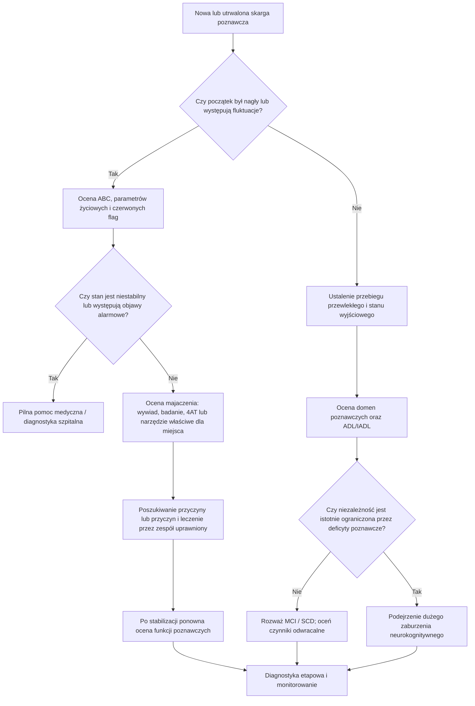

# 7.7. Majaczenie, otępienie i łagodne zaburzenia poznawcze

> **Moduł 7. Ocena funkcji poznawczych i psychicznych**  
> Materiał dydaktyczny do kursu badania neurologicznego. Rozdział omawia rozpoznawanie ostrych i przewlekłych zespołów zaburzeń poznawczych, ich dynamikę, ocenę wpływu na samodzielność oraz rolę informacji od pacjenta i osoby bliskiej. Nie zastępuje badania lekarskiego, diagnostyki specjalistycznej, neuropsychologicznej ani lokalnych procedur postępowania w stanach nagłych.

## Wprowadzenie

Zaburzenia poznawcze należą do najważniejszych problemów neurologii, geriatrii, psychiatrii i medycyny rodzinnej. Mogą pojawić się nagle, w ciągu godzin lub dni, rozwijać się stopniowo przez miesiące i lata albo mieć przebieg zmienny, z okresami względnej stabilizacji i pogorszenia. Ich prawidłowa ocena wymaga przede wszystkim ustalenia **punktu odniesienia**, czyli wcześniejszego poziomu funkcjonowania konkretnej osoby, a następnie określenia czasu początku, tempa zmian, domen poznawczych objętych zaburzeniem i wpływu objawów na codzienną niezależność.

Trzy pojęcia są szczególnie istotne:

- **Majaczenie (delirium)** – ostry, zwykle rozwijający się w ciągu godzin lub dni zespół zaburzeń uwagi i świadomości, któremu towarzyszy dodatkowe zaburzenie poznawcze. Objawy często fluktuują. Majaczenie jest najczęściej skutkiem ostrej choroby, działania substancji lub współwystępowania wielu czynników i wymaga pilnego poszukiwania przyczyny.
- **Otępienie / duże zaburzenie neurokognitywne** – zespół nabytego, zwykle przewlekłego pogorszenia jednej lub wielu domen poznawczych, na tyle istotnego, że ogranicza samodzielność w codziennym funkcjonowaniu. Nie jest prawidłowym następstwem starzenia się.
- **Łagodne zaburzenia poznawcze (MCI, mild cognitive impairment)** – obiektywnie uchwytne, niewielkie pogorszenie funkcji poznawczych względem wcześniejszego poziomu, przy zasadniczo zachowanej niezależności w codziennych czynnościach. Osoba może potrzebować większego wysiłku, przypomnień lub strategii kompensacyjnych, ale nie spełnia kryteriów dużego zaburzenia neurokognitywnego.

Najważniejsza reguła kliniczna brzmi: **nowe, nagłe lub wyraźnie fluktuujące zaburzenia poznawcze należy traktować jako możliwe majaczenie albo inną ostrą chorobę, dopóki nie zostanie przeprowadzona odpowiednia ocena**. Nie wolno automatycznie przypisywać nagłego splątania rozpoznanemu wcześniej otępieniu, podeszłemu wiekowi ani „zwykłemu pogorszeniu pamięci”.

W Polsce w 2026 r. opublikowano stanowisko Sekcji Alzheimerowskiej Polskiego Towarzystwa Neurologicznego i Polskiego Towarzystwa Alzheimerowskiego dotyczące etapowej ścieżki diagnostycznej chorób otępiennych. Podkreśla ono rolę wstępnej oceny w podstawowej opiece zdrowotnej, identyfikacji zaburzeń poznawczych i potencjalnie odwracalnych przyczyn, a następnie diagnostyki specjalistycznej obejmującej pogłębiony wywiad, badanie neurologiczne i psychiatryczne, ocenę neuropsychologiczną, badania laboratoryjne oraz neuroobrazowanie stosownie do wskazań [1]. W przypadku majaczenia ważnym punktem odniesienia pozostają zalecenia NICE CG103, zaktualizowane w części diagnostycznej w styczniu 2023 r. [2].

## Cele kształcenia

Po ukończeniu rozdziału uczestnik powinien umieć:

1. Zdefiniować majaczenie, otępienie, łagodne zaburzenia poznawcze i subiektywne pogorszenie funkcji poznawczych.
2. Odróżnić ostry, fluktuujący zespół zaburzeń uwagi i świadomości od przewlekłego, postępującego lub stabilnego pogorszenia poznawczego.
3. Wyjaśnić znaczenie uwagi, czuwania, sieci czołowo-ciemieniowych, wzgórza, układu siatkowatego, hipokampa i połączeń istoty białej.
4. Rozpoznać typowe czynniki predysponujące do majaczenia oraz czynniki bezpośrednio je wyzwalające.
5. Zebrać wywiad od pacjenta i osoby znającej jego wcześniejsze funkcjonowanie, z poszanowaniem autonomii, prywatności i zgody.
6. Przeprowadzić uporządkowaną ocenę początku, przebiegu, fluktuacji, uwagi, świadomości, funkcji poznawczych i samodzielności.
7. Znać zasady stosowania 4AT i CAM jako narzędzi wspomagających wykrywanie majaczenia, rozumiejąc, że wynik przesiewowy nie jest samodzielnym rozpoznaniem.
8. Rozróżniać MCI od dużego zaburzenia neurokognitywnego na podstawie wpływu deficytów na niezależność.
9. Wskazać najważniejsze przyczyny potencjalnie odwracalne lub modyfikowalne oraz sytuacje wymagające diagnostyki pilnej.
10. Opisać podstawowe zasady diagnostyki różnicowej, doboru badań laboratoryjnych, obrazowych, neurofizjologicznych i specjalistycznych.
11. Rozpoznać majaczenie nałożone na otępienie i unikać błędu diagnostycznego polegającego na uznaniu ostrej zmiany za nieuchronną progresję choroby przewlekłej.
12. Udokumentować źródła informacji, stan wyjściowy, dynamikę objawów, wynik badania, ograniczenia oceny, ryzyko i podjęte działania.

## 1. Definicje i podstawowe rozróżnienia

### 1.1. Funkcje poznawcze

Funkcje poznawcze to procesy umożliwiające odbieranie, selekcjonowanie, zapamiętywanie, przetwarzanie i wykorzystywanie informacji. W badaniu klinicznym należy uwzględnić co najmniej:

- uwagę i złożoną uwagę;
- szybkość przetwarzania informacji;
- uczenie się i pamięć;
- funkcje wykonawcze;
- język;
- funkcje wzrokowo-przestrzenne i praksję;
- rozpoznawanie oraz integrację informacji zmysłowych;
- poznanie społeczne, w tym rozumienie intencji i reguł społecznych.

Nie każda trudność z wykonaniem zadania oznacza pierwotne zaburzenie poznawcze. Wynik może być obniżony przez niedosłuch, niedowidzenie, ból, duszność, zmęczenie, depresję, lęk, brak znajomości języka testu, niskie wykształcenie, zaburzenia ruchowe, afazję, nieprawidłowe warunki badania lub ostrą chorobę somatyczną.

### 1.2. Majaczenie

Majaczenie jest ostrym zespołem neuropsychiatrycznym, którego rdzeniem są:

1. zaburzenie uwagi, czyli zmniejszona zdolność kierowania, utrzymywania i przenoszenia uwagi;
2. zaburzenie świadomości otoczenia, rozumiane jako ograniczona orientacja i zdolność adekwatnego reagowania na bodźce;
3. szybki rozwój zmian – zwykle w ciągu godzin lub dni – w porównaniu ze stanem wyjściowym;
4. fluktuacje nasilenia objawów w ciągu doby;
5. dodatkowe zaburzenia poznawcze, np. dezorientacja, zaburzenia pamięci, języka, percepcji lub myślenia;
6. brak lepszego wyjaśnienia przez samo utrwalone zaburzenie neurokognitywne, przy czym majaczenie może nałożyć się na istniejące otępienie.

Majaczenie jest zespołem, a nie etiologicznym rozpoznaniem końcowym. W dokumentacji warto zapisać „podejrzenie majaczenia” lub „zespół majaczeniowy” oraz równolegle określić, jakie przyczyny są rozważane i jakie działania diagnostyczne podjęto.

### 1.3. Otępienie i duże zaburzenie neurokognitywne

Termin „otępienie” jest nadal szeroko stosowany w praktyce klinicznej. W klasyfikacji DSM-5-TR odpowiada mu w przybliżeniu pojęcie **dużego zaburzenia neurokognitywnego**. Rozpoznanie zespołu wymaga wykazania istotnego pogorszenia w jednej lub kilku domenach poznawczych, potwierdzonego relacją pacjenta, osoby bliskiej lub klinicysty oraz obiektywną oceną. Deficyty ograniczają niezależność w codziennym funkcjonowaniu, np. w zarządzaniu lekami, finansami, zakupami, organizacją posiłków, podróżowaniem lub wykonywaniu złożonych obowiązków.

Otępienie nie jest pojedynczą chorobą. Jest zespołem o wielu możliwych przyczynach, w tym neurodegeneracyjnych, naczyniowych, mieszanych, zapalnych, zakaźnych, metabolicznych, toksycznych i pourazowych. Ustalenie podtypu etiologicznego wymaga osobnej oceny.

### 1.4. Łagodne zaburzenia poznawcze

MCI jest stanem pośrednim między prawidłowym funkcjonowaniem poznawczym a dużym zaburzeniem neurokognitywnym, ale nie należy traktować go jako nieuchronnego etapu otępienia. Osoba z MCI może:

- zauważać trudności z pamięcią, koncentracją lub inną domeną;
- otrzymywać informacje o pogorszeniu od bliskich;
- osiągać wynik niższy od oczekiwanego dla wieku, wykształcenia i kontekstu językowo-kulturowego;
- zachowywać zasadniczą niezależność;
- potrzebować większego wysiłku, kalendarza, list, alarmów lub dodatkowego sprawdzania;
- pozostawać stabilna, poprawić się po leczeniu przyczyny współistniejącej albo przejść do większego stopnia zaburzeń.

MCI jest zespołem klinicznym, a nie etiologią. Może mieć podłoże neurodegeneracyjne, naczyniowe, psychiatryczne, metaboliczne, polekowe, związane z zaburzeniami snu lub wieloczynnikowe.

### 1.5. Subiektywne pogorszenie funkcji poznawczych

Subiektywne pogorszenie funkcji poznawczych (SCD, subjective cognitive decline) oznacza utrzymujące się poczucie pogorszenia w porównaniu z wcześniejszym poziomem, przy braku uchwytnego obiektywnego deficytu w zastosowanej ocenie. Nie oznacza automatycznie choroby neurodegeneracyjnej. Wymaga jednak wysłuchania pacjenta, oceny nastroju, snu, stresu, leków, chorób somatycznych i czynników ryzyka oraz ustalenia, czy potrzebna jest obserwacja lub pogłębiona diagnostyka.

### 1.6. Majaczenie nałożone na otępienie

Majaczenie nałożone na otępienie (delirium superimposed on dementia) oznacza nagłe pogorszenie funkcjonowania poznawczego i uwagi u osoby, u której wcześniej występowało przewlekłe zaburzenie neurokognitywne. Rozpoznanie jest trudne, ponieważ pacjent może już przed ostrą chorobą być zdezorientowany, mieć zaburzenia pamięci i wymagać pomocy. Kluczowe staje się ustalenie **zmiany względem jego własnego stanu wyjściowego**, a nie porównywanie go z abstrakcyjną normą populacyjną.

### 1.7. Porównanie najważniejszych zespołów

| Cecha | Majaczenie | MCI | Otępienie / duże zaburzenie neurokognitywne |
|---|---|---|---|
| Początek | Zwykle nagły lub podostry | Zwykle stopniowy albo zauważony w toku obserwacji | Najczęściej stopniowy, niekiedy skokowy przy komponencie naczyniowym |
| Czas rozwoju | Godziny–dni | Miesiące–lata | Miesiące–lata, zależnie od etiologii |
| Przebieg | Fluktuujący, często w ciągu doby | Zmienny; może być stabilny, poprawiać się lub postępować | Najczęściej przewlekły, postępujący lub schodkowy |
| Uwaga | Często wyraźnie zaburzona | Zwykle względnie zachowana, choć może być osłabiona | Może pogarszać się zależnie od podtypu i stadium |
| Czuwanie/świadomość | Często zmienione | Zasadniczo zachowane | Zwykle zachowane do późnych etapów, z wyjątkami |
| Niezależność | Może gwałtownie się pogorszyć | Zasadniczo zachowana | Istotnie ograniczona przez deficyty poznawcze |
| Przyczyna | Ostra choroba, leki, substancje, czynniki wieloczynnikowe | Heterogenna | Choroba lub zespół chorób mózgu |
| Pilność | Wymaga pilnej oceny przyczyn | Zależna od dynamiki i objawów alarmowych | Zwykle diagnostyka planowa, pilna przy szybkim postępie lub czerwonych flagach |

**Ważne:** tabela opisuje typowe wzorce, a nie sztywne reguły. Majaczenie może występować bez wyraźnej senności, otępienie może fluktuować, a osoba z MCI może mieć współistniejącą depresję, niedosłuch lub chorobę somatyczną.

## 2. Podstawy neuroanatomiczne

### 2.1. Funkcje poznawcze jako działanie sieci mózgowych

Uwaga, świadomość, pamięć i zachowanie nie są zlokalizowane w jednym ośrodku. Powstają dzięki współdziałaniu rozległych sieci korowych i podkorowych. W majaczeniu zaburzenie może dotyczyć jednocześnie kilku układów regulujących czuwanie, selekcję bodźców, pamięć roboczą i kontrolę zachowania. W otępieniach wzorzec zajęcia struktur zależy od etiologii i etapu choroby.

### 2.2. Pień mózgu i układ siatkowaty

Wstępujący układ siatkowaty aktywujący, z połączeniami do wzgórza, podwzgórza i kory, uczestniczy w utrzymywaniu czuwania i gotowości do reagowania. Zaburzenia funkcji pnia mózgu, ciężkie zaburzenia metaboliczne, hipoksja, leki sedatywne i uogólniona niewydolność organizmu mogą zmieniać poziom reaktywności.

W ocenie klinicznej należy odróżnić:
- obniżenie czuwania i reaktywności;
- brak współpracy wynikający z afazji, niedosłuchu lub zaburzeń ruchowych;
- celowe milczenie lub wycofanie;
- zaburzenia świadomości o podłożu metabolicznym lub strukturalnym.

### 2.3. Wzgórze

Wzgórze jest węzłem integrującym informacje czuciowe, ruchowe i poznawcze. Jego połączenia z korą przedczołową, ciemieniową i limbiczną uczestniczą w regulacji uwagi, pamięci roboczej i świadomości. Uszkodzenia wzgórza, zwłaszcza obustronne lub dotyczące określonych jąder, mogą powodować zaburzenia czuwania, pamięci i zachowania.

### 2.4. Sieci uwagowe i kora przedczołowa

Sieci czołowo-ciemieniowe oraz układy przedniej części zakrętu obręczy uczestniczą w utrzymywaniu celu, selekcji bodźców, wykrywaniu konfliktu i hamowaniu reakcji nieadekwatnych. Zaburzenia uwagi są centralnym elementem majaczenia, ale występują także w chorobach naczyniowych, neurodegeneracyjnych, depresji, zaburzeniach snu i działaniach niepożądanych leków.

### 2.5. Hipokamp i przyśrodkowy płat skroniowy

Hipokamp i struktury przyśrodkowej części płata skroniowego są istotne dla uczenia się i pamięci epizodycznej. W chorobie Alzheimera zmiany patologiczne często obejmują te obszary wcześnie, jednak przebieg kliniczny zależy od rozległości i rozmieszczenia zmian. W majaczeniu funkcjonowanie pamięci może pogarszać się wtórnie do zaburzeń uwagi i kodowania, dlatego słaby wynik przypominania w stanie ostrym nie powinien być automatycznie interpretowany jako dowód przewlekłej choroby pamięci.

### 2.6. Kora ciemieniowa i sieci integracyjne

Kora ciemieniowa uczestniczy w integracji informacji zmysłowych, orientacji przestrzennej, uwadze i wykonywaniu złożonych czynności. Rozległe połączenia czołowo-ciemieniowe i skroniowo-ciemieniowe mają znaczenie dla wielu zespołów otępiennych. Uszkodzenia istoty białej mogą powodować spowolnienie przetwarzania informacji i zaburzenia funkcji wykonawczych.

### 2.7. Układ limbiczny i obwody czołowo-podkorowe

Ciało migdałowate, hipokamp, zakręt obręczy, kora oczodołowo-czołowa, prążkowie i wzgórze uczestniczą w regulacji emocji, motywacji, uczenia się i zachowania. Zmiany w tych sieciach mogą powodować apatię, odhamowanie, drażliwość, zaburzenia motywacji i zmianę zachowań społecznych. W ocenie poznawczej trzeba więc uwzględnić zarówno funkcje testowane bezpośrednio, jak i obserwowane w codziennych sytuacjach.

### 2.8. Układy cholinergiczne, dopaminergiczne i noradrenergiczne

Układy cholinergiczne z przodomózgowia podstawnego i pnia mózgu modulują uwagę, uczenie się i pamięć. Układy dopaminergiczne uczestniczą w motywacji, saliencji bodźców, ruchu i przetwarzaniu nagrody. Układy noradrenergiczne, w tym miejsce sinawe, wpływają na czuwanie i reakcję na nowość. Zaburzenia równowagi tych układów są jedną z hipotez patofizjologicznych majaczenia i różnych zespołów neurodegeneracyjnych, ale nie istnieje pojedynczy pomiar neuroprzekaźnika, który potwierdzałby rozpoznanie majaczenia.

## 3. Podstawy neurofizjologiczne i mechanizmy chorobowe

### 3.1. Majaczenie jako zaburzenie sieciowe

Majaczenie jest najczęściej wynikiem interakcji podatności mózgu i czynnika wyzwalającego. U osoby z małą rezerwą poznawczą nawet umiarkowana infekcja, odwodnienie, zaburzenie snu lub zmiana farmakoterapii może wywołać wyraźne zaburzenie funkcjonowania. U osoby bez wcześniejszych deficytów potrzeba zwykle większego obciążenia, choć nie jest to reguła.

Model wieloczynnikowy obejmuje:
- zaburzenie regulacji neuroprzekaźnictwa, w tym względny niedobór aktywności cholinergicznej i zaburzenia dopaminergiczne;
- reakcję zapalną i wpływ cytokin na funkcję bariery krew–mózg oraz sieci neuronalne;
- zaburzenia metabolizmu energetycznego i perfuzji mózgowej;
- zaburzenia snu, rytmu dobowego i sygnalizacji melatoninowej;
- wpływ bólu, stresu, unieruchomienia i deprywacji sensorycznej;
- interakcje leków, toksyn i zaburzeń elektrolitowych.

Nie należy sprowadzać majaczenia do „braku acetylocholiny” ani zakładać, że każdy przypadek ma jeden dominujący mechanizm.

### 3.2. Mechanizmy chorób neurodegeneracyjnych

W chorobach neurodegeneracyjnych dochodzi do stopniowej utraty sprawności określonych populacji neuronów, zaburzeń połączeń synaptycznych, odkładania nieprawidłowych białek lub współwystępowania zmian naczyniowych. Przykłady obejmują:

- patologię amyloidowo-tau w chorobie Alzheimera;
- patologię alfa-synukleinową w chorobie z ciałami Lewy’ego i chorobie Parkinsona;
- patologię białek tau lub TDP-43 w części zwyrodnień czołowo-skroniowych;
- uszkodzenia naczyniowe małych i dużych naczyń w zaburzeniach naczyniopochodnych;
- współistnienie kilku procesów, szczególnie u osób w starszym wieku.

Obecność biomarkera biologicznego nie jest równoznaczna z automatycznym wyjaśnieniem wszystkich objawów. Wynik należy interpretować w kontekście obrazu klinicznego, prawdopodobieństwa przedtestowego, wieku, współchorobowości i celu badania.

### 3.3. Rezerwa poznawcza i odporność funkcjonalna

Rezerwa poznawcza opisuje zdolność mózgu do utrzymywania funkcji mimo zmian patologicznych. Wpływają na nią m.in. edukacja, aktywność intelektualna i społeczna, zdrowie naczyniowe, aktywność fizyczna oraz warunki środowiskowe. Nie jest ona „zapasem neuronów” możliwym do zmierzenia jednym testem. Może tłumaczyć, dlaczego dwie osoby o podobnym nasileniu zmian strukturalnych prezentują różny poziom sprawności.

## 4. Dynamika objawów i znaczenie stanu wyjściowego

### 4.1. Oś czasu jako pierwszy element diagnostyki

Przed interpretacją wyniku testu należy ustalić:

1. Kiedy pacjent lub otoczenie po raz pierwszy zauważyli zmianę?
2. Czy początek był nagły, podostry czy stopniowy?
3. Czy objawy występują stale, czy nasilają się i ustępują?
4. Czy zmiana jest inna rano, wieczorem lub w nocy?
5. Czy wystąpiła w związku z infekcją, zabiegiem, hospitalizacją, upadkiem, zmianą leków lub odstawieniem substancji?
6. Czy przed aktualnym epizodem pacjent samodzielnie zarządzał lekami, finansami, zakupami i higieną?
7. Czy w ostatnich miesiącach lub latach widoczne było systematyczne pogarszanie się funkcjonowania?

### 4.2. Fluktuacje

Fluktuacje mogą obejmować:
- zmienną zdolność utrzymania uwagi;
- okresy logicznej rozmowy przeplatane dezorientacją;
- naprzemienne pobudzenie i senność;
- pogorszenie w godzinach wieczornych lub nocnych;
- zmienną zdolność wykonywania prostych poleceń;
- przemijające zaburzenia percepcji.

Samo pogorszenie wieczorne nie wystarcza do rozpoznania majaczenia. Należy ustalić, czy występuje nowa zmiana względem wcześniejszego stanu i czy towarzyszą jej zaburzenia uwagi lub świadomości.

### 4.3. Przebieg schodkowy, postępujący i zmienny

- **Przebieg stopniowo postępujący** może sugerować chorobę neurodegeneracyjną, ale wymaga wykluczenia innych przyczyn.
- **Przebieg schodkowy** może występować w związku z kolejnymi incydentami naczyniowymi lub innymi ostrymi uszkodzeniami.
- **Przebieg zmienny w skali dnia** może występować w majaczeniu, ale także w otępieniu z ciałami Lewy’ego, zaburzeniach snu i innych stanach.
- **Nagła zmiana na tle przewlekłych deficytów** wymaga poszukiwania majaczenia nałożonego na otępienie, udaru, napadu padaczkowego, krwawienia, infekcji lub zaburzeń metabolicznych.

### 4.4. Dlaczego porównanie z wcześniejszym poziomem jest niezbędne

Wynik testu poznawczego jest pomiarem wykonania w określonych warunkach, a nie samodzielnym opisem całej historii pacjenta. U osoby z wieloletnim otępieniem wynik niski może być jej stanem przewlekłym. U osoby dotąd samodzielnej podobny wynik uzyskany po nagłej zmianie zachowania może oznaczać stan ostry. Dlatego w dokumentacji trzeba zapisać zarówno aktualny wynik, jak i źródło informacji o stanie wyjściowym.

## 5. Czynniki ryzyka i czynniki wyzwalające majaczenie

### 5.1. Czynniki predysponujące

Do najważniejszych należą:
- podeszły wiek, szczególnie w połączeniu z kruchością;
- wcześniejsze MCI lub otępienie;
- przebyte majaczenie;
- wielochorobowość i ciężka choroba ogólnoustrojowa;
- zaburzenia słuchu i wzroku;
- niedożywienie i odwodnienie;
- ograniczona mobilność i zależność od pomocy;
- przewlekłe zaburzenia snu;
- polifarmakoterapia;
- uzależnienie od alkoholu lub leków uspokajających;
- zaburzenia neurologiczne, w tym udar, choroba Parkinsona i padaczka.

### 5.2. Czynniki wyzwalające

| Obszar | Przykłady | Co należy ustalić |
|---|---|---|
| Zakażenia | Zapalenie płuc, zakażenie układu moczowego z objawami, sepsa, zakażenie OUN | Gorączka lub hipotermia, objawy miejscowe, parametry życiowe, stan ogólny |
| Metaboliczne | Hipoglikemia, hiperglikemia, zaburzenia sodu i wapnia, niewydolność nerek lub wątroby | Glikemia, elektrolity, funkcja narządów, bilans płynów |
| Krążeniowo-oddechowe | Hipoksja, hipotensja, niewydolność serca, zaburzenia rytmu | Saturacja, ciśnienie, tętno, oddech, perfuzja |
| Neurologiczne | Udar, krwawienie, napad padaczkowy, stan padaczkowy bezdrgawkowy, uraz głowy | Deficyty ogniskowe, uraz, napady, ból głowy, wskazania do obrazowania lub EEG |
| Leki i substancje | Leki antycholinergiczne, opioidy, benzodiazepiny, leki nasenne, glikokortykosteroidy, leki dopaminergiczne, interakcje | Lista leków, dawki, ostatnie zmiany, niewłaściwe dawkowanie, odstawienie |
| Ból i dyskomfort | Ból pooperacyjny, złamanie, odleżyny, ból zębów | Lokalizacja, nasilenie, zachowanie sugerujące ból |
| Eliminacja | Zatrzymanie moczu, zaparcie, zaleganie kału | Mikcja, objawy brzuszne, wywiad, badanie zgodnie z kompetencjami |
| Środowisko | Brak snu, hałas, częste przenoszenie, izolacja, brak okularów lub aparatu słuchowego | Warunki oddziału, orientacja, dostęp do pomocy sensorycznych |

### 5.3. Leki i obciążenie antycholinergiczne

Szczególną uwagę należy zwrócić na:
- leki o działaniu antycholinergicznym, w tym niektóre leki przeciwhistaminowe pierwszej generacji, przeciwdepresyjne, przeciwparkinsonowskie i urologiczne;
- benzodiazepiny i leki nasenne, zwłaszcza u osób starszych;
- opioidy, szczególnie po rozpoczęciu leczenia lub zmianie dawki;
- leki przeciwpsychotyczne i leki o działaniu sedatywnym;
- glikokortykosteroidy;
- leki dopaminergiczne;
- interakcje wielu preparatów;
- nagłe odstawienie alkoholu, benzodiazepin lub innych substancji, od których pacjent jest zależny.

Nie wolno samodzielnie odstawiać przewlekle stosowanych leków uspokajających lub przeciwpadaczkowych bez oceny ryzyka zespołu odstawiennego i decyzji osoby uprawnionej. Przegląd farmakoterapii powinien uwzględniać wskazanie, dawkę, czas stosowania, czynność nerek i wątroby, interakcje oraz realną korzyść dla pacjenta.

### 5.4. Infekcja a wynik badania moczu

Dodatni wynik badania moczu lub obecność bakterii w posiewie u osoby starszej nie dowodzi, że przyczyną majaczenia jest zakażenie układu moczowego. Bez objawów klinicznych i właściwego kontekstu trzeba rozważyć bezobjawową bakteriurię, częstą w starszej populacji. Nie należy automatycznie przypisywać ostrego splątania zakażeniu dróg moczowych ani wdrażać antybiotyku wyłącznie na podstawie niejednoznacznego wyniku. Decyzję o badaniach i leczeniu podejmuje lekarz na podstawie całości obrazu klinicznego i aktualnych zaleceń.

## 6. Wywiad od pacjenta i osoby bliskiej

### 6.1. Zasady rozmowy

Rozmowę należy prowadzić spokojnie, krótkimi zdaniami i z uwzględnieniem możliwości pacjenta. W razie potrzeby ogranicza się liczbę osób w pomieszczeniu, hałas i liczbę jednoczesnych pytań. Nie należy poprawiać każdej nieścisłości ani konfrontować pacjenta w sposób zwiększający lęk.

Warto rozpocząć od pytania otwartego: „Co zmieniło się ostatnio w Pana/Pani samopoczuciu lub codziennym funkcjonowaniu?”. Następnie doprecyzować początek, dynamikę, czynniki towarzyszące i konsekwencje.

### 6.2. Pytania do pacjenta

Przykładowe pytania:
- „Kiedy po raz pierwszy zauważył(a) Pan/Pani zmianę?”
- „Czy trudności pojawiły się nagle, czy narastały stopniowo?”
- „Czy w ciągu dnia zdarzają się okresy lepszego i gorszego kontaktu?”
- „Czy łatwo jest Panu/Pani skupić uwagę na rozmowie?”
- „Czy ostatnio pojawiła się gorączka, ból, kaszel, duszność, biegunka, zaparcie albo trudności z oddawaniem moczu?”
- „Czy doszło do upadku lub urazu głowy?”
- „Czy zmieniono ostatnio leki albo dawki?”
- „Czy śpi Pan/Pani tak jak zwykle?”
- „Czy trudniej jest samodzielnie przygotować posiłek, zarządzać lekami, płacić rachunki lub dotrzeć do znanych miejsc?”

W pytaniach o funkcjonowanie należy unikać sugestii i oceniać konkretne czynności, a nie ogólne wrażenie „radzenia sobie”.

### 6.3. Informacja od osoby bliskiej lub opiekuna

Osoba znająca pacjenta może opisać zmianę, której pacjent nie pamięta albo nie dostrzega. Warto zapytać:
- jaki był zwykły poziom orientacji i komunikacji;
- czy pacjent wcześniej rozpoznawał rodzinę, miejsce i porę dnia;
- czy samodzielnie przyjmował leki i zarządzał pieniędzmi;
- czy korzystał z telefonu, transportu, zakupów i urządzeń domowych;
- czy potrzebował pomocy w higienie, ubieraniu, jedzeniu i przemieszczaniu;
- kiedy dokładnie zauważono zmianę;
- czy występuje naprzemienna senność i pobudzenie;
- czy pojawiły się nowe omamy, lęk, agresja, wycofanie lub zaburzenia snu;
- czy zmieniono leki, dietę, ilość płynów lub środowisko opieki.

Należy odnotować relację osoby bliskiej jako odrębne źródło informacji, z podaniem jej relacji do pacjenta i okresu, którego dotyczy opis.

### 6.4. Zgoda, prywatność i rozbieżne relacje

Włączenie rodziny nie oznacza automatycznego prawa do ujawniania jej wszystkich informacji o pacjencie. Należy przestrzegać zasad zgody, tajemnicy zawodowej i przepisów o prawach pacjenta. W sytuacji, gdy pacjent nie jest w stanie przekazać wiarygodnych informacji, a konieczne jest ratowanie zdrowia lub życia, postępowanie musi odbywać się zgodnie z obowiązującym prawem i procedurami podmiotu leczniczego.

Jeżeli pacjent i opiekun przedstawiają rozbieżne relacje, nie należy arbitralnie wybierać jednej z nich. Trzeba opisać różnicę, poszukać danych obiektywnych, dokumentacji wcześniejszej i – jeśli to możliwe – informacji od innych osób znających codzienne funkcjonowanie.

## 7. Badanie kliniczne

### 7.1. Ocena ogólna i parametry życiowe

W pierwszej kolejności ocenia się:
- drożność dróg oddechowych, oddychanie i krążenie;
- poziom czuwania i zdolność reagowania;
- temperaturę;
- ciśnienie tętnicze i częstość tętna;
- częstość oddechów i saturację;
- glikemię przyłóżkową, jeśli jest wskazana i dostępna w zakresie kompetencji;
- stan nawodnienia i odżywienia;
- ból, uraz i oznaki zakażenia.

W razie niestabilności krążeniowo-oddechowej, ciężkiego zaburzenia świadomości, podejrzenia udaru lub innego stanu nagłego nie kontynuuje się rutynowego testowania poznawczego. Priorytetem jest wezwanie odpowiedniej pomocy i postępowanie zgodne z procedurą ratunkową.

### 7.2. Uwaga i świadomość

Należy ocenić, czy pacjent:
- utrzymuje kontakt wzrokowy lub inny adekwatny kontakt;
- reaguje na zwrócenie się po imieniu;
- potrafi skupić uwagę na krótkiej rozmowie;
- wykonuje proste, jednoetapowe polecenie;
- utrzymuje wątek rozmowy;
- rozprasza się bodźcami z otoczenia;
- odpowiada z opóźnieniem lub traci tok zadania;
- ma zmienny poziom czuwania.

Wynik należy interpretować z uwzględnieniem słuchu, wzroku, języka, afazji, bólu, sedacji i sprawności ruchowej.

### 7.3. Orientacja

Orientacja w czasie, miejscu, sytuacji i własnej osobie jest przydatnym elementem oceny, ale sama dezorientacja nie rozpoznaje majaczenia. Osoba z przewlekłym otępieniem może mieć utrwalone trudności orientacyjne, a pacjent z majaczeniem może okresowo odpowiadać prawidłowo.

### 7.4. Badanie neurologiczne

Zakres badania należy dostosować do stanu pacjenta. W szczególności trzeba szukać:
- asymetrii twarzy;
- niedowładu lub nowego zaburzenia koordynacji;
- zaburzeń mowy i rozumienia;
- zaburzeń pola widzenia;
- objawów oponowych;
- nowego oczopląsu lub zaburzeń ruchów gałek ocznych;
- objawów urazu głowy;
- napadów, mioklonii lub nietypowych ruchów;
- objawów parkinsonizmu i zaburzeń chodu.

Nowy objaw ogniskowy wymaga pilnej oceny przyczyny strukturalnej, zwłaszcza udaru lub krwawienia.

### 7.5. Ocena funkcjonalna

Należy rozróżnić czynności podstawowe (ADL) od złożonych czynności instrumentalnych (IADL). W praktyce przydatne są konkretne przykłady:

| Obszar | Pytanie lub obserwacja |
|---|---|
| Leki | Czy pacjent prawidłowo dobiera preparat, dawkę i porę? |
| Finanse | Czy rozumie rachunki, płatności i wartość pieniędzy? |
| Zakupy | Czy planuje i realizuje zakupy bezpiecznie? |
| Posiłki | Czy potrafi przygotować prosty posiłek i wyłączyć urządzenia? |
| Transport | Czy samodzielnie dociera do znanych miejsc? |
| Telefon | Czy potrafi zadzwonić po pomoc i obsłużyć znane funkcje? |
| Higiena i ubieranie | Czy wymaga nowej pomocy w czynnościach podstawowych? |
| Bezpieczeństwo | Czy pozostawanie samemu w domu stwarza nowe ryzyko? |

Utrata samodzielności musi wynikać z zaburzeń poznawczych, a nie wyłącznie z niedowładu, bólu, duszności, ograniczeń wzroku lub braku dostępności środowiska.

## 8. Procedura oceny krok po kroku

Poniższa procedura jest schematem dydaktycznym. W praktyce kolejność może wymagać zmiany zależnie od stabilności pacjenta, miejsca udzielania świadczenia, kompetencji badającego i lokalnych procedur.

### Etap 1. Ocena bezpieczeństwa

1. Oceń, czy pacjent jest przytomny i oddycha prawidłowo.
2. Zwróć uwagę na objawy udaru, napadu, urazu, sepsy, hipoksji i ciężkiej hipoglikemii.
3. W razie zagrożenia przerwij rutynowe badanie i uruchom odpowiednią ścieżkę pomocy.

### Etap 2. Ustalenie tożsamości i warunków komunikacji

1. Potwierdź tożsamość zgodnie z procedurą.
2. Przedstaw się i wyjaśnij cel rozmowy.
3. Sprawdź, czy pacjent słyszy i widzi wystarczająco dobrze.
4. Zapewnij okulary, aparat słuchowy, tłumacza lub inną pomoc komunikacyjną, jeśli jest potrzebna.
5. Zadbaj o spokojne otoczenie i ograniczenie bodźców.

### Etap 3. Określenie stanu wyjściowego

1. Zapytaj pacjenta o wcześniejsze funkcjonowanie.
2. Uzyskaj – jeśli to możliwe i prawnie dopuszczalne – relację osoby bliskiej.
3. Sprawdź wcześniejszą dokumentację, wypisy i listę leków.
4. Zapisz, czy pacjent przed aktualnym epizodem był samodzielny, częściowo zależny czy wymagał stałej opieki.

### Etap 4. Ustalenie osi czasu

1. Określ datę lub przybliżony czas początku.
2. Rozróżnij początek nagły, podostry i przewlekły.
3. Ustal, czy objawy fluktuują.
4. Zapytaj o infekcję, uraz, zabieg, zmianę leków, odwodnienie, ból i zaburzenia snu.
5. Ustal, czy występowały wcześniejsze podobne epizody.

### Etap 5. Ocena uwagi i czuwania

1. Obserwuj kontakt i poziom reaktywności.
2. Poproś o wykonanie prostego polecenia.
3. Sprawdź, czy pacjent utrzymuje wątek krótkiej rozmowy.
4. Zwróć uwagę na rozpraszalność i zmienność odpowiedzi.
5. Nie utożsamiaj braku odpowiedzi z brakiem rozumienia, dopóki nie uwzględnisz afazji, niedosłuchu, bariery językowej i zaburzeń ruchowych.

### Etap 6. Ocena orientacji i dodatkowych domen

1. Zapytaj o miejsce, czas i sytuację.
2. Oceń podstawowe rozumienie komunikatu.
3. Zwróć uwagę na zaburzenia pamięci, języka, percepcji i myślenia.
4. Zapisz, które próby były możliwe, a które niewykonalne i dlaczego.

### Etap 7. Ocena objawów somatycznych

1. Zmierz lub zweryfikuj parametry życiowe.
2. Oceń ból, nawodnienie, odżywienie i mobilność.
3. Zapytaj o mikcję, wypróżnienia, kaszel, duszność, gorączkę i objawy miejscowe.
4. Wykonaj badanie przedmiotowe w zakresie kompetencji i wskazań.

### Etap 8. Przegląd farmakoterapii i substancji

1. Zbierz aktualną listę leków i preparatów bez recepty.
2. Ustal ostatnie zmiany dawek i preparatów.
3. Zapytaj o alkohol, leki uspokajające i inne substancje.
4. Zwróć uwagę na leki antycholinergiczne i sedatywne.
5. Nie zalecaj nagłego odstawienia leków przewlekłych bez decyzji osoby uprawnionej.

### Etap 9. Narzędzie przesiewowe

1. Wybierz narzędzie odpowiednie dla miejsca i stanu pacjenta.
2. W razie podejrzenia majaczenia rozważ 4AT; w intensywnej terapii lub sali wybudzeń stosuje się narzędzia przeznaczone do tych warunków, np. CAM-ICU albo ICDSC.
3. Zapisz wynik, godzinę, warunki badania i ograniczenia.
4. Dodatni wynik potraktuj jako wskazanie do oceny klinicznej, a nie samodzielne rozpoznanie.
5. Wynik ujemny nie znosi podejrzenia, jeśli wywiad wskazuje na fluktuacje lub wyraźną zmianę względem stanu wyjściowego.

### Etap 10. Ocena funkcjonalna

1. Zapytaj o ADL i IADL przed początkiem objawów.
2. Zapytaj o aktualny poziom pomocy.
3. Ustal, czy utrata samodzielności wynika z poznania, motoryki, czucia, wzroku, słuchu czy choroby somatycznej.
4. Opisz konkretne przykłady, nie tylko ogólną ocenę.

### Etap 11. Wstępne różnicowanie

1. Jeśli początek jest ostry lub występują fluktuacje uwagi i świadomości, priorytetowo oceń majaczenie i przyczyny ostre.
2. Jeśli pogorszenie jest przewlekłe, ustal domeny poznawcze i wpływ na niezależność.
3. Jeśli deficyt jest niewielki, ale obiektywny, a samodzielność zasadniczo zachowana, rozważ MCI po wykluczeniu przyczyn zakłócających.
4. Nie rozpoznawaj otępienia wyłącznie na podstawie niskiego wyniku testu.

### Etap 12. Decyzja o pilności

1. Zidentyfikuj czerwone flagi.
2. Zdecyduj, czy potrzebna jest pilna pomoc, diagnostyka szpitalna, konsultacja specjalistyczna czy planowa obserwacja.
3. W przypadku podejrzenia majaczenia zapewnij pilne poszukiwanie przyczyny.
4. Przy szybko postępującym pogorszeniu skieruj do pilnej diagnostyki neurologicznej.

### Etap 13. Dokumentacja

1. Zapisz źródła informacji.
2. Zapisz stan wyjściowy i czas zmiany.
3. Zapisz wyniki obserwacji i narzędzi.
4. Zapisz czynniki ograniczające wiarygodność badania.
5. Zapisz ryzyko, podjęte działania, osobę powiadomioną i plan dalszego postępowania.

### Etap 14. Ponowna ocena

W majaczeniu stan może zmieniać się w ciągu godzin. Powtarzaj ocenę zgodnie z dynamiką kliniczną i procedurą. Po ustąpieniu ostrego stanu należy ponownie ocenić funkcje poznawcze, ponieważ wynik uzyskany w czasie majaczenia nie jest wiarygodną podstawą do rozpoznania przewlekłego MCI lub otępienia.

### Schemat postępowania

## 9. Narzędzia wykrywania majaczenia

### 9.1. 4AT – przeznaczenie

4AT (4 A's Test) jest krótkim narzędziem przesiewowym służącym do wykrywania możliwego majaczenia i zaburzeń poznawczych. NICE zaleca jego stosowanie u osób, u których rozpoznano wskaźniki możliwego majaczenia; w intensywnej terapii i sali wybudzeń po zabiegu zaleca się narzędzia odpowiednie dla tych warunków, takie jak CAM-ICU lub ICDSC [2, 3].

4AT obejmuje cztery obszary:
1. czujność (Alertness);
2. krótką ocenę orientacji (AMT4);
3. uwagę – odliczanie miesięcy wstecz;
4. ostry początek lub fluktuujący przebieg.

### 9.2. Ogólna interpretacja 4AT

| Wynik całkowity | Znaczenie przesiewowe |
|---:|---|
| 0 pkt | Majaczenie lub istotne zaburzenie poznawcze mniej prawdopodobne, ale nie wykluczone |
| 1–3 pkt | Możliwe zaburzenie poznawcze; wymaga interpretacji klinicznej |
| 4 pkt lub więcej | Możliwe majaczenie z zaburzeniem poznawczym lub bez niego; potrzebna ocena kliniczna |

Szczegółowe punktowanie poszczególnych elementów należy prowadzić według aktualnego formularza i podręcznika 4AT, z uwzględnieniem wersji językowej. Wynik 4 lub większy nie oznacza automatycznie potwierdzonego majaczenia. Wysoki wynik może wynikać także z ciężkiego przewlekłego zaburzenia poznawczego, afazji, bariery językowej lub innych ograniczeń. Z kolei wynik niski nie wyklucza epizodu fluktuującego, jeżeli badanie wykonano w okresie względnej poprawy.

### 9.2.1. Punktowanie poszczególnych elementów 4AT

Poniższa tabela przedstawia strukturę punktacji zgodną z oficjalnym przewodnikiem 4AT. Przed zastosowaniem w praktyce należy korzystać z aktualnego, właściwego językowo formularza, a nie odtwarzać narzędzie z pamięci.

| Element | Sposób oceny | Punkty |
|---|---|---:|
| Czujność | Prawidłowa czujność; ewentualna łagodna senność krótsza niż 10 sekund po obudzeniu, po której pacjent pozostaje przytomny | 0 |
| Czujność | Wyraźnie nieprawidłowy poziom czujności, np. znaczna senność, trudność wybudzenia lub wyraźne pobudzenie | 4 |
| AMT4 | Bez błędów w odpowiedziach dotyczących wieku, daty urodzenia, miejsca i aktualnego roku | 0 |
| AMT4 | Jeden błąd | 1 |
| AMT4 | Co najmniej dwa błędy albo niemożność przeprowadzenia próby z powodu stanu pacjenta | 2 |
| Uwaga | Prawidłowe podanie co najmniej siedmiu miesięcy wstecz, począwszy od grudnia | 0 |
| Uwaga | Pacjent rozpoczyna, ale podaje mniej niż siedem miesięcy poprawnie, albo odmawia rozpoczęcia | 1 |
| Uwaga | Nie może rozpocząć próby, np. z powodu senności lub znacznego zaburzenia uwagi | 2 |
| Ostry początek / fluktuacja | Brak wiarygodnych danych o ostrej zmianie lub fluktuacji w wymaganym przedziale czasu | 0 |
| Ostry początek / fluktuacja | Istotna zmiana lub fluktuacja funkcji poznawczych, czujności albo innych funkcji psychicznych, która pojawiła się w ostatnich dwóch tygodniach i nadal była obecna w ciągu ostatnich 24 godzin | 4 |

**Ważne szczegóły wykonania:**
- W elemencie AMT4 pyta się o wiek, datę urodzenia, miejsce (np. nazwę szpitala lub budynku) i aktualny rok. Akceptuje się rozsądną identyfikację miejsca; nie jest wymagane podanie pełnej nazwy formalnej.
- W próbie miesięcy wstecz można zastosować jedną podpowiedź wstępną: „Jaki miesiąc jest przed grudniem?”. Następnie pacjent podaje miesiące w kolejności odwrotnej.
- Jeżeli pacjent z powodu senności, znacznego zaburzenia uwagi lub niemożności nawiązania komunikacji nie może wykonać elementu AMT4 albo próby uwagi, należy zastosować kategorię „niemożliwe do oceny” zgodnie z formularzem, a nie pozostawiać pustego pola.
- Ostry początek lub fluktuację można ustalić na podstawie obserwacji personelu, wcześniejszej dokumentacji, relacji bliskich lub wiarygodnej wiedzy klinicysty. Brak opiekuna przy łóżku nie może automatycznie opóźniać rozpoznania i pomocy.
- U osób z ciężkim, przewlekłym otępieniem nieprawidłowe wyniki elementów poznawczych mogą podnosić wynik 4AT także bez nowego majaczenia. W takich przypadkach szczególne znaczenie ma porównanie z wcześniejszym stanem i obserwacja w czasie.

Źródło punktacji i instrukcji wykonania: oficjalny przewodnik użytkownika 4AT, dostępny pod adresem [https://www.the4at.com/userguide](https://www.the4at.com/userguide).

### 9.3. CAM – Confusion Assessment Method

Klasyczny algorytm CAM opiera się na czterech cechach:
1. ostry początek i fluktuujący przebieg;
2. nieuwaga;
3. zdezorganizowane myślenie;
4. zmieniony poziom świadomości.

Wynik uznaje się za dodatni, gdy obecne są cechy 1 i 2 oraz co najmniej jedna z cech 3 lub 4. CAM wymaga prawidłowego zebrania danych i oceny klinicznej. Nie powinien być traktowany jako mechaniczna lista pytań niezależna od szkolenia i warunków badania.

### 9.4. CAM-ICU i ICDSC

CAM-ICU jest przeznaczony do oceny majaczenia u pacjentów intensywnej terapii, w tym osób, które nie mogą swobodnie mówić z powodu wentylacji mechanicznej. ICDSC jest listą kontrolną obserwacji objawów w określonym przedziale czasu. Dobór narzędzia zależy od środowiska, możliwości komunikacyjnych i procedur jednostki.

### 9.5. Ograniczenia narzędzi

Narzędzia przesiewowe:
- nie zastępują badania lekarskiego;
- nie ustalają etiologii;
- nie wykluczają udaru, zakażenia, zatrucia ani napadu padaczkowego;
- mogą dawać wyniki fałszywie dodatnie i fałszywie ujemne;
- zależą od pory badania i fluktuacji objawów;
- mogą być zaburzone przez afazję, niedosłuch, niedowidzenie, bariery językowe i ciężkie zaburzenia ruchowe;
- wymagają interpretacji w kontekście stanu wyjściowego.

W metaanalizie 17 badań obejmujących 3702 obserwacje u osób starszych oszacowano dla 4AT łączną czułość i swoistość około 0,88 każda; wyniki różniły się między populacjami i warunkami klinicznymi [4]. W badaniu walidacyjnym z 2014 r. w populacji hospitalizowanych osób w starszym wieku uzyskano czułość 89,7% i swoistość 84,1% [5]. Wartości te nie są gwarancją takiej samej skuteczności w każdej placówce, języku i grupie pacjentów.

## 10. Łagodne zaburzenia poznawcze – ocena kliniczna

### 10.1. Kryteria zespołu MCI

Rozpoznanie MCI wymaga:
- zgłoszenia pogorszenia przez pacjenta, osobę bliską lub klinicystę;
- wykazania niewielkiego, ale obiektywnego pogorszenia co najmniej jednej domeny poznawczej;
- zachowania zasadniczej niezależności w codziennym funkcjonowaniu;
- braku wyjaśnienia objawów wyłącznie przez majaczenie;
- oceny, czy objawy nie są lepiej wyjaśnione innym zaburzeniem psychicznym, ostrą chorobą lub czynnikiem sensorycznym.

Nie ma jednego wyniku MMSE, MoCA ani innego testu, który samodzielnie rozpoznaje MCI. Wynik należy interpretować z uwzględnieniem norm odpowiednich dla wieku, wykształcenia, języka, kultury i warunków badania.

### 10.2. Fenotyp amnestyczny i nieamnestyczny

W praktyce klinicznej można opisywać:
- MCI z dominującym zaburzeniem pamięci;
- MCI bez dominującego zaburzenia pamięci;
- postać jednoobszarową;
- postać wieloobszarową.

Opis fenotypu nie przesądza etiologii. Zaburzenia pamięci mogą występować w chorobie Alzheimera, depresji, zaburzeniach snu, po urazie, w chorobach naczyniowych i w wielu innych stanach.

### 10.3. Wpływ na codzienne funkcjonowanie

Przy MCI pacjent może nadal samodzielnie:
- przyjmować leki, choć korzysta z przypomnień;
- zarządzać pieniędzmi, choć potrzebuje więcej czasu;
- przygotowywać posiłki;
- podróżować znanymi trasami;
- prowadzić gospodarstwo domowe;
- realizować obowiązki zawodowe lub rodzinne, czasem z większym wysiłkiem.

Jeżeli deficyty poznawcze powodują, że pacjent nie może bezpiecznie i niezależnie wykonywać istotnych czynności, trzeba ocenić, czy spełnia kryteria dużego zaburzenia neurokognitywnego. Nie należy jednak przypisywać utraty samodzielności poznaniu, jeżeli jej główną przyczyną jest niedowład, ból, ograniczenie ruchomości lub brak wsparcia środowiskowego.

### 10.4. Możliwe dalsze losy MCI

MCI może:
- utrzymywać się bez istotnej zmiany;
- poprawić się po leczeniu przyczyny współistniejącej;
- ulec pogorszeniu;
- przejść w duże zaburzenie neurokognitywne;
- okazać się stanem wynikającym z depresji, zaburzeń snu, leków, niedosłuchu lub innych czynników.

Nie należy przedstawiać MCI jako pewnej fazy przedotępiennej. Ryzyko progresji zależy od fenotypu, wieku, chorób współistniejących, wyników badań, biomarkerów i czasu obserwacji.

### 10.5. Monitorowanie

Plan monitorowania powinien być indywidualny. W praktyce warto:
- zapisać wynik wyjściowy i zastosowane narzędzie;
- udokumentować funkcjonowanie ADL/IADL;
- odnotować czynniki ryzyka naczyniowego i somatycznego;
- ocenić słuch, wzrok, nastrój i sen;
- sprawdzić farmakoterapię;
- ustalić termin ponownej oceny, często w perspektywie 6–12 miesięcy, wcześniej przy pogorszeniu lub nowych objawach;
- wskazać objawy, które powinny skłonić do pilnego kontaktu.

Odstęp 6–12 miesięcy jest przykładowym zakresem obserwacji, a nie uniwersalną normą. Częstotliwość zależy od dynamiki, ryzyka i zaleceń lekarza prowadzącego.

## 11. Otępienie – ocena zespołu i wstępne różnicowanie etiologii

### 11.1. Zasada etapowej diagnostyki

Diagnostyka powinna odpowiedzieć na cztery pytania:

1. Czy występuje obiektywny zespół zaburzeń poznawczych?
2. Czy pogorszenie ogranicza niezależność?
3. Jaki jest prawdopodobny wzorzec etiologiczny?
4. Czy występują przyczyny współistniejące, odwracalne lub modyfikowalne?

W polskim stanowisku PTN i PTA z 2026 r. opisano etapowe podejście: wstępna identyfikacja w POZ, badania przesiewowe i podstawowe badania laboratoryjne, a następnie – przy dodatnim wyniku lub utrzymującym się podejrzeniu – pogłębiona diagnostyka specjalistyczna [1].

### 11.2. Najczęstsze wzorce kliniczne

| Zespół / etiologia | Częsty początek i dominujące cechy | Wskazówki różnicujące |
|---|---|---|
| Choroba Alzheimera | Stopniowe pogarszanie pamięci epizodycznej, później innych domen | Trudność uczenia się i utrwalania nowych informacji; stopniowa utrata sprawności |
| Otępienie naczyniopochodne | Często zaburzenia wykonawcze, uwagi i szybkości przetwarzania; przebieg może być schodkowy | Związek czasowy z incydentami naczyniowymi, ogniskowe objawy, obciążenie naczyniowe i zmiany w obrazowaniu |
| Otępienie z ciałami Lewy’ego | Fluktuacje poznawcze, omamy wzrokowe, parkinsonizm, zaburzenia zachowania w śnie REM | Wczesne zaburzenia uwagi i wzrokowo-przestrzenne; nadwrażliwość na niektóre leki przeciwpsychotyczne |
| Otępienie w chorobie Parkinsona | Pogorszenie poznawcze w przebiegu ustalonej choroby Parkinsona | Należy uwzględnić czas wystąpienia objawów ruchowych i poznawczych |
| Zwyrodnienie czołowo-skroniowe | Wczesne zmiany zachowania, odhamowanie, apatia lub postępujące zaburzenia języka | Zmiana osobowości, zachowania społecznego lub języka może wyprzedzać typowe zaburzenia pamięci |
| Otępienie mieszane | Połączenie cech kilku procesów | Częste u osób starszych; nie należy wymuszać jednego mechanizmu |
| Wodogłowie normotensyjne | Zaburzenia chodu, funkcji poznawczych i objawy z dolnych dróg moczowych | Triada nie jest zawsze pełna; wymaga oceny specjalistycznej i obrazowania |
| Szybko postępujące zaburzenia poznawcze | Pogorszenie w tygodniach lub miesiącach | Wymagają pilnej diagnostyki, m.in. przyczyn autoimmunologicznych, zakaźnych, prionowych, naczyniowych i toksyczno-metabolicznych |

Tabela przedstawia wskazówki, a nie kryteria rozpoznania. W praktyce częste są postacie mieszane i współistnienie kilku chorób.

### 11.3. Otępienie a prawidłowe starzenie

W prawidłowym starzeniu może występować wolniejsze przypominanie, większa potrzeba czasu na przetworzenie informacji i sporadyczne trudności z odnalezieniem słowa. Nie powinno jednak dochodzić do postępującej utraty niezależności w codziennym życiu. Utrata zdolności do bezpiecznego zarządzania lekami, finansami, podróżowania lub wykonywania znanych czynności wymaga diagnostyki, a nie wyjaśnienia samym wiekiem.

### 11.4. Depresja i zaburzenia psychiczne

Depresja może powodować spowolnienie, trudności z koncentracją, skargi pamięciowe, zaburzenia snu i obniżenie inicjatywy. Może też współistnieć z MCI lub otępieniem. Nie należy używać określenia „pseudootępienie” jako skrótu myślowego, który zastępuje diagnostykę. Poprawa nastroju nie zawsze oznacza całkowite ustąpienie deficytu poznawczego.

### 11.5. Zaburzenia poznawcze związane z lekami i chorobami somatycznymi

Możliwe czynniki obejmują:
- niedobór witaminy B12 lub folianów;
- niedoczynność tarczycy;
- zaburzenia elektrolitowe i glikemii;
- niewydolność nerek lub wątroby;
- bezdech senny i przewlekły niedobór snu;
- depresję i zaburzenia lękowe;
- nadużywanie alkoholu;
- działania niepożądane i interakcje leków;
- niedosłuch i niedowidzenie;
- przewlekły ból i ograniczenie aktywności.

„Potencjalnie odwracalne” nie znaczy, że każda przyczyna jest w pełni odwracalna ani że leczenie gwarantuje odzyskanie wcześniejszej sprawności. Celem jest identyfikacja czynników, które można bezpiecznie leczyć lub modyfikować.

## 12. Badania dodatkowe – zasady doboru

### 12.1. Badania laboratoryjne w ostrym pogorszeniu

Zakres badań ustala lekarz na podstawie stanu klinicznego. Zależnie od sytuacji mogą być potrzebne:
- glikemia;
- morfologia krwi;
- elektrolity, w tym sód i wapń;
- parametry nerkowe;
- parametry wątrobowe;
- CRP lub inne markery zapalne;
- gazometria przy podejrzeniu zaburzeń oddychania lub równowagi kwasowo-zasadowej;
- badania mikrobiologiczne przy uzasadnionym podejrzeniu zakażenia;
- badania toksykologiczne lub stężenia wybranych leków, gdy wskazuje na to wywiad;
- inne badania celowane.

Nie należy wykonywać wszystkich badań automatycznie u każdego pacjenta. Wyniki trzeba interpretować w kontekście wieku, chorób współistniejących, objawów i prawdopodobieństwa przedtestowego.

### 12.2. Wstępna diagnostyka przewlekłych zaburzeń poznawczych

W zależności od obrazu klinicznego lekarz może rozważyć:
- morfologię;
- elektrolity, glukozę i wapń;
- TSH;
- witaminę B12, a w określonych sytuacjach foliany;
- parametry nerkowe i wątrobowe;
- badania zapalne lub zakaźne, jeśli istnieją wskazania;
- inne badania wynikające z wieku, chorób, leków i nietypowego przebiegu.

Badanie moczu powinno wynikać z obrazu klinicznego, a nie być rutynowo traktowane jako wyjaśnienie każdego zaburzenia zachowania u osoby starszej.

### 12.3. Neuroobrazowanie

Tomografia komputerowa (TK) lub rezonans magnetyczny (MRI) mogą być wskazane w zależności od:
- nagłego początku;
- objawów ogniskowych;
- urazu głowy;
- stosowania leków przeciwkrzepliwych;
- nowego napadu padaczkowego;
- szybko postępującego pogorszenia;
- nietypowego wieku lub obrazu klinicznego;
- podejrzenia wodogłowia, guza, krwawienia lub choroby naczyniowej.

W diagnostyce przewlekłych zaburzeń poznawczych MRI mózgu jest często preferowanym badaniem, jeśli jest dostępny i nie ma przeciwwskazań. TK może być właściwa w sytuacji pilnej lub gdy MRI jest niedostępne albo niewskazane. Obrazowanie nie zastępuje wywiadu i oceny funkcjonalnej.

### 12.4. EEG

EEG należy rozważyć, gdy występuje podejrzenie:
- stanu padaczkowego bezdrgawkowego;
- napadów o nietypowym przebiegu;
- nawracających epizodów zaburzeń świadomości;
- encefalopatii o niejasnej przyczynie;
- wybranych szybko postępujących zespołów poznawczych.

Prawidłowy zapis rutynowego EEG nie wyklucza wszystkich napadów ani zaburzeń encefalopatycznych.

### 12.5. Badanie płynu mózgowo-rdzeniowego

Punkcja lędźwiowa może być wskazana przy podejrzeniu zapalenia opon lub mózgu, choroby zapalnej, wybranych zakażeń, choroby prionowej albo w określonych sytuacjach diagnostyki biomarkerowej choroby Alzheimera. Decyzja wymaga oceny przeciwwskazań, ryzyka i celu badania.

### 12.6. Biomarkery choroby Alzheimera

Biomarkery w płynie mózgowo-rdzeniowym, obrazowaniu PET lub krwi mogą wspierać rozpoznanie patologii alzheimerowskiej w wybranych sytuacjach. Nie są uniwersalnym testem przesiewowym dla każdego zapominającego pacjenta. Ich dobór i interpretacja wymagają właściwego kontekstu klinicznego, jakości analitycznej, dostępności oraz kompetencji specjalistycznych. Wynik dodatni nie zwalnia z oceny alternatywnych i współistniejących przyczyn zaburzeń.

## 13. Diagnostyka różnicowa

### 13.1. Najważniejsze stany imitujące lub współistniejące

| Stan | Wskazówki kliniczne | Działanie diagnostyczne |
|---|---|---|
| Udar lub krwawienie śródczaszkowe | Nagły początek, objaw ogniskowy, zaburzenia mowy, widzenia, siły lub koordynacji | Pilna ścieżka udarowa i neuroobrazowanie |
| Napad padaczkowy / stan bezdrgawkowy | Epizodyczność, automatyzmy, fluktuacje, niewyjaśnione zaburzenia kontaktu | Ocena neurologiczna, EEG według wskazań |
| Zakażenie OUN | Gorączka lub hipotermia, ból głowy, sztywność karku, drgawki, zaburzenia świadomości | Pilna diagnostyka szpitalna, badania laboratoryjne i płynu mózgowo-rdzeniowego według wskazań |
| Sepsa i zakażenia ogólnoustrojowe | Zaburzenia parametrów życiowych, pogorszenie stanu ogólnego, objawy ogniskowe zakażenia | Pilna ocena i diagnostyka zakażenia |
| Hipoglikemia lub zaburzenia glikemii | Poty, drżenie, osłabienie, zaburzenia zachowania, cukrzyca i leki hipoglikemizujące | Natychmiastowa ocena glikemii i postępowanie zgodne z procedurą |
| Zaburzenia elektrolitowe i narządowe | Odwodnienie, niewydolność nerek lub wątroby, zaburzenia sodu lub wapnia | Badania laboratoryjne i leczenie przyczyny |
| Zatrucie lub odstawienie substancji | Związek czasowy z lekiem, alkoholem lub substancją psychoaktywną | Wywiad, przegląd leków, badania celowane |
| Uraz głowy / krwiak podtwardówkowy | Upadek, leczenie przeciwkrzepliwe, ból głowy, senność, pogorszenie chodu | Pilna ocena lekarska i obrazowanie według wskazań |
| Depresja | Obniżony nastrój, anhedonia, zaburzenia snu, spowolnienie, subiektywne skargi | Badanie stanu psychicznego, ocena ryzyka, diagnostyka współistniejących zaburzeń |
| Niedosłuch lub niedowidzenie | Nieprawidłowe odpowiedzi w warunkach niedostosowanych sensorycznie | Korekcja sensoryczna i ponowna ocena |
| Wodogłowie normotensyjne | Zaburzenia chodu, poznania i mikcji | Neurologiczna ocena specjalistyczna i obrazowanie |
| Szybko postępująca choroba mózgu | Pogorszenie w tygodniach lub miesiącach, napady, mioklonie, ataksja, objawy psychiatryczne | Pilna diagnostyka neurologiczna |

### 13.2. Majaczenie a otępienie z ciałami Lewy’ego

Otępienie z ciałami Lewy’ego może przebiegać z fluktuacjami poznawczymi, omamami wzrokowymi i parkinsonizmem. Te cechy nie wykluczają jednoczesnego majaczenia. Nowa zmiana w ciągu godzin lub dni, zwłaszcza po infekcji, zabiegu lub zmianie leków, wymaga poszukiwania ostrej przyczyny. Nie należy tłumaczyć każdego epizodu splątania przewlekłymi fluktuacjami choroby.

### 13.3. Majaczenie a depresja

Depresja może dawać spowolnienie, brak inicjatywy, trudności z koncentracją i skargi pamięciowe. W majaczeniu typowe są jednak ostry początek, fluktuacje uwagi i zmieniony poziom świadomości. Oba stany mogą współistnieć, a depresja może zwiększać podatność na majaczenie.

### 13.4. Majaczenie a psychoza

Omamy i urojenia mogą występować w majaczeniu, ale sama obecność omamów nie wystarcza do rozpoznania psychozy pierwotnej. Należy ocenić uwagę, świadomość, początek, stan somatyczny, leki i objawy neurologiczne. Pierwszy epizod objawów psychotycznych u osoby starszej wymaga oceny przyczyn somatycznych i neurologicznych.

### 13.5. Zespół szybko postępującego otępienia

Szybko postępujące zaburzenia poznawcze rozwijające się w tygodniach lub miesiącach wymagają pilnej diagnostyki neurologicznej. Należy rozważyć m.in. choroby prionowe, autoimmunologiczne zapalenie mózgu, zakażenia, chłoniaka OUN, nowotwory, zaburzenia naczyniowe, toksyczno-metaboliczne i napady padaczkowe. Obecność mioklonii, ataksji, zaburzeń widzenia, napadów, objawów autonomicznych lub nowych objawów psychiatrycznych zwiększa pilność oceny.

## 14. Czerwone flagi i pilność postępowania

### 14.1. Objawy wymagające natychmiastowej oceny

- nagła dezorientacja lub utrata kontaktu w ciągu minut lub godzin;
- nowy niedowład, asymetria twarzy, zaburzenia mowy, widzenia lub koordynacji;
- nagły, bardzo silny ból głowy;
- utrata przytomności, trudności z oddychaniem lub sinica;
- napad drgawkowy trwający około 5 minut lub dłużej, napady powtarzające się bez odzyskania świadomości albo pierwszy napad z utrzymującymi się zaburzeniami;
- podejrzenie hipoglikemii, ciężkiej hipoksji lub wstrząsu;
- gorączka z zaburzeniami świadomości, sztywnością karku lub innymi objawami zakażenia OUN;
- uraz głowy z pogorszeniem świadomości, szczególnie przy leczeniu przeciwkrzepliwym;
- gwałtowne pobudzenie lub senność stwarzające bezpośrednie zagrożenie dla pacjenta albo otoczenia.

### 14.2. Objawy wymagające pilnej diagnostyki specjalistycznej

- szybkie pogarszanie się poznania w ciągu tygodni lub miesięcy;
- nowe napady, mioklonie lub ataksja;
- nowa zmiana osobowości i zachowania z objawami neurologicznymi;
- postępujące zaburzenia chodu i mikcji wraz z pogorszeniem poznawczym;
- nietypowy wiek początku zaburzeń poznawczych;
- podejrzenie encefalopatii autoimmunologicznej lub zakaźnej;
- utrzymywanie się zaburzeń po leczeniu prawdopodobnej przyczyny majaczenia;
- powtarzające się epizody ostrego splątania bez wyjaśnienia.

### 14.3. Zasada bezpieczeństwa

W Polsce w sytuacji bezpośredniego zagrożenia życia lub zdrowia należy wezwać pomoc pod numerem 112 lub 999 albo postępować zgodnie z procedurą ratunkową placówki. Nie należy opóźniać wezwania pomocy w celu dokończenia skali poznawczej lub zebrania pełnego wywiadu.

## 15. Bezpieczeństwo pacjenta i postępowanie zespołowe

### 15.1. Ryzyka związane z majaczeniem

Majaczenie zwiększa ryzyko:
- upadków i urazów;
- aspiracji i niedożywienia;
- odwodnienia;
- samowolnego usuwania wkłuć, cewników i opatrunków;
- unieruchomienia i odleżyn;
- zaburzeń snu i dalszej dezorganizacji;
- utraty zaufania, lęku i cierpienia;
- przedłużonej hospitalizacji i utraty samodzielności.

### 15.2. Podstawowe działania niefarmakologiczne

W ramach kompetencji zespołu i zaleceń klinicznych należy rozważyć:
- spokojne, przewidywalne otoczenie;
- regularne przypominanie miejsca, czasu i celu pobytu;
- zapewnienie zegara, kalendarza i światła dziennego;
- ograniczenie niepotrzebnych zmian sali i personelu;
- umożliwienie kontaktu z bliską osobą, jeśli pacjent tego chce i jest to bezpieczne;
- zapewnienie okularów, aparatu słuchowego i protez;
- odpowiednie nawodnienie i żywienie;
- leczenie bólu;
- wspieranie bezpiecznej mobilizacji;
- ochronę snu nocnego i ograniczenie zbędnych interwencji;
- zapobieganie zaparciu i zatrzymaniu moczu;
- przegląd leków i ograniczenie niepotrzebnej sedacji;
- unikanie nieuzasadnionego unieruchomienia i stosowania przymusu.

### 15.3. Pobudzenie i zachowania trudne

Pobudzenie może być wyrazem bólu, strachu, hipoksji, zatrzymania moczu, zaparcia, niezrozumienia sytuacji, przeciążenia sensorycznego lub majaczenia. Należy najpierw poszukać przyczyny i zastosować komunikację uspokajającą, ograniczenie bodźców, obecność znanej osoby i inne strategie niefarmakologiczne.

Leki przeciwpsychotyczne nie leczą przyczyny majaczenia i nie powinny być rutynowym sposobem postępowania. W wybranych sytuacjach ciężkiego cierpienia lub bezpośredniego zagrożenia lekarz może rozważyć krótkotrwałe leczenie po ocenie ryzyka i przeciwwskazań. Szczególnej ostrożności wymagają osoby z chorobą Parkinsona i otępieniem z ciałami Lewy’ego, u których część leków może wywołać ciężkie działania niepożądane. Decyzje farmakologiczne należą do osób uprawnionych i muszą uwzględniać aktualne wytyczne [2, 6].

### 15.4. Ochrona godności i autonomii

- Zwracaj się do pacjenta w sposób dorosły i partnerski.
- Wyjaśniaj każdą czynność prostym językiem.
- Nie rozmawiaj o pacjencie tak, jakby go nie było.
- Nie utożsamiaj trudności poznawczych z brakiem zdolności do wyrażania woli.
- Ocenę zdolności do podejmowania konkretnej decyzji pozostawiaj osobie uprawnionej, zgodnie z prawem i procedurami.
- Umożliwiaj udział pacjenta w decyzjach w zakresie, w jakim jest to możliwe.
- Uwzględniaj wartości, przekonania, język, historię życia i preferencje osoby chorej.

## 16. Normy, ograniczenia i błędy interpretacyjne

### 16.1. Brak jednej uniwersalnej normy wyniku

Nie istnieje pojedynczy próg punktowy, który w każdej populacji rozpoznaje lub wyklucza majaczenie, MCI czy otępienie. Wyniki narzędzi zależą od:
- wieku;
- wykształcenia;
- języka i kultury;
- wcześniejszej sprawności poznawczej;
- słuchu i wzroku;
- stanu emocjonalnego;
- bólu, zmęczenia i snu;
- ostrej choroby;
- warunków badania;
- wersji i jakości narzędzia.

### 16.2. Najczęstsze błędy

1. Rozpoznanie otępienia na podstawie jednego niskiego wyniku testu.
2. Uznanie nagłego splątania za naturalną progresję wcześniej rozpoznanego otępienia.
3. Pominięcie majaczenia hipoaktywnego, w którym pacjent jest cichy, senny i mało aktywny.
4. Utożsamienie dodatniego 4AT z potwierdzonym majaczeniem.
5. Uznanie ujemnego wyniku przesiewowego za całkowite wykluczenie majaczenia.
6. Pominięcie informacji od osoby znającej stan wyjściowy.
7. Przypisanie wszystkich objawów wiekowi.
8. Przypisanie splątania zakażeniu układu moczowego wyłącznie na podstawie dodatniego badania moczu.
9. Pominięcie leków antycholinergicznych, sedatywnych i interakcji.
10. Ocenianie samodzielności bez rozróżnienia przyczyn poznawczych, ruchowych i sensorycznych.
11. Wykonywanie testu w języku, którego pacjent nie zna wystarczająco dobrze.
12. Brak ponownej oceny po ustąpieniu ostrego stanu.

### 16.3. Kiedy wynik jest niewiarygodny lub ograniczony

Należy zaznaczyć ograniczenie, gdy pacjent:
- jest w stanie znacznego pobudzenia lub senności;
- ma afazję albo poważne zaburzenia słuchu;
- nie rozumie języka badania;
- odczuwa silny ból;
- jest w stanie ostrej duszności lub niestabilności;
- otrzymał niedawno lek sedatywny;
- nie ma okularów lub aparatu słuchowego;
- nie może wykonać zadania z powodu niedowładu lub zaburzeń ruchowych.

W takim przypadku należy opisać, co rzeczywiście zaobserwowano, zamiast wpisywać automatycznie „brak współpracy” lub „nieprawidłowa funkcja poznawcza”.

## 17. Dokumentacja badania

### 17.1. Minimalny zakres

Dokumentacja powinna zawierać:
- datę i godzinę badania;
- miejsce i powód oceny;
- źródła informacji;
- opis wcześniejszego stanu poznawczego i funkcjonalnego;
- czas początku i dynamikę zmiany;
- ocenę uwagi i czuwania;
- orientację i obserwowane domeny poznawcze;
- wynik narzędzia przesiewowego wraz z wersją i ograniczeniami;
- parametry życiowe i istotne objawy somatyczne;
- listę leków lub informację o jej braku;
- objawy ogniskowe i inne istotne wyniki badania neurologicznego;
- ocenę ADL/IADL;
- czerwone flagi i ocenę ryzyka;
- podjęte działania, powiadomione osoby i plan dalszego postępowania.

### 17.2. Wzór formularza

| Pole | Miejsce na wpis |
|---|---|
| Data i godzina | ................................................ |
| Powód oceny | ................................................ |
| Źródło informacji | Pacjent / rodzina / opiekun / dokumentacja / inne |
| Stan wyjściowy | ................................................ |
| Początek zmiany | Nagły / podostry / stopniowy / nieustalony |
| Dynamika | Stała / fluktuująca / postępująca / schodkowa |
| Uwaga i czuwanie | ................................................ |
| Orientacja | ................................................ |
| Objawy towarzyszące | ................................................ |
| Parametry życiowe | ................................................ |
| Leki i ostatnie zmiany | ................................................ |
| Narzędzie i wynik | ................................................ |
| Ograniczenia badania | ................................................ |
| Funkcjonowanie ADL/IADL | ................................................ |
| Czerwone flagi | ................................................ |
| Podjęte działania | ................................................ |
| Osoba powiadomiona | ................................................ |
| Plan i termin ponownej oceny | ................................................ |

### 17.3. Przykładowy zapis – podejrzenie majaczenia

„Pacjent, 82 lata, dotychczas według córki samodzielny w podstawowych czynnościach dnia codziennego, przyjmował leki z tygodniowego organizera. Od około 24 godzin występuje nowa dezorientacja, trudność utrzymania uwagi i naprzemienna senność z pobudzeniem. Rodzina podaje wyraźną zmianę względem stanu sprzed dwóch dni. W badaniu kontakt zmienny, pacjent gubi wątek rozmowy, wymaga powtarzania prostych poleceń. Wynik 4AT: ...; ograniczenia: ... . Z uwagi na ostry początek i zmianę względem stanu wyjściowego zgłoszono pilną potrzebę oceny lekarskiej i poszukiwania przyczyny ostrej. Nie przypisano objawów wyłącznie wcześniej niepotwierdzonemu zaburzeniu pamięci.”

### 17.4. Przykładowy zapis – podejrzenie MCI

„Pacjentka, 69 lat, od około roku zgłasza narastające trudności w przypominaniu nazw i terminów. Mąż potwierdza niewielką zmianę, bez wyraźnej utraty samodzielności. Pacjentka nadal prowadzi gospodarstwo domowe, samodzielnie przyjmuje leki i zarządza finansami, korzystając częściej z kalendarza. W ocenie przesiewowej stwierdzono ...; wynik wymaga interpretacji z uwzględnieniem wykształcenia i warunków badania. Nie stwierdzono cech ostrego fluktuującego zaburzenia uwagi. Zalecono etapową diagnostykę lekarską i ocenę czynników współistniejących.”

### 17.5. Przykładowy zapis – przewlekłe zaburzenia z utratą niezależności

„Pacjent, 78 lat, według syna od około trzech lat stopniowo pogarsza się w zakresie pamięci świeżej i organizacji czynności. W ostatnich sześciu miesiącach wymaga nadzoru przy przyjmowaniu leków i opłacaniu rachunków; dwukrotnie zgubił drogę w znanej okolicy. Zmiana ma charakter przewlekły, bez opisywanego nagłego początku. Wymaga dalszej diagnostyki zespołu otępiennego i ustalenia etiologii. W badaniu nie należy przesądzać podtypu wyłącznie na podstawie wywiadu.”

## 18. Przypadki kliniczne

### Przypadek 1. Majaczenie hipoaktywne po zabiegu

Pacjentka, 86 lat, trzecia doba po operacji ortopedycznej. Jest cicha, śpiąca, odpowiada pojedynczymi słowami. Rodzina podaje, że przed zabiegiem rozmawiała swobodnie, czytała gazetę i samodzielnie jadła. W nocy była kilkukrotnie wybudzana. Otrzymuje leki przeciwbólowe, ma ograniczoną mobilność.

**Pytania dydaktyczne:**
1. Dlaczego nie należy uznać senności za „spokojne zachowanie”?
2. Jakie czynniki wyzwalające trzeba sprawdzić?
3. Jak ocenić uwagę, ból, saturację, nawodnienie i wpływ leków?
4. Dlaczego porównanie z informacją rodziny jest kluczowe?

**Omówienie:** obraz sugeruje możliwość majaczenia hipoaktywnego. Należy pilnie ocenić przyczyny, w tym ból, hipoksję, zakażenie, zaburzenia metaboliczne, odwodnienie i leki. Brak pobudzenia nie zmniejsza znaczenia klinicznego stanu.

### Przypadek 2. Majaczenie nałożone na otępienie

Pacjent, 84 lata, od kilku lat ma rozpoznane otępienie. Zwykle rozpoznaje rodzinę, je samodzielnie i porusza się z laską. Od dwóch dni nie rozpoznaje mieszkania, odmawia picia i naprzemiennie krzyczy oraz zasypia. Rodzina zgłasza, że wcześniej takich zmian nie było.

**Pytania dydaktyczne:**
1. Co stanowi najważniejszą informację w wywiadzie?
2. Czy wcześniejsze otępienie wyklucza majaczenie?
3. Jakie przyczyny ostre trzeba rozważyć?

**Omówienie:** nagła zmiana względem stanu wyjściowego wskazuje na konieczność oceny majaczenia nałożonego na otępienie. Należy poszukiwać infekcji, odwodnienia, bólu, zatrzymania moczu, zaparcia, zaburzeń metabolicznych, zmian leków i innych przyczyn.

### Przypadek 3. MCI z dominującymi trudnościami pamięciowymi

Pacjent, 72 lata, zauważa, że częściej zapisuje terminy i powtarza pytania. Nadal samodzielnie prowadzi samochód na znanych trasach, zarządza finansami i przyjmuje leki. Żona potwierdza niewielkie pogorszenie, ale nie opisuje utraty niezależności.

**Pytania dydaktyczne:**
1. Jak odróżnić MCI od dużego zaburzenia neurokognitywnego?
2. Jakie informacje funkcjonalne należy zebrać?
3. Dlaczego jeden wynik testu nie wystarcza?

**Omówienie:** należy ocenić obiektywność deficytu, domeny poznawcze i wpływ na codzienną niezależność. MCI jest możliwym zespołem, ale trzeba rozważyć także sen, nastrój, słuch, wzrok, leki i choroby somatyczne.

### Przypadek 4. Podejrzenie otępienia z komponentem naczyniowym

Pacjentka, 77 lat, po przebytych udarach, od kilku lat ma trudności z planowaniem, wielozadaniowością i szybkością działania. Rodzina opisuje pogorszenia po kolejnych incydentach naczyniowych, z częściową stabilizacją między nimi.

**Pytania dydaktyczne:**
1. Jakie znaczenie ma przebieg schodkowy?
2. Jakie objawy neurologiczne i czynniki naczyniowe należy ocenić?
3. Dlaczego możliwe jest współistnienie patologii neurodegeneracyjnej?

**Omówienie:** należy rozważyć zaburzenie naczyniopochodne, ale nie wolno zakładać wyłącznej etiologii naczyniowej. Konieczna jest ocena neurologiczna, funkcjonalna i obrazowa według wskazań.

### Przypadek 5. Omamy wzrokowe i fluktuacje

Pacjent, 75 lat, od kilkunastu miesięcy doświadcza okresowych omamów wzrokowych, ma zmienną sprawność uwagi i spowolnienie ruchowe. W ostatnim tygodniu, po zmianie leków, pojawiła się nagła dezorientacja.

**Pytania dydaktyczne:**
1. Jakie przewlekłe zespoły należy rozważyć?
2. Czy fluktuacje wykluczają majaczenie?
3. Jakie znaczenie ma przegląd leków?

**Omówienie:** w diagnostyce przewlekłej należy rozważyć otępienie z ciałami Lewy’ego, ale nowa dezorientacja po zmianie leków wymaga równoległej oceny majaczenia i innych ostrych przyczyn. Należy zachować szczególną ostrożność w doborze leków przeciwpsychotycznych.

### Przypadek 6. Zaburzenia poznawcze, depresja i niedosłuch

Pacjentka, 68 lat, skarży się na pamięć i koncentrację. Od roku jest wycofana, śpi nieregularnie i rzadko wychodzi z domu. Nie używa zaleconego aparatu słuchowego. W badaniu często prosi o powtórzenie polecenia.

**Pytania dydaktyczne:**
1. Jak niedosłuch może zafałszować ocenę poznawczą?
2. Jak ocenić nastrój i sen?
3. Dlaczego nie należy od razu rozpoznawać otępienia?

**Omówienie:** potrzebna jest ocena słuchu, nastroju, snu, leków i funkcjonowania. Badanie poznawcze powinno odbyć się w warunkach umożliwiających słyszenie i rozumienie poleceń.

### Przypadek 7. Szybko postępujące zaburzenia poznawcze

Pacjent, 61 lat, w ciągu trzech miesięcy utracił zdolność samodzielnej pracy. Pojawiły się zaburzenia chodu, mioklonie i okresowe zaburzenia widzenia. Rodzina opisuje szybkie pogarszanie się kontaktu.

**Pytania dydaktyczne:**
1. Dlaczego tempo zmian jest sygnałem alarmowym?
2. Jakie grupy etiologiczne należy pilnie rozważyć?
3. Dlaczego potrzebna jest diagnostyka neurologiczna w warunkach specjalistycznych?

**Omówienie:** szybko postępujący zespół wymaga pilnej diagnostyki, w tym przyczyn prionowych, autoimmunologicznych, zakaźnych, naczyniowych, nowotworowych i toksyczno-metabolicznych. Nie należy prowadzić wyłącznie rutynowej obserwacji.

### Przypadek 8. Nagłe splątanie po upadku

Pacjent, 79 lat, przyjmuje lek przeciwkrzepliwy. Po upadku w domu rodzina zauważa narastającą senność i dezorientację. Pacjent twierdzi, że nie uderzył głową.

**Pytania dydaktyczne:**
1. Dlaczego deklaracja pacjenta nie wyklucza urazu głowy?
2. Jakie ryzyko wiąże się z leczeniem przeciwkrzepliwym?
3. Czy należy wykonywać długi test poznawczy przed skierowaniem?

**Omówienie:** konieczna jest pilna ocena lekarska i rozważenie krwawienia śródczaszkowego. Nie należy opóźniać diagnostyki obrazowej ani pomocy w celu przeprowadzenia rutynowego testu poznawczego.

## 19. Stacje OSCE

### Stacja 1. Ocena nagłej zmiany poznawczej

**Zadanie:** przeprowadź krótką ocenę pacjenta, u którego rodzina zgłasza nowe splątanie od poprzedniego dnia.

**Oceniane elementy:**
- ocena bezpieczeństwa i parametrów życiowych;
- ustalenie stanu wyjściowego;
- określenie czasu początku i fluktuacji;
- ocena uwagi i czuwania;
- wskazanie potrzeby oceny majaczenia;
- rozpoznanie czerwonych flag;
- właściwe przekazanie informacji zespołowi.

### Stacja 2. Wywiad z opiekunem

**Zadanie:** zbierz informację o zmianach funkcjonalnych u osoby z podejrzeniem przewlekłego pogorszenia poznawczego.

**Oceniane elementy:**
- pytania o początek i dynamikę;
- ADL i IADL;
- wcześniejszą samodzielność;
- bezpieczeństwo przyjmowania leków i zarządzania finansami;
- źródła informacji i zgodę na udział opiekuna;
- odróżnienie obserwacji od interpretacji.

### Stacja 3. Różnicowanie MCI i otępienia

**Zadanie:** na podstawie opisu pacjenta określ, czy utrata niezależności wynika z zaburzeń poznawczych, czy z innych ograniczeń.

**Oceniane elementy:**
- ocena domen poznawczych;
- konkretne przykłady czynności instrumentalnych;
- uwzględnienie niedowładu, bólu i ograniczeń sensorycznych;
- prawidłowe sformułowanie hipotezy;
- wskazanie potrzeby diagnostyki etapowej.

### Stacja 4. Dokumentacja i przekazanie pacjenta

**Zadanie:** sporządź krótki wpis i przekaż informację o pacjencie z podejrzeniem majaczenia.

**Oceniane elementy:**
- zapis źródła informacji i stanu wyjściowego;
- zapis dynamiki i wyniku narzędzia;
- opis ograniczeń badania;
- wskazanie czerwonych flag;
- przekazanie informacji o lekach, parametrach i działaniach;
- ustalenie, kto przejmuje dalszą ocenę.

## 20. Pytania kontrolne

### Pytanie 1

Która cecha najbardziej przemawia za majaczeniem?

A. Powolne pogarszanie pamięci przez kilka lat.  
B. Nagła zmiana uwagi i świadomości w ciągu dwóch dni.  
C. Stabilne trudności z przypominaniem nazw.  
D. Utrwalony niedosłuch.

**Prawidłowa odpowiedź: B.** Ostry początek i zaburzenie uwagi oraz świadomości są kluczowe dla podejrzenia majaczenia.

### Pytanie 2

Czy dodatni wynik 4AT samodzielnie potwierdza majaczenie?

A. Tak, w każdej populacji.  
B. Tak, jeśli wynik wynosi co najmniej 4.  
C. Nie, jest to wynik przesiewowy wymagający oceny klinicznej.  
D. Nie, ponieważ 4AT służy wyłącznie do rozpoznawania otępienia.

**Prawidłowa odpowiedź: C.** 4AT wspiera wykrywanie, ale nie ustala etiologii ani nie zastępuje rozpoznania klinicznego.

### Pytanie 3

Co jest najważniejsze w rozpoznawaniu majaczenia nałożonego na otępienie?

A. Porównanie z normą wieku.  
B. Wyłącznie wynik MMSE.  
C. Ustalenie zmiany względem indywidualnego stanu wyjściowego.  
D. Sama obecność omamów.

**Prawidłowa odpowiedź: C.** Kluczowa jest nowa zmiana względem wcześniejszego funkcjonowania.

### Pytanie 4

Który opis najlepiej odpowiada MCI?

A. Znaczna utrata niezależności z powodu deficytów poznawczych.  
B. Niewielki, obiektywny deficyt przy zasadniczo zachowanej niezależności.  
C. Ostry zespół zaburzeń uwagi i świadomości.  
D. Każda skarga pamięciowa po 65. roku życia.

**Prawidłowa odpowiedź: B.** MCI wymaga obiektywnego pogorszenia, ale bez istotnej utraty niezależności.

### Pytanie 5

Czy każda osoba z MCI rozwinie otępienie?

A. Tak.  
B. Nie, przebieg jest zróżnicowany.  
C. Tak, w ciągu roku.  
D. Nie, MCI zawsze ustępuje.

**Prawidłowa odpowiedź: B.** MCI może pozostać stabilne, poprawić się lub postępować.

### Pytanie 6

Który objaw wymaga pilnej oceny pod kątem udaru?

A. Od kilku lat sporadyczne zapominanie nazw.  
B. Nowa asymetria twarzy i zaburzenie mowy.  
C. Wieloletnie korzystanie z kalendarza.  
D. Stabilny niedosłuch.

**Prawidłowa odpowiedź: B.** Nowe objawy ogniskowe wymagają pilnej diagnostyki.

### Pytanie 7

Jak należy interpretować dodatni wynik badania moczu u osoby z nagłym splątaniem?

A. Zawsze oznacza zakażenie układu moczowego jako przyczynę.  
B. Nie wymaga interpretacji klinicznej.  
C. Wymaga zestawienia z objawami i kontekstem; możliwa jest bezobjawowa bakteriuria.  
D. Zawsze uzasadnia antybiotyk.

**Prawidłowa odpowiedź: C.** Sam wynik nie dowodzi przyczyny majaczenia.

### Pytanie 8

Która sytuacja szczególnie zwiększa ryzyko majaczenia?

A. Stabilny tryb życia i prawidłowy sen.  
B. Wielochorobowość, otępienie, odwodnienie i polifarmakoterapia.  
C. Sam fakt korzystania z okularów.  
D. Wyłącznie niskie wykształcenie.

**Prawidłowa odpowiedź: B.** Współdziałanie wielu czynników zwiększa podatność na majaczenie.

### Pytanie 9

Co należy zrobić, gdy pacjent z podejrzeniem majaczenia ma wyraźne zaburzenia oddychania i obniżoną świadomość?

A. Najpierw wykonać pełny test poznawczy.  
B. Odroczyć ocenę do następnego dnia.  
C. Przerwać rutynowe testowanie i uruchomić pilną pomoc.  
D. Uznać, że to otępienie.

**Prawidłowa odpowiedź: C.** Bezpieczeństwo i stabilizacja stanu mają pierwszeństwo.

### Pytanie 10

Która cecha bardziej przemawia za dużym zaburzeniem neurokognitywnym niż MCI?

A. Większy wysiłek potrzebny do przypomnienia terminu.  
B. Korzystanie z kalendarza przy zachowanej niezależności.  
C. Utrata zdolności samodzielnego zarządzania lekami z powodu deficytów poznawczych.  
D. Sporadyczne zapominanie nazw własnych.

**Prawidłowa odpowiedź: C.** Istotne ograniczenie niezależności jest zasadniczą granicą między MCI a dużym zaburzeniem neurokognitywnym.

### Pytanie 11

Jaki jest prawidłowy sposób postępowania po ustąpieniu majaczenia?

A. Uznać wynik z okresu ostrego za ostateczny.  
B. Ponownie ocenić funkcje poznawcze i funkcjonowanie po stabilizacji.  
C. Automatycznie rozpoznać otępienie.  
D. Zrezygnować z dalszej obserwacji.

**Prawidłowa odpowiedź: B.** Ostry stan może zniekształcać wyniki oceny poznawczej.

### Pytanie 12

Które stwierdzenie dotyczące informacji od opiekuna jest prawidłowe?

A. Zawsze jest ważniejsza niż relacja pacjenta.  
B. Jest niepotrzebna, jeśli wykonano test.  
C. Pomaga odtworzyć stan wyjściowy, ale jej źródło i ograniczenia należy odnotować.  
D. Zastępuje badanie neurologiczne.

**Prawidłowa odpowiedź: C.** Relacja informanta jest ważna, lecz stanowi odrębne źródło danych.

## 21. Lista kontrolna dla badającego

Przed zakończeniem oceny sprawdź, czy:

- [ ] oceniono bezpieczeństwo i stabilność pacjenta;
- [ ] ustalono czas początku i dynamikę objawów;
- [ ] porównano aktualny stan z wcześniejszym funkcjonowaniem;
- [ ] uwzględniono relację pacjenta i – jeśli to właściwe – osoby bliskiej;
- [ ] oceniono uwagę, czuwanie i orientację;
- [ ] sprawdzono czynniki sensoryczne, językowe i ruchowe;
- [ ] przeanalizowano leki, substancje i ostatnie zmiany farmakoterapii;
- [ ] oceniono objawy somatyczne i neurologiczne;
- [ ] rozważono majaczenie, MCI i duże zaburzenie neurokognitywne;
- [ ] nie potraktowano wyniku przesiewowego jako samodzielnego rozpoznania;
- [ ] oceniono wpływ na ADL i IADL;
- [ ] rozpoznano czerwone flagi;
- [ ] udokumentowano ograniczenia badania i plan dalszego postępowania.

## 22. Najważniejsze zasady praktyczne

1. Nagła zmiana poznawcza jest sygnałem do poszukiwania ostrej przyczyny, a nie do automatycznego przypisywania objawów otępieniu.
2. Majaczenie może być hipoaktywne – brak pobudzenia nie oznacza braku zagrożenia.
3. U osoby z otępieniem najważniejsze jest ustalenie, co zmieniło się względem jej własnego stanu wyjściowego.
4. MCI nie oznacza automatycznie przyszłego otępienia.
5. Granicę między MCI a dużym zaburzeniem neurokognitywnym wyznacza m.in. wpływ deficytów na niezależność, a nie sam wynik testu.
6. Dodatni wynik 4AT lub CAM wymaga oceny klinicznej i poszukiwania przyczyny.
7. Ujemny wynik narzędzia nie wyklucza majaczenia przy silnym podejrzeniu klinicznym.
8. Należy ocenić leki, nawodnienie, ból, sen, słuch, wzrok, mobilność i stan somatyczny.
9. Zakażenia, zaburzenia metaboliczne, udar, napady i urazy mogą powodować ostre pogorszenie poznawcze.
10. Po ustąpieniu ostrego stanu trzeba ponownie ocenić funkcje poznawcze i samodzielność.
11. Dokumentacja powinna rozdzielać obserwacje, relacje informantów i hipotezy diagnostyczne.
12. Pacjent pozostaje osobą z własną historią, prawami, wartościami i godnością – także wtedy, gdy nie potrafi w pełni wyrazić swoich potrzeb.

## 23. Bibliografia

Poniższe źródła dobrano z uwzględnieniem wytycznych klinicznych, stanowisk towarzystw naukowych, publikacji walidacyjnych i materiałów instytucji publicznych. Odnośniki prowadzą do stron wydawców, baz bibliograficznych lub dokumentów źródłowych. Zalecenia należy stosować z uwzględnieniem aktualizacji, lokalnych procedur i zakresu kompetencji.

1. Gorzkowska A, Gabryelewicz T, Barcikowska M, Barczak A, Klimkowicz-Mrowiec A, Kucharski R, Siuda J, Świtońska M, Sienkiewicz-Jarosz H. Podstawowe rekomendacje diagnostyki chorób otępiennych — ścieżka pacjenta. Stanowisko Sekcji Alzheimerowskiej Polskiego Towarzystwa Neurologicznego i Polskiego Towarzystwa Alzheimerowskiego z 2026 roku. Polski Przegląd Neurologiczny. 2026;22:e03126013. DOI: [10.5603/ppn.111152](https://doi.org/10.5603/ppn.111152). Opublikowano online 27 maja 2026 r.
2. National Institute for Health and Care Excellence. Delirium: prevention, diagnosis and management in hospital and long-term care. NICE guideline CG103. Opublikowano 28 lipca 2010 r.; aktualizacja 18 stycznia 2023 r. [https://www.nice.org.uk/guidance/cg103](https://www.nice.org.uk/guidance/cg103).
3. MacLullich AMJ, Ryan T, Cash H, et al. The 4AT: rapid clinical test for delirium detection. Materiały, podręcznik, wersje językowe i dowody walidacyjne. [https://www.the4at.com/](https://www.the4at.com/).
4. Tieges Z, MacLullich AMJ, Anand A, Brookes C, Cassarino M, O'Connor M, Ryan T, Saller T, Arora RC, Chang Y, Agarwal K, Quispel-Aggenbach D, Shenkin SD. Diagnostic accuracy of the 4AT for delirium detection in older adults: systematic review and meta-analysis. Age and Ageing. 2021;50(3):733–743. DOI: [10.1093/ageing/afaa224](https://doi.org/10.1093/ageing/afaa224).
5. Bellelli G, Morandi A, Davis DHJ, Mazzola P, Turco R, Gentile S, Ryan T, Cash H, Guerini F, Torpilliesi T, Del Santo F, Trabucchi M, Annoni G, MacLullich AMJ. Validation of the 4AT, a new instrument for rapid delirium screening: a study in 234 hospitalised older people. Age and Ageing. 2014;43(4):496–502. DOI: [10.1093/ageing/afu021](https://doi.org/10.1093/ageing/afu021).
6. Australian Commission on Safety and Quality in Health Care. Delirium Clinical Care Standard. Materiały dotyczące rozpoznawania, postępowania i ograniczania stosowania leków przeciwpsychotycznych. [https://www.safetyandquality.gov.au/clinical-care-standards/delirium](https://www.safetyandquality.gov.au/clinical-care-standards/delirium).
7. Inouye SK, van Dyck CH, Alessi CA, Balkin S, Siegal AP, Horwitz RI. Clarifying confusion: the Confusion Assessment Method. A new method for detection of delirium. Annals of Internal Medicine. 1990;113(12):941–948. DOI: [10.7326/0003-4819-113-12-941](https://doi.org/10.7326/0003-4819-113-12-941).
8. National Institute for Health and Care Excellence. Dementia: assessment, management and support for people living with dementia and their carers. NICE guideline NG97. Opublikowano 20 czerwca 2018 r.; ostatni przegląd 24 października 2025 r. [https://www.nice.org.uk/guidance/ng97](https://www.nice.org.uk/guidance/ng97).
9. Atri A, Dickerson BC, Clevenger CK, et al. The Alzheimer's Association clinical practice guideline for the diagnostic evaluation, testing, counseling, and disclosure of suspected Alzheimer's disease and related disorders (DETeCD-ADRD): executive summary of recommendations for primary care. Alzheimer's & Dementia. 2025. DOI: [10.1002/alz.14333](https://doi.org/10.1002/alz.14333).
10. Atri A, Dickerson BC, Clevenger CK, et al. The Alzheimer's Association clinical practice guideline for the diagnostic evaluation, testing, counseling, and disclosure of suspected Alzheimer's disease and related disorders (DETeCD-ADRD): validated clinical assessment instruments. Alzheimer's & Dementia. 2025. DOI: [10.1002/alz.14335](https://doi.org/10.1002/alz.14335).
11. American Psychiatric Association. Diagnostic and Statistical Manual of Mental Disorders. Fifth Edition, Text Revision (DSM-5-TR). Washington, DC: American Psychiatric Association Publishing; 2022. [https://doi.org/10.1176/appi.books.9780890425787](https://doi.org/10.1176/appi.books.9780890425787).
12. World Health Organization. ICD-11 for Mortality and Morbidity Statistics. [https://icd.who.int/](https://icd.who.int/).
13. National Institute on Aging. What Is Mild Cognitive Impairment? Informacje o definicji, diagnostyce i zróżnicowanym przebiegu MCI. [https://www.nia.nih.gov/health/memory-loss-and-forgetfulness/what-mild-cognitive-impairment](https://www.nia.nih.gov/health/memory-loss-and-forgetfulness/what-mild-cognitive-impairment).
14. Livingston G, Huntley J, Liu KY, Costafreda SG, Selbæk G, Alladi S, Ames D, Banerjee S, Burns A, Brayne C, Fox NC, Ferri CP, Gitlin LN, Howard R, Kales HC, Kivimäki M, Larson EB, Nakasujja N, Rockwood K, Samus Q, Shirai K, Singh-Manoux A, Schneider LS, Walsh S, Yao Y, Sommerlad A, Mukadam N. Dementia prevention, intervention, and care: 2024 report of the Lancet standing Commission. The Lancet. 2024;404(10452):572–628. DOI: [10.1016/S0140-6736(24)01296-0](https://doi.org/10.1016/S0140-6736(24)01296-0).
15. World Health Organization. Risk reduction of cognitive decline and dementia: WHO guidelines. Geneva: WHO; 2019. [https://www.who.int/publications/i/item/9789241550543](https://www.who.int/publications/i/item/9789241550543).
16. World Health Organization. Risk reduction of cognitive decline and dementia: WHO guidelines. Second edition. Geneva: WHO; 15 lipca 2026 r. ISBN 978-92-4-012355-7. [https://www.who.int/publications/i/item/9789240123557](https://www.who.int/publications/i/item/9789240123557).
17. Główny Inspektorat Sanitarny. Choroby otępienne – informacje o profilaktyce, wczesnym rozpoznawaniu i wsparciu. [https://www.gov.pl/web/gis/choroby-otepienne](https://www.gov.pl/web/gis/choroby-otepienne).
18. National Institute for Health and Care Excellence. Delirium: recommendations on assessment and diagnosis, including use of 4AT and CAM-ICU/ICDSC. [https://www.nice.org.uk/guidance/cg103/chapter/Recommendations](https://www.nice.org.uk/guidance/cg103/chapter/Recommendations).
19. National Institute for Health and Care Excellence. Dementia: recommendations on initial assessment, informant history, physical examination, laboratory testing and referral. [https://www.nice.org.uk/guidance/ng97/chapter/Recommendations](https://www.nice.org.uk/guidance/ng97/chapter/Recommendations).
20. National Institute for Health and Care Excellence. Delirium – evidence review and recommendations for research on diagnostic tools. [https://www.nice.org.uk/guidance/cg103](https://www.nice.org.uk/guidance/cg103).
21. Inouye SK, Westendorp RGJ, Saczynski JS. Delirium in elderly people. The Lancet. 2014;383(9920):911–922. DOI: [10.1016/S0140-6736(13)60688-1](https://doi.org/10.1016/S0140-6736(13)60688-1).
22. Wilson JE, Mart MF, Cunningham C, Shehabi Y, Girard TD, MacLullich AMJ, Slooter AJC, Ely EW. Delirium. Nature Reviews Disease Primers. 2020;6:90. DOI: [10.1038/s41572-020-00223-4](https://doi.org/10.1038/s41572-020-00223-4).
23. Fong TG, Davis D, Growdon ME, Albuquerque A, Inouye SK. The interface between delirium and dementia in elderly adults. The Lancet Neurology. 2015;14(8):823–832. DOI: [10.1016/S1474-4422(15)00101-5](https://doi.org/10.1016/S1474-4422(15)00101-5).
24. Petersen RC. Mild cognitive impairment. Continuum (Minneapolis, Minn). 2016;22(2 Dementia):404–418. DOI: [10.1212/CON.0000000000000313](https://doi.org/10.1212/CON.0000000000000313).
25. Albert MS, DeKosky ST, Dickson D, Dubois B, Feldman HH, Fox NC, Gamst A, Holtzman DM, Jagust WJ, Petersen RC, Snyder PJ, Carrillo MC, Thies B, Phelps CH. The diagnosis of mild cognitive impairment due to Alzheimer's disease: recommendations from the National Institute on Aging–Alzheimer's Association workgroups. Alzheimer's & Dementia. 2011;7(3):270–279. DOI: [10.1016/j.jalz.2011.03.008](https://doi.org/10.1016/j.jalz.2011.03.008).
26. McKhann GM, Knopman DS, Chertkow H, Hyman BT, Jack CR Jr, Kawas CH, Klunk WE, Koroshetz WJ, Manly JJ, Mayeux R, Mohs RC, Morris JC, Rossor MN, Scheltens P, Carrillo MC, Thies B, Weintraub S, Phelps CH. The diagnosis of dementia due to Alzheimer's disease: recommendations from the National Institute on Aging–Alzheimer's Association workgroups. Alzheimer's & Dementia. 2011;7(3):263–269. DOI: [10.1016/j.jalz.2011.03.005](https://doi.org/10.1016/j.jalz.2011.03.005).
27. McKeith IG, Boeve BF, Dickson DW, Halliday G, Taylor JP, Weintraub D, Aarsland D, Galvin J, Attems J, Ballard CG, Bayston A, Beach TG, Blanc F, Bohnen N, Bonanni L, Bras J, Brundin P, Burn D, Chen-Plotkin A, Duda JE, El-Agnaf O, Feldman H, Ferman TJ, Ffytche D, Fujishiro H, Galasko D, Goldman JG, Gomperts SN, Honig LS, Iranzo A, Kantarci K, Kauffman H, Koga S, Kukull W, Lee VM, Leverenz JB, Lewis S, Lippa C, Lunde A, Masellis M, Miyasaki JM, Molano J, Mollenhauer B, Montine T, Moreno E, Mori E, Murray M, O'Brien JT, Orimo S, Postuma RB, Ramaswamy S, Ross OA, Sampaio C, Singleton A, Taylor A, Thomas A, Tiraboschi P, Toledo JB, Troster AI, Vonsattel JPG, Walker Z, Yamada M, Younes K, Beach TG. Diagnosis and management of dementia with Lewy bodies: Fourth consensus report of the DLB Consortium. Neurology. 2017;89(1):88–100. DOI: [10.1212/WNL.0000000000004058](https://doi.org/10.1212/WNL.0000000000004058).
28. Rascovsky K, Hodges JR, Knopman D, Mendez MF, Kramer JH, Neuhaus J, van Swieten JC, Seelaar H, Dopper EGP, Onyike CU, Hillis AE, Josephs KA, Boeve BF, Kertesz A, Seeley WW, Rankin KP, Johnson JK, Gorno-Tempini ML, Rosen H, Prioleau-Latham CE, Lee A, Kipps CM, Lillo P, Piguet O, Rohrer JD, Rossor MN, Warren JD, Fox NC, Galasko D, Salmon DP, Black SE, Mesulam M, Weintraub S, Dickerson BC, Diehl-Schmid J, Pasquier F, Deramecourt V, Lebert F, Pijnenburg Y, Chow TW, Manes F, Grafman J, Cappa SF, Freedman M, Grossman M, Miller BL. Sensitivity of revised diagnostic criteria for the behavioural variant of frontotemporal dementia. Brain. 2011;134(Pt 9):2456–2477. DOI: [10.1093/brain/awr179](https://doi.org/10.1093/brain/awr179).
29. Román GC, Tatemichi TK, Erkinjuntti T, Cummings JL, Masdeu JC, Garcia JH, Amaducci L, Orgogozo JM, Brun A, Hofman A, Moody DM, O'Brien MD, Yamaguchi T, Grafman J, Drayer BP, Bennett DA, Fisher M, Ogata J, Kokmen E, Bermejo F, Wolf PA, Gorelick PB, Bick KL, Pajeau AK, Bell MA, DeCarli C, Culebras A, Korczyn AD, Bogousslavsky J, Hartmann A, Scheinberg P. Vascular dementia: diagnostic criteria for research studies. Report of the NINDS-AIREN International Workshop. Neurology. 1993;43(2):250–260. DOI: [10.1212/WNL.43.2.250](https://doi.org/10.1212/WNL.43.2.250).
30. World Health Organization. Dementia – fact sheet and public health information. [https://www.who.int/news-room/fact-sheets/detail/dementia](https://www.who.int/news-room/fact-sheets/detail/dementia).

## 24. Materiały edukacyjne i odnośniki praktyczne

- **4AT – formularz, podręcznik i wersje językowe:** [https://www.the4at.com/](https://www.the4at.com/).
- **NICE CG103 – majaczenie:** [https://www.nice.org.uk/guidance/cg103](https://www.nice.org.uk/guidance/cg103).
- **NICE NG97 – diagnostyka i wsparcie osób z otępieniem:** [https://www.nice.org.uk/guidance/ng97](https://www.nice.org.uk/guidance/ng97).
- **Stanowisko PTN i PTA z 2026 r.:** [https://doi.org/10.5603/ppn.111152](https://doi.org/10.5603/ppn.111152).
- **WHO, wytyczne redukcji ryzyka zaburzeń poznawczych i otępienia, wydanie drugie z 2026 r.:** [https://www.who.int/publications/i/item/9789240123557](https://www.who.int/publications/i/item/9789240123557).
- **Główny Inspektorat Sanitarny – choroby otępienne:** [https://www.gov.pl/web/gis/choroby-otepienne](https://www.gov.pl/web/gis/choroby-otepienne).
- **Alzheimer Europe – informacje dla osób z otępieniem i opiekunów:** [https://www.alzheimer-europe.org/](https://www.alzheimer-europe.org/).

## Zakończenie

Rzetelna ocena majaczenia, MCI i otępienia zaczyna się od uważnego wysłuchania człowieka i ustalenia, co zmieniło się w jego życiu. Ostry zespół zaburzeń uwagi i świadomości wymaga pilnego poszukiwania przyczyny. Przewlekłe pogorszenie poznawcze wymaga ustalenia domen, wpływu na niezależność i prawdopodobnej etiologii. Łagodne zaburzenia poznawcze wymagają obserwacji i diagnostyki, ale nie powinny być przedstawiane jako nieuchronny wyrok.

Najlepsza praktyka łączy wiedzę neuroanatomiczną, obserwację kliniczną, dane od pacjenta i jego bliskich, ocenę funkcjonalną, badania dobrane do hipotezy oraz szacunek dla autonomii i godności. Celem nie jest samo nadanie nazwy zaburzeniu, lecz rozpoznanie zagrożeń, ograniczenie cierpienia, zachowanie możliwie największej samodzielności i zapewnienie właściwej pomocy.

