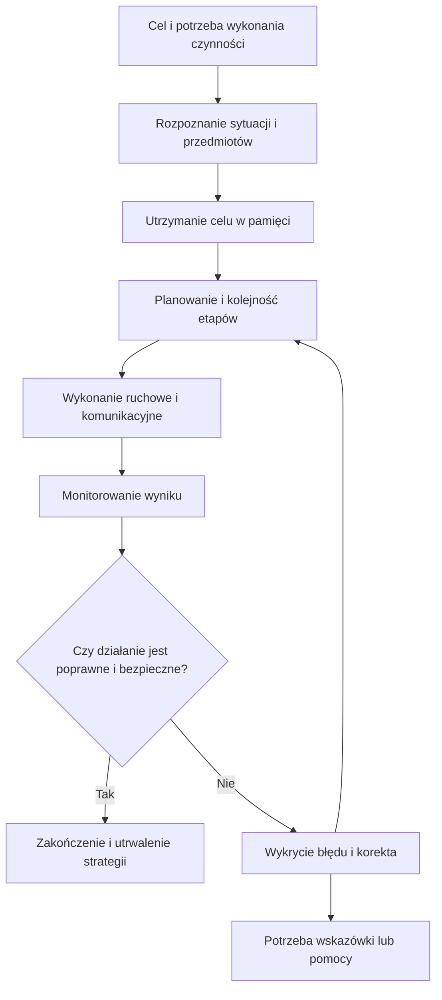
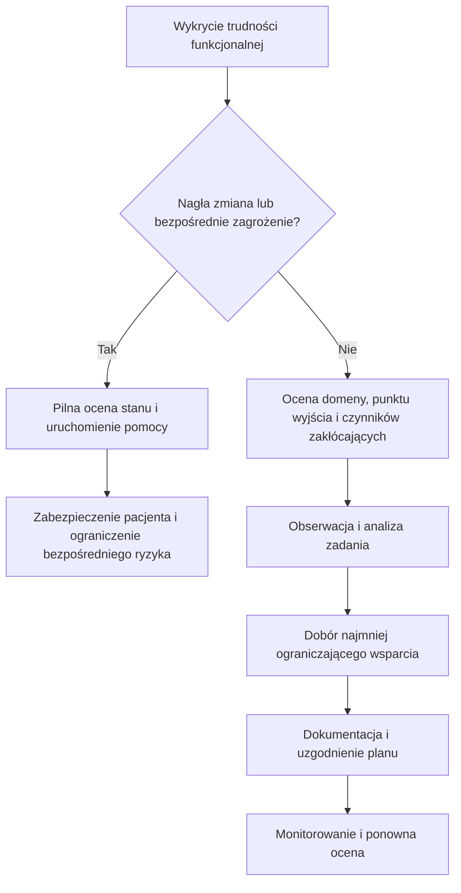
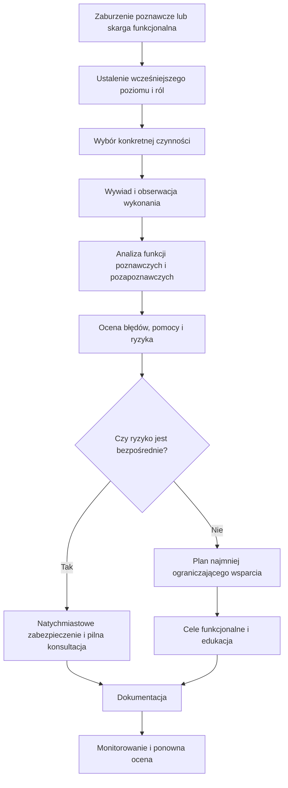

# 7.9. Ocena funkcjonalnych następstw zaburzeń poznawczych

> **Moduł 7. Ocena funkcji poznawczych i psychicznych**  
> Materiał dydaktyczny do kursu badania neurologicznego. Rozdział poświęcono ocenie tego, jak zaburzenia pamięci, uwagi, języka, funkcji wykonawczych, orientacji i oceny sytuacji wpływają na codzienną samodzielność, bezpieczeństwo, role społeczne oraz potrzeby wsparcia.  
> **Data opracowania:** 28 listopada 2026 r.  
> **Poziom:** kształcenie zaawansowane – neurologia, geriatria, rehabilitacja, pielęgniarstwo, fizjoterapia i opieka interdyscyplinarna.

## Wprowadzenie

Wynik testu poznawczego nie opisuje całego życia człowieka. Pacjent może uzyskać relatywnie dobry wynik krótkiego badania przesiewowego, a mimo to popełniać niebezpieczne błędy podczas przyjmowania leków, zarządzania rachunkami, przygotowywania posiłków albo poruszania się w nieznanym otoczeniu. Może też uzyskać wynik obniżony z powodu ograniczeń słuchu, wzroku, języka, wykształcenia, bólu lub zmęczenia, a nadal samodzielnie i bezpiecznie wykonywać wiele złożonych czynności. Dlatego ocena funkcjonalnych następstw zaburzeń poznawczych musi wykraczać poza liczbę punktów w MMSE, MoCA, Mini-Cog lub innym narzędziu przesiewowym.

Celem badania jest ustalenie, **co pacjent potrafi wykonać, co rzeczywiście wykonuje, w jakich warunkach, z jaką jakością i bezpieczeństwem, jakiego rodzaju wsparcia potrzebuje oraz czy obserwowana zmiana wynika z zaburzeń poznawczych, innych problemów zdrowotnych, barier środowiskowych czy ich współwystępowania**. Ocena ma charakter funkcjonalny, a nie moralny. Trudności z płaceniem rachunków, pamiętaniem o lekach czy odnajdywaniem drogi nie świadczą o lenistwie, braku dobrej woli ani o mniejszej wartości osoby. Są informacją kliniczną, którą należy opisać bez stygmatyzacji i wykorzystać do zaplanowania proporcjonalnego wsparcia.

Rozdział rozwija sześć pozycji konspektu 7.9: samodzielność w czynnościach dnia codziennego, bezpieczeństwo przyjmowania leków, prowadzenie pojazdów i obsługę urządzeń, zarządzanie finansami, ryzyko zagubienia i upadków oraz potrzeby opiekuna i wsparcia środowiskowego. Nie powtarza pełnego omówienia modelu ICF, podstawowych ADL i IADL ani skal ogólnej oceny funkcjonalnej z rozdziału 2.12. Nie zastępuje także oceny stanu psychicznego, diagnostyki majaczenia i otępienia ani instrukcji przeprowadzania MMSE, MoCA, Mini-Cog, FAB, 4AT i CAM, opisanych w rozdziałach 7.6–7.8. W tym miejscu nacisk położono na **przełożenie rozpoznanych trudności poznawczych na konkretne czynności, ryzyko i plan opieki**.

> **Zasada nadrzędna:** rozpoznanie otępienia, łagodnych zaburzeń poznawczych lub nieprawidłowy wynik przesiewowy nie upoważniają automatycznie do odebrania pacjentowi samodzielności, prawa do podejmowania decyzji, możliwości prowadzenia pojazdu ani kontroli nad finansami. Każdą zdolność ocenia się w odniesieniu do konkretnego zadania, aktualnego stanu, ryzyka, dostępnych ułatwień i obowiązujących przepisów. Z drugiej strony deklarowana samodzielność nie może przesłaniać udokumentowanych, powtarzalnych błędów zagrażających życiu lub zdrowiu.

---

## 1. Cele badania i efekty kształcenia

### 1.1. Cele kliniczne

Ocena funkcjonalnych następstw zaburzeń poznawczych ma umożliwić:

1. określenie, czy i w jakim zakresie zmieniła się samodzielność pacjenta w porównaniu z jego wcześniejszym poziomem funkcjonowania;
2. odróżnienie ograniczeń wynikających z zaburzeń poznawczych od ograniczeń ruchowych, czuciowych, wzrokowych, słuchowych, bólowych, internistycznych i środowiskowych;
3. wykrycie czynności, w których pacjent popełnia błędy, pomija etapy, nie rozpoznaje zagrożenia lub nie potrafi skorygować działania;
4. ocenę bezpieczeństwa stosowania leków, przygotowywania posiłków, gospodarowania pieniędzmi, korzystania z transportu, prowadzenia pojazdów i obsługi urządzeń;
5. rozpoznanie ryzyka zagubienia, upadku, wypadku domowego, zatrucia, niedożywienia, odwodnienia, zaniedbania samoopieki i wykorzystania finansowego;
6. ustalenie, jakie wsparcie jest niezbędne, jakie jest jedynie pomocne, a jakie mogłoby niepotrzebnie ograniczać autonomię;
7. rozpoznanie potrzeb i obciążenia osoby wspierającej;
8. przygotowanie realistycznego, uzgodnionego z pacjentem planu bezpieczeństwa i wsparcia;
9. określenie mierzalnych celów rehabilitacji poznawczej, kompensacji i adaptacji środowiska;
10. zaplanowanie ponownej oceny po zmianie stanu zdrowia, wdrożeniu pomocy lub wystąpieniu nowego incydentu.

### 1.2. Efekty uczenia się

Po ukończeniu rozdziału uczestnik powinien umieć:

- wyjaśnić różnicę między wynikiem testu poznawczego, zdolnością do wykonania zadania i rzeczywistym wykonaniem zadania w środowisku;
- przeprowadzić ukierunkowany wywiad funkcjonalny z pacjentem i – za jego zgodą lub na właściwej podstawie prawnej – z osobą bliską;
- analizować czynność jako sekwencję etapów wymagających pamięci, uwagi, planowania, języka, praksji, percepcji i kontroli błędów;
- odróżnić samodzielność bez pomocy od samodzielności z urządzeniem wspomagającym, przypomnieniem, nadzorem lub pomocą fizyczną;
- wykrywać niebezpieczne błędy w gospodarowaniu lekami, finansami i urządzeniami;
- opisać kliniczne przesłanki wymagające pilnej konsultacji lub czasowego ograniczenia ryzykownej czynności;
- nie wydawać poza swoimi kompetencjami formalnych orzeczeń o zdolności do prowadzenia pojazdów, zdolności do pracy, zdolności do czynności prawnych ani zdolności do podejmowania decyzji medycznych;
- dokumentować obserwacje w sposób konkretny, neutralny i możliwy do zweryfikowania;
- zaproponować środki wsparcia najmniej ograniczające autonomię;
- rozpoznać przeciążenie opiekuna i skierować go do adekwatnej pomocy.

### 1.3. Granice kompetencji

Ocena funkcjonalna w badaniu neurologicznym jest elementem procesu klinicznego. Nie jest równoznaczna z:

- pełną diagnozą neuropsychologiczną;
- formalną oceną zdolności do czynności prawnych;
- orzeczeniem o braku zdolności do świadomego lub swobodnego podjęcia konkretnej decyzji;
- orzeczeniem o spełnianiu wymagań zdrowotnych dla kierowcy;
- oceną psychologiczną kierowcy;
- oceną ryzyka zawodowego na stanowisku pracy;
- decyzją sądu, organu administracji lub instytucji finansowej.

Jeżeli wynik badania może mieć konsekwencje prawne, zawodowe lub administracyjne, należy wskazać właściwą ścieżkę specjalistyczną i nie przedstawiać wstępnej obserwacji jako formalnego rozstrzygnięcia. Zakres czynności zależy od kwalifikacji zawodowych, uprawnień, aktualnych przepisów i procedur placówki.

---

## 2. Definicje i podstawowe rozróżnienia

### 2.1. Funkcjonalne następstwa zaburzeń poznawczych

Są to ograniczenia lub zmiany w wykonywaniu codziennych czynności, które pozostają w związku z osłabieniem jednej lub kilku funkcji poznawczych. Mogą dotyczyć rozpoczęcia działania, zapamiętania celu, utrzymania uwagi, zaplanowania kolejności, rozpoznania przedmiotów, zrozumienia instrukcji, oceny ryzyka, wykrycia błędu lub zakończenia czynności.

Przykład: osoba pamięta, że powinna przyjmować lek, ale nie potrafi ustalić, czy dawka została już przyjęta. Problem dotyczy nie tylko pamięci deklaratywnej, lecz także pamięci prospektywnej, monitorowania wykonania i kontroli błędu.

### 2.2. Podstawowe czynności dnia codziennego – ADL

ADL obejmują podstawową samoobsługę, między innymi jedzenie, higienę, kąpiel, ubieranie, korzystanie z toalety i podstawowe przemieszczanie się. W tym rozdziale interesuje nas szczególnie poznawczy składnik tych czynności: rozpoznanie celu, dobór właściwych przedmiotów, zachowanie kolejności, dostosowanie działania do sytuacji i kontrola bezpieczeństwa.

Szczegółowe zasady ogólnej oceny ADL oraz narzędzia takie jak indeks Barthel i skala Katza przedstawiono w rozdziale 2.12. Nie należy ponownie przeliczać tych samych domen bez potrzeby; w 7.9 należy dopisać, **czy ograniczenie ma komponent poznawczy i jaki mechanizm je wyjaśnia**.

### 2.3. Złożone czynności dnia codziennego – IADL

IADL wymagają zwykle większej samodzielności organizacyjnej i poznawczej. Należą do nich między innymi:

- przyjmowanie i organizowanie leków;
- robienie zakupów;
- przygotowywanie posiłków;
- korzystanie z telefonu i technologii;
- organizowanie transportu;
- prowadzenie gospodarstwa domowego;
- zarządzanie rachunkami i finansami;
- umawianie wizyt i realizowanie zaleceń;
- planowanie podróży i poruszanie się poza znanym otoczeniem.

Wczesne zaburzenia funkcji wykonawczych, pamięci prospektywnej i oceny sytuacji mogą najpierw ujawniać się właśnie w złożonych IADL, zanim pojawią się wyraźne trudności w podstawowej samoobsłudze.

### 2.4. Zaawansowane aktywności dnia codziennego

Zaawansowane aktywności obejmują zadania zależne od ról życiowych, zainteresowań, pracy, nauki, relacji społecznych, aktywności obywatelskiej, korzystania z technologii i samodzielnego podróżowania. Ich utrata może być pierwszym sygnałem pogorszenia, ale nie zawsze oznacza chorobę: przyczyną może być emerytura, zmiana warunków życia, brak dostępu, choroba somatyczna albo świadoma zmiana priorytetów.

### 2.5. Zdolność, wykonanie i uczestnictwo

Należy rozróżnić trzy poziomy:

- **Zdolność do wykonania:** co osoba może zrobić w standaryzowanych, sprzyjających warunkach.
- **Wykonanie:** co osoba faktycznie robi w swoim domu, pracy i społeczności, z uwzględnieniem dostępnych pomocy oraz barier.
- **Uczestnictwo:** możliwość udziału w ważnych rolach i sytuacjach życiowych, na przykład prowadzeniu domu, opiece nad bliskimi, pracy, nauce, praktykach religijnych, spotkaniach rodzinnych lub aktywności społecznej.

Różnica między zdolnością a wykonaniem jest klinicznie istotna. Pacjent może poprawnie wykonać zadanie w gabinecie, lecz w domu nie radzić sobie z wieloetapową czynnością z powodu hałasu, presji czasu, wielu bodźców lub braku podpowiedzi.

### 2.6. Rodzaje pomocy

| Rodzaj wsparcia | Znaczenie | Przykład |
|---|---|---|
| Samodzielność | Czynność wykonana bez pomocy innej osoby | Pacjent sam przygotowuje ubranie i ubiera się bezpiecznie |
| Ułatwienie techniczne | Wykorzystanie urządzenia lub adaptacji | Organizer leków przygotowany według uzgodnionego planu |
| Przypomnienie | Sygnał rozpoczęcia lub kontynuacji | Alarm przypomina o zaplanowanej czynności |
| Podpowiedź werbalna | Wskazanie następnego etapu | „Teraz sprawdź, czy zakręciłeś gaz” |
| Wskazówka wizualna | Informacja w postaci etykiety, planu lub piktogramu | Zdjęcia kolejnych etapów przygotowania posiłku |
| Nadzór | Obecność osoby obserwującej i reagującej na ryzyko | Bliski pozostaje w pobliżu podczas obsługi kuchenki |
| Asekuracja | Gotowość do zapobieżenia upadkowi lub urazowi | Osoba wspierająca towarzyszy podczas wchodzenia po schodach |
| Pomoc częściowa | Wykonanie wybranych etapów przez inną osobę | Opiekun przygotowuje leki, pacjent sam je przyjmuje po weryfikacji |
| Pomoc całkowita | Inna osoba wykonuje całą czynność | Opiekun przejmuje zadanie, którego pacjent nie może bezpiecznie wykonać |

W dokumentacji należy określić nie tylko, czy pacjent „wymaga pomocy”, ale także **jakiej pomocy, w jakiej sytuacji, jak często i z jakiego powodu**.

### 2.7. Samodzielność a autonomia

Samodzielność oznacza wykonanie czynności bez pomocy. Autonomia oznacza możliwość wyrażania preferencji, udziału w decyzjach i kierowania własnym życiem. Osoba może potrzebować pomocy w przygotowaniu leków, a jednocześnie zachowywać zdolność do wyboru miejsca zamieszkania, ubioru, planu dnia lub preferowanego sposobu rehabilitacji.

Wsparcie powinno zwiększać bezpieczeństwo i sprawczość, nie zaś zastępować wolę pacjenta bez uzasadnienia.

---

## 3. Podstawy neuroanatomiczne i neurofizjologiczne funkcjonowania

### 3.1. Funkcjonowanie jako wynik pracy sieci mózgowych

Codzienna czynność nie jest wykonywana przez jeden „ośrodek samodzielności”. Wymaga współpracy rozproszonych sieci odpowiedzialnych za:

- utrzymanie celu działania;
- wybór właściwej reakcji;
- pamiętanie o zamiarze w przyszłości;
- rozpoznawanie przedmiotów i sytuacji;
- orientację przestrzenną;
- sekwencjonowanie ruchów;
- kontrolę błędów;
- przewidywanie skutków;
- regulację emocji i motywacji;
- integrację informacji wzrokowych, słuchowych, czuciowych i ruchowych.

Ograniczenie funkcjonalne może powstać zarówno wskutek uszkodzenia określonego obszaru, jak i zaburzenia łączności między odległymi strukturami. Dlatego podobny błąd w czynności może mieć różne przyczyny.

### 3.2. Kora przedczołowa i obwody czołowo-prążkowiowe

Kora przedczołowa uczestniczy w planowaniu, hamowaniu reakcji, utrzymywaniu celu, elastycznym przełączaniu strategii, ocenie konsekwencji i monitorowaniu działania.

Uszkodzenie lub dysfunkcja obwodów czołowo-prążkowiowych może prowadzić do:

- trudności w rozpoczęciu czynności;
- utraty kolejności etapów;
- powtarzania tych samych działań;
- impulsywnych zakupów;
- nieadekwatnego reagowania na ostrzeżenia;
- trudności w zmianie planu po wystąpieniu przeszkody;
- braku kontroli błędów;
- odhamowania lub apatii.

W praktyce pacjent może znać zasady bezpiecznego przygotowania posiłku, lecz nie zatrzymać działania, gdy zauważy dym lub rozlaną ciecz.

### 3.3. Hipokamp i przyśrodkowy płat skroniowy

Struktury przyśrodkowego płata skroniowego uczestniczą w uczeniu się i konsolidacji pamięci epizodycznej. Ich dysfunkcja może utrudniać zapamiętywanie nowych informacji, lokalizacji przedmiotów, ustaleń i instrukcji.

W czynnościach dnia codziennego może to skutkować:

- ponownym przyjmowaniem tej samej dawki leku;
- zapominaniem o pozostawionym włączonym urządzeniu;
- wielokrotnym kupowaniem tych samych produktów;
- gubieniem przedmiotów i niemożnością odtworzenia kolejności zdarzeń;
- trudnością w zapamiętaniu nowej trasy.

Nie każda trudność pamięciowa wynika jednak z uszkodzenia hipokampa. Niewystarczające kodowanie informacji może być skutkiem zaburzeń uwagi, depresji, bólu, niewyspania, majaczenia lub działania leków.

### 3.4. Kora ciemieniowa i sieci wzrokowo-przestrzenne

Obszary ciemieniowe integrują informacje czuciowe, wzrokowe i przestrzenne. Uczestniczą w orientacji, kierowaniu uwagą, rozpoznawaniu relacji przestrzennych, praksji i schemacie ciała.

Dysfunkcja tych sieci może powodować:

- trudności w odnajdywaniu przedmiotów;
- pomijanie jednej strony przestrzeni;
- błędy podczas ubierania;
- problemy z odczytywaniem oznaczeń na urządzeniach;
- trudności w orientacji w nowym budynku;
- nieprawidłowe ocenianie odległości;
- gubienie się w znanych lub nieznanych miejscach.

Należy odróżnić zaburzenia wzrokowo-przestrzenne od obniżenia ostrości wzroku, ubytku pola widzenia, zaniedbywania stronnego, zaburzeń czucia i apraksji.

### 3.5. Sieci językowe i komunikacja

Zaburzenia rozumienia, nazywania, czytania i pisania mogą wpływać na możliwość odczytania etykiety leku, zrozumienia instrukcji, telefonicznego wezwania pomocy lub przeprowadzenia transakcji.

W ocenie trzeba ustalić, czy trudność wynika z afazji, niedosłuchu, nieznajomości języka, zaburzeń pamięci, uwagi czy nieodpowiedniej formy komunikatu. W razie potrzeby należy stosować prosty język, pismo o odpowiednim kontraście, piktogramy, komunikację wspomagającą lub pomoc logopedy.

### 3.6. Móżdżek, jądra podstawy i układ ruchowy

Móżdżek wspiera przewidywanie skutków ruchu, korektę błędów, rytm i koordynację. Jądra podstawy uczestniczą w wyborze i inicjowaniu programów ruchowych. Zaburzenia tych układów mogą ograniczać wykonywanie czynności, nawet gdy pamięć i rozumienie pozostają względnie zachowane.

Przykłady:

- ataksja utrudnia bezpieczne przenoszenie gorącego naczynia;
- bradykinezja wydłuża czas ubierania i przygotowania posiłku;
- drżenie utrudnia dawkowanie płynnego leku;
- niedowład utrudnia otwieranie opakowań;
- neuropatia obwodowa zmniejsza czucie w dłoniach i zwiększa ryzyko oparzenia.

Nie należy przypisywać zaburzeniom poznawczym ograniczenia, którego główną przyczyną jest deficyt ruchowy lub czuciowy.

### 3.7. Uwaga, pamięć prospektywna i monitorowanie działania

Wiele codziennych czynności wymaga pamięci prospektywnej, czyli pamiętania o wykonaniu zamiaru w przyszłości. Przykładem jest przyjęcie dawki o określonej porze, wyłączenie piekarnika po zakończeniu pieczenia lub zabranie dokumentów przed wyjściem.

Monitorowanie działania wymaga porównania stanu rzeczywistego z planowanym. Osoba powinna zauważyć, że:

- tabletka nadal leży w organizerze;
- rachunek nie został opłacony;
- drzwi nie są zamknięte;
- urządzenie nadal pracuje;
- trasa prowadzi w niewłaściwym kierunku.

Osłabienie monitorowania może być bardziej niebezpieczne niż samo zapominanie, ponieważ pacjent nie rozpoznaje, że popełnił błąd.

### 3.8. Schemat funkcjonalny czynności

---

## 4. Ogólna metodyka oceny funkcjonalnej

### 4.1. Zasada porównania z wcześniejszym poziomem

Najważniejsze pytanie nie brzmi: „Czy pacjent wykonuje czynność idealnie?”, lecz: „Czy w porównaniu z jego wcześniejszym sposobem funkcjonowania nastąpiła istotna zmiana?”. Osoba, która nigdy nie prowadziła samochodu, nie zarządzała rachunkami ani nie przygotowywała posiłków, nie powinna być oceniana tak, jakby utraciła te umiejętności wskutek choroby.

Należy zebrać informacje o:

- wcześniejszych obowiązkach i rolach;
- wykształceniu i doświadczeniu;
- zwyczajach domowych;
- podziale zadań w rodzinie;
- wcześniejszym sposobie zarządzania finansami;
- dotychczasowym korzystaniu z transportu i technologii;
- zmianach w ostatnich tygodniach, miesiącach i latach.

### 4.2. Źródła informacji

Najlepiej łączyć:

1. relację pacjenta;
2. relację osoby, która zna jego wcześniejsze funkcjonowanie;
3. obserwację wykonania czynności;
4. dokumentację medyczną i listę leków;
5. informacje z rehabilitacji, opieki domowej lub pracy – jeśli są dostępne i można je legalnie udostępnić;
6. dane obiektywne, na przykład nieopłacone rachunki, powtarzające się pomyłki w dawkowaniu lub udokumentowane upadki, o ile pacjent wyraził zgodę na ich wykorzystanie albo istnieje inna właściwa podstawa prawna.

Relacja opiekuna jest ważna, ale nie jest automatycznie bardziej wiarygodna niż relacja pacjenta. Należy uwzględnić możliwe różnice perspektywy, konflikty, zmęczenie, interesy finansowe, nadmierną ochronę lub niedostrzeganie trudności.

### 4.3. Procedura krok po kroku

**Krok 1. Ocena pilności.**  
Przed badaniem należy wykluczyć nagłą zmianę stanu, majaczenie, nowe objawy ogniskowe, napad padaczkowy, ciężkie zaburzenia metaboliczne, zatrucie, uraz, zagrożenie samobójcze i bezpośrednie ryzyko wypadku. W stanie nagłym priorytetem jest pilna pomoc, a nie pełna ocena IADL.

**Krok 2. Ustalenie celu badania.**  
Należy określić, czy badanie ma dotyczyć samoobsługi, leków, finansów, prowadzenia pojazdu, zagubień, upadków, opieki domowej czy planowania wsparcia.

**Krok 3. Uzyskanie zgody i wyjaśnienie zakresu.**  
Pacjent powinien wiedzieć, jakie czynności będą omawiane lub obserwowane, kto może otrzymać informacje i w jakim celu. Udział bliskiej osoby powinien być uzgodniony z pacjentem, z uwzględnieniem przepisów dotyczących tajemnicy i dokumentacji.

**Krok 4. Ustalenie stanu wyjściowego.**  
Należy odtworzyć, kto wcześniej wykonywał dane zadanie, jak często i w jaki sposób.

**Krok 5. Ocena aktualnego wykonania.**  
Pytamy o rzeczywiste zachowania, a nie tylko o deklarację „radzę sobie”. Prosimy o konkretne przykłady z ostatnich dni lub tygodni.

**Krok 6. Analiza domen poznawczych.**  
Ustalamy, czy czynność wymaga pamięci, uwagi, planowania, języka, praksji, orientacji, oceny ryzyka, elastyczności poznawczej czy kontroli błędu.

**Krok 7. Ocena ograniczeń pozapoznawczych.**  
Sprawdzamy wzrok, słuch, ruchomość, siłę, czucie, ból, wydolność, nastrój, sen i działania niepożądane leków.

**Krok 8. Obserwacja czynności.**  
Jeżeli jest to bezpieczne i uzasadnione, obserwujemy wykonanie zadania w warunkach zbliżonych do naturalnych. Nie prowokujemy niebezpiecznej sytuacji, aby „sprawdzić”, czy pacjent popełni błąd.

**Krok 9. Ocena pomocy.**  
Zapisujemy, czy pacjent potrzebuje przypomnienia, wskazówki, nadzoru, asekuracji, pomocy częściowej czy całkowitej.

**Krok 10. Ocena konsekwencji błędu.**  
Określamy prawdopodobieństwo i ciężkość szkody: pomyłka w kolejności ubierania ma inne znaczenie niż podwójne przyjęcie antykoagulantu lub pozostawienie włączonego gazu.

**Krok 11. Ocena zasobów i barier środowiskowych.**  
Uwzględniamy układ mieszkania, oświetlenie, oznaczenia, dostępność transportu, urządzenia wspomagające, sieć rodzinną i możliwość korzystania z usług.

**Krok 12. Uzgodnienie wsparcia.**  
Wybieramy środki najmniej ograniczające, które realnie zmniejszają ryzyko.

**Krok 13. Dokumentacja i przekazanie zaleceń.**  
Opisujemy obserwacje, źródła informacji, niepewność, ryzyko i plan.

**Krok 14. Zaplanowanie ponownej oceny.**  
Ustalamy termin lub warunek ponownego badania, na przykład po zmianie leków, hospitalizacji, upadku, incydencie związanym z finansami lub pogorszeniu orientacji.

### 4.4. Pytania otwarte i pytania o konkretne zdarzenia

Zamiast pytać wyłącznie: „Czy przyjmuje Pan/Pani leki prawidłowo?”, warto zapytać:

- „Proszę opowiedzieć, jak wygląda przyjmowanie leków od rana do wieczora”.
- „Kto przygotowuje tabletki i skąd wiadomo, że dawka została już przyjęta?”.
- „Co dzieje się, gdy pora przyjęcia wypada poza domem?”.
- „Czy zdarzyło się w ostatnim miesiącu przyjąć dawkę dwa razy albo ją pominąć?”.
- „Kto sprawdza, czy leki się kończą?”.
- „Czy pacjent potrafi wyjaśnić, co zrobi w razie pominięcia dawki?”.

Warto dopytywać o częstotliwość, okoliczności, konsekwencje i sposób radzenia sobie. Pojedynczy błąd nie przesądza o trwałej utracie zdolności, ale powtarzające się błędy wymagają analizy.

### 4.5. Obserwacja zadania – analiza etapów

Dla wybranej czynności należy ustalić:

1. **Inicjację:** czy pacjent rozpoczyna działanie bez nadmiernego przypominania?
2. **Rozpoznanie celu:** czy rozumie, po co wykonuje czynność?
3. **Dobór narzędzi:** czy wybiera właściwe przedmioty?
4. **Planowanie:** czy potrafi ułożyć etapy w logicznej kolejności?
5. **Wykonanie:** czy wykonuje je sprawnie i bezpiecznie?
6. **Elastyczność:** czy radzi sobie ze zmianą warunków?
7. **Monitorowanie:** czy zauważa pomyłki?
8. **Korektę:** czy potrafi naprawić błąd?
9. **Zakończenie:** czy pamięta o zamknięciu, wyłączeniu, odłożeniu i zabezpieczeniu przedmiotów?
10. **Uogólnianie:** czy umiejętność przenosi się na inne dni i sytuacje?

Nie należy oceniać wyłącznie szybkości. Wolniejsze wykonanie może być bezpieczne i samodzielne, jeśli pacjent zachowuje kontrolę nad czynnością.

---

## 5. Samodzielność w czynnościach dnia codziennego

### 5.1. Poznawczy składnik samoobsługi

Podstawowa samoobsługa wymaga współdziałania funkcji poznawczych i ruchowych. Kąpiel wymaga zaplanowania kolejności, rozpoznania przyborów, regulacji temperatury, pamiętania o bezpieczeństwie i zakończenia czynności. Ubieranie wymaga rozpoznania części garderoby, orientacji przód–tył, doboru stroju do pogody i sytuacji, a także praksji oraz sprawności manualnej.

W ocenie należy odróżnić:

- **brak inicjacji** – pacjent nie rozpoczyna czynności, mimo że potrafi ją wykonać po przypomnieniu;
- **zaburzenie sekwencjonowania** – pomija lub przestawia etapy;
- **apraksję** – ma trudność z wykonaniem wyuczonego, celowego gestu mimo braku wystarczającego deficytu siły, czucia lub rozumienia;
- **agnozję** – nie rozpoznaje przedmiotu lub jego znaczenia;
- **zaburzenie orientacji** – nie wie, gdzie znajduje się potrzebny przedmiot lub pomieszczenie;
- **zaburzenie pamięci prospektywnej** – zapomina o dokończeniu zadania;
- **zaburzenie oceny ryzyka** – nie dostrzega zagrożenia, na przykład zbyt gorącej wody;
- **ograniczenie ruchowe lub czuciowe** – wie, co zrobić, ale nie może wykonać czynności bezpiecznie.

### 5.2. Higiena i kąpiel

Należy ocenić, czy pacjent:

- pamięta o regularnej higienie;
- rozpoznaje potrzebne przybory;
- dobiera właściwe środki;
- zachowuje kolejność czynności;
- reguluje temperaturę wody;
- pamięta o wyłączeniu kranu;
- bezpiecznie wchodzi i wychodzi z wanny lub kabiny;
- nie pozostawia włączonych urządzeń;
- rozpoznaje, kiedy potrzebuje pomocy.

**Czerwone sygnały:** oparzenia, powtarzające się poślizgnięcia, pozostawianie wody, niebezpieczne korzystanie z urządzeń elektrycznych, brak reakcji na zawroty głowy lub omdlenie. Należy rozważyć ocenę środowiska domowego, uchwyty, maty antypoślizgowe, siedzisko, regulację temperatury i nadzór dostosowany do ryzyka.

### 5.3. Ubieranie i dobór garderoby

Trudności mogą wynikać z zaburzeń praksji, orientacji przestrzennej, funkcji wykonawczych, rozpoznawania odzieży lub oceny sytuacji społecznej.

Warto sprawdzić, czy pacjent:

- dobiera ubranie do pogody i okazji;
- rozpoznaje przód i tył;
- potrafi ułożyć kolejność zakładania;
- zapina guziki i zamki;
- zauważa, że ubranie jest zabrudzone lub nieodpowiednie;
- pamięta o obuwiu i odzieży ochronnej.

Pomocne mogą być ubrania o prostym kroju, oznaczenia kolorystyczne, przygotowanie zestawu na dany dzień i ograniczenie liczby dostępnych elementów. Nie należy infantylizować pacjenta ani odbierać mu możliwości wyboru.

### 5.4. Jedzenie, picie i przygotowanie prostego posiłku

Trzeba rozróżnić trudności poznawcze od dysfagii, niedowładu, drżenia, zaburzeń czucia, chorób jamy ustnej, depresji i utraty apetytu.

Oceniamy:

- rozpoznawanie posiłku i przyborów;
- inicjowanie jedzenia i picia;
- pamiętanie o regularnych posiłkach;
- przestrzeganie zaleceń dietetycznych, jeśli są wskazane;
- bezpieczne korzystanie z kuchenki, czajnika i noża;
- kontrolę temperatury potraw;
- wyłączanie urządzeń i porządkowanie miejsca pracy;
- rozpoznawanie zepsutego jedzenia.

Krztuszenie, kaszel podczas posiłku, mokry głos, nawracające infekcje dolnych dróg oddechowych lub niezamierzona utrata masy ciała wymagają odrębnej oceny połykania i stanu odżywienia. Nie wolno przypisywać ich automatycznie zaburzeniom pamięci.

### 5.5. Korzystanie z toalety i kontrola higieny

W ocenie poznawczej należy zwrócić uwagę na rozpoznawanie potrzeby, odnajdywanie toalety, zdejmowanie i zakładanie odzieży, zachowanie higieny oraz bezpieczne zakończenie czynności.

Nagła zmiana kontroli zwieraczy, zatrzymanie moczu, nowe zaburzenia czucia w okolicy krocza lub osłabienie kończyn dolnych mogą wskazywać na stan neurologiczny wymagający pilnej diagnostyki, a nie wyłącznie na postępujące zaburzenie poznawcze.

### 5.6. Planowanie dnia i utrzymywanie rutyny

Utrwalona, przewidywalna rutyna może kompensować osłabienie pamięci i funkcji wykonawczych. Należy sprawdzić, czy pacjent:

- rozumie plan dnia;
- pamięta o wizytach i posiłkach;
- potrafi przygotować potrzebne przedmioty;
- reaguje na zmianę harmonogramu;
- umie poprosić o pomoc;
- rozpoznaje sytuację, w której nie powinien działać samodzielnie.

Plan dnia powinien być czytelny, realistyczny i współtworzony z pacjentem. Nadmiar przypomnień może wywoływać frustrację; brak przypomnień może zwiększać ryzyko pominięcia ważnych czynności.

### 5.7. Interpretacja

Nie istnieje jeden uniwersalny próg punktowy, który samodzielnie rozstrzyga o samodzielności w każdej czynności. Należy opisać rodzaj błędu, częstość, kontekst, potrzebny poziom pomocy i konsekwencje. W przypadku pacjenta z zachowaną sprawnością ruchową, ale z zaburzeniem sekwencjonowania, wskazane może być wsparcie poznawcze, a nie całkowite przejęcie samoobsługi.

---

## 6. Bezpieczeństwo przyjmowania leków

### 6.1. Dlaczego zarządzanie lekami jest zadaniem złożonym

Bezpieczne przyjmowanie leków wymaga:

- rozpoznania preparatu;
- zrozumienia celu i schematu;
- zapamiętania pory;
- odróżnienia dawki przyjętej od nieprzyjętej;
- odczytania etykiety;
- otwarcia opakowania;
- odmierzenia lub podziału dawki, jeśli jest to zalecone;
- uwzględnienia zależności od posiłku;
- rozpoznania działań niepożądanych;
- uzupełnienia zapasu;
- skontaktowania się z personelem w razie problemu.

Wiele błędów wynika z połączenia zaburzeń pamięci, uwagi, wzroku, sprawności manualnej, rozumienia instrukcji i organizacji.

### 6.2. Uporządkowana ocena zarządzania lekami

Należy przeprowadzić uzgodnienie farmakoterapii i zapytać:

1. Kto aktualnie przygotowuje leki?
2. Kto decyduje o porze i dawce?
3. Czy pacjent rozpoznaje opakowania i nazwy?
4. Czy potrafi odczytać etykietę?
5. Czy pamięta, czy dawka została już przyjęta?
6. Czy rozumie, co zrobić w razie pominięcia dawki?
7. Czy potrafi bezpiecznie korzystać z organizera?
8. Czy pamięta o uzupełnianiu zapasu i receptach?
9. Czy przyjmuje preparaty bez recepty, suplementy, zioła lub leki innych osób?
10. Czy występowały pomyłki, podwójne dawki, pominięcia lub nieplanowane odstawienia?
11. Czy wystąpiły upadki, senność, splątanie, hipoglikemia, krwawienie albo inne możliwe następstwa?
12. Czy schemat jest zrozumiały i możliwy do wykonania?

Lista leków powinna być zweryfikowana z dokumentacją, opakowaniami, receptami i – gdy jest to możliwe – farmaceutą lub lekarzem prowadzącym.

### 6.3. Analiza typowych błędów

| Błąd | Możliwy mechanizm | Potencjalne następstwo |
|---|---|---|
| Pominięcie dawki | Pamięć prospektywna, brak rutyny | Niewystarczający efekt leczenia |
| Podwójna dawka | Brak monitorowania i pamięci epizodycznej | Toksyczność lub krwawienie |
| Zamiana opakowań | Rozpoznawanie wzrokowe, uwaga | Niewłaściwy preparat |
| Nieprawidłowe dzielenie tabletki | Rozumienie instrukcji, praksja | Błędna dawka |
| Samowolne odstawienie | Ocena ryzyka, rozumienie | Nawrót lub destabilizacja choroby |
| Łączenie z preparatem bez recepty | Wiedza, pamięć, ocena interakcji | Interakcja lub działanie niepożądane |
| Brak uzupełnienia leku | Planowanie i organizacja | Przerwanie terapii |
| Niezauważenie objawów alarmowych | Wgląd i rozumienie | Opóźniona pomoc |

### 6.4. Leki szczególnie istotne z punktu widzenia bezpieczeństwa

Szczególnej uwagi wymagają między innymi:

- leki przeciwkrzepliwe i przeciwpłytkowe;
- insulina i inne leki obniżające glikemię;
- leki przeciwpadaczkowe;
- opioidy i inne leki sedatywne;
- leki przeciwarytmiczne i hipotensyjne;
- leki o wąskim indeksie terapeutycznym;
- preparaty wymagające stopniowego zwiększania lub zmniejszania dawki;
- leki o działaniu antycholinergicznym lub nasilającym splątanie.

Wymienienie grup nie oznacza, że pacjent ma je samodzielnie odstawiać. Zmiany farmakoterapii należą do osoby uprawnionej do prowadzenia leczenia.

### 6.5. Środki poprawy bezpieczeństwa

Możliwe działania obejmują:

- uproszczenie schematu przez lekarza, jeżeli jest klinicznie zasadne;
- aktualną, czytelną listę leków;
- organizer przygotowywany przez uprawnioną lub przeszkoloną osobę;
- opakowania jednostkowe przygotowane przez aptekę, jeżeli usługa jest dostępna;
- alarm przypominający;
- kontrolę przyjęcia dawki przez osobę wspierającą;
- przegląd lekowy i ocenę interakcji;
- edukację pacjenta i opiekuna;
- ustalenie procedury na wypadek pominięcia lub błędnego przyjęcia dawki.

Organizer nie jest automatycznie bezpieczny. Pacjent może przesunąć tabletki, pomylić dni, otworzyć kilka przegródek lub przyjąć dawkę ponownie. Dobór pomocy musi wynikać z obserwacji rzeczywistego wykonania, a nie z samego rozpoznania.

### 6.6. Postępowanie po błędzie lekowym

W razie podejrzenia podwójnej dawki, pomylenia preparatu, przyjęcia leku przez niewłaściwą osobę lub pominięcia leku o krytycznym znaczeniu należy:

1. ustalić nazwę preparatu, dawkę, czas i możliwą ilość;
2. ocenić objawy i stan ogólny;
3. skontaktować się z lekarzem, farmaceutą lub właściwą służbą medyczną zgodnie z pilnością;
4. w przypadku ciężkich objawów lub zagrożenia życia wezwać pomoc ratunkową;
5. nie wywoływać wymiotów i nie podawać „odtrutek” bez zalecenia;
6. zabezpieczyć opakowanie i listę przyjętych leków;
7. udokumentować zdarzenie i wdrożyć działania zapobiegające powtórzeniu.

### 6.7. Kryteria pilnej reakcji

Pilnej oceny wymagają między innymi: zaburzenia świadomości po błędzie lekowym, duszność, omdlenie, drgawki, krwawienie, ciężka hipoglikemia, objawy udaru, silna reakcja alergiczna lub przyjęcie potencjalnie toksycznej dawki.

---

## 7. Prowadzenie pojazdów i obsługa urządzeń

### 7.1. Prowadzenie pojazdu jako złożona czynność poznawczo-ruchowa

Bezpieczne prowadzenie pojazdu wymaga równoczesnej pracy wielu funkcji:

- utrzymania i przerzutności uwagi;
- szybkości przetwarzania informacji;
- pamięci roboczej;
- orientacji wzrokowo-przestrzennej;
- rozpoznawania znaków i zagrożeń;
- przewidywania zachowania innych uczestników ruchu;
- hamowania nieadekwatnej reakcji;
- podejmowania decyzji pod presją czasu;
- koordynacji wzrokowo-ruchowej;
- elastycznego reagowania na zmianę sytuacji;
- zachowania krytycyzmu i wglądu.

Ograniczenie jednej funkcji może mieć niewielki wpływ w spokojnym, znanym otoczeniu, a duży podczas jazdy w ruchu miejskim, nocą, w deszczu, na skrzyżowaniu lub przy objazdach.

### 7.2. Wywiad dotyczący prowadzenia pojazdu

Należy zapytać o:

- aktualną częstość i rodzaj jazdy;
- typ pojazdu i charakter tras;
- wcześniejsze doświadczenie;
- wypadki, kolizje, otarcia i mandaty;
- pomyłki na znanych trasach;
- zbyt późne hamowanie lub trudności na skrzyżowaniach;
- gubienie się i konieczność korzystania z pomocy;
- reakcje pasażerów;
- sytuacje, w których pacjent zrezygnował z jazdy;
- zmiany w zachowaniu, uwadze, wzroku, słuchu i sprawności ruchowej;
- stosowane leki, senność, omdlenia, napady i używanie alkoholu lub innych substancji.

Pytania należy zadawać bez oskarżania. Celem jest uzyskanie rzetelnych danych i zmniejszenie ryzyka, nie zawstydzenie pacjenta.

### 7.3. Obserwacje zwiększające podejrzenie zagrożenia

Szczególną uwagę zwracają:

- dezorientacja na znanych trasach;
- częste pomyłki w ocenie odległości i pierwszeństwa;
- nieprawidłowe reagowanie na światła i znaki;
- trudność w dzieleniu uwagi;
- brak reakcji na nieoczekiwane zdarzenia;
- impulsywne decyzje;
- brak rozpoznania własnych błędów;
- powtarzające się incydenty zgłaszane przez niezależnych świadków;
- istotne zaburzenia wzrokowo-przestrzenne, praksji lub pola widzenia;
- niekontrolowane napady, omdlenia lub znaczna senność.

Żaden pojedynczy wynik MMSE, MoCA ani innego testu przesiewowego nie rozstrzyga samodzielnie o bezpieczeństwie prowadzenia pojazdu. Test może być jednym z elementów szerszej oceny, ale nie zastępuje wywiadu dotyczącego jazdy, badania neurologicznego, oceny wzroku, analizy funkcjonalnej i – jeśli wskazana – specjalistycznej oceny psychologicznej lub praktycznej.

### 7.4. Zasady postępowania

W Polsce decyzje dotyczące formalnych wymagań zdrowotnych dla kierowców należą do właściwych osób i jednostek działających na podstawie ustawy o kierujących pojazdami oraz przepisów wykonawczych. Osoba prowadząca edukacyjną lub rehabilitacyjną ocenę funkcjonalną nie powinna przedstawiać własnej obserwacji jako orzeczenia lekarskiego lub psychologicznego.

W razie istotnych przesłanek ryzyka należy:

1. opisać konkretne incydenty i funkcje, które mogą być zaburzone;
2. wyjaśnić pacjentowi i – w odpowiednim zakresie – osobie bliskiej, dlaczego potrzebna jest dalsza ocena;
3. skierować do uprawnionego lekarza przeprowadzającego badania kierowców, a w razie potrzeby do psychologa transportu lub ośrodka oceny jazdy;
4. omówić możliwość czasowego powstrzymania się od prowadzenia do czasu wyjaśnienia ryzyka, jeśli istnieje bezpośrednie zagrożenie;
5. zaproponować alternatywy transportu, aby ograniczenie jazdy nie prowadziło do izolacji;
6. udokumentować przekazane informacje i reakcję pacjenta.

Nie wolno obiecywać, że wczesne zaburzenia poznawcze zawsze oznaczają zakaz prowadzenia, ani zapewniać, że dobry wynik testu przesiewowego gwarantuje bezpieczeństwo. Decyzja powinna być indywidualna, aktualizowana wraz ze zmianą stanu i zgodna z prawem.

### 7.5. Obsługa urządzeń i maszyn

Ocena powinna obejmować urządzenia domowe i zawodowe, w szczególności:

- kuchenkę gazową i elektryczną;
- piekarnik, czajnik, żelazko i grzejnik;
- elektronarzędzia;
- kosiarki, pilarki i maszyny ogrodnicze;
- urządzenia warsztatowe;
- sprzęt medyczny używany w domu;
- systemy ogrzewania i wentylacji;
- urządzenia wymagające kontroli temperatury, ciśnienia lub dozowania.

Należy sprawdzić, czy pacjent rozumie funkcje przycisków, pamięta kolejność, potrafi zatrzymać urządzenie, rozpoznaje alarm i nie podejmuje niebezpiecznej improwizacji.

### 7.6. Działania ograniczające ryzyko

Możliwe rozwiązania:

- automatyczne wyłączniki i zabezpieczenia;
- ograniczenie dostępu do niebezpiecznych narzędzi, jeśli istnieje konkretne ryzyko;
- instrukcje obrazkowe;
- oznaczenia kontrastowe;
- wyłączniki czasowe;
- nadzór podczas czynności wysokiego ryzyka;
- zastąpienie niebezpiecznej czynności bezpieczniejszą;
- dostosowanie stanowiska pracy i konsultacja medycyny pracy.

Każde ograniczenie powinno być proporcjonalne, okresowo weryfikowane i – o ile to możliwe – uzgodnione z pacjentem.

### 7.7. Prawo i aktualność regulacji

Na dzień opracowania należy korzystać z aktualnych tekstów aktów prawnych, a nie wyłącznie ze starszych komentarzy. W szczególności należy sprawdzać:

- ustawę z 5 stycznia 2011 r. o kierujących pojazdami wraz z tekstem jednolitym i zmianami;
- rozporządzenie Ministra Zdrowia w sprawie badań lekarskich osób ubiegających się o uprawnienia do kierowania pojazdami i kierowców;
- rozporządzenie Ministra Zdrowia z 26 października 2026 r. dotyczące badań psychologicznych kierowców, obowiązujące od 14 listopada 2026 r.;
- aktualne przepisy dotyczące pracy na stanowisku kierowcy i badań medycyny pracy.

Nowelizacja z 30 kwietnia 2026 r. (Dz.U. 2026 poz. 608) dotyczyła między innymi szczegółowych warunków badania w zakresie słuchu. Nowelizacja z 26 października 2026 r. (Dz.U. 2026 poz. 1434) dotyczy badań psychologicznych. Nie należy wyciągać z samego faktu nowelizacji wniosku o konkretnym rozstrzygnięciu dotyczącym danego pacjenta – trzeba odczytać właściwe przepisy i skierować go do uprawnionej ścieżki.

---

## 8. Zarządzanie finansami

### 8.1. Znaczenie kliniczne

Zarządzanie finansami jest złożoną aktywnością wymagającą pamięci, liczenia, rozumienia pojęć, planowania, oceny ryzyka, hamowania impulsów i rozpoznawania oszustw. Trudności mogą pojawić się wcześnie, nawet gdy pacjent nadal samodzielnie je, ubiera się i porusza.

Należy odróżnić:

- umiejętność wykonania prostej transakcji;
- rozumienie wartości pieniędzy;
- planowanie budżetu;
- opłacanie rachunków;
- korzystanie z bankowości elektronicznej;
- rozpoznawanie nieuczciwych ofert;
- podejmowanie złożonych decyzji finansowych.

Sprawność w jednej domenie nie dowodzi sprawności we wszystkich pozostałych.

### 8.2. Obszary oceny

| Obszar | Przykładowe zadanie | Możliwa trudność |
|---|---|---|
| Proste operacje | Rozpoznanie nominałów, wydanie reszty | Zaburzenia liczenia lub uwagi |
| Zakupy | Porównanie ceny i ilości | Pamięć robocza, planowanie |
| Rachunki | Opłacenie faktury w terminie | Pamięć prospektywna, organizacja |
| Budżet | Zaplanowanie wydatków | Funkcje wykonawcze |
| Bankowość | Rozpoznanie odbiorcy i kwoty | Uwaga, rozumienie, ocena ryzyka |
| Umowy | Zrozumienie warunków i konsekwencji | Język, pamięć, abstrakcja |
| Oszustwa | Rozpoznanie presji i nietypowej prośby | Krytycyzm, hamowanie reakcji |

### 8.3. Wywiad i obserwacja

Warto zapytać:

- Kto dotychczas prowadził budżet domowy?
- Czy pacjent nadal wykonuje te same czynności?
- Czy pojawiły się nieopłacone rachunki, podwójne płatności lub nietypowe wypłaty?
- Czy pacjent rozpoznaje odbiorców przelewów?
- Czy rozumie, jakie skutki może mieć podpisanie umowy?
- Czy otrzymuje liczne telefony lub wiadomości z prośbą o pieniądze?
- Czy ktoś wywiera na niego presję?
- Czy pacjent potrafi przerwać transakcję i skonsultować wątpliwość?

Należy unikać żądania ujawniania haseł, numerów PIN, pełnych danych rachunków i innych poufnych informacji. Badanie nie wymaga dostępu do konta ani przeprowadzania rzeczywistego przelewu.

### 8.4. Ocena zdolności do konkretnej decyzji

Ocena kliniczna powinna dotyczyć określonej czynności i czasu. Należy sprawdzić, czy osoba:

1. rozumie istotne informacje;
2. potrafi zachować je wystarczająco długo, aby podjąć decyzję;
3. potrafi odnieść informacje do własnej sytuacji;
4. rozważa dostępne możliwości i ich konsekwencje;
5. potrafi zakomunikować wybór.

To uporządkowanie ma charakter kliniczny i edukacyjny. Nie zastępuje oceny prawnej ani formalnego orzeczenia o zdolności do czynności prawnych. Rozpoznanie otępienia samo w sobie nie przesądza o niezdolności do każdej decyzji finansowej.

### 8.5. Ochrona przed wykorzystaniem finansowym

Sygnały alarmowe obejmują:

- nagłe, nietypowe darowizny lub przelewy;
- powtarzające się wypłaty gotówki bez wyjaśnienia;
- podpisywanie dokumentów pod presją;
- pojawienie się nowej osoby kontrolującej finanse;
- znikanie pieniędzy lub przedmiotów;
- strach pacjenta przed osobą bliską;
- sprzeczne relacje i próby uniemożliwienia rozmowy z pacjentem.

Należy rozmawiać z pacjentem w warunkach zapewniających prywatność, nie oskarżać bez dowodów i uruchamiać odpowiednie procedury ochrony, jeśli istnieje podejrzenie przemocy ekonomicznej, oszustwa lub przestępstwa.

### 8.6. Proporcjonalne zabezpieczenia

Możliwe działania to:

- przypomnienia o rachunkach;
- automatyczne płatności po świadomym uzgodnieniu i kontroli;
- limity transakcji, jeśli pacjent tego chce i rozwiązanie jest prawnie dopuszczalne;
- wspólne przeglądanie wyciągów z osobą zaufaną;
- konsultacja prawna lub finansowa;
- przygotowanie pełnomocnictwa w czasie, gdy osoba rozumie jego znaczenie i konsekwencje;
- kontakt z bankiem w sprawie bezpiecznych rozwiązań;
- edukacja dotycząca oszustw telefonicznych, internetowych i podszywania się pod instytucje.

Nie wolno samodzielnie przejmować haseł, kart, pieniędzy ani dokumentów pacjenta. Każda forma reprezentacji musi mieć właściwą podstawę prawną i respektować wolę osoby w zakresie, w jakim może ona ją wyrazić.

---

## 9. Ryzyko zagubienia i upadków

### 9.1. Zagubienie i dezorientacja przestrzenna

Zagubienie może wynikać z zaburzeń pamięci topograficznej, orientacji, uwagi, rozpoznawania punktów orientacyjnych, planowania trasy lub oceny zagrożenia. Może wystąpić zarówno w nieznanym otoczeniu, jak i w miejscu wcześniej dobrze znanym.

Należy ustalić:

- czy pacjent gubi się w domu, na osiedlu czy poza miejscowością;
- czy rozpoznaje własny adres i potrafi poprosić o pomoc;
- czy potrafi korzystać z telefonu;
- czy pamięta cel podróży;
- czy rozpoznaje znane punkty orientacyjne;
- czy wychodzi bez poinformowania bliskich;
- czy wraca o zwykłej porze;
- czy wystąpiły przypadki odnalezienia poza planowaną trasą;
- czy zagubienie współwystępuje z majaczeniem, zaburzeniami widzenia lub zmianą leków.

Określenie „wędrowanie” bywa zbyt ogólne i może stygmatyzować. Lepiej opisać konkretne zachowanie: „pacjent trzykrotnie wyszedł z domu po zmroku, nie potrafił wskazać celu i wrócił z pomocą sąsiada”.

### 9.2. Różnicowanie przyczyn zagubienia

Należy rozważyć:

- otępienie z zaburzeniami orientacji;
- majaczenie i ostre splątanie;
- udar lub inne ogniskowe uszkodzenie mózgu;
- napad padaczkowy i stan ponapadowy;
- zaburzenia wzroku i pola widzenia;
- niedosłuch;
- depresję, lęk i zaburzenia snu;
- działanie leków sedatywnych;
- hipoglikemię, odwodnienie i infekcję;
- nieznane lub nadmiernie złożone środowisko.

Nagła dezorientacja, zwłaszcza z gorączką, zaburzeniami świadomości, nowym niedowładem, zaburzeniami mowy lub silnym bólem głowy, wymaga pilnej diagnostyki.

### 9.3. Ocena ryzyka upadków

Upadek jest zwykle wynikiem wielu czynników. Zaburzenia poznawcze mogą zwiększać ryzyko przez:

- nieuwagę;
- impulsywne wstawanie;
- nieprawidłową ocenę przeszkody;
- zapominanie o pomocy do chodzenia;
- brak rozpoznania zmęczenia;
- trudność w wykonywaniu dwóch zadań jednocześnie;
- niewłaściwe reagowanie na zmianę nawierzchni;
- dezorientację w nocy;
- nieprzestrzeganie zaleceń wynikających z ograniczeń ruchowych.

Trzeba równolegle ocenić siłę, chód, równowagę, czucie, wzrok, ciśnienie ortostatyczne, obuwie, stan stóp, ból, leki i warunki domowe. Sama obecność zaburzeń pamięci nie wystarcza do wyjaśnienia każdego upadku. Aktualne wytyczne NICE NG249 z 29 kwietnia 2025 r. zalecają, aby nie używać skal predykcyjnych do przewidywania, kto upadnie; zamiast tego należy ustalać indywidualne czynniki ryzyka i wdrażać ukierunkowane postępowanie wieloczynnikowe. W kompleksowej ocenie, zależnie od sytuacji, uwzględnia się między innymi funkcje poznawcze i nastrój, majaczenie w odpowiednich warunkach, ciśnienie w pozycji leżącej i stojącej, odżywienie i nawodnienie, chód, równowagę, siłę, słuch, wzrok, choroby współistniejące i leki [25].

### 9.4. Analiza zdarzenia

Po upadku należy ustalić:

1. kiedy i gdzie doszło do zdarzenia;
2. co pacjent robił bezpośrednio wcześniej;
3. czy wystąpiły zawroty głowy, omdlenie, ból w klatce piersiowej lub kołatanie serca;
4. czy pacjent pamięta zdarzenie;
5. czy doszło do urazu głowy;
6. czy przyjmuje leki przeciwkrzepliwe;
7. czy wystąpiła nowa dezorientacja lub objawy ogniskowe;
8. czy pacjent potrafi wezwać pomoc i bezpiecznie wstać.

Uraz głowy, utrata przytomności, nowy deficyt neurologiczny, silny ból, wymioty, krwawienie lub przyjmowanie leków przeciwkrzepliwych wymagają oceny medycznej zgodnie z pilnością.

### 9.5. Środowisko domowe

Warto ocenić:

- oświetlenie korytarzy i łazienki;
- kontrast stopni i progów;
- luźne dywany i przewody;
- uchwyty i poręcze;
- wysokość łóżka i krzesła;
- dostęp do toalety;
- obuwie;
- oznaczenia pomieszczeń;
- widoczność numeru domu i adresu;
- dostęp do telefonu;
- bezpieczeństwo wyjść i schodów.

Dostosowanie powinno odpowiadać rzeczywistemu wzorcowi błędów. Nadmierne zamykanie drzwi, blokowanie wyjść lub stosowanie ograniczeń fizycznych może powodować szkody i wymaga szczególnej ostrożności oraz zgodności z prawem i standardami opieki.

### 9.6. Plan bezpieczeństwa przy ryzyku zagubienia

Plan może obejmować:

- ustalenie bezpiecznych, znanych tras;
- kartę identyfikacyjną lub opaskę z danymi kontaktowymi, za zgodą pacjenta;
- telefon z prostą obsługą;
- uzgodniony sposób kontaktu z bliskimi;
- informację dla zaufanych sąsiadów, jeśli pacjent wyrazi zgodę;
- system lokalizacji tylko przy odpowiedniej podstawie prawnej, poszanowaniu prywatności i proporcjonalności;
- ustalenie, kto reaguje, gdy pacjent nie wróci o określonej porze;
- regularne sprawdzanie, czy rozwiązanie nadal działa.

Nie należy zakładać, że urządzenie lokalizacyjne rozwiązuje problem. Pacjent może je zgubić, wyłączyć, nie naładować lub nie zaakceptować.

---

## 10. Potrzeby opiekuna i wsparcie środowiskowe

### 10.1. Opiekun jako partner i osoba wymagająca wsparcia

Osoba bliska często dostarcza informacji o zmianie funkcjonowania i pomaga w codziennych czynnościach. Nie powinna być jednak traktowana wyłącznie jako bezpłatny zasób opieki. Opieka może wpływać na sen, zdrowie fizyczne, dobrostan psychiczny, sytuację zawodową, finanse i relacje rodzinne.

Należy pytać o potrzeby opiekuna niezależnie od stopnia zaburzeń poznawczych pacjenta.

### 10.2. Obszary oceny potrzeb opiekuna

1. **Zakres obowiązków:** ile czasu zajmuje opieka, jakie czynności są wykonywane i czy występują zadania nocne.
2. **Kompetencje:** czy opiekun rozumie chorobę, zna leki, potrafi rozpoznać stan nagły i wie, jak reagować.
3. **Zdrowie:** choroby przewlekłe, ból, zmęczenie, zaburzenia snu i ograniczenia ruchowe.
4. **Dobrostan psychiczny:** lęk, obniżony nastrój, poczucie winy, przeciążenie i izolacja.
5. **Sytuacja społeczna:** praca, dzieci, inni członkowie rodziny, transport i dostęp do usług.
6. **Finanse:** koszty leków, sprzętu, dojazdów i utraconych dochodów.
7. **Bezpieczeństwo:** ryzyko przemocy, konfliktów, zaniedbania lub niezamierzonego urazu.
8. **Odpoczynek:** możliwość zastępstwa, opieki wytchnieniowej i czasu wolnego.
9. **Preferencje:** czego opiekun chce się nauczyć i jakiej pomocy oczekuje.
10. **Plan kryzysowy:** kto przejmie opiekę, gdy opiekun zachoruje lub nie będzie dostępny.

### 10.3. Narzędzia oceny obciążenia

Można rozważyć standaryzowane narzędzia, takie jak:

- Zarit Burden Interview – pełna lub skrócona wersja;
- Caregiver Strain Index;
- krótkie kwestionariusze potrzeb i obciążenia opiekuna;
- ustrukturyzowany wywiad dotyczący zdrowia, czasu i zasobów.

Narzędzia te nie są diagnozą psychiatryczną ani automatyczną podstawą do przyznania określonego świadczenia. Wynik należy interpretować w kontekście sytuacji rodzinnej, kulturowej, zdrowotnej i ekonomicznej. Trzeba korzystać z właściwej, zweryfikowanej wersji językowej i przestrzegać warunków licencyjnych.

### 10.4. Wsparcie środowiskowe

Plan może obejmować:

- edukację dotyczącą choroby i komunikacji;
- instruktaż bezpiecznej pomocy przy czynnościach dnia codziennego;
- rehabilitację i terapię zajęciową;
- trening strategii kompensacyjnych;
- dostosowanie mieszkania;
- opiekę domową i usługi opiekuńcze;
- dzienny dom pomocy lub inne formy aktywizacji;
- opiekę wytchnieniową;
- poradnictwo psychologiczne;
- grupę wsparcia;
- konsultację pracownika socjalnego;
- poradnictwo prawne i finansowe;
- koordynację opieki między POZ, neurologiem, geriatrą, rehabilitacją i pomocą społeczną.

W Polsce zakres dostępnych świadczeń zależy od miejsca zamieszkania, kryteriów kwalifikacji, sytuacji dochodowej, lokalnej organizacji pomocy i aktualnych przepisów. Należy przekazać pacjentowi i opiekunowi konkretne, sprawdzone informacje o lokalnych możliwościach, zamiast obiecywać świadczenie, którego dostępność nie została potwierdzona.

### 10.5. Zgoda i prywatność

Pacjent powinien mieć możliwość wskazania, z kim personel może rozmawiać i jakie informacje mogą być przekazywane. Włączenie opiekuna nie oznacza automatycznie prawa do dostępu do całej dokumentacji. Należy przestrzegać tajemnicy zawodowej, praw pacjenta i przepisów o ochronie danych osobowych.

Jeśli pacjent ma trudności z komunikacją, należy stosować odpowiednie ułatwienia i oceniać jego możliwość udziału w decyzji dotyczącej konkretnej sprawy. Nie wolno zakładać, że trudności poznawcze oznaczają brak zdolności do wyrażenia preferencji.

### 10.6. Sygnały przeciążenia lub zagrożenia

Pilnej reakcji wymagają:

- opiekun zgłaszający, że nie jest już w stanie zapewnić bezpiecznej opieki;
- groźby, przemoc lub zaniedbanie;
- brak dostępu pacjenta do jedzenia, leków, higieny lub pomocy;
- powtarzające się pozostawianie osoby bez niezbędnego nadzoru;
- skrajne wyczerpanie, myśli samobójcze lub utrata kontroli nad zachowaniem opiekuna;
- podejrzenie wykorzystania finansowego lub fizycznego.

W takich sytuacjach należy uruchomić właściwą ścieżkę ochrony i pomocy, z uwzględnieniem bezpośredniego zagrożenia.

---

## 11. Narzędzia i skale wspierające ocenę funkcjonalną

### 11.1. Zasady doboru

Narzędzie należy wybrać po określeniu pytania klinicznego. Trzeba sprawdzić:

- czy narzędzie mierzy podstawowe ADL, IADL, zaawansowane aktywności, zmianę względem stanu wyjściowego czy obciążenie opiekuna;
- kto udziela odpowiedzi;
- czy ocena opiera się na obserwacji, wywiadzie czy obu źródłach;
- czy dostępna jest zwalidowana wersja językowa;
- jakie są warunki licencyjne;
- czy wynik można interpretować w danej populacji;
- czy narzędzie ma odpowiednią czułość dla wczesnych trudności.

### 11.2. Przykładowe narzędzia

| Narzędzie | Główny obszar | Charakterystyka i ograniczenia |
|---|---|---|
| Functional Activities Questionnaire (FAQ, Pfeffer) | Złożone IADL | Informacja od osoby bliskiej; przydatny w ocenie trudności w czynnościach złożonych; nie zastępuje obserwacji |
| Lawton–Brody IADL | Złożone czynności dnia codziennego | Ocenia między innymi telefon, zakupy, posiłki, dom, pranie, transport, leki i finanse; należy stosować właściwą wersję i sposób punktowania |
| Katz ADL | Podstawowa samoobsługa | Uzupełnia ocenę poznawczą o podstawowe czynności; może nie wykrywać subtelnych trudności wykonawczych |
| Barthel Index | Podstawowe czynności i mobilność | Przydatny w rehabilitacji; wynik może być zdominowany przez ograniczenia ruchowe |
| Disability Assessment for Dementia (DAD) | Funkcjonowanie w otępieniu | Ocenia wykonanie i inicjację wybranych czynności; wymaga właściwej wersji i przeszkolenia |
| Amsterdam IADL Questionnaire | Złożone IADL | Narzędzie ukierunkowane na wczesne zmiany funkcjonalne; interpretacja zależy od wersji i norm |
| Clinical Dementia Rating (CDR) | Stopień nasilenia zaburzeń | Uwzględnia pamięć, orientację, osąd, sprawy społeczne, dom i samoobsługę; nie jest prostym testem samodzielności |
| IQCODE | Zmiana funkcjonowania w czasie | Kwestionariusz informatora; ograniczenia wynikają z jakości pamięci i perspektywy informatora |
| ECog | Codzienne funkcje poznawcze | Obejmuje pamięć, język, organizację, planowanie i funkcje wzrokowo-przestrzenne; dostępność wersji i norm należy zweryfikować |
| Zarit Burden Interview | Obciążenie opiekuna | Ocenia subiektywne obciążenie; nie jest narzędziem do diagnozowania pacjenta |

### 11.3. Functional Activities Questionnaire

FAQ jest kwestionariuszem informacyjnym dotyczącym trudności w złożonych aktywnościach dnia codziennego. Może pomagać w wykrywaniu zmian w zarządzaniu finansami, zakupach, przygotowywaniu posiłków, umawianiu spotkań, korzystaniu z telefonu, podróżowaniu i organizowaniu spraw.

W praktyce należy:

1. ustalić, czy pacjent wykonywał daną czynność przed zachorowaniem;
2. zapytać, czy nadal ją wykonuje;
3. ustalić, czy wykonuje ją gorzej, wolniej lub z większą pomocą;
4. uzyskać konkretny przykład;
5. sprawdzić, czy zmiana wynika z poznania, ruchu, wzroku, słuchu, nastroju lub warunków społecznych;
6. interpretować sumę zgodnie z instrukcją konkretnej wersji.

Nie należy stosować jednego punktu odcięcia jako uniwersalnego rozpoznania otępienia. Właściwości psychometryczne zależą od badanej populacji i celu użycia.

### 11.4. Lawton–Brody IADL

Skala Lawtona–Brody obejmuje złożone czynności, takie jak korzystanie z telefonu, zakupy, przygotowanie posiłków, prowadzenie domu, pranie, transport, przyjmowanie leków i zarządzanie finansami. W historycznych wersjach część punktowania była powiązana z rolami płciowymi. Współcześnie należy unikać zakładania, że dana osoba powinna wykonywać określone zadanie z powodu płci. Ocenia się rzeczywiste wcześniejsze role, doświadczenie i zmianę funkcjonowania.

### 11.5. Narzędzia a testy poznawcze

MMSE, MoCA, Mini-Cog i FAB mierzą wybrane aspekty funkcji poznawczych, ale nie są bezpośrednimi miarami zdolności do samodzielnego prowadzenia domu, zarządzania lekami czy finansami. Wynik powinien być zestawiony z informacją o rzeczywistym funkcjonowaniu. Zasady przeprowadzania i interpretacji tych testów opisano w rozdziale 7.8.

### 11.6. Ograniczenia skal

- Skala informacyjna zależy od wiedzy i wiarygodności informatora.
- Skala obserwacyjna może nie odzwierciedlać zachowania w domu.
- Wynik zależy od wcześniejszego podziału obowiązków.
- Niektóre narzędzia słabo wykrywają wczesne zaburzenia.
- Wynik może być zaniżony przez niedosłuch, niedowidzenie, afazję, ból lub ograniczenia ruchowe.
- Wersje językowe i normy nie zawsze są równoważne.
- Zmiana wyniku w czasie może wynikać z uczenia się, zmiany informatora lub warunków badania.
- Skale nie zastępują oceny ryzyka ani decyzji klinicznej.

---

## 12. Normy, interpretacja i ograniczenia

### 12.1. Nie istnieje jedna norma samodzielności

Normy funkcjonalne zależą od wcześniejszego doświadczenia, wieku, stanu zdrowia, środowiska, kultury, podziału obowiązków i dostępnych ułatwień. Nie należy uznawać za patologiczne tego, że pacjent nie wykonuje czynności, której nigdy nie wykonywał lub której wykonywanie nie było jego rolą.

Istotna jest zmiana względem indywidualnego punktu odniesienia oraz jej wpływ na bezpieczeństwo i uczestnictwo.

### 12.2. Interpretacja wzorca funkcjonalnego

| Wzorzec | Możliwa interpretacja | Co należy sprawdzić |
|---|---|---|
| Trudności głównie w złożonych IADL | Wczesne zaburzenia wykonawcze, pamięci lub orientacji | Wywiad, testy poznawcze, obserwacja |
| Trudności w nowych i nieznanych sytuacjach | Elastyczność poznawcza, orientacja, pamięć robocza | Znane trasy, instrukcje, środowisko |
| Trudności w samoobsłudze z zachowanym rozumieniem | Deficyt ruchowy, czuciowy, wzrokowy lub praksja | Badanie neurologiczne i funkcjonalne |
| Duża zmienność z dnia na dzień | Majaczenie, sen, leki, infekcja, zmęczenie | Ocena pilności i przyczyn odwracalnych |
| Trudności nasilone pod presją czasu | Uwaga, szybkość przetwarzania, funkcje wykonawcze | Obserwacja w spokojnych warunkach |
| Rozbieżność relacji pacjenta i bliskiego | Różna perspektywa, ograniczony wgląd, konflikt | Oddzielne wywiady i obiektywne przykłady |
| Poprawa po wskazówce | Zachowane częściowo mechanizmy wykonawcze, potrzeba kompensacji | Rodzaj i skuteczność podpowiedzi |
| Błędy mimo przypomnień | Głębsze zaburzenia rozumienia, sekwencjonowania lub kontroli | Pogłębiona ocena i bezpieczeństwo |

Tabela ma charakter orientacyjny. Nie jest algorytmem rozpoznawania etiologii.

### 12.3. Czynniki zakłócające

Przed przypisaniem trudności zaburzeniom poznawczym należy uwzględnić:

- majaczenie i ostre choroby;
- depresję, lęk i apatię;
- ból i zmęczenie;
- zaburzenia snu;
- niedosłuch i niedowidzenie;
- afazję i trudności językowe;
- ograniczenia ruchowe i czuciowe;
- choroby serca, płuc, nerek i układu hormonalnego;
- działania niepożądane leków i polifarmakoterapię;
- alkohol i inne substancje;
- ubóstwo, brak transportu i niedostępność usług;
- zmianę miejsca zamieszkania;
- utratę osoby, która wcześniej wykonywała dane zadanie;
- nieznajomość technologii lub brak dostępu do niej.

### 12.4. Czułość funkcjonalna na zmianę

Wczesne pogorszenie może ujawniać się w jakości, czasie i niezawodności czynności, a nie w całkowitej utracie samodzielności. Warto zapisywać:

- liczbę błędów;
- rodzaj błędów;
- potrzebną liczbę przypomnień;
- czas wykonania;
- zdolność do samodzielnej korekty;
- zmienność między dniami;
- konsekwencje dla bezpieczeństwa.

Nie należy tworzyć pozornie precyzyjnych norm czasu lub liczby podpowiedzi, jeśli nie wynikają z instrukcji zwalidowanego narzędzia.

---

## 13. Diagnostyka różnicowa funkcjonalnych trudności

### 13.1. Zaburzenia neurodegeneracyjne

Choroby neurodegeneracyjne mogą powodować stopniowe pogorszenie pamięci, języka, funkcji wykonawczych, wzrokowo-przestrzennych i zachowania. Profil trudności zależy od etiologii i etapu choroby. Nie należy rozpoznawać podtypu otępienia wyłącznie na podstawie jednej utraconej czynności.

### 13.2. Majaczenie

Nagła utrata zdolności do przyjmowania leków, przygotowania posiłku lub odnalezienia drogi może być pierwszym widocznym skutkiem majaczenia. Wymaga pilnego poszukiwania przyczyny, a nie wyłącznie zwiększenia nadzoru.

### 13.3. Depresja i apatia

Pacjent może nie wykonywać czynności z powodu braku energii, motywacji, nadziei lub zainteresowania, mimo częściowo zachowanej zdolności wykonawczej. Należy odróżnić brak inicjacji od niezrozumienia zadania, zapominania i apraksji.

### 13.4. Zaburzenia ruchowe i czuciowe

Choroba Parkinsona, udar, neuropatia, ataksja, spastyczność, ból i ograniczenia stawowe mogą utrudniać czynności bez pierwotnego zaburzenia poznawczego. Należy opisać osobno komponent ruchowy i poznawczy.

### 13.5. Zaburzenia wzroku i słuchu

Niedowidzenie może powodować błędne odczytywanie etykiet i rozpoznawanie przedmiotów. Niedosłuch może być błędnie interpretowany jako brak rozumienia. Przed oceną trzeba zapewnić okulary, aparat słuchowy i właściwe warunki komunikacji.

### 13.6. Działania niepożądane leków i zaburzenia metaboliczne

Sedacja, hipotonia ortostatyczna, hipoglikemia, zaburzenia elektrolitowe, odwodnienie i toksyczność leków mogą prowadzić do gwałtownego pogorszenia wykonania czynności. Należy przeprowadzić przegląd leków i ocenę stanu ogólnego.

### 13.7. Czynniki psychospołeczne

Utrata partnera, przeprowadzka, brak wsparcia, trudności finansowe, samotność i ograniczony dostęp do transportu mogą wyglądać jak utrata samodzielności. Nie wolno mylić braku możliwości z brakiem zdolności.

---

## 14. Czerwone flagi i bezpieczeństwo pacjenta

### 14.1. Czerwone flagi wymagające pilnej oceny medycznej

- nagła zmiana orientacji lub zdolności wykonywania czynności;
- nowe osłabienie kończyny, asymetria twarzy, zaburzenia mowy lub widzenia;
- nagły silny ból głowy;
- napad padaczkowy, utrata przytomności lub stan ponapadowy;
- gorączka z zaburzeniami świadomości;
- podejrzenie zatrucia, przedawkowania lub ciężkiego błędu lekowego;
- uraz głowy, szczególnie przy leczeniu przeciwkrzepliwym;
- duszność, ból w klatce piersiowej, omdlenie;
- ciężka hipoglikemia lub objawy zaburzeń metabolicznych;
- nowe zaburzenia połykania z ryzykiem aspiracji;
- bezpośrednie zagrożenie samobójcze, przemocą lub wykorzystaniem;
- brak możliwości zapewnienia podstawowych potrzeb i bezpieczeństwa w środowisku domowym.

### 14.2. Ryzyka wymagające szybkiego planu bezpieczeństwa

- powtarzające się pomyłki w lekach;
- pozostawianie kuchenki lub urządzeń bez nadzoru;
- gubienie się poza domem;
- powtarzające się upadki;
- niebezpieczne prowadzenie pojazdu;
- utrata kontroli nad finansami połączona z podejrzeniem oszustwa;
- brak jedzenia, picia lub higieny;
- przeciążenie opiekuna uniemożliwiające bezpieczną opiekę.

### 14.3. Hierarchia reakcji

### 14.4. Zasada najmniej ograniczającego wsparcia

W pierwszej kolejności należy rozważyć rozwiązania, które zachowują możliwie największą niezależność:

1. poprawa warunków środowiskowych;
2. prosta instrukcja i przypomnienie;
3. wizualna podpowiedź;
4. urządzenie wspomagające;
5. wspólne wykonanie wybranego etapu;
6. nadzór w sytuacji wysokiego ryzyka;
7. częściowe przejęcie zadania;
8. całkowite przejęcie tylko wtedy, gdy jest to konieczne i uzasadnione.

Poziom pomocy powinien być okresowo ponownie oceniany. Wsparcie może być zmniejszone po poprawie stanu lub zwiększone w okresie infekcji, zmęczenia, zmiany leków albo progresji choroby.

---

## 15. Planowanie interwencji i monitorowanie

### 15.1. Cele funkcjonalne

Cel powinien być konkretny, mierzalny, osiągalny, istotny dla pacjenta i określony w czasie.

Przykłady:

- pacjent przez 14 dni będzie korzystał z przygotowanego planu dnia i samodzielnie rozpocznie poranne czynności po jednym przypomnieniu;
- pacjent będzie przyjmował leki zgodnie z przygotowanym schematem pod kontrolą wskazanej osoby, bez powtórnego przyjmowania dawek;
- pacjent będzie przygotowywał prosty posiłek z wykorzystaniem obrazkowej listy etapów, bez obsługi urządzeń wysokiego ryzyka bez nadzoru;
- pacjent będzie poruszał się po uzgodnionej trasie z telefonem i kartą identyfikacyjną;
- opiekun otrzyma instruktaż i uzgodni co najmniej jedną formę regularnego odpoczynku.

### 15.2. Strategie kompensacyjne

- kalendarz i plan dnia;
- przypomnienia dźwiękowe lub wizualne;
- stałe miejsca przechowywania przedmiotów;
- oznaczenia pomieszczeń;
- uproszczenie liczby etapów;
- ograniczenie rozpraszających bodźców;
- przygotowanie zestawów potrzebnych do czynności;
- rutyna i stałe pory;
- checklisty;
- urządzenia automatycznie wyłączające;
- wspólne wykonywanie czynności;
- wykorzystanie zachowanych umiejętności i zainteresowań.

### 15.3. Rehabilitacja i terapia zajęciowa

Interwencje mogą obejmować trening konkretnych czynności, strategie pamięciowe, uczenie bezbłędne, wskazówki stopniowane, modyfikację środowiska, kompensację i edukację opiekuna. Dobór metody powinien odpowiadać profilowi zaburzeń, celom pacjenta, etapowi choroby i dowodom naukowym.

Nie należy obiecywać odwrócenia postępującej choroby neurodegeneracyjnej. Celem może być utrzymanie umiejętności, ograniczenie ryzyka, poprawa komfortu, zmniejszenie obciążenia i zwiększenie udziału pacjenta w codziennym życiu.

### 15.4. Monitorowanie

Przy ponownej ocenie należy porównać:

- te same czynności;
- podobne warunki;
- ten sam sposób punktowania;
- rodzaj i liczbę podpowiedzi;
- liczbę incydentów;
- obciążenie opiekuna;
- cele pacjenta;
- ewentualne działania niepożądane zastosowanych zabezpieczeń.

Warto zapisywać nie tylko pogorszenie, lecz także zachowane umiejętności i skuteczne strategie.

---

## 16. Dokumentacja kliniczna

### 16.1. Zasady dokumentowania

Dokumentacja powinna być:

- konkretna;
- neutralna;
- oparta na obserwacji lub jasno oznaczonym źródle informacji;
- oddzielająca fakt od interpretacji;
- uwzględniająca wcześniejszy poziom funkcjonowania;
- opisująca rodzaj pomocy;
- wskazująca ryzyko i podjęte działania;
- możliwa do porównania w czasie.

Należy unikać nieprecyzyjnych określeń: „niesamodzielny”, „nie radzi sobie”, „nieodpowiedzialny”, „nie współpracuje”, jeśli nie towarzyszy im opis zachowania.

### 16.2. Wzór zapisu

**Obszar oceny:**  
**Data i warunki badania:**  
**Źródło informacji:** pacjent / osoba bliska / obserwacja / dokumentacja.  
**Zgoda na udział osoby bliskiej:** tak / nie / inna podstawa prawna.  
**Wcześniejszy poziom funkcjonowania:**  
**Aktualne wykonanie czynności:**  
**Zaobserwowane błędy:**  
**Prawdopodobny komponent poznawczy:** pamięć / uwaga / funkcje wykonawcze / język / praksja / orientacja / ocena ryzyka.  
**Możliwe czynniki pozapoznawcze:**  
**Rodzaj wymaganej pomocy:**  
**Ryzyko i możliwe konsekwencje:**  
**Zastosowane zabezpieczenia:**  
**Preferencje pacjenta:**  
**Plan i termin ponownej oceny:**  

### 16.3. Przykład – zarządzanie lekami

„Pacjent deklaruje samodzielne przyjmowanie leków. W wywiadzie od żony uzyskano informację o dwóch pominiętych dawkach i jednym podejrzeniu ponownego przyjęcia preparatu w ostatnich dwóch tygodniach. Podczas rozmowy pacjent nie potrafił odtworzyć schematu godzinowego ani wskazać, w jaki sposób sprawdza przyjęcie dawki. Ograniczenie może wiązać się z osłabieniem pamięci prospektywnej i monitorowania działania; konieczna jest weryfikacja z listą leków i lekarzem prowadzącym. Uzgodniono czasowe przygotowywanie dawek przez osobę bliską i kontrolę przyjęcia do czasu przeglądu farmakoterapii. Pacjent zaakceptował rozwiązanie. Zaplanowano ponowną ocenę po konsultacji.”

### 16.4. Przykład – finanse

„Pacjent dotychczas samodzielnie opłacał rachunki. Od około trzech miesięcy wystąpiły dwa opóźnienia płatności i powtarzające się trudności z rozpoznaniem odbiorcy przelewu. Pacjent zachowuje umiejętność wykonywania prostych zakupów gotówkowych. Nie przeprowadzano transakcji na rzeczywistym koncie. Zalecono pogłębioną ocenę funkcji wykonawczych i pamięci, omówienie bezpiecznych przypomnień oraz konsultację dotyczącą ochrony przed oszustwami. Nie formułowano wniosku o ogólnej niezdolności do zarządzania majątkiem.”

### 16.5. Przykład – prowadzenie pojazdu

„Pacjent zgłosił dwa epizody pomylenia trasy w znanej okolicy oraz trudność w ocenie pierwszeństwa na skrzyżowaniu, potwierdzoną przez pasażera. W badaniu stwierdzono trudności w zadaniu wzrokowo-przestrzennym i przerzutności uwagi. Wynik nie stanowi samodzielnego orzeczenia o zdolności do kierowania. Omówiono ryzyko, zaproponowano powstrzymanie się od jazdy do czasu oceny przez uprawnionego lekarza i wskazano alternatywne sposoby transportu. Pacjent otrzymał informację o dalszej ścieżce.”

### 16.6. Przykład – opiekun

„Córka pacjenta zgłasza codzienną pomoc w organizowaniu leków, zakupach i wizytach, a także dwukrotne nocne wybudzenia związane z dezorientacją ojca. Opiekunka opisuje narastające zmęczenie i ograniczenie aktywności zawodowej. Ustalono potrzebę konsultacji pracownika socjalnego, informacji o opiece wytchnieniowej i edukacji dotyczącej postępowania w razie nagłego pogorszenia. Za zgodą pacjenta przekazano informacje o planie opieki.”

---

## 17. Przypadki kliniczne

### Przypadek 1. Wczesne trudności w złożonych IADL

Mężczyzna w wieku 69 lat samodzielnie wykonuje podstawową samoobsługę. Żona zauważyła, że od kilku miesięcy pacjent opłaca rachunki dwukrotnie, zapomina o terminach i kupuje te same produkty.

**Analiza:** trudności dotyczą pamięci prospektywnej, planowania i monitorowania. Należy sprawdzić, czy pacjent wcześniej wykonywał te zadania, ocenić pamięć i funkcje wykonawcze oraz wykluczyć depresję, niedosłuch, zaburzenia snu i działania leków.

**Plan:** ocena IADL, FAQ lub inne właściwe narzędzie, analiza finansów bez dostępu do poufnych danych, przypomnienia i wspólna kontrola rachunków za zgodą pacjenta.

### Przypadek 2. Pomyłki w przyjmowaniu leków

Kobieta w wieku 78 lat z cukrzycą i migotaniem przedsionków deklaruje, że przyjmuje wszystkie leki. Opiekun znajduje jednak tabletki w różnych miejscach, a pacjentka nie pamięta, czy przyjęła poranną dawkę.

**Analiza:** wysokie ryzyko błędu lekowego. Należy uwzględnić pamięć prospektywną, rozumienie schematu, sprawność manualną, wzrok i możliwość hipoglikemii.

**Plan:** pilna weryfikacja listy leków, konsultacja z lekarzem i farmaceutą, ustalenie bezpiecznego systemu przygotowania i kontroli dawek. Nie zaleca się samodzielnego zmieniania leczenia.

### Przypadek 3. Trudności w przygotowaniu posiłku

Pacjent z chorobą neurodegeneracyjną rozpoczyna gotowanie, ale pozostawia włączoną kuchenkę i zapomina o garnku. Jednocześnie potrafi przygotować kanapkę bez użycia urządzeń grzewczych.

**Analiza:** zachowana część samodzielności, ale istotne ryzyko związane z urządzeniem. Należy ocenić sekwencjonowanie, pamięć prospektywną, kontrolę błędów i wzrok.

**Plan:** czasowe wyłączenie samodzielnego korzystania z kuchenki, jeżeli ryzyko jest bezpośrednie, oraz zapewnienie bezpiecznej alternatywy przygotowania posiłku. Ograniczenie powinno być wyjaśnione i okresowo weryfikowane.

### Przypadek 4. Zagubienie w znanej okolicy

Kobieta w wieku 74 lat dwukrotnie nie wróciła o planowanej porze ze spaceru. Raz została odnaleziona w sąsiedniej dzielnicy i nie potrafiła wskazać drogi powrotnej.

**Analiza:** należy ocenić orientację przestrzenną, pamięć topograficzną, wzrok, słuch, majaczenie, napady i leki. Trzeba ustalić, czy epizody były nagłe czy stopniowe.

**Plan:** plan bezpiecznych tras, telefon, karta identyfikacyjna za zgodą, uzgodniony kontakt i dalsza diagnostyka. W razie ostrego początku – pilna ocena medyczna.

### Przypadek 5. Prowadzenie pojazdu

Pacjent w wieku 71 lat z łagodnymi zaburzeniami poznawczymi nie zgłasza trudności. Żona opisuje jednak pomyłki na skrzyżowaniach i spóźnione reakcje.

**Analiza:** samoocena może nie odzwierciedlać rzeczywistego ryzyka. Należy zebrać historię jazdy, ocenić uwagę, funkcje wzrokowo-przestrzenne, szybkość przetwarzania, wzrok, słuch, leki i stan ruchowy.

**Plan:** skierowanie do właściwej oceny uprawnionej, omówienie ryzyka i alternatyw transportu. Nie rozstrzyga się sprawy na podstawie samego wyniku MoCA.

### Przypadek 6. Przeciążenie opiekuna

Mąż pacjentki z otępieniem zgłasza bezsenność, zmęczenie i brak możliwości opuszczenia domu. Pacjentka wymaga przypominania o posiłkach i pomocy przy lekach, ale nadal potrafi wykonywać część czynności samodzielnie.

**Analiza:** potrzeby pacjentki i opiekuna muszą być ocenione równolegle. Należy sprawdzić, które czynności można bezpiecznie pozostawić pacjentce, a które wymagają wsparcia.

**Plan:** edukacja, plan dnia, pomoc środowiskowa, opieka wytchnieniowa i ponowna ocena obciążenia.

### Przypadek 7. Rozbieżność relacji

Pacjent twierdzi, że samodzielnie zarządza domem. Córka zgłasza trudności, ale nie potrafi podać przykładów i ma konflikt z pacjentem dotyczący majątku.

**Analiza:** nie wolno automatycznie uznać relacji córki za rozstrzygającą. Należy przeprowadzić rozmowę z pacjentem, zebrać konkretne zdarzenia, sprawdzić dokumentację i – jeśli to możliwe – zaobserwować zadanie.

**Plan:** oddzielne wywiady, poszanowanie prywatności, neutralna dokumentacja i unikanie pochopnych decyzji o ograniczeniu autonomii.

### Przypadek 8. Nagła utrata samodzielności

Mężczyzna w wieku 82 lat z rozpoznanym otępieniem od dwóch dni nie potrafi znaleźć łazienki, nie rozpoznaje opiekuna i odmawia jedzenia.

**Analiza:** nagła zmiana w stosunku do stanu wyjściowego sugeruje możliwe majaczenie lub inną ostrą chorobę. Nie wolno przypisywać jej automatycznie progresji otępienia.

**Plan:** pilna ocena medyczna, parametry życiowe, przegląd leków, poszukiwanie infekcji, odwodnienia, bólu, zaburzeń metabolicznych, urazu i innych przyczyn.

---

## 18. Algorytm podsumowania funkcjonalnego

### 18.1. Krótki schemat decyzyjny

- Jeżeli trudność pojawiła się nagle – najpierw ocenić stan ostry.
- Jeżeli dotyczy tylko jednej czynności – przeanalizować jej wymagania i kontekst.
- Jeżeli dotyczy wielu złożonych IADL – pogłębić ocenę poznawczą i funkcjonalną.
- Jeżeli występuje wyraźny komponent ruchowy, wzrokowy lub słuchowy – ocenić go osobno.
- Jeżeli występują powtarzalne błędy z ryzykiem szkody – wdrożyć proporcjonalne zabezpieczenie.
- Jeżeli pacjent zachowuje umiejętność z pomocą – wykorzystać tę pomoc zamiast automatycznie przejmować czynność.
- Jeżeli opiekun jest przeciążony – objąć wsparciem również opiekuna.

---

## 19. Lista kontrolna badającego

### 19.1. Przed badaniem

- [ ] Czy wykluczono nagłą zmianę stanu i bezpośrednie zagrożenie?
- [ ] Czy określono pytanie kliniczne?
- [ ] Czy ustalono wcześniejszy poziom funkcjonowania?
- [ ] Czy uzyskano zgodę na udział osoby bliskiej lub ustalono właściwą podstawę prawną?
- [ ] Czy zapewniono okulary, aparat słuchowy i inne potrzebne pomoce?
- [ ] Czy uwzględniono ból, zmęczenie, sen i stan ogólny?

### 19.2. Podczas badania

- [ ] Czy pytano o konkretne zdarzenia?
- [ ] Czy oddzielono deklarację od obserwacji?
- [ ] Czy opisano rodzaj błędu?
- [ ] Czy oceniono inicjację, sekwencję, monitorowanie i korektę?
- [ ] Czy rozważono przyczyny ruchowe, sensoryczne i środowiskowe?
- [ ] Czy określono potrzebny poziom pomocy?
- [ ] Czy uwzględniono preferencje pacjenta?
- [ ] Czy nie wykonywano prób stwarzających niepotrzebne zagrożenie?

### 19.3. Po badaniu

- [ ] Czy wskazano konkretne ryzyka?
- [ ] Czy wdrożono adekwatne zabezpieczenia?
- [ ] Czy pacjent rozumie plan?
- [ ] Czy opiekun otrzymał potrzebne informacje?
- [ ] Czy ustalono, kto koordynuje dalszą opiekę?
- [ ] Czy zapisano termin ponownej oceny?
- [ ] Czy dokumentacja odróżnia obserwację od interpretacji?
- [ ] Czy nie sformułowano orzeczenia wykraczającego poza kompetencje?

---

## 20. Stacje OSCE

### Stacja 1. Ocena bezpieczeństwa przyjmowania leków

**Scenariusz:** pacjent z zaburzeniami pamięci twierdzi, że przyjmuje leki samodzielnie. Osoba bliska zgłasza pominięcia i podwójne dawki.

**Zadanie:** przeprowadzić ukierunkowany wywiad, ustalić wcześniejszy sposób zarządzania lekami, wskazać możliwe mechanizmy błędów i zaproponować bezpieczny plan.

**Elementy oceniane:**

1. identyfikacja pilnego ryzyka;
2. uzgodnienie listy leków;
3. pytania o konkretne pomyłki;
4. rozpoznanie pamięci prospektywnej i monitorowania;
5. uwzględnienie wzroku, słuchu i sprawności manualnej;
6. unikanie samodzielnego zalecania zmian dawek;
7. proporcjonalny plan wsparcia;
8. neutralna dokumentacja.

### Stacja 2. Ocena IADL i finansów

**Scenariusz:** pacjent nadal samodzielnie wykonuje samoobsługę, ale pojawiły się opóźnienia płatności i nietypowe przelewy.

**Zadanie:** zebrać wywiad o wcześniejszym i aktualnym zarządzaniu finansami, ocenić ryzyko wykorzystania i zaplanować dalsze działania.

**Elementy oceniane:** poszanowanie autonomii, pytania o konkretne transakcje bez żądania haseł, rozpoznanie presji i oszustwa, oddzielenie oceny klinicznej od prawnej, wskazanie konsultacji.

### Stacja 3. Ryzyko zagubienia i upadków

**Scenariusz:** pacjent kilkukrotnie zgubił się w okolicy domu i upadł podczas nocnego wyjścia.

**Zadanie:** ustalić dynamikę, czynniki poznawcze i pozapoznawcze, czerwone flagi i plan bezpieczeństwa.

**Elementy oceniane:** ocena urazu, omdlenia i objawów ogniskowych, analiza leków, orientacji, wzroku, chodu i środowiska, realistyczny plan kontaktu i zabezpieczenia.

### Stacja 4. Potrzeby opiekuna

**Scenariusz:** opiekun zgłasza wyczerpanie, bezsenność i brak możliwości zapewnienia nadzoru.

**Zadanie:** przeprowadzić krótką ocenę potrzeb opiekuna, rozpoznać sygnały zagrożenia i wskazać dostępne ścieżki wsparcia.

**Elementy oceniane:** empatyczna komunikacja, pytania o zdrowie i obciążenie, ocena bezpieczeństwa pacjenta, propozycja pomocy wytchnieniowej i społecznej, poszanowanie prywatności.

---

## 21. Pytania kontrolne z odpowiedziami

**1. Dlaczego wynik MoCA nie wystarcza do oceny samodzielności w zarządzaniu lekami?**  
Ponieważ test ocenia wybrane funkcje poznawcze w krótkich, standaryzowanych warunkach. Nie pokazuje bezpośrednio, czy pacjent pamięta o dawkach w domu, rozpoznaje opakowania, kontroluje przyjęcie i reaguje na pomyłki.

**2. Co oznacza różnica między zdolnością a wykonaniem?**  
Zdolność opisuje to, co osoba może zrobić w sprzyjających warunkach; wykonanie – to, co rzeczywiście robi w swoim środowisku, z uwzględnieniem barier i pomocy.

**3. Czy rozpoznanie otępienia oznacza automatyczną utratę zdolności do zarządzania finansami?**  
Nie. Ocenia się konkretne czynności i decyzje, z uwzględnieniem zachowanych umiejętności, ryzyka, wsparcia i właściwych procedur prawnych.

**4. Dlaczego należy ustalić, kto wcześniej wykonywał daną czynność?**  
Ponieważ brak doświadczenia lub inny podział ról nie jest równoznaczny z utratą umiejętności wskutek choroby.

**5. Jakie funkcje są ważne przy prowadzeniu pojazdu?**  
Między innymi uwaga, szybkość przetwarzania, funkcje wzrokowo-przestrzenne, pamięć robocza, planowanie, hamowanie reakcji, ocena ryzyka i koordynacja wzrokowo-ruchowa.

**6. Czy dobry wynik MMSE gwarantuje bezpieczną jazdę?**  
Nie. Nie istnieje pojedynczy wynik przesiewowy gwarantujący bezpieczeństwo prowadzenia.

**7. Jak należy postąpić przy nagłej utracie samodzielności u osoby z otępieniem?**  
Trzeba pilnie ocenić możliwość majaczenia, udaru, infekcji, urazu, zaburzeń metabolicznych, zatrucia lub działania leków. Nie należy automatycznie przypisywać zmiany progresji otępienia.

**8. Dlaczego ocena opiekuna jest częścią oceny funkcjonalnej?**  
Ponieważ bezpieczeństwo i ciągłość opieki zależą również od zdrowia, zasobów, kompetencji i możliwości osoby wspierającej.

**9. Czy organizer leków zawsze rozwiązuje problem?**  
Nie. Pacjent może pomylić przegródki, przyjąć dawkę ponownie lub nie rozumieć schematu. Trzeba obserwować rzeczywiste użycie.

**10. Jak dokumentować rozbieżne relacje pacjenta i opiekuna?**  
Oddzielnie zapisać źródło każdej informacji, podać konkretne przykłady, nie rozstrzygać bez podstaw i – jeśli to możliwe – uzupełnić wywiad obserwacją.

**11. Co oznacza zasada najmniej ograniczającego wsparcia?**  
Wybór takiej pomocy, która zapewnia bezpieczeństwo, ale zachowuje możliwie największą autonomię i udział pacjenta.

**12. Jakie są czerwone flagi po upadku?**  
Uraz głowy, utrata przytomności, nowy deficyt neurologiczny, silny ból, wymioty, krwawienie, przyjmowanie leków przeciwkrzepliwych lub nagła zmiana świadomości.

---

## 22. Praktyczny wzór podsumowania funkcjonalnego

Poniższy wzór można dostosować do dokumentacji placówki. Nie zastępuje formularzy urzędowych ani pełnej oceny neuropsychologicznej.

| Domena | Stan wcześniejszy | Stan aktualny | Rodzaj pomocy | Ryzyko | Plan |
|---|---|---|---|---|---|
| Samoobsługa | | | | | |
| Przygotowanie posiłków | | | | | |
| Leki | | | | | |
| Zakupy | | | | | |
| Finanse | | | | | |
| Telefon i technologia | | | | | |
| Transport i trasy | | | | | |
| Prowadzenie pojazdu | | | | | |
| Urządzenia i maszyny | | | | | |
| Bezpieczeństwo w domu | | | | | |
| Potrzeby opiekuna | | | | | |

**Wniosek funkcjonalny powinien zawierać:**

1. najważniejsze zachowane umiejętności;
2. czynności, w których występuje pogorszenie;
3. prawdopodobny udział funkcji poznawczych i innych czynników;
4. poziom pomocy wymagany w poszczególnych czynnościach;
5. ryzyka wymagające natychmiastowej reakcji;
6. uzgodnione środki wsparcia;
7. potrzeby pacjenta i opiekuna;
8. termin i warunki ponownej oceny.

---

## 23. Podsumowanie kliniczne

Ocena funkcjonalnych następstw zaburzeń poznawczych łączy badanie neurologiczne z codziennym doświadczeniem pacjenta. Jej wartość polega na przejściu od abstrakcyjnego wyniku testu do odpowiedzi na konkretne pytania: czy osoba bezpiecznie przyjmuje leki, przygotowuje posiłki, rozpoznaje zagrożenie, zarządza finansami, porusza się w otoczeniu i może nadal uczestniczyć w ważnych dla niej rolach.

Najważniejsze zasady:

1. Porównuj aktualne funkcjonowanie z wcześniejszym poziomem i rzeczywistymi rolami pacjenta.
2. Oceniaj konkretne czynności, a nie ogólną etykietę „samodzielny” lub „niesamodzielny”.
3. Oddzielaj zaburzenia poznawcze od ruchowych, sensorycznych, emocjonalnych, somatycznych i środowiskowych.
4. Nie traktuj testu przesiewowego jako orzeczenia o zdolności do wykonywania codziennych zadań.
5. Szczególnie dokładnie oceniaj leki, finanse, prowadzenie pojazdów, urządzenia, zagubienia i upadki.
6. Nagła zmiana funkcjonowania wymaga poszukiwania ostrej przyczyny.
7. Włączaj opiekuna, ale respektuj zgodę, prywatność i głos pacjenta.
8. Wybieraj wsparcie najmniej ograniczające, które rzeczywiście zapewnia bezpieczeństwo.
9. Dokumentuj konkretne zachowania, źródła informacji, błędy, pomoc i konsekwencje.
10. Regularnie ponawiaj ocenę, ponieważ funkcjonowanie może zmieniać się wraz ze stanem zdrowia i środowiskiem.

Rzetelna ocena nie służy odbieraniu człowiekowi sprawczości. Jej zadaniem jest rozpoznanie rzeczywistych potrzeb, zapobieganie możliwej do uniknięcia krzywdzie i takie zorganizowanie pomocy, aby osoba mogła zachować jak najwięcej bezpieczeństwa, godności, autonomii i udziału w życiu.

---

## 24. Bibliografia i źródła

Poniższe źródła dobrano z uwzględnieniem wytycznych klinicznych, klasycznych prac dotyczących ADL/IADL, badań psychometrycznych, zaleceń dotyczących otępienia, bezpieczeństwa prowadzenia pojazdów, opieki nad opiekunami oraz polskich aktów prawnych. Przed użyciem narzędzia w praktyce należy sprawdzić aktualność wersji językowej, norm, instrukcji i licencji.

1. World Health Organization. *International Classification of Functioning, Disability and Health (ICF).* Geneva: WHO; 2001.  
   https://www.who.int/standards/classifications/international-classification-of-functioning-disability-and-health

2. National Institute for Health and Care Excellence. *Dementia: assessment, management and support for people living with dementia and their carers.* NICE Guideline NG97. Published 20 June 2018; last reviewed 24 October 2025.  
   https://www.nice.org.uk/guidance/ng97

3. Alzheimer's Association. *The Alzheimer's Association clinical practice guideline for the diagnostic evaluation, testing, counseling, and disclosure of suspected Alzheimer's disease and related disorders (DETeCD-ADRD): Validated clinical assessment instruments.* Alzheimer's & Dementia. 2025.  
   https://doi.org/10.1002/alz.14335

4. Alzheimer's Association. *DETeCD-ADRD Clinical Practice Guideline – recommendations and supporting materials.*  
   https://www.alz.org/professionals/professional-providers/dementia-diagnostic-guidelines

5. Pfeffer RI, Kurosaki TT, Harrah CH Jr, Chance JM, Filos S. Measurement of functional activities in older adults in the community. *J Gerontol.* 1982;37(3):323–329.  
   https://doi.org/10.1093/geronj/37.3.323

6. González DA, Gonzales MM, Resch ZJ, Sullivan AC, Soble JR. Comprehensive Evaluation of the Functional Activities Questionnaire (FAQ) and Its Reliability and Validity. *Assessment.* 2022;29(4):748–763.  
   https://doi.org/10.1177/1073191121991215

7. Lawton MP, Brody EM. Assessment of older people: self-maintaining and instrumental activities of daily living. *Gerontologist.* 1969;9(3 Pt 1):179–186.  
   https://doi.org/10.1093/geront/9.3_Part_1.179

8. Katz S, Ford AB, Moskowitz RW, Jackson BA, Jaffe MW. Studies of illness in the aged. The Index of ADL: a standardized measure of biological and psychosocial function. *JAMA.* 1963;185:914–919.  
   https://doi.org/10.1001/jama.1963.03060120024016

9. Mahoney FI, Barthel DW. Functional evaluation: the Barthel Index. *Md State Med J.* 1965;14:61–65.  
   https://pubmed.ncbi.nlm.nih.gov/14258950/

10. Mlinac ME, Feng MC. Assessment of Activities of Daily Living, Self-Care, and Independence. *Arch Clin Neuropsychol.* 2016;31(6):506–516.  
    https://doi.org/10.1093/arclin/acw049

11. Morris JC. The Clinical Dementia Rating (CDR): current version and scoring rules. *Neurology.* 1993;43(11):2412–2414.  
    https://doi.org/10.1212/WNL.43.11.2412-a

12. Washington University in St. Louis. *Clinical Dementia Rating (CDR) – information and training.*  
    https://knightadrc.wustl.edu/professionals-clinicians/cdr-dementia-staging-instrument/

13. Galasko D, Bennett D, Sano M, Ernesto C, Thomas R, Grundman M, Ferris S. An inventory to assess activities of daily living for clinical trials in Alzheimer's disease: the Alzheimer's Disease Cooperative Study. *Alzheimer Dis Assoc Disord.* 1997;11 Suppl 2:S33–S39. PMID: 9236950.  
    https://pubmed.ncbi.nlm.nih.gov/9236950/

14. Gélinas I, Gauthier L, McIntyre M, Gauthier S. Development of a functional measure for persons with Alzheimer's disease: the Disability Assessment for Dementia. *Am J Occup Ther.* 1999;53(5):471–481.  
    https://doi.org/10.5014/ajot.53.5.471

15. Jekel K, Damian M, Wattmo C, Hausner L, Bullock R, Connelly PJ, et al. Mild cognitive impairment and deficits in instrumental activities of daily living: a systematic review. *Alzheimer's Research & Therapy.* 2015;7:17.  
    https://doi.org/10.1186/s13195-015-0099-0

16. Zarit SH, Reever KE, Bach-Peterson J. Relatives of the impaired elderly: correlates of feelings of burden. *Gerontologist.* 1980;20(6):649–655.  
    https://doi.org/10.1093/geront/20.6.649

17. Bédard M, Molloy DW, Squire L, Dubois S, Lever JA, O'Donnell M. The Zarit Burden Interview: a new short version and screening version. *Gerontologist.* 2001;41(5):652–657.  
    https://doi.org/10.1093/geront/41.5.652

18. American Academy of Neurology. *Practice Parameter update: Evaluation and management of driving risk in dementia.* *Neurology.* 2010;74(16):1316–1324.  
    https://doi.org/10.1212/WNL.0b013e3181da3b0f

19. Allan CL, Behrman S, Baruch N, Ebmeier KP. Driving and dementia: a clinical update for mental health professionals. *Evid Based Ment Health.* 2016;19(4):110–113.  
    https://doi.org/10.1136/eb-2016-102485

20. Marson DC, Sawrie SM, Snyder S, McInturff B, Stalvey T, Boothe A, et al. Assessing financial capacity in patients with Alzheimer disease: a conceptual model and prototype instrument. *Arch Neurol.* 2000;57(6):877–884.  
    https://doi.org/10.1001/archneur.57.6.877

21. Griffith HR, Belue K, Sicola A, Krzywanski S, Zamrini E, Harrell L, et al. Impaired financial abilities in mild cognitive impairment: a direct assessment approach. *Neurology.* 2003;60(3):449–457.  
    https://doi.org/10.1212/WNL.60.3.449

22. Torpy JM, Burke AE, Golub RM. Cognitive Impairment and Money Management. *JAMA.* 2011;305(15):1610.  
    https://doi.org/10.1001/jama.2011.489

23. National Institute for Health and Care Excellence. *Medicines optimisation: the safe and effective use of medicines to enable the best possible outcomes.* NICE Guideline NG5.  
    https://www.nice.org.uk/guidance/ng5

24. World Health Organization. *Medication Without Harm – Global Patient Safety Challenge.*  
    https://www.who.int/initiatives/medication-without-harm

25. National Institute for Health and Care Excellence. *Falls: assessment and prevention in older people and in people 50 and over at higher risk.* NICE Guideline NG249. Published 29 April 2025.  
    https://www.nice.org.uk/guidance/ng249

26. World Health Organization. *WHO global report on falls prevention in older age.* Geneva: WHO; 2007.  
    https://www.who.int/publications/i/item/9789241563536

27. European Commission. *Driving licences – medical fitness to drive and relevant European framework.*  
    https://transport.ec.europa.eu/transport-themes/road-safety/road-safety-policy/driving-licence_en

28. Ustawa z dnia 5 stycznia 2011 r. o kierujących pojazdami – tekst jednolity, Dz.U. 2025 poz. 1226, z późniejszymi zmianami.  
    https://eli.gov.pl/eli/DU/2025/1226/ogl

29. Rozporządzenie Ministra Zdrowia z dnia 30 kwietnia 2026 r. zmieniające rozporządzenie w sprawie badań lekarskich osób ubiegających się o uprawnienia do kierowania pojazdami i kierowców, Dz.U. 2026 poz. 608.  
    https://eli.gov.pl/eli/DU/2026/608/ogl

30. Rozporządzenie Ministra Zdrowia z dnia 26 października 2026 r. zmieniające rozporządzenie w sprawie badań psychologicznych osób ubiegających się o uprawnienia do kierowania pojazdami, kierowców oraz osób wykonujących pracę na stanowisku kierowcy, Dz.U. 2026 poz. 1434.  
    https://eli.gov.pl/eli/DU/2026/1434/ogl

31. Rozporządzenie Parlamentu Europejskiego i Rady (UE) 2016/679 – ogólne rozporządzenie o ochronie danych (RODO).  
    https://eur-lex.europa.eu/eli/reg/2016/679/oj

32. Ustawa z dnia 6 listopada 2008 r. o prawach pacjenta i Rzeczniku Praw Pacjenta, z późniejszymi zmianami.  
    https://eli.gov.pl/eli/DU/2009/417/ogl

33. Alzheimer's Association. *Dementia and driving – information for clinicians and families.*  
    https://www.alz.org/help-support/caregiving/safety/dementia-driving

34. National Institute on Aging. *Caring for a Person with Alzheimer's Disease.*  
    https://www.nia.nih.gov/health/caregiving

35. Family Caregiver Alliance. *Caregiver Assessment: Principles, Guidelines and Strategies for Change.*  
    https://www.caregiver.org/resource/caregiver-assessment-principles-guidelines-and-strategies-for-change/

36. World Health Organization. *Integrated care for older people (ICOPE): guidance for person-centred assessment and pathways in primary care.*  
    https://www.who.int/initiatives/integrated-care-for-older-people-icope

37. American Occupational Therapy Association. *Occupational therapy practice framework: Domain and process.*  
    https://www.aota.org/practice/domain-and-process

38. National Institute for Health and Care Excellence. *Supporting adult carers.* NICE Guideline NG150.  
    https://www.nice.org.uk/guidance/ng150

### Uwagi dotyczące korzystania z bibliografii

- Narzędzia i formularze mogą być chronione prawem autorskim. W kursie należy uczyć zasad ich doboru i interpretacji, a nie kopiować bez zezwolenia pełnych arkuszy testowych.
- Przed zastosowaniem skali należy sprawdzić, czy istnieje zwalidowana wersja polska, aktualny podręcznik, właściwy sposób punktowania i wymagane szkolenie.
- Akty prawne należy odczytywać w aktualnym brzmieniu, z uwzględnieniem późniejszych zmian i przepisów wykonawczych.
- Wytyczne międzynarodowe stanowią źródło wiedzy klinicznej, ale nie zastępują polskich przepisów, lokalnych procedur ani indywidualnej oceny pacjenta.
- Materiał ma charakter dydaktyczny. Nie stanowi samodzielnej podstawy do rozpoznania, orzeczenia o zdolności do kierowania pojazdem, ograniczenia praw pacjenta ani zmiany farmakoterapii.
