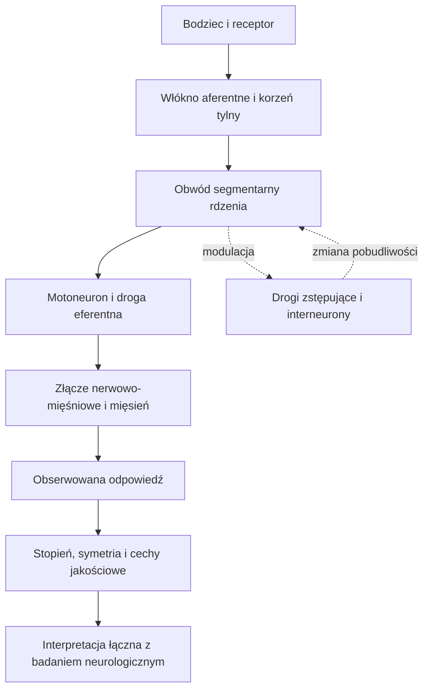
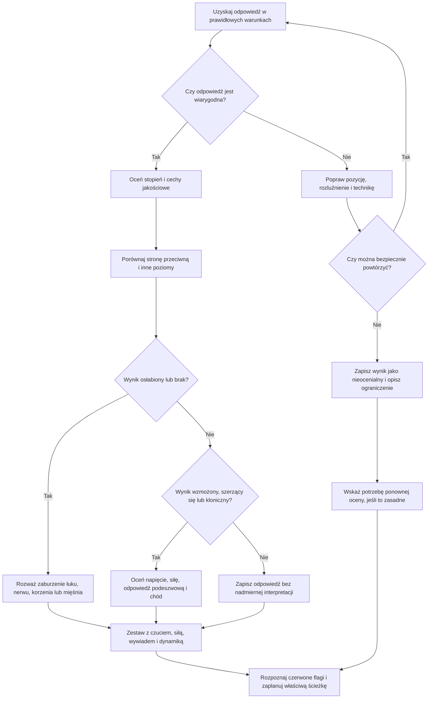

# 8.3. Skala i interpretacja odruchów

> **Moduł 8 – Odruchy neurologiczne, objawy oponowe i ocena rdzeniowa**  
> **Zakres:** standaryzowane stopniowanie odruchów, jakościowy opis odpowiedzi, rozpoznawanie hipo- i hiperrefleksji, arefleksji, klonusu, rozprzestrzeniania i odwrócenia odpowiedzi oraz interpretacja wzorców w kontekście całego badania neurologicznego.  
> **Przeznaczenie:** materiał dydaktyczny dla osób kształcących się w badaniu neurologicznym, fizjoterapii, rehabilitacji i naukach o zdrowiu. Samodzielne rozpoznawanie chorób, kwalifikowanie do leczenia i podejmowanie decyzji klinicznych zależą od kwalifikacji zawodowych, uprawnień oraz procedur placówki.

## Wprowadzenie

Odruchy neurologiczne są użytecznym elementem badania przyłóżkowego, ponieważ pozwalają ocenić czynnościową odpowiedź układu nerwowego na określony bodziec. Ich wartość nie polega jednak na przypisaniu każdemu odruchowi jednej liczby, lecz na umiejętnym połączeniu obserwacji ilościowej i jakościowej z lokalizacją anatomiczną, wywiadem, siłą mięśniową, napięciem, czuciem, koordynacją, chodem oraz dynamiką objawów.

W praktyce klinicznej spotyka się kilka sposobów zapisu nasilenia odruchów. Najczęściej stosowane są skale porządkowe obejmujące stopnie od 0 do 4, niekiedy z oznaczeniami plusowymi, a w części systemów także dodatkowy stopień 5+ dla klonusu utrwalonego. Nazewnictwo i przypisanie klonusu do konkretnego stopnia nie są identyczne we wszystkich podręcznikach i placówkach. Dlatego dokumentacja musi jasno określać zastosowaną konwencję.

W tym rozdziale omówiono stopniowanie i interpretację odpowiedzi, a nie ponownie technikę wywoływania pięciu podstawowych odruchów. Ułożenie pacjenta, lokalizacja ścięgien, technika uderzenia młotkiem i manewry wzmacniające przedstawiono w rozdziale 8.2. Podstawy budowy łuku odruchowego, neurofizjologia wrzecionka mięśniowego, interneurony i modulacja zstępująca znajdują się w rozdziale 8.1. Odruchy powierzchowne opisano w rozdziale 8.4, a objawy piramidowe i patologiczne – w rozdziale 8.5.

**Zasada nadrzędna:** wynik odruchu jest obserwacją kliniczną, a nie samodzielnym rozpoznaniem. Największą wartość ma powtarzalny wzorzec odpowiedzi, zwłaszcza asymetria, zgodność z innymi objawami i lokalizacja anatomiczna.

---

## 1. Cele kształcenia i efekty uczenia się

### 1.1. Cel ogólny

Celem rozdziału jest przygotowanie uczestnika do spójnego, powtarzalnego i krytycznego stopniowania odruchów neurologicznych, opisywania ich cech jakościowych oraz wstępnego różnicowania wzorców osłabienia i wzmożenia odpowiedzi.

### 1.2. Szczegółowe efekty uczenia się

Po ukończeniu rozdziału uczestnik powinien umieć:

1. wyjaśnić, czym jest skala porządkowa i dlaczego stopnia odruchu nie należy traktować jako precyzyjnego pomiaru siły;
2. odróżnić skalę NINDS 0–4 od tradycyjnych skal plusowych;
3. prawidłowo zapisać zastosowaną konwencję stopniowania;
4. rozpoznać odpowiedź prawidłową, osłabioną, zniesioną, wzmożoną i kloniczną;
5. odróżnić klonus nieutrwalony od utrwalonego i opisać jego stronę oraz charakter;
6. ocenić symetrię odruchów i rozprzestrzenianie odpowiedzi;
7. rozumieć pojęcia strefy odruchogennej i odruchu odwróconego;
8. powiązać hiporefleksję z możliwym zaburzeniem elementów łuku odruchowego;
9. rozumieć, kiedy hiperrefleksja może wskazywać na uszkodzenie górnego neuronu ruchowego;
10. uwzględniać czynniki fizjologiczne, wiek, leki, ból, napięcie i warunki badania;
11. wskazać ograniczenia wiarygodności oceny i źródła rozbieżności między badającymi;
12. sporządzić zapis zawierający stopień, stronę, cechy jakościowe, warunki i ograniczenia;
13. rozpoznać czerwone flagi wymagające pilnej oceny medycznej;
14. unikać wnioskowania etiologicznego na podstawie pojedynczego odruchu.

### 1.3. Granice kompetencji i odpowiedzialności

Skala odruchów jest narzędziem opisu badania. Nie zastępuje badania lekarskiego, badań neurofizjologicznych, obrazowania ani oceny ogólnego stanu pacjenta. Wynik nie upoważnia samodzielnie do rozpoznawania mielopatii, radikulopatii, polineuropatii, choroby neuronu ruchowego ani innych schorzeń.

Jeżeli występuje nagły niedowład, szybko narastające osłabienie, zaburzenie oddychania lub połykania, nowy poziom czuciowy, zatrzymanie moczu, nietrzymanie moczu lub stolca albo gwałtowny ból kręgosłupa z deficytem neurologicznym, należy uruchomić właściwą ścieżkę pilnej pomocy. Nie wolno opóźniać postępowania w celu uzyskania pełnej punktacji odruchów.

---

## 2. Pojęcia niezbędne do stopniowania

### 2.1. Odpowiedź odruchowa

Odpowiedź odruchowa jest obserwowalną reakcją mięśnia lub zespołu mięśni po pobudzeniu odpowiedniego obwodu neuronalnego. W odruchu na rozciąganie jej wielkość zależy między innymi od stanu wrzecionek mięśniowych, przewodzenia aferentnego, pobudliwości motoneuronów, modulacji interneuronalnej, wpływów zstępujących, napięcia wstępnego mięśnia i właściwości mechanicznych kończyny.

W badaniu klinicznym nie mierzy się bezpośrednio wszystkich tych elementów. Badający obserwuje ruch, palpacyjnie potwierdza skurcz, porównuje strony i ocenia, czy odpowiedź jest proporcjonalna do zastosowanego bodźca.

### 2.2. Amplituda odpowiedzi

Amplituda opisuje wielkość widocznego ruchu lub skurczu. Nie jest tożsama z siłą mięśniową ocenianą w skali MRC/Lovetta. Duża odpowiedź odruchowa nie oznacza większej dowolnej siły mięśnia, a niewielki ruch nie musi oznaczać osłabienia dowolnego.

Na amplitudę wpływają:

- siła i kierunek bodźca;
- pozycja stawu i stopień wstępnego rozciągnięcia mięśnia;
- rozluźnienie lub napięcie dowolne;
- mechaniczne właściwości ścięgna i mięśnia;
- pobudliwość obwodów rdzeniowych;
- modulacja zstępująca;
- ból, lęk, uwaga i współpraca pacjenta.

### 2.3. Próg wywołania

Próg wywołania oznacza względną łatwość uzyskania odpowiedzi. Odruch, który pojawia się po niewielkim, prawidłowo wykonanym bodźcu, może być określany jako łatwo wywoływany. Jeżeli potrzebny jest precyzyjny bodziec, odpowiednie ustawienie lub manewr wzmacniający, odpowiedź może być słabsza albo trudniejsza do uzyskania.

Nie należy jednak utożsamiać łatwości wywołania z jedynym kryterium nasilenia. Błędna lokalizacja ścięgna, niewłaściwy kąt uderzenia i napięcie badanego mogą pozornie zwiększać próg lub powodować fałszywy brak odruchu.

### 2.4. Symetria

Symetria oznacza podobieństwo odpowiedzi po obu stronach w porównywalnych warunkach. Niewielkie różnice są możliwe u osób zdrowych. Wyraźna, powtarzalna asymetria może być ważniejsza niż sama wartość bezwzględna stopnia.

Porównanie ma sens tylko wtedy, gdy:

- zastosowano podobną technikę i siłę bodźca;
- kończyny były ułożone porównywalnie;
- mięśnie były rozluźnione w podobnym stopniu;
- badanie wykonano w zbliżonych warunkach;
- nie występują istotne ograniczenia bólowe lub mechaniczne po jednej stronie.

### 2.5. Strefa odruchogenna

Strefa odruchogenna to obszar, którego pobudzenie może wywołać określoną odpowiedź odruchową. Jej poszerzenie oznacza, że reakcja pojawia się po pobudzeniu miejsca wykraczającego poza typowy, wąski obszar. Może towarzyszyć wzmożonej pobudliwości odruchowej, ale zależy także od techniki, siły bodźca i indywidualnej anatomii.

### 2.6. Rozprzestrzenianie odpowiedzi

Rozprzestrzenianie oznacza, że bodziec skierowany na jeden odruch wywołuje dodatkowy skurcz lub ruch w sąsiednich grupach mięśniowych. Należy zapisać, jaki odruch badano i jakie dodatkowe mięśnie zareagowały.

Rozprzestrzenianie może być istotnym objawem wzmożonej pobudliwości obwodów rdzeniowych, zwłaszcza gdy współistnieje ze spastycznością, klonusem i innymi objawami uszkodzenia górnego neuronu ruchowego. Nie jest jednak samodzielnym dowodem konkretnej choroby.

### 2.7. Odruch odwrócony

Odruch odwrócony występuje wtedy, gdy pobudzenie obszaru związanego z określonym odruchem nie wywołuje typowej odpowiedzi badanego mięśnia, ale pojawia się inna odpowiedź ruchowa. Przykładem jest odwrócony odruch ramienno-promieniowy, którego technikę i znaczenie anatomiczne omówiono w rozdziale 8.2.

W interpretacji należy rozdzielić:
- brak typowego skurczu mięśnia badanego;
- obecność odpowiedzi w innych mięśniach;
- poziom, na którym może występować zaburzenie;
- objawy towarzyszące, zwłaszcza wzmożenie odruchów poniżej badanego poziomu.

### 2.8. Klonus

Klonus jest rytmiczną, powtarzalną odpowiedzią mięśniową, która może pojawiać się po nagłym rozciągnięciu i utrzymaniu mięśnia w określonym położeniu. W praktyce najczęściej ocenia się klonus stopy. Może być nieutrwalony lub utrwalony.

Nie należy mylić klonusu z drżeniem, mioklonią, dowolnym napinaniem mięśnia, drżeniem parkinsonowskim ani mechanicznym drganiem kończyny. Ocenia się rytmiczność, powtarzalność, zależność od utrzymywanego rozciągnięcia i możliwość wygaszenia po zwolnieniu bodźca.

---

## 3. Podstawy neuroanatomiczne i neurofizjologiczne interpretacji

### 3.1. Odruch jako wynik działania całego układu

Odpowiedź odruchowa zależy od sprawności kilku poziomów:

1. receptora i włókien czuciowych;
2. zwoju rdzeniowego i korzenia tylnego;
3. połączeń segmentarnych w rdzeniu;
4. motoneuronów rogu przedniego;
5. korzenia przedniego i nerwu obwodowego;
6. złącza nerwowo-mięśniowego;
7. mięśnia i jego właściwości mechanicznych;
8. modulacji przez drogi zstępujące oraz obwody interneuronalne.

Z tego powodu osłabienie odpowiedzi nie wskazuje automatycznie na jeden poziom uszkodzenia. Podobnie wzmożenie odruchów może wynikać z zaburzenia kontroli zstępującej, lecz wymaga potwierdzenia innymi objawami.

### 3.2. Znaczenie górnego neuronu ruchowego

Drogi korowo-rdzeniowe i inne układy zstępujące modulują pobudliwość obwodów rdzeniowych. Uszkodzenie tych dróg może prowadzić do utraty części wpływów hamujących, zmian pobudliwości motoneuronów i interneuronów, a w następstwie do wzmożenia odruchów, rozprzestrzeniania odpowiedzi i klonusu.

Nie każdy etap uszkodzenia ośrodkowego daje jednak od razu hiperrefleksję. W ostrej fazie ciężkiego uszkodzenia rdzenia może wystąpić wstrząs rdzeniowy z przejściowym osłabieniem lub zniesieniem odruchów poniżej poziomu uszkodzenia. W ostrym udarze również nie należy oczekiwać, że hiperrefleksja będzie obecna od pierwszych minut.

### 3.3. Znaczenie dolnego neuronu ruchowego i łuku odruchowego

Uszkodzenie aferentnej lub eferentnej części łuku, komórek rogu przedniego, korzenia, splotu, nerwu obwodowego, złącza nerwowo-mięśniowego lub mięśnia może osłabiać odpowiedź. Najbardziej typowe dla uszkodzenia elementów łuku jest osłabienie albo zniesienie odruchu na odpowiednim poziomie, ale obraz zależy od miejsca, rozległości i czasu trwania procesu.

### 3.4. Schemat zależności lokalizacyjnych

### 3.5. Poziomy segmentarne – znaczenie orientacyjne

| Odruch | Główne poziomy segmentarne | Nerw obwodowy | Znaczenie interpretacyjne |
|---|---|---|---|
| Bicepsowy | C5–C6 | mięśniowo-skórny | może dostarczać informacji o łuku C5–C6 |
| Ramienno-promieniowy | C5–C6, zwykle przewaga C6 | promieniowy | przydatny w zestawieniu z bicepsowym i tricepsowym |
| Tricepsowy | głównie C7, udział C8 | promieniowy | nieprawidłowość wymaga oceny siły wyprostu łokcia i czucia |
| Kolanowy | L2–L4, zwykle L3–L4 | udowy | zestawia się go z siłą mięśnia czworogłowego i czuciem |
| Skokowy | głównie S1, udział S2 | piszczelowy | interpretuje się razem z siłą zgięcia podeszwowego i czuciem stopy |

Poziomy są przybliżone i częściowo nakładają się na siebie. Nie należy lokalizować uszkodzenia na podstawie pojedynczej różnicy jednego stopnia bez zgodności z innymi objawami.

---

## 4. Skale stopniowania odruchów

### 4.1. Dlaczego stosuje się skalę porządkową?

Skala pozwala skrótowo zapisać nasilenie odpowiedzi i porównać wynik w czasie lub między stronami. Jest jednak skalą porządkową: kolejne stopnie oznaczają uporządkowane kategorie, a nie równe przedziały liczbowej wielkości.

Nie wolno zakładać, że przejście z 1 do 2 oznacza taką samą zmianę fizjologiczną jak przejście z 2 do 3. Nie należy też traktować stopnia odruchu jako równoważnika skali siły mięśniowej MRC/Lovetta.

### 4.2. Skala odruchów miotatycznych NINDS 0–4

W skali NINDS opisuje się odpowiedź w pięciu stopniach:

| Stopień | Opis odpowiedzi | Znaczenie praktyczne |
|---:|---|---|
| 0 | Odruch niewywołany | wynik nieprawidłowy; wymaga sprawdzenia techniki i kontekstu |
| 1 | Odpowiedź mała, słabsza od oczekiwanej; może być śladowa lub pojawiać się po wzmocnieniu | może być wariantem lub wskazywać na zaburzenie łuku |
| 2 | Odpowiedź w dolnej połowie zakresu prawidłowego | odpowiedź prawidłowa |
| 3 | Odpowiedź w górnej połowie zakresu prawidłowego | odpowiedź może być prawidłowa, jeżeli jest symetryczna i bez innych nieprawidłowości |
| 4 | Odpowiedź wzmożona, większa niż oczekiwana; klonus może być odnotowany dodatkowo | wymaga oceny cech towarzyszących i kontekstu |

W skali NINDS stopień 4 oznacza odpowiedź wzmożoną, a obecność klonusu powinna zostać opisana słownie. Nie należy automatycznie przenosić znaczenia stopnia 4 z innego systemu, w którym 4+ oznacza klonus.

### 4.3. Tradycyjna skala plusowa

W wielu podręcznikach i zapisach klinicznych używa się skali z oznaczeniami plusowymi:

| Zapis | Typowy opis |
|---|---|
| 0 | brak odpowiedzi |
| 1+ | odpowiedź śladowa lub osłabiona, czasem uzyskiwana dopiero po wzmocnieniu |
| 2+ | odpowiedź przeciętna, typowo prawidłowa |
| 3+ | odpowiedź żywa lub bardzo żywa; może być wariantem osobniczym albo nieprawidłowością |
| 4+ | odpowiedź bardzo wzmożona, w niektórych systemach z klonusem |
| 5+ | klonus utrwalony – w systemach, które stosują dodatkowy stopień |

Warianty skali różnią się między źródłami. Część systemów opisuje 4+ jako klonus nieutrwalony, a 5+ jako utrwalony. Inne przypisują klonus do 4+ bez dodatkowego stopnia. Stanford Medicine 25 przedstawia wariant z 0–5+, natomiast podręcznik Clinical Methods opisuje klasyczną skalę 0–4, w której 4 oznacza odpowiedź powtarzalną lub kloniczną.

### 4.4. Porównanie systemów

| Zagadnienie | NINDS 0–4 | Skala plusowa |
|---|---|---|
| Zapis | liczby 0–4 | 0 oraz 1+–4+, czasem 5+ |
| Stopień prawidłowy | 2 w dolnej, 3 w górnej połowie zakresu prawidłowego | zwykle 2+ |
| Odpowiedź żywa | 3 może być jeszcze prawidłowe | 3+ może być prawidłowe lub wzmożone |
| Klonus | opisać osobno przy stopniu 4 | zależy od lokalnej konwencji |
| Ryzyko nieporozumienia | pomylenie z innymi skalami 0–4 | pomylenie 4+ i 5+ między placówkami |

**Zalecenie dydaktyczne:** w obrębie jednego kursu, formularza i dokumentacji należy wybrać jeden system podstawowy. Jeżeli placówka używa innej konwencji, trzeba ją jawnie wskazać. Nie wolno porównywać wyników zapisanych różnymi skalami bez sprawdzenia ich definicji.

### 4.5. Znak plus nie oznacza siły mięśniowej

Zapis 2+ w skali odruchów nie jest oceną siły mięśnia 2/5. W dokumentacji należy używać nazw skal, np. „odruch kolanowy 2+ według skali plusowej” oraz oddzielnie „wyprost kolana 5/5 w skali MRC”. Dzięki temu unika się pomyłek w przekazywaniu informacji.

### 4.6. Czy stopień 3 zawsze oznacza chorobę?

Nie. Odpowiedź żywa, ale symetryczna, bez klonusu, bez rozprzestrzeniania i bez innych objawów uszkodzenia górnego neuronu ruchowego może występować u osób zdrowych. Znaczenie stopnia 3 zależy od:

- wcześniejszego stanu pacjenta;
- symetrii;
- porównania z innymi odruchami;
- napięcia mięśniowego;
- siły mięśniowej;
- odpowiedzi podeszwowej;
- obecności klonusu;
- chodu i sprawności manualnej;
- dynamiki objawów.

### 4.7. Czy stopień 1 zawsze jest nieprawidłowy?

Nie. Odpowiedź słaba może występować u zdrowej osoby, zwłaszcza gdy jest symetryczna, łatwo wywoływana po prawidłowym ustawieniu i nie towarzyszą jej inne objawy. Nie wolno jednak bagatelizować nowej, jednostronnej hiporefleksji, szczególnie jeśli współistnieje z bólem korzeniowym, osłabieniem mięśni lub zaburzeniem czucia.

---

## 5. Standaryzowana procedura stopniowania

### 5.1. Warunki wstępne

Przed przypisaniem stopnia należy upewnić się, że:

1. pacjent rozumie cel badania i wyraził zgodę;
2. nie występuje ból lub uraz uniemożliwiający bezpieczne badanie;
3. kończyna jest ułożona w sposób umożliwiający rozluźnienie;
4. badający zna lokalizację właściwego ścięgna;
5. bodziec jest krótki, kontrolowany i porównywalny po obu stronach;
6. w razie trudności zastosowano właściwe ustawienie i dopuszczalny manewr wzmacniający;
7. wynik nie jest skutkiem dowolnego ruchu pacjenta.

### 5.2. Algorytm oceny pojedynczego odruchu

1. Zidentyfikuj badany odruch i stronę.
2. Sprawdź pozycję kończyny oraz rozluźnienie mięśni.
3. Zastosuj prawidłowy bodziec zgodnie z techniką opisaną w rozdziale 8.2.
4. Obserwuj skurcz mięśnia i ruch w stawie.
5. Oceń, czy odpowiedź jest nieobecna, słaba, typowa czy wzmożona.
6. Zwróć uwagę na rozprzestrzenianie odpowiedzi i dodatkowe ruchy.
7. Jeśli odpowiedź jest niepewna, popraw pozycję i powtórz próbę w kontrolowany sposób.
8. W razie potrzeby zastosuj manewr wzmacniający, jeśli jest bezpieczny i odpowiedni.
9. Zbadaj ten sam odruch po stronie przeciwnej.
10. Zapisz stopień, jakość odpowiedzi i warunki badania.
11. Dopiero po zebraniu danych z kilku poziomów sformułuj ostrożny wniosek lokalizacyjny.

### 5.3. Kiedy można stwierdzić brak odruchu?

Odruchu nie należy określać jako zniesionego po jednym nieudanym uderzeniu. Przed zapisem 0 trzeba sprawdzić:

- czy uderzono w prawidłowe miejsce;
- czy mięsień był odpowiednio rozluźniony;
- czy kończyna była właściwie podparta;
- czy nie występuje ból lub ograniczenie ruchu;
- czy zmiana kąta ustawienia poprawia odpowiedź;
- czy zastosowanie manewru wzmacniającego jest możliwe;
- czy po stronie przeciwnej odruch można wywołać.

Jeżeli warunki techniczne pozostają niepewne, należy zapisać „odruch trudny do oceny” lub „nie udało się wiarygodnie wywołać”, zamiast bez zastrzeżeń przypisywać stopień 0.

### 5.4. Ograniczenie liczby powtórzeń

Nie należy wielokrotnie i coraz mocniej uderzać w ścięgno. Powtarzanie bodźca może powodować habituację, dyskomfort, napięcie ochronne i pogorszenie porównywalności. Jeśli odpowiedź nie występuje, należy poprawić technikę, a nie eskalować siłę uderzenia.

### 5.5. Wzmacnianie odpowiedzi

Manewr Jendrassika i inne techniki wzmacniające mogą ułatwić uzyskanie odpowiedzi. Należy zapisać, czy odruch wystąpił spontanicznie, czy dopiero po wzmocnieniu. Odpowiedź wywołana wyłącznie po wzmocnieniu nie powinna być opisywana tak samo jak łatwo uzyskiwana odpowiedź bez manewru.

---

## 6. Hiporefleksja i arefleksja

### 6.1. Definicje

**Hiporefleksja** oznacza osłabienie odpowiedzi odruchowej w porównaniu z oczekiwaną dla danego pacjenta i warunków badania.

**Arefleksja** oznacza brak uchwytnej odpowiedzi odruchowej mimo prawidłowej techniki, odpowiedniego ustawienia i prób uzyskania odpowiedzi, w tym – jeśli jest to wskazane – zastosowania wzmocnienia.

Warto rozróżniać:
- odpowiedź niewielką, ale obecną;
- odpowiedź uzyskiwaną wyłącznie po wzmocnieniu;
- odpowiedź niewywołaną mimo prawidłowej techniki;
- wynik nieocenialny z powodu bólu, ograniczenia ruchu lub braku współpracy.

### 6.2. Możliwe poziomy zaburzenia

Osłabienie odruchu może wynikać z zaburzenia:

- receptora lub włókien aferentnych;
- zwoju rdzeniowego lub korzenia tylnego;
- połączeń segmentarnych;
- motoneuronu alfa;
- korzenia przedniego;
- nerwu obwodowego;
- złącza nerwowo-mięśniowego;
- mięśnia;
- mechaniki ścięgna i stawu.

Nie każda przyczyna ma charakter neurologiczny. Ból, obrzęk, blizna, deformacja, unieruchomienie i znaczna sztywność stawu mogą utrudniać wywołanie lub obserwację odpowiedzi.

### 6.3. Hiporefleksja w radikulopatii

Uszkodzenie korzenia może osłabiać odruch zależny od danego poziomu segmentarnego. W interpretacji należy poszukiwać zgodności z:

- bólem promieniującym w charakterystycznym obszarze;
- zaburzeniem czucia o rozkładzie korzeniowym;
- osłabieniem mięśni unerwianych przez ten korzeń;
- zmianą odruchu odpowiadającego temu poziomowi;
- objawami prowokacyjnymi i dynamiką dolegliwości.

Odruch może pozostać prawidłowy w części radikulopatii, ponieważ unerwienie mięśni i łuków odruchowych obejmuje nakładające się segmenty. Prawidłowy wynik nie wyklucza więc uszkodzenia korzenia.

### 6.4. Hiporefleksja w neuropatii obwodowej

W mononeuropatii osłabienie może dotyczyć odruchu, którego łuk przebiega przez zajęty nerw. W polineuropatii może występować obustronne, często dystalne osłabienie odruchów, zwłaszcza skokowych. Wzorzec zależy od rodzaju włókien, długości aksonów, etiologii i zaawansowania procesu.

Przykłady przyczyn obejmują:
- polineuropatię cukrzycową;
- neuropatie toksyczne i polekowe;
- neuropatie niedoborowe;
- neuropatie zapalne;
- neuropatie dziedziczne;
- uciskowe uszkodzenia pojedynczych nerwów.

### 6.5. Arefleksja w ostrym zespole poliradikuloneuropatii

W szybko narastającym osłabieniu z obniżeniem lub zniesieniem odruchów należy brać pod uwagę ostre choroby obwodowego układu nerwowego, w tym zespół Guillaina–Barrégo. Szczególnie niepokojące są:
- symetryczny, postępujący niedowład;
- zaburzenia chodu i wstawania;
- osłabienie mięśni twarzy;
- zaburzenia połykania lub mowy;
- duszność, słaby kaszel lub trudność w liczeniu na jednym wydechu;
- wahania ciśnienia, rytmu serca i inne objawy autonomiczne.

W takiej sytuacji konieczna jest pilna ocena szpitalna. Nie należy czekać na pełne zniesienie wszystkich odruchów.

### 6.6. Arefleksja a wstrząs rdzeniowy

Po ostrym ciężkim uszkodzeniu rdzenia może wystąpić przejściowe zahamowanie czynności odruchowej poniżej poziomu uszkodzenia. Początkowo mogą dominować wiotkość i arefleksja, a dopiero później pojawiać się wzmożenie odruchów i spastyczność. Dlatego wczesny brak hiperrefleksji nie wyklucza uszkodzenia ośrodkowego.

### 6.7. Różnicowanie hiporefleksji

| Wzorzec | Możliwe wyjaśnienie | Dane wymagające sprawdzenia |
|---|---|---|
| Jednostronny, ograniczony do jednego odruchu | korzeń, nerw, uraz miejscowy lub błąd techniczny | siła, czucie, ból, pozycja, powtarzalność |
| Kilka odruchów w obszarze jednego nerwu | mononeuropatia | mapa unerwienia, funkcja mięśni, czucie |
| Dystalny i obustronny | polineuropatia lub wariant związany z wiekiem | czucie wibracji, propriocepcja, siła dystalna |
| Uogólniony z osłabieniem | choroba obwodowa, zaburzenie metaboliczne lub toksyczne | tempo narastania, oddychanie, połykanie, leki |
| Poniżej ostrego urazu rdzenia | wstrząs rdzeniowy lub uszkodzenie łuków | poziom czuciowy, mechanizm urazu, funkcja zwieraczy |
| Trudny do uzyskania bez innych objawów | technika, napięcie, ból, cechy osobnicze | ponowna ocena w prawidłowych warunkach |

---

## 7. Hiperrefleksja i odpowiedź wzmożona

### 7.1. Definicja

**Hiperrefleksja** oznacza nadmiernie żywą odpowiedź odruchową w stosunku do oczekiwanej. Może obejmować większą amplitudę, łatwiejsze wywołanie, poszerzenie strefy odruchogennej, rozprzestrzenianie odpowiedzi lub klonus.

Wynik należy oceniać w odniesieniu do pozostałych odruchów i objawów. Sama żywość odpowiedzi, zwłaszcza obustronna i symetryczna, nie rozstrzyga o obecności choroby.

### 7.2. Znaczenie uszkodzenia górnego neuronu ruchowego

Wzmożone odruchy mogą występować w uszkodzeniu dróg zstępujących, między innymi w:
- udarze mózgu;
- stwardnieniu rozsianym;
- mielopatii szyjnej lub piersiowej;
- urazowym uszkodzeniu rdzenia;
- zmianach uciskowych rdzenia;
- innych chorobach ośrodkowego układu nerwowego.

Wniosek o zespole górnego neuronu ruchowego jest silniejszy, gdy hiperrefleksji towarzyszą:
- spastyczność;
- osłabienie o charakterystycznym rozkładzie;
- dodatnia odpowiedź podeszwowa typu wyprostnego;
- klonus;
- rozprzestrzenianie odruchów;
- zaburzenia chodu lub zręczności dłoni;
- inne objawy zgodne z lokalizacją ośrodkową.

### 7.3. Żywe odruchy jako wariant osobniczy

Niektóre osoby mają fizjologicznie żywe odruchy. Za wariantem osobniczym może przemawiać:
- obustronna symetria;
- brak klonusu;
- brak rozprzestrzeniania;
- prawidłowe napięcie;
- prawidłowa siła;
- brak patologicznej odpowiedzi podeszwowej;
- brak postępujących objawów;
- brak zgodnego deficytu czuciowego lub ruchowego.

Nie oznacza to, że taki wynik zawsze jest prawidłowy. Jeżeli pacjent zgłasza nową niezręczność dłoni, sztywność, zaburzenia chodu lub postępujące osłabienie, należy przeprowadzić pełną ocenę.

### 7.4. Rozprzestrzenianie odpowiedzi

Rozprzestrzenianie może być szczególnie przydatne w ocenie wzmożonej pobudliwości. Przykładowo uderzenie w ścięgno jednego mięśnia może wywołać dodatkowy skurcz w sąsiedniej grupie. Należy zapisać:
- odruch pierwotnie badany;
- mięśnie, które zareagowały;
- stronę;
- powtarzalność;
- obecność innych objawów piramidowych.

Nie należy opisywać rozprzestrzeniania na podstawie ruchu przypadkowego lub dowolnego napinania mięśni.

### 7.5. Klonus nieutrwalony i utrwalony

| Cecha | Klonus nieutrwalony | Klonus utrwalony |
|---|---|---|
| Charakter | kilka rytmicznych wychyleń | rytmiczna odpowiedź utrzymuje się przy podtrzymywanym rozciągnięciu |
| Wygaszanie | może ustąpić samoistnie | utrzymuje się, dopóki zachowane są warunki pobudzenia |
| Znaczenie | wymaga oceny w kontekście | silnie przemawia za patologiczną wzmożoną pobudliwością |
| Dokumentacja | strona, liczba wychyleń, warunki | strona, utrzymywanie się, warunki i objawy towarzyszące |

Wynik należy interpretować z napięciem mięśniowym, siłą, odpowiedzią podeszwową i pozostałymi odruchami. Klonus utrwalony jest nieprawidłowy, ale nie wskazuje samodzielnie jednej etiologii.

### 7.6. Klonus a inne ruchy mimowolne

| Zjawisko | Cechy różnicujące |
|---|---|
| Klonus | rytmiczne, powtarzalne skurcze związane z utrzymanym rozciągnięciem |
| Drżenie | oscylacyjny ruch, który może występować w spoczynku, postawie lub ruchu |
| Mioklonia | krótkie, nagłe, zwykle nierytmiczne zrywy mięśniowe |
| Fascykulacje | drobne, miejscowe skurcze jednostek motorycznych, bez typowego ruchu stawu |
| Ruch dowolny | zależy od intencji lub polecenia, może być modulowany świadomie |
| Drganie mechaniczne | może wynikać z bólu, niestabilności stawu lub zewnętrznego poruszania kończyną |

---

## 8. Asymetria – jedna z najważniejszych cech interpretacyjnych

### 8.1. Dlaczego asymetria ma znaczenie?

Stopień odruchu jest zależny od osobniczej pobudliwości i techniki. Porównanie stron w tych samych warunkach pozwala ograniczyć część tych zmiennych. Wyraźna, powtarzalna asymetria może wskazywać na jednostronne zaburzenie łuku odruchowego lub asymetryczne zaburzenie kontroli ośrodkowej.

### 8.2. Jak dokumentować asymetrię?

Nie wystarczy zapisać „odruchy asymetryczne”. Należy wskazać:
- który odruch;
- po której stronie;
- jaki stopień lub opis jakościowy;
- czy różnica powtarzała się;
- czy zastosowano wzmocnienie;
- czy występowały inne objawy po tej samej stronie.

Przykład: „Odruch kolanowy: prawa kończyna 1, lewa 2 według skali NINDS; różnica powtarzalna przy porównywalnym ułożeniu. Wymaga korelacji z siłą mięśnia czworogłowego, czuciem i objawami korzeniowymi”.

### 8.3. Asymetria bez innych objawów

Niewielka różnica jednego stopnia bez innych odchyleń może być trudna do interpretacji. Należy sprawdzić powtarzalność i warunki. Nie wolno przypisywać jej automatycznie uszkodzeniu korzenia lub nerwu.

### 8.4. Asymetria z objawami towarzyszącymi

Jeżeli asymetrii towarzyszy osłabienie mięśni, zaburzenie czucia, ból promieniujący, zanik, spastyczność lub zaburzenie chodu, wzrasta jej znaczenie lokalizacyjne. Nadal konieczne jest zestawienie wszystkich danych.

---

## 9. Wzorce odruchowe i lokalizacja

### 9.1. Zasada wzorca, a nie pojedynczego wyniku

Interpretacja powinna obejmować:
1. rozkład odruchów w kończynach;
2. porównanie stron;
3. poziom segmentarny;
4. zgodność z siłą mięśniową;
5. zgodność z czuciem;
6. napięcie mięśniowe;
7. objawy patologiczne;
8. dynamikę dolegliwości;
9. choroby współistniejące i leki.

### 9.2. Przykładowe wzorce

| Wzorzec | Możliwe lokalizacje lub mechanizmy | Co należy zbadać dodatkowo |
|---|---|---|
| Osłabienie jednego odruchu z odpowiadającym osłabieniem mięśni | korzeń, nerw obwodowy, segment rdzenia | siła w mięśniach tego samego miotomu, czucie, ból |
| Osłabienie kilku odruchów w obszarze jednego nerwu | mononeuropatia | czucie w obszarze nerwu, funkcja innych mięśni unerwianych przez nerw |
| Obustronne osłabienie dystalnych odruchów | polineuropatia lub wariant związany z wiekiem | czucie wibracji, czucie ułożenia, siła stóp |
| Żywe odruchy poniżej określonego poziomu | uszkodzenie dróg zstępujących lub rdzenia | poziom czuciowy, napięcie, chód, odpowiedź podeszwowa |
| Żywe odruchy w wielu kończynach z klonusem | zespół górnego neuronu ruchowego | pełne badanie piramidowe, obrazowanie według wskazań |
| Odruch odwrócony na jednym poziomie i wzmożenie poniżej | możliwe połączenie uszkodzenia segmentarnego i dróg zstępujących | siła, czucie, pozostałe odruchy, objawy rdzeniowe |
| Arefleksja z szybko narastającym osłabieniem | ostra poliradikuloneuropatia lub inne ciężkie zaburzenie obwodowe | oddychanie, połykanie, funkcje autonomiczne, pilna diagnostyka |

### 9.3. Uszkodzenie korzenia a nerwu obwodowego

Odruch może być osłabiony zarówno w radikulopatii, jak i neuropatii. Rozróżnienie wymaga oceny:
- rozkładu czuciowego;
- miotomów;
- mięśni unerwianych przez różne nerwy, ale ten sam korzeń;
- mięśni unerwianych przez ten sam nerw, ale różne korzenie;
- bólu korzeniowego;
- wyników badań przewodnictwa i elektromiografii, jeśli są wskazane.

Odruch nie jest samodzielnym testem różnicującym korzeń i nerw.

### 9.4. Wzorzec mielopatyczny

W mielopatii mogą współistnieć:
- wzmożone odruchy poniżej poziomu uszkodzenia;
- objawy piramidowe;
- zaburzenia chodu;
- niezręczność dłoni;
- zaburzenia czucia;
- objawy segmentarne na poziomie uszkodzenia;
- zaburzenia zwieraczy w zaawansowanych lub ciężkich przypadkach.

W niektórych sytuacjach odruch na poziomie uszkodzenia może być osłabiony, a poniżej wzmożony. Taki układ wymaga pilnej oceny lekarskiej, zwłaszcza przy progresji.

---

## 10. Czynniki fizjologiczne, chorobowe i techniczne

### 10.1. Czynniki fizjologiczne

Na odpowiedź mogą wpływać:
- wiek;
- indywidualna pobudliwość układu nerwowego;
- budowa ciała i masa mięśniowa;
- temperatura kończyny;
- stan zmęczenia;
- napięcie emocjonalne;
- uwaga i koncentracja;
- wcześniejsza aktywność mięśniowa;
- nawykowa asymetria funkcjonalna.

Nie należy używać pojedynczego czynnika do wyjaśnienia wyniku bez sprawdzenia pozostałych danych.

### 10.2. Wiek podeszły

U osób starszych odruchy, szczególnie skokowe, mogą być słabsze. Wpływają na to między innymi zmiany obwodowego układu nerwowego, mięśni, ścięgien, stawów i współistniejące choroby. Nie oznacza to, że brak odruchu skokowego można automatycznie uznać za fizjologiczny.

Warto:
- porównać obie strony;
- zbadać odruchy kolanowe i pozostałe;
- ocenić czucie wibracji i ułożenia;
- sprawdzić siłę mięśni stóp;
- zebrać wywiad dotyczący cukrzycy, alkoholu, niedoborów i leków;
- porównać wynik z wcześniejszą dokumentacją.

### 10.3. Leki i substancje

Leki wpływające na ośrodkowy układ nerwowy, przewodnictwo nerwowo-mięśniowe, metabolizm i temperaturę ciała mogą pośrednio lub bezpośrednio modyfikować odpowiedź. Należy zebrać wywiad dotyczący:
- leków uspokajających i nasennych;
- leków przeciwpadaczkowych;
- leków zwiotczających mięśnie;
- leków wpływających na złącze nerwowo-mięśniowe;
- substancji psychoaktywnych i alkoholu;
- toksyn i ekspozycji zawodowych.

Nie należy samodzielnie odstawiać leków na podstawie wyniku odruchów.

### 10.4. Czynniki techniczne

Najczęstsze przyczyny błędnej oceny:
- uderzenie w niewłaściwe miejsce;
- zbyt słaby lub zbyt mocny bodziec;
- nieprawidłowe podparcie kończyny;
- napięcie dowolne;
- ból;
- zbyt szybkie powtarzanie prób;
- brak porównania stron;
- obserwowanie wyłącznie ruchu, bez palpacji mięśnia;
- nieuwzględnienie ograniczeń mechanicznych.

### 10.5. Czynniki metaboliczne i ogólnoustrojowe

Zaburzenia elektrolitowe, temperatura, ciężkie zaburzenia metaboliczne, choroby tarczycy, niedobory witamin, choroby nerek i wątroby oraz inne stany ogólnoustrojowe mogą wpływać na funkcję nerwowo-mięśniową. Interpretacja wymaga wywiadu, badania ogólnego i odpowiednich badań dodatkowych.

---

## 11. Normy, wiarygodność i ograniczenia

### 11.1. Nie istnieje jedna amplituda prawidłowa dla wszystkich

Odpowiedź odruchowa jest zmienna osobniczo. Zakres prawidłowy nie jest identyczny u każdej osoby, a ocena zależy od techniki i doświadczenia badającego. Dlatego ważniejsze jest porównanie z drugą stroną, wcześniejszym wynikiem pacjenta i pozostałymi elementami badania niż sama liczba.

### 11.2. Wiarygodność między badającymi

Badanie Litvan i współpracowników dotyczące skali NINDS wykazało znaczną do niemal doskonałej zgodność wewnątrzobserwatora oraz umiarkowaną do znaczącej zgodność między obserwatorami. Powtarzalność była lepsza dla odruchów kończyn dolnych niż górnych. Wynik ten wspiera stosowanie skali, ale nie oznacza, że ocena jest całkowicie obiektywna ani wolna od błędu.

### 11.3. Ograniczenia skali porządkowej

Skala:
- nie mierzy bezpośrednio napięcia mięśniowego;
- nie mierzy siły dowolnej;
- nie określa dokładnego poziomu uszkodzenia;
- nie rozpoznaje etiologii;
- nie zastępuje badania przewodnictwa nerwowego i EMG;
- nie jest niezależna od techniki i warunków badania;
- nie pozwala zakładać równych odstępów między stopniami.

### 11.4. Ograniczenia pojedynczego odruchu

Prawidłowy odruch nie wyklucza:
- częściowej radikulopatii;
- wczesnej neuropatii;
- choroby ośrodkowej;
- uszkodzenia, które nie obejmuje badanego łuku;
- choroby, której objawy jeszcze się nie rozwinęły.

Nieprawidłowy odruch nie potwierdza automatycznie:
- konkretnej radikulopatii;
- polineuropatii;
- mielopatii;
- choroby neuronu ruchowego;
- uszkodzenia pojedynczego nerwu.

### 11.5. Jak zwiększyć powtarzalność?

- Stosować tę samą skalę w całej dokumentacji.
- Porównywać ten sam odruch po obu stronach.
- Utrzymywać podobną pozycję i technikę.
- Opisywać wynik jakościowo.
- Zaznaczać zastosowanie wzmocnienia.
- Zapisywać klonus oddzielnie.
- W razie kontroli porównywać z wcześniejszym opisem, a nie tylko z liczbą.
- W zespole klinicznym uzgodnić definicje stopni.

### 11.6. Kiedy wynik należy uznać za nieocenialny?

Wynik może być nieocenialny, jeśli:
- pacjent nie może przyjąć odpowiedniej pozycji;
- ból uniemożliwia bezpieczne wykonanie próby;
- występuje znaczna deformacja lub ograniczenie ruchu;
- nie można uzyskać rozluźnienia;
- pacjent nie rozumie poleceń i nie ma możliwości wiarygodnej obserwacji;
- kończyna jest unieruchomiona lub zabezpieczona po urazie;
- warunki techniczne nie pozwalają na powtarzalną próbę.

W takich przypadkach należy opisać ograniczenie, a nie wymuszać stopień.

---

## 12. Diagnostyka różnicowa

### 12.1. Hiporefleksja i arefleksja

Należy rozważyć:
- radikulopatię;
- mononeuropatię;
- polineuropatię;
- uszkodzenie splotu;
- uszkodzenie komórek rogu przedniego;
- ostrą poliradikuloneuropatię;
- wstrząs rdzeniowy;
- zaburzenia złącza nerwowo-mięśniowego;
- choroby mięśni;
- przyczyny mechaniczne i techniczne;
- wpływ leków oraz zaburzeń metabolicznych.

### 12.2. Hiperrefleksja

Należy rozważyć:
- uszkodzenie dróg korowo-rdzeniowych;
- mielopatię;
- udar mózgu;
- stwardnienie rozsiane;
- uraz rdzenia;
- inne choroby ośrodkowego układu nerwowego;
- wariant osobniczy przy symetrycznej odpowiedzi bez innych objawów;
- wpływ napięcia emocjonalnego i warunków badania.

### 12.3. Klonus

Różnicowanie obejmuje:
- klonus związany ze wzmożoną pobudliwością odruchową;
- drżenie;
- mioklonie;
- ruch dowolny;
- drgania mechaniczne;
- powtarzalne ruchy wywołane bólem lub niestabilnością stawu.

### 12.4. Odruchy a choroba neuronu ruchowego

W chorobach neuronu ruchowego mogą współistnieć cechy uszkodzenia górnego i dolnego neuronu ruchowego. Sam wzorzec odruchów nie wystarcza do rozpoznania. Należy ocenić rozkład niedowładu, zanik, fascykulacje, napięcie, objawy opuszkowe, oddechowe, czuciowe oraz przebieg w czasie. Diagnostyka wymaga specjalistycznej oceny i badań dodatkowych.

### 12.5. Odruchy w zaburzeniach metabolicznych

Zaburzenia metaboliczne mogą wpływać na nerwy, mięśnie i złącze nerwowo-mięśniowe. W zależności od przyczyny odruchy mogą być osłabione, zmienne lub zachowane. Nie należy przypisywać wyniku jednej chorobie bez danych klinicznych i laboratoryjnych.

---

## 13. Czerwone flagi

### 13.1. Nagły deficyt ogniskowy

Nagłe osłabienie kończyny, asymetria twarzy, zaburzenia mowy, widzenia, równowagi lub świadomości wymagają natychmiastowego uruchomienia ścieżki udarowej. Odruchy mogą być początkowo prawidłowe, osłabione lub asymetryczne. Nie należy oczekiwać na rozwój hiperrefleksji.

### 13.2. Podejrzenie ucisku rdzenia

Pilnej oceny wymagają:
- narastający niedowład;
- nowy poziom czuciowy;
- zaburzenia chodu;
- obustronne objawy kończyn dolnych;
- zaburzenia zwieraczy;
- zaburzenia czucia w okolicy siodłowej;
- ból kręgosłupa z deficytem neurologicznym;
- objawy po urazie lub u pacjenta z chorobą nowotworową.

### 13.3. Podejrzenie zespołu ogona końskiego lub stożka rdzeniowego

Niepokojące są:
- nowe zatrzymanie moczu lub zaburzenia czucia mikcji;
- nietrzymanie moczu lub stolca;
- zaburzenie czucia w okolicy krocza;
- obustronny ból korzeniowy;
- narastający niedowład kończyn dolnych;
- zaburzenia funkcji seksualnych o ostrym początku.

Wymagana jest pilna ocena lekarska i diagnostyka zgodna z lokalną ścieżką.

### 13.4. Szybko narastające osłabienie z arefleksją

Szybko postępujące osłabienie, zwłaszcza symetryczne, z osłabieniem lub zniesieniem odruchów może wskazywać na ostrą poliradikuloneuropatię. Zaburzenia połykania, słaby kaszel, duszność i niestabilność autonomiczna wymagają natychmiastowej pomocy.

### 13.5. Klonus i narastające objawy piramidowe

Nowy klonus, postępująca spastyczność, zaburzenia chodu, niezręczność dłoni i osłabienie mogą wskazywać na mielopatię lub inne uszkodzenie ośrodkowe. Jeżeli objawy są nowe lub szybko narastają, konieczna jest pilna ocena.

### 13.6. Zasada bezpieczeństwa

Stopień odruchu nie może opóźniać pomocy. W stanie nagłym priorytetem są ocena ABCDE, parametry życiowe, glikemia według wskazań, wezwanie właściwego zespołu i przekazanie informacji o czasie początku objawów.

---

## 14. Bezpieczeństwo i komfort pacjenta

### 14.1. Zasady ogólne

- Wyjaśnić cel i przebieg badania.
- Uzyskać zgodę.
- Zapewnić prywatność i komfort.
- Nie uderzać w obszar urazu, rany, krwiaka lub świeżego zabiegu bez oceny bezpieczeństwa.
- Nie wykonywać gwałtownych ruchów w niestabilnym lub bolesnym stawie.
- Przerwać próbę, jeśli pojawia się ból, zawroty głowy, lęk lub pogorszenie stanu.
- Asekurować pacjenta z ryzykiem upadku.
- Dezynfekować sprzęt zgodnie z procedurą placówki.

### 14.2. Pacjent z ograniczoną komunikacją

Należy używać krótkich, zrozumiałych poleceń, demonstracji i komunikacji wspomagającej. Jeżeli nie można uzyskać wiarygodnego rozluźnienia, należy odnotować ograniczenie. Nie wolno interpretować braku współpracy jako dowodu arefleksji.

### 14.3. Pacjent po urazie

Przy podejrzeniu urazu kręgosłupa lub kończyny nie należy zmieniać pozycji ani wykonywać prób, które mogłyby zwiększyć ból lub ryzyko wtórnego uszkodzenia. Należy postępować według procedur urazowych i zaleceń zespołu odpowiedzialnego za pacjenta.

---

## 15. Dokumentowanie wyników

### 15.1. Minimalny zakres dokumentacji

W zapisie należy uwzględnić:

1. datę i godzinę badania;
2. badane odruchy;
3. stronę prawą i lewą;
4. zastosowaną skalę;
5. stopień lub opis jakościowy;
6. obecność albo brak klonusu;
7. liczbę wychyleń i informację o utrwaleniu, jeśli dotyczy;
8. rozprzestrzenianie odpowiedzi;
9. zastosowanie manewru wzmacniającego;
10. warunki i ograniczenia badania;
11. objawy towarzyszące;
12. osobne sformułowanie obserwacji i interpretacji.

### 15.2. Zalecany zapis tabelaryczny

| Odruch | Prawa strona | Lewa strona | Cechy jakościowe |
|---|---:|---:|---|
| Bicepsowy |  |  |  |
| Ramienno-promieniowy |  |  |  |
| Tricepsowy |  |  |  |
| Kolanowy |  |  |  |
| Skokowy |  |  |  |

Pod tabelą należy wskazać skalę, np. „Stopniowanie według skali NINDS 0–4; klonus opisywany osobno”.

### 15.3. Przykładowy zapis prawidłowy

„Odruchy głębokie kończyn górnych i dolnych obecne, symetryczne. W skali NINDS: bicepsowy 2/2, ramienno-promieniowy 2/2, tricepsowy 2/2, kolanowy 2/2, skokowy 2/2. Bez uchwytnego rozprzestrzeniania odpowiedzi i bez klonusu. Badanie wykonano w porównywalnych pozycjach, bez zgłaszanego bólu”.

### 15.4. Przykładowy zapis hiporefleksji

„Odruch skokowy obustronnie osłabiony, prawa 1, lewa 1 według skali NINDS; odpowiedź uzyskano po manewrze wzmacniającym. Odruchy kolanowe 2 obustronnie. Wynik wymaga korelacji z czuciem wibracji, czuciem ułożenia, siłą mięśni stóp i wywiadem dotyczącym neuropatii”.

### 15.5. Przykładowy zapis asymetrii

„Odruch bicepsowy po stronie prawej 1, po lewej 2 według skali NINDS; różnica powtarzalna przy porównywalnej technice. Odruch ramienno-promieniowy 1/2. Odruch tricepsowy 2/2. Wymaga korelacji z siłą zginania łokcia, czuciem i dolegliwościami korzeniowymi”.

### 15.6. Przykładowy zapis hiperrefleksji

„Odruchy kolanowe i skokowe żywe, symetryczne, z rozprzestrzenianiem odpowiedzi na mięśnie sąsiednie. Klonus stóp obustronny, nieutrwalony. Współistnieje wzmożone napięcie mięśniowe kończyn dolnych. Obraz wymaga oceny w kierunku zespołu górnego neuronu ruchowego”.

### 15.7. Przykładowy zapis klonusu

„Po kontrolowanym zgięciu grzbietowym stopy i utrzymaniu rozciągnięcia stwierdzono klonus po stronie prawej – 6 rytmicznych wychyleń, wygasający samoistnie. Po stronie lewej klonus niewywołany. Wynik zestawiono z napięciem, siłą, odpowiedzią podeszwową i chodem”.

### 15.8. Przykładowy zapis badania niepełnego

„Ocena odruchu kolanowego po stronie lewej ograniczona z powodu bólu i ograniczenia zgięcia stawu. Nie przypisano stopnia; wynik nieocenialny w aktualnych warunkach. Pozostałe odruchy oceniono zgodnie z opisem”.

---

## 16. Przypadki kliniczne

### Przypadek 1. Symetrycznie żywe odruchy bez innych objawów

Osoba dorosła zgłasza się na badanie kontrolne. Odruchy kończyn górnych i dolnych są żywe, ale symetryczne. Nie stwierdza się klonusu, spastyczności, niedowładu, zaburzeń czucia ani patologicznej odpowiedzi podeszwowej.

**Rozumowanie:** żywe odruchy mogą być cechą osobniczą. Należy odnotować wynik i ocenić go w kontekście całego badania. Sama żywość bez innych odchyleń nie uzasadnia rozpoznania uszkodzenia ośrodkowego.

### Przypadek 2. Jednostronnie osłabiony odruch bicepsowy

Pacjent zgłasza ból szyi promieniujący do kończyny górnej. Odruch bicepsowy po stronie objawowej jest słabszy niż po stronie przeciwnej. Występuje także osłabienie określonych ruchów i zaburzenie czucia.

**Rozumowanie:** należy rozważyć uszkodzenie korzenia lub struktur obwodowych, ale konieczne jest zestawienie miotomów, dermatomów, nerwów i pozostałych odruchów. Sam wynik nie potwierdza radikulopatii.

### Przypadek 3. Obustronnie osłabione odruchy skokowe u osoby starszej

Osoba w wieku podeszłym ma słabe odruchy skokowe po obu stronach. Odruchy kolanowe są obecne. Pacjent zgłasza także pogorszenie czucia w stopach.

**Rozumowanie:** wiek może wpływać na odpowiedź, ale współistniejące zaburzenia czucia wymagają oceny w kierunku neuropatii i innych przyczyn. Należy zbadać czucie wibracji, ułożenia, siłę dystalną, skórę stóp, choroby metaboliczne i leki.

### Przypadek 4. Żywe odruchy, klonus i zaburzenia chodu

Pacjent zgłasza narastającą niezręczność dłoni i sztywność nóg. Odruchy kończyn dolnych są wyraźnie wzmożone, występuje klonus stopy i zaburzenie chodu.

**Rozumowanie:** wzorzec sugeruje możliwe uszkodzenie dróg zstępujących. Należy pilnie ocenić objawy mielopatii, zbadać poziom czuciowy, napięcie, odpowiedź podeszwową i funkcję zwieraczy oraz skierować do właściwej diagnostyki.

### Przypadek 5. Arefleksja i szybko narastające osłabienie

Pacjent w ciągu kilku dni rozwija symetryczne osłabienie kończyn dolnych, a następnie górnych. Odruchy są zniesione. Pojawia się trudność w połykaniu.

**Rozumowanie:** jest to stan pilny. Należy brać pod uwagę ostrą poliradikuloneuropatię, w tym zespół Guillaina–Barrégo. Priorytetem jest ocena oddychania, połykania, funkcji autonomicznych i pilna hospitalizacja.

### Przypadek 6. Odruchy osłabione po urazie rdzenia

Po ciężkim urazie kręgosłupa pacjent ma wiotkość i osłabione odruchy poniżej poziomu uszkodzenia.

**Rozumowanie:** w ostrej fazie może występować wstrząs rdzeniowy. Brak hiperrefleksji nie wyklucza uszkodzenia rdzenia. Należy prowadzić ocenę zgodnie z procedurą urazową i monitorować zmianę obrazu neurologicznego.

### Przypadek 7. Różnica jednego stopnia bez innych odchyleń

U pacjenta jeden odruch jest oceniony jako 1 po prawej i 2 po lewej, ale różnica nie jest powtarzalna. Siła, czucie i napięcie są prawidłowe.

**Rozumowanie:** należy sprawdzić technikę, rozluźnienie i pozycję. Nie należy wyciągać wniosku o uszkodzeniu na podstawie niepowtarzalnej różnicy.

### Przypadek 8. Klonus a drżenie

U pacjenta obserwuje się rytmiczne ruchy stopy. Ruchy pojawiają się po utrzymaniu stopy w zgięciu grzbietowym, są powtarzalne i wygasają po zwolnieniu rozciągnięcia.

**Rozumowanie:** zależność od utrzymanego rozciągnięcia i rytmiczna odpowiedź przemawiają za klonusem. Należy odróżnić go od drżenia, mioklonii i ruchu dowolnego oraz zestawić z pozostałymi objawami piramidowymi.

---

## 17. Stacje OSCE

### Stacja 1. Stopniowanie i dokumentacja

**Cel:** prawidłowe przypisanie stopnia i opisanie jakości odpowiedzi.

**Zadanie:** uczestnik otrzymuje opis lub demonstrację odpowiedzi odruchowej i ma:
1. wskazać zastosowaną skalę;
2. przypisać stopień;
3. opisać symetrię;
4. wskazać, czy występuje rozprzestrzenianie;
5. sporządzić krótki zapis.

**Kryteria oceny:**
- prawidłowe rozróżnienie skali NINDS i plusowej;
- oddzielenie stopnia od siły mięśniowej;
- uwzględnienie jakości odpowiedzi;
- zapis bez nadmiernych wniosków etiologicznych.

### Stacja 2. Różnicowanie hiporefleksji

**Cel:** rozpoznanie możliwego wzorca obwodowego i ograniczeń wyniku.

**Zadanie:** uczestnik otrzymuje przypadek osoby z obustronnie słabymi odruchami skokowymi i zaburzeniami czucia stóp.

**Kryteria oceny:**
- wskazanie możliwej polineuropatii;
- wymienienie innych przyczyn;
- uwzględnienie wieku i chorób metabolicznych;
- wskazanie potrzeby pełnego badania czucia i siły;
- unikanie automatycznego rozpoznania.

### Stacja 3. Interpretacja hiperrefleksji

**Cel:** ocena wzorca sugerującego uszkodzenie górnego neuronu ruchowego.

**Zadanie:** uczestnik analizuje żywe odruchy, rozprzestrzenianie, klonus i zaburzenia chodu.

**Kryteria oceny:**
- prawidłowe rozpoznanie cech wzmożonej pobudliwości;
- wskazanie badania napięcia i odpowiedzi podeszwowej;
- uwzględnienie poziomu czuciowego;
- wskazanie pilnej oceny przy progresji.

### Stacja 4. Dokumentacja wyniku nieocenialnego

**Cel:** prawidłowe opisanie ograniczeń.

**Zadanie:** pacjent nie może przyjąć pozycji z powodu bólu i ograniczenia ruchu.

**Kryteria oceny:**
- nieprzypisywanie stopnia bez wiarygodnej odpowiedzi;
- opis przyczyny ograniczenia;
- wskazanie, które elementy zbadano;
- zachowanie bezpieczeństwa i komfortu pacjenta.

---

## 18. Lista kontrolna badającego

### 18.1. Przed badaniem

- [ ] Potwierdzono tożsamość pacjenta.
- [ ] Wyjaśniono cel i przebieg badania.
- [ ] Uzyskano zgodę.
- [ ] Sprawdzono ból, uraz i ograniczenia ruchu.
- [ ] Zapewniono prywatność i bezpieczeństwo.
- [ ] Przygotowano sprawny młotek neurologiczny.
- [ ] Ustalono, jaką skalę będzie się stosować.

### 18.2. W trakcie badania

- [ ] Zapewniono prawidłowe ułożenie.
- [ ] Uzyskano możliwie dobre rozluźnienie.
- [ ] Zastosowano porównywalną technikę.
- [ ] Oceniono odpowiedź po obu stronach.
- [ ] Zwrócono uwagę na rozprzestrzenianie.
- [ ] Oceniono obecność klonusu.
- [ ] Zapisano zastosowanie manewru wzmacniającego.
- [ ] Nie powtarzano nadmiernie bodźca.
- [ ] Nie kontynuowano próby przy bólu lub ryzyku urazu.

### 18.3. Po badaniu

- [ ] Zapisano zastosowaną skalę.
- [ ] Rozdzielono obserwację od interpretacji.
- [ ] Udokumentowano asymetrię.
- [ ] Opisano klonus oddzielnie.
- [ ] Wskazano ograniczenia.
- [ ] Zestawiono wynik z siłą, czuciem i napięciem.
- [ ] Rozpoznano ewentualne czerwone flagi.
- [ ] Przekazano pilne nieprawidłowości zgodnie z procedurą.

---

## 19. Najczęstsze błędy i sposoby ich ograniczania

| Błąd | Możliwa konsekwencja | Sposób ograniczenia |
|---|---|---|
| Mieszanie skal NINDS i plusowej | nieporównywalna dokumentacja | jawnie podać nazwę skali |
| Traktowanie 3+ jako zawsze patologicznego | nadrozpoznawanie | oceniać symetrię i objawy towarzyszące |
| Uznanie 1+ za zawsze prawidłowy | przeoczenie neuropatii lub radikulopatii | uwzględnić nowość i asymetrię |
| Uznanie jednego braku odpowiedzi za arefleksję | fałszywy wynik | poprawić pozycję, technikę i wzmocnienie |
| Używanie siły uderzenia jako jedynego kryterium | ból i brak powtarzalności | standaryzować bodziec |
| Pominięcie klonusu | utrata ważnej informacji | opisać go oddzielnie |
| Niewskazanie strony | utrata wartości lokalizacyjnej | zapisywać prawą i lewą stronę osobno |
| Mylenie stopnia odruchu z siłą mięśniową | błąd kliniczny | podawać nazwę skali |
| Wnioskowanie o chorobie z jednego odruchu | nadmierna pewność | analizować pełny wzorzec |
| Pominięcie wstrząsu rdzeniowego | błędne wykluczenie uszkodzenia rdzenia | uwzględnić czas od urazu |
| Nieopisanie ograniczeń | pozorna pewność wyniku | dokumentować ból i niepełność badania |
| Brak porównania stron | przeoczenie asymetrii | badać ten sam odruch obustronnie |

---

## 20. Algorytm interpretacji odruchów

### 20.1. Pytania pomocnicze

Przed sformułowaniem wniosku należy zapytać:

1. Czy wynik jest powtarzalny?
2. Czy porównano obie strony?
3. Czy użyto tej samej skali?
4. Czy odpowiedź jest zgodna z anatomią segmentarną?
5. Czy występuje rozprzestrzenianie lub klonus?
6. Czy siła i czucie są zgodne z hipotezą?
7. Czy napięcie mięśniowe wskazuje na zaburzenie ośrodkowe?
8. Czy istnieją czynniki mechaniczne, metaboliczne lub farmakologiczne?
9. Czy objawy są nowe lub postępujące?
10. Czy występuje stan wymagający pilnej pomocy?

---

## 21. Pytania kontrolne z odpowiedziami

### Pytanie 1

Dlaczego skala odruchów jest skalą porządkową, a nie precyzyjnym pomiarem?

**Odpowiedź:** stopnie opisują kategorie nasilenia, ale odstępy między nimi nie są równe. Ocena jest zależna od obserwatora, techniki i warunków badania.

### Pytanie 2

Czy stopień 3 w skali NINDS zawsze oznacza hiperrefleksję patologiczną?

**Odpowiedź:** nie. W skali NINDS stopień 3 oznacza odpowiedź w górnej połowie zakresu prawidłowego. Znaczenie zależy od symetrii i objawów towarzyszących.

### Pytanie 3

Czym różni się skala NINDS od tradycyjnej skali plusowej?

**Odpowiedź:** różnią się definicjami stopni i sposobem opisu klonusu. Nie wolno przenosić znaczenia 4 lub 4+ między systemami bez sprawdzenia konwencji.

### Pytanie 4

Jak należy postąpić przed zapisaniem arefleksji?

**Odpowiedź:** sprawdzić pozycję, rozluźnienie, lokalizację ścięgna i technikę, a w razie wskazań zastosować manewr wzmacniający. Jeżeli warunki są nieodpowiednie, zapisać wynik jako nieocenialny.

### Pytanie 5

Co może sugerować obustronna hiporefleksja skokowa z zaburzeniami czucia stóp?

**Odpowiedź:** może wskazywać na polineuropatię, ale wymaga uwzględnienia wieku, chorób metabolicznych, leków, czucia wibracji i siły mięśniowej.

### Pytanie 6

Jakie znaczenie ma asymetria odruchów?

**Odpowiedź:** może wskazywać na jednostronne zaburzenie łuku lub asymetryczne zaburzenie ośrodkowe. Należy potwierdzić jej powtarzalność i zestawić z innymi objawami.

### Pytanie 7

Co oznacza rozprzestrzenianie odpowiedzi?

**Odpowiedź:** dodatkowy skurcz w mięśniach poza mięśniem typowo badanym. Może towarzyszyć wzmożonej pobudliwości odruchowej.

### Pytanie 8

Czym różni się klonus nieutrwalony od utrwalonego?

**Odpowiedź:** nieutrwalony obejmuje ograniczoną liczbę wychyleń i może wygasać samoistnie; utrwalony utrzymuje się przy podtrzymywanym rozciągnięciu.

### Pytanie 9

Czy brak hiperrefleksji bezpośrednio po urazie rdzenia wyklucza uszkodzenie rdzenia?

**Odpowiedź:** nie. W ostrej fazie może występować wstrząs rdzeniowy z przejściowym osłabieniem lub zniesieniem odruchów.

### Pytanie 10

Dlaczego nie wolno utożsamiać stopnia odruchu z siłą mięśniową?

**Odpowiedź:** odruch ocenia odpowiedź mimowolną obwodu neuronalnego, a skala MRC/Lovetta ocenia dowolną siłę mięśnia.

### Pytanie 11

Jakie objawy wraz z arefleksją wymagają pilnej oceny?

**Odpowiedź:** szybko narastające osłabienie, zaburzenia połykania, słaby kaszel, duszność, niestabilność autonomiczna i szybko postępujące objawy neurologiczne.

### Pytanie 12

Co powinno znaleźć się w dokumentacji klonusu?

**Odpowiedź:** strona, warunki wywołania, liczba wychyleń lub informacja o utrwaleniu, możliwość wygaszenia i objawy towarzyszące.

---

## 22. Słownik pojęć

- **Arefleksja:** brak uchwytnej odpowiedzi odruchowej po prawidłowej próbie.
- **Hiporefleksja:** osłabienie odpowiedzi odruchowej.
- **Hiperrefleksja:** nadmiernie żywa odpowiedź odruchowa.
- **Klonus:** rytmiczna, powtarzalna odpowiedź mięśniowa związana z rozciąganiem.
- **Klonus utrwalony:** klonus utrzymujący się przy podtrzymywanym rozciągnięciu.
- **Strefa odruchogenna:** obszar, którego pobudzenie wywołuje odpowiedź.
- **Rozprzestrzenianie:** dodatkowa odpowiedź w mięśniach innych niż typowo badany.
- **Odruch odwrócony:** brak typowej odpowiedzi badanego mięśnia przy wystąpieniu innej odpowiedzi ruchowej.
- **Skala porządkowa:** skala, której kategorie są uporządkowane, ale odległości między nimi nie muszą być równe.
- **Skala NINDS:** skala odruchów miotatycznych 0–4.
- **Skala plusowa:** tradycyjny zapis odruchów 0, 1+, 2+, 3+, 4+, niekiedy 5+.
- **Wstrząs rdzeniowy:** przejściowe zahamowanie czynności odruchowej poniżej ostrego uszkodzenia rdzenia.
- **Asymetria odruchów:** różnica odpowiedzi między stronami w porównywalnych warunkach.
- **Manewr wzmacniający:** czynność ułatwiająca wywołanie odpowiedzi odruchowej.
- **Górny neuron ruchowy:** element układu ruchowego obejmujący drogi zstępujące wpływające na neurony ruchowe.
- **Dolny neuron ruchowy:** motoneuron i jego akson prowadzący do mięśnia.
- **Radikulopatia:** zaburzenie funkcji korzenia nerwowego.
- **Mononeuropatia:** uszkodzenie pojedynczego nerwu obwodowego.
- **Polineuropatia:** uogólnione uszkodzenie wielu nerwów obwodowych.

---

## 23. Podsumowanie kliniczne

1. Stopniowanie odruchów jest narzędziem porządkowania obserwacji, a nie bezpośrednim pomiarem siły mięśnia.
2. NINDS 0–4 i skale plusowe nie są w pełni zamienne. W dokumentacji należy wskazać zastosowany system.
3. Odpowiedź 1 lub 3 może mieć różne znaczenie zależnie od osoby, symetrii i pozostałych objawów.
4. Arefleksję należy stwierdzać dopiero po sprawdzeniu techniki i warunków badania.
5. Hiporefleksja może wynikać z zaburzenia różnych elementów łuku odruchowego.
6. Hiperrefleksja może wskazywać na zaburzenie wpływów zstępujących, ale wymaga korelacji z napięciem, siłą, odpowiedzią podeszwową i chodem.
7. Klonus, rozprzestrzenianie i asymetria są ważnymi cechami jakościowymi.
8. Wiek, leki, ból, temperatura, napięcie i warunki badania mogą modyfikować odpowiedź.
9. Prawidłowy odruch nie wyklucza choroby, a nieprawidłowy nie określa samodzielnie etiologii.
10. W stanach nagłych priorytetem jest bezpieczeństwo pacjenta i pilna pomoc, a nie kompletność punktacji.

**Najważniejsza zasada praktyczna:** zapisuj to, co rzeczywiście zaobserwowano, określaj używaną skalę, porównuj strony i interpretuj odruchy w świetle całego badania neurologicznego.

---

## 24. Bibliografia i źródła edukacyjne

1. Walker HK. Deep Tendon Reflexes. In: Walker HK, Hall WD, Hurst JW, editors. *Clinical Methods: The History, Physical, and Laboratory Examinations*. 3rd ed. Boston: Butterworths; 1990. Chapter 72. NCBI Bookshelf.  
   https://www.ncbi.nlm.nih.gov/books/NBK396/

2. Zimmerman B, Hubbard JB. Deep Tendon Reflexes. In: *StatPearls* [Internet]. Treasure Island (FL): StatPearls Publishing; aktualizacja 24 lipca 2023.  
   https://www.ncbi.nlm.nih.gov/books/NBK531502/

3. Rodriguez-Beato FY, De Jesus O. Physiology, Deep Tendon Reflexes. In: *StatPearls* [Internet]. Treasure Island (FL): StatPearls Publishing; 2023.  
   https://www.ncbi.nlm.nih.gov/books/NBK562238/

4. Hallett M. NINDS myotatic reflex scale. *Neurology*. 1993;43(12):2723.  
   https://doi.org/10.1212/WNL.43.12.2723

5. Litvan I, Mangone CA, Werden W, Bueri JA, Estol CJ, Garcea DO, Rey RC, Sica REP, Hallett M, Bartko JJ. Reliability of the NINDS Myotatic Reflex Scale. *Neurology*. 1996;47(4):969–972.  
   https://doi.org/10.1212/WNL.47.4.969

6. Ooi LW, Xian LLS, Shen VTW, Chuan CY, Abdul Halim S, Izani Ghani AR, Idris Z, Malin Abdullah J. Deep Tendon Reflex: The Tools and Techniques. What Surgical Neurology Residents Should Know. *Malays J Med Sci*. 2021;28(2):48–62.  
   https://doi.org/10.21315/mjms2021.28.2.5  
   https://pmc.ncbi.nlm.nih.gov/articles/PMC8075597/

7. Stanford Medicine 25. Reflex Exam (Deep Tendon Reflexes). Stanford University School of Medicine.  
   https://stanfordmedicine25.stanford.edu/the25/tendon.html

8. Stanford Medicine 25. The 25 – materiały edukacyjne z badania neurologicznego i demonstracje technik.  
   https://med.stanford.edu/stanfordmedicine25/the25.html

9. Stam J, van Crevel H. Reliability of the clinical and electromyographic examination of tendon reflexes. *J Neurol*. 1990;237:427–431. Wskazanie bibliograficzne w korespondencji dotyczącej zgodności oceny odruchów.  
   https://doi.org/10.1007/BF00314744

10. Manschot S, van Passel L, Buskens E, Algra A, van Gijn J. Mayo and NINDS scales for assessment of tendon reflexes: between observer agreement and implications for communication. *J Neurol Neurosurg Psychiatry*. 1998;64(2):253–255.  
    https://pmc.ncbi.nlm.nih.gov/articles/PMC2170032/

11. DeMyer W. *Technique of the Neurologic Examination: A Programmed Text*. 5th ed. New York: McGraw-Hill; 2004.

12. Bickley LS. *Bates' Guide to Physical Examination and History Taking*. 13th ed. Philadelphia: Wolters Kluwer; 2021.

13. Blumenfeld H. *Neuroanatomy Through Clinical Cases*. 3rd ed. New York: Oxford University Press; 2021.

14. Campbell WW, Barohn RJ. *DeJong's The Neurologic Examination*. 8th ed. Philadelphia: Wolters Kluwer; 2020.

15. Preston DC, Shapiro BE. *Electromyography and Neuromuscular Disorders: Clinical-Electrophysiologic-Ultrasound Correlations*. 4th ed. Elsevier; 2021.

16. National Institute of Neurological Disorders and Stroke. Neurological diagnostic and educational resources.  
    https://www.ninds.nih.gov/

17. National Library of Medicine. PubMed – baza publikacji dotyczących badania odruchów i neurologii klinicznej.  
    https://pubmed.ncbi.nlm.nih.gov/

### Materiały wideo

- Stanford Medicine 25 – badanie odruchów głębokich, demonstracja techniki i interpretacji:  
  https://stanfordmedicine25.stanford.edu/the25/tendon.html
- Ooi i wsp. – materiał wideo towarzyszący artykułowi o narzędziach i technice badania odruchów:  
  https://youtu.be/Fz4kAa4Wj_g

### Uwagi bibliograficzne

Źródła mają różny charakter: rozdział podręcznikowy NCBI przedstawia klasyczną konwencję, NINDS opisuje skalę miotatyczną, badanie Litvan i współpracowników dotyczy powtarzalności oceny, a artykuł Ooi i współpracowników analizuje narzędzia, technikę i interpretację. Stanford Medicine 25 jest materiałem dydaktycznym. Przed wdrożeniem jednolitego formularza należy uzgodnić lokalną skalę i sposób zapisu z zespołem klinicznym. Nie należy mieszać definicji stopni pochodzących z różnych systemów.

---

**Powiązanie z kolejnymi częściami kursu**

- Rozdział 8.1 – podstawy neurofizjologii odruchów.
- Rozdział 8.2 – praktyczna technika badania odruchów głębokich.
- Rozdział 8.3 – skala i interpretacja odruchów.
- Rozdział 8.4 – odruchy powierzchowne i skórne.
- Rozdział 8.5 – objawy piramidowe i patologiczne.
- Rozdział 8.6 – objawy oponowe.
- Rozdział 8.7 – ocena poziomu uszkodzenia rdzenia.
- Rozdział 8.8 – zespoły rdzeniowe.
