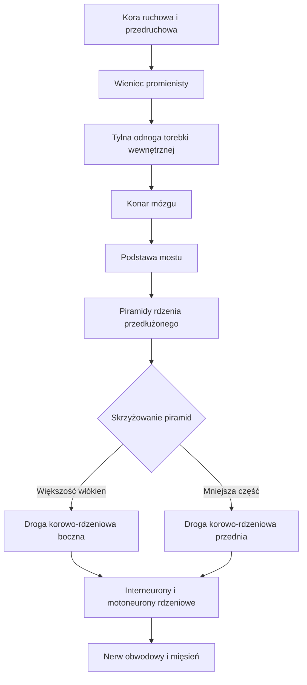
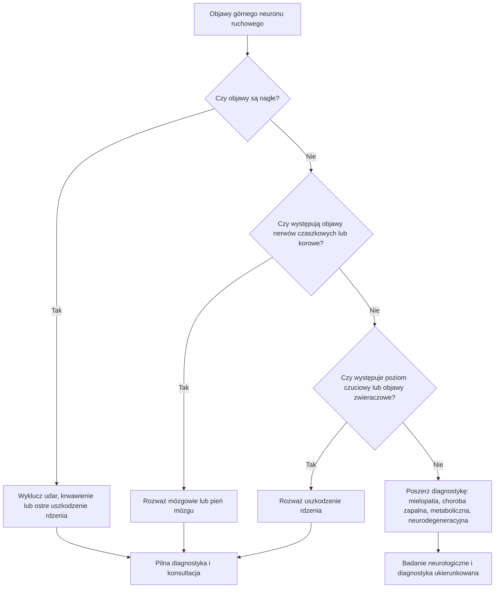
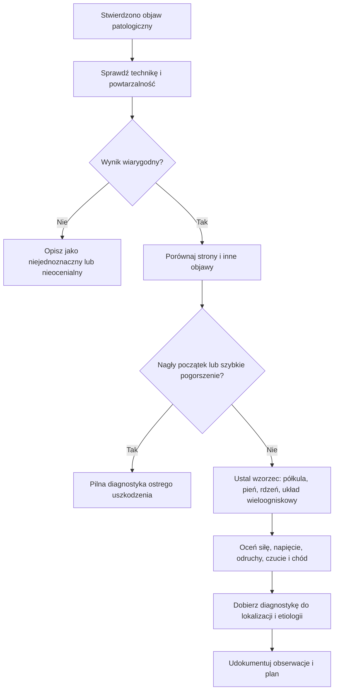

# 8.5. Objawy piramidowe i patologiczne

## Wprowadzenie

Objawy piramidowe i patologiczne należą do najważniejszych elementów badania układu ruchowego, ponieważ pozwalają rozpoznać zaburzenie czynności górnego neuronu ruchowego, czyli struktur zstępujących dróg ruchowych powyżej motoneuronu obwodowego. Ich właściwa interpretacja wymaga jednak znacznie więcej niż zapamiętania nazw prób. Badający powinien rozumieć przebieg drogi korowo-rdzeniowej i korowo-jądrowej, organizację segmentarną rdzenia, mechanizmy regulacji odruchów oraz relację pomiędzy objawami dodatnimi i ubytkowymi.

W praktyce klinicznej do objawów sugerujących uszkodzenie górnego neuronu ruchowego zalicza się przede wszystkim niedowład o charakterystycznym rozkładzie, utratę precyzji ruchów dowolnych, wzmożone odruchy ścięgniste, spastyczność, klonus oraz patologiczne odpowiedzi podeszwowe. Do prób wykorzystywanych w ocenie należą między innymi objaw Babińskiego, Chaddocka i Oppenheima, a także objawy Hoffmanna i Trömnera. Nie są one równoważne pod względem mechanizmu, czułości, swoistości ani wiarygodności między badającymi.

**Najważniejsza zasada kliniczna:** dodatni objaw patologiczny jest wskazówką lokalizacyjną, a nie samodzielnym rozpoznaniem etiologicznym. Wynik należy zestawić z siłą mięśniową, napięciem, odruchami głębokimi, czuciem, koordynacją, chodem, nerwami czaszkowymi, dynamiką objawów i danymi z badań dodatkowych. Pojedynczy objaw ujemny nie wyklucza uszkodzenia drogi piramidowej.

Rozdział rozwija zagadnienia wprowadzone w 8.1–8.4. Podstawowa technika badania odpowiedzi podeszwowej i odruchów powierzchownych została przedstawiona w rozdziale 8.4; tutaj nacisk położono na pogłębioną interpretację, objawy kończyny górnej, klonus, lokalizację uszkodzenia i wartość diagnostyczną poszczególnych znaków.

---

## 1. Cele kształcenia i efekty uczenia się

### 1.1. Cel ogólny

Celem rozdziału jest przygotowanie uczestnika do rozpoznawania, prawidłowego wywoływania i krytycznej interpretacji wybranych objawów uszkodzenia dróg piramidowych oraz innych objawów patologicznych, z uwzględnieniem neuroanatomii, neurofizjologii, lokalizacji uszkodzenia i zasad bezpieczeństwa.

### 1.2. Szczegółowe efekty uczenia się

Po ukończeniu rozdziału uczestnik powinien:

1. wyjaśnić pojęcia górnego neuronu ruchowego, zespołu piramidowego, drogi korowo-rdzeniowej i drogi korowo-jądrowej;
2. opisać przebieg drogi korowo-rdzeniowej od kory ruchowej do rdzenia kręgowego;
3. wyjaśnić znaczenie skrzyżowania piramid i przewidywać stronę objawów w zależności od położenia uszkodzenia;
4. odróżniać objawy uszkodzenia górnego i dolnego neuronu ruchowego;
5. prawidłowo interpretować odpowiedź podeszwową, w tym odróżniać wyprost palucha od reakcji wycofania;
6. opisać znaczenie objawów Chaddocka i Oppenheima oraz ograniczenia ich stosowania;
7. przeprowadzić próbę Hoffmanna i Trömnera z zachowaniem powtarzalnej techniki;
8. rozpoznać klonus stopy i rzepki oraz odróżnić go od innych ruchów mimowolnych;
9. łączyć objawy w zespoły lokalizacyjne, zamiast wyciągać wnioski z pojedynczego testu;
10. rozpoznać sytuacje wymagające pilnej diagnostyki obrazowej lub konsultacji specjalistycznej;
11. sporządzić dokumentację oddzielającą obserwację od interpretacji;
12. uwzględniać ograniczenia czułości, swoistości i zgodności między badającymi.

### 1.3. Granice kompetencji

Rozdział ma charakter edukacyjny. Samo wykonanie próby nie upoważnia do samodzielnego rozpoznawania choroby, zlecania badań ani modyfikowania leczenia poza zakresem uprawnień zawodowych. W razie podejrzenia udaru, ostrego uszkodzenia rdzenia, szybko postępującej mielopatii, zespołu ogona końskiego lub innego stanu nagłego należy uruchomić właściwą ścieżkę pilnej pomocy medycznej. Nie wolno opóźniać przekazania pacjenta z powodu wielokrotnego powtarzania prób neurologicznych.

---

## 2. Definicje i terminologia

### 2.1. Górny neuron ruchowy

Górny neuron ruchowy (upper motor neuron, UMN) oznacza neurony i ich wypustki uczestniczące w przekazywaniu oraz modulowaniu poleceń ruchowych z ośrodkowego układu nerwowego do obwodowych układów wykonawczych. W badaniu klinicznym termin odnosi się przede wszystkim do neuronów zstępujących z kory mózgu i struktur pnia mózgu, których aksony wpływają na interneurony rdzeniowe oraz motoneurony jąder nerwów czaszkowych i rogów przednich rdzenia.

### 2.2. Dolny neuron ruchowy

Dolny neuron ruchowy (lower motor neuron, LMN) obejmuje motoneurony jąder ruchowych nerwów czaszkowych i komórek rogów przednich rdzenia kręgowego, a także ich aksony biegnące przez nerwy obwodowe do mięśni. Uszkodzenie dolnego neuronu ruchowego może powodować wiotki niedowład, zanik mięśni, fascykulacje i osłabienie lub zniesienie odruchów zależnych od uszkodzonego łuku.

### 2.3. Droga piramidowa

Droga piramidowa to zbiorcze określenie głównych dróg zstępujących układu korowego, przede wszystkim drogi korowo-rdzeniowej i korowo-jądrowej. Nazwa wynika z przebiegu znacznej części włókien przez piramidy rdzenia przedłużonego. W praktyce klinicznej termin „objawy piramidowe” bywa używany szerzej dla objawów zespołu górnego neuronu ruchowego, choć nie każdy element kontroli ruchu zależy wyłącznie od drogi korowo-rdzeniowej.

### 2.4. Zespół górnego neuronu ruchowego

Zespół górnego neuronu ruchowego jest wzorcem zaburzeń wynikających z uszkodzenia ośrodkowych dróg ruchowych. Może obejmować:
- niedowład ośrodkowy;
- utratę selektywności i precyzji ruchów;
- spowolnienie i osłabienie ruchów dowolnych;
- wzmożenie odruchów na rozciąganie;
- spastyczność, czyli zależne od szybkości rozciągania zwiększenie oporu mięśniowego;
- klonus;
- patologiczne odpowiedzi odruchowe, w tym wyprostną odpowiedź podeszwową;
- osłabienie lub zniesienie niektórych odruchów powierzchownych.

Nie wszystkie elementy muszą występować równocześnie. W ostrym okresie uszkodzenia mózgu lub rdzenia napięcie i odruchy mogą być początkowo obniżone. Późniejszy rozwój hiperrefleksji i spastyczności zależy od przyczyny, lokalizacji, rozległości oraz czasu od uszkodzenia.

### 2.5. Objaw patologiczny

Objaw patologiczny jest określoną odpowiedzią ruchową, która w danym wieku i kontekście klinicznym nie jest oczekiwana u osoby bez odpowiedniego zaburzenia neurologicznego. Określenie „patologiczny” nie oznacza jednak, że pojedyncza dodatnia próba przesądza o konkretnej chorobie. Należy uwzględnić warianty fizjologiczne, wiek rozwojowy, technikę badania, ból, pobudzenie i współistniejące choroby.

### 2.6. Objaw dodatni i ujemny

- **Objaw dodatni** – charakterystyczna odpowiedź występuje po prawidłowo wykonanym bodźcu.
- **Objaw ujemny** – charakterystyczna odpowiedź nie została wywołana.
- **Wynik niejednoznaczny** – obserwacja nie pozwala na wiarygodną klasyfikację.
- **Próba nieocenialna** – nie można jej rzetelnie wykonać z powodu bólu, urazu, zmian skórnych, ograniczenia ruchu, braku współpracy lub innej przeszkody.

Wyniku niejednoznacznego nie należy automatycznie kodować jako ujemnego.

---

## 3. Podstawy neuroanatomiczne

### 3.1. Początek drogi korowo-rdzeniowej

Włókna drogi korowo-rdzeniowej pochodzą głównie z neuronów warstwy V kory mózgu. Znaczna część rozpoczyna się w:
- pierwotnej korze ruchowej zakrętu przedśrodkowego;
- korze przedruchowej;
- dodatkowej korze ruchowej;
- obszarach czuciowych i ciemieniowych uczestniczących w integracji ruchu.

Nie należy utożsamiać drogi korowo-rdzeniowej wyłącznie z pojedynczym polem kory. Jest to układ włókien o zróżnicowanym pochodzeniu i funkcji.

### 3.2. Przebieg włókien

Włókna zstępują kolejno przez:
1. wieniec promienisty;
2. tylną odnogę torebki wewnętrznej;
3. odnogę tylną konaru mózgu w śródmózgowiu;
4. podstawę mostu;
5. piramidy rdzenia przedłużonego;
6. skrzyżowanie piramid;
7. sznury boczne i przednie rdzenia kręgowego.

Włókna korowo-jądrowe odchodzą na różnych poziomach pnia mózgu, docierając do jąder ruchowych nerwów czaszkowych. Większość tych jąder otrzymuje obustronne unerwienie korowe, ale istnieją klinicznie ważne wyjątki i asymetrie, szczególnie dotyczące dolnej części jądra nerwu twarzowego i części jądra nerwu podjęzykowego.

### 3.3. Skrzyżowanie piramid

Większość włókien drogi korowo-rdzeniowej krzyżuje się w dolnej części rdzenia przedłużonego i tworzy drogę korowo-rdzeniową boczną. Mniejsza część biegnie początkowo w drodze przedniej i może krzyżować się segmentarnie lub oddziaływać obustronnie na mięśnie osiowe.

Zasada lokalizacyjna:
- uszkodzenie powyżej skrzyżowania piramid zwykle powoduje objawy górnego neuronu ruchowego po stronie przeciwnej do ogniska;
- uszkodzenie drogi korowo-rdzeniowej w rdzeniu poniżej skrzyżowania zwykle powoduje objawy po stronie uszkodzenia, poniżej poziomu zmiany;
- w uszkodzeniach pnia mózgu mogą współistnieć objawy nerwów czaszkowych po stronie ogniska i objawy długich dróg ruchowych po stronie przeciwnej.

Zasada ta jest orientacyjna. W zmianach rozległych, obustronnych, wieloogniskowych lub obejmujących skrzyżowanie wzorzec może być bardziej złożony.

### 3.4. Somatotopia i znaczenie lokalizacji

W obrębie kory ruchowej występuje organizacja somatotopowa, ale jej dokładny obraz jest bardziej złożony niż klasyczna ilustracja „człowieka ruchowego”. W torebce wewnętrznej włókna ruchowe są skupione w stosunkowo małej przestrzeni, dlatego niewielkie ognisko może wywołać znaczny niedowład twarzy, kończyny górnej i dolnej. W rdzeniu kręgowym uszkodzenie może jednocześnie naruszać włókna długich dróg zstępujących, drogi czuciowe oraz neurony segmentarne.

### 3.5. Schemat drogi korowo-rdzeniowej

### 3.6. Drogi pozapiramidowe i modulacja

Kontrola napięcia, postawy i automatyzmów ruchowych nie jest wyłączną funkcją drogi korowo-rdzeniowej. Uczestniczą w niej także:
- drogi siatkowato-rdzeniowe;
- drogi przedsionkowo-rdzeniowe;
- połączenia jąder podstawy z korą i wzgórzem;
- obwody móżdżkowe;
- lokalne sieci interneuronów rdzeniowych.

Dlatego spastyczność i hiperrefleksja są wynikiem zaburzenia sieci regulacyjnej, a nie prostego „odłączenia hamulca” w jednym przewodzie. Współczesne modele zespołu górnego neuronu ruchowego uwzględniają zmiany pobudliwości motoneuronów, interneuronów, hamowania zstępującego, plastyczności rdzeniowej oraz właściwości mechanicznych mięśni i tkanek łącznych [1, 2].

---

## 4. Neurofizjologia objawów górnego neuronu ruchowego

### 4.1. Utrata selektywnej kontroli ruchu

Uszkodzenie dróg zstępujących może ograniczać zdolność niezależnego aktywowania pojedynczych grup mięśni. Pacjent ma trudność z wykonywaniem precyzyjnych, szybkich ruchów palców, rozdzielaniem ruchów w stawach i kontrolą siły. Często pojawiają się ruchy sprzężone, stereotypowe wzorce zgięciowe lub wyprostne oraz kompensacje.

### 4.2. Hiperrefleksja

Wzmożone odruchy na rozciąganie mogą wynikać ze zmienionej modulacji rdzeniowych obwodów odruchowych po uszkodzeniu dróg zstępujących. Ich obecność należy oceniać łącznie z rozprzestrzenianiem odpowiedzi, asymetrią, klonusem, napięciem i innymi objawami ośrodkowymi. Żywe, symetryczne odruchy bez innych nieprawidłowości mogą być wariantem osobniczym.

### 4.3. Spastyczność

Spastyczność jest zaburzeniem napięcia charakteryzującym się zależnym od szybkości rozciągania zwiększeniem oporu mięśniowego. Nie jest synonimem każdej sztywności ani każdej wzmożonej aktywności mięśniowej. Należy ją odróżniać od:
- sztywności pozapiramidowej;
- przykurczu mięśniowo-ścięgnistego;
- bólowego ograniczenia ruchu;
- dystonii;
- obronnego napięcia mięśniowego;
- zwiększonego oporu wynikającego ze zmian stawowych.

### 4.4. Klonus

Klonus jest rytmiczną, powtarzalną odpowiedzią mięśnia lub grupy mięśni na utrzymywane rozciągnięcie. W badaniu klinicznym utrwalony klonus, zwłaszcza w połączeniu z hiperrefleksją i innymi objawami piramidowymi, silnie przemawia za zaburzeniem ośrodkowej kontroli odruchów. Kilka nieregularnych ruchów po bodźcu nie powinno być automatycznie uznawane za klonus patologiczny.

### 4.5. Patologiczna odpowiedź podeszwowa

Odpowiedź wyprostna palucha u osoby dorosłej może wskazywać na zaburzenie funkcji dróg zstępujących. Interpretacja obejmuje ocenę kierunku ruchu palucha, czasu pojawienia się odpowiedzi, jej powtarzalności i współistniejącego ruchu pozostałych palców. Samo rozszerzenie palców lub wycofanie całej kończyny nie wystarcza do rozpoznania dodatniego objawu Babińskiego.

### 4.6. Zmienność w czasie

W ostrym uszkodzeniu mózgu lub rdzenia obraz neurologiczny może ewoluować. Bezpośrednio po ciężkim uszkodzeniu rdzenia może wystąpić wstrząs rdzeniowy z obniżeniem napięcia i odruchów poniżej poziomu uszkodzenia. W kolejnych dniach lub tygodniach mogą rozwinąć się hiperrefleksja i spastyczność. Brak objawów piramidowych w pierwszym badaniu nie wyklucza więc istotnego uszkodzenia ośrodkowego.

---

## 5. Ogólna metodyka badania objawów patologicznych

### 5.1. Przygotowanie

Przed badaniem należy:
- zweryfikować tożsamość pacjenta;
- wyjaśnić cel i przebieg prób;
- uzyskać zgodę;
- ocenić ból, urazy, stan skóry i ograniczenia ruchu;
- zapewnić stabilne, wygodne ułożenie;
- przygotować tępy, czysty i nieuszkadzający skóry przyrząd;
- sprawdzić, czy pacjent rozumie polecenia i czy można uzyskać wiarygodną odpowiedź.

### 5.2. Zasada porównania stron

Jeżeli stan pacjenta na to pozwala, badanie należy przeprowadzić obustronnie i porównać:
- obecność odpowiedzi;
- jej kierunek;
- amplitudę;
- czas pojawienia się;
- liczbę powtórzeń;
- symetrię;
- wpływ rozluźnienia i pozycji.

Wynik należy opisywać konkretnie. Zapis „objawy piramidowe obecne” jest mniej użyteczny niż „odpowiedź podeszwowa wyprostna po stronie prawej, Hoffmann dodatni obustronnie, klonus skokowy utrwalony po stronie prawej”.

### 5.3. Unikanie nadmiernej stymulacji

Bodziec powinien być wystarczający do wywołania odpowiedzi, ale nie powinien powodować urazu ani nadmiernego bólu. Wielokrotne silne drażnienie może wywołać reakcję obronną, pobudzenie i ruchy wycofania, które utrudniają interpretację. Należy przerwać próbę, jeśli pojawia się ból, skurcz obronny lub ryzyko uszkodzenia skóry.

### 5.4. Kolejność oceny

Praktyczna kolejność:
1. obserwacja postawy i spontanicznych ruchów;
2. ocena siły mięśniowej;
3. ocena napięcia mięśniowego;
4. odruchy głębokie;
5. objawy patologiczne kończyn górnych;
6. odpowiedzi podeszwowe i ich warianty;
7. ocena klonusu;
8. czucie i poziom czuciowy;
9. chód i równowaga, jeśli jest to bezpieczne;
10. synteza wyników i decyzja o dalszym postępowaniu.

---

## 6. Objaw Babińskiego – pogłębiona interpretacja

### 6.1. Znaczenie

Objaw Babińskiego jest wyprostną odpowiedzią palucha po bodźcu drażniącym podeszwę stopy. U dorosłego, w odpowiednim kontekście klinicznym, sugeruje zaburzenie czynności dróg korowo-rdzeniowych lub szerzej – ośrodkowej kontroli odpowiedzi podeszwowej.

Szczegółową technikę wykonania opisano w rozdziale 8.4. W tym miejscu należy podkreślić, że najważniejszym elementem odpowiedzi jest wyprost palucha. Rozszerzenie pozostałych palców może towarzyszyć odpowiedzi, ale nie powinno zastępować oceny kierunku ruchu palucha.

### 6.2. Cechy odpowiedzi wiarygodnej

Za odpowiedź przemawiającą za dodatnim objawem Babińskiego uznaje się:
- powolny lub stopniowy wyprost palucha;
- pojawienie się odpowiedzi po odpowiednim bodźcu, a nie przed nim;
- powtarzalność przy delikatnym, prawidłowo wykonanym badaniu;
- brak cech gwałtownego, nieswoistego wycofania całej kończyny;
- zgodność z innymi objawami uszkodzenia górnego neuronu ruchowego.

Nie należy wymagać jednoczesnego, wyraźnego wachlarzowatego rozstawienia wszystkich pozostałych palców. U części pacjentów reakcja może być dyskretna, a interpretacja wymaga doświadczenia i zestawienia z całym badaniem.

### 6.3. Odpowiedź wycofania

Reakcja wycofania może obejmować zgięcie biodra i kolana, odwiedzenie kończyny, zgięcie palców lub gwałtowny ruch całej stopy. Jest to reakcja obronna na nieprzyjemny bodziec, a nie równoważnik objawu Babińskiego.

W razie wątpliwości:
1. przerwać próbę i pozwolić pacjentowi się rozluźnić;
2. upewnić się, że stopa jest stabilnie podparta;
3. zastosować łagodniejszy, kontrolowany bodziec;
4. obserwować paluch niezależnie od ruchu całej kończyny;
5. rozważyć alternatywną próbę, np. Chaddocka lub Oppenheima, jeśli jest wskazana;
6. odnotować wynik jako niejednoznaczny, jeżeli nie można odróżnić wyprostu palucha od wycofania.

### 6.4. Odpowiedź obojętna

Brak widocznego ruchu palucha oznacza odpowiedź obojętną lub niewywołaną. Nie jest to dowód prawidłowej funkcji drogi korowo-rdzeniowej. Odpowiedź może być niewidoczna z powodu:
- neuropatii obwodowej;
- uszkodzenia korzenia lub nerwu;
- osłabienia mięśni;
- ograniczenia ruchomości stawów;
- bólu;
- obrzęku lub zmian skórnych;
- niewłaściwej techniki;
- zaburzeń świadomości i reaktywności.

### 6.5. Znaczenie wieku

U niemowląt wyprostna odpowiedź podeszwowa może być fizjologiczna z powodu niedojrzałości dróg zstępujących. U dorosłych i dzieci starszych interpretacja powinna uwzględniać wiek, rozwój, stan neurologiczny oraz pozostałe wyniki. Nie wolno przenosić norm rozwojowych na badanie dorosłych.

### 6.6. Lokalizacja

Dodatni objaw Babińskiego wskazuje na zaburzenie ośrodkowej kontroli odpowiedzi podeszwowej, ale sam nie określa poziomu uszkodzenia. Ognisko może znajdować się w półkuli mózgu, torebce wewnętrznej, pniu mózgu lub rdzeniu kręgowym. Lokalizację ustala się na podstawie innych objawów.

---

## 7. Objaw Chaddocka

### 7.1. Definicja i mechanizm

Objaw Chaddocka jest wariantem wywoływania patologicznej odpowiedzi podeszwowej przez drażnienie skóry w okolicy bocznej kostki i bocznego brzegu stopy. Ocenia się tę samą zasadniczą odpowiedź wyprostną palucha, która może wystąpić w objawie Babińskiego.

### 7.2. Wskazania do zastosowania

Próba może być rozważana, gdy:
- drażnienie podeszwy wywołuje silne łaskotanie lub reakcję wycofania;
- na podeszwie występują zmiany utrudniające badanie;
- odpowiedź w klasycznej próbie jest niejednoznaczna;
- potrzebne jest porównanie odpowiedzi po innym rodzaju bodźca.

### 7.3. Interpretacja

Dodatnia odpowiedź ma postać wyprostu palucha, niekiedy z wachlarzowatym ustawieniem pozostałych palców. Samo odsunięcie stopy, zgięcie palców lub niespecyficzny ruch obronny nie stanowią dodatniego wyniku.

### 7.4. Ograniczenia

Objaw Chaddocka nie jest niezależnym potwierdzeniem rozpoznania. W badaniach porównawczych zgodność między różnymi wariantami odpowiedzi podeszwowej była ograniczona. Wynik powinien być traktowany jako element całego badania, a nie jako test rozstrzygający.

---

## 8. Objaw Oppenheima

### 8.1. Definicja

Objaw Oppenheima polega na wywołaniu odpowiedzi podeszwowej przez kontrolowany ucisk lub przesuwanie palców po przednio-przyśrodkowej powierzchni piszczeli. Ocenia się, czy pojawia się wyprost palucha.

### 8.2. Zasady wykonania

1. Ułożyć kończynę w wygodnej pozycji i rozluźnić mięśnie.
2. Sprawdzić, czy na przedniej powierzchni goleni nie ma urazu, stanu zapalnego, krwiaka lub silnej bolesności.
3. Zastosować kontrolowany bodziec wzdłuż przednio-przyśrodkowej powierzchni piszczeli.
4. Obserwować paluch i pozostałe palce, nie skupiając się wyłącznie na ruchu całej kończyny.
5. Porównać strony.
6. W razie bólu lub reakcji obronnej przerwać badanie.

### 8.3. Interpretacja

Dodatnia odpowiedź wymaga wyprostu palucha. Reakcja bólowego cofnięcia kończyny, zgięcia kolana lub napięcia mięśni nie jest równoważna dodatniemu objawowi.

### 8.4. Ograniczenia

Próba może być nieprzyjemna i zależna od tolerancji bólu. Nie należy zwiększać siły ucisku w celu „wymuszenia” odpowiedzi. Jeżeli wynik jest niejednoznaczny, należy go tak opisać, zamiast przypisywać mu wartość dodatnią lub ujemną bez podstaw.

---

## 9. Objaw Hoffmanna

### 9.1. Znaczenie kliniczne

Objaw Hoffmanna jest próbą oceny odruchowej odpowiedzi palców ręki, wykorzystywaną jako jeden z elementów badania górnego neuronu ruchowego. Może wskazywać na wzmożoną pobudliwość odruchową w obrębie kończyny górnej, między innymi w przebiegu mielopatii szyjnej. Nie jest jednak swoisty wyłącznie dla ucisku rdzenia szyjnego i nie powinien być interpretowany samodzielnie.

### 9.2. Technika

1. Pacjent powinien siedzieć lub leżeć w wygodnej pozycji.
2. Badający stabilizuje dłoń pacjenta, utrzymując ją rozluźnioną.
3. Chwyta palec środkowy w okolicy paliczka dalszego lub paznokcia, zgodnie z przyjętą techniką.
4. Wykonuje krótki, kontrolowany ruch nagłego zwolnienia lub pstryknięcia dystalnego paliczka/paznokcia w kierunku zgięcia.
5. Obserwuje kciuk i palec wskazujący.
6. Ocenia, czy występuje mimowolne zgięcie palca wskazującego i przywiedzenie lub zgięcie kciuka.
7. Powtarza próbę tylko wtedy, gdy pierwsza odpowiedź była niejasna i pacjent toleruje badanie.
8. Porównuje obie ręce.

### 9.3. Odpowiedź dodatnia

Za dodatnią odpowiedź uznaje się mimowolne zgięcie palca wskazującego i kciuka po bodźcu. Należy odróżnić:
- ruch odruchowy od świadomego zaciskania dłoni;
- odpowiedź wywołaną bodźcem od spontanicznego ruchu;
- rzeczywistą reakcję kciuka i palca wskazującego od ruchu całej ręki.

### 9.4. Czynniki zakłócające

Wynik może być trudny do interpretacji przy:
- dużym napięciu mięśniowym dłoni;
- bólu palców lub nadgarstka;
- przykurczach;
- drżeniu;
- ruchach mimowolnych;
- lęku i nadmiernym napięciu;
- nieprawidłowej technice lub zbyt silnym bodźcu.

### 9.5. Znaczenie dodatniego wyniku

Dodatni objaw Hoffmanna może zwiększać podejrzenie uszkodzenia ośrodkowych dróg ruchowych, zwłaszcza jeśli współistnieją:
- pogorszenie sprawności manualnej;
- niezgrabność dłoni;
- obustronne parestezje;
- wzmożone odruchy w kończynach dolnych;
- dodatni objaw Babińskiego;
- klonus;
- zaburzenia chodu;
- objawy czuciowe lub poziom czuciowy.

Sam dodatni objaw Hoffmanna nie rozpoznaje mielopatii szyjnej. Może występować u części osób bez klinicznej mielopatii, a jego wartość zależy od populacji, techniki i prawdopodobieństwa wstępnego choroby.

### 9.6. Wynik jednostronny i obustronny

Asymetria może zwiększać znaczenie lokalizacyjne, ale nie jest regułą rozstrzygającą. Odpowiedź obustronna również może występować w chorobach ośrodkowych, w tym w mielopatii szyjnej. Należy zawsze opisać stronę, jakość odpowiedzi i pozostałe objawy.

---

## 10. Objaw Trömnera

### 10.1. Definicja

Objaw Trömnera jest próbą odruchową kończyny górnej, w której bodziec przykładany do powierzchni dłoniowej paliczka dalszego palca środkowego wywołuje zgięcie palca wskazującego i/lub kciuka. Jest często opisywany jako manewr zbliżony do objawu Hoffmanna, ale różni się kierunkiem i sposobem podania bodźca.

### 10.2. Technika

1. Ułożyć rękę pacjenta w rozluźnieniu.
2. Delikatnie ustabilizować palec środkowy, zwykle w lekkim zgięciu.
3. Krótkim, kontrolowanym ruchem opukać lub pstryknąć powierzchnię dłoniową paliczka dalszego palca środkowego.
4. Obserwować mimowolne zgięcie palca wskazującego i kciuka.
5. Porównać odpowiedź po obu stronach.
6. Unikać silnego bodźca, który mógłby wywołać reakcję obronną.

### 10.3. Interpretacja

Wynik dodatni polega na powtarzalnej, mimowolnej odpowiedzi zgięciowej kciuka i/lub palca wskazującego po prawidłowym bodźcu. W literaturze spotyka się różnice w sposobie opisu odpowiedzi i wykonania próby. W dokumentacji należy zatem opisać rzeczywiście zaobserwowany ruch, a nie ograniczać się do samego określenia „Trömner dodatni”.

### 10.4. Znaczenie diagnostyczne

W przeglądzie Jiang i współpracowników z 2024 r. oraz w przeglądzie zakresowym Sharma i współpracowników z 2025 r. objaw Trömnera wykazywał obiecujące parametry diagnostyczne w wybranych badaniach dotyczących mielopatii szyjnej. Zakresy czułości i swoistości były jednak oparte na ograniczonej liczbie badań, a wyniki zależały od doboru grup kontrolnych i metodologii. Nie należy przenosić tych wartości bezpośrednio na każdą populację pacjentów.

### 10.5. Ograniczenia

- Wymaga opanowania powtarzalnej techniki.
- Może być zaburzony przez ból, przykurcz i ruchy mimowolne.
- Dodatnia odpowiedź nie określa przyczyny uszkodzenia.
- Ujemna odpowiedź nie wyklucza mielopatii.
- Wynik powinien być interpretowany razem z objawami kończyn dolnych i oceną chodu.

---

## 11. Klonus stopy i rzepki

### 11.1. Definicja

Klonus to rytmiczna seria mimowolnych skurczów i rozluźnień mięśnia lub grupy mięśni, wywołana nagłym rozciągnięciem i podtrzymywaniem rozciągnięcia. Najczęściej w badaniu neurologicznym ocenia się klonus stopy, rzadziej klonus rzepki.

### 11.2. Klonus stopy – przygotowanie

- Pacjent powinien być ułożony na plecach lub siedzieć z podpartą kończyną.
- Kolano należy ustawić tak, aby mięśnie były możliwie rozluźnione.
- Badający stabilizuje podudzie i stopę.
- Należy upewnić się, że ograniczenie ruchu nie wynika z bólu, przykurczu lub zmian stawowych.

### 11.3. Klonus stopy – procedura

1. Ująć stopę w okolicy przodostopia.
2. Wykonać szybkie, kontrolowane zgięcie grzbietowe stopy.
3. Utrzymać stopę w zgięciu grzbietowym, nie wykonując naprzemiennych ruchów.
4. Obserwować, czy pojawia się rytmiczna seria naprzemiennych skurczów mięśni łydki i ruchów stopy.
5. Ocenić liczbę uderzeń, regularność i czas trwania odpowiedzi.
6. Zwolnić rozciągnięcie i sprawdzić, czy ruch ustaje.
7. Porównać drugą kończynę, jeśli jest to bezpieczne.

### 11.4. Klonus rzepki – procedura

1. Pacjent leży na plecach, kończyna jest rozluźniona i wyprostowana.
2. Badający stabilizuje rzepkę.
3. Przemieszcza ją gwałtownie w kierunku dystalnym i utrzymuje nacisk.
4. Obserwuje rytmiczne, powtarzalne ruchy rzepki wynikające z naprzemiennego napięcia mięśnia czworogłowego.
5. Zapisuje, czy klonus jest obecny, jak długo się utrzymuje i czy występuje po obu stronach.

Próba rzepkowa może być niewykonalna lub nieinterpretowalna przy bólu, wysięku, niestabilności, urazie lub znacznych zmianach stawu kolanowego.

### 11.5. Klonus utrwalony i nieutrwalony

W praktyce opisuje się:
- **klonus nieutrwalony** – krótka seria rytmicznych skurczów, która samoistnie wygasa;
- **klonus utrwalony** – rytmiczna odpowiedź utrzymująca się podczas podtrzymywania rozciągnięcia.

Nie ma jednego uniwersalnego progu liczby uderzeń, który w każdej sytuacji rozdzielałby odpowiedź fizjologiczną od patologicznej. Należy podać rzeczywistą liczbę uderzeń lub czas trwania, jeśli można je wiarygodnie zmierzyć, oraz opisać kontekst kliniczny.

### 11.6. Różnicowanie klonusu

| Zjawisko | Charakterystyka | Wskazówki różnicujące |
|---|---|---|
| Klonus | Rytmiczna seria skurczów po utrzymanym rozciągnięciu | Zwykle regularny, zależny od utrzymywania bodźca |
| Drżenie | Oscylacyjne ruchy wokół stawu | Może występować w spoczynku, postawie lub ruchu |
| Mioklonie | Krótkie, nagłe, nieregularne lub rytmiczne szarpnięcia | Nie muszą zależeć od stałego rozciągania |
| Ruch wycofania | Złożona odpowiedź obronna | Zwykle nieregularna, wielostawowa |
| Ruch dowolny | Świadome naprzemienne poruszanie | Zależny od polecenia i kontroli pacjenta |
| Drżenie ortostatyczne | Szybkie drżenie podczas stania | Znika lub zmienia się po zmianie pozycji |

### 11.7. Znaczenie kliniczne

Utrwalony klonus, szczególnie jednostronny lub wyraźnie asymetryczny, w połączeniu z hiperrefleksją, spastycznością i objawami ubytkowymi, przemawia za uszkodzeniem ośrodkowych dróg ruchowych. Sam klonus nie określa poziomu uszkodzenia i nie jest wystarczającym kryterium rozpoznania konkretnej choroby.

---

## 12. Porównanie objawów piramidowych i patologicznych

| Objaw | Badana okolica | Charakter odpowiedzi | Główne znaczenie |
|---|---|---|---|
| Babiński | Podeszwa stopy | Wyprost palucha, czasem wachlarz palców | Zaburzenie ośrodkowej kontroli odpowiedzi podeszwowej |
| Chaddock | Boczna okolica kostki i stopy | Wyprost palucha | Alternatywny sposób wywołania odpowiedzi podeszwowej |
| Oppenheim | Przednio-przyśrodkowa powierzchnia piszczeli | Wyprost palucha | Alternatywny sposób wywołania odpowiedzi podeszwowej |
| Hoffmann | Palec środkowy ręki | Zgięcie kciuka i palca wskazującego | Wzmożona pobudliwość odruchowa kończyny górnej |
| Trömner | Dłoniowa powierzchnia paliczka dalszego palca środkowego | Zgięcie kciuka i/lub palca wskazującego | Objaw górnego neuronu ruchowego, badany m.in. w mielopatii szyjnej |
| Klonus stopy | Staw skokowy | Rytmiczne skurcze po rozciągnięciu | Wzmożona pobudliwość odruchowa, możliwe uszkodzenie ośrodkowe |
| Klonus rzepki | Staw kolanowy | Rytmiczne ruchy rzepki | Wzmożona pobudliwość odruchowa kończyny dolnej |

**Uwaga:** objawy Babińskiego, Chaddocka i Oppenheima są wariantami oceny odpowiedzi podeszwowej. Nie należy sumować ich jako trzech niezależnych dowodów na trzy odrębne uszkodzenia.

---

## 13. Lokalizacja uszkodzenia na podstawie wzorca objawów

### 13.1. Półkula mózgu

Uszkodzenie kory ruchowej lub podkorowych dróg ruchowych może powodować przeciwstronny niedowład, wzmożenie odruchów i dodatni objaw Babińskiego. Dodatkowe cechy zależą od lokalizacji:
- afazja przy zajęciu dominującej półkuli;
- zaniedbywanie stronne przy zajęciu odpowiednich obszarów półkuli niedominującej;
- zaburzenia pola widzenia przy zajęciu dróg wzrokowych;
- napady padaczkowe przy zmianach drażniących korę.

Nagły początek objawów ogniskowych wymaga traktowania jako podejrzenie udaru do czasu wykluczenia.

### 13.2. Torebka wewnętrzna

Uszkodzenie tylnej odnogi torebki wewnętrznej może wywołać gęsty niedowład połowiczy po stronie przeciwnej, często obejmujący twarz, kończynę górną i dolną. Ze względu na skupienie włókien nawet niewielkie ognisko może powodować istotny deficyt. Objawy korowe, takie jak afazja lub zaniedbywanie, mogą być nieobecne, jeżeli kora nie jest bezpośrednio zajęta.

### 13.3. Pień mózgu

Zmiany w pniu mózgu mogą dawać zespoły skrzyżowane:
- objawy nerwów czaszkowych po stronie ogniska;
- objawy drogi korowo-rdzeniowej po stronie przeciwnej;
- zaburzenia spojrzenia, czucia, koordynacji lub świadomości zależnie od poziomu.

Współistnienie objawów pniowych i nagłego niedowładu jest wskazaniem do pilnej oceny neurologicznej.

### 13.4. Rdzeń szyjny

Uszkodzenie rdzenia szyjnego może powodować:
- objawy segmentarne na poziomie zmiany, niekiedy z cechami dolnego neuronu ruchowego;
- objawy górnego neuronu ruchowego poniżej poziomu uszkodzenia;
- zaburzenia czucia w kończynach lub na tułowiu;
- niezgrabność dłoni;
- zaburzenia chodu i równowagi;
- w zaawansowanych przypadkach zaburzenia funkcji pęcherza i jelit.

W mielopatii szyjnej objawy w kończynach górnych mogą być mieszane: na poziomie uszkodzenia mogą występować cechy obwodowe, a poniżej – cechy ośrodkowe. Nie należy wykluczać mielopatii tylko dlatego, że odruchy w rękach są osłabione.

### 13.5. Rdzeń piersiowy

Uszkodzenie rdzenia piersiowego może powodować spastyczny niedowład kończyn dolnych, poziom czuciowy na tułowiu i zaburzenia autonomiczne. Odruchy kończyn górnych mogą pozostawać prawidłowe. Poziom czuciowy wymaga dokładnego zmapowania i zestawienia z innymi objawami.

### 13.6. Stożek rdzeniowy i ogon koński

Uszkodzenie stożka rdzeniowego może powodować zaburzenia zwieraczy, czucia siodłowego, funkcji seksualnych oraz mieszane objawy neurologiczne. Zespół ogona końskiego jest uszkodzeniem korzeni nerwowych i typowo daje cechy dolnego neuronu ruchowego, ból korzeniowy, osłabienie i zaburzenia czucia w obszarach korzeniowych. Nie należy utożsamiać tych zespołów z typowym zespołem piramidowym, ale ich obecność stanowi pilną sytuację kliniczną.

### 13.7. Schemat lokalizacyjny

---

## 14. Diagnostyczna wartość objawów – czułość, swoistość i ograniczenia

### 14.1. Czułość i swoistość

Czułość określa, jak często test jest dodatni u osób z chorobą. Swoistość określa, jak często test jest ujemny u osób bez choroby. Wartość predykcyjna dodatnia i ujemna zależą również od częstości choroby w badanej populacji. Nie można bezpośrednio przenosić parametrów z grupy pacjentów kierowanych do poradni chirurgii kręgosłupa na populację ogólną lub na oddział ratunkowy.

### 14.2. Dane dotyczące mielopatii szyjnej

Przegląd systematyczny Jiang i współpracowników, opublikowany w 2024 r., obejmował 11 badań z grupami kontrolnymi i dodatkowe badania częstości objawów u pacjentów z degeneracyjną mielopatią szyjną. Autorzy wskazali, że:
- Trömner i hiperrefleksja należały do bardziej czułych prób;
- objaw Babińskiego, klonus i objaw Trömnera należały do objawów o wysokiej swoistości w części badań;
- objaw Babińskiego i klonus miały ograniczoną czułość;
- nie wykazano jednoznacznego związku obecności pojedynczego objawu z ciężkością choroby.

Przegląd zakresowy Sharma i współpracowników z 2025 r. podsumował 16 badań. W wybranych badaniach czułość Trömnera wynosiła 93–97%, a swoistość 79–100%; swoistość Babińskiego wynosiła 93–100%, a klonusu 96–99%. Zakresy te nie są uniwersalnymi wartościami dla każdego pacjenta, ponieważ zależą od metod, populacji, definicji wyniku i jakości badań.

### 14.3. Objaw Hoffmanna

Systematyczny przegląd Fogarty i współpracowników wykazał, że dodatni objaw Hoffmanna samodzielnie zwykle tylko umiarkowanie zmienia prawdopodobieństwo degeneracyjnej mielopatii szyjnej. W analizie dwóch badań łączny dodatni iloraz wiarygodności wynosił 2,2, a ujemny 0,63. Dane nie uzasadniają stosowania próby jako samodzielnego testu potwierdzającego lub wykluczającego chorobę.

### 14.4. Odpowiedź podeszwowa i zgodność między badającymi

Badanie Araújo i współpracowników wykazało ograniczoną zgodność między obserwatorami i między różnymi próbami odpowiedzi podeszwowej. W analizowanej grupie czułość wynosiła około 59,7% dla Babińskiego, 55,3% dla Chaddocka i 30,0% dla Oppenheima. Wyników tych nie należy traktować jako stałych parametrów klinicznych, ale jako przypomnienie, że technika i interpretacja mają istotne znaczenie.

### 14.5. Praktyczne wnioski

1. Dodatni objaw Babińskiego lub utrwalony klonus zwiększa podejrzenie uszkodzenia ośrodkowego, ale nie wskazuje samodzielnie przyczyny ani dokładnego poziomu.
2. Ujemny Babiński nie wyklucza mielopatii, udaru ani innego uszkodzenia górnego neuronu ruchowego.
3. Dodatni Hoffmann nie jest równoznaczny z rozpoznaniem mielopatii szyjnej.
4. Trömner może być przydatny jako element badania przesiewowego, lecz wymaga standaryzacji i interpretacji w kontekście.
5. Zgodność kilku niezależnych elementów badania ma większą wartość niż powtarzanie jednego testu.
6. Objawy kliniczne należy interpretować w odniesieniu do prawdopodobieństwa wstępnego i dynamiki choroby.

---

## 15. Diagnostyka różnicowa zespołu górnego neuronu ruchowego

### 15.1. Choroby naczyniowe

- udar niedokrwienny;
- krwotok śródmózgowy;
- krwotok podpajęczynówkowy z objawami ogniskowymi;
- malformacje naczyniowe;
- niedokrwienie rdzenia.

Nagły początek, maksymalne nasilenie od początku, asymetria i współistniejące zaburzenia mowy, widzenia, równowagi lub świadomości wymagają pilnej diagnostyki.

### 15.2. Choroby demielinizacyjne i zapalne

- stwardnienie rozsiane;
- zapalenie rdzenia;
- choroby z kręgu zapaleń nerwów wzrokowych i rdzenia;
- inne choroby autoimmunologiczne ośrodkowego układu nerwowego.

Wskazówkami mogą być epizodyczne objawy z różnych lokalizacji, zaburzenia wzroku, czucia, koordynacji, zmęczenie i objawy pniowe. Rozpoznanie wymaga kryteriów klinicznych, obrazowych i laboratoryjnych odpowiednich dla podejrzewanej choroby.

### 15.3. Mielopatia uciskowa

- degeneracyjna mielopatia szyjna;
- przepuklina krążka międzykręgowego;
- zwężenie kanału kręgowego;
- guz wewnątrz- lub zewnątrzrdzeniowy;
- ropień nadtwardówkowy;
- krwiak nadtwardówkowy;
- zmiany pourazowe.

Postępujące zaburzenia sprawności dłoni, niezgrabność, trudności w chodzeniu, wzmożone odruchy, klonus i objawy podeszwowe powinny nasuwać podejrzenie mielopatii.

### 15.4. Choroby metaboliczne i niedoborowe

- niedobór witaminy B12;
- niedobór miedzi;
- zaburzenia elektrolitowe;
- choroby tarczycy;
- wybrane choroby mitochondrialne i metaboliczne.

Niektóre choroby metaboliczne mogą dawać jednocześnie objawy sznurów tylnych, drogi piramidowej i nerwów obwodowych. Dlatego obraz może być mieszany.

### 15.5. Choroby neurodegeneracyjne i genetyczne

- stwardnienie zanikowe boczne;
- dziedziczna parapareza spastyczna;
- pierwotne stwardnienie boczne;
- wybrane ataksje dziedziczne;
- choroby neurodegeneracyjne z zajęciem dróg ruchowych.

W stwardnieniu zanikowym bocznym mogą współistnieć objawy górnego i dolnego neuronu ruchowego. Brak zaburzeń czucia jest częsty, ale nie stanowi samodzielnego kryterium rozpoznania.

### 15.6. Choroby zakaźne

- zakaźne zapalenie rdzenia;
- ropień nadtwardówkowy;
- kiła układu nerwowego;
- zakażenie HTLV-1;
- wybrane przewlekłe zakażenia ośrodkowego układu nerwowego.

Gorączka, ból kręgosłupa, immunosupresja, niedawne zakażenie lub zabieg zwiększają podejrzenie przyczyny zakaźnej.

### 15.7. Zaburzenia czynnościowe

Zaburzenia neurologiczne czynnościowe mogą powodować osłabienie, nieprawidłowe wzorce ruchu i objawy przypominające chorobę strukturalną. Rozpoznanie powinno opierać się na dodatnich objawach klinicznych wskazujących na niezgodność z typową neuroanatomią lub zmienność zależną od określonych manewrów, a nie wyłącznie na prawidłowym badaniu obrazowym. Nie należy przypisywać objawów psychogennych tylko dlatego, że obraz badań jest niejednoznaczny.

---

## 16. Czerwone flagi i sytuacje wymagające pilnej reakcji

### 16.1. Nagły deficyt ogniskowy

Nagłe wystąpienie niedowładu, asymetrii twarzy, zaburzeń mowy, widzenia, równowagi lub świadomości należy traktować jako podejrzenie udaru albo innego ostrego zdarzenia naczyniowego. Należy uruchomić lokalną procedurę udarową i nie opóźniać transportu przez wykonywanie dodatkowych prób.

### 16.2. Podejrzenie ostrego uszkodzenia rdzenia

Alarmujące są:
- nowy niedowład kończyn po urazie;
- ból szyi lub pleców z objawami neurologicznymi;
- poziom czuciowy;
- szybko narastające zaburzenia chodu;
- nowe zaburzenia oddawania moczu lub stolca;
- zaburzenia czucia w okolicy siodłowej;
- narastająca spastyczność lub obustronne objawy piramidowe.

Przy podejrzeniu urazu kręgosłupa nie należy wykonywać gwałtownych ruchów szyi ani prób prowokujących. Trzeba utrzymać zasady ochrony kręgosłupa zgodnie z procedurami ratunkowymi.

### 16.3. Podejrzenie ucisku rdzenia szyjnego

Pilnej oceny wymagają:
- postępująca utrata sprawności dłoni;
- obustronne drętwienie lub osłabienie kończyn;
- zaburzenia chodu i częste upadki;
- dodatnie objawy piramidowe w kilku kończynach;
- nowa dysfunkcja pęcherza lub jelit;
- narastające objawy neurologiczne w krótkim czasie.

Przy podejrzeniu mielopatii szyjnej należy pilnie skierować pacjenta do właściwej diagnostyki, zwykle z uwzględnieniem rezonansu magnetycznego odcinka szyjnego. Czas i tryb badania zależą od dynamiki, ciężkości i lokalnych ścieżek klinicznych.

### 16.4. Zakażenie lub krwiak kanału kręgowego

Gorączka, silny ból kręgosłupa, immunosupresja, zakażenie krwi, niedawny zabieg, stosowanie leków przeciwkrzepliwych lub zaburzenia krzepnięcia w połączeniu z deficytem neurologicznym wymagają pilnej oceny pod kątem ropnia lub krwiaka nadtwardówkowego.

### 16.5. Zaburzenia oddychania i połykania

Szybko narastające osłabienie, dysfagia, dyzartria, osłabienie kaszlu, duszność lub objawy niewydolności oddechowej wymagają pilnej pomocy. Nie należy ograniczać oceny do objawów kończynowych.

### 16.6. Zasada bezpieczeństwa

W stanach nagłych priorytetem jest stabilizacja, monitorowanie i przekazanie pacjenta do właściwego zespołu. Badanie neurologiczne ma być ukierunkowane i nie może opóźniać leczenia.

---

## 17. Bezpieczeństwo pacjenta i ergonomia badania

### 17.1. Ochrona skóry i tkanek

- Stosować tępe narzędzia.
- Nie używać igieł, ostrych krawędzi ani przedmiotów mogących przeciąć skórę.
- Nie wykonywać prób przez otwarte rany, owrzodzenia, świeże blizny lub obszary zakażone.
- Unikać nadmiernego ucisku na kości i tkanki wrażliwe.
- Przerwać próbę przy bólu lub niepokojącej reakcji.

### 17.2. Pacjent z zaburzeniami czucia

U pacjenta z neuropatią, zaburzeniami czucia bólu lub temperatury należy szczególnie uważać, aby bodziec nie doprowadził do uszkodzenia skóry. Brak reakcji bólowej nie jest zgodą na zwiększanie siły bodźca.

### 17.3. Pacjent po urazie

Przy podejrzeniu niestabilnego urazu kręgosłupa nie należy wykonywać prób wymagających gwałtownego przemieszczania kończyn lub tułowia. W badaniu należy ograniczyć się do bezpiecznych elementów zgodnych z procedurą urazową i poleceniami zespołu prowadzącego.

### 17.4. Komfort psychiczny i komunikacja

Należy uprzedzić pacjenta o charakterze bodźca, zapewnić możliwość przerwania badania i unikać zaskakiwania. W razie lęku lub nadmiernego napięcia mięśniowego należy zrobić przerwę i ponownie wyjaśnić procedurę.

---

## 18. Diagnostyka dodatkowa i dalsze postępowanie

### 18.1. Rezonans magnetyczny

MRI mózgowia lub rdzenia dobiera się do podejrzewanej lokalizacji. Przy podejrzeniu mielopatii szyjnej MRI odcinka szyjnego pozwala ocenić ucisk rdzenia, krążki międzykręgowe, więzadła, sygnał miąższu i inne zmiany strukturalne. W zależności od objawów może być potrzebne obrazowanie innych odcinków lub mózgowia.

### 18.2. Tomografia komputerowa

CT ma szczególne znaczenie w ostrych urazach i ocenie struktur kostnych. Nie zastępuje MRI w ocenie miąższu rdzenia, ale może być właściwym badaniem pierwszego wyboru w określonych sytuacjach urazowych lub naczyniowych.

### 18.3. Badania elektrofizjologiczne

EMG i badania przewodnictwa nerwowego pomagają różnicować uszkodzenia nerwów obwodowych, korzeni i dolnego neuronu ruchowego. Nie są samodzielnym testem potwierdzającym wszystkie choroby dróg piramidowych. Potencjały wywołane mogą być przydatne w wybranych przypadkach do oceny przewodzenia w drogach czuciowych lub ruchowych.

### 18.4. Badania laboratoryjne

Zakres badań zależy od hipotezy klinicznej. Może obejmować:
- morfologię krwi i parametry zapalne;
- elektrolity;
- glukozę;
- witaminę B12 i inne badania niedoborowe;
- funkcję tarczycy;
- badania zakaźne;
- badania autoimmunologiczne;
- badania toksykologiczne lub metaboliczne.

Nie należy wykonywać szerokich paneli bez wskazań. Wyniki laboratoryjne interpretuje się w kontekście objawów i badania neurologicznego.

### 18.5. Konsultacje

W zależności od podejrzewanej przyczyny może być potrzebna konsultacja neurologiczna, neurochirurgiczna, ortopedyczna, rehabilitacyjna, zakaźna lub ratunkowa. Postępujące objawy mielopatii wymagają szczególnie uważnej i terminowej oceny.

---

## 19. Dokumentowanie wyników

### 19.1. Zasady ogólne

Dokumentacja powinna być:
- obiektywna;
- możliwie ilościowa;
- porównywalna w kolejnych badaniach;
- zrozumiała dla innych członków zespołu;
- oddzielająca obserwację od interpretacji.

Należy podać stronę, rodzaj próby, charakter odpowiedzi, liczbę powtórzeń, warunki badania i ograniczenia.

### 19.2. Przykładowy formularz

| Próba | Strona prawa | Strona lewa | Uwagi |
|---|---|---|---|
| Babiński | dodatni / ujemny / niejednoznaczny | dodatni / ujemny / niejednoznaczny | Opis ruchu palucha i reakcji wycofania |
| Chaddock | dodatni / ujemny / nieocenialny | dodatni / ujemny / nieocenialny | Miejsce i jakość bodźca |
| Oppenheim | dodatni / ujemny / nieocenialny | dodatni / ujemny / nieocenialny | Bolesność i reakcja obronna |
| Hoffmann | dodatni / ujemny / niejednoznaczny | dodatni / ujemny / niejednoznaczny | Ruch kciuka i palca wskazującego |
| Trömner | dodatni / ujemny / niejednoznaczny | dodatni / ujemny / niejednoznaczny | Ruch kciuka i palca wskazującego |
| Klonus stopy | brak / nieutrwalony / utrwalony | brak / nieutrwalony / utrwalony | Liczba uderzeń lub czas trwania |
| Klonus rzepki | brak / obecny / nieocenialny | brak / obecny / nieocenialny | Liczba uderzeń lub czas trwania |

### 19.3. Przykład prawidłowego zapisu

„Objaw Hoffmanna dodatni obustronnie, z wyraźniejszą odpowiedzią po stronie lewej. Objaw Trömnera dodatni po stronie lewej. Odpowiedź podeszwowa wyprostna po stronie lewej, z wyprostem palucha; po stronie prawej zgięciowa. Klonus skokowy nieutrwalony po stronie lewej, 3 rytmiczne uderzenia. Współistnieje wzmożone napięcie mięśniowe w kończynach dolnych i niepewny chód tandemowy. Obraz wymaga pilnej oceny w kierunku mielopatii lub innego uszkodzenia ośrodkowych dróg ruchowych.”

### 19.4. Przykład zapisu niejednoznacznego

„Odpowiedź podeszwowa po stronie prawej niejednoznaczna z powodu nasilonej reakcji wycofania. Nie stwierdzono wiarygodnego, izolowanego wyprostu palucha. Wynik nie został zaklasyfikowany jako dodatni ani ujemny.”

### 19.5. Oddzielenie obserwacji od wniosku

**Obserwacja:** „Po bodźcu w próbie Hoffmanna wystąpiło mimowolne zgięcie palca wskazującego i kciuka po obu stronach.”

**Interpretacja:** „Wynik może wskazywać na wzmożoną pobudliwość odruchową kończyn górnych; wymaga korelacji z pozostałymi objawami.”

Nie należy zapisywać jako faktu rozpoznania, którego nie potwierdzono.

---

## 20. Przypadki kliniczne

### Przypadek 1. Nagły niedowład połowiczy

Pacjent w wieku 68 lat zgłasza nagłe osłabienie prawej ręki i nogi oraz trudności w mówieniu. W badaniu stwierdza się prawostronny niedowład, wzmożone odruchy po stronie prawej i wyprostną odpowiedź podeszwową po tej stronie.

**Interpretacja:** obraz sugeruje ostre uszkodzenie ośrodkowe po stronie lewej, ale nie określa etiologii. Priorytetem jest pilna ścieżka diagnostyki udaru, a nie rozbudowane badanie odruchów.

### Przypadek 2. Postępująca niezgrabność dłoni

Pacjentka w wieku 57 lat zauważa trudności w zapinaniu guzików, pogorszenie pisma i okresowe drętwienie obu dłoni. W ostatnich miesiącach pojawiła się niepewność chodu. W badaniu stwierdza się dodatni objaw Hoffmanna obustronnie, wzmożone odruchy kolanowe, dodatni objaw Babińskiego po stronie prawej i trudność w chodzie tandemowym.

**Interpretacja:** należy podejrzewać mielopatię szyjną lub inne uszkodzenie ośrodkowe. Wymagana jest pilna diagnostyka, zwykle MRI odcinka szyjnego, i konsultacja specjalistyczna.

### Przypadek 3. Izolowany dodatni Hoffmann

U młodego dorosłego bez dolegliwości neurologicznych stwierdzono słabo dodatni objaw Hoffmanna po obu stronach. Siła, napięcie, odruchy kończyn dolnych, czucie i chód są prawidłowe.

**Interpretacja:** izolowany dodatni objaw nie rozpoznaje mielopatii. Należy ocenić wywiad, powtarzalność techniki i pozostałe elementy badania. Nie należy kierować na pilne leczenie wyłącznie na podstawie pojedynczego znaku bez dodatkowych przesłanek.

### Przypadek 4. Dodatni Babiński z reakcją wycofania

Pacjent po udarze ma znaczne łaskotanie i gwałtownie cofa stopę podczas drażnienia podeszwy. Nie można jednoznacznie ocenić ruchu palucha.

**Interpretacja:** wynik należy zapisać jako niejednoznaczny. Można rozważyć alternatywną próbę, jeśli nie ma przeciwwskazań. Nie wolno uznać całego ruchu wycofania za dodatni objaw Babińskiego.

### Przypadek 5. Utrwalony klonus stopy

U pacjenta z narastającym niedowładem kończyn dolnych po szybkim zgięciu grzbietowym stopy pojawia się rytmiczna seria skurczów utrzymująca się podczas podtrzymywania rozciągnięcia. Występuje również wzmożone napięcie i obustronny dodatni Babiński.

**Interpretacja:** zespół przemawia za uszkodzeniem ośrodkowych dróg ruchowych. Konieczna jest lokalizacja na podstawie poziomu czuciowego, objawów segmentarnych i pozostałych elementów badania.

### Przypadek 6. Osłabione odruchy w rękach, żywe w nogach

Pacjent zgłasza zaniki mięśni dłoni i trudności manualne. Odruchy z kończyn górnych są osłabione, ale kolanowe i skokowe są wygórowane, a odpowiedź podeszwowa jest wyprostna.

**Interpretacja:** możliwy jest obraz mieszany – zajęcie segmentów szyjnych lub dolnego neuronu ruchowego na poziomie uszkodzenia oraz dróg zstępujących poniżej. Należy rozważyć mielopatię szyjną, chorobę neuronu ruchowego i inne przyczyny, a diagnostykę dobrać do całego obrazu.

### Przypadek 7. Gorączka i ból kręgosłupa

Pacjent z immunosupresją zgłasza silny ból odcinka piersiowego, gorączkę i narastające osłabienie nóg. W badaniu pojawia się poziom czuciowy i wzmożone odruchy poniżej określonego poziomu.

**Interpretacja:** należy pilnie wykluczyć ropień nadtwardówkowy lub inne zakaźne uszkodzenie rdzenia. To sytuacja wymagająca natychmiastowej diagnostyki szpitalnej.

### Przypadek 8. Mieszane objawy górnego i dolnego neuronu ruchowego

Pacjent ma postępujące osłabienie, zanik mięśni i fascykulacje w jednej kończynie, a jednocześnie wygórowane odruchy i dodatni objaw Babińskiego w innej.

**Interpretacja:** należy rozważyć chorobę obejmującą zarówno górny, jak i dolny neuron ruchowy, w tym stwardnienie zanikowe boczne, ale także inne przyczyny wielopoziomowe. Konieczna jest specjalistyczna diagnostyka; pojedynczy objaw nie przesądza rozpoznania.

---

## 21. Stacje OSCE

### Stacja 1. Ocena objawów patologicznych kończyny górnej

**Cel:** wykonać próbę Hoffmanna i Trömnera oraz opisać odpowiedź.

**Zadanie:**
1. Przedstawić się i uzyskać zgodę.
2. Ułożyć rękę pacjenta w rozluźnieniu.
3. Wykonać próbę Hoffmanna.
4. Wykonać próbę Trömnera.
5. Porównać strony.
6. Opisać zaobserwowany ruch.
7. Podać ograniczenia interpretacji.

**Kryteria oceny:**
- komunikacja i zgoda;
- stabilizacja kończyny;
- właściwa technika;
- obserwacja odpowiedzi;
- porównanie stron;
- unikanie nadmiernego bodźca;
- poprawna dokumentacja;
- brak nadinterpretacji.

### Stacja 2. Ocena klonusu stopy

**Cel:** rozpoznać i opisać klonus.

**Zadanie:**
1. Ułożyć pacjenta bezpiecznie.
2. Rozluźnić kończynę.
3. Wykonać szybkie zgięcie grzbietowe stopy.
4. Utrzymać rozciągnięcie.
5. Obserwować rytmiczność i czas trwania odpowiedzi.
6. Porównać stronę przeciwną.
7. Zapisać liczbę uderzeń lub czas, jeśli jest możliwy do wiarygodnego określenia.

**Kryteria oceny:**
- bezpieczne ułożenie;
- prawidłowe podtrzymanie rozciągnięcia;
- odróżnienie klonusu od ruchu wycofania;
- ocena utrwalenia;
- dokumentacja;
- właściwe wnioskowanie kliniczne.

### Stacja 3. Interpretacja odpowiedzi podeszwowej

**Cel:** odróżnić odpowiedź zgięciową, wyprostną, obojętną i reakcję wycofania.

**Zadanie:**
1. Obejrzeć stopę i ocenić bezpieczeństwo badania.
2. Wyjaśnić pacjentowi przebieg próby.
3. Wykonać bodziec zgodnie z techniką z rozdziału 8.4.
4. Obserwować ruch palucha.
5. Odróżnić ruch palucha od ruchu całej kończyny.
6. W razie niejednoznaczności nie wymuszać odpowiedzi.
7. Zapisać wynik.

**Kryteria oceny:**
- rozpoznanie odpowiedzi;
- odróżnienie wyprostu od wycofania;
- znajomość ograniczeń;
- bezpieczeństwo skóry;
- właściwa dokumentacja.

### Stacja 4. Lokalizacja zespołu piramidowego

**Cel:** zinterpretować zestaw objawów i wskazać pilność postępowania.

**Scenariusz:** pacjent ma postępujące zaburzenia sprawności dłoni, obustronne parestezje, wzmożone odruchy kończyn dolnych, dodatni objaw Hoffmanna i niepewny chód.

**Zadanie:**
1. Zidentyfikować zespół objawów.
2. Wskazać możliwą lokalizację.
3. Wymienić najważniejsze rozpoznania różnicowe.
4. Wskazać potrzebę pilnego MRI i konsultacji.
5. Podać czerwone flagi, o które należy dopytać.

---

## 22. Najczęstsze błędy interpretacyjne

1. Uznawanie każdego ruchu palców po drażnieniu stopy za objaw Babińskiego.
2. Traktowanie rozszerzenia palców bez wyprostu palucha jako wystarczającego dowodu dodatniej odpowiedzi.
3. Uznawanie braku odpowiedzi za dowód prawidłowej drogi korowo-rdzeniowej.
4. Rozpoznawanie mielopatii szyjnej na podstawie izolowanego Hoffmanna.
5. Uznawanie kilku ruchów stopy za klonus bez oceny rytmiczności i zależności od utrzymanego rozciągnięcia.
6. Pomijanie neuropatii obwodowej, która może osłabiać odpowiedź odruchową.
7. Nieuwzględnianie wstrząsu rdzeniowego w ostrym okresie uszkodzenia.
8. Mylenie spastyczności z przykurczem lub sztywnością pozapiramidową.
9. Przypisywanie dodatniemu objawowi dokładnego poziomu uszkodzenia bez analizy pozostałych objawów.
10. Nadmierne powtarzanie bodźców i wywoływanie reakcji obronnych.
11. Niezapisywanie strony, rodzaju odpowiedzi i warunków badania.
12. Używanie wyniku pojedynczego testu do wykluczenia poważnej choroby.

---

## 23. Pytania kontrolne

### Pytanie 1

Co oznacza dodatni objaw Babińskiego u dorosłego?

**Odpowiedź:** Wyprost palucha po odpowiednim bodźcu podeszwowym, w odpowiednim kontekście klinicznym, sugeruje zaburzenie ośrodkowej kontroli odpowiedzi podeszwowej i może wskazywać na uszkodzenie dróg korowo-rdzeniowych.

### Pytanie 2

Czy brak dodatniego Babińskiego wyklucza mielopatię?

**Odpowiedź:** Nie. Próba ma ograniczoną czułość, a wynik zależy od techniki, stanu pacjenta i współistniejących zaburzeń obwodowych.

### Pytanie 3

Czym różnią się objawy Hoffmanna i Trömnera?

**Odpowiedź:** Oba są próbami kończyny górnej oceniającymi odruchową odpowiedź palców. Różnią się sposobem i kierunkiem podania bodźca. Trömner polega na stymulacji powierzchni dłoniowej paliczka dalszego palca środkowego, a Hoffmann na nagłym zwolnieniu lub pstryknięciu dystalnego paliczka/paznokcia.

### Pytanie 4

Czy dodatni Hoffmann samodzielnie rozpoznaje ucisk rdzenia szyjnego?

**Odpowiedź:** Nie. Może występować u osób bez klinicznej mielopatii i wymaga korelacji z objawami, innymi elementami badania i obrazowaniem.

### Pytanie 5

Co odróżnia klonus od drżenia?

**Odpowiedź:** Klonus jest rytmiczną odpowiedzią wywoływaną i podtrzymywaną przez rozciągnięcie. Drżenie ma inne mechanizmy i nie musi zależeć od utrzymywanego bodźca rozciągającego.

### Pytanie 6

Jak lokalizuje się uszkodzenie drogi korowo-rdzeniowej powyżej skrzyżowania piramid?

**Odpowiedź:** Objawy ruchowe zwykle występują po stronie przeciwnej do uszkodzenia.

### Pytanie 7

Jak lokalizuje się uszkodzenie drogi korowo-rdzeniowej w rdzeniu poniżej skrzyżowania?

**Odpowiedź:** Objawy górnego neuronu ruchowego zwykle występują po stronie uszkodzenia, poniżej jego poziomu.

### Pytanie 8

Dlaczego w mielopatii szyjnej mogą współistnieć objawy górnego i dolnego neuronu ruchowego?

**Odpowiedź:** Uszkodzenie może obejmować neurony segmentarne lub korzenie na poziomie zmiany, a jednocześnie drogi zstępujące biegnące do niższych segmentów.

### Pytanie 9

Czy dodatni objaw Babińskiego wskazuje na konkretną przyczynę choroby?

**Odpowiedź:** Nie. Wskazuje na zaburzenie ośrodkowej kontroli odpowiedzi podeszwowej, ale przyczyną mogą być różne choroby mózgowia lub rdzenia.

### Pytanie 10

Jak należy postąpić przy nagłym niedowładzie i dodatnim objawie Babińskiego?

**Odpowiedź:** Należy uruchomić pilną ścieżkę diagnostyki ostrego deficytu neurologicznego, w tym podejrzenia udaru, i nie opóźniać pomocy przez powtarzanie prób.

### Pytanie 11

Jak należy dokumentować odpowiedź niejednoznaczną?

**Odpowiedź:** Opisać obserwację, przyczynę niejednoznaczności i ograniczenia. Nie należy automatycznie kodować jej jako dodatniej ani ujemnej.

### Pytanie 12

Które objawy razem zwiększają podejrzenie mielopatii szyjnej?

**Odpowiedź:** Postępująca niezgrabność dłoni, zaburzenia chodu, wzmożone odruchy, objaw Hoffmanna, Babińskiego, klonus i zaburzenia czucia. Wymagają one oceny w kontekście klinicznym i odpowiedniej diagnostyki obrazowej.

---

## 24. Algorytm praktycznej interpretacji

### 24.1. Minimalny zestaw danych do interpretacji

Przed sformułowaniem wniosku należy odpowiedzieć na pytania:
- Czy objawy pojawiły się nagle, podostro czy przewlekle?
- Czy są jednostronne, obustronne, symetryczne czy asymetryczne?
- Czy występują objawy korowe lub nerwów czaszkowych?
- Czy stwierdzono poziom czuciowy?
- Czy występują objawy segmentarne?
- Czy obecne są zaburzenia zwieraczy?
- Czy współistnieje neuropatia obwodowa?
- Czy wynik próby był technicznie wiarygodny?
- Czy istnieje wcześniejsza dokumentacja pozwalająca ocenić dynamikę?

---

## 25. Podsumowanie kliniczne

1. Objawy piramidowe są elementem zespołu górnego neuronu ruchowego, a nie odrębną jednostką chorobową.
2. Droga korowo-rdzeniowa biegnie od kory przez torebkę wewnętrzną i pień mózgu do rdzenia; większość włókien krzyżuje się w dolnej części rdzenia przedłużonego.
3. Uszkodzenie powyżej skrzyżowania zwykle daje objawy po stronie przeciwnej, a poniżej skrzyżowania – po stronie uszkodzenia.
4. Babiński, Chaddock i Oppenheim są wariantami oceny odpowiedzi podeszwowej, a nie trzema niezależnymi testami.
5. Hoffmann i Trömner są próbami kończyny górnej; dodatni wynik wymaga korelacji z pozostałym badaniem.
6. Utrwalony klonus jest istotną wskazówką uszkodzenia ośrodkowej kontroli odruchów, ale jego brak nie wyklucza choroby.
7. Wartość diagnostyczna objawów zależy od prawdopodobieństwa wstępnego, populacji, techniki i jakości badania.
8. Objawy ubytkowe, poziom czuciowy, zaburzenia chodu i dynamika choroby są równie ważne jak próby odruchowe.
9. Podejrzenie udaru, ucisku rdzenia lub szybko postępującej mielopatii wymaga pilnego postępowania.
10. Dokumentacja powinna opisywać obserwację, stronę, jakość odpowiedzi i ograniczenia.

---

## 26. Słownik pojęć

| Pojęcie | Definicja |
|---|---|
| Górny neuron ruchowy | Ośrodkowy neuron i jego wypustka zstępująca wpływająca na obwodowe układy wykonawcze |
| Dolny neuron ruchowy | Motoneuron jądra ruchowego lub rogu przedniego i jego akson do mięśnia |
| Droga korowo-rdzeniowa | Główna droga zstępująca kontroli ruchu dowolnego kończyn i tułowia |
| Droga korowo-jądrowa | Droga zstępująca do jąder ruchowych nerwów czaszkowych |
| Skrzyżowanie piramid | Miejsce skrzyżowania większości włókien korowo-rdzeniowych w rdzeniu przedłużonym |
| Hiperrefleksja | Wzmożona odpowiedź odruchowa |
| Spastyczność | Zależne od szybkości rozciągania zwiększenie oporu mięśniowego |
| Klonus | Rytmiczna seria skurczów po utrzymanym rozciągnięciu |
| Mielopatia | Zespół zaburzeń wynikających z uszkodzenia rdzenia kręgowego |
| Objaw Babińskiego | Wyprostna odpowiedź palucha po bodźcu podeszwowym |
| Objaw Chaddocka | Wyprostna odpowiedź palucha po bodźcu w okolicy bocznej kostki i stopy |
| Objaw Oppenheima | Wyprostna odpowiedź palucha po bodźcu wzdłuż przednio-przyśrodkowej powierzchni piszczeli |
| Objaw Hoffmanna | Odruchowa odpowiedź zgięciowa kciuka i palca wskazującego po bodźcu na palec środkowy |
| Objaw Trömnera | Odruchowa odpowiedź zgięciowa kciuka i/lub palca wskazującego po bodźcu na dłoniową powierzchnię paliczka dalszego palca środkowego |
| Poziom czuciowy | Granica na tułowiu, poniżej której występuje zmiana czucia, sugerująca lokalizację rdzeniową |

---

## 27. Bibliografia i źródła edukacyjne

1. Margetis K, Hall WA. **Neuroanatomy, Upper Motor Neuron Signs.** In: StatPearls [Internet]. Treasure Island (FL): StatPearls Publishing; aktualizacja 18 maja 2026 r. NCBI Bookshelf.  
   https://www.ncbi.nlm.nih.gov/books/NBK541082/

2. Acharya AB, Jamil RT, Dewey JJ. **Babinski Reflex.** In: StatPearls [Internet]. Treasure Island (FL): StatPearls Publishing; aktualizacja 1 stycznia 2023 r.  
   https://www.ncbi.nlm.nih.gov/books/NBK519009/

3. **Chaddock Reflex.** In: StatPearls [Internet]. NCBI Bookshelf.  
   https://www.ncbi.nlm.nih.gov/books/NBK519555/

4. Newman G. **How To Assess Reflexes.** Merck Manual Professional Edition. Pełny przegląd: sierpień 2025; aktualizacja: wrzesień 2026.  
   https://www.merckmanuals.com/professional/neurologic-disorders/neurologic-examination/how-to-assess-reflexes

5. Jiang Z, Davies B, Zipser C, Margetis K, Martin A, Matsoukas S, Zipser-Mohammadzada F, Kheram N, Boraschi A, Zakin E, Obadaseraye OR, Fehlings MG, Wilson J, Yurac R, Cook CE, Milligan J, Tabrah J, Widdop S, Wood L, Roberts EA, Rujeedawa T, Tetreault L. **The value of Clinical signs in the diagnosis of Degenerative Cervical Myelopathy – A Systematic review and Meta-analysis.** Global Spine J. 2024;14(4):1369–1394.  
   https://doi.org/10.1177/21925682231209869

6. Sharma S, Sial A, Sima S, Diwan A. **Clinical signs and symptoms for degenerative cervical myelopathy: a scoping review of case-control studies to facilitate early diagnosis among healthcare professionals with stakeholder engagement.** Spinal Cord. 2025;63(3):171–180.  
   https://doi.org/10.1038/s41393-025-01065-1  
   https://pubmed.ncbi.nlm.nih.gov/40011743/

7. Fogarty A, Lenza E, Gupta G, Jarzem P, Dasgupta K, Radhakrishna M. **A Systematic Review of the Utility of the Hoffmann Sign for the Diagnosis of Degenerative Cervical Myelopathy.** Spine. 2018;43(23):1664–1669.  
   https://doi.org/10.1097/BRS.0000000000002697

8. Chang CW, Chang KY, Lin SM. **Quantification of the Trömner signs: a sensitive marker for cervical spondylotic myelopathy.** Eur Spine J. 2011;20(6):923–927.  
   https://doi.org/10.1007/s00586-010-1681-6  
   https://pmc.ncbi.nlm.nih.gov/articles/PMC3099157/

9. Araújo R, Firmino-Machado J, Correia P, Leitão-Marques M, Carvalho J, Silva M, Nogueira A, Nunes C. **The plantar reflex: a study of observer agreement, sensitivity, and observer bias.** Neurol Clin Pract. 2015;5(4):309–316.  
   https://doi.org/10.1212/CPJ.0000000000000155  
   https://pmc.ncbi.nlm.nih.gov/articles/PMC5764473/

10. Loo SF, Justin NK, Lee RA, Hew YC, Lim KS, Tan CT. **Differentiating Extensor Plantar Response in Pathological and Normal Population.** Ann Indian Acad Neurol. 2018;21(2):144–149.  
    https://pmc.ncbi.nlm.nih.gov/articles/PMC6073965/

11. Milligan J, Ryan K, Fehlings M, Bauman C. **Degenerative cervical myelopathy: Diagnosis and management in primary care.** Can Fam Physician. 2019;65(9):619–624.  
    https://pmc.ncbi.nlm.nih.gov/articles/PMC6741789/

12. Fehlings MG, Tetreault LA, Riew KD, Middleton JW, Wang JC, Ahn H, et al. **A Clinical Practice Guideline for the Management of Patients With Degenerative Cervical Myelopathy.** Global Spine J. 2017;7(3 Suppl):70S–83S.  
    https://doi.org/10.1177/2192568217701914

13. Davies BM, Mowforth OD, Smith EK, Kotter MR. **Degenerative cervical myelopathy.** BMJ. 2018;360:k186.  
    https://doi.org/10.1136/bmj.k186

14. Badhiwala JH, Ahuja CS, Akbar MA, et al. **Degenerative cervical myelopathy – update and future directions.** Nat Rev Neurol. 2020;16(2):108–124.  
    https://doi.org/10.1038/s41582-019-0303-0

15. Jang SH. **The corticospinal tract from the viewpoint of brain rehabilitation.** J Rehabil Med. 2014;46(3):193–199.  
    https://doi.org/10.2340/16501977-1780

16. Martin JH. **The corticospinal system: from development to motor control.** Neuroscientist. 2005;11(2):161–173.  
    https://doi.org/10.1177/1073858404270843

17. Lance JW. **The control of muscle tone, reflexes, and movement: Robert Wartenberg Lecture.** Neurology. 1980;30(12):1303–1313.  
    https://doi.org/10.1212/WNL.30.12.1303

18. Blumenfeld H. **Neuroanatomy Through Clinical Cases.** 3rd ed. New York: Oxford University Press; 2021.

19. Campbell WW, Barohn RJ. **DeJong’s The Neurologic Examination.** 8th ed. Philadelphia: Wolters Kluwer; 2020.

20. Bickley LS. **Bates’ Guide to Physical Examination and History Taking.** 13th ed. Philadelphia: Wolters Kluwer; 2021.

21. National Institute for Health and Care Excellence. **Neurological conditions: recognition and referral.** NICE guideline NG127.  
    https://www.nice.org.uk/guidance/ng127

### Materiały edukacyjne

- Stanford Medicine 25 – demonstracje badania neurologicznego:  
  https://stanfordmedicine25.stanford.edu/the25.html
- Merck Manual Professional – badanie odruchów i objawów patologicznych:  
  https://www.merckmanuals.com/professional/neurologic-disorders/neurologic-examination/how-to-assess-reflexes
- NCBI Bookshelf – neuroanatomia objawów górnego neuronu ruchowego:  
  https://www.ncbi.nlm.nih.gov/books/NBK541082/

### Uwagi dotyczące bibliografii i interpretacji dowodów

Źródła obejmują podręczniki neurologii klinicznej, materiały NCBI, podręcznikowe opracowania badania odruchów oraz przeglądy systematyczne i zakresowe dotyczące mielopatii szyjnej. Parametry czułości i swoistości przytoczono wyłącznie jako wyniki określonych przeglądów i badań, a nie jako niezmienne normy. Różnice w populacji, definicji dodatniej próby, technice wykonania i jakości grup kontrolnych ograniczają możliwość przenoszenia wartości liczbowych na indywidualnego pacjenta.

W pracy klinicznej pierwszeństwo mają aktualne wytyczne, lokalne procedury, całościowa ocena neurologiczna i bezpieczeństwo pacjenta. Żaden z opisanych objawów nie zastępuje diagnostyki obrazowej, konsultacji specjalistycznej ani oceny przyczyny klinicznej.
