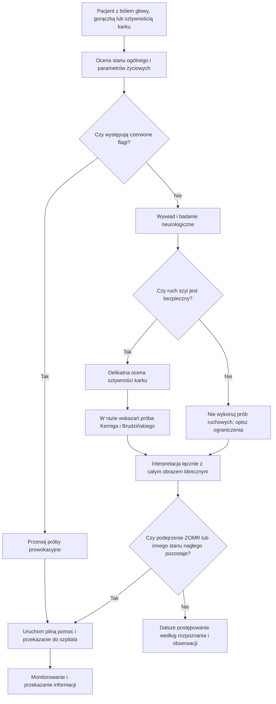
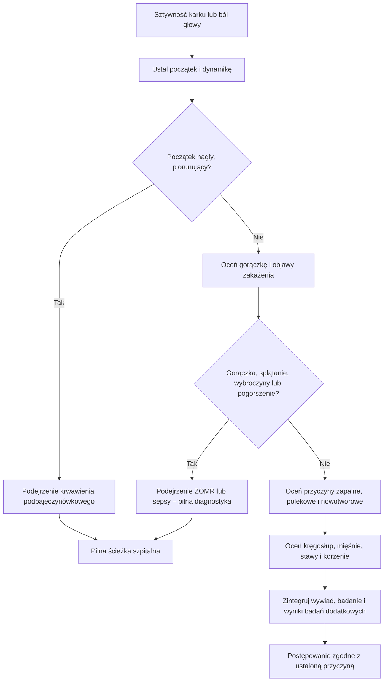

# 8.6. Objawy oponowe

## Wprowadzenie

Objawy oponowe są zespołem dolegliwości i odchyleń stwierdzanych w badaniu, które mogą wskazywać na podrażnienie struktur oponowych, korzeni nerwów rdzeniowych lub sąsiadujących struktur układu nerwowego. Najważniejsze elementy oceny przyłóżkowej to sztywność karku, objaw Kerniga i objaw Brudzińskiego. Ich obecność może zwiększać podejrzenie zapalenia opon mózgowo-rdzeniowych, ale nie jest równoznaczna z rozpoznaniem zakażenia. Podobny obraz może wystąpić między innymi w krwawieniu podpajęczynówkowym, procesie zapalnym niezakaźnym, rozsiewie nowotworowym do opon oraz w wybranych stanach pooperacyjnych.

Badanie objawów oponowych ma znaczenie przede wszystkim jako część szybkiej oceny klinicznej. Nie zastępuje oceny stanu ogólnego, parametrów życiowych, świadomości, funkcji nerwów czaszkowych, obecności objawów ogniskowych ani diagnostyki laboratoryjnej i obrazowej. Ujemny wynik pojedynczej próby nie wyklucza zapalenia opon mózgowo-rdzeniowych. Jeżeli obraz kliniczny budzi podejrzenie ostrego zapalenia opon, zwłaszcza bakteryjnego, priorytetem jest pilne skierowanie do odpowiednio wyposażonego szpitala, a nie wielokrotne powtarzanie prób prowokacyjnych.

**Najważniejsza zasada bezpieczeństwa:** przy podejrzeniu zapalenia opon mózgowo-rdzeniowych, sepsy meningokokowej lub krwawienia podpajęczynówkowego nie wolno opóźniać pilnej pomocy medycznej w celu wykonania pełnego badania neurologicznego. Brak sztywności karku, objawu Kerniga lub Brudzińskiego nie może być podstawą do uspokojenia pacjenta ani odstąpienia od dalszej diagnostyki.

---

## 1. Cele kształcenia i efekty uczenia się

### 1.1. Cel ogólny

Celem rozdziału jest przygotowanie uczestnika do bezpiecznej, uporządkowanej i krytycznej oceny objawów oponowych u osoby dorosłej, ze szczególnym uwzględnieniem pacjenta w wieku podeszłym. Uczestnik ma rozumieć mechanizm powstawania objawów, znać prawidłową technikę podstawowych prób, umieć opisać wynik bez nadinterpretacji oraz rozpoznać sytuacje wymagające natychmiastowego przekazania pacjenta do diagnostyki szpitalnej.

### 1.2. Szczegółowe efekty uczenia się

Po zakończeniu rozdziału uczestnik powinien:

1. zdefiniować pojęcia: oponowe zapalenie, meningizm, sztywność karku, objaw Kerniga i objaw Brudzińskiego;
2. opisać budowę opon mózgowo-rdzeniowych i przestrzeni podpajęczynówkowej;
3. wyjaśnić, dlaczego podrażnienie opon i korzeni może powodować ból, ochronne napięcie mięśni oraz odruchowe ograniczenie ruchu;
4. przygotować pacjenta do badania z uwzględnieniem zgody, komfortu, bezpieczeństwa kręgosłupa szyjnego i oceny stanu ogólnego;
5. wykonać – w granicach własnych kwalifikacji – łagodne badanie ruchomości szyi, próbę Kerniga i próbę Brudzińskiego;
6. odróżnić rzeczywistą mimowolną reakcję od dobrowolnego napinania mięśni, bólu mechanicznego i reakcji wycofania;
7. interpretować wynik z uwzględnieniem ograniczonej czułości klasycznych objawów;
8. wskazać najważniejsze zakaźne i niezakaźne przyczyny meningizmu;
9. rozpoznać objawy alarmowe zapalenia opon, sepsy i krwawienia podpajęczynówkowego;
10. wyjaśnić rolę punkcji lędźwiowej, badań krwi i neuroobrazowania w diagnostyce;
11. dokumentować wynik w sposób odtwarzalny, rzeczowy i pozbawiony nieuprawnionych wniosków;
12. przekazać pacjenta do pilnej pomocy, nie opóźniając transportu przez dodatkowe próby.

### 1.3. Granice kompetencji

Badanie przyłóżkowe nie upoważnia do samodzielnego rozpoznawania etiologii zapalenia opon, zlecania lub wykonywania punkcji lędźwiowej ani modyfikowania leczenia przeciwdrobnoustrojowego poza zakresem uprawnień. Punkcja lędźwiowa jest procedurą medyczną wykonywaną przez odpowiednio przygotowanego i uprawnionego członka zespołu, po ocenie wskazań, przeciwwskazań i ryzyka.

Uczestnik szkolenia powinien działać zgodnie z aktualnymi przepisami, zakresem wykonywanego zawodu, zleceniami, procedurami placówki oraz zasadami współpracy zespołowej. W razie podejrzenia stanu nagłego obowiązkiem jest uruchomienie właściwej ścieżki pomocy, a nie kontynuowanie badania dydaktycznego.

---

## 2. Definicje i podstawowe pojęcia

### 2.1. Opony mózgowo-rdzeniowe

Opony mózgowo-rdzeniowe są błonami otaczającymi mózgowie i rdzeń kręgowy. Wyróżnia się:

- oponę twardą – zewnętrzną, mocną warstwę ochronną;
- pajęczynówkę – warstwę pośrednią;
- oponę miękką – cienką błonę ściśle przylegającą do powierzchni ośrodkowego układu nerwowego.

Pomiędzy pajęczynówką a oponą miękką znajduje się przestrzeń podpajęczynówkowa, w której krąży płyn mózgowo-rdzeniowy. Przestrzeń ta obejmuje mózgowie i rdzeń, a także zbiorniki płynowe oraz struktury naczyniowe.

### 2.2. Zapalenie opon mózgowo-rdzeniowych

Zapalenie opon mózgowo-rdzeniowych (ZOMR) to proces zapalny obejmujący opony mózgowia i rdzenia kręgowego. Może być wywołany przez bakterie, wirusy, grzyby, prątki lub inne czynniki zakaźne, a także przez mechanizmy niezakaźne, na przykład reakcję autoimmunologiczną, proces nowotworowy albo reakcję polekową.

Postać bakteryjna może przebiegać gwałtownie i stanowi bezpośrednie zagrożenie życia. Wymaga pilnej diagnostyki i leczenia szpitalnego. Nie wolno zakładać, że brak klasycznych objawów oznacza łagodny przebieg lub wyklucza chorobę.

### 2.3. Meningizm i sztywność karku

Meningizm oznacza zespół objawów klinicznych sugerujących podrażnienie opon, zwykle obejmujący ból głowy, nadwrażliwość na światło, nudności lub wymioty oraz ograniczenie biernego zginania szyi. Meningizm jest opisem klinicznym, a nie rozpoznaniem etiologicznym.

Sztywność karku to zwiększony opór lub mimowolne ograniczenie biernego zgięcia szyi, które może być związane z podrażnieniem opon. Należy ją odróżnić od bólu mięśniowo-szkieletowego, ograniczenia zakresu ruchu w chorobie zwyrodnieniowej, urazie, dystonii i ochronnego napinania mięśni.

### 2.4. Objaw Kerniga

Objaw Kerniga polega na pojawieniu się bólu, wyraźnego oporu lub mimowolnej reakcji obronnej podczas próby wyprostu kolana, gdy biodro i kolano są uprzednio zgięte. Wynik dodatni może wskazywać na podrażnienie opon lub korzeni, ale nie jest swoisty wyłącznie dla zapalenia opon.

### 2.5. Objaw Brudzińskiego

Klasyczny objaw karkowy Brudzińskiego polega na mimowolnym zgięciu bioder i kolan podczas delikatnego biernego zginania szyi u pacjenta leżącego na plecach. Reakcja powinna być odróżniona od świadomego ruchu, bólu bioder, przykurczu, wzmożonego napięcia lub dobrowolnego podciągania kończyn.

### 2.6. Objawy oponowe a rozpoznanie

Objawy oponowe są elementem badania klinicznego. Nie identyfikują drobnoustroju, nie rozróżniają wiarygodnie wszystkich postaci zapalenia i nie zastępują analizy płynu mózgowo-rdzeniowego. Rozpoznanie opiera się na całości obrazu klinicznego, badaniach krwi, badaniu płynu mózgowo-rdzeniowego, a w określonych sytuacjach także na neuroobrazowaniu i badaniach mikrobiologicznych.

---

## 3. Podstawy neuroanatomiczne

### 3.1. Opona twarda

Opona twarda jest najbardziej zewnętrzną i wytrzymałą oponą. W obrębie czaszki pozostaje związana z kośćmi czaszki i tworzy między innymi przegrody oraz zatoki żylne opony twardej. W kanale kręgowym oddzielona jest od ścian kanału przestrzenią nadtwardówkową.

Opona twarda i naczynia oponowe są strukturami wrażliwymi na bodźce bólowe. Ich unerwienie jest złożone: w obrębie jamy czaszki istotną rolę odgrywają gałęzie nerwu trójdzielnego, a w tylnym dole czaszki również włókna związane z górnymi segmentami szyjnymi i innymi nerwami. Z tego powodu podrażnienie opon może powodować ból głowy o różnej lokalizacji.

### 3.2. Pajęczynówka i przestrzeń podpajęczynówkowa

Pajęczynówka nie przylega bezpośrednio do powierzchni mózgowia. Pomiędzy nią a oponą miękką znajduje się przestrzeń podpajęczynówkowa zawierająca płyn mózgowo-rdzeniowy, naczynia oraz beleczki pajęczynówki.

Zapalenie struktur oponowych może prowadzić do zmian w składzie płynu mózgowo-rdzeniowego, zaburzeń przepływu i wchłaniania płynu, obrzęku oraz wzrostu ciśnienia śródczaszkowego. Skutki zależą od etiologii, dynamiki i rozległości procesu.

### 3.3. Opona miękka i powierzchnia ośrodkowego układu nerwowego

Opona miękka ściśle pokrywa mózgowie i rdzeń kręgowy, wnikając w bruzdy i szczeliny. Wraz z pajęczynówką uczestniczy w tworzeniu granic przestrzeni podpajęczynówkowej. Proces zapalny obejmujący opony miękkie może oddziaływać na naczynia, korzenie nerwowe i powierzchowne struktury mózgowia.

### 3.4. Korzenie nerwów rdzeniowych i struktury szyjne

Korzenie nerwowe przebiegają w sąsiedztwie opon i są otoczone osłonkami oponowymi. Podrażnienie korzeni może nasilać ból podczas określonych ruchów, szczególnie gdy ruch powoduje ich rozciąganie. W badaniu objawu Kerniga obserwuje się reakcję na ruch kończyny dolnej, który zmienia napięcie struktur nerwowych i oponowych w kanale kręgowym.

Nie należy jednak traktować objawu Kerniga jako prostego, izolowanego testu rozciągania korzeni. Na wynik wpływają także mięśnie kulszowo-goleniowe, stawy biodrowe i kolanowe, ból kręgosłupa, tolerancja pacjenta na ruch oraz współistniejące choroby układu ruchu.

### 3.5. Schemat warstw opon

```text
Skóra i tkanki głowy
        |
Kości czaszki
        |
Opona twarda
        |
Pajęczynówka
        |
Przestrzeń podpajęczynówkowa
(płyn mózgowo-rdzeniowy i naczynia)
        |
Opona miękka
        |
Mózgowie / rdzeń kręgowy
```

Schemat jest uproszczony i nie przedstawia wszystkich przestrzeni potencjalnych, przegród ani szczegółów budowy opon.

---

## 4. Podstawy neurofizjologiczne i mechanizm objawów

### 4.1. Podrażnienie opon i ból

W procesie zapalnym dochodzi do uwalniania mediatorów zapalnych, zwiększenia wrażliwości struktur bólowych, zmian przepuszczalności bariery krew–płyn mózgowo-rdzeniowy oraz reakcji naczyniowej. Ból może wynikać z pobudzenia struktur oponowych i naczyniowych, a także z towarzyszącego wzrostu ciśnienia, obrzęku i zajęcia korzeni.

### 4.2. Ochronne napięcie mięśni

Ból wywoływany ruchem może prowadzić do odruchowego ograniczenia zakresu ruchu i zwiększenia aktywności mięśni stabilizujących szyję lub tułów. W sztywności karku istotne jest rozpoznanie, czy badający napotyka mimowolny opór, czy jedynie zgłaszany przez pacjenta ból przy zachowanej możliwości ruchu.

Ochronne napięcie może być nasilane przez lęk, zimno, niepewność, ból mięśniowo-szkieletowy i nieprawidłowe ułożenie. Dlatego badanie powinno być spokojne, zapowiedziane i delikatne.

### 4.3. Reakcje podczas próby Kerniga

Zgięcie biodra i kolana, a następnie wyprost kolana, zmienia napięcie mięśni tylnej grupy uda i struktur nerwowych. W obecności podrażnienia opon lub korzeni może pojawić się ból i odruchowe ograniczenie wyprostu. Nie jest to mechanizm całkowicie swoisty: podobny wynik może wystąpić przy przykurczu mięśni, patologii stawu biodrowego lub kolanowego, bólu korzeniowym i innych zaburzeniach.

### 4.4. Reakcja podczas próby Brudzińskiego

Bierne zgięcie szyi może zwiększyć napięcie struktur oponowych i korzeniowych. U części pacjentów z podrażnieniem opon wywołuje to odruchową reakcję zgięciową kończyn dolnych, która zmniejsza napięcie struktur. Obserwuje się ją jako mimowolne zgięcie bioder i kolan.

### 4.5. Dlaczego objawy mogą nie występować?

Objawy oponowe zależą od stopnia i lokalizacji procesu, czasu od początku choroby, wieku, stanu świadomości, odporności, przyjmowanych leków, tolerancji bólu i współistniejących chorób. We wczesnej fazie zakażenia, u osób starszych, z immunosupresją lub zaburzeniami świadomości objawy mogą być skąpe albo nietypowe.

**Wniosek:** brak objawów oponowych nie jest testem wykluczającym zapalenie opon mózgowo-rdzeniowych.

---

## 5. Przyczyny objawów oponowych i najważniejsze wzorce kliniczne

### 5.1. Przyczyny zakaźne

Do najważniejszych przyczyn zakaźnych należą:

- bakteryjne zapalenie opon mózgowo-rdzeniowych, między innymi pneumokokowe i meningokokowe;
- wirusowe zapalenie opon, na przykład enterowirusowe lub związane z wirusem opryszczki;
- gruźlicze zapalenie opon;
- grzybicze zapalenie opon, szczególnie u osób z zaburzeniami odporności;
- zakażenia związane z zabiegami neurochirurgicznymi, drenami lub innymi urządzeniami w obrębie ośrodkowego układu nerwowego.

### 5.2. Przyczyny niezakaźne

Meningizm może towarzyszyć:

- krwawieniu podpajęczynówkowemu;
- rozsiewowi nowotworowemu do opon;
- chorobom zapalnym i autoimmunologicznym;
- reakcji polekowej;
- niektórym stanom pooperacyjnym;
- zaburzeniom związanym ze zmianami ciśnienia płynu mózgowo-rdzeniowego.

### 5.3. Inwazyjna choroba meningokokowa

Zakażenie meningokokowe może przebiegać jako zapalenie opon, sepsa albo jednocześnie jako oba zespoły. Początek bywa nieswoisty i może przypominać infekcję wirusową. Stan może pogarszać się bardzo szybko. Wysypka wybroczynowa lub plamica, która nie blednie pod uciskiem, jest ważnym sygnałem alarmowym, ale jej brak nie wyklucza choroby meningokokowej.

Do objawów mogą należeć: gorączka, silny ból głowy, sztywność karku, wymioty, światłowstręt, zaburzenia świadomości, zimne kończyny, przyspieszony oddech, ból mięśni i kończyn oraz objawy wstrząsu.

### 5.4. Krwawienie podpajęczynówkowe

Krwawienie podpajęczynówkowe może powodować nagły, bardzo silny ból głowy, często osiągający maksymalne nasilenie w ciągu kilku minut. Mogą wystąpić wymioty, światłowstręt, sztywność karku, utrata przytomności, drgawki lub objawy ogniskowe.

W takim obrazie sztywność karku nie powinna prowadzić wyłącznie do rozpoznania infekcji. Nagły ból głowy o charakterze piorunującym wymaga pilnej oceny szpitalnej i diagnostyki krwawienia.

---

## 6. Przygotowanie do badania i ocena bezpieczeństwa

### 6.1. Weryfikacja pacjenta i wyjaśnienie badania

1. Potwierdź tożsamość pacjenta zgodnie z procedurą placówki.
2. Przedstaw cel i przebieg badania prostym językiem.
3. Uzyskaj zgodę na badanie i respektuj prawo pacjenta do przerwania próby.
4. Zapytaj o ból szyi, uraz, wcześniejsze zabiegi, ograniczenie ruchomości, choroby kręgosłupa i dolegliwości kończyn.
5. Zapytaj o początek bólu głowy, gorączkę, światłowstręt, wymioty, drgawki i zmianę zachowania.
6. Oceń, czy pacjent rozumie polecenia i może wiarygodnie zgłaszać ból.

### 6.2. Ocena stanu ogólnego przed próbami

Przed wykonywaniem prób prowokacyjnych należy ocenić – w granicach kompetencji – stan świadomości, drożność dróg oddechowych, oddychanie, krążenie, temperaturę, tętno, ciśnienie tętnicze, częstość oddechów i saturację. W razie cech niestabilności, zaburzeń świadomości, drgawek, wstrząsu lub szybko narastających objawów badanie szczegółowe należy przerwać i uruchomić pilną pomoc.

### 6.3. Wywiad ukierunkowany

Należy ustalić:

- dokładny czas początku bólu głowy i tempo osiągania maksymalnego nasilenia;
- gorączkę, dreszcze, nudności, wymioty i światłowstręt;
- senność, splątanie, zmianę zachowania, drgawki lub omdlenie;
- wysypkę, wybroczyny, zimne kończyny i pogorszenie stanu ogólnego;
- kontakt z osobą chorą, ognisko zakażenia i podróże;
- immunosupresję, brak śledziony, choroby nowotworowe i niedawne leczenie;
- niedawny uraz, zabieg neurochirurgiczny, nakłucie, implant lub drenaż;
- leki przeciwkrzepliwe i przeciwpłytkowe, jeśli rozważana jest dalsza diagnostyka inwazyjna.

### 6.4. Oglądanie i badanie wstępne

Obserwuj spontaniczne ustawienie głowy, unikanie ruchu, mimikę bólową, zachowanie, mowę i kontakt. Obejrzyj skórę pod kątem wybroczyn, plamicy i innych zmian. Oceń źrenice, ruchy gałek ocznych, symetrię twarzy, mowę, siłę kończyn i obecność nowych objawów ogniskowych, jeśli stan pacjenta na to pozwala.

### 6.5. Sytuacje, w których nie należy prowokować ruchu szyi

Nie wykonuj biernego zginania ani rotacji szyi, jeżeli istnieje podejrzenie urazu kręgosłupa szyjnego, niestabilności, złamania, ostrego uszkodzenia więzadeł, świeżego zabiegu lub innego stanu, w którym ruch może być niebezpieczny. W razie wątpliwości utrzymuj głowę i szyję w bezpiecznym ustawieniu i postępuj zgodnie z procedurą urazową.

Nie należy forsować zakresu ruchu u osoby z silnym bólem, znaczną sztywnością zwyrodnieniową, ciężką osteoporozą, aktywną dystonią lub istotnym ograniczeniem ruchomości. W takich sytuacjach wynik próby może być niewiarygodny, a jej wykonanie niepotrzebnie zwiększać ból.

---

## 7. Badanie sztywności karku

### 7.1. Cel próby

Celem jest ocena, czy podczas łagodnego biernego zgięcia szyi występuje nieproporcjonalny, mimowolny opór lub charakterystyczne ograniczenie ruchu, mogące wskazywać na podrażnienie opon.

### 7.2. Pozycja pacjenta

Pacjent leży na plecach na stabilnym podłożu. Głowa spoczywa w pozycji neutralnej. Kończyny są rozluźnione. Badający stoi przy wezgłowiu, zapewniając stabilne podparcie głowy.

### 7.3. Procedura krok po kroku

1. Wyjaśnij, że będziesz delikatnie poruszać głową i że pacjent ma natychmiast zgłosić ból lub dyskomfort.
2. Oceń spontaniczną ruchomość szyi bez wymuszania ruchu.
3. Ułóż jedną rękę pod potylicą, a drugą – jeśli potrzebne – stabilizuj tułów lub barki.
4. Rozpocznij bardzo powolne, niewielkie zgięcie szyi.
5. Obserwuj opór, mimowolne napinanie mięśni, grymas bólowy, reakcję kończyn i zgłaszane dolegliwości.
6. Nie przekraczaj granicy bólu ani oporu.
7. Zatrzymaj próbę, jeśli pojawia się silny ból, niepokój, pogorszenie stanu lub podejrzenie urazu.
8. Zapisz, czy występował opór mimowolny, ból, ograniczenie mechaniczne czy brak możliwości wiarygodnej oceny.

### 7.4. Interpretacja

Za wynik sugerujący sztywność karku uznaje się wyraźny, nieproporcjonalny opór przy biernym zginaniu szyi, zwłaszcza gdy towarzyszą mu objawy ogólne i ból głowy. Sam ból podczas ruchu przy zachowanej ruchomości nie jest równoznaczny z klasyczną sztywnością karku.

Nie istnieje uniwersalny kąt zgięcia, który samodzielnie potwierdza lub wyklucza meningizm. Ocena ma charakter kliniczny i zależy od wieku, anatomii, współistniejących chorób oraz techniki badającego.

### 7.5. Najczęstsze błędy

- zbyt szybkie lub gwałtowne zginanie głowy;
- traktowanie każdego bólu szyi jako sztywności oponowej;
- pomijanie urazu lub niestabilności kręgosłupa;
- brak porównania z ruchem spontanicznym;
- nieuwzględnienie choroby zwyrodnieniowej i przykurczów;
- kontynuowanie próby mimo silnego bólu;
- uznawanie prawidłowej ruchomości za dowód wykluczający zapalenie opon.

---

## 8. Badanie objawu Kerniga

### 8.1. Cel i mechanizm

Próba Kerniga służy do oceny, czy wyprost kolana przy zgiętym biodrze wywołuje ból, opór lub mimowolną reakcję obronną. Objaw może wystąpić w podrażnieniu opon i korzeni, ale także w chorobach układu mięśniowo-szkieletowego.

### 8.2. Pozycja pacjenta

Pacjent leży na plecach. Badający upewnia się, że nie ma przeciwwskazań do zginania biodra i kolana, takich jak świeży uraz, zabieg, znaczny ból stawu lub istotne ograniczenie ruchomości.

### 8.3. Procedura krok po kroku

1. Wyjaśnij próbę i uzyskaj zgodę.
2. Zegnij kończynę w stawie biodrowym i kolanowym, zwykle do ustawienia zbliżonego do 90 stopni, bez wymuszania zakresu.
3. Podtrzymując udo, powoli rozpocznij bierny wyprost kolana.
4. Obserwuj, czy pojawia się ból, wyraźny opór, odruchowe cofnięcie kończyny lub mimowolne napinanie mięśni.
5. Zapytaj pacjenta o lokalizację bólu: tył uda, okolica podkolanowa, kręgosłup lędźwiowy lub inne miejsce.
6. Przerwij próbę, jeśli ból jest silny lub pojawia się wyraźna reakcja obronna.
7. W razie braku przeciwwskazań oceń drugą stronę, zachowując podobną technikę.
8. Opisz wynik osobno dla każdej kończyny.

### 8.4. Wynik dodatni

Wynik sugerujący dodatni objaw Kerniga obejmuje ból lub wyraźny opór podczas biernego wyprostu kolana w ustawieniu zgiętego biodra, którego nie wyjaśnia oczywista patologia stawu ani typowy przykurcz mięśni. Nie należy opierać rozpoznania wyłącznie na arbitralnej wartości kąta wyprostu.

### 8.5. Różnicowanie wyniku

Przed uznaniem objawu za oponowy należy rozważyć:

- skrócenie lub wzmożone napięcie mięśni kulszowo-goleniowych;
- chorobę stawu biodrowego lub kolanowego;
- ból korzeniowy i objawy napięciowe nerwu kulszowego;
- patologię kręgosłupa lędźwiowego;
- przykurcze, spastyczność lub dystonię;
- lęk, brak rozluźnienia i dobrowolne ograniczenie ruchu.

### 8.6. Najczęstsze błędy

- gwałtowny wyprost kolana;
- brak stabilizacji uda;
- nieuwzględnienie ograniczeń stawowych;
- uznanie bólu wyłącznie w mięśniu za swoisty objaw oponowy;
- porównywanie stron przy różnej technice;
- wielokrotne powtarzanie próby w celu uzyskania wyniku dodatniego.

---

## 9. Badanie objawu Brudzińskiego

### 9.1. Cel i mechanizm

Próba Brudzińskiego ocenia, czy bierne zgięcie szyi powoduje mimowolne zgięcie bioder i kolan. Jest to reakcja ochronna opisywana w podrażnieniu opon. Wynik wymaga odróżnienia od dobrowolnego ruchu, przykurczu, bólu kręgosłupa i innych przyczyn.

### 9.2. Pozycja pacjenta

Pacjent leży na plecach. Kończyny dolne powinny być ułożone swobodnie, bez wymuszonego wyprostu. Badający stoi przy wezgłowiu i zapewnia podparcie głowy.

### 9.3. Procedura krok po kroku

1. Wyjaśnij, że będziesz delikatnie zginać szyję i obserwować reakcję nóg.
2. Sprawdź, czy nie ma przeciwwskazań do ruchu szyi.
3. Ułóż rękę pod potylicą, a drugą stabilizuj tułów, jeśli jest to konieczne.
4. Delikatnie rozpocznij bierne zgięcie szyi.
5. Obserwuj, czy pojawia się mimowolne zgięcie obu bioder i kolan.
6. Zwróć uwagę na symetrię, moment wystąpienia i powtarzalność reakcji.
7. Nie zwiększaj siły ani zakresu, jeżeli pojawia się ból lub znaczny opór.
8. Zapisz wynik wraz z ograniczeniami badania.

### 9.4. Interpretacja

Wynik sugerujący dodatni objaw Brudzińskiego to wyraźne, mimowolne zgięcie bioder i kolan wywołane biernym zgięciem szyi. Ruch powinien mieć charakter odruchowy, a nie wynikać z polecenia lub świadomego przygotowania pacjenta.

Brak takiej reakcji nie wyklucza zapalenia opon. Ujemny wynik jest częsty nawet u osób z potwierdzonym zapaleniem.

### 9.5. Najczęstsze błędy

- niewłaściwe podparcie głowy;
- zbyt gwałtowne zgięcie szyi;
- nieuwzględnienie dobrowolnego podciągania nóg;
- interpretacja ruchu wywołanego bólem biodra jako reakcji oponowej;
- nieuwzględnienie przykurczów i ograniczeń ortopedycznych;
- powtarzanie próby mimo niepokoju lub bólu pacjenta.

---

## 10. Próba nasilenia bólu głowy przy rotacji – jolt accentuation

### 10.1. Znaczenie

Jolt accentuation to próba, w której ocenia się, czy delikatne, poziome ruchy głowy nasilają istniejący ból głowy. W publikacjach opisywano ruchy z częstotliwością około 2–3 razy na sekundę, ale wynik tej próby ma ograniczoną wartość i nie może służyć do wykluczania zapalenia opon.

### 10.2. Zasady bezpieczeństwa

Nie wykonuj próby przy podejrzeniu urazu lub niestabilności kręgosłupa szyjnego, silnym bólu szyi, ograniczeniu ruchomości, świeżym zabiegu ani u pacjenta, który nie może wiarygodnie współpracować. Nie należy wykonywać gwałtownych ruchów ani wymuszać rotacji.

### 10.3. Ograniczenia

Wynik zależy od wyjściowego bólu głowy, zdolności pacjenta do jego oceny, współistniejącej migreny, bólu szyjnego i techniki wykonania. Próba nie jest zamiennikiem oceny klinicznej ani badania płynu mózgowo-rdzeniowego. Nie należy jej wykonywać, jeśli może opóźnić pilną pomoc.

---

## 11. Porównanie klasycznych objawów oponowych

| Próba | Sposób wykonania | Wynik sugerujący podrażnienie opon | Najważniejsze ograniczenie |
|---|---|---|---|
| Sztywność karku | Delikatne bierne zgięcie szyi | Nieproporcjonalny opór lub mimowolne ograniczenie | Choroby szyi, ból i ograniczenie ruchomości |
| Kernig | Zgięcie biodra i kolana, następnie wyprost kolana | Ból lub opór podczas wyprostu | Przykurcz mięśni, stawy, radikulopatia |
| Brudziński | Delikatne bierne zgięcie szyi | Mimowolne zgięcie bioder i kolan | Niska czułość, dobrowolna reakcja, przykurcze |
| Jolt accentuation | Delikatna rotacja głowy u współpracującego pacjenta | Nasilenie istniejącego bólu głowy | Zależność od bólu wyjściowego i ograniczona czułość |

Żadna z tych prób nie jest samodzielnym testem potwierdzającym lub wykluczającym zapalenie opon.

---

## 12. Czułość, swoistość i ograniczenia diagnostyczne

### 12.1. Pojęcia statystyczne

- **Czułość** określa, jaki odsetek osób z chorobą uzyskuje wynik dodatni.
- **Swoistość** określa, jaki odsetek osób bez choroby uzyskuje wynik ujemny.
- **Iloraz wiarygodności wyniku dodatniego (LR+)** informuje, jak bardzo wynik dodatni zwiększa szanse choroby.
- **Iloraz wiarygodności wyniku ujemnego (LR−)** informuje, jak bardzo wynik ujemny zmniejsza szanse choroby.
- **Wartość predykcyjna** zależy między innymi od częstości choroby w badanej populacji.

Nawet test o wysokiej swoistości może mieć niewielką wartość w populacji o bardzo niskim prawdopodobieństwie choroby. Z kolei test o ograniczonej czułości nie może bezpiecznie wykluczać choroby po wyniku ujemnym.

### 12.2. Wyniki badań nad objawami oponowymi

Metaanaliza Tetsuyi Akaishiego i współpracowników z 2019 r. objęła dziewięć badań, 599 osób z pleocytozą w płynie mózgowo-rdzeniowym oraz 1216 osób bez pleocytozy. Autorzy wskazali orientacyjne, zbiorcze oszacowania czułości: około 46% dla sztywności karku, 52% dla jolt accentuation, 23% dla objawu Kerniga i 28% dla objawu Brudzińskiego. Szacowana swoistość wynosiła około 71% dla sztywności karku i jolt accentuation, 91% dla Kerniga oraz 89% dla Brudzińskiego.

Wyników tych nie należy traktować jako niezmiennych parametrów dla każdego pacjenta. W badaniach występowała heterogeniczność, różniły się populacje, definicje dodatniego wyniku i standardy odniesienia. Wartości te pokazują przede wszystkim, że klasyczne objawy mogą być nieobecne u znacznej części chorych.

### 12.3. Różnice między badaniami

W prospektywnym badaniu Thomasa i współpracowników z 2002 r. czułość objawu Kerniga i Brudzińskiego wynosiła po około 5%, a sztywności karku około 30% w badanej populacji dorosłych z podejrzeniem zapalenia opon. Wyniki te różnią się od orientacyjnych oszacowań przedstawionych w metaanalizie Akaishiego. Różnice podkreślają znaczenie doboru populacji, sposobu badania i definicji wyniku.

### 12.4. Wniosek praktyczny

1. Dodatni objaw może wzmocnić podejrzenie, ale nie określa etiologii.
2. Ujemny objaw nie wyklucza zapalenia opon.
3. Nie należy używać pojedynczej próby jako kryterium decyzji o odstąpieniu od diagnostyki.
4. Wynik trzeba interpretować razem z wywiadem, stanem ogólnym, parametrami życiowymi i badaniem neurologicznym.
5. Wysokie podejrzenie kliniczne wymaga pilnej diagnostyki szpitalnej niezależnie od wyniku prób.

---

## 13. Czerwone flagi – sytuacje wymagające pilnej pomocy

### 13.1. Podejrzenie bakteryjnego zapalenia opon

Szczególnie alarmujące jest współwystępowanie:

- gorączki;
- bólu głowy;
- sztywności karku;
- zaburzeń świadomości lub funkcji poznawczych, w tym splątania i majaczenia.

Brak jednego z tych elementów nie wyklucza choroby. Podejrzenie może być uzasadnione również przy mniej typowym obrazie, zwłaszcza u osób starszych, z demencją, zaburzeniami komunikacji lub immunosupresją.

### 13.2. Objawy sepsy i inwazyjnej choroby meningokokowej

- szybko pogarszający się stan ogólny;
- wybroczyny lub plamica, które nie bledną pod uciskiem;
- zimne kończyny, bladość lub marmurkowatość skóry;
- tachykardia, przyspieszony oddech, hipotensja;
- silne bóle mięśni, stawów lub kończyn;
- zaburzenia świadomości, drgawki lub omdlenie.

Wysypka może pojawić się późno. Nie należy czekać na jej wystąpienie.

### 13.3. Podejrzenie krwawienia podpajęczynówkowego

- nagły, bardzo silny ból głowy osiągający maksymalne nasilenie w ciągu 1–5 minut;
- ból głowy podczas wysiłku, kaszlu lub aktywności seksualnej;
- wymioty, światłowstręt, sztywność karku;
- utrata przytomności, drgawki lub nowe objawy ogniskowe.

Taki obraz wymaga natychmiastowej oceny w szpitalnym oddziale ratunkowym.

### 13.4. Inne objawy alarmowe

- nowy niedowład, zaburzenia mowy, widzenia lub równowagi;
- nowe napady drgawkowe;
- narastająca senność lub szybkie obniżenie GCS;
- zaburzenia źrenic;
- obrzęk tarczy nerwu wzrokowego, jeśli został stwierdzony przez osobę kompetentną;
- objawy wstrząsu;
- niedawny zabieg neurochirurgiczny, zakażenie urządzenia lub podejrzenie ropnia;
- silny ból głowy z immunosupresją lub nowotworem.

### 13.5. Działanie

W razie wystąpienia czerwonych flag należy:

1. przerwać próby prowokacyjne;
2. uruchomić pilną pomoc medyczną zgodnie z lokalną procedurą;
3. ocenić i monitorować podstawowe funkcje życiowe w granicach kompetencji;
4. zapewnić bezpieczne ułożenie i ochronę przed urazem;
5. przygotować przekazanie informacji o początku i dynamice objawów;
6. nie opóźniać transportu w celu wykonania dodatkowych testów.

---

## 14. Diagnostyka różnicowa sztywności karku i meningizmu

| Przyczyna | Cechy sugerujące | Uwagi diagnostyczne |
|---|---|---|
| Bakteryjne ZOMR | Gorączka, silny ból głowy, sztywność karku, zaburzenia świadomości | Stan nagły; objawy mogą być niepełne |
| Wirusowe ZOMR | Ból głowy, gorączka, światłowstręt, czasem łagodniejszy przebieg | Nie zawsze można odróżnić klinicznie od postaci bakteryjnej |
| Gruźlicze lub grzybicze ZOMR | Przebieg podostry lub przewlekły, czynniki ryzyka | Często nietypowy obraz, szczególnie w immunosupresji |
| Krwawienie podpajęczynówkowe | Ból piorunujący, wymioty, sztywność karku, możliwa utrata przytomności | Wymaga pilnego obrazowania i dalszej diagnostyki |
| Encefalitis | Zaburzenia zachowania, pamięci, świadomości, drgawki, objawy ogniskowe | Może współistnieć z zapaleniem opon |
| Ropień mózgu lub ropniak podtwardówkowy | Gorączka, ból głowy, objawy ogniskowe, drgawki | Ryzyko efektu masy i powikłań |
| Ból szyjny pochodzenia mięśniowego | Ból związany z ruchem lub uciskiem mięśni, często po przeciążeniu | Nie wyklucza współistnienia choroby ogólnej |
| Spondyloza szyjna | Przewlekłe ograniczenie ruchomości, ból, objawy korzeniowe | Częsta u osób starszych |
| Uraz lub niestabilność szyi | Wywiad urazowy, ból środkowej linii, ograniczenie ruchu | Nie wykonywać biernych prób ruchowych |
| Dystonia szyjna | Mimowolne ustawienie głowy, skurcze i ból mięśni | Wymaga oceny neurologicznej |
| Migrena | Nawracający ból głowy, nudności, światłowstręt, czasem ból szyi | Pierwszy lub nietypowy silny ból wymaga oceny przyczyn wtórnych |
| Polekowe lub autoimmunologiczne zapalenie opon | Zależność czasowa od leku lub choroby układowej | Rozpoznanie po wykluczeniu groźnych przyczyn zakaźnych |

### 14.1. Zasada różnicowania

Meningizm nie jest synonimem bakteryjnego zapalenia opon. Sztywność karku może wynikać z wielu procesów, a ten sam pacjent może mieć równocześnie chorobę układu ruchu i stan zapalny opon. W sytuacji ostrej nie wolno przypisywać objawów wyłącznie zwyrodnieniu kręgosłupa, migrenie lub przeciążeniu mięśni, jeśli występują gorączka, zaburzenia świadomości, nagły ból głowy, wybroczyny lub objawy ogniskowe.

---

## 15. Wskazania do pilnej diagnostyki i rola badań dodatkowych

### 15.1. Ocena szpitalna

Podejrzenie ostrego zapalenia opon wymaga pilnej oceny w odpowiednio wyposażonej placówce. Decyzje diagnostyczne podejmuje zespół medyczny na podstawie stanu pacjenta, czasu trwania objawów, ryzyka powikłań i dostępnych badań.

### 15.2. Badania krwi

W zależności od obrazu klinicznego mogą być wykonywane między innymi:

- morfologia krwi z rozmazem;
- CRP lub prokalcytonina;
- elektrolity, glukoza, parametry nerkowe i wątrobowe;
- posiewy krwi;
- badania krzepnięcia;
- badania ukierunkowane na podejrzewany czynnik zakaźny.

Pobranie materiału nie może opóźniać rozpoczęcia leczenia, jeżeli zespół rozpoznaje stan wymagający natychmiastowej terapii.

### 15.3. Punkcja lędźwiowa

Punkcja lędźwiowa i badanie płynu mózgowo-rdzeniowego są podstawowym elementem potwierdzania i różnicowania zapalenia opon. Badania płynu mogą obejmować:

- ciśnienie otwarcia, jeśli pomiar jest wskazany i możliwy;
- wygląd makroskopowy;
- liczbę leukocytów i ich rozmaz;
- liczbę erytrocytów;
- stężenie białka;
- stężenie glukozy i równoczesne oznaczenie glukozy we krwi;
- barwienie metodą Grama i posiew;
- badania molekularne, w tym PCR, zgodnie z podejrzeniem etiologicznym;
- inne testy, zależnie od sytuacji klinicznej.

Wyników nie interpretuje się w izolacji. Wcześniejsze podanie antybiotyku może zmniejszać wydajność niektórych badań mikrobiologicznych.

### 15.4. Kiedy rozważa się neuroobrazowanie przed punkcją?

Nie należy wykonywać tomografii komputerowej głowy rutynowo u każdej osoby z podejrzeniem zapalenia opon przed punkcją lędźwiową. Niepotrzebne obrazowanie może opóźnić leczenie.

Wytyczne WHO z 2025 r. wskazują na potrzebę obrazowania przed punkcją przy określonych cechach ryzyka, takich jak GCS poniżej 10, objawy ogniskowe, deficyty nerwów czaszkowych, obrzęk tarczy nerwu wzrokowego, nowy napad drgawkowy u dorosłego lub ciężki stan immunosupresji. Wytyczne NICE NG240 wskazują między innymi nowe objawy ogniskowe, nieprawidłowe reakcje źrenic, GCS 9 lub mniej albo utrzymujący się szybki spadek świadomości oraz czynniki ryzyka zmiany zajmującej przestrzeń.

Szczegółowe kryteria i sposób postępowania mogą się różnić pomiędzy wytycznymi. Ostateczną decyzję podejmuje zespół lekarski zgodnie z aktualnymi zaleceniami i lokalnym protokołem.

### 15.5. Zasada niezależności leczenia od opóźnienia diagnostyki

Jeżeli punkcja lędźwiowa jest przeciwwskazana, wymaga odroczenia albo jej wykonanie spowoduje istotne opóźnienie, nie wolno czekać z leczeniem podejrzenia bakteryjnego zapalenia opon. Należy pobrać odpowiednie próbki, jeśli można to zrobić bez zwłoki, i rozpocząć leczenie zgodnie z decyzją zespołu medycznego. WHO i NICE podkreślają, że obrazowanie ani odroczenie punkcji nie mogą opóźniać terapii.

### 15.6. Przeciwwskazania i powody odroczenia punkcji

Do sytuacji wymagających odroczenia lub szczególnej oceny należą między innymi:

- niestabilność oddechowa lub krążeniowa;
- niezabezpieczone drogi oddechowe;
- nieopanowane drgawki;
- istotne zaburzenia krzepnięcia lub ryzyko krwawienia;
- zakażenie skóry lub tkanek w miejscu nakłucia;
- rozległa lub szybko szerząca się plamica;
- cechy sugerujące zmianę zajmującą przestrzeń lub ryzyko wgłobienia;
- niektóre ciężkie stany immunosupresji.

Ocena przeciwwskazań, wskazań do obrazowania i momentu punkcji należy do uprawnionego zespołu medycznego. Nie wolno utożsamiać samego podejrzenia zapalenia opon z automatycznym wskazaniem do natychmiastowej punkcji bez oceny bezpieczeństwa.

---

## 16. Bezpieczeństwo pacjenta i organizacja postępowania

### 16.1. Bezpieczeństwo podczas badania

- uzyskaj zgodę i wyjaśnij każdy ruch;
- nie wykonuj gwałtownych ruchów szyi;
- nie pokonuj siłą oporu;
- przerwij próbę przy silnym bólu, zawrotach głowy, pogorszeniu świadomości lub innych niepokojących objawach;
- nie wykonuj prób przy podejrzeniu urazu lub niestabilności kręgosłupa szyjnego;
- zabezpiecz pacjenta przed upadkiem, jeśli występują osłabienie, splątanie lub omdlenie;
- dbaj o higienę rąk i dezynfekcję używanego sprzętu.

### 16.2. Zasady zapobiegania zakażeniom

W przypadku podejrzenia choroby meningokokowej lub innego zakażenia przenoszonego drogą kropelkową należy wdrożyć środki ostrożności zgodnie z procedurą kontroli zakażeń placówki. Personel powinien stosować właściwe środki ochrony indywidualnej, a decyzje o izolacji, zgłoszeniu epidemiologicznym i profilaktyce osób z bliskiego kontaktu podejmować zgodnie z obowiązującymi przepisami i zaleceniami służb sanitarnych.

### 16.3. Komunikacja i przekazanie pacjenta

Przekazanie powinno obejmować:

- czas początku i dynamikę objawów;
- obecność gorączki i bólu głowy;
- stan świadomości i jego zmiany;
- wynik oceny parametrów życiowych;
- wysypkę, wybroczyny lub objawy wstrząsu;
- objawy ogniskowe i napady drgawkowe;
- wykonane próby i ich ograniczenia;
- choroby współistniejące, immunosupresję i istotne leki;
- działania podjęte i czas ich wykonania.

---

## 17. Szczególne grupy pacjentów

### 17.1. Osoby starsze

U osób starszych gorączka może być słabiej wyrażona, a ból głowy i sztywność karku trudniejsze do rozpoznania z powodu demencji, zaburzeń komunikacji, choroby zwyrodnieniowej i przewlekłego bólu. Pierwszym objawem może być splątanie, senność, upadek, utrata samodzielności lub pogorszenie funkcjonowania.

Nie należy przypisywać nowego splątania wyłącznie wiekowi, otępieniu ani odwodnieniu bez oceny możliwych ostrych przyczyn.

### 17.2. Osoby z immunosupresją

U osób po przeszczepieniu, w trakcie chemioterapii, leczenia immunosupresyjnego lub z zaawansowanymi zaburzeniami odporności obraz kliniczny może być nietypowy. Gorączka i klasyczne objawy oponowe mogą być słabo wyrażone. Próg pilnej diagnostyki powinien być niski.

### 17.3. Osoby z zaburzeniami świadomości

Pacjent z zaburzeniami świadomości może nie zgłaszać bólu, światłowstrętu ani innych dolegliwości. Należy wykorzystać informacje od rodziny lub świadków, ocenić dynamikę zmian, źrenice, funkcje życiowe i objawy ogniskowe. Nie wolno interpretować braku współpracy jako ujemnego wyniku testów.

### 17.4. Osoby z chorobami kręgosłupa

Przewlekła spondyloza, zesztywnienie, przebyte operacje i ograniczenie ruchomości mogą utrudniać ocenę sztywności karku. W takich przypadkach należy opisać ograniczenia i nie forsować ruchu. Wynik próby może być nieocenialny.

### 17.5. Pacjenci z zaburzeniami komunikacji

U osób z afazją, niedosłuchem, barierą językową lub zaburzeniami poznawczymi trzeba dostosować sposób komunikacji. Można wykorzystać proste polecenia, gesty, tablice komunikacyjne lub pomoc tłumacza. Należy rozróżnić brak możliwości uzyskania odpowiedzi od odpowiedzi ujemnej.

---

## 18. Dokumentacja badania

### 18.1. Zasady dokumentowania

Dokumentacja powinna odzwierciedlać to, co rzeczywiście zbadano i zaobserwowano. Należy unikać zapisu „objawy oponowe ujemne” bez wskazania, które próby wykonano, czy były możliwe do oceny i jakie ograniczenia wystąpiły.

### 18.2. Zalecany zakres zapisu

- data i godzina badania;
- stan ogólny i parametry życiowe;
- poziom świadomości;
- ból głowy, gorączka, światłowstręt, nudności i wymioty;
- obecność lub brak sztywności karku;
- wynik próby Kerniga po stronie prawej i lewej;
- wynik próby Brudzińskiego;
- ewentualne wykonanie jolt accentuation i powód jej zastosowania;
- ograniczenia badania;
- obecność objawów ogniskowych, drgawek, wysypki lub cech sepsy;
- podjęte działania, konsultacje i sposób przekazania pacjenta.

### 18.3. Przykładowy zapis prawidłowego wyniku badania przy braku podejrzenia alarmowego

„Pacjent przytomny, w logicznym kontakcie. Bez zgłaszanej gorączki i ostrego bólu głowy. Ruchomość szyi zachowana, bez wyraźnego mimowolnego oporu przy łagodnym biernym zgięciu. Próba Kerniga obustronnie bez bólu i bez wyraźnego oporu. Próba Brudzińskiego bez mimowolnego zgięcia kończyn dolnych. Wyniki nie stanowią samodzielnej podstawy do wykluczenia zapalenia opon; interpretowane w kontekście całego badania.”

### 18.4. Przykładowy zapis wyniku niejednoznacznego

„Ocena sztywności karku ograniczona z powodu znacznej spondylozy szyjnej i przewlekłego bólu. Bierne zgięcie szyi nie było wykonywane poza bezpieczny zakres. Próba Kerniga nieocenialna po stronie prawej z powodu bólu stawu biodrowego. Wynik próby Brudzińskiego bez jednoznacznej mimowolnej reakcji. Badanie nie pozwala na wykluczenie meningizmu; decyzję o dalszej diagnostyce należy oprzeć na obrazie klinicznym.”

### 18.5. Przykładowy zapis wymagający pilnego przekazania

„Nagły, bardzo silny ból głowy z osiągnięciem maksymalnego nasilenia w krótkim czasie, wymioty i sztywność karku. Pacjent wymaga pilnej diagnostyki szpitalnej w kierunku krwawienia podpajęczynówkowego i innych przyczyn wtórnego bólu głowy. Nie kontynuowano prób prowokacyjnych. Uruchomiono procedurę pilnego przekazania.”

---

## 19. Przypadki kliniczne

### Przypadek 1. Gorączka, ból głowy i splątanie

Pacjent, 24 lata, zgłasza silny ból głowy, gorączkę i światłowstręt. Rodzina zauważyła narastające splątanie. W badaniu występuje sztywność karku.

**Interpretacja:** obraz wymaga pilnego podejrzenia ostrego zapalenia opon mózgowo-rdzeniowych, w tym postaci bakteryjnej. Nie należy wykonywać kolejnych prób w celu „potwierdzenia” rozpoznania.

**Postępowanie:** pilna pomoc szpitalna, ocena funkcji życiowych, monitorowanie, przekazanie informacji o początku objawów i uruchomienie procedur właściwych dla podejrzenia zakażenia ośrodkowego układu nerwowego.

### Przypadek 2. Ujemne objawy oponowe, ale wysokie podejrzenie kliniczne

Pacjent, 67 lat, ma gorączkę, osłabienie, ból głowy i nowo powstałe splątanie. Nie stwierdzono wyraźnej sztywności karku, a próby Kerniga i Brudzińskiego są ujemne.

**Interpretacja:** ujemne próby nie wykluczają zapalenia opon. U osób starszych klasyczne objawy mogą być słabo wyrażone.

**Postępowanie:** pilna ocena lekarska i dalsza diagnostyka zgodnie z obrazem klinicznym.

### Przypadek 3. Ból szyi po przeciążeniu

Pacjent, 42 lata, zgłasza ból karku po długiej pracy przy komputerze. Nie ma gorączki, silnego bólu głowy ani zaburzeń świadomości. Ruch czynny nasila ból mięśni, ale nie stwierdza się wyraźnego mimowolnego oporu podczas ostrożnego badania.

**Interpretacja:** obraz może odpowiadać bólowi mięśniowo-szkieletowemu, ale rozpoznanie wymaga uwzględnienia pełnego wywiadu i badania.

**Postępowanie:** ocena przyczyn mechanicznych, edukacja i dalsze postępowanie odpowiednie do kompetencji. Pojawienie się gorączki, silnego bólu głowy lub objawów neurologicznych wymaga ponownej pilnej oceny.

### Przypadek 4. Nagły ból głowy podczas wysiłku

Pacjentka, 51 lat, opisuje nagły, bardzo silny ból głowy, który osiągnął maksymalne nasilenie w ciągu kilku minut. Wystąpiły wymioty i sztywność karku.

**Interpretacja:** należy pilnie brać pod uwagę krwawienie podpajęczynówkowe. Objawy oponowe nie oznaczają automatycznie infekcji.

**Postępowanie:** natychmiastowa diagnostyka szpitalna, pilne obrazowanie zgodnie z procedurą. Nie należy opóźniać przekazania przez wykonywanie kolejnych prób.

### Przypadek 5. Wybroczyny i pogorszenie stanu ogólnego

Pacjent, 19 lat, ma gorączkę, bóle mięśni, wymioty, zimne kończyny i szybko narastające wybroczyny, które nie bledną pod uciskiem.

**Interpretacja:** podejrzenie inwazyjnej choroby meningokokowej i sepsy. Brak sztywności karku nie zmniejsza pilności sytuacji.

**Postępowanie:** natychmiastowa pomoc medyczna, uruchomienie procedury sepsowej i środków ostrożności w kontroli zakażeń. Nie opóźniać postępowania przez badanie objawów Kerniga i Brudzińskiego.

### Przypadek 6. Ograniczenie ruchomości szyi w chorobie zwyrodnieniowej

Pacjent, 78 lat, ma wieloletnią spondylozę szyjną i znacznie ograniczony zakres ruchu. Zgłasza ból karku, ale bez gorączki i bez nowych objawów ogólnych.

**Interpretacja:** ocena sztywności karku może być niewiarygodna. Nie należy wymuszać ruchu ani przypisywać ograniczenia oponom.

**Postępowanie:** udokumentować ograniczenia, przeprowadzić pełną ocenę kliniczną i uwzględnić dynamikę dolegliwości.

### Przypadek 7. Immunosupresja i nietypowy obraz

Pacjent, 55 lat, po przeszczepieniu narządu, zgłasza narastający ból głowy i senność. Nie ma wysokiej gorączki, a sztywność karku jest słabo wyrażona.

**Interpretacja:** immunosupresja zwiększa ryzyko nietypowego i ciężkiego zakażenia. Brak klasycznych objawów nie uspokaja.

**Postępowanie:** pilna konsultacja szpitalna, diagnostyka dostosowana do czynników ryzyka i ocena bezpieczeństwa punkcji lędźwiowej.

### Przypadek 8. Ból korzeniowy a dodatnia próba Kerniga

Pacjent, 46 lat, ma przewlekły ból lędźwiowy promieniujący do tylnej powierzchni uda. Podczas wyprostu kolana przy zgiętym biodrze pojawia się ból promieniujący do kończyny.

**Interpretacja:** wynik może wynikać z podrażnienia korzenia lub nerwu kulszowego, a nie z meningizmu. Należy ocenić rozkład bólu, objawy neurologiczne i wywiad ogólny.

**Postępowanie:** różnicowanie przyczyn korzeniowych i oponowych na podstawie pełnego obrazu. Nie wolno utożsamiać dodatniej próby z zapaleniem opon.

---

## 20. Stacje OSCE – ocena umiejętności praktycznych

### Stacja 1. Ocena sztywności karku

**Zadanie:** przygotuj pacjenta i oceń sztywność karku.

**Oceniane elementy:**
- identyfikacja pacjenta i uzyskanie zgody;
- pytanie o uraz i choroby szyi;
- ocena stanu ogólnego;
- prawidłowe ułożenie pacjenta;
- delikatna technika biernego zgięcia;
- obserwacja oporu i bólu;
- przerwanie próby przy zagrożeniu;
- poprawna dokumentacja.

### Stacja 2. Próba Kerniga

**Zadanie:** wykonaj próbę Kerniga u pacjenta bez przeciwwskazań.

**Oceniane elementy:**
- prawidłowa pozycja;
- zgięcie biodra i kolana bez wymuszania;
- stabilizacja uda;
- powolny wyprost kolana;
- obserwacja bólu i oporu;
- różnicowanie ograniczeń stawowych i mięśniowych;
- porównanie stron;
- opis wyniku.

### Stacja 3. Próba Brudzińskiego

**Zadanie:** oceń reakcję kończyn dolnych podczas biernego zgięcia szyi.

**Oceniane elementy:**
- ocena przeciwwskazań;
- właściwe ułożenie;
- stabilizacja głowy;
- łagodne zgięcie szyi;
- obserwacja mimowolnego zgięcia bioder i kolan;
- różnicowanie reakcji dobrowolnej;
- przerwanie próby w razie bólu;
- dokumentacja.

### Stacja 4. Rozpoznanie stanu nagłego

**Zadanie:** pacjent ma gorączkę, silny ból głowy, splątanie i wybroczyny. Zdecyduj o priorytetach postępowania.

**Oceniane elementy:**
- rozpoznanie podejrzenia inwazyjnej choroby meningokokowej lub sepsy;
- natychmiastowe uruchomienie pomocy;
- przerwanie prób prowokacyjnych;
- ocena i monitorowanie podstawowych funkcji życiowych;
- wdrożenie środków ostrożności zgodnie z procedurą;
- przekazanie zwięzłej informacji zespołowi.

---

## 21. Lista kontrolna badania objawów oponowych

- [ ] Potwierdzono tożsamość pacjenta.
- [ ] Wyjaśniono cel i przebieg badania.
- [ ] Uzyskano zgodę.
- [ ] Zapytano o uraz, operacje i choroby kręgosłupa szyjnego.
- [ ] Oceniono stan świadomości i parametry życiowe.
- [ ] Zebrano wywiad dotyczący bólu głowy, gorączki, światłowstrętu i wymiotów.
- [ ] Oceniono skórę pod kątem wybroczyn i plamicy.
- [ ] Wykluczono oczywiste przeciwwskazania do ruchu szyi.
- [ ] Wykonano próbę sztywności karku tylko wtedy, gdy było to bezpieczne.
- [ ] Wykonano próbę Kerniga tylko wtedy, gdy było to bezpieczne.
- [ ] Wykonano próbę Brudzińskiego tylko wtedy, gdy było to bezpieczne.
- [ ] Nie wymuszano ruchu ani nie powtarzano prób nadmiernie.
- [ ] Wyniki opisano oddzielnie i z uwzględnieniem ograniczeń.
- [ ] W razie czerwonych flag uruchomiono pilną pomoc bez opóźnienia.
- [ ] Przekazano informacje o początku i dynamice objawów.

---

## 22. Algorytm postępowania przy podejrzeniu objawów oponowych



Algorytm nie jest skalą diagnostyczną ani substytutem lokalnej procedury ratunkowej. Wysokie podejrzenie kliniczne ma pierwszeństwo przed ujemnymi wynikami prób.

---

## 23. Schemat różnicowania meningizmu



---

## 24. Wzór dokumentacji do wykorzystania dydaktycznego

| Element | Zapis |
|---|---|
| Data i godzina | ........................................................ |
| Stan świadomości | ........................................................ |
| Temperatura / ciśnienie / tętno / oddech / SpO₂ | ........................................................ |
| Ból głowy – początek i dynamika | ........................................................ |
| Gorączka / światłowstręt / wymioty | ........................................................ |
| Wysypka / wybroczyny / plamica | ........................................................ |
| Sztywność karku | obecna / nieobecna / nieocenialna |
| Próba Kerniga prawa | dodatnia / ujemna / nieocenialna |
| Próba Kerniga lewa | dodatnia / ujemna / nieocenialna |
| Próba Brudzińskiego | dodatnia / ujemna / nieocenialna |
| Objawy ogniskowe / drgawki | ........................................................ |
| Ograniczenia badania | ........................................................ |
| Podjęte działania | ........................................................ |
| Przekazanie / konsultacja | ........................................................ |

**Ważne:** wpis „ujemne” oznacza jedynie brak określonej reakcji w danej próbie. Nie oznacza wykluczenia zapalenia opon mózgowo-rdzeniowych.

---

## 25. Pytania kontrolne z odpowiedziami

### Pytanie 1
Czym jest meningizm?

**Odpowiedź:** Jest zespołem objawów klinicznych sugerujących podrażnienie opon, a nie samodzielnym rozpoznaniem etiologicznym.

### Pytanie 2
Jakie trzy klasyczne elementy badania oponowego należy znać?

**Odpowiedź:** Sztywność karku, objaw Kerniga i objaw Brudzińskiego.

### Pytanie 3
Na czym polega objaw Kerniga?

**Odpowiedź:** Na pojawieniu się bólu, oporu lub reakcji obronnej podczas wyprostu kolana przy zgiętym biodrze i kolanie.

### Pytanie 4
Na czym polega objaw Brudzińskiego?

**Odpowiedź:** Na mimowolnym zgięciu bioder i kolan podczas biernego zginania szyi.

### Pytanie 5
Czy ujemny objaw Kerniga wyklucza zapalenie opon?

**Odpowiedź:** Nie. Czułość próby jest ograniczona i wynik ujemny nie wyklucza choroby.

### Pytanie 6
Czy dodatni objaw oponowy potwierdza etiologię bakteryjną?

**Odpowiedź:** Nie. Objawy oponowe mogą występować również w krwawieniu podpajęczynówkowym i innych procesach zapalnych lub nowotworowych.

### Pytanie 7
Jaki obraz szczególnie sugeruje bakteryjne zapalenie opon?

**Odpowiedź:** Współwystępowanie gorączki, bólu głowy, sztywności karku i zaburzeń świadomości lub funkcji poznawczych. Brak pełnego zestawu nie wyklucza choroby.

### Pytanie 8
Dlaczego nie należy rutynowo wykonywać tomografii przed każdą punkcją lędźwiową?

**Odpowiedź:** Rutynowe obrazowanie może opóźniać diagnostykę i leczenie, a u pacjentów bez czynników ryzyka nie jest zalecane. Neuroobrazowanie jest wskazane w określonych sytuacjach ryzyka.

### Pytanie 9
Czy antybiotykoterapię można opóźnić do czasu wykonania punkcji?

**Odpowiedź:** Nie, jeżeli punkcja jest niebezpieczna lub spowoduje istotne opóźnienie. Leczenie podejrzenia bakteryjnego zapalenia opon nie może czekać na badanie.

### Pytanie 10
Jakie znaczenie ma wysypka nieblednąca pod uciskiem?

**Odpowiedź:** Może wskazywać na inwazyjną chorobę meningokokową i sepsę. Jest objawem alarmowym, ale jej brak nie wyklucza zakażenia.

### Pytanie 11
Czy należy wykonywać bierne zginanie szyi u pacjenta po urazie z podejrzeniem niestabilności?

**Odpowiedź:** Nie. Należy utrzymać bezpieczne ustawienie i postępować według procedury urazowej.

### Pytanie 12
Dlaczego u osób starszych objawy oponowe mogą być słabo wyrażone?

**Odpowiedź:** Wpływają na to między innymi choroby zwyrodnieniowe, demencja, zaburzenia komunikacji, zmieniona odpowiedź gorączkowa i nietypowy obraz zakażenia.

### Pytanie 13
Jak należy opisać próbę, której nie można było wykonać z powodu ograniczenia ruchomości szyi?

**Odpowiedź:** Jako nieocenialną lub ograniczoną z podaniem konkretnej przyczyny, a nie jako ujemną.

### Pytanie 14
Co należy zrobić przy podejrzeniu krwawienia podpajęczynówkowego?

**Odpowiedź:** Natychmiast skierować pacjenta do pilnej diagnostyki szpitalnej; nie opóźniać przekazania przez kolejne próby oponowe.

### Pytanie 15
Jaki jest najważniejszy wniosek kliniczny z badania objawów oponowych?

**Odpowiedź:** Wyniki prób mają ograniczoną czułość i swoistość. Należy je interpretować w kontekście całego obrazu klinicznego, a podejrzenie stanu nagłego wymaga pilnej diagnostyki niezależnie od wyniku pojedynczego testu.

---

## 26. Najczęstsze błędy interpretacyjne

1. Utożsamianie meningizmu z bakteryjnym zapaleniem opon.
2. Wykluczanie zapalenia opon na podstawie braku sztywności karku.
3. Traktowanie dodatniego objawu Kerniga jako dowodu etiologii zakaźnej.
4. Pomijanie krwawienia podpajęczynówkowego w różnicowaniu nagłego bólu głowy.
5. Wymuszanie ruchów szyi mimo urazu lub silnego bólu.
6. Nieuwzględnianie wieku, immunosupresji i zaburzeń poznawczych.
7. Uznawanie wyniku nieocenialnego za ujemny.
8. Opóźnianie pomocy przez wielokrotne powtarzanie prób.
9. Rutynowe wymaganie tomografii przed każdą punkcją lędźwiową.
10. Opóźnianie leczenia przeciwdrobnoustrojowego z powodu oczekiwania na obrazowanie lub punkcję.

---

## 27. Podsumowanie kliniczne

Objawy oponowe stanowią ważny element badania neurologicznego, ale ich rola polega na wspieraniu podejrzenia klinicznego, a nie na samodzielnym rozstrzyganiu rozpoznania. Sztywność karku, objaw Kerniga i objaw Brudzińskiego mają ograniczoną czułość. Ich brak nie wyklucza zapalenia opon, a ich obecność nie wskazuje jednoznacznie na etiologię bakteryjną.

Najważniejsze decyzje dotyczą bezpieczeństwa: rozpoznania czerwonych flag, unikania niebezpiecznych prób ruchowych, pilnego przekazania pacjenta oraz niewstrzymywania leczenia z powodu oczekiwania na badania. Punkcja lędźwiowa i neuroobrazowanie powinny być planowane przez uprawniony zespół zgodnie z aktualnymi wytycznymi, stanem pacjenta i lokalną procedurą.

W praktyce klinicznej rzetelność oznacza zarówno umiejętność rozpoznania nieprawidłowości, jak i świadomość ograniczeń własnego badania. Bezpieczeństwo pacjenta, prawda w dokumentacji i terminowe przekazanie do właściwej diagnostyki mają pierwszeństwo przed uzyskaniem kompletnego zestawu objawów.

---

## 28. Bibliografia i źródła edukacyjne

1. World Health Organization. **WHO guidelines on meningitis diagnosis, treatment and care.** Geneva: World Health Organization; 2025. [NCBI Bookshelf – pełne zalecenia](https://www.ncbi.nlm.nih.gov/books/NBK614844/).
2. National Institute for Health and Care Excellence. **Meningitis (bacterial) and meningococcal disease: recognition, diagnosis and management. NICE guideline NG240.** 2024. [Zalecenia NICE](https://www.nice.org.uk/guidance/ng240).
3. Paing A, Elliff-O’Shea L, Boardman L, Turner D, Glennie L, on behalf of the NICE guideline committee. **Meningitis (bacterial) and meningococcal disease: recognition, diagnosis and management—summary of updated NICE guidance.** BMJ. 2024;387:q2452. [DOI: 10.1136/bmj.q2452](https://doi.org/10.1136/bmj.q2452).
4. Akaishi T, Kobayashi J, Abe M, Ishizawa K, Nakashima I, Aoki M, Ishii T. **Sensitivity and specificity of meningeal signs in patients with meningitis.** J Gen Fam Med. 2019;20(5):193–198. [DOI: 10.1002/jgf2.268](https://doi.org/10.1002/jgf2.268).
5. Thomas KE, Hasbun R, Jekel J, Quagliarello VJ. **The diagnostic accuracy of Kernig's sign, Brudzinski's sign, and nuchal rigidity in adults with suspected meningitis.** Clin Infect Dis. 2002;35(1):46–52. [PubMed PMID: 12060874](https://pubmed.ncbi.nlm.nih.gov/12060874/).
6. Centers for Disease Control and Prevention. **Meningococcal Disease Symptoms and Complications.** Aktualizacja: 6 marca 2026. [CDC](https://www.cdc.gov/meningococcal/signs-symptoms/index.html).
7. National Institute for Health and Care Excellence. **Subarachnoid haemorrhage caused by a ruptured aneurysm: diagnosis and management. NICE guideline NG228.** [Zalecenia NICE](https://www.nice.org.uk/guidance/ng228).
8. National Health Service. **Subarachnoid haemorrhage.** [Informacje o objawach alarmowych](https://www.nhs.uk/conditions/subarachnoid-haemorrhage/).
9. Główny Inspektorat Sanitarny. **Inne szczepienia zalecane seniorom – szczepienie przeciw meningokokom.** [Portal Gov.pl](https://www.gov.pl/web/gis/inne-szczepienia-zalecane-seniorom).
10. Wojewódzka Stacja Sanitarno-Epidemiologiczna we Wrocławiu. **Rola szczepień profilaktycznych przy zapaleniu opon mózgowo-rdzeniowych.** 18 marca 2026. [Portal Gov.pl](https://www.gov.pl/web/wsse-wroclaw/zapalenie-opon-mozgowo-rdzeniowych--przyczyny-zagrozenia-i-profilaktyka).
11. National Institute for Health and Care Excellence. **Meningitis (bacterial) and meningococcal disease – rationale and impact.** [NICE NG240](https://www.nice.org.uk/guidance/ng240/chapter/Rationale-and-impact).
12. World Health Organization. **Meningitis – fact sheet.** [WHO](https://www.who.int/news-room/fact-sheets/detail/meningitis).
13. Centers for Disease Control and Prevention. **Clinical guidance for meningococcal disease.** [CDC](https://www.cdc.gov/meningococcal/hcp/clinical-guidance/index.html).
14. National Institute for Health and Care Excellence. **Bacterial meningitis and meningococcal disease – neuroimaging and lumbar puncture recommendations.** [NICE NG240](https://www.nice.org.uk/guidance/ng240/chapter/Recommendations).
15. World Health Organization. **WHO guidelines on meningitis diagnosis, treatment and care – recommendations on cranial imaging.** 2025. [NCBI Bookshelf, sekcja A.4](https://www.ncbi.nlm.nih.gov/books/NBK614844/).
16. National Institute for Health and Care Excellence. **Subarachnoid haemorrhage – assessment and referral for diagnostic investigations.** [NICE NG228](https://www.nice.org.uk/guidance/ng228/chapter/Recommendations).

### Uwagi dotyczące korzystania z bibliografii

- Wytyczne WHO z 2025 r. stanowią aktualne źródło zaleceń dotyczących diagnostyki i leczenia ostrego zapalenia opon.
- NICE NG240 opublikowano w 2024 r.; przed zastosowaniem w praktyce należy sprawdzić aktualną wersję i lokalne procedury.
- Badania Akaishiego i Thomasa różnią się wynikami, co należy uwzględniać podczas nauczania czułości i swoistości objawów.
- Materiały internetowe służą celom edukacyjnym; nie zastępują pełnych wytycznych, oceny klinicznej ani obowiązujących procedur w Polsce.

---

## 29. Zestawienie najważniejszych zasad do zapamiętania

1. Meningizm jest zespołem objawów, nie rozpoznaniem etiologicznym.
2. Sztywność karku oznacza nieproporcjonalny opór lub mimowolne ograniczenie biernego zgięcia, a nie każdy ból szyi.
3. Objaw Kerniga polega na bólu lub oporze przy wyproście kolana w ustawieniu zgiętego biodra.
4. Objaw Brudzińskiego polega na mimowolnym zgięciu bioder i kolan przy biernym zgięciu szyi.
5. Czułość klasycznych objawów oponowych jest ograniczona.
6. Ujemne próby nie wykluczają zapalenia opon.
7. Dodatnie próby nie określają etiologii.
8. Nagły ból głowy o charakterze piorunującym wymaga pilnego różnicowania krwawienia podpajęczynówkowego.
9. Wybroczyny, plamica, zimne kończyny i pogorszenie stanu mogą wskazywać na inwazyjną chorobę meningokokową lub sepsę.
10. Nie wykonuje się biernych prób ruchowych szyi przy podejrzeniu urazu lub niestabilności.
11. Punkcja lędźwiowa jest procedurą dla uprawnionego zespołu i wymaga oceny bezpieczeństwa.
12. Neuroobrazowanie przed punkcją nie jest rutynowe u każdego pacjenta.
13. Antybiotykoterapia podejrzenia bakteryjnego zapalenia opon nie może być opóźniana przez oczekiwanie na punkcję lub obrazowanie.
14. U osób starszych i z immunosupresją objawy mogą być nietypowe.
15. W razie czerwonych flag najważniejsze jest pilne przekazanie do diagnostyki szpitalnej.

**Zasada końcowa:** badanie objawów oponowych ma pomagać w rozpoznaniu zagrożenia, nie może natomiast tworzyć fałszywego poczucia bezpieczeństwa. Najwyższym priorytetem jest ochrona życia i zdrowia pacjenta, rzetelność obserwacji oraz szybkie uruchomienie właściwej pomocy.
