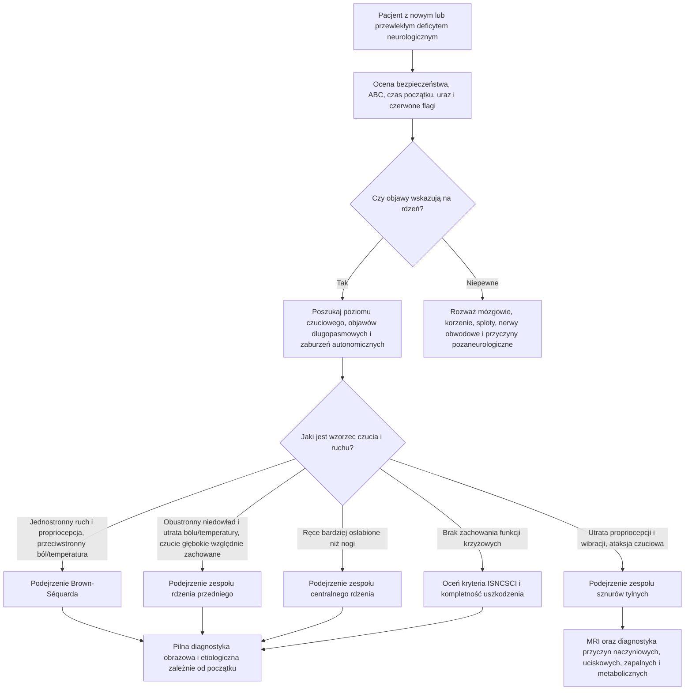

# 8.8. Zespoły rdzeniowe

## Wprowadzenie

Zespoły rdzeniowe są wzorcami objawów powstających wskutek uszkodzenia określonych struktur rdzenia kręgowego. Ich rozpoznawanie opiera się na połączeniu trzech elementów: anatomii przekroju rdzenia, przebiegu dróg długich oraz segmentarnej organizacji neuronów ruchowych i czuciowych. W praktyce klinicznej nie chodzi o mechaniczne dopasowanie pacjenta do podręcznikowego schematu, lecz o sformułowanie hipotezy lokalizacyjnej, sprawdzenie jej w badaniu neurologicznym i zweryfikowanie w odpowiednim obrazowaniu.

Klasyczne zespoły nie zawsze występują w postaci pełnej. Uraz, niedokrwienie, ucisk, krwawienie, zapalenie lub proces rozrostowy mogą obejmować kilka sąsiadujących struktur, a obrzęk i wtórne uszkodzenie zmieniają obraz w czasie. Dlatego wzorzec kliniczny należy traktować jako narzędzie rozumowania, a nie jako samodzielne rozpoznanie etiologiczne.

Rozdział rozwija zagadnienia lokalizacyjne przedstawione w rozdziałach 8.5 i 8.7. Nie zastępuje formalnej klasyfikacji ISNCSCI ani oceny poziomu neurologicznego. W przypadku urazu rdzenia standaryzację badania i klasyfikację stopnia uszkodzenia należy prowadzić zgodnie z aktualnym, dziewiątym wydaniem ISNCSCI z 2026 r. oraz właściwym arkuszem ASIA/ISCoS [1–3].

> **Zasada bezpieczeństwa:** nowy lub narastający deficyt neurologiczny, poziom czuciowy, obustronne osłabienie kończyn, zaburzenia zwieraczy, zaburzenia oddychania albo podejrzenie ucisku rdzenia wymagają pilnej oceny lekarskiej. Nie wolno opóźniać transportu, obrazowania ani leczenia z powodu wielokrotnego powtarzania prób neurologicznych.

## 1. Cele kształcenia i efekty uczenia się

### 1.1. Cel ogólny

Celem rozdziału jest przygotowanie uczestnika do rozpoznawania najważniejszych wzorców zespołów rdzeniowych, łączenia objawów z uszkodzeniem określonych dróg i struktur segmentarnych oraz właściwego rozpoznawania sytuacji wymagających pilnego MRI i konsultacji specjalistycznej.

### 1.2. Szczegółowe efekty uczenia się

Po ukończeniu rozdziału uczestnik powinien umieć:

1. wyjaśnić, dlaczego uszkodzenie sznurów tylnych powoduje przede wszystkim zaburzenie czucia ułożenia i wibracji, a uszkodzenie dróg rdzeniowo-wzgórzowych – zaburzenie czucia bólu i temperatury;
2. opisać klasyczny obraz zespołu Brown-Séquarda i wyjaśnić jego podstawę anatomiczną;
3. rozpoznać wzorzec zespołu rdzenia przedniego, w tym względne zachowanie czucia głębokiego;
4. rozpoznać zespół sznurów tylnych i odróżnić ataksję czuciową od móżdżkowej i przedsionkowej;
5. rozpoznać zespół centralny rdzenia, zwłaszcza nieproporcjonalne osłabienie kończyn górnych względem dolnych;
6. odróżnić klinicznie całkowity zespół uszkodzenia rdzenia od anatomicznego przecięcia rdzenia;
7. interpretować wpływ wstrząsu rdzeniowego na wczesny obraz ruchowy i odruchowy;
8. zestawić objawy z poziomem anatomicznym i dynamiką początku;
9. wskazać najważniejsze przyczyny urazowe, naczyniowe, uciskowe, zapalne, metaboliczne i nowotworowe;
10. określić sytuacje, w których potrzebne jest pilne MRI, oraz rozumieć, dlaczego prawidłowa TK nie wyklucza uszkodzenia miąższu rdzenia;
11. sporządzić zwięzły, powtarzalny opis badania, oddzielając obserwacje od interpretacji;
12. przekazać podejrzenie stanu nagłego w sposób jasny, z podaniem czasu początku objawów, ich dynamiki i najważniejszych deficytów.

### 1.3. Granice kompetencji

Rozdział ma charakter edukacyjny. Samo rozpoznanie wzorca klinicznego nie upoważnia do samodzielnego ustalania etiologii, zlecania badań, kwalifikowania do zabiegu ani modyfikowania leczenia poza zakresem uprawnień zawodowych. Formalne badanie ISNCSCI, badanie okolicy krzyżowej, ocena funkcji zwieraczy i interpretacja badań obrazowych wymagają odpowiedniego przygotowania oraz działania zgodnego z kompetencjami i procedurami placówki.

W razie podejrzenia ostrego uszkodzenia rdzenia należy zapewnić bezpieczeństwo, ograniczyć niepotrzebne przemieszczanie kręgosłupa, monitorować stan ogólny w granicach kompetencji i niezwłocznie uruchomić właściwą ścieżkę pomocy.

## 2. Definicje i terminologia

### 2.1. Zespół rdzeniowy

Zespół rdzeniowy to układ objawów wynikających z uszkodzenia rdzenia kręgowego na określonym poziomie i w określonym rozmieszczeniu poprzecznym. Może obejmować zaburzenia ruchowe, czuciowe, autonomiczne i odruchowe. Wzorzec zależy od tego, które drogi długie, rogi istoty szarej, spoidło białe przednie i struktury segmentarne zostały zajęte.

### 2.2. Zespół całkowity i niecałkowity

W ujęciu klinicznym i klasyfikacyjnym uszkodzenie neurologicznie całkowite oznacza brak zachowania kwalifikującej się funkcji czuciowej i ruchowej w najniższych segmentach krzyżowych S4–S5 zgodnie z kryteriami ISNCSCI. Nie jest to równoznaczne z anatomicznym przecięciem rdzenia. Rdzeń może zachować włókna lub ciągłość anatomiczną, mimo że badanie nie wykazuje funkcji spełniającej kryteria zachowania krzyżowego.

Uszkodzenie niecałkowite oznacza zachowanie co najmniej jednej kwalifikującej się funkcji krzyżowej lub spełnienie odpowiednich kryteriów funkcji ruchowej. Szczegółowe zasady klasyfikacji AIS A–E, NLI, ZPP, DAP i VAC opisano w rozdziale 8.7 oraz w aktualnym standardzie ISNCSCI [1–3].

### 2.3. Zespół anatomiczny a etiologia

Nazwa zespołu opisuje przede wszystkim wzorzec uszkodzenia, a nie jego przyczynę. Przykładowo zespół rdzenia przedniego może wystąpić w następstwie niedokrwienia w zakresie tętnicy rdzeniowej przedniej, urazu z uciskiem przednich części rdzenia albo innego procesu obejmującego przednie i boczne drogi. Podobnie zespół sznurów tylnych może być następstwem niedokrwienia, ucisku, demielinizacji lub zaburzeń metabolicznych.

### 2.4. Poziom segmentarny i objawy poniżej poziomu

Uszkodzenie rdzenia może wywoływać:
- objawy segmentarne na wysokości uszkodzenia, np. wiotkość, zanik lub osłabienie odruchu z powodu zajęcia komórek rogu przedniego albo korzeni;
- objawy długopasmowe poniżej uszkodzenia, np. niedowład spastyczny, hiperrefleksję i zaburzenia czucia przewodzonego przez długie drogi;
- zaburzenia autonomiczne, w tym funkcji pęcherza, jelit, funkcji seksualnych, potliwości i regulacji krążenia.

W ostrym okresie objawy długopasmowe mogą być maskowane przez wstrząs rdzeniowy. Nie należy więc oczekiwać pełnego obrazu spastyczności i hiperrefleksji bezpośrednio po ciężkim urazie.

### 2.5. Mielopatia

Mielopatia oznacza kliniczny zespół dysfunkcji rdzenia kręgowego. Może mieć charakter uciskowy, naczyniowy, zapalny, demielinizacyjny, metaboliczny, zakaźny, pourazowy lub nowotworowy. Termin ten nie określa sam w sobie przyczyny. Rozpoznanie mielopatii wymaga powiązania obrazu klinicznego z badaniami dodatkowymi i wykluczenia przyczyn, w których opóźnienie leczenia grozi nieodwracalnym deficytem [9,10].

## 3. Podstawy neuroanatomiczne niezbędne do rozpoznawania zespołów

### 3.1. Trzy główne układy dróg długich

W rozpoznawaniu zespołów rdzeniowych szczególne znaczenie mają trzy układy:

| Układ | Główna modalność lub funkcja | Przebieg w rdzeniu | Typowy skutek uszkodzenia |
|---|---|---|---|
| Droga korowo-rdzeniowa boczna | Ruch dowolny, zwłaszcza precyzyjna kontrola kończyn | Po skrzyżowaniu piramid biegnie po tej samej stronie rdzenia | Niedowład poniżej uszkodzenia, z czasem objawy górnego neuronu ruchowego |
| Sznury tylne | Propriocepcja świadoma, wibracja, precyzyjny dotyk | Wstępują po tej samej stronie do rdzenia przedłużonego | Utrata czucia ułożenia i wibracji po stronie uszkodzenia, ataksja czuciowa |
| Droga rdzeniowo-wzgórzowa | Ból, temperatura, część czucia dotyku | Włókna drugiego neuronu krzyżują się w rdzeniu przez spoidło białe przednie, zwykle w pobliżu poziomu wejścia | Przeciwstronna utrata bólu i temperatury, często zaczynająca się nieco poniżej poziomu uszkodzenia |

Włókna drogi rdzeniowo-wzgórzowej mogą wstępować lub zstępować krótko w obrębie pęczka Lissauera przed skrzyżowaniem. Dlatego granica zaburzeń bólu i temperatury nie zawsze pokrywa się dokładnie z poziomem anatomicznym uszkodzenia.

### 3.2. Sznury tylne

Sznury tylne obejmują:
- pęczek smukły – położony przyśrodkowo, przewodzący informacje głównie z kończyn dolnych i dolnej części tułowia;
- pęczek klinowaty – obecny powyżej około T6, położony bardziej bocznie, przewodzący informacje z kończyn górnych i górnej części tułowia.

Włókna pierwszego neuronu wstępują po tej samej stronie rdzenia, a skrzyżowanie drogi następuje dopiero w rdzeniu przedłużonym. Uszkodzenie sznurów tylnych w rdzeniu powoduje zatem zaburzenia propriocepcji i wibracji po stronie uszkodzenia poniżej poziomu zmiany.

### 3.3. Droga korowo-rdzeniowa

Większość włókien drogi korowo-rdzeniowej krzyżuje się w dolnej części rdzenia przedłużonego. W rdzeniu kręgowym droga korowo-rdzeniowa boczna kontroluje ruchy po tej samej stronie. Jej uszkodzenie w rdzeniu powoduje ipsilateralny niedowład poniżej poziomu zmiany. W ostrym okresie może dominować wiotkość i osłabienie odruchów, natomiast później pojawiają się wzmożone odruchy, spastyczność i objawy patologiczne.

### 3.4. Droga rdzeniowo-wzgórzowa

Włókna przewodzące ból i temperaturę wchodzą do rdzenia przez korzenie tylne, mogą przemieścić się o jeden lub kilka segmentów w pęczku Lissauera, a następnie krzyżują się w spoidle białym przednim. Po skrzyżowaniu wstępują w układzie przednio-bocznym po stronie przeciwnej. Uszkodzenie jednostronne rdzenia może zatem powodować przeciwstronne zaburzenia bólu i temperatury poniżej poziomu zmiany.

### 3.5. Istota szara i objawy segmentarne

Rogi przednie zawierają ciała komórek dolnego neuronu ruchowego. Ich uszkodzenie powoduje segmentarne osłabienie wiotkie, obniżenie odruchów, a w przebiegu przewlekłym zanik mięśni i możliwe fascykulacje. Rogi tylne i okolica spoidła białego przedniego uczestniczą w przetwarzaniu i przekazywaniu informacji czuciowych. Zmiany centralne mogą selektywnie uszkadzać skrzyżowujące się włókna bólu i temperatury, dając zaburzenia czucia na poziomie segmentów.

### 3.6. Unaczynienie rdzenia

Rdzeń jest zaopatrywany przez:
- tętnicę rdzeniową przednią, która zaopatruje znaczną część przednich i bocznych struktur rdzenia;
- parzyste tętnice rdzeniowe tylne, zaopatrujące przede wszystkim sznury tylne i tylne części rdzenia;
- tętnice korzeniowo-rdzeniowe, które wzmacniają krążenie rdzeniowe na różnych poziomach.

Tętnica Adamkiewicza jest największą tętnicą korzeniowo-rdzeniową przednią, ale jej poziom odejścia jest zmienny. Nie należy zakładać stałego poziomu naczyniowego u każdego pacjenta. Obszary graniczne, zmienność krążenia obocznego, hipotensja i choroby aorty mogą wpływać na rozległość niedokrwienia.

### 3.7. Schemat przekroju rdzenia – orientacja funkcjonalna

Poniższy schemat ma charakter poglądowy, nie jest mapą do samodzielnego odczytywania obrazów MRI.

```text
                 TYŁ / GRZBIET
              SZNURY TYLNE
        propriocepcja, wibracja
                   │
          ┌────────┴────────┐
          │                 │
          │    ISTOTA       │
          │    SZARA        │
          │                 │
          │   spoidło       │
          │   białe         │
          │   przednie      │
          │                 │
          └───────┬─────────┘
                  │
       DROGI PRZEDNIO-BOCZNE
       ból i temperatura
       droga korowo-rdzeniowa
       ruch dowolny
                  │
             PRZÓD / BRZUCH
```

W rzeczywistym przekroju drogi korowo-rdzeniowe leżą w sznurach bocznych, a droga rdzeniowo-wzgórzowa w układzie przednio-bocznym. Schemat nie oddaje pełnej somatotopii ani wszystkich dróg.

## 4. Ogólna metodyka oceny zespołu rdzeniowego

### 4.1. Najpierw bezpieczeństwo i czas początku

Przed szczegółowym badaniem należy ustalić:
1. czy objawy rozpoczęły się po urazie, nagle bez urazu, podostro czy przewlekle;
2. czy deficyt narasta, stabilizuje się, ustępuje lub nawraca;
3. czy występuje ból kręgosłupa, ból korzeniowy, gorączka, dreszcze lub objawy ogólnoustrojowe;
4. czy występują zaburzenia mikcji, defekacji, czucia siodłowego lub funkcji seksualnych;
5. czy pacjent przyjmuje leki przeciwkrzepliwe, ma nowotwór, immunosupresję, niedawne zakażenie lub zabieg w obrębie kręgosłupa;
6. czy występują duszność, osłabienie kaszlu, zaburzenia połykania lub objawy dysfunkcji autonomicznej.

W urazie należy stosować procedury ratunkowe i zasady ochrony kręgosłupa. Nie wykonuje się prób prowokujących ruch w niestabilnym odcinku ani prób chodu bez oceny bezpieczeństwa.

### 4.2. Badanie ruchowe

Ocenę ruchową należy przeprowadzić systematycznie, porównując obie strony i uwzględniając:
- siłę mięśni proksymalnych i dystalnych;
- rozkład niedowładu;
- napięcie mięśniowe;
- odruchy głębokie i powierzchowne;
- obecność objawów patologicznych;
- funkcję mięśni oddechowych, jeśli poziom uszkodzenia lub objawy wskazują na takie ryzyko.

W urazie rdzenia formalną klasyfikację należy prowadzić zgodnie z ISNCSCI. Wynik skali Lovetta lub MRC może być użyteczny w badaniu funkcjonalnym, ale nie zastępuje oceny mięśni kluczowych i reguł ISNCSCI.

### 4.3. Badanie czucia

Należy ocenić osobno:
- dotyk lekki;
- czucie bólu i temperatury, jeżeli badanie jest wskazane i dostępne są bezpieczne narzędzia;
- czucie wibracji;
- propriocepcję;
- rozkład zaburzeń na tułowiu i kończynach;
- obecność poziomu czuciowego;
- ewentualną dysocjację czuciową, czyli odmienne zachowanie poszczególnych modalności.

Nie wolno utożsamiać braku odpowiedzi na jeden bodziec z całkowitą utratą wszystkich modalności czucia.

### 4.4. Ocena funkcji autonomicznych

Wywiad i badanie powinny obejmować:
- zatrzymanie moczu, nietrzymanie lub zmianę czucia parcia;
- zaparcia, nietrzymanie stolca i zmianę kontroli defekacji;
- zaburzenia seksualne;
- zaburzenia potliwości i termoregulacji;
- hipotonię ortostatyczną, bradykardię lub niestabilność ciśnienia;
- objawy autonomicznej dysrefleksji u pacjentów z przewlekłym uszkodzeniem rdzenia, zwłaszcza na poziomie T6 lub wyżej.

Ocena funkcji autonomicznych wymaga poszanowania intymności, zgody pacjenta i kompetencji osoby badającej. Nie należy opierać wykluczenia zespołu ogona końskiego na pojedynczym badaniu czucia krocza lub napięcia zwieracza.

### 4.5. Ocena poziomu i wzorca

Należy określić:
- czy objawy są jednostronne, obustronne czy asymetryczne;
- czy zaburzenia czucia tworzą poziom na tułowiu;
- czy występuje segmentarne osłabienie na wysokości zmiany;
- czy poniżej poziomu pojawiają się objawy długopasmowe;
- czy zaburzenia czucia mają charakter rozszczepiony;
- czy objawy autonomiczne są proporcjonalne do poziomu i rozległości uszkodzenia.

Wzorzec zespołowy pomaga wskazać lokalizację, ale nie określa samodzielnie przyczyny ani stopnia odwracalności uszkodzenia.

### 4.6. Zasada dokumentowania dynamiki

Badanie należy powtarzać w sposób porównywalny, zapisując datę, godzinę, pozycję, stan bólowy, leki wpływające na świadomość i siłę, zastosowaną skalę oraz ograniczenia. Zmiana wyniku może wynikać z progresji choroby, ustępowania wstrząsu rdzeniowego, zmiany bólu, zmęczenia lub różnicy techniki badania.

## 5. Zespół Brown-Séquarda

### 5.1. Definicja i mechanizm

Zespół Brown-Séquarda jest klasycznym wzorcem wynikającym z jednostronnego uszkodzenia połowy rdzenia lub jej znacznej części. Pełna anatomiczna hemisekcja jest rzadka; w praktyce częściej obserwuje się niepełny zespół połowiczego uszkodzenia rdzenia.

Najważniejszy układ objawów wynika z położenia dróg:
- uszkodzenie drogi korowo-rdzeniowej bocznej powoduje niedowład po stronie uszkodzenia poniżej zmiany;
- uszkodzenie sznurów tylnych powoduje ipsilateralne zaburzenie propriocepcji i czucia wibracji poniżej zmiany;
- uszkodzenie drogi rdzeniowo-wzgórzowej po skrzyżowaniu powoduje przeciwstronne zaburzenie czucia bólu i temperatury, zwykle rozpoczynające się około jednego do dwóch segmentów poniżej poziomu zmiany;
- zajęcie rogu przedniego lub korzenia na wysokości zmiany może wywołać segmentarne objawy dolnego neuronu ruchowego.

### 5.2. Typowy obraz kliniczny

| Funkcja | Po stronie uszkodzenia | Po stronie przeciwnej |
|---|---|---|
| Ruch poniżej uszkodzenia | Niedowład, później możliwe objawy piramidowe | Zwykle względnie zachowany, chyba że uszkodzenie jest szersze |
| Propriocepcja i wibracja | Osłabione lub zniesione poniżej poziomu | Zwykle względnie zachowane |
| Ból i temperatura | Mogą być zaburzone segmentarnie na poziomie uszkodzenia | Utrata poniżej poziomu, często z przesunięciem o 1–2 segmenty |
| Odruchy | Możliwe osłabienie na poziomie, wzmożenie poniżej po ustąpieniu wstrząsu | Zależne od rozległości zmiany |
| Funkcje autonomiczne | Możliwe zaburzenia pęcherza, jelit, potliwości i funkcji seksualnych | Zależne od rozległości i poziomu |

Wysokie uszkodzenie szyjne lub górne piersiowe może zajmować drogę współczulną i powodować zespół Hornera po stronie zmiany: zwężenie źrenicy, niewielkie opadanie powieki i zaburzenie potliwości twarzy. Nie jest to objaw obowiązkowy.

### 5.3. Etiologia

Możliwe przyczyny obejmują:
- rany penetrujące, w tym kłute i postrzałowe;
- uraz tępy z uszkodzeniem asymetrycznym;
- złamanie lub przemieszczenie struktur kręgosłupa;
- boczną przepuklinę krążka międzykręgowego z uciskiem rdzenia;
- guz zewnątrzrdzeniowy lub wewnątrzrdzeniowy;
- krwiak nadtwardówkowy;
- ropień nadtwardówkowy;
- zmianę demielinizacyjną, np. w przebiegu stwardnienia rozsianego;
- niedokrwienie lub krwawienie rdzenia;
- rzadziej proces zakaźny lub zapalny.

### 5.4. Procedura badania

1. Ustal czas początku, mechanizm urazu i dynamikę objawów.
2. Oceń bezpieczeństwo kręgosłupa i stan ogólny.
3. Porównaj siłę mięśniową po obu stronach, uwzględniając segmenty i grupy proksymalne oraz dystalne.
4. Zbadaj czucie wibracji i propriocepcję po obu stronach.
5. Zbadaj ból i temperaturę w sposób bezpieczny, mapując poziom i stronę zaburzeń.
6. Oceń odruchy, napięcie i objawy patologiczne, pamiętając o możliwym wstrząsie rdzeniowym.
7. Zapisz, czy występują objawy segmentarne na wysokości uszkodzenia.
8. Oceń funkcje autonomiczne i objawy alarmowe.
9. W razie nowego lub postępującego deficytu uruchom pilną diagnostykę obrazową.

### 5.5. Interpretacja

Najbardziej charakterystyczne jest połączenie ipsilateralnego niedowładu i utraty czucia głębokiego z przeciwstronną utratą bólu i temperatury. Wzorzec może być niepełny. Brak jednego elementu nie wyklucza asymetrycznego uszkodzenia rdzenia. W ostrym okresie niedowład może być wiotki i odruchy mogą być osłabione, dlatego wynik należy oceniać w kontekście czasu od urazu.

### 5.6. Przykład kliniczny

Pacjent po ranie kłutej prawej połowy klatki piersiowej zgłasza osłabienie prawej kończyny dolnej. W badaniu stwierdza się osłabienie siły po prawej stronie, zaburzenie czucia wibracji i ułożenia prawej kończyny oraz zmniejszenie czucia bólu i temperatury po lewej stronie, rozpoczynające się kilka segmentów poniżej poziomu zmiany. Wzorzec sugeruje prawostronne połowicze uszkodzenie rdzenia. Nie określa jednak samodzielnie przyczyny, rozległości ani rokowania. Konieczna jest pilna ocena urazowa i obrazowanie.

## 6. Zespół rdzenia przedniego

### 6.1. Definicja

Zespół rdzenia przedniego jest wzorcem wynikającym z uszkodzenia przednich i bocznych części rdzenia, przy względnym oszczędzeniu sznurów tylnych. Może być następstwem niedokrwienia w zakresie tętnicy rdzeniowej przedniej, urazu, ucisku lub innego procesu obejmującego przednie dwie trzecie przekroju rdzenia.

Nie każdy przypadek ma identyczny zasięg. Określenie „zespół tętnicy rdzeniowej przedniej” odnosi się do mechanizmu naczyniowego, natomiast „zespół rdzenia przedniego” opisuje wzorzec anatomiczno-kliniczny.

### 6.2. Podstawa anatomiczna

Przednia część rdzenia zawiera:
- drogi korowo-rdzeniowe boczne i część przednich;
- drogi rdzeniowo-wzgórzowe;
- rogi przednie istoty szarej;
- część dróg autonomicznych i struktur pośrednio-bocznych na odpowiednich poziomach.

Sznury tylne mogą pozostać względnie zachowane, ponieważ mają odrębne unaczynienie. Granice naczyniowe są jednak zmienne, a rozległe niedokrwienie może zajmować również struktury tylne.

### 6.3. Typowy obraz kliniczny

Najczęściej występują:
- obustronny niedowład lub porażenie poniżej poziomu uszkodzenia;
- utrata czucia bólu i temperatury poniżej zmiany;
- względne zachowanie propriocepcji i czucia wibracji;
- możliwe segmentarne objawy dolnego neuronu ruchowego na wysokości uszkodzenia;
- zaburzenia pęcherza, jelit i funkcji seksualnych;
- w zależności od poziomu – zaburzenia oddychania, regulacji ciśnienia i rytmu serca.

W ostrym niedokrwieniu objawy mogą rozpocząć się nagle, często z bólem pleców. Początkowo może wystąpić wiotkość i arefleksja związane ze wstrząsem rdzeniowym. W późniejszym okresie, jeśli drogi zstępujące zostały trwale uszkodzone, mogą pojawić się spastyczność, hiperrefleksja i objawy patologiczne.

### 6.4. Możliwe przyczyny

- niedokrwienie w zakresie tętnicy rdzeniowej przedniej;
- choroby aorty, zabiegi aortalne lub powikłania naczyniowe;
- hipotensja i zaburzenia perfuzji rdzenia;
- uraz z uciskiem lub uszkodzeniem przednich części rdzenia;
- ucisk przez krążek, guz, krwiak lub ropień;
- rzadziej inne przyczyny naczyniowe, zapalne lub jatrogenne.

### 6.5. Procedura badania

1. Ustal, czy początek był nagły, czy poprzedzał go ból pleców, zabieg naczyniowy, hipotensja lub uraz.
2. Oceń siłę mięśniową obustronnie i rozkład niedowładu.
3. Zbadaj ból i temperaturę poniżej podejrzewanego poziomu.
4. Zbadaj propriocepcję i wibrację, sprawdzając, czy są względnie zachowane.
5. Oceń czucie na tułowiu i poszukaj poziomu czuciowego.
6. Oceń odruchy, napięcie i objawy patologiczne z uwzględnieniem fazy choroby.
7. Zapytaj o mikcję, defekację, funkcje seksualne i objawy autonomiczne.
8. W przypadku wysokiego uszkodzenia oceń ryzyko niewydolności oddechowej i zaburzeń krążenia.
9. Niezwłocznie przekaż pacjenta do diagnostyki szpitalnej, jeśli podejrzewa się ostre niedokrwienie lub ucisk rdzenia.

### 6.6. Diagnostyka różnicowa

Najważniejsze jest odróżnienie niedokrwienia rdzenia od:
- poprzecznego zapalenia rdzenia;
- uciskowej mielopatii;
- krwiaka nadtwardówkowego;
- ropnia nadtwardówkowego;
- krwawienia do rdzenia;
- rozległej zmiany demielinizacyjnej;
- choroby metabolicznej obejmującej drogi rdzeniowe.

Bardzo szybki, nagły początek przemawia za przyczyną naczyniową, ale nie rozstrzyga rozpoznania. W diagnostyce należy zestawić dynamikę objawów, MRI, badania płynu mózgowo-rdzeniowego – jeśli są wskazane – i wyniki badań ogólnych. Wczesne MRI w niedokrwieniu rdzenia może nie wykazywać jeszcze pełnego obrazu; prawidłowy wczesny wynik nie zawsze kończy diagnostykę [10,11].

### 6.7. Przykład kliniczny

Pacjent po rozległym zabiegu na aorcie nagle zgłasza ból pleców i utratę siły obu kończyn dolnych. W badaniu stwierdza się obustronny niedowład, osłabienie czucia bólu i temperatury oraz względnie zachowane czucie wibracji i ułożenia. Obraz sugeruje zespół rdzenia przedniego o możliwym mechanizmie niedokrwiennym. Wymaga pilnej diagnostyki szpitalnej, oceny perfuzji i MRI; nie należy opóźniać postępowania przez powtarzanie prób.

## 7. Zespół sznurów tylnych

### 7.1. Definicja

Zespół sznurów tylnych wynika z uszkodzenia dróg przewodzących przede wszystkim propriocepcję świadomą, czucie wibracji i precyzyjny dotyk. Wzorzec może być obustronny lub asymetryczny. Czysty zespół sznurów tylnych jest rzadki; w praktyce zmiany mogą obejmować również drogi korowo-rdzeniowe, korzenie lub nerwy obwodowe.

### 7.2. Typowy obraz kliniczny

- osłabienie lub utrata czucia wibracji;
- zaburzenie czucia ułożenia palców i stawów;
- pogorszenie kontroli ruchu po zamknięciu oczu;
- dodatnia próba Romberga, jeśli zaburzenie propriocepcji jest istotne, a pozostałe układy równowagi pozwalają na kompensację;
- ataksja czuciowa, często z nadmiernym unoszeniem stóp i silnym kontrolowaniem wzrokowym;
- pseudoatetoza, czyli powolne, mimowolne ruchy palców przy braku informacji wzrokowej;
- względne zachowanie czucia bólu i temperatury oraz siły mięśniowej w czystym uszkodzeniu sznurów tylnych.

### 7.3. Ataksja czuciowa a inne rodzaje ataksji

| Cecha | Ataksja czuciowa | Ataksja móżdżkowa | Ataksja przedsionkowa |
|---|---|---|---|
| Główne zaburzenie | Utrata informacji proprioceptywnej | Zaburzenie koordynacji i kalibracji ruchu | Zaburzenie stabilizacji spojrzenia i orientacji przestrzennej |
| Wpływ zamknięcia oczu | Wyraźne pogorszenie | Objawy obecne również przy otwartych oczach | Może nasilać niestabilność |
| Romberg | Często dodatni | Nie jest typowym izolowanym objawem | Może być dodatni lub kierunkowo zmienny |
| Próby palec–nos | Pogorszenie po ograniczeniu kontroli wzrokowej | Dysmetria także przy otwartych oczach | Zwykle nie dominuje dysmetria kończyn |
| Czucie wibracji i ułożenia | Często zaburzone | Zwykle zachowane | Zwykle zachowane |
| Oczopląs | Nie jest cechą podstawową | Może współistnieć | Często występuje zależnie od uszkodzenia |

Dodatni Romberg nie jest samodzielnym rozpoznaniem zespołu sznurów tylnych. Należy ocenić propriocepcję, czucie wibracji, układ przedsionkowy, wzrok, siłę i bezpieczeństwo stania.

### 7.4. Przyczyny

- niedokrwienie w zakresie tętnic rdzeniowych tylnych;
- ucisk rdzenia od strony tylnej;
- zmiany demielinizacyjne;
- niedobór witaminy B12 i podostre zwyrodnienie sznurowe;
- niedobór miedzi;
- kiła układu nerwowego z wiądem rdzenia;
- choroby dziedziczne, np. niektóre ataksje czuciowe;
- inne choroby metaboliczne i neurodegeneracyjne.

W niedoborze witaminy B12 może wystąpić podostre zwyrodnienie sznurowe obejmujące nie tylko sznury tylne, lecz także drogi korowo-rdzeniowe boczne. Wówczas oprócz ataksji czuciowej mogą pojawić się niedowład spastyczny, objawy piramidowe i cechy neuropatii obwodowej. Nie należy więc opisywać każdego niedoboru B12 jako czystego zespołu sznurów tylnych.

### 7.5. Procedura badania

1. Oceń czucie wibracji kamertonem o odpowiedniej częstotliwości, porównując strony i stopniowo przechodząc od dystalnych do proksymalnych punktów.
2. Zbadaj propriocepcję palców i stawów, wykonując niewielkie ruchy w górę i w dół przy zamkniętych oczach.
3. Oceń stabilność w pozycji siedzącej i stojącej, zapewniając asekurację.
4. Wykonaj próbę Romberga wyłącznie wtedy, gdy pacjent może bezpiecznie stać i nie ma przeciwwskazań.
5. Obserwuj chód w dobrym oświetleniu, a ewentualną zmianę warunków przeprowadzaj tylko przy asekuracji.
6. Oceń precyzję ruchów kończyn i porównaj wynik przy otwartych oraz zamkniętych oczach.
7. Zbadaj czucie bólu i temperatury, aby sprawdzić, czy zaburzenie jest selektywne.
8. Oceń siłę, odruchy i objawy piramidowe, ponieważ mogą wskazywać na szersze zajęcie rdzenia.
9. Zbierz wywiad dotyczący diety, zaburzeń wchłaniania, operacji przewodu pokarmowego, ekspozycji na podtlenek azotu, chorób autoimmunologicznych i zakażeń.

### 7.6. Interpretacja

Wzorzec obejmujący utratę propriocepcji i wibracji, ataksję nasilającą się bez kontroli wzrokowej oraz względne zachowanie bólu i temperatury sugeruje uszkodzenie sznurów tylnych. Jeżeli równocześnie występują objawy piramidowe, należy rozważyć szersze zajęcie rdzenia, w tym podostre zwyrodnienie sznurowe, demielinizację lub ucisk.

### 7.7. Przykład kliniczny

Osoba z postępującą niestabilnością chodu zgłasza, że poruszanie się w ciemności jest szczególnie trudne. W badaniu stwierdza się osłabione czucie wibracji w stopach, zaburzone rozpoznawanie kierunku ruchu palców, dodatni Romberg i względnie zachowane czucie bólu. Wzorzec wskazuje na ataksję czuciową i wymaga ustalenia, czy przyczyna leży w sznurach tylnych, korzeniach czy nerwach obwodowych. W diagnostyce różnicowej należy uwzględnić niedobór B12 i miedzi, choroby demielinizacyjne, ucisk oraz inne przyczyny metaboliczne.

## 8. Zespół centralny rdzenia

### 8.1. Definicja

Zespół centralny rdzenia jest niecałkowitym uszkodzeniem, w którym zmiany koncentrują się w centralnych częściach rdzenia, najczęściej w odcinku szyjnym. Typowym obrazem jest większe osłabienie kończyn górnych niż dolnych, szczególnie zaburzenie funkcji dłoni i precyzyjnych ruchów palców. Mogą współistnieć zaburzenia czucia, ból neuropatyczny i zaburzenia pęcherza.

### 8.2. Mechanizm i etiologia

Klasyczny mechanizm obejmuje uraz przeprostny szyi, często u osoby starszej z wcześniejszym zwężeniem kanału kręgowego. Rdzeń może zostać uciśnięty pomiędzy strukturami przednimi i tylnymi, a w jego centralnych częściach mogą powstać obrzęk, krwawienie lub uszkodzenie aksonalne. Zespół może wystąpić również bez widocznego złamania lub zwichnięcia kręgów.

Inne przyczyny obejmują:
- uraz zgięciowo-przeprostny;
- ucisk przez krążek lub osteofity;
- krwiak lub guz;
- jamistość rdzenia i inne choroby jamiste;
- zapalenie lub demielinizację;
- rzadziej proces naczyniowy.

### 8.3. Typowy obraz kliniczny

- osłabienie kończyn górnych większe niż kończyn dolnych;
- szczególnie znaczne zaburzenie sprawności dłoni i ruchów precyzyjnych;
- trudności w chwytaniu, zapinaniu guzików, pisaniu i manipulowaniu przedmiotami;
- zaburzenia czucia o zmiennym rozkładzie;
- możliwe obustronne parestezje lub ból palący w kończynach górnych;
- możliwe zaburzenia mikcji, zwłaszcza zatrzymanie moczu w fazie ostrej;
- objawy piramidowe poniżej poziomu uszkodzenia, które mogą pojawić się lub nasilać z czasem.

W części centralnych uszkodzeń może wystąpić segmentarne, obustronne zaburzenie bólu i temperatury w obszarach odpowiadających zajętym segmentom, jeżeli uszkodzone zostaną krzyżujące się włókna w spoidle białym przednim. Nie jest to jednak obowiązkowy element każdego zespołu centralnego.

### 8.4. Znaczenie somatotopii i ograniczenia klasycznego wyjaśnienia

W podręcznikach często opisuje się, że włókna kontrolujące kończyny górne leżą bardziej przyśrodkowo, a kończyny dolne bardziej bocznie w drodze korowo-rdzeniowej. Taki schemat może pomagać w nauce, ale nie powinien być traktowany jako jedyne ani wystarczające wyjaśnienie klinicznej przewagi osłabienia rąk. Rzeczywista somatotopia jest złożona, a rozkład uszkodzenia, obrzęk, krwawienie, zwężenie kanału, uraz tkanek i zajęcie innych dróg wpływają na obraz.

### 8.5. Procedura badania

1. Ustal mechanizm urazu, zwłaszcza upadek z przeprostem szyi, oraz obecność wcześniejszej spondylozy lub zwężenia kanału.
2. Zabezpiecz kręgosłup zgodnie z procedurą urazową.
3. Porównaj siłę w kończynach górnych i dolnych.
4. Zwróć szczególną uwagę na prostowanie i zginanie palców, odwodzenie palców, chwyt i precyzyjne manipulowanie.
5. Oceń czucie dotyku, bólu, temperatury, wibracji i ułożenia, mapując rozkład zaburzeń.
6. Oceń odruchy i objawy piramidowe, uwzględniając wstrząs rdzeniowy.
7. Zapytaj o mikcję i oceń ryzyko zatrzymania moczu.
8. Oceń ból szyi, objawy korzeniowe i ewentualne zaburzenia oddychania.
9. Nie podejmuj prób mobilizacji ani chodu bez decyzji zespołu prowadzącego.

### 8.6. Diagnostyka różnicowa

- obustronna radikulopatia szyjna;
- mielopatia szyjna w przebiegu spondylozy;
- obustronne uszkodzenie splotów lub nerwów obwodowych;
- udar mózgu, zwłaszcza gdy występują objawy twarzowo-językowe lub zaburzenia świadomości;
- zespół Guillaina–Barrégo;
- choroby neuronu ruchowego;
- uszkodzenie rdzenia o innym wzorcu;
- uraz tkanek miękkich bez uszkodzenia rdzenia.

### 8.7. Przykład kliniczny

Osoba starsza po upadku z uderzeniem twarzą o podłoże zgłasza osłabienie rąk, trudności w poruszaniu palcami i mniejsze osłabienie nóg. TK nie wykazuje złamania kręgosłupa szyjnego, ale utrzymuje się deficyt neurologiczny. Obraz może odpowiadać zespołowi centralnemu rdzenia. Zgodnie z zaleceniami NICE obecność nieprawidłowości neurologicznej mogącej wynikać z uszkodzenia rdzenia jest wskazaniem do MRI po TK, nawet gdy TK nie wykazuje zmiany wyjaśniającej objawy [4].

## 9. Całkowite uszkodzenie rdzenia

### 9.1. Definicja kliniczna

W klasyfikacji ISNCSCI uszkodzenie neurologicznie całkowite oznacza brak zachowania funkcji czuciowej i ruchowej w segmentach S4–S5 według określonych kryteriów. W praktyce odpowiada to kategorii AIS A, jeśli spełnione są wszystkie wymagane warunki. Nie należy utożsamiać tego określenia z anatomicznym przerwaniem ciągłości rdzenia.

### 9.2. Obraz kliniczny

Zależnie od poziomu i fazy uszkodzenia mogą wystąpić:
- obustronny niedowład lub porażenie poniżej poziomu;
- zaburzenia czucia obejmujące wszystkie lub liczne modalności poniżej poziomu;
- brak zachowania funkcji krzyżowych S4–S5;
- zaburzenia pęcherza, jelit i funkcji seksualnych;
- zaburzenia potliwości i termoregulacji;
- zaburzenia ciśnienia tętniczego i rytmu serca;
- ryzyko niewydolności oddechowej w wysokich uszkodzeniach szyjnych;
- powikłania unieruchomienia, zakrzepowo-zatorowe, oddechowe, skórne i urologiczne.

### 9.3. Wstrząs rdzeniowy a wstrząs neurogenny

Pojęcia te należy rozróżniać.

**Wstrząs rdzeniowy** jest stanem neurologicznym po ostrym uszkodzeniu rdzenia, w którym poniżej poziomu uszkodzenia może wystąpić przejściowa utrata lub znaczne osłabienie odruchów, wiotkość i zaburzenie funkcji autonomicznych. W miarę ewolucji uszkodzenia odruchy mogą powracać, a następnie wystąpić hiperrefleksja i spastyczność.

**Wstrząs neurogenny** jest zaburzeniem hemodynamicznym wynikającym z utraty współczulnego napięcia naczyniowego, szczególnie w wysokich uszkodzeniach rdzenia. Może objawiać się hipotensją i bradykardią. Nie jest synonimem wstrząsu rdzeniowego. W urazie należy równocześnie wykluczać krwotok i inne przyczyny wstrząsu.

### 9.4. Dlaczego wczesne badanie wymaga powtórzenia?

Wynik badania bezpośrednio po urazie może być zmieniony przez:
- wstrząs rdzeniowy;
- ból i uraz współistniejący;
- sedację i leki przeciwbólowe;
- zaburzenia świadomości;
- hipotermię, hipotensję i hipoksję;
- trudności komunikacyjne;
- urazy obwodowe i złamania ograniczające badanie.

Wczesny wynik powinien być starannie zapisany, ale nie wolno na jego podstawie przesądzać o ostatecznym rokowaniu. Badanie należy powtarzać zgodnie z procedurą kliniczną i standardem ISNCSCI, gdy stan pacjenta na to pozwala.

### 9.5. Znaczenie poziomu uszkodzenia

Wysokie uszkodzenie szyjne może zaburzać unerwienie przepony i mięśni oddechowych, a uszkodzenie na poziomie piersiowym może wpływać na mięśnie międzyżebrowe, kontrolę tułowia i funkcje autonomiczne. Poziom neurologiczny nie jest równoważny poziomowi kręgowemu. Szczegółową ocenę NLI i AIS przedstawiono w rozdziale 8.7.

### 9.6. Przykład kliniczny

Pacjent po ciężkim urazie kręgosłupa ma obustronne porażenie kończyn dolnych, zaburzenia czucia poniżej określonego poziomu i brak zachowania funkcji krzyżowych w badaniu wykonanym zgodnie z procedurą. W pierwszych godzinach występują wiotkość i osłabienie odruchów. Nie należy interpretować tego jako dowodu anatomicznego przecięcia rdzenia ani przesądzać rokowania na podstawie pojedynczego badania. Należy prowadzić seryjną ocenę neurologiczną i leczenie w ośrodku dysponującym odpowiednimi możliwościami.

## 10. Porównanie najważniejszych zespołów

| Cecha | Brown-Séquard | Rdzeń przedni | Sznury tylne | Centralny rdzeń | Całkowite uszkodzenie |
|---|---|---|---|---|---|
| Ruch | Głównie ipsilateralny niedowład poniżej zmiany | Zwykle obustronny niedowład | Zwykle względnie zachowany w czystym zespole | Kończyny górne bardziej niż dolne | Brak funkcji ruchowej poniżej poziomu w zakresie odpowiadającym klasyfikacji |
| Propriocepcja i wibracja | Utrata ipsilateralna | Względnie zachowane | Wyraźnie zaburzone | Zmiennie | Zwykle zaburzone poniżej poziomu |
| Ból i temperatura | Utrata przeciwstronna poniżej zmiany | Obustronnie zaburzone | Względnie zachowane | Zmiennie; możliwy wzorzec segmentarny | Zwykle zaburzone poniżej poziomu |
| Ataksja | Możliwa czuciowa po stronie uszkodzenia | Nie jest dominującą cechą | Ataksja czuciowa | Zmienna | Zależna od zachowanych funkcji |
| Autonomiczne | Możliwe | Częste w rozległych zmianach | Możliwe, zależnie od zasięgu | Możliwe, zwłaszcza pęcherz | Częste |
| Typowa etiologia | Uraz, ucisk, guz, demielinizacja | Niedokrwienie, uraz, ucisk | Niedokrwienie, demielinizacja, niedobory, ucisk | Przeprost szyi, stenozę, uraz | Rozległy uraz lub inna ciężka przyczyna |
| Najważniejsza wskazówka | Rozszczepienie objawów po stronach | Ruch i ból/temperatura upośledzone, czucie głębokie względnie zachowane | Utrata propriocepcji i wibracji | Ręce słabsze niż nogi | Brak zachowania krzyżowego według ISNCSCI |

Tabela przedstawia wzorce klasyczne. W praktyce zespoły bywają niepełne i nakładają się na siebie.

## 11. Algorytm lokalizacji klinicznej

### 11.1. Schemat rozumowania



### 11.2. Znaczenie dynamiki objawów

| Dynamika | Przyczyny, które należy pilnie rozważyć | Uwagi |
|---|---|---|
| Nagła, w sekundach lub minutach | Uraz, niedokrwienie, krwawienie, ostry ucisk | Wymaga pilnej diagnostyki; nie zakładać automatycznie zapalenia |
| Ostra, w godzinach | Ucisk, krwiak, ropień, proces naczyniowy, zapalenie | Konieczne zestawienie bólu, gorączki, czynników ryzyka i MRI |
| Podostra, w dniach lub tygodniach | Zapalenie, demielinizacja, ucisk nowotworowy, zakażenie | Należy ocenić dynamikę i objawy ogólnoustrojowe |
| Przewlekła, postępująca | Spondyloza, guz, choroba metaboliczna, przetoka tętniczo-żylna, choroba neurodegeneracyjna | Postęp nie wyklucza pilności, szczególnie przy nowym deficycie zwieraczowym |
| Nawracająca lub zmienna | Choroba zapalna, naczyniowa, ucisk dynamiczny, zaburzenie czynnościowe | Wymaga obiektywizacji i analizy czynników wyzwalających |

Czas początku jest ważnym elementem diagnostycznym, ale nie zastępuje badania i obrazowania. W dużych analizach mielopatii dynamika objawów, wzorzec MRI i dane z płynu mózgowo-rdzeniowego pomagają odróżniać przyczyny zapalne od naczyniowych, uciskowych i innych [9,10].

## 12. Diagnostyka różnicowa zespołów rdzeniowych

### 12.1. Uciskowa mielopatia

Może być wywołana przez:
- zmiany zwyrodnieniowe i osteofity;
- przepuklinę krążka międzykręgowego;
- guz zewnątrzrdzeniowy;
- przerzut nowotworowy;
- ropień nadtwardówkowy;
- krwiak nadtwardówkowy;
- złamanie lub przemieszczenie kręgu.

Objawy mogą narastać stopniowo lub gwałtownie. Ból kręgosłupa, ból korzeniowy, poziom czuciowy, niedowład i zaburzenia zwieraczy powinny zwiększać podejrzenie ucisku. Przy podejrzeniu ucisku rdzenia nie należy odkładać MRI i konsultacji.

### 12.2. Poprzeczne zapalenie rdzenia

Poprzeczne zapalenie rdzenia jest zespołem zapalnym obejmującym rdzeń w różnym zakresie. Może powodować obustronne objawy ruchowe, czuciowe i autonomiczne, ale obraz nie zawsze jest symetryczny ani całkowicie poprzeczny. W diagnostyce różnicowej uwzględnia się stwardnienie rozsiane, spektrum zapalenia nerwów wzrokowych i rdzenia związane z przeciwciałami AQP4, chorobę z przeciwciałami MOG, zakażenia, choroby układowe i przyczyny idiopatyczne.

Rozpoznanie zapalenia wymaga wykluczenia ucisku oraz przyczyn naczyniowych, metabolicznych i nowotworowych. Nie należy używać określenia „poprzeczne zapalenie rdzenia” jako ogólnej nazwy każdego zespołu z poziomem czuciowym [10,11].

### 12.3. Niedokrwienie rdzenia

Niedokrwienie rdzenia zwykle charakteryzuje się nagłym początkiem, często z bólem pleców, szybko narastającym niedowładem i zaburzeniami czucia. Wzorzec zależy od zajętego obszaru naczyniowego. MRI może być początkowo mało charakterystyczne, a zmiany mogą ujawnić się w badaniu kontrolnym. Należy uwzględnić choroby aorty, zabiegi naczyniowe, hipotensję, miażdżycę, rozwarstwienie i inne przyczyny zaburzenia perfuzji.

### 12.4. Krwiak nadtwardówkowy

Krwiak może powstać po urazie, zabiegu, punkcji lub samoistnie, zwłaszcza przy zaburzeniach krzepnięcia i stosowaniu leków przeciwkrzepliwych. Typowy alarmujący obraz obejmuje nagły ból kręgosłupa, ból korzeniowy i szybko narastający deficyt neurologiczny. Wymaga pilnego MRI i konsultacji neurochirurgicznej lub chirurgii kręgosłupa.

### 12.5. Ropień nadtwardówkowy

Może objawiać się bólem kręgosłupa, gorączką, podwyższonymi markerami zapalnymi i narastającymi objawami neurologicznymi, ale klasyczna triada nie występuje u wszystkich pacjentów. Czynniki ryzyka obejmują cukrzycę, immunosupresję, bakteriemię, zakażenia skóry, dożylne używanie substancji, niedawne zabiegi i cewnikowanie. Podejrzenie wymaga pilnego MRI, badań laboratoryjnych, posiewów zgodnie z procedurą i pilnej oceny lekarskiej.

### 12.6. Zespół stożka rdzeniowego i ogona końskiego

Zespół stożka rdzeniowego wynika z uszkodzenia końcowej części rdzenia. Może powodować wczesne zaburzenia zwieraczy, czucia siodłowego i funkcji seksualnych, często z obustronnymi objawami. Zespół ogona końskiego jest uszkodzeniem korzeni nerwowych poniżej stożka; częściej daje ból korzeniowy, asymetryczny niedowład wiotki, osłabienie odruchów i zaburzenia czucia w obszarach korzeniowych. Oba zespoły mogą się nakładać i wymagają pilnej diagnostyki. Szczegóły przedstawiono w rozdziale 8.7.

### 12.7. Choroby metaboliczne i niedoborowe

Należy uwzględnić:
- niedobór witaminy B12;
- niedobór miedzi;
- niedobór witaminy E w odpowiednich kontekstach klinicznych;
- zaburzenia związane z ekspozycją na podtlenek azotu;
- niektóre choroby mitochondrialne i dziedziczne;
- toksyczne uszkodzenia rdzenia i nerwów obwodowych.

Mogą one dawać obraz sznurów tylnych, drogi piramidowej lub mieszany. Badania laboratoryjne dobiera lekarz do wywiadu i obrazu klinicznego.

### 12.8. Mielopatia nowotworowa

Przerzuty do kręgosłupa mogą prowadzić do ucisku rdzenia, złamań patologicznych i szybko narastającego deficytu. Nowotwór w wywiadzie, nowy ból pleców, ból nasilający się w nocy, ból przy kaszlu lub parciu, zaburzenia chodu i nowe zaburzenia zwieraczy są sygnałami alarmowymi. Podejrzenie przerzutowego ucisku rdzenia wymaga pilnej ścieżki diagnostycznej zgodnie z lokalnymi i krajowymi wytycznymi.

### 12.9. Zaburzenia czynnościowe

Zaburzenie neurologiczne czynnościowe może powodować osłabienie, zaburzenia czucia lub chodu. Rozpoznanie powinno opierać się na dodatnich cechach klinicznych niespójności lub zmienności charakterystycznej dla zaburzenia czynnościowego, a nie wyłącznie na prawidłowym MRI lub braku rozpoznanej choroby strukturalnej. Nie wolno pomijać pilnej diagnostyki, jeśli występują czerwone flagi albo nowy obiektywny deficyt.

## 13. Czerwone flagi i wskazania do pilnego MRI

### 13.1. Objawy wymagające pilnej oceny

| Objaw lub kontekst | Możliwe zagrożenie | Wymagane działanie |
|---|---|---|
| Nagły niedowład jednej lub wielu kończyn po urazie | Ostre uszkodzenie rdzenia, złamanie, krwiak | Natychmiastowa ścieżka urazowa, stabilizacja i obrazowanie |
| Szybko narastający niedowład obustronny | Ucisk, krwiak, ropień, niedokrwienie | Pilna ocena szpitalna i MRI |
| Nowy poziom czuciowy na tułowiu | Mielopatia | Pilna diagnostyka przyczynowa |
| Zatrzymanie moczu, nietrzymanie lub utrata czucia parcia z bólem pleców | Ucisk stożka lub ogona końskiego | Pilne MRI i konsultacja |
| Znieczulenie siodłowe lub zaburzenia funkcji seksualnych z objawami korzeniowymi | Zespół ogona końskiego lub stożka | Pilna diagnostyka, nie czekać na pełny zespół |
| Ból kręgosłupa, gorączka i deficyt neurologiczny | Ropień lub zakażenie kręgosłupa | Pilne MRI, badania i konsultacja |
| Nowotwór w wywiadzie i nowy ból pleców lub niedowład | Przerzutowy ucisk rdzenia | Pilna ścieżka onkologiczno-neurologiczna |
| Antykoagulacja i nagły ból z deficytem | Krwiak nadtwardówkowy | Pilne MRI i konsultacja |
| Osłabienie mięśni oddechowych lub słabnący kaszel | Wysokie uszkodzenie rdzenia | Pilna ocena oddechowa i zabezpieczenie |
| Hipotensja i bradykardia po urazie rdzenia | Możliwy wstrząs neurogenny, ale także krwotok | Ocena urazowa i hemodynamiczna |

### 13.2. Kiedy MRI jest szczególnie ważne?

MRI należy pilnie rozważyć lub wykonać zgodnie z odpowiednią ścieżką, gdy:
- badanie wskazuje na uszkodzenie rdzenia, a przyczyna nie jest wyjaśniona;
- po urazie występuje nieprawidłowość neurologiczna, nawet jeśli TK nie wykazuje zmiany wyjaśniającej objawy;
- podejrzewa się ucisk przez guz, krwiak, ropień, krążek lub inne tkanki;
- objawy sugerują zapalenie, demielinizację lub niedokrwienie;
- deficyt postępuje albo pojawiają się nowe zaburzenia zwieraczy;
- obraz kliniczny i wynik TK są rozbieżne.

NICE zaleca wykonanie MRI po TK u dorosłych z nieprawidłowością neurologiczną, która może wynikać z uszkodzenia rdzenia, niezależnie od tego, czy TK uwidoczniła zmianę tłumaczącą deficyt [4]. MRI jest szczególnie przydatne do oceny miąższu rdzenia, obrzęku, krwawienia, ucisku i tkanek miękkich. TK pozostaje ważna w ocenie złamań i struktur kostnych.

### 13.3. Dobór zakresu badania

Zakres MRI powinien odpowiadać lokalizacji klinicznej i pytaniu diagnostycznemu. Przy niejasnym poziomie, objawach wieloogniskowych, podejrzeniu zmian wielopoziomowych lub określonych chorobach zapalnych i nowotworowych lekarz może zdecydować o obrazowaniu większego odcinka lub całego rdzenia. Sekwencje, użycie kontrastu i badania dodatkowe zależą od podejrzenia:
- sekwencje T1 i T2 do oceny anatomii i sygnału;
- STIR lub inne sekwencje tłumiące tłuszcz do oceny obrzęku i tkanek miękkich;
- sekwencje po kontraście przy podejrzeniu zakażenia, nowotworu lub zapalenia;
- dyfuzja, jeżeli podejrzewa się niedokrwienie, z uwzględnieniem ograniczeń technicznych i czasu od początku objawów.

Nie należy samodzielnie interpretować obrazu MRI bez odpowiednich kwalifikacji. Wynik powinien być korelowany z badaniem neurologicznym i oceną radiologiczną.

### 13.4. Czego nie wolno robić?

- Nie wykonywać manipulacji kręgosłupa przy podejrzeniu ostrego urazu lub niestabilności.
- Nie prowokować ruchów szyi ani tułowia w celu „potwierdzenia” zespołu.
- Nie opóźniać transportu w celu dokończenia pełnego badania.
- Nie uznawać prawidłowej TK za wykluczenie uszkodzenia rdzenia.
- Nie wykluczać zespołu ogona końskiego na podstawie pojedynczego objawu lub prawidłowego napięcia zwieracza.
- Nie przypisywać wszystkich objawów chorobie zwyrodnieniowej bez oceny dynamiki i czerwonych flag.
- Nie rozpoczynać rehabilitacji obciążającej przed wyjaśnieniem ostrego, postępującego deficytu i stabilności kręgosłupa.

## 14. Bezpieczeństwo pacjenta

### 14.1. Ochrona kręgosłupa

W podejrzeniu urazu należy stosować zasady postępowania urazowego i ograniczania ruchów kręgosłupa zgodnie z procedurą. Przemieszczanie pacjenta, transfery i zmiana pozycji wymagają koordynacji zespołu. Nie należy wymuszać pozycji, która nasila ból lub objawy neurologiczne.

### 14.2. Ocena oddechu i krążenia

Wysokie uszkodzenia szyjne mogą zagrażać wentylacji i skuteczności kaszlu. W urazie rdzenia należy monitorować parametry życiowe i objawy niewydolności oddechowej zgodnie z zakresem kompetencji. Hipotensja nie może być automatycznie przypisana wstrząsowi neurogennemu – trzeba wykluczyć krwotok i inne przyczyny.

### 14.3. Ochrona przed powikłaniami

U pacjentów z istotnym uszkodzeniem rdzenia należy uwzględnić ryzyko:
- zakrzepicy żył głębokich i zatorowości płucnej;
- odleżyn i uszkodzeń skóry;
- zakażeń układu moczowego i oddechowego;
- zaburzeń opróżniania pęcherza i jelit;
- bólu neuropatycznego;
- spastyczności i przykurczów;
- dysrefleksji autonomicznej w przewlekłym uszkodzeniu na poziomie T6 lub wyżej;
- depresji, zaburzeń adaptacyjnych i obciążenia opiekunów.

Profilaktyka i leczenie tych powikłań wymagają planu interdyscyplinarnego.

### 14.4. Autonomiczna dysrefleksja

U osób z przewlekłym uszkodzeniem rdzenia na poziomie T6 lub wyżej może wystąpić autonomiczna dysrefleksja, czyli nagły wzrost ciśnienia tętniczego wywołany bodźcem poniżej poziomu uszkodzenia. Objawy mogą obejmować silny ból głowy, zaczerwienienie i pocenie powyżej uszkodzenia, gęsią skórkę, niepokój, zatkanie nosa i bradykardię lub tachykardię. Częstymi bodźcami są przepełniony pęcherz, zatkanie cewnika, zaparcie, ucisk skóry lub bolesny uraz.

Jest to stan potencjalnie zagrażający życiu. Wymaga pilnego działania zgodnie z protokołem dla autonomicznej dysrefleksji. Nie należy mylić go z wstrząsem neurogennym, który charakteryzuje się przede wszystkim hipotensją i utratą współczulnego napięcia naczyniowego.

## 15. Dokumentowanie wyników

### 15.1. Zasady ogólne

Dokumentacja powinna:
- zawierać czas badania i czas początku objawów;
- określać zastosowaną skalę i metodę;
- oddzielać wynik obserwacji od interpretacji;
- opisywać stronę, poziom i modalność czucia;
- uwzględniać ograniczenia badania;
- wskazywać, czy wynik jest porównywalny z wcześniejszym;
- odnotowywać działania podjęte po wykryciu czerwonych flag.

W urazach rdzenia należy stosować aktualny arkusz ISNCSCI. Nie należy tworzyć własnej modyfikacji arkusza ani zmieniać definicji punktów, ponieważ ogranicza to porównywalność wyników.

### 15.2. Minimalny zakres opisu zespołu

1. Mechanizm i czas początku objawów.
2. Stan ogólny i bezpieczeństwo badania.
3. Rozkład osłabienia i wyniki oceny siły.
4. Rozkład zaburzeń czucia z rozróżnieniem modalności.
5. Poziom czuciowy, jeżeli można go wiarygodnie określić.
6. Odruchy, napięcie i objawy patologiczne.
7. Objawy segmentarne i długopasmowe.
8. Funkcje autonomiczne i zwieracze – w zakresie właściwym dla kompetencji.
9. Ograniczenia badania i czynniki zakłócające.
10. Wstępna hipoteza lokalizacyjna oraz pilność dalszej diagnostyki.

### 15.3. Przykładowy zapis – wzorzec Brown-Séquarda

„Badanie wykonano w pozycji leżącej, przy zachowanej świadomości i współpracy. Stwierdzono osłabienie siły mięśniowej prawej kończyny dolnej oraz zaburzenie czucia wibracji i ułożenia po prawej stronie poniżej poziomu tułowiowego. Czucie bólu i temperatury jest osłabione po stronie lewej, z granicą rozpoczynającą się poniżej poziomu zaburzeń po stronie prawej. Wzorzec sugeruje asymetryczne uszkodzenie rdzenia z cechami zespołu połowiczego. Wymagana pilna korelacja z MRI i oceną specjalistyczną. Wynik nie stanowi samodzielnego rozpoznania etiologicznego.”

### 15.4. Przykładowy zapis – wzorzec rdzenia przedniego

„Stwierdzono obustronny niedowład kończyn dolnych oraz obustronne osłabienie czucia bólu i temperatury poniżej poziomu tułowiowego. Czucie wibracji i ułożenia pozostaje względnie zachowane. Wzorzec może odpowiadać zajęciu przednich i bocznych struktur rdzenia. Ze względu na nagły początek i współistniejący ból pleców pacjent wymaga pilnej diagnostyki szpitalnej w kierunku niedokrwienia lub ucisku rdzenia.”

### 15.5. Przykładowy zapis – zespół sznurów tylnych

„Stwierdzono obustronne osłabienie czucia wibracji w kończynach dolnych i zaburzenie rozpoznawania kierunku ruchu palców. Stabilność w staniu pogarsza się po zamknięciu oczu; próbę wykonano z asekuracją. Czucie bólu i temperatury jest względnie zachowane. Obraz wskazuje na ataksję czuciową z podejrzeniem zajęcia sznurów tylnych lub obwodowej drogi proprioceptywnej. Wymaga dalszej diagnostyki lokalizacyjnej i etiologicznej.”

### 15.6. Przykładowy zapis – zespół centralny rdzenia

„Po urazie przeprostownym szyi stwierdzono większe osłabienie kończyn górnych niż dolnych, szczególnie funkcji dłoni i ruchów precyzyjnych. Występują parestezje obu rąk i zaburzenie mikcji. TK nie wykazuje złamania tłumaczącego deficyt. Obraz kliniczny budzi podejrzenie zespołu centralnego rdzenia. Wskazane pilne MRI po TK i konsultacja specjalistyczna.”

### 15.7. Dokumentowanie niepewności

Jeżeli badanie jest niepełne, należy opisać przyczynę, np. ból, sedację, zaburzenia świadomości, uraz kończyny lub brak możliwości współpracy. Nie wolno wpisywać „prawidłowo” w miejsce elementu, którego nie udało się ocenić. W formalnym ISNCSCI należy używać właściwych oznaczeń NT lub ND zgodnie z aktualnym standardem.

## 16. Przypadki kliniczne

### Przypadek 1. Asymetryczny deficyt po urazie penetrującym

Pacjent po ranie kłutej szyi zgłasza osłabienie prawej ręki i nogi. Po prawej stronie stwierdza się osłabienie siły i czucia wibracji, a po lewej stronie zaburzenie czucia bólu i temperatury poniżej poziomu szyjnego. Możliwe jest współistnienie zespołu Hornera.

**Interpretacja:** wzorzec sugeruje prawostronne połowicze uszkodzenie rdzenia. Należy ocenić stabilność kręgosłupa, drogi oddechowe i naczynia, a następnie pilnie wykonać odpowiednie obrazowanie i konsultację.

### Przypadek 2. Nagły niedowład po zabiegu naczyniowym

Pacjent po operacji aorty nagle traci siłę w obu kończynach dolnych. Ból pleców pojawił się w tym samym czasie. Czucie bólu i temperatury jest znacznie osłabione, a wibracja i propriocepcja względnie zachowane.

**Interpretacja:** podejrzenie niedokrwienia rdzenia i zespołu rdzenia przedniego. Należy pilnie ocenić perfuzję, wykluczyć inne przyczyny i wykonać MRI. Wczesny wynik MRI może wymagać kontroli, jeżeli podejrzenie kliniczne pozostaje wysokie.

### Przypadek 3. Zaburzenia równowagi nasilone w ciemności

Pacjent zgłasza trudności z chodzeniem po zmroku. W badaniu stwierdza się utratę czucia wibracji i ułożenia w stopach, dodatni Romberg oraz względnie zachowane czucie bólu i temperatury.

**Interpretacja:** ataksja czuciowa. Należy różnicować uszkodzenie sznurów tylnych z neuropatią dużych włókien, niedoborem B12 lub miedzi i innymi przyczynami metabolicznymi.

### Przypadek 4. Osłabienie rąk po upadku u osoby starszej

Po upadku z przeprostem szyi pacjent ma trudności z chwytaniem przedmiotów i poruszaniem palcami. Nogi są osłabione w mniejszym stopniu. TK nie wykazuje złamania.

**Interpretacja:** podejrzenie zespołu centralnego rdzenia, szczególnie przy wcześniejszym zwężeniu kanału szyjnego. Utrzymujący się deficyt neurologiczny wymaga MRI po TK, nawet jeśli TK nie wyjaśnia objawów.

### Przypadek 5. Niedowład i arefleksja w pierwszych godzinach po urazie

Pacjent po urazie kręgosłupa ma znaczny niedowład i osłabione odruchy poniżej poziomu uszkodzenia. W badaniu wczesnym nie występuje spastyczność.

**Interpretacja:** obraz może wynikać z wstrząsu rdzeniowego. Nie należy wykluczać uszkodzenia dróg piramidowych na podstawie braku hiperrefleksji w ostrej fazie. Konieczne są seryjne badania i formalna klasyfikacja, gdy stan pozwala.

### Przypadek 6. Ból kręgosłupa, gorączka i narastający deficyt

Pacjent z cukrzycą zgłasza silny ból pleców, gorączkę i narastające osłabienie kończyn dolnych. Występuje zaburzenie mikcji.

**Interpretacja:** należy pilnie wykluczyć ropień nadtwardówkowy i ucisk rdzenia lub korzeni. Wymagane są pilne MRI, ocena lekarska i diagnostyka zakażenia. Nie należy wykonywać prób prowokujących ani kierować pacjenta na rutynową rehabilitację.

### Przypadek 7. Postępująca sztywność chodu i zaburzenia czucia

Pacjent od kilku miesięcy ma pogarszającą się równowagę, drętwienie stóp i sztywność kończyn dolnych. W badaniu występują objawy piramidowe i osłabione czucie wibracji.

**Interpretacja:** możliwe zajęcie sznurów tylnych i dróg korowo-rdzeniowych. Należy uwzględnić mielopatię uciskową, niedobór B12 lub miedzi, demielinizację i inne przyczyny. Wymagana jest diagnostyka obrazowa i laboratoryjna.

### Przypadek 8. Nowotwór i nowy ból pleców

Pacjent z rozpoznanym nowotworem zgłasza nowy ból kręgosłupa, trudności w chodzeniu i osłabienie kończyn. Objawy narastają w ciągu kilku dni.

**Interpretacja:** podejrzenie przerzutowego ucisku rdzenia. To stan nagły. Należy uruchomić pilną ścieżkę diagnostyczną, wykonać MRI zgodnie z procedurą i przekazać pacjenta do zespołu specjalistycznego.

## 17. Stacje OSCE – ocena umiejętności

### Stacja 1. Rozpoznanie zespołu Brown-Séquarda

**Cel:** ocena umiejętności rozpoznawania rozszczepienia objawów po stronach ciała.

**Zadanie:** na podstawie przedstawionego opisu badania uczestnik wskazuje, które drogi są prawdopodobnie zajęte, po której stronie znajduje się zmiana i jakie badanie jest potrzebne.

**Oceniane elementy:**
- prawidłowe rozróżnienie drogi korowo-rdzeniowej, sznurów tylnych i drogi rdzeniowo-wzgórzowej;
- uwzględnienie przesunięcia zaburzeń bólu i temperatury względem poziomu;
- rozpoznanie możliwych objawów segmentarnych;
- wskazanie pilnego obrazowania;
- unikanie utożsamiania wzorca z jedną etiologią.

### Stacja 2. Różnicowanie zespołu rdzenia przedniego i sznurów tylnych

**Cel:** ocena umiejętności interpretacji modalności czucia.

**Zadanie:** uczestnik otrzymuje dwa zestawy wyników: w pierwszym występuje obustronna utrata bólu i temperatury z względnym zachowaniem wibracji; w drugim utrata wibracji i propriocepcji z ataksją czuciową.

**Oceniane elementy:**
- prawidłowe wskazanie dominującego układu dróg;
- uwzględnienie siły mięśniowej i odruchów;
- wskazanie możliwych przyczyn naczyniowych i metabolicznych;
- wskazanie ograniczeń pojedynczej próby;
- zaplanowanie dalszej diagnostyki.

### Stacja 3. Podejrzenie zespołu centralnego rdzenia

**Cel:** rozpoznanie pilnego wzorca po urazie przeprostownym szyi.

**Zadanie:** uczestnik ocenia opis pacjenta starszego po upadku, u którego osłabienie rąk jest większe niż nóg, a TK nie wykazuje złamania.

**Oceniane elementy:**
- rozpoznanie podejrzenia zespołu centralnego;
- wskazanie, że prawidłowa TK nie wyklucza uszkodzenia rdzenia;
- zalecenie pilnego MRI zgodnie z procedurą;
- unikanie mobilizacji i manipulacji;
- właściwe przekazanie pacjenta.

### Stacja 4. Dokumentowanie zespołu rdzeniowego

**Cel:** ocena jakości zapisu klinicznego.

**Zadanie:** uczestnik otrzymuje niepełny opis badania i ma przygotować zwięzły zapis z rozdzieleniem obserwacji, interpretacji i dalszych działań.

**Oceniane elementy:**
- podanie czasu początku i dynamiki;
- opis stron, poziomu i modalności;
- zapis siły i odruchów;
- wskazanie ograniczeń badania;
- opis hipotezy lokalizacyjnej bez nadmiernej pewności;
- wskazanie pilności dalszej diagnostyki.

## 18. Pytania kontrolne z odpowiedziami

### Pytanie 1
Który układ dróg odpowiada za ipsilateralną utratę czucia wibracji poniżej jednostronnego uszkodzenia rdzenia?

**Odpowiedź:** sznury tylne, ponieważ włókna pierwszego neuronu wstępują po tej samej stronie rdzenia i krzyżują się dopiero w rdzeniu przedłużonym.

### Pytanie 2
Dlaczego w zespole Brown-Séquarda ból i temperatura są często zaburzone po stronie przeciwnej?

**Odpowiedź:** włókna drogi rdzeniowo-wzgórzowej krzyżują się w rdzeniu przez spoidło białe przednie, a następnie wstępują po stronie przeciwnej. Zaburzenie może rozpoczynać się jeden lub kilka segmentów poniżej zmiany.

### Pytanie 3
Jaki wzorzec czucia jest typowy dla zespołu rdzenia przedniego?

**Odpowiedź:** obustronne zaburzenie bólu i temperatury poniżej poziomu przy względnym zachowaniu propriocepcji i czucia wibracji, o ile sznury tylne są oszczędzone.

### Pytanie 4
Jakie objawy dominują w zespole sznurów tylnych?

**Odpowiedź:** utrata czucia wibracji i propriocepcji, ataksja czuciowa oraz pogorszenie stabilności po ograniczeniu kontroli wzrokowej.

### Pytanie 5
Co jest charakterystyczne dla zespołu centralnego rdzenia?

**Odpowiedź:** osłabienie kończyn górnych, szczególnie rąk, większe niż osłabienie kończyn dolnych, często po urazie przeprostownym szyi u osoby ze zwężeniem kanału.

### Pytanie 6
Czy zespół centralny rdzenia zawsze wymaga obecności złamania kręgu?

**Odpowiedź:** nie. Może wystąpić bez widocznego złamania, zwłaszcza przy wcześniejszym zwężeniu kanału szyjnego i mechanizmie przeprostu.

### Pytanie 7
Czy brak hiperrefleksji bezpośrednio po ciężkim urazie wyklucza uszkodzenie drogi piramidowej?

**Odpowiedź:** nie. Wstrząs rdzeniowy może początkowo powodować wiotkość i arefleksję. Obraz odruchowy zmienia się w czasie.

### Pytanie 8
Czy AIS A oznacza anatomiczne przecięcie rdzenia?

**Odpowiedź:** nie. AIS A oznacza brak zachowania funkcji krzyżowych według kryteriów ISNCSCI. Nie jest dowodem anatomicznego przecięcia.

### Pytanie 9
Dlaczego prawidłowa TK po urazie nie wyklucza uszkodzenia rdzenia?

**Odpowiedź:** TK dobrze ocenia kości, ale jest mniej czuła w ocenie miąższu rdzenia, obrzęku, krwawienia i niektórych uszkodzeń tkanek miękkich. Przy nieprawidłowości neurologicznej należy wykonać MRI zgodnie z zaleceniami.

### Pytanie 10
Jakie objawy powinny nasunąć podejrzenie ucisku stożka lub ogona końskiego?

**Odpowiedź:** nowe zaburzenia mikcji lub defekacji, zatrzymanie moczu, znieczulenie siodłowe, zaburzenia funkcji seksualnych, ból korzeniowy i narastający niedowład. Wymagają pilnego MRI.

### Pytanie 11
Czy dodatni Romberg samodzielnie rozpoznaje zespół sznurów tylnych?

**Odpowiedź:** nie. Jest nieswoisty i wymaga oceny propriocepcji, czucia wibracji, układu przedsionkowego, wzroku i bezpieczeństwa postawy.

### Pytanie 12
Jak odróżnić wstrząs rdzeniowy od neurogennego?

**Odpowiedź:** wstrząs rdzeniowy jest przejściowym zaburzeniem neurologicznym z wiotkością i osłabieniem odruchów poniżej uszkodzenia; wstrząs neurogenny jest zaburzeniem hemodynamicznym z hipotensją i często bradykardią wskutek utraty współczulnego napięcia naczyniowego.

### Pytanie 13
Jakie czynniki zwiększają podejrzenie ropnia nadtwardówkowego?

**Odpowiedź:** ból kręgosłupa z gorączką lub objawami zakażenia, cukrzyca, immunosupresja, bakteriemia, zakażenie skóry, niedawny zabieg lub procedura w obrębie kręgosłupa. Brak pełnej triady nie wyklucza choroby.

### Pytanie 14
Dlaczego czas początku objawów jest ważny w różnicowaniu mielopatii?

**Odpowiedź:** nagły początek zwiększa podejrzenie przyczyny naczyniowej lub urazowej; przebieg podostry może sugerować zapalenie, demielinizację lub ucisk; przewlekła progresja może wskazywać na spondylozę, guz lub chorobę metaboliczną. Są to wskazówki, a nie samodzielne kryteria rozpoznania.

### Pytanie 15
Jak należy postąpić, gdy obraz kliniczny wskazuje na uszkodzenie rdzenia, ale wynik TK jest niejednoznaczny?

**Odpowiedź:** nie uznawać TK za badanie wykluczające uszkodzenie miąższu. Przy nieprawidłowości neurologicznej wykonać MRI zgodnie z pilną ścieżką, skonsultować pacjenta i kontynuować seryjną ocenę neurologiczną.

## 19. Lista kontrolna dla badającego

### Przed badaniem
- [ ] Ustaliłem czas początku i dynamikę objawów.
- [ ] Oceniłem stan ogólny, oddychanie i krążenie.
- [ ] Sprawdziłem mechanizm urazu i ryzyko niestabilności.
- [ ] Zidentyfikowałem czerwone flagi.
- [ ] Uzyskałem zgodę i wyjaśniłem przebieg badania.

### Podczas badania
- [ ] Porównałem siłę obu stron.
- [ ] Oceniłem rozkład niedowładu.
- [ ] Zbadałem czucie w kilku modalnościach.
- [ ] Określiłem, czy istnieje poziom czuciowy.
- [ ] Oceniłem odruchy i napięcie w kontekście fazy choroby.
- [ ] Sprawdziłem objawy segmentarne i długopasmowe.
- [ ] Zebrałem informacje o funkcjach autonomicznych.
- [ ] Nie wykonywałem prób zagrażających stabilności kręgosłupa.

### Po badaniu
- [ ] Oddzieliłem obserwacje od interpretacji.
- [ ] Zapisałem ograniczenia i czynniki zakłócające.
- [ ] Wskazałem hipotezę lokalizacyjną z odpowiednim stopniem pewności.
- [ ] Przekazałem pilne informacje właściwemu zespołowi.
- [ ] Nie opóźniłem obrazowania ani leczenia.
- [ ] Zaplanowałem porównywalne badanie kontrolne, jeśli jest wskazane.

## 20. Najważniejsze wnioski praktyczne

1. Zespół rdzeniowy rozpoznaje się na podstawie układu objawów ruchowych, czuciowych i autonomicznych, a nie jednego testu.
2. Brown-Séquard charakteryzuje się klasycznie ipsilateralnym niedowładem i utratą czucia głębokiego oraz przeciwstronną utratą bólu i temperatury.
3. Zespół rdzenia przedniego powoduje zwykle obustronne zaburzenia ruchowe i bólu/temperatury przy względnym zachowaniu sznurów tylnych.
4. Zespół sznurów tylnych daje ataksję czuciową, zaburzenia propriocepcji i wibracji.
5. Zespół centralny rdzenia często powoduje większe osłabienie rąk niż nóg, zwłaszcza po przeproście szyi.
6. Kliniczna całkowitość uszkodzenia według ISNCSCI nie oznacza anatomicznego przecięcia rdzenia.
7. Wstrząs rdzeniowy może maskować objawy górnego neuronu ruchowego we wczesnym okresie.
8. Dynamika objawów jest ważną wskazówką etiologiczną, ale wymaga korelacji z MRI i innymi badaniami.
9. Prawidłowa TK nie wyklucza uszkodzenia rdzenia, jeżeli istnieje deficyt neurologiczny.
10. Nowe zaburzenia zwieraczy, poziom czuciowy, szybko narastający niedowład, gorączka z bólem kręgosłupa lub nowotwór w wywiadzie wymagają pilnej oceny.
11. Badanie musi być bezpieczne, powtarzalne, udokumentowane i dostosowane do kompetencji osoby badającej.
12. Właściwe rozpoznanie lokalizacyjne ma służyć szybkiemu i odpowiedzialnemu postępowaniu, a nie zastępować diagnostykę etiologiczną.

## 21. Słownik pojęć

| Termin | Znaczenie |
|---|---|
| Mielopatia | Zespół kliniczny dysfunkcji rdzenia kręgowego |
| Hemisekcja | Jednostronne uszkodzenie znacznej części przekroju rdzenia |
| Brown-Séquard | Wzorzec połowiczego uszkodzenia rdzenia |
| Zespół rdzenia przedniego | Wzorzec zajęcia przednich i bocznych struktur rdzenia |
| Zespół sznurów tylnych | Wzorzec zaburzenia propriocepcji i wibracji |
| Zespół centralny rdzenia | Wzorzec centralnego uszkodzenia, często z przewagą osłabienia kończyn górnych |
| Ataksja czuciowa | Zaburzenie koordynacji wynikające z utraty informacji proprioceptywnej |
| Dysocjacja czuciowa | Różne zachowanie modalności czucia w obrębie tego samego obszaru |
| Poziom czuciowy | Najbardziej doogonowy poziom prawidłowego czucia w określonej modalności, ustalany według właściwego standardu |
| Wstrząs rdzeniowy | Przejściowe zahamowanie odruchów i funkcji neurologicznych poniżej ostrego uszkodzenia |
| Wstrząs neurogenny | Zaburzenie hemodynamiczne wskutek utraty współczulnego napięcia naczyniowego |
| AIS | Skala stopnia uszkodzenia rdzenia w standardzie ISNCSCI |
| MRI | Rezonans magnetyczny, podstawowe badanie miąższu rdzenia i tkanek miękkich |
| TK | Tomografia komputerowa, szczególnie przydatna w ocenie struktur kostnych |

## 22. Bibliografia i materiały edukacyjne

1. Rupp R, Biering-Sørensen F, Burns S, Franz S, Furlan JC, Guest J, Jones L, Kirshblum S, Krassioukov A, McClure I, Rodriguez G, Schmidt Read M, Snider B, Schuld C, Tansey K, Walden K. **International Standards for Neurological Classification of Spinal Cord Injury: 9th edition 2026.** Top Spinal Cord Inj Rehabil. 2026;32(4):141–168. DOI: [10.46292/sci26-00067](https://doi.org/10.46292/sci26-00067). Pełny opis: [PubMed](https://pubmed.ncbi.nlm.nih.gov/42812624/).
2. American Spinal Injury Association. **ISNCSCI Resources.** Oficjalny arkusz i materiały standardu 2026: [https://asia-spinalinjury.org/isncsci-resources/](https://asia-spinalinjury.org/isncsci-resources/).
3. American Spinal Injury Association. **2026 ISNCSCI Worksheet – permissions and licensing.** [https://asia-spinalinjury.org/international-standards-neurological-classification-sci-isncsci-worksheet/](https://asia-spinalinjury.org/international-standards-neurological-classification-sci-isncsci-worksheet/).
4. National Institute for Health and Care Excellence. **Spinal injury: assessment and initial management. NICE guideline NG41.** [Recommendations, w tym 1.5.6–1.5.7 dotyczące CT i MRI](https://www.nice.org.uk/guidance/ng41/chapter/Recommendations).
5. Kunam VK, Velayudhan V, Chaudhry ZA, Bobinski M, Smoker WRK, Reede DL. **Incomplete Cord Syndromes: Clinical and Imaging Review.** Radiographics. 2018;38(4):1201–1222. DOI: [10.1148/rg.2018170178](https://doi.org/10.1148/rg.2018170178). [PubMed](https://pubmed.ncbi.nlm.nih.gov/29995620/).
6. Shams S, Farrell CL, Arain A. **Brown-Séquard Syndrome.** StatPearls [Internet]. Updated 2024 Feb 27. [NCBI Bookshelf](https://www.ncbi.nlm.nih.gov/books/NBK538135/).
7. **Anterior Spinal Artery Syndrome.** StatPearls [Internet]. [NCBI Bookshelf](https://www.ncbi.nlm.nih.gov/books/NBK560731/).
8. National Institute of Neurological Disorders and Stroke. **Central Cord Syndrome.** [https://www.ninds.nih.gov/health-information/disorders/central-cord-syndrome](https://www.ninds.nih.gov/health-information/disorders/central-cord-syndrome).
9. Pardo CA, et al. **A practical approach to the diagnosis of spinal cord lesions.** Practical Neurology. 2018. [BMJ](https://pn.bmj.com/content/early/2018/03/02/practneurol-2017-001845).
10. Zalewski NL, et al. **Clinical biomarkers differentiate myelitis from vascular and other causes of myelopathy.** Neurology. [DOI: 10.1212/WNL.0000000000004765](https://www.neurology.org/doi/10.1212/wnl.0000000000004765).
11. Ando T. **The differential diagnosis of inflammatory and non-inflammatory myelopathy.** Clinical Neurology. 2023;63(12):806–812. DOI: [10.5692/clinicalneurol.cn-001909](https://doi.org/10.5692/clinicalneurol.cn-001909).
12. Fehlings MG, Martin AR, Tetreault LA, et al. **A Clinical Practice Guideline for the Management of Patients With Acute Spinal Cord Injury: Recommendations on the Role of Baseline Magnetic Resonance Imaging in Clinical Decision Making and Outcome Prediction.** Global Spine J. 2017. DOI: [10.1177/2192568217703089](https://doi.org/10.1177/2192568217703089).
13. American Association of Neurological Surgeons. **Central Cord Syndrome.** Materiał edukacyjny dla pacjentów i personelu: [https://www.aans.org/patients/conditions-treatments/central-cord-syndrome/](https://www.aans.org/patients/conditions-treatments/central-cord-syndrome/).
14. McKinley W, et al. **Posterior cord syndrome: Demographics and rehabilitation outcomes.** The Journal of Spinal Cord Medicine. [PubMed Central](https://pmc.ncbi.nlm.nih.gov/articles/PMC7952058/).
15. American Spinal Injury Association. **International Standards Committee Updates.** [https://asia-spinalinjury.org/international-standards-committee-updates/](https://asia-spinalinjury.org/international-standards-committee-updates/).
16. EMSCI. **ISNCSCI Calculator and educational resources.** Narzędzie pomocnicze do sprawdzania klasyfikacji; nie zastępuje szkolenia i oceny klinicznej: [https://ais.emsci.org/](https://ais.emsci.org/).
17. RadioGraphics. **Incomplete Cord Syndromes: Clinical and Imaging Review – rozmowa edukacyjna z autorami.** [YouTube](https://www.youtube.com/watch?v=ed8nW9bW_Q4).

### Uwagi dotyczące korzystania ze źródeł

- W przypadku formalnej klasyfikacji urazu rdzenia pierwszeństwo ma aktualny standard ISNCSCI z 2026 r. i oficjalny arkusz ASIA/ISCoS.
- Materiały edukacyjne i opracowania przeglądowe pomagają zrozumieć anatomię oraz wzorce kliniczne, ale nie zastępują wytycznych lokalnych i oceny specjalistycznej.
- Arkusz ISNCSCI jest objęty warunkami licencyjnymi. Nie należy go modyfikować ani włączać do materiałów komercyjnych bez sprawdzenia warunków licencji i uzyskania wymaganej zgody.
- W rozdziale zastosowano autorskie opisy i schematy; nie reprodukowano obszernych fragmentów cudzych materiałów.

---

**Podsumowanie dydaktyczne:** rozpoznawanie zespołów rdzeniowych wymaga świadomego połączenia anatomii, neurofizjologii, badania klinicznego, dynamiki objawów i obrazowania. Najważniejszym zadaniem badającego jest rozpoznać wzorzec, dostrzec zagrożenie, rzetelnie udokumentować wynik i nie opóźnić pilnej pomocy. Wiedza ta ma służyć ochronie zdrowia, godności i bezpieczeństwa pacjenta.
